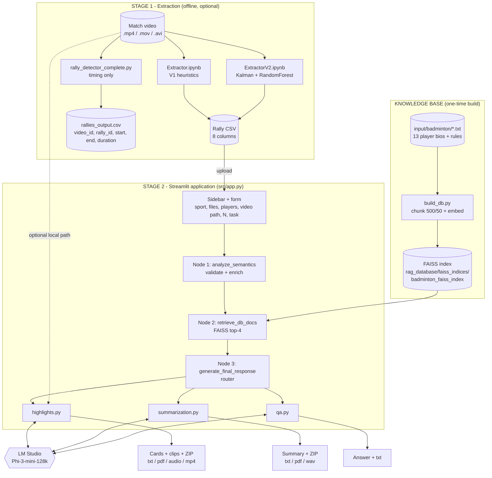
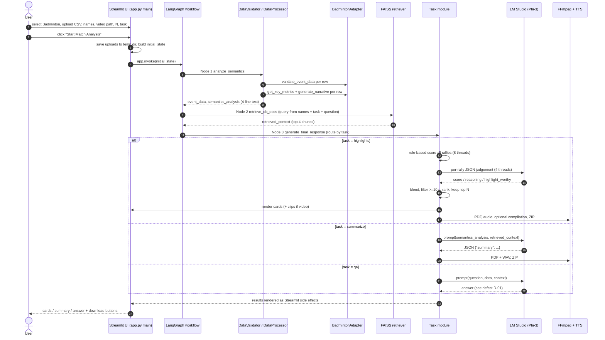
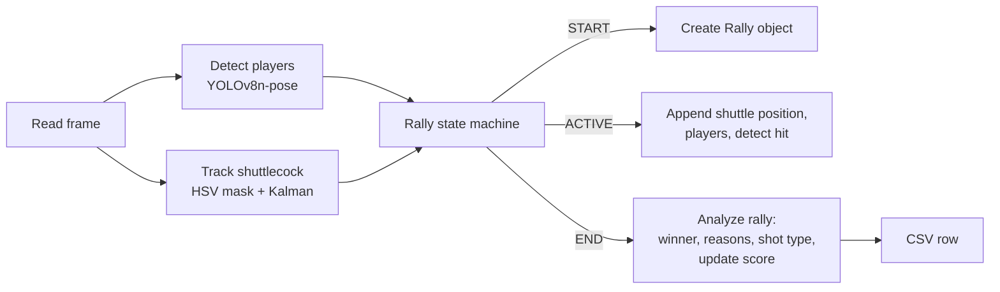
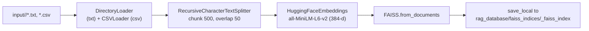
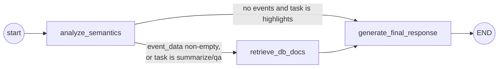
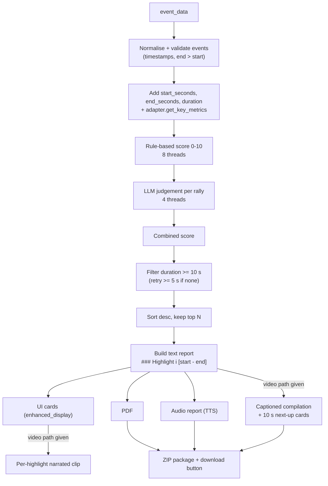

# Sports Video Analysis System - Complete Codebase Guide

> **Purpose of this document.** A single, end-to-end explanation of the entire project: what it is trying to achieve, every folder and file, every pipeline from raw video to final deliverable, how one-player and two-player usage differ, what "highlights" the system produces and how they are chosen, and an honest account of what is implemented, partial, broken or missing.
>
> **How it was produced.** Every source file was read (`src/`, `codebase/`, config, data, notebooks). Statements marked **(run)** were additionally confirmed by executing the project's own code on the bundled sample data on 2026-10-02. LM Studio was **not running** during that review, so no LLM-dependent behaviour was executed; those parts are described from the code and flagged as such.

---

## Table of Contents

1. [Executive Summary](#1-executive-summary)
2. [System at a Glance](#2-system-at-a-glance)
3. [Repository Map](#3-repository-map)
4. [The Data Contract (Rally CSV)](#4-the-data-contract-rally-csv)
5. [Pipeline A - Video to Rally CSV (Stage 1)](#5-pipeline-a---video-to-rally-csv-stage-1)
6. [Pipeline B - Knowledge Base / RAG Build](#6-pipeline-b---knowledge-base--rag-build)
7. [Pipeline C - The Application, Start to End (Stage 2)](#7-pipeline-c---the-application-start-to-end-stage-2)
8. [Task Pipelines in Depth](#8-task-pipelines-in-depth)
9. [One-Player vs Two-Player](#9-one-player-vs-two-player)
10. [Highlights: What Is Generated and How It Is Chosen](#10-highlights-what-is-generated-and-how-it-is-chosen)
11. [The Models and Where Each Is Used](#11-the-models-and-where-each-is-used)
12. [Outputs and Artefacts](#12-outputs-and-artefacts)
13. [Implementation Status Matrix](#13-implementation-status-matrix)
14. [Defect and Risk Register](#14-defect-and-risk-register)
15. [Extension Points and Suggested Next Steps](#15-extension-points-and-suggested-next-steps)
- [Appendix A - File-by-File Function Index](#appendix-a---file-by-file-function-index)
- [Appendix B - The LangGraph State Object](#appendix-b---the-langgraph-state-object)
- [Appendix C - Constants and Tunables](#appendix-c---constants-and-tunables)
- [Appendix D - Glossary](#appendix-d---glossary)

---

## 1. Executive Summary

### 1.1 What the project is

A **local, privacy-preserving sports-analytics tool for badminton** that converts the *structured data of a match* (one row per rally) into:

| Deliverable | Short description |
|---|---|
| **Ranked highlights** | The top *N* rallies (1-100), each with exact timestamps, a narrative sentence and an LLM-written "why this is exciting" explanation. |
| **Narrated video clips** | If you also supply the match video, each highlight is cut with FFmpeg and given a synthesized voice-over. |
| **Highlights package** | ZIP of text + PDF + audio (+ captioned compilation video). |
| **Match summary** | A narrative paragraph, exported as text, PDF and audio. |
| **Q&A assistant** | Questions about the match, intended to be answered from match data plus a knowledge base. |

### 1.2 The core idea

Watching a full match to find the best moments is slow. The project splits the problem in two:

1. **Understand the video once** (Stage 1) and write it down as a table - *when did each rally start and end, who won it, with which shot, why, and what was the score*.
2. **Work from the table** (Stage 2) - score every rally, let a local LLM add judgement, retrieve background knowledge about players and rules, and render the results as cards, documents, audio and video.

### 1.3 The most important things to know before reading further

| # | Fact | Why it matters |
|---|---|---|
| 1 | **The app's input is a rally CSV, not a video.** The video is optional and only used to cut clips. | A video alone cannot be analysed by the app; Stage 1 must produce the CSV first. |
| 2 | **Only badminton singles-style data (two sides, A and B) is supported.** There is no separate "one-player" pipeline and no doubles support. | See [section 9](#9-one-player-vs-two-player). |
| 3 | **Highlights are ranked by score, not categorised.** There is no taxonomy such as "smash winners" or "comebacks". | See [section 10](#10-highlights-what-is-generated-and-how-it-is-chosen). |
| 4 | **The summary LLM does not receive the rally data.** It receives four lines of statistics plus ~1000 characters of retrieved background. | Summaries are weakly grounded; see defect D-03. |
| 5 | **Q&A currently cannot return an LLM answer.** A prompt-variable mismatch triggers the fallback text, and the follow-up button calls an undefined function. | See defects D-01 and D-02. |
| 6 | **The Stage-1 extractors are heuristic prototypes** (colour thresholds, fixed court bounds, pose-index rules, and in V2 a random-forest trained on random noise). | Their CSVs need human review. |

### 1.4 Technology in one table

| Layer | Technology |
|---|---|
| UI | Streamlit 1.49 |
| Orchestration | LangChain 0.3, LangGraph 0.6 |
| LLM | Phi-3-mini-128k-instruct served by **LM Studio** (OpenAI-compatible, `http://127.0.0.1:1234/v1`) |
| Embeddings / retrieval | `sentence-transformers/all-MiniLM-L6-v2` (384-d) + FAISS (flat, CPU) |
| Speech | `pyttsx3` (system TTS: SAPI5 on Windows) |
| Video/audio processing | FFmpeg and ffprobe via `subprocess`, Pillow for caption images |
| Reports | ReportLab |
| Stage-1 vision | OpenCV, Ultralytics YOLOv8 (pose + detection), MediaPipe, filterpy Kalman filter, scikit-learn, optional Roboflow |

---

## 2. System at a Glance

### 2.1 Master architecture



### 2.2 The whole story, start to end (narrative)

1. **Record/obtain a badminton match video.**
2. **Stage 1.** Run an extractor notebook in Google Colab. It watches the video frame by frame, finds the two players and the shuttlecock, detects when rallies start and end, guesses who won and why, labels the decisive shot, keeps a running score, and writes `badminton_analysis*.csv`.
3. **One-time setup.** Install the app, start LM Studio with Phi-3, and build the FAISS index from the biographies and rules in `input/badminton/`.
4. **Open the app.** Pick *Badminton*, upload the CSV, optionally type player names and a local video path, choose how many highlights, choose a task (Summary / Highlights / Q&A), press **Start Match Analysis**.
5. **Pipeline.** LangGraph runs three nodes: validate and enrich the CSV, retrieve background documents, then route to the task module.
6. **Task module.** For *Highlights*: score each rally by rules, ask the LLM to judge each rally, blend the scores, keep the top *N*, render cards, build PDF/audio, optionally cut narrated clips and a captioned compilation, and offer a ZIP download. *Summary* and *Q&A* call the LLM with the analysis text and retrieved context.
7. **Deliver.** Everything is also written to `output/` on disk.

### 2.3 End-to-end sequence (Stage 2)



---

## 3. Repository Map

Root folder: `SportsVideoAnalysis/` (a ZIP download is named `SportsVideoAnalysis-main/`).

### 3.1 Top level

| Path | Role |
|---|---|
| `README.md` | Install / usage guide. |
| `CODEBASE_GUIDE.md` | This document. |
| `LICENSE.txt` | MIT, copyright 2025 M ShreeRaj. |
| `requirements.txt` | 213 pinned packages. **UTF-16 LE encoded** (pip reads it; many editors show garbage). Includes Windows-only `pywin32` and `pypiwin32`. Does **not** include `ultralytics`, `roboflow`, `mediapipe`, `filterpy` (Stage 1 only). |
| `.gitignore` | Standard Python ignores plus `output/`, media files, `*.pkl`, `.env`. |
| `src/` | The application. |
| `input/badminton/` | RAG source documents. |
| `semantics/` | Two sample rally CSVs. |
| `rag_database/` | FAISS indices (see 3.5). |
| `codebase/` | Stage-1 extraction code and sample outputs. |
| `output/` | Created at runtime (git-ignored). |
| `venv/`, `*.log` | Only present if you ran an install locally. |

### 3.2 `src/` - application code

| File | Lines (approx.) | Responsibility |
|---|---|---|
| `app.py` | 1,150 | Streamlit UI, theme CSS, LangGraph state + 3 nodes + graph assembly, auth, DB-rebuild hook, CLI flag `--rebuild-db`. |
| `highlights.py` | 1,180 | The largest task module: timestamp parsing, rule scoring, LLM judging, selection, narrative, display, PDF/audio/video/ZIP packaging. |
| `summarization.py` | 320 | Summary prompt, JSON clean-up, display, PDF/audio/ZIP. |
| `qa.py` | 170 | Q&A prompt, generation, text export. |
| `build_db.py` | 100 | Builds one FAISS index per sport. |
| `config/badminton.json` | 100 | Required CSV columns, terminology, scoring tables, three prompts, validation rules. |
| `core/validation.py` | 250 | `DataValidator` (CSV to dict rows) and `DataProcessor` (enrich + stats). |
| `core/llm_provider.py` | 85 | LLM abstraction; only `LMStudioProvider` exists. |
| `core/ai_analyzer.py` | 70 | **Unused** duplicate of the per-rally AI analysis. |
| `core/excitement_scorer.py` | 140 | **Unused** duplicate of the rule scorer (this one reads the config correctly). |
| `sports/base.py` | 120 | `SportConfig` and abstract `SportAdapter`. |
| `sports/factory.py` | 150 | `SportFactory`: registry, "available" and "coming soon" lists. |
| `sports/badminton/adapter.py` | 270 | All badminton-specific logic (validation, 0-1 scoring, metrics, narrative). |
| `utils/video_highlight_processor.py` | 490 | Per-clip: cut with FFmpeg, TTS narration, fit narration to clip length, mux. |
| `utils/video_extractor.py` | 680 | Whole-video compilation: parse the highlights text, cut segments, burn captions, add 10-second "Coming Up Next" cards, concatenate. |
| `utils/enhanced_display.py` | 115 | Streamlit highlight cards (expanders, video player, AI-analysis box). |
| `utils/pdf_generator.py` | 185 | ReportLab PDF for highlights or summary. |
| `utils/audio_generator.py` | 160 | pyttsx3 spoken report. |
| `utils/text_processing.py` | 95 | Emoji stripper, time-to-words, random narrative templates. |
| `__init__.py` files | - | Re-export helpers with a `sys.path` fallback so modules can be imported in more than one way. |

> **Import convention.** Modules import each other as top-level names (`from highlights import ...`, `from core.llm_provider import ...`). This works because Streamlit puts the script's folder on `sys.path`. Always launch from `src/`.

### 3.3 `input/badminton/` - RAG corpus (14 files, ~45 KB)

| Type | Files |
|---|---|
| Rules | `Badminton Rules.txt` - best-of-three, 21 points, rally-point scoring, deuce at 20-20, cap at 30, service rules (~1.8 KB). |
| Women's singles profiles (6) | An Se Young, Carolina Marin, Neslihan Yigit, Pornpawee Chochuwong, Pusarla V. Sindhu, Ratchanok Intanon. |
| Men's singles profiles (7) | Viktor Axelsen, Anders Antonsen, Anthony Sinisuka Ginting, Chou Tien Chen, Kento Momota, Ng Ka Long Angus, Rasmus Gemke. |

Each profile is a single long paragraph (about 3-4 KB) covering birth data, titles, playing style and career. **Only these 13 players have background context** in the knowledge base.

### 3.4 `semantics/` and `codebase/outputs/` - sample data

| File | Rows | Status when fed to the app **(run)** |
|---|---|---|
| `semantics/set1.csv` | 42 | **Valid.** Full game: first rally 07:00, final score 22-20 (a deuce game). Mixed time formats (see 4.3). |
| `semantics/set2.csv` | 33 | **Rejected** - header is `win_point_player,win_reason,...` with **no `start_time`/`end_time` columns**. Final score 21-12. |
| `codebase/outputs/sample.csv` | 42 | Only the first **4** rows are real (07:00-08:29, a prefix of `set1.csv`); **38 rows are completely blank** and are silently dropped. |
| `codebase/outputs/badminton_analysis.csv` | 4 | Valid; V1 extractor demo output (score 2-2). |
| `codebase/outputs/badminton_analysis_enhanced.csv` | 5 | Valid; V2 extractor demo output (score 2-3); uses `net_shot`. |
| `codebase/outputs/rallies_output.csv` | 8 | Different schema (`video_id, rally_id, start_time, end_time, duration`); **not** app input. |

Vocabulary seen across the samples: shots - `smash` (17), `net shot` (16), `push` (15), `cross-court net shot` (10), `lob` (7), `return net` (5), `defensive return drive` (4), `drop` (4), `drive`, `back-court drive`, `defensive return lob`, `rush`, `wrist smash`, `net_shot`; win reasons - `opponent hits the net`, `opponent goes out of bounds`, `wins by landing`, `opponent fails to clear the net`, `wins by placement`.

### 3.5 `rag_database/`

| Path | State |
|---|---|
| `faiss_indices/badminton_faiss_index/index.faiss` | Present but **incomplete**: LangChain's `FAISS.load_local` also needs `index.pkl` (the document store), which is missing. File size 164,397 B is consistent with ~107 vectors of 384 float32 dimensions (an inference from size). Must be rebuilt. |
| `faiss_index/index.faiss` | Legacy, unused by any code. |

### 3.6 `codebase/code/` and `codebase/outputs/rally_detector_complete.py`

Stage-1 programs; detailed in [section 5](#5-pipeline-a---video-to-rally-csv-stage-1).

---

## 4. The Data Contract (Rally CSV)

### 4.1 Schema

Defined by `required_columns` in `src/config/badminton.json`. **All eight must be present as column headers.**

| Column | Type | Example | Consumed by |
|---|---|---|---|
| `start_time` | `MM:SS` / `MM:SS:00` / `HH:MM:SS` | `07:00` | Duration, narrative, clip cut, PDF, ranking filter. |
| `end_time` | same | `07:22` | Same. |
| `win_point_player` | text | `Ratchanok Intanon` | Winner on cards, narrative, audio. |
| `win_reason` | text | `opponent hits the net` | Narrative; win-shot bonus (substring match). |
| `ball_types` | comma-separated text | `smash, drop` | Shot variety; exciting-shot bonus; key actions on cards. |
| `lose_reason` | text | `hits the net` | Present in the contract; **not used by any scoring or display code**. |
| `roundscore_A` | integer | `11` | Close-game bonus, match-point bonus, game phase. |
| `roundscore_B` | integer | `9` | Same. |

### 4.2 Validation behaviour **(run)**

Performed by `DataValidator` using `BadmintonAdapter.validate_event_data`:

1. File must be UTF-8 and non-empty, with all required headers; otherwise the **whole file** is rejected with `Missing required columns: ...`.
2. A row is **kept** only if `start_time` and `end_time` are non-empty and match the regex `^(\d{1,2}):(\d{2})(?::(\d{2}))?$` with captured groups interpreted as `minutes:seconds[:hours]`, requiring minutes <= 59, seconds <= 59 and the third group <= 23; and, if present, both scores parse as integers.
3. Everything else is a silent skip (a `[WARNING]` is printed in the terminal).
4. Multiple uploaded CSVs are merged into one event list in directory-listing order.

### 4.3 Time-format quirks **(run)**

The regex's third group is treated as **hours**, which makes the supported formats unintuitive:

| Value | Accepted? | Reason |
|---|---|---|
| `07:00` | Yes | Plain MM:SS. |
| `28:58:00` | Yes | Third group `00` is "hours = 0"; the real meaning (MM:SS:00) is only understood by `highlights.parse_timestamp`. |
| `01:05:10` | Yes | Third group `10` <= 23. |
| `01:05:30` | **No** | Third group `30` is read as 30 hours. Real `HH:MM:SS` values fail whenever the seconds field exceeds 23. |
| `75:10` | **No** | Minutes > 59. |

Practical consequence: **footage longer than about an hour, expressed as `HH:MM:SS`, will be partly rejected.** The sample `set1.csv` uses `MM:SS` for the first 31 rows and `MM:SS:00` for the remaining 11 (from `24:38:00` onward); this convention is what the code is tuned for.

Four different parsers coexist and **disagree** on `MM:SS:00`:

| Parser | `28:58:00` read as |
|---|---|
| `highlights.parse_timestamp` (heuristic: first field > 23 means minutes) | 1,738 s - correct |
| `video_highlight_processor.parse_timestamp` | 104,280 s (28 h 58 m) - wrong |
| `BadmintonAdapter._time_to_seconds` | 104,280 s - wrong |
| `video_extractor` compilation regex | does not match at all |

This is documented as defect D-06.

---

## 5. Pipeline A - Video to Rally CSV (Stage 1)

Stage 1 lives in `codebase/` and is **not imported by the app**. It exists to manufacture the CSV the app consumes.

### 5.1 Overview of the three programs

| Program | Environment | Output | Purpose |
|---|---|---|---|
| `Extractor.ipynb` (V1) | Google Colab | 8-column CSV | Baseline end-to-end extractor using rules. |
| `ExtractorV2.ipynb` | Google Colab | 8-column CSV + `match_summary.csv` + `shot_classifier_enhanced.pkl` | Improved tracking, court detection, ML shot classifier. |
| `rally_detector_complete.py` | Local CLI | `rallies_output.csv` (times only) | "Phase 1": rally timing with an optional YOLO / Roboflow shuttlecock model and an evaluation routine. |

Both notebooks assume **exactly two players**, side-by-side ordering (the left-most detected person is "A", the next is "B"), and a camera view where the net is roughly at the horizontal centre of the frame.

### 5.2 Per-frame loop shared by V1 and V2



### 5.3 V1 (`Extractor.ipynb`) component by component

**Cell 0-2**: install `opencv-python-headless numpy ultralytics torch torchvision mediapipe scikit-learn pandas`; import; upload the video through `google.colab.files`.

**Cell 3 - classes**

| Class / method | What it does |
|---|---|
| `BadmintonAnalyzer.__init__` | Opens the video (`cv2.VideoCapture`), reads fps/size, loads `yolov8n-pose.pt` and `yolov8n.pt`, creates a MediaPipe Pose (not actually used later), and instantiates the tracker, court detector, shot classifier and rally detector. Scores start at 0-0. |
| `analyze_video` | Reads the first frame to detect the court, rewinds, then loops over every frame: players, shuttlecock, rally state; builds `Rally` objects; prints progress every 600 frames. |
| `detect_players_with_pose` | Runs YOLOv8-pose; for each person keeps keypoints with confidence > 0.5, builds a bounding box from them, computes `pose_features`, then **sorts by horizontal centre and keeps the first two**. |
| `extract_pose_features` | Sets `arm_raised` if `keypoints[15].y < keypoints[11].y` and `arm_extended` if `|kp15 - kp13| > 50`. In the COCO-17 layout used by YOLOv8-pose, indices 11/13/15 are left hip / left knee / left ankle, so these "arm" tests actually look at the leg (the code seems to assume 15 = wrist, 13 = elbow). |
| `analyze_rally` | Calls the winner, shot and reason routines, increments `score_a` or `score_b`, returns one CSV row dict. |
| `determine_rally_winner` | Looks at the **last shuttle position**: if the landing zone is `out_of_bounds`, `net` or `below_net`, the **last hitter loses**; otherwise the last hitter wins. No shuttle data means "A wins". |
| `determine_reasons` | Maps landing zone to text: `opponent goes out of bounds`, `opponent hits the net`, `opponent fails to clear the net`, `wins by landing`, else `opponent error`. |
| `Rally` | Collects shuttle positions, player positions and "shots". `detect_shot`: a hit is registered when a player's centre is within **100 px** of the shuttle **and** `arm_raised`; the hitter side is the player's index (0 = A, 1 = B). `get_last_hitter` defaults to B when unknown. |
| `ShuttlecockTracker` | White HSV mask (`[0,0,200]`-`[180,30,255]`), morphological open/close, contours of area 5-500 px, returns the centroid of the first acceptable of the 5 largest; if none, extrapolates with an OpenCV Kalman filter for up to 30 lost frames. |
| `CourtDetector` | Canny + Hough lines on the first frame only (the lines are stored but then ignored); bounds are **fixed fractions** of the frame (x: 10%-90%, y: 20%-80%); the net is the frame's horizontal centre. `get_landing_zone`: outside bounds = `out_of_bounds`; within 50 px of the net and low in frame = `net`; within 30 px of the net = `below_net`; else `valid`. |
| `ShotClassifier` | Rules on the last 10 shuttle positions: strong upward trend gives `lob` (large vertical range) or `clear`; strong downward trend gives `smash` (if the last hit had `arm_raised`) or `drop`; wide horizontal range gives `drive`; near the bottom gives `net shot`; else `push`. Fewer than 3 positions gives `net shot`; no detected shots gives `push`. |
| `RallyDetector` | `IDLE` to `START` after the shuttle is seen for more than 5 consecutive frames; `ACTIVE` while seen; `END` after it is unseen for `fps x 1` frames (1 second). |

**Output**: `badminton_analysis.csv` with the eight columns; `format_time` writes `MM:SS` (or `HH:MM:SS` after 60 minutes).

### 5.4 V2 (`ExtractorV2.ipynb`) - what changed

| Area | V1 | V2 |
|---|---|---|
| Extra packages | - | `filterpy`, `scipy`, `pillow` |
| Shuttle detection | White mask only | White **and yellow** masks, area 5-800, scored by circularity, aspect ratio and size; picks the best candidate |
| Shuttle tracking | OpenCV 4-state Kalman | `filterpy` 6-state Kalman (position, velocity, acceleration); rejects detections > 200 px from the prediction; predicts through up to **45** lost frames |
| Court | Fixed fractions | Hough lines grouped into near-horizontal and near-vertical; bounds from line extremes; 20 px margin; net width 60 px; builds a mask |
| Rally detection | Shuttle visible > 5 frames starts; 1 s unseen ends | Starts after **0.2 s** of shuttle presence; ends after **1.5 s** absence |
| Pose features | Left-side indices (15/13/11, see above) | Right arm: wrist 10, elbow 8, shoulder 6 (raised if wrist above shoulder; extended if wrist-elbow > 60 px); `jumping` if right ankle is more than 50 px above the knee; requires >= 6 confident keypoints |
| Hit detection | within 100 px and `arm_raised` | within **120 px** and (`arm_raised` or `arm_extended` or `jumping`); counts hits |
| Unknown last hitter | defaults to B | defaults to A |
| Winner | landing-zone rule | Same, plus: if the shuttle fell more than 100 px in the last 5 positions, the **last hitter wins** |
| Win reasons | 5 strings | adds `wins with powerful shot` (shuttle speed > 20) and `wins by placement` (else) for valid landings |
| Shot classifier | Rules | `RandomForestClassifier(100 trees)` over 10 trajectory features, with the rule set as fallback when `max probability < 0.3` |
| Speed control | none | `SKIP_FRAMES` setting; ETA in progress output |
| Extras | - | Per-shot statistics, `match_summary.csv`, pickled classifier |

**Important caveat about the V2 classifier.** `initialize_model()` fits the forest on **1,000 rows of `np.random.randn` with random labels** ("synthetic training data" in a comment). It therefore carries no real signal. When the highest predicted probability is below 0.3 the rule-based fallback is used; otherwise the output is essentially an arbitrary label from the 12-class vocabulary (`smash, clear, drop, net_shot, drive, lob, push, cross_court, lift, flick, rush, defensive_return`). A `fine_tune(training_data)` method exists for labelled rallies but is never called.

Note the **vocabulary drift**: V1 writes `net shot`, V2 writes `net_shot`; the app's scoring tables key on `net shot`, `cross-court net shot`, etc., so V2 labels like `net_shot` or `cross_court` do not receive the same bonuses.

### 5.5 Score semantics produced by Stage 1

Every detected rally awards **one point to A or B**, accumulated over the **entire video**. There is no concept of a *game*; the score never resets at 21, and no side-switch, interval or service logic exists. The app's "match point" bonus (either score >= 20) therefore fires for every rally after a side reaches 20, in any game.

### 5.6 `rally_detector_complete.py` ("Phase 1: rally timing only")

| Component | Behaviour |
|---|---|
| `RallyState` | Enum `IDLE`, `RALLY_ACTIVE`, `RALLY_ENDING`. |
| `ShuttlecockDetector` | Chooses one backend: **Roboflow hosted model** (default; `shuttlecock-cqzy3` v1, needs internet and the `roboflow` package), **local YOLO** (`--model-path`, else `shuttlecock.pt`, else `yolov8n.pt`), or **HSV colour only** (`--no-yolo`). Colour detection is always added as a complement: white mask, area 10-500, circularity > 0.3. Returns the single highest-confidence detection. |
| `RallyDetector.process_frame` | `IDLE` to `RALLY_ACTIVE` the first time a shuttle is detected. In `ACTIVE`, positions are kept (last 5); if the average movement over them falls under 10 px the state becomes `RALLY_ENDING`; a shuttle missing for longer than 1.5 s ends the rally. In `ENDING`, renewed movement cancels the end; otherwise after 0.5 s the rally ends. Rallies shorter than **2.0 s** are discarded. |
| `process_video` | Reads the video, emits `start`/`end` events, optional live visualisation (`--visualize`) and annotated video (`--save-video`), then writes `video_id, rally_id, start_time, end_time, duration`. Returns `None` with a warning if no rallies were found. |
| `evaluate_predictions` | Compares predictions with a ground-truth CSV using temporal IoU > 0.5 to compute precision, recall, F1 and average IoU. |

This program has no notion of winner, shot or score, so its output **cannot be uploaded to the app** directly.

> **Security note.** A Roboflow API key is hard-coded as the default in this file. Treat it as exposed: rotate it and remove it from the source.

### 5.7 What Stage 1 can and cannot do

| Capability | V1 | V2 | Detector script |
|---|---|---|---|
| Rally start/end times | Yes | Yes | Yes |
| Winner of each rally | Heuristic | Heuristic (slightly refined) | No |
| Win/lose reason | 5 strings | 6 strings | No |
| Shot label | 13-label list, but only 7 are reachable by the rules (`push, net shot, lob, clear, smash, drop, drive`) | RF (noise) + rules | No |
| Running score | Yes (single cumulative count) | Yes | No |
| Game segmentation | No | No | No |
| Doubles | No | No | No |
| Single-player (solo practice) footage | No (expects two players) | No | Timing only |
| Evaluation against ground truth | No | No | Yes |

---

## 6. Pipeline B - Knowledge Base / RAG Build

`src/build_db.py`, run via `python src/build_db.py` or the admin **Rebuild Database** button.



Step by step:

1. `build_database()` creates `rag_database/faiss_indices/` and loops over `SUPPORTED_SPORTS = ['badminton','soccer','tennis','volleyball']`. Only badminton has an input folder; the other three print "Sport directory not found" and return `False`. Overall success is `True` if at least one sport is built.
2. `build_database_for_sport` loads `**/*.txt` with the default `DirectoryLoader` loader and `**/*.csv` with `CSVLoader` (UTF-8). Dropping a rally CSV into `input/badminton/` would therefore also feed the knowledge base.
3. Splits into 500-character chunks with 50 overlap (the corpus is 45 KB, so on the order of 100 chunks).
4. Embeds with `all-MiniLM-L6-v2` (downloaded once from the Hugging Face Hub, ~90 MB; no API key needed for this public model).
5. Saves `index.faiss` + `index.pkl`.

**Windows caveat (observed on the review machine).** The default `DirectoryLoader` text loader goes through the `unstructured` package, which imports `python-magic`/`python-magic-bin`. On the review machine `import magic` hung and the build then terminated with a segmentation fault at "0/14" files. Swapping to `TextLoader` for `.txt` files avoids this (a code change; not yet made).

**Retrieval at query time** (`app.retrieve_documents`):

| Query part | Included when |
|---|---|
| `Information about <player_names>` | player string non-empty (always non-empty; see section 9) |
| `summary of the match` / `key moments and highlights` / `answer to the question` | task is summarize / highlights / qa |
| the user's question text | Q&A with a question |
| first two default queries of the sport | adapter provides them (see D-05: only one is ever returned) |

The query parts are joined with `. ` and sent to `retriever.get_relevant_documents`, which returns the **top 4** chunks (the default `k`). The chunks are formatted as `Document 1: ... Document 2: ...` into `retrieved_context`.

**Where the retrieved context is actually used:** only by the **summary** prompt (truncated to the first 1,000 characters) and the **Q&A** prompt (which currently fails, D-01). The **Highlights** task retrieves context but never reads it.

---

## 7. Pipeline C - The Application, Start to End (Stage 2)

### 7.1 Process start-up

```
streamlit run app.py          (working dir = src/)
  -> imports: LangChain/LangGraph, highlights, summarization, qa, core.validation, sports.factory
  -> sports.factory auto-registers BadmintonAdapter
  -> main() is executed on every Streamlit rerun
```

Module-level constants: `PROJECT_ROOT` (parent of `src/`), `DB_FAISS_BASE_PATH`, `EMBEDDING_MODEL`, `LM_STUDIO_BASE_URL="http://127.0.0.1:1234/v1"`, `LM_STUDIO_MODEL="phi-3-mini-128k-instruct"`. `load_dotenv` is imported but **never called**.

`python app.py --rebuild-db` is a CLI shortcut that runs `rebuild_database()` and exits; otherwise `main()` runs.

### 7.2 `main()` - the interface

**Sidebar**

| Element | Behaviour |
|---|---|
| Sport selector | Options: `Badminton` (available) and `Soccer`, `Tennis`, `Volleyball` (*Coming Soon*). Selecting anything but badminton shows a warning and sets `sport_adapter = None`. |
| Test AI Connection | Calls `load_llm()` (a Streamlit-cached `ChatOpenAI`) and sends the word "Hello" to prove LM Studio is reachable. |
| Admin Login | Form accepting `admin` / `admin` (hard-coded in `check_auth`). When authenticated: a **Logout** button and **Rebuild Database**. |

**Main area**

| Control | Stored as | Notes |
|---|---|---|
| File uploader | `uploaded_files` | Accepts txt, json, csv, wav, mp3, flac; **only CSV is processed**. |
| Player 1 / Player 2 | `player1`, `player2` | Free text. See section 9. |
| Match Video URL | `video_url` | Despite the label, a **local file path**. Used by Highlights only. |
| Number of highlights | `highlights_limit` | 1-100, default 7; mirrored in `st.session_state`. |
| Task | `task` | `summarize`, `highlights`, `qa`. |
| Question | `question` | Text area shown only for Q&A. |
| **Start Match Analysis** | - | Runs the pipeline (7.3). |

The "Analyzing: ..." card summarises the player string and whether a video was given.

### 7.3 Pressing **Start Match Analysis**

1. Guards: at least one uploaded file; a sport adapter must exist (else `st.stop()`).
2. `save_uploaded_files` writes the uploads to a fresh temp directory `streamlit_sports_analysis_*`.
3. `create_workflow()` (cached with `st.cache_resource`) builds and compiles the graph (7.4).
4. The initial state is assembled (Appendix B) and `app.invoke(initial_state)` runs inside a spinner.
5. For Q&A, the final state is saved to `st.session_state.analysis_state`.
6. In a `finally` block the temp directory is deleted unless the task was Q&A.

### 7.4 The LangGraph workflow



**Node 1 - `analyze_semantics`**

1. Requires `sport_adapter` and a valid `semantics_path`.
2. Collects every `*.csv` in the temp directory; none means the error "No CSV files found".
3. For each file runs `DataValidator.validate_csv_files` (section 4). Per-file errors are shown with `st.error` and the file is skipped.
4. `DataProcessor.process_rally_data` enriches every event: it adds `computed_metrics` (from `adapter.get_key_metrics`), an `excitement_score` on the **0-1 scale** from `adapter.calculate_excitement_score`, `sport`, and a `narrative` from `adapter.generate_narrative`.
5. `generate_summary_stats` computes totals, average excitement, average/max duration and a high/medium/low distribution.
6. It then produces the **only text the downstream LLM prompts receive about the match**:

```
Sport: Badminton
Events Processed: 42
Average Excitement Score: 0.46
Data Quality: Good (1/1 files valid)
```
   **(run, with `semantics/set1.csv`)**

Returned: `event_data`, `semantics_analysis`, plus extra keys (`processed_files`, `event_count`, `summary_stats`, `sport_adapter`).

**Node 2 - `retrieve_db_docs`**: loads the sport's FAISS retriever (`@st.cache_resource`, `allow_dangerous_deserialization=True`), builds the query (section 6) and returns `retrieved_context`. If the index is missing or fails to load, the context becomes an error string and the pipeline continues.

**Node 3 - `generate_final_response`**: routes by `task`:

| `task` | Call | Notes |
|---|---|---|
| `summarize` | `generate_summarization_response(state_copy)` | `highlight_rallies` is set to `event_data` but the summarizer never reads it. |
| `highlights` | `generate_highlights_response(state)` | Uses `event_data` and `highlights_limit`. |
| `qa` | `generate_qa_response(state_copy)` | Only the rally **count** is used. |

The node returns `None` on success. All results reach the user as **Streamlit side effects** (`st.markdown`, `st.video`, `st.download_button`, ...) executed inside the task modules. Only errors are returned as `{"generation": message}`.

### 7.5 Streamlit re-run behaviour

Everything displayed after **Start Match Analysis** lives inside that button's `if` block. Clicking another widget triggers a Streamlit rerun that re-evaluates the script without the button being `True`, so results disappear unless saved in `session_state` (only Q&A does so). The files in `output/` remain on disk.

---

## 8. Task Pipelines in Depth

### 8.1 Highlights pipeline (`highlights.generate_highlights_response`)



**Step 1 - normalise** (`generate_highlights_response`). Accepts a list of dicts (normal), a dict with `events`, a JSON string or a log-style string (`parse_rallies_from_text`, a legacy branch). Required fields come from the config's eight columns; a row missing any is kept only if `adapter.validate_event_data` still passes, and missing fields are filled with `'Unknown'`. Timestamps go through `parse_timestamp`; rows with `end <= start` are dropped. Each valid event gets `start_seconds`, `end_seconds`, `duration` and the adapter's key metrics.

**Step 2 - rule score** (`calculate_excitement_score`, 0-10). Detailed in [section 10.2](#102-the-rule-based-score-exact-formula). Runs in a thread pool of up to 8.

**Step 3 - LLM judgement** (`parallel_ai_analysis` / `analyze_rally_with_ai`). For **every** rally (not just candidates) the module builds `ChatPromptTemplate | LLM | JsonOutputParser` using the default prompt, because the config override is never applied (D-05), and expects a JSON object:

| Key | Meaning |
|---|---|
| `score` | 0-10 excitement from the model |
| `reasoning` | ~60-word explanation; later used on the card, in the PDF, and as the video narration |
| `highlight_worthy` | boolean |

If the call fails or the JSON is invalid, the fallback is `ai_score = excitement_score / 10`, `ai_reasoning = "AI analysis unavailable"`, `highlight_worthy = excitement_score > 5`. Up to 4 requests run concurrently (LM Studio will typically serialise them). If the LLM provider cannot even be created, the stage is skipped and rule-based scoring alone is used.

**Step 4 - combine** (`select_highlights`): `combined = excitement_score x 0.7 + ai_score x 10 x 0.3`.
- With the **fallback** (`ai_score` in 0-1) this is the intended 70/30 blend.
- With a **working LLM** `ai_score` is 0-10, so the second term becomes `ai_score x 3` (up to 30). The model's number then outweighs the rule score roughly 4:1 (defect D-04).

**Step 5 - filter and rank.** Keeps rallies with `duration >= 10` s (if none survive, a second pass uses 5 s); sorts by `combined_score` descending; keeps `max_highlights` = the user's *N* (15 if unset).

**Step 6 - text report.** Builds Markdown:

```
# Match Highlights - <players>
---
## Match Introduction
The match begins with player introductions and preparation.

### Highlight 1 [07:00 - 07:22]
<adapter narrative>
*<ai reasoning, max 100 words>*
...
**Total Highlights:** N
```
The adapter narrative looks like `27 seconds rally won by X featuring lob, push due to <win_reason> at 28:58`.

**Step 7 - UI** (`utils/enhanced_display`). A title, then one expander per highlight (first expanded) showing duration, winner, either an embedded clip or the "Key Actions" text, and an "AI Analysis" panel (info box, or a warning if unavailable). A caption states "Showing Top N highlights" and warns when fewer than N exist.

**Step 8 - per-highlight clip** (only with a readable video path; `video_highlight_processor.extract_and_narrate_highlight`), one clip at a time while the page renders:

1. FFmpeg cuts `[start, start + duration]` with H.264/AAC.
2. If a reasoning text exists, pyttsx3 writes a WAV (female/Zira voice preferred, rate 160) and FFmpeg converts it to MP3.
3. `combine_video_with_narration` measures both durations; if the narration is shorter it is padded with silence, if longer it is sped up with `atempo`; then the video stream is copied and the narration becomes the **only** audio track (`-shortest`).
4. With no narration text the clip is **muted** (original audio removed).
5. Output: `output/highlight_clips/<players>_highlight_<n>_<timestamp>.mp4`, shown by `st.video`.

**Step 9 - files.** Writes `<players>_highlights_<ts>.txt`; builds the PDF (`pdf_generator`: title, "MATCH INTRODUCTION", then per highlight "HIGHLIGHT i: start - end / Player: / Analysis:") and the spoken audio (`audio_generator`: welcome line, one randomly chosen narrative template per highlight, occasional transition phrases every second highlight, closing line).

**Step 10 - compilation video** (only with a video; `video_extractor.create_highlights_compilation`):

1. Re-parses the saved text file for `[MM:SS - MM:SS]` headings and the following description line.
2. For each segment (up to 4 in parallel): cut, clamp to the video's length, burn a caption bar (Pillow-rendered PNG overlay shown from 0.5 s to the end minus 0.5 s) at the bottom, then append a **10-second black card** reading `Coming Up Next: <next description>...` (or `End of Highlights`).
3. Concatenates all segments with `libx264 / aac / crf 23 / 30 fps`.
4. Segments whose headings use `MM:SS:00` times do not match the regex and are skipped (D-06).

**Step 11 - ZIP.** `Highlights_Package_<ts>.zip` with whichever of text, audio, compilation video and PDF exist, a download button, and a "Process Another Match" button (which only reruns the script).

### 8.2 Summary pipeline (`summarization.generate_summarization_response`)

1. Picks the summarisation prompt from the config (`analysis.summarization_prompt`) - a request for **one paragraph of about 350-400 words** returned as JSON `{"summary": ...}`. (The fallback prompt in code asks for 150-200 words.)
2. Fills it with `semantics_analysis` (cut to 2,500 chars - in practice the 4-line stats text) and `retrieved_context` (cut to 1,000 chars - roughly the first 2 chunks of player/rules text).
3. Creates a fresh `LMStudioProvider` and runs `prompt | llm | StrOutputParser`.
4. `parse_json_response` strips code fences, tries `json.loads`, then the substring between the first `{` and last `}`, then falls back to plain text; additional regex clean-up removes JSON residue and quotes.
5. Displays "Match Summary" with `st.write`.
6. Writes `<players>_performance_summary_<ts>.txt`, creates a PDF (title "BADMINTON MATCH SUMMARY" + "MATCH OVERVIEW") and a WAV via the shared utilities, zips the PDF and audio into `output/downloads/*_assets.zip`, and shows a download button.

Observation: the prompt contains **no player names, no scores and no rally facts**. The model can only restate generalities from the retrieved biography text; any specifics in the output would be invented. Fixing this (passing the top rallies or per-player stats) is the single highest-value improvement (see section 15).

### 8.3 Q&A pipeline (`qa.generate_qa_response`)

Intended flow: use `analysis.qa_prompt` from the config, fill `{question}`, match data, `{retrieved_context}`, `{player_names}`, call the LLM, append helper text, save a `.txt`, offer a download.

Actual behaviour:

| Step | Result |
|---|---|
| Prompt from config needs `question`, `enhanced_semantics`, `retrieved_context`, `player_names` | The code supplies `semantics_analysis`, `question`, `player_names` only. LangChain raises *missing variables {enhanced_semantics, retrieved_context}* **(run)**. |
| `except` inside `st.spinner` | The error is caught and a generic fallback answer is shown ("Full Q&A analysis couldn't be completed ..."), followed by the extra text and a save/download. |
| Initial Q&A with no question | Appends suggested follow-up questions and "Based on analysis of N key rallies". |
| Follow-up question button | `app.py` calls `generate_qa_response(follow_state)`, a name that is **not defined** in `app.py` (the import is aliased `generate_qa_response_external`) - a `NameError`. |

So today, Q&A shows fallback text and cannot be followed up. Even once repaired, the model would see only the 4-line stats text as "match data".

### 8.4 LLM access layer

| Piece | Behaviour |
|---|---|
| `LLMProvider` (ABC) | Contract: `generate_response`, `invoke`. |
| `LMStudioProvider` | Lazily creates `ChatOpenAI(model, base_url, api_key="lm-studio", temperature=0.3, max_tokens=2048, timeout=120)`. |
| `LLMProviderFactory.create_provider("lm_studio")` | The only provider type; anything else raises `ValueError`. |
| Per-module `load_llm()` | `summarization`, `qa`, `highlights` each define their own, creating a new provider per call; `app.load_llm()` is separate and is the only one that tests the connection. |

---

## 9. One-Player vs Two-Player

This is the area most likely to be misunderstood, so it is stated precisely.

### 9.1 The headline

> **There is exactly one pipeline.** "One-player" and "two-player" are not separate modes in the code. The difference is limited to *how the player-name string is built* in the UI. The underlying data model is always two-sided (`win_point_player`, `roundscore_A`, `roundscore_B`).

### 9.2 What the UI does (`app.py`, name construction)

| Player 1 | Player 2 | `player_names` produced | Retrieval query starts with |
|---|---|---|---|
| filled | filled | `P1 vs P2` | `Information about p1 vs p2` |
| filled | empty | `P1 vs opponent` | `Information about p1 vs opponent` |
| empty | filled | `P2 vs opponent` | `Information about p2 vs opponent` |
| empty | empty | `the badminton players` | `Information about the badminton players` |

### 9.3 Where the name string flows

| Consumer | Effect |
|---|---|
| FAISS query | Embedding similarity pulls the profile chunks of the named player(s) (top 4 overall). With two names, the 4 chunks are shared between both biographies; with one name, mostly that player's biography. |
| Highlights text, PDF title, audio intro/outro | Display only. |
| Output file names | Sanitised into the prefix of every saved file. |
| Q&A prompt | `{player_names}` (currently unreachable, D-01). |
| Summary and per-rally LLM prompts | **Not used.** |
| Scoring, ranking, filtering | **Not used.** |

Names typed in the UI are **never reconciled with the CSV**. Winners shown on cards, in narratives and in the audio are the strings in `win_point_player`; they can differ from what was typed.

### 9.4 Capability comparison

| Capability | Two names | One name | No names |
|---|---|---|---|
| Whole-match highlights (both players' rallies) | Yes | Yes (same set) | Yes |
| Retrieval of both players' background | Yes (shared top-4) | One player's background | Generic rules/bios |
| Highlights restricted to *that* player's winning rallies | **Not implemented** | **Not implemented** | - |
| Per-player statistics (points won, favourite shots, error types) | **Not implemented** | **Not implemented** | - |
| "Player vs opponent" perspective narration | No | Label only | No |
| Works for a player with no profile in `input/` | Analysis yes, context no | Same | - |
| Doubles | No | No | No |

### 9.5 Stage 1 and player count

Stage 1 always tracks two persons (`players[:2]`, ordered left to right) and assigns A/B by that order. There is no one-player capture mode (such as solo practice) and no doubles mode, and no configuration for either.

### 9.6 What a genuine one-player mode would require (not built)

Filtering `event_data` by `win_point_player == <name>` (and/or by loser for error analysis), computing player-level aggregates (`shots won with`, `win reasons`, `lost rallies and why`), adding them to `semantics_analysis`, and giving the UI a "perspective" switch. The adapter and config structure would support this without touching the graph.

---

## 10. Highlights: What Is Generated and How It Is Chosen

### 10.1 Is there a list of highlight types?

**No fixed list exists.** The system does not label highlights as *Smash Winner*, *Long Rally*, *Comeback*, etc. A "highlight" is simply one of the *N* highest-scoring rallies. What differentiates them is the set of score components below, which act as implicit categories.

### 10.2 The rule-based score (exact formula)

`highlights.calculate_excitement_score` returns a value clamped to **0-10**:

| # | Component | Formula | Max |
|---|---|---|---|
| 1 | Rally duration | `min(duration_s / 10, 3.0)` | 3.0 |
| 2 | Shot variety | `min(unique_shots x 0.75, 2.5)` | 2.5 |
| 3 | Exciting shots | sum of bonuses for each key that appears as a **substring** of `ball_types`, capped | 2.5 |
| 4 | Close score | if `|A-B| <= 2`: `1.5 - 0.25 x |A-B|` (1.5 / 1.25 / 1.0) | 1.5 |
| 5 | Match-point situation | `+1.5` if either score >= 20 (`max_score - 1`) | 1.5 |
| 6 | Winning-shot type | first key found as a substring of `win_reason` | 0.8 |

Tables used (hard-coded defaults in `highlights.py`; identical to `badminton.json`):

| Exciting shot | Bonus | | Winning-shot key | Bonus |
|---|---|---|---|---|
| smash | 1.0 | | smash | 0.8 |
| jump smash | 1.5 | | drop | 0.5 |
| around the head | 1.2 | | net shot | 0.6 |
| tumbling net shot | 1.3 | | clear | 0.3 |
| dive | 1.4 | | drive | 0.4 |
| cross-court net shot | 1.1 | | | |
| backhand smash | 1.2 | | | |

Notes derived from the code and the sample data:

- The tables are matched with `in`, so `wrist smash` earns the `smash` bonus; `jump smash` earns **both** `smash` (1.0) and `jump smash` (1.5) before the 2.5 cap.
- The vocabulary produced by Stage 1 rarely hits the rarer keys (`jump smash`, `dive`, `around the head`, `tumbling net shot`, `backhand smash` are not emitted), so in practice the exciting-shot bonus comes from `smash` and `cross-court net shot`.
- The win-reason bonus keys on shot words, but Stage 1 reasons are phrases such as `opponent hits the net`. The only accidental match is `opponent fails to clear the net`, which contains the word **`clear`** and earns +0.3 as if a clear shot won the rally. `wins by landing`, `opponent goes out of bounds` and `opponent hits the net` earn nothing.
- Two other scores exist and are **not the ranking score**: the adapter's 0-1 `excitement_score` (used for the "Average Excitement Score" line and `game_phase`), and the duplicate in `core/excitement_scorer.py` (unused).

### 10.3 Worked example **(run, rule-based only, no LLM)**

`semantics/set1.csv`: 42 rallies, 37 of which last >= 10 s. Top 7 by rule score:

| # | Window | Dur | Rule score | Winner | Shots | Win reason | Score after |
|---|---|---|---|---|---|---|---|
| 1 | 28:58:00-29:25:00 | 27 s | 6.75 | Ratchanok Intanon | return net | opponent fails to clear the net | 20-20 |
| 2 | 30:15:00-31:22:00 | 67 s | 6.55 | An Se Young | net shot | opponent fails to clear the net | 22-20 |
| 3 | 29:32:00-30:15:00 | 43 s | 6.50 | An Se Young | net shot | opponent hits the net | 21-20 |
| 4 | 23:54-24:25:00 | 31 s | 6.10 | Ratchanok Intanon | cross-court net shot | wins by landing | 16-15 |
| 5 | 19:05-19:33 | 28 s | 6.05 | An Se Young | smash | opponent goes out of bounds | 12-12 |
| 6 | 27:32:00-28:00:00 | 28 s | 5.90 | Ratchanok Intanon | cross-court net shot | wins by landing | 19-18 |
| 7 | 25:43:00-26:14:00 | 31 s | 5.75 | An Se Young | smash | wins by landing | 18-16 |

Breakdown of #1: duration 2.70 + variety 0.75 + exciting shot 0 + tie score 1.50 + match-point 1.50 + "clear" accident 0.30 = **6.75**.

Reading the list: the system favours **late-game, tight-score, longer rallies**. With the LLM running, the final order changes because of the blend described in 8.1 Step 4.

### 10.4 What each selected highlight contains

| Item | Source |
|---|---|
| Heading with start/end | CSV |
| Duration, winner | CSV |
| Narrative sentence | `adapter.generate_narrative` (UI/text/PDF) and a random template (audio) |
| AI analysis (~60 words) | LLM `reasoning` (or "AI analysis unavailable") |
| Key actions (no-video case) | `ball_types` |
| Embedded narrated clip | FFmpeg + TTS, only with a readable video |
| Place in compilation | Segment + caption + 10-second next-up card, only with a video and only for `MM:SS` headings |

### 10.5 Things that look like highlight features but are not implemented

Replay slow-motion, shot-level (as opposed to rally-level) highlights, momentum/comeback detection, per-game boundaries, automatic detection of "match point" versus a deuce, crowd-noise or audio-peak detection, player-specific reels.

---

## 11. The Models and Where Each Is Used

| Model | Type | Runs where | Used by | Notes |
|---|---|---|---|---|
| Phi-3-mini-128k-instruct | Chat LLM | LM Studio, local | Connection test; per-rally judgement (up to N_rallies calls); summary; Q&A | `temperature 0.3`, `max_tokens 2048`, timeout 120 s. Must be served under the identifier `phi-3-mini-128k-instruct`. |
| all-MiniLM-L6-v2 | Sentence embeddings (384-d) | In-process, CPU/GPU via PyTorch | `build_db.py`; retriever at query time | Public Hugging Face model. |
| FAISS flat index | Vector store | In-process | Retrieval | Top-4 by default. |
| pyttsx3 (SAPI5) | Text-to-speech | OS voices | Audio report, clip narration | Voice quality depends on installed Windows voices. |
| YOLOv8n-pose, YOLOv8n | Pose / object detection | Colab | Stage 1 | `players[:2]` after sorting by x. |
| MediaPipe Pose | Pose | Colab | Stage 1 | Instantiated but its output is never used. |
| Kalman filters | Tracking | Colab | Stage 1 | OpenCV (V1) and filterpy (V2). |
| RandomForest (100 trees) | Shot classifier | Colab | Stage 1 V2 | Trained on random noise. |
| Roboflow `shuttlecock-cqzy3` | Object detection | Roboflow cloud | `rally_detector_complete.py` | Sends frames to a third-party API. |

---

## 12. Outputs and Artefacts

Everything the app writes goes to `output/` (created on demand). Names are prefixed with the sanitised player-name string (non-alphanumerics replaced by `_`).

| Task | File | Notes |
|---|---|---|
| Highlights | `<players>_highlights_<ts>.txt` | Markdown-like report; also the input for the compilation parser. |
| | `<players>_highlights_<ts>.pdf` | ReportLab. |
| | `<players>_highlights_<ts>.mp3` | Contains pyttsx3 **WAV** bytes under an `.mp3` name. |
| | `<players>_highlights_<ts>.mp4` | Compilation; only with a video. |
| | `Highlights_Package_<ts>.zip` | In-memory download only (not written to disk). |
| | `output/highlight_clips/<players>_highlight_<n>_<ts>.mp4` | One narrated clip per highlight; temporary `temp_clip_*`/`temp_narration_*` files are cleaned up. |
| Summary | `<players>_performance_summary_<ts>.txt` | Header + summary text. |
| | `<players>_<sport>_highlights_<ts>.pdf` and `.wav` | Names say "highlights" even for summaries. |
| | `output/downloads/<name>_assets.zip` | PDF + WAV. |
| Q&A | `<players>_qa_<question>_<ts>.txt` or `<players>_comprehensive_qa_<ts>.txt` | Includes the (currently fallback) answer. |

---

## 13. Implementation Status Matrix

Legend: **Done** works as designed; **Partial** works with significant limits; **Broken** present but failing; **Missing** not built.

| Area | Capability | Status | Notes |
|---|---|---|---|
| Stage 1 | Rally boundaries from video | Partial | Heuristic; needs review. |
| | Winner / reason / shot labels | Partial | Heuristic; V2 classifier is noise. |
| | Score tracking | Partial | Single cumulative count, no games. |
| | Doubles / solo | Missing | |
| KB | Build FAISS index | Partial | Works once the loader is fixed on Windows; shipped index incomplete. |
| | Retrieval | Done | Top-4; used only by summary (and Q&A). |
| App | Streamlit UI, theme, sidebar | Done | |
| | CSV validation + enrichment | Done | Time-format quirks (D-06); `set2.csv` rejected. |
| | LangGraph pipeline | Done | |
| | Admin login / DB rebuild | Done | Default credentials. |
| Highlights | Rule scoring + selection | Done | |
| | LLM judgement | Partial | Scale bug (D-04); needs LM Studio. |
| | Cards UI | Done | |
| | PDF / text / audio | Done | Audio extension mismatch. |
| | Narrated clips | Partial | Broken for `MM:SS:00` times (D-06). |
| | Captioned compilation | Partial | Skips `MM:SS:00` segments. |
| | ZIP package | Done | |
| Summary | LLM summary | Partial | Weakly grounded (D-03). |
| | PDF / audio / ZIP | Done | |
| Q&A | Initial answer | Broken | D-01. |
| | Follow-up questions | Broken | D-02. |
| Players | One-player mode | Missing | Only a label difference. |
| | Per-player stats | Missing | |
| Sports | Soccer / tennis / volleyball | Missing | Placeholders. |
| LLM | Providers other than LM Studio | Missing | Factory has one entry. |
| Quality | Automated tests | Missing | None in the repo. |
| Ops | `.env` configuration | Missing | `python-dotenv` installed, never called. |

---

## 14. Defect and Risk Register

IDs are stable references used throughout this document. "Verified" means observed by running the code; otherwise confirmed by reading it.

| ID | Severity | Location | Description | Effect | Verified |
|---|---|---|---|---|---|
| D-01 | High | `config/badminton.json` `qa_prompt` vs `qa.py` | Prompt needs `enhanced_semantics` and `retrieved_context`; code supplies `semantics_analysis`, `question`, `player_names`. | Q&A always returns the generic fallback. | Yes |
| D-02 | High | `app.py` ~L1130 | Follow-up button calls undefined `generate_qa_response`. | `NameError` on every follow-up. | Read |
| D-03 | High | `app.analyze_semantics`, `summarization.py` | LLM receives a 4-line stats stub instead of rally facts; names/scores never enter the summary prompt. | Summaries are generic or invented. | Yes (text printed) |
| D-04 | High | `highlights.select_highlights` | Comment assumes `ai_score` in 0-1 but the prompt returns 0-10; formula multiplies by 10. | With a live LLM, the model's score dominates ranking (about 3 points per LLM point vs 0.7 per rule point). | Read |
| D-05 | Medium | `highlights.calculate_excitement_score`, `analyze_rally_with_ai`; `base.get_default_queries` | `getattr(config.analysis, ...)` on a **dict** always returns the default, so JSON tuning of shot tables, max score and the highlights prompt has no effect. `default_queries` is read from the top level but lives under `analysis`. | Editing `badminton.json` for highlights does nothing; retrieval gets one generic query. | Yes (default queries) |
| D-06 | High | adapter, `highlights`, `video_highlight_processor`, `video_extractor` | Four inconsistent timestamp parsers (section 4.3). | Wrong durations and narratives in stats; clip extraction at the wrong second (e.g. 28:58:00 read as 28 h); compilation skips those segments; `HH:MM:SS` with seconds > 23 rejected. Affects the most exciting late-game rallies in `set1.csv`. | Yes |
| D-07 | Medium | `semantics/set2.csv`, `codebase/outputs/sample.csv` | `set2.csv` lacks time columns; `sample.csv` has 38 blank rows. | `set2.csv` cannot be analysed; `sample.csv` yields only 4 rallies. | Yes |
| D-08 | Medium | `highlights.parallel_ai_analysis` | LLM is called for **all** rallies, not only candidates (README previously implied otherwise). | N calls per analysis; slow on local hardware. | Read |
| D-09 | Medium | Win-bonus matching | Substring `clear` matches `fails to clear the net`. Win-reason phrases from Stage 1 otherwise never match. | Slightly wrong scores; the win-shot bonus is almost dead. | Yes |
| D-10 | Medium | Stage 1 V1 `extract_pose_features` | COCO-17 indices 15/13/11 (ankle/knee/hip) used as wrist/elbow/shoulder. | Hit detection and `arm_raised` unreliable. | Read |
| D-11 | Medium | Stage 1 V2 shot classifier | Random forest trained on random noise. | Shot labels unreliable and vocabulary differs from V1 (`net_shot`). | Read |
| D-12 | Medium | Stage 1 scoring | Cumulative points, no game boundaries. | Match-point bonus fires for any rally after a side reaches 20. | Read |
| D-13 | Medium | `rag_database/`, `build_db.py` | Shipped index lacks `index.pkl`; default loader path segfaulted on the review machine via `unstructured`/`python-magic`. | Retrieval fails until rebuilt; rebuild may crash on Windows. | Yes (crash) |
| D-14 | Low | `generate_final_response` | Returns `None` on success; results are UI side effects. | Cannot reuse results programmatically. | Read |
| D-15 | Low | `highlights.generate_highlights_response` | `structured_highlights` (including an opening segment) is built but never used. | Dead code; the compilation uses the text file. | Read |
| D-16 | Low | Audio | `.mp3` filename holds WAV data. | Strict players may refuse. | Read |
| D-17 | Low | Clips | Narration replaces original audio; with no AI text the clip is muted. | Not a mix with crowd sound. | Read |
| D-18 | Low | Dead code | `core/ai_analyzer.py`, `core/excitement_scorer.py`, `app.show_processing_page`, `app.transcribe_audio_alternative`, `DataProcessor.filter_highlights`, `validate_data_structure`, `SportFactory.get_config` (looks in the wrong folder), `video_extractor.create_blank_screen/create_transition_clip/test_parsing`, `video_highlight_processor.replace_audio_entirely`, `highlights.create_narrative_highlight`, `highlights.load_llm`, `summarization.display_formatted_summary`, `_GLOBAL_RALLY_CACHE`. | Maintenance noise. | Read |
| D-19 | Security | `app.check_auth` | Hard-coded `admin`/`admin`. | Anyone with network access gets admin. | Read |
| D-20 | Security | `rally_detector_complete.py` | Hard-coded Roboflow API key. | Credential exposure. | Read |
| D-21 | Security | `app.load_retriever` | `allow_dangerous_deserialization=True`. | Loading an untrusted index could execute code. | Read |
| D-22 | Portability | `requirements.txt` | UTF-16; Windows-only pins; Stage-1 packages missing. | Non-Windows installs fail without filtering. | Yes |
| D-23 | Quality | Repository | No tests, no CI. | Regressions go unnoticed. | - |

---

## 15. Extension Points and Suggested Next Steps

### 15.1 Highest value fixes (small)

1. **D-01/D-02**: align the Q&A prompt variables (`enhanced_semantics`/`retrieved_context`) and call `generate_qa_response_external`.
2. **D-04**: divide the LLM score by 10 (or drop the `x 10`) so the blend is truly 70/30.
3. **D-06**: use one shared timestamp parser everywhere (treat `MM:SS:00` as minutes and seconds, real `HH:MM:SS` as hours).
4. **D-13**: use `TextLoader(encoding="utf-8")` in `build_db.py` and ship `index.pkl` (or document the rebuild).
5. **D-03**: build `semantics_analysis` from the actual match - score progression, top rallies, most used shots, win reasons per player.

### 15.2 Product features (medium)

| Feature | Where to add |
|---|---|
| One-player mode | Filter `event_data` by name in `analyze_semantics`; add a perspective selector in `main()`; add player aggregates to `semantics_analysis`. |
| Game segmentation | Reset detection in Stage 1 (score hits 21+ with 2-point lead) and a `game` column in the CSV. |
| Highlight categories | Tag each selected rally (e.g. long rally, smash winner, deuce point, comeback) from the existing score components and show badges. |
| Other LLM backends | Add providers to `LLMProviderFactory` and read endpoint/model from the environment. |
| Config-driven scoring | Replace the `getattr` calls with `config.analysis.get(...)`, as `core/excitement_scorer.py` already does. |
| More sports | Follow the adapter checklist in the README. |

### 15.3 Engineering hygiene

Tests for the validator, parsers and scorers using `semantics/set1.csv`; a unified time utility; a UTF-8 `requirements.txt` split into `requirements-app.txt` and `requirements-stage1.txt`; environment-based configuration; removal of dead modules; moving secrets out of source.

---

## Appendix A - File-by-File Function Index

### A.1 `src/app.py`

| Symbol | Purpose |
|---|---|
| `AgentState` (TypedDict) | LangGraph state schema (Appendix B). |
| `rebuild_database()` | Dynamically imports `build_db.py` and calls `build_database()`, reporting through Streamlit. |
| `inject_dark_theme_css()` | Injects the dark-theme CSS (responsive breakpoints at 1024/768/480 px). |
| `show_processing_page()` | Animated "processing" panel. **Unused.** |
| `load_llm()` | `@st.cache_resource`; `ChatOpenAI` for LM Studio with a "Hello" test. |
| `load_retriever(sport_name)` | `@st.cache_resource`; loads `<sport>_faiss_index` with `HuggingFaceEmbeddings` and returns `as_retriever()`. |
| `transcribe_audio_alternative(path)` | Speech-recognition helper. **Unused.** |
| `save_uploaded_files(files)` | Writes uploads to a temp dir and returns its path. |
| `analyze_semantics(state)` | Node 1. |
| `retrieve_documents(state)` | Node 2. |
| `generate_final_response(state)` | Node 3 router. |
| `create_workflow()` | `@st.cache_resource`; builds the graph, including the inner `should_continue_after_analysis` conditional. |
| `check_auth(user, pw)` | Hard-coded credentials. |
| `main()` | Whole UI and the click handler. |
| `__main__` block | `--rebuild-db` CLI flag. |

### A.2 `src/highlights.py`

| Symbol | Purpose |
|---|---|
| `setup_ffmpeg_path()` | On Windows, prepends common FFmpeg folders to `PATH`. |
| `load_llm()` | Provider-factory helper. **Unused here.** |
| `parse_timestamp(str)` / `format_timestamp(int)` | String to seconds (with the "> 23 means minutes" heuristic) and back to `MM:SS`. |
| `calculate_excitement_score(rally, adapter)` | Rule score 0-10 (section 10.2). |
| `analyze_rally_with_ai(rally, llm, adapter)` | One LLM judgement; sets `ai_score`, `ai_reasoning`, `highlight_worthy`. |
| `parallel_calculate_excitement_scores(...)` | Thread pool (<= 8) over scoring. |
| `parallel_ai_analysis(...)` | Thread pool (<= 4) over LLM judgements. |
| `select_highlights(...)` | Normalise input, score, judge, blend, filter, sort, cut. |
| `remove_emojis`, `format_time`, `convert_to_natural_time` | Text helpers (duplicated in `utils/text_processing.py`). |
| `create_narrative_highlight(...)` | Template narrative. **Unused here** (the utils version is used). |
| `parse_rallies_from_text(text)` | Legacy parser for JSON / log-style / `key: value` text. |
| `display_highlights_in_streamlit(...)` | Thin wrapper over `enhanced_display`. |
| `generate_highlights_response(state)` | The whole highlights pipeline (8.1). |

### A.3 `src/summarization.py`, `src/qa.py`

| Symbol | Purpose |
|---|---|
| `summarization.load_llm` / `qa.load_llm` | Provider-factory LLM getters with a fallback import from `app`. |
| `summarization.parse_json_response` | Tolerant JSON extraction. |
| `summarization.display_formatted_summary` | **Unused** renderer. |
| `summarization.generate_summarization_response` | Section 8.2. |
| `qa.generate_qa_response` | Section 8.3. |

### A.4 `src/build_db.py`

`build_database_for_sport(sport)`, `build_database()` - section 6.

### A.5 `src/core/`

| Symbol | Purpose |
|---|---|
| `llm_provider.LLMProvider`, `LMStudioProvider`, `LLMProviderFactory` | Section 8.4. |
| `validation.DataValidator` | `validate_csv_files`, `_validate_csv_file`, `_validate_row_data`, `validate_data_structure` (unused). |
| `validation.DataProcessor` | `process_rally_data`, `filter_highlights` (unused), `generate_summary_stats`. |
| `ai_analyzer.analyze_rally_with_ai` | **Unused** duplicate. |
| `excitement_scorer.parse_timestamp/format_timestamp/calculate_excitement_score` | **Unused** duplicates. |

### A.6 `src/sports/`

| Symbol | Purpose |
|---|---|
| `base.SportConfig` | Read-only wrapper over the JSON: `name`, `required_columns`, `terminology`, `game_structure`, `analysis`, `default_queries`, `get_terminology`, `placeholders`. |
| `base.SportAdapter` (ABC) | Loads `config/<sport>.json`; abstract `sport_name`, `calculate_excitement_score`, `generate_narrative`, `validate_event_data`, `get_key_metrics`; concrete `get_default_queries`. |
| `factory.SportFactory` | `register_adapter`, `get_adapter`, `get_available_sports` (hard-wired to badminton), `get_coming_soon_sports` (soccer, tennis, volleyball), `get_config`, `is_sport_supported`; auto-registers `BadmintonAdapter`. |
| `badminton.adapter.BadmintonAdapter` | `calculate_excitement_score` (0-1: duration > 30/15/5 s, shot variety, close late score, win reason, late phase), `_parse_duration`, `_time_to_seconds`, `generate_narrative`, `_format_duration`, `validate_event_data`, `_is_valid_time_format`, `get_key_metrics` (duration, shot_variety, score_importance, game_phase `early/mid/mid-late/late`, excitement_score). |

### A.7 `src/utils/`

| File | Symbols |
|---|---|
| `video_highlight_processor.py` | `parse_timestamp`, `extract_and_narrate_highlight`, `extract_video_segment`, `generate_narration_audio`, `combine_video_with_narration`, `create_muted_video`, `replace_audio_entirely` (unused). |
| `video_extractor.py` | `parse_timestamps_from_file`, `format_time`, `time_to_seconds`, `seconds_to_time`, `wrap_text`, `check_ffmpeg`, `get_video_info`, `extract_segment`, `create_blank_screen` (unused), `create_caption_image`, `add_caption_to_segment`, `create_transition_clip` (unused), `create_highlights_compilation`, `test_parsing` (dev helper). |
| `enhanced_display.py` | `display_highlights_in_streamlit`, `display_text_highlight_info`, `display_ai_analysis`. |
| `pdf_generator.py` | `generate_pdf_report`. |
| `audio_generator.py` | `generate_audio_report`. |
| `text_processing.py` | `remove_emojis`, `format_time`, `convert_to_natural_time`, `create_narrative_highlight`. |

### A.8 `codebase/`

| File | Symbols |
|---|---|
| `Extractor.ipynb` | `BadmintonAnalyzer`, `Rally`, `ShuttlecockTracker`, `CourtDetector`, `ShotClassifier`, `RallyDetector`. |
| `ExtractorV2.ipynb` | `EnhancedShuttlecockTracker`, `EnhancedShotClassifier`, `EnhancedCourtDetector`, `EnhancedRallyDetector`, `EnhancedBadmintonAnalyzer`, `Rally`. |
| `rally_detector_complete.py` | `RallyState`, `ShuttlecockDetector`, `RallyDetector`, `format_time`, `process_video`, `evaluate_predictions`, `main`. |

---

## Appendix B - The LangGraph State Object

| Key | Set by | Used by | Notes |
|---|---|---|---|
| `semantics_path` | initial | Node 1 | Temp directory with the uploads. |
| `player_names` | initial | Node 2, all task modules | See section 9. |
| `task` | initial | Node 2, router | `summarize` / `highlights` / `qa`. |
| `question` | initial | Node 2, Q&A | Empty for non-Q&A. |
| `video_url` | initial | Highlights | Local path. |
| `highlights_limit` | initial | Highlights | *N*. |
| `sport_adapter` | initial, re-emitted | All nodes | `BadmintonAdapter` instance. |
| `semantics_analysis` | Node 1 | Summary, Q&A | The 4-line stats text. |
| `event_data` | Node 1 | Node 2, Highlights, router | List of enriched rally dicts. |
| `retrieved_context` | Node 2 | Summary, Q&A | Top-4 chunks, formatted. |
| `highlight_rallies` | initial `[]`; router copies `event_data` for summary/Q&A | Q&A (count only) | Name is historical. |
| `generation` | initial `""`; errors only | - | Success output is rendered, not returned. |
| `processed_files`, `event_count`, `summary_stats` | Node 1 (extra) | - | Not declared in `AgentState`. |

---

## Appendix C - Constants and Tunables

| Constant | Value | Location |
|---|---|---|
| LLM endpoint / model | `http://127.0.0.1:1234/v1` / `phi-3-mini-128k-instruct` | `app.py`, `llm_provider.py` |
| LLM params | temperature 0.3, max_tokens 2048, timeout 120 s | same |
| Embedding model | `sentence-transformers/all-MiniLM-L6-v2` | `app.py`, `build_db.py` |
| Chunking | 500 / 50 | `build_db.py` |
| Retrieval k | 4 (LangChain default) | `app.retrieve_documents` |
| Prompt truncation | semantics 2,500 chars; context 1,000; question 500 | `summarization.py`, `qa.py` |
| Highlights limit | 1-100, default 7; fallback 15 | `app.py`, `highlights.py` |
| Min rally length for highlights | 10 s (retry 5 s) | `highlights.py` |
| Thread pools | 8 scoring / 4 LLM / 4 compilation / 3 caption images | `highlights.py`, `video_extractor.py` |
| Rule blend | 0.7 rule + 0.3 x 10 x ai_score | `highlights.py` |
| Score caps | duration 3.0, variety 2.5, shot bonus 2.5, total 10 | `highlights.py` |
| TTS | rate 160 (clips) / 165 (reports); volume 1.0 / 0.9 | `video_highlight_processor.py`, `audio_generator.py` |
| Transition card | 10 s, fades 1 s | `video_extractor.py` |
| Admin credentials | `admin` / `admin` | `app.check_auth` |
| Stage 1 thresholds | V1: >5 frames start, 1 s end; V2: 0.2 s start, 1.5 s end; detector: min 2.0 s, end 1.5 s, movement 10 px | `codebase/` |

---

## Appendix D - Glossary

| Term | Meaning |
|---|---|
| **Rally** | One exchange of shots that ends in a point (the CSV row). |
| **Highlight** | A rally selected for the top-*N* list. |
| **Event** | Generic name for a rally in the sport-agnostic code (`event_data`). |
| **Adapter** | Class that holds all sport-specific logic (`BadmintonAdapter`). |
| **Semantics** | The project's name for the structured match data/analysis. |
| **RAG** | Retrieval-Augmented Generation: fetch relevant text, then prompt the LLM with it. |
| **FAISS** | Library for fast vector similarity search. |
| **LM Studio** | Desktop app that serves local LLMs through an OpenAI-compatible HTTP API. |
| **LangGraph** | Library for defining LLM workflows as state graphs. |
| **COCO-17** | The 17-keypoint human pose layout used by YOLOv8-pose. |
| **Stage 1 / Stage 2** | Video-to-CSV extraction / the Streamlit application. |
