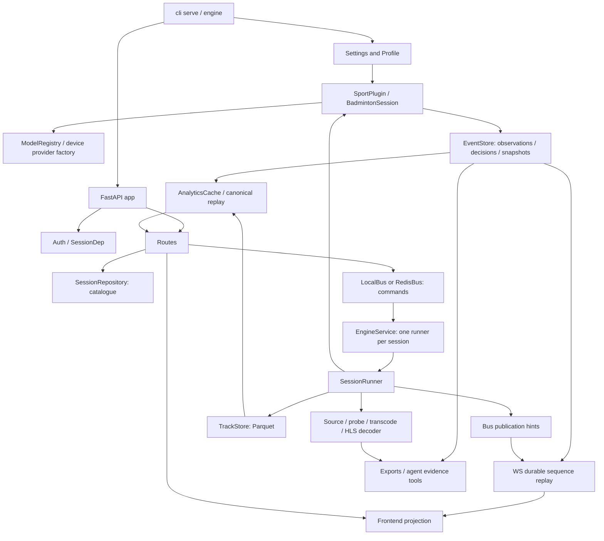

# Backend and runtime audit — 3 November 2026

Final integration result: 1,398 backend tests, 162 frontend tests and all eight
browser tests passed; TypeScript/Vite, scoped Ruff and scoped Biome error checks
passed. The current bounded real TrackNet CUDA parity/proxy diagnostic passed;
its fresh ONNX export remained unavailable (`onnxscript` missing, overall partial).
See [the final validation record](../full-pipeline-phase-2-validation.md) for
commands, artifact hashes, warnings and evidence limits.

This source inspection extends the uncommitted event/score candidate at
`cc73688630e40d534d94b7ef32bd0cbfed7e0571`. It does not replace the prior
[score evidence report](../event-score-integrity-20261103.md). The principal
orchestrator owns remote execution and the integrated validation record. This
agent ran no tests, media operations, downloads or inference on Windows.
The companion [frontend and analytics inventory](frontend-analytics-20261103.md)
covers the product surfaces and their projection contracts.

The principal's full GPU suite, round four, passed **1,398 tests in 221.93 seconds**
with 19 Starlette deprecation warnings. It includes all 19 regressions authored by
this agent, the principal's three independent-repository generation regressions,
and five media-stop regressions. Results below describe this tested candidate;
they do not establish real Redis, fresh ONNX export, or external LLM integration.

Path prefixes below are exact repository roots: **E** = `engine/src/bai_engine/`,
**A** = `apps/api/src/bai_api/`, **B** = `sports/badminton/src/bai_badminton/`.
The API is FastAPI; persistence is SQLite plus Parquet/media files; execution is
threaded Python. There is no separate score microservice or ORM-backed score table.

## Component and contract inventory

| Component / entry point | Inputs / dependencies | Outputs / consumers | State owner / persistence | Contract and failure behavior | Tests / evidence-based status | Defects / next action |
|---|---|---|---|---|---|---|
| Application `A/app.py:create_app`, lifespan | `Settings`, optional Bus; embedded `EngineService`, SessionRepository, Auth | FastAPI routes, SPA/assets, process resources | App owns service/repo/bus lifetimes; files under configured data root | Startup opens catalogue, starts engine only in embedded mode; shutdown stops service before closing repo/bus. ValueError→422. HTTP security headers applied. | `apps/api/tests/test_api.py`; integration-tested in prior GPU suite; model-free upload and score browser paths exercised | External mode does not share Python locks or cached handles. See external-runtime boundary below. |
| CLI `A/cli.py:_serve/_engine/_analyse/_models` | Environment settings, `--host/--port/profile`, local source or registry names | Uvicorn listener, standalone command worker, one-shot analysis, model status/fetch | CLI owns processes; underlying repository/registry own durable state | `_engine` refuses absent Redis URL. `_analyse` polls analysed/failed state; `_models fetch` prints per-model failures. `_serve` now derives one effective Settings for listener and Auth. | `test_cli_bind_contract.py`: both regressions reproduced before change and passed in the full GPU suite | CLI override previously bypassed non-loopback passphrase guard. Boundary fix verified using real Auth and mocked listener; no real public listener deployed by this audit. |
| Configuration `E/config.py:Settings/load_profile` | `BAI_*` environment / `.env`, YAML profiles; Pydantic | Validated process/model choices → runner/plugin/providers | Process settings, not mutable domain state | Profile extra fields rejected; model backend/precision enumerated. Profile name becomes `<profiles_dir>/<name>.yaml`. Missing profile is explicit error. External mode now rejects absent Redis URL. | `engine/tests/test_bus_config.py`, `apps/api/tests/test_external_lifecycle_contract.py`; invalid configuration reproduced before principal's fix; full GPU suite passed | External shared transport is a configuration precondition, not proof of safe distributed reset/ownership. Unsupported/declarative knobs listed below. |
| Source creation `A/routes/sessions.py:create_upload/create_youtube` | Multipart upload or typed URL body, size/duration settings, profile, optional roster | Session response; start command only for new source | `store_upload` owns source hash; SessionRepository owns session identity/catalogue | Upload returns 201 or 200 on reuse; YouTube requires feature flag and rights acknowledgement. Source URI is redacted in responses. Reuse keys source identity + profile + sport and requested match format, not title. | `test_api`, `test_saved_session_reuse`, `test_session_match_format`; integration-tested for upload; external YouTube download is not established by mocked tests | Same-process reuse is serialized; no multi-API-process uniqueness constraint. Live-source enums are not ingestion support. |
| Session catalogue `E/store/sessions.py:SessionRepository/_refresh_store_generation` | Session models and updates; source SHA/YouTube ID | Session metadata/status → API, runner, WS | `data/sessions.sqlite`, WAL; RLock serializes this instance | Session ULID; UTC created/updated timestamps. `paths` requires alphanumeric ID; `media_paths` requires lowercase 64-hex SHA. `mark_interrupted` preserves results and marks unfinished sessions failed on startup. Generation-keyed refresh discards completed-reset handles; pinned snapshot generation rejects detected crossings before exposure without closing an active handle. | `test_saved_session_lifecycle`, `test_store`, `test_runtime_metadata`; principal's three `test_external_generation_refresh.py` cases passed in the full GPU suite | No tenant ownership field. Independent-repository tests cover completed reset and two controlled crossings; no distributed lease or fully atomic cross-process reset protocol is established. |
| Start/stop/reanalysis `E/runtime/runner.py:EngineService.dispatch/_prepare_start/_reset_semantics` | Ordered command maps, session ID; existing engine/plugin | SessionRunner, backup/reset notification, resumed or rebuilt analysis | One runner per session in one EngineService; catalogue, backup tree, event log | Completed empty analyses attach without rerun; interrupted nonempty work backs up before reset. Reanalysis coalesces and refuses a still-live semantic writer. Manual calibration/review carry over explicitly. | `test_lifecycle`, `test_reanalysis_safety`, `test_saved_session_lifecycle`, `test_runtime_stop_integrity`; full GPU suite passed | Transcode cancellation/join gap corrected and tested with controlled producer failures. External reset/store ownership remains a separate limitation. |
| Processing worker `E/runtime/runner.py:SessionRunner.run/_analyse/_resident` | Canonical HLS segments, sport plugin, profile, commands | Durable tracks/events, status/frontier/state hints | Worker owns sequential cursor and sport private state; repository holds progress | Sequential plugins never reuse a cache or seek-preview that would skip matcher history. Final partial chunk uses actual `p.end`. Failed stages mark FAILED; idle completed runner reattaches for later commands. | `test_sequential_perception`, `test_partial_segment_progress`, `test_lifecycle`; integration-tested | No resumable serialized matcher state. Restart replays/reprocesses from a clean semantic generation. No global GPU admission scheduler. |
| Media preparation scheduling `SessionRunner._ensure_media/_run_media_job` | Source identity, probe, proxy plan, existing HLS | MediaInfo, playable HLS, proxy/sprite, transcode error → worker/UI | Shared source-hash media directory; separate transcode thread | Fast reuse requires complete HLS. Early playback begins after first segment. Media duration estimate is replaced by completed segment frame count. Principal's fix registers child jobs for stop cancellation and joins producer lifetime. | `test_api:test_upload_to_playback_end_to_end`, `test_media`, `test_lifecycle`; five new `test_runtime_stop_integrity.py` cases and full GPU suite passed | Controlled tests cover producer join/cancel, unexpected failure, progress callback cleanup and process-spawn cancellation; they are not measurements of arbitrary deployed encoder recovery. Media/timeline inspection is in perception audit. |
| Generic event storage `E/store/events.py:EventStore` | Immutable schema-v1 events/snapshots, session ownership | Sequence-assigned events/effective fold/state → sport/API/WS/agents | Per-session SQLite WAL; event history authoritative, snapshots derived | Same-ID/same-body retry returns original seq; conflicting body rejects. Nested write/savepoint transaction and after-commit callbacks. `read_snapshot` binds related reads; global supersession folded in one SQL statement. | `test_event_transactions`, `test_score_read_snapshot`, score synchronization tests; integration-tested, browser score path verified | Point and sport payloads remain dicts, not a fully discriminated versioned union. Sequence resets only with analysis generation. Independent competing temporal writers remain unsupported. |
| Track storage `E/store/tracks.py:TrackStore.write_chunk/read` | Typed Arrow rows; inclusive canonical frame bounds, object kind | Highest revision per exact range → WS/analytics/review | Per-object Parquet files `f<start>-<end>.v<rev>.parquet` | Temp-file rename publication; row range validated; legacy missing columns become null. Higher revisions selected only for identical chunk bounds. | `test_store`, wire/provenance tests; unit/integration-tested | Lock is per instance; no multiwriter ownership. Differently overlapping ranges may coexist, so consumers must preserve ambiguity rather than claim unique observations. |
| Local transport `E/bus.py:LocalBus` | Plain maps from API/worker | Ordered in-memory commands; per-session pub/sub hints | In-memory queue/subscriptions; no durable command receipt | Slow subscriber drops oldest hint. Durable event replay compensates; status/track hints are not a log. HTTP 202 means queued, not applied. | `test_bus_config`, WS revision/replay integration tests | Command loss on process crash remains an explicit architecture limitation; no new broker/outbox justified by synthetic success. |
| Redis transport `E/bus.py:RedisBus` | Configured Redis URL; msgpack | Redis list commands, pub/sub hints → external worker/API | Redis owns list/pubsub; destructive BLPOP has no processing acknowledgement | Constructor pings server. Redis list is not an exactly-once command system. Finite fractional timeouts now pass through unchanged; None retains blocking semantics. | Three `test_redis_timeout_contract.py` cases passed in the full GPU suite; **mocked adapter contract**, not real Redis/external service integration | Actual Redis timeout/service behavior remains untested. External durability and crash recovery remain incomplete. |
| Model registry `E/runtime/registry.py:ModelRegistry.path/open_verified` | Manifest model spec, artifact bytes, expected/first-use pin | Path or verified private stream → model adapters | `models/cache`, manifest, atomic pin file; registry owns integrity checks | Manifest hash or serialized first-use pin; first-use hash is integrity, not authenticity. Private download staging verifies before replace. `open_verified` binds stream bytes to digest and rejects archives. | `test_verified_model_artifacts`, `test_model_pin_publication`, `test_model_fetch_publication`, `test_model_archive_integrity`; full GPU suite passed | Archive-derived cache now has the separately tested bundle contract below. No real downloads performed. |
| Archive-derived model `ModelRegistry._extract_onnx` | Pinned ONNX ZIP bytes, including graph external files | Complete graph bundle → pose/ONNX adapters | New `extracted-v1/<archive-digest>-<object-id>/`; legacy artifacts preserved | Private verified archive snapshot; per-member SHA manifest; complete-directory rename; reuse checks graph and all external files. Rejects parent/absolute/platform-ambiguous members and links/special files. | Six `test_model_archive_integrity.py` cases reproduced before change and passed in the full GPU suite | Cache is application-owned; returned paths do not prevent mutation after validation. Python zipfile sanitization means the traversal regression alone is **not** proof of arbitrary filesystem escape. No real model inference tested here. |
| TrackNet export/provider boundary `B/perception/tracknet.py:_onnx_cache_key/_cached_onnx/_publish_onnx` and `E/runtime/device.py:ort_providers/ort_runtime` | Checkpoint hash, exporter source/contract, Torch/runtime, graph/provider identity | Validated content-addressed ONNX graph and actual provider metadata → TrackNet | Cached graph/manifest; no separate authoritative perception state | Contract `tracknetv3-onnx-opset17-embedded-v3`; graph digest and float32 dynamic IO contract checked. Final provider factory receives graph digest. Runtime reports fallback. | TrackNet cache tests, `test_tensorrt_cache_contract`; prior real Torch CUDA tensor parity recorded, **fresh ONNX parity blocked** | `onnx`/`onnxscript` unavailable in recorded server environment. Provider advertisement alone is not execution proof. No thresholds/model/precision changed. |
| Native TensorRT policy `E/runtime/device.py:_trt_cache_namespace` | Complete graph, runtime/driver/GPU, precision/builder identity | Compatibility directory only if explicit internal owner supplies context | Persistent engine/timing caches disabled by default | Namespace includes all supplied compatibility fields; does not serialize native ORT engine/profile writes. | `test_tensorrt_cache_contract`; mocked provider contract unit tests | Native lifecycle owner, real build/parity/throughput remain unimplemented/unvalidated. Do not enable by assumption. |
| Analytics cache `A/analytics.py:AnalyticsCache.get` | Current event seq, database inode/mtime, player/camera directory mtime, frontier/frame count, FPS | Bounded LRU MatchAnalytics → API, reports | Cache is disposable; event/track evidence is authoritative | Reads under repository generation + SQLite snapshot. Track-only changes invalidate. Max 128 sessions. | `test_analytics_quality`, read-snapshot/score acceptance tests; integration-tested | Coherent cache token does not automatically make callers that read additional data in separate scopes coherent; exports/product routes require whole-response snapshot. |
| Network event/state projection `A/routes/sessions.py:events/state/tracks` | Validated SessionDep; frame filters/sequence cursor/object window | JSON events/state or msgpack tracks → client/API users | No independent score authority | Effective vs raw-delta modes explicit; response carries analysis revision; frame state is latest snapshot at/before frame. Track window bounded to one hour. | `test_api`, score/revision tests, wire tests; integration-tested | No public mutation endpoint for arbitrary score fields. Malformed typed request returns 422; missing session returns 404. |
| WebSocket `A/ws.py:session_ws/sync_events/forward/track_window` | Authorized session, cursor+generation/revision, bus hints, seek/playhead | `hello/events/tracks/status/state/state_at/reply`, binary msgpack → SessionSocket | Durable seq cursor owned by gateway/client; presentation playhead not score authority | Subscribe before replay; paginate durable log; reset on generation change/rollback; seek recovers state at canonical frame; no repository lock across await. | `test_websocket_revisions`, `test_reanalysis_websocket`, score synchronization + real browser spec | Gateway assumes shared/reopened durable store. No realtime network-chaos/Redis deployment test was performed by this agent. |
| Identity/service reviews `A/routes/identity_reviews.py:_snapshot/confirm_identity/confirm_stroke/setup_doubles_service` | Roster, completed analysis, explicit analysis revision, track/event evidence | Human review event/ledger projection → individual analytics and service UI | EventStore write transaction; roster remains separate human input | Revision required for writes, unknown observations rejected, notifications follow commit. Generic verification rejects identity evidence. | `test_four_player_review`, `test_identity_review_guard`, roster tests; integration-tested | Review-backed four-person identity is not automatic biometric identity. Parent/perception inventory covers estimation limits. |
| Exports `A/routes/exports.py` | Session, canonical event/track history or proxy frame range | JSONL, CSV/legacy CSV, clip MP4, PDF, summary JSON → download UI | Derived files under session exports; evidence remains authority | Unavailable score exports null. Event projections use repository/SQLite snapshots; PDF summary and rows share one snapshot. Clip encodes privately, publishes atomically; failed/timeout output discarded, timeout returns 504. New key binds source SHA, proxy device/inode/mtime/size, rational FPS, frame range and encoding contract; changed/deleted proxy before publication returns 409. | All eight `test_export_publication_integrity.py` cases passed in the full GPU suite; publication, input invalidation and snapshot regressions verified | Encoder/PDF renderer fault tests are mocked; coherence tests use real SQLite and independent writer connections. Proxy fingerprint is a lifecycle identity, not a full video digest; storage remains application-owned. |
| Authentication `A/auth.py`, `A/routes/auth_routes.py`, `A/deps.py:get_session` | Optional single-user passphrase, signed cookie, CSRF header | Authorized local principal → session/system routes | Process Auth; cookie uses configured/random signing secret; no user DB | Non-loopback needs passphrase. Signed HttpOnly SameSite Strict cookie; unsafe methods require cookie-bound CSRF. REST session ID alphanumeric ≤40; unknown 404. WS checks cookie. | `test_api:test_passphrase_auth`, both CLI configuration regressions; full GPU suite passed | No tenant-level authorization, roles or per-session owners; intentional single-user scope. Host override now reaches Auth settings. Health/metrics are public. |
| Q&A `A/routes/agents.py:ask`, `agents/src/bai_agents/agent.py:answer/validate`, `agents/src/bai_agents/tools.py:ToolContext` | User question/history, event/track store, optional provider | Answer, citations, issues; deterministic fallback | No independent sporting authority; request history supplied by client | Max question 1000 chars/history 12; execution runs off event loop; provider failures disclose fallback/issues. Validator checks citation IDs and numeric claims, not every semantic claim. Citation frames are looked up after answer generation. | Agent unit tests and `test_api:test_ask_grounded_and_fallback`; mocked/fallback tested | ToolContext retains raw handles across await without generation snapshot; reanalysis may close them and separate tool reads can mix revisions. Source-confirmed exposure, no concurrency reproducer in this audit. Per-session token budget setting unused; external provider unverified. |
| Logs/metrics `E/obs.py`, `A/routes/system.py` | Runtime stages, event callbacks, GPU telemetry | Structured logs, Prometheus `/metrics`, `/api/system`, `/api/models`, `/api/profiles` | Process metrics; no persisted trace store | Session/stage/model fields, ISO logging timestamp; failure/degradation distinct. Model available flag only means artifact path/package exists, not load readiness. | Existing API/runtime metadata tests; source-inspected observation sites | `DECODE_FPS`, `WS_SEND_LAG`, `ESCALATIONS` declared but never updated. No command correlation ID/ack journal; health says process alive, not every model/stage ready. |

## Route inventory and boundary semantics

All session-bearing routes use `SessionDep` unless specified; it authenticates the
single principal and checks the session identifier. `public_session` removes the
filesystem source URI. Source timestamps are not reconstructed by serialization:
event `frame_start/end`, `pts_us`, seek frames and clip ranges use the canonical
analysis timeline. Session created/updated timestamps are UTC ISO datetimes.

| Routes | Request / response and notable semantics |
|---|---|
| `POST /api/sessions`, `POST /api/sessions/youtube` | Multipart/form or YouTubeRequest → Session; 201 new, 200 reused. Source import acceptance is not completed analysis. Profile/name/format validated; YouTube disabled is 403. |
| `GET /api/sessions`, `GET/PATCH/DELETE /api/sessions/{id}` | List ≤500; SessionPatch only title/player names; delete embedded worker joins before deleting. External deletion needs acknowledged stop or explicit refusal. |
| `PUT /api/sessions/{id}/roster` | ParticipantRoster validates unique IDs, team/score-slot relationships; referenced reviewed participants cannot be removed/reassigned. Does not assert tracker identity. |
| `POST .../start`, `/stop`, `/reanalyse` | 202 `{status:accepted, action}` → in-memory/Redis command. No durable command completion receipt. |
| `GET .../events`, `/state`, `/tracks` | Effective or seq-delta events, frame/latest snapshot plus timeline, typed binary tracks; revision accompanies projection. Unknown/no snapshot can legitimately be null. |
| `POST .../calibration`, `/calibration/auto`; `GET .../calibration/proposal` | Correspondences/optional net-top/frame → queued calibration; proposal uses actual decoded frame and method/score, not a calibrated probability. 409 media unavailable; proposal 404 frame not ready. |
| `POST .../corrections` | Literal winner/verify/official/match_start/match_intervals commands. Point score fields cannot be changed through generic verify. 202 queued, rejected type/domain inputs 422. |
| `GET .../analytics`, `/heatmap`, `/highlights`, `/insights` | Evidence-derived folds, units/availability, highlight references/ranking; no synthetic measurements for unavailable evidence. Product/frontend agent audits full response compatibility. |
| `GET .../individual-analytics`, `/estimated-individual-analytics` | Reviewed person mapping and separately labelled automatic estimate surfaces; do not merge their provenance. |
| `GET/POST/DELETE .../identity-reviews`, `POST/DELETE .../stroke-participant-reviews`, `GET/POST .../doubles-service` | Explicit revision and human participant/service evidence; direct transactional mutations return durable Event, unlike queued generic corrections. |
| `GET .../hls/{name}`, `/sprite/{name}`, `/proxy.mp4` | Authorized media routes; exact HLS/sprite basename patterns. Growing playlist no-cache; completed segments immutable-cache. Not-ready is 404/409, not empty media. |
| `GET .../exports/events.jsonl`, `/rallies.csv`, `/legacy.csv`, `/clip.mp4`, `/report.pdf`, `/summary.json` | Canonical evidence projections and derived media/report artifacts. Clip max ten minutes plus bounded padding; frame range inclusive, end converted to b+1. |
| `POST .../ask`, `GET .../ask/provider` | Grounded answer and provider availability; no scoring writes. Provider unavailable has deterministic fallback. |
| `GET /api/analytics/overview` | Cross-session product summary with explicit response model; no tenant partition (single-user deployment). |
| `GET /api/auth/me`, `POST /api/auth/login/logout` | Signed session/CSRF state; ten failed passphrases in five minutes throttled. Logout deletes cookie. |
| `GET /api/health`, `/api/system`, `/api/models`, `/api/profiles`, `/metrics` | Health/metrics public, diagnostic system/model/profile require User. `ok` health is liveness, not model-inference readiness. |
| `WS /ws/sessions/{id}` | Cookie-authenticated binary msgpack, reconnect cursor and generation; score history replay is durable, bus notification is a hint. |

## Event, command and timeline contracts

| Boundary / implementation | Identity, time and authority | Delivery, errors and retry |
|---|---|---|
| Durable `E/schema/events.py:Event` → `E/store/events.py:EventStore.append` | Schema version 1; ULID `event_id`, owning `session_id`, per-log `seq`; inclusive nonnegative canonical `frame_start/end`, `pts_us` at start. `actors` distinguishes player/track IDs. Sport `type` and `payload` remain open ontology fields. | Same event ID/body is idempotent; conflicting reuse rejects. Frozen envelope; statuses provisional, confirmed, corrected, retracted, human_verified. `supersedes` replaces history logically; `parent_id` preserves derivation. Human-verified status does not turn unrelated model evidence into ground truth. |
| Evidence and provenance envelope | `EvidenceKind` track_window/pose/court/score_ocr/component_scores/event/dataset/human; frame span, track/event references, scores/note. Provenance model/version, params hash, worker/profile. Confidence band is a plugin-owned threshold label. | Missing evidence and confidence remain nullable/unknown; bounded numeric confidence is not a calibration guarantee. No source-clock or 3D airborne-measurement guarantee is created by the generic envelope. |
| API commands → `E/bus.py:send_command` → `EngineService.dispatch` | `cmd`, `session_id`, operation fields; start, stop, reanalyse, playhead, calibrate, auto_calibrate, correct_winner, set_rally_official, set_match_start, set_reviewed_match_intervals, verify_event. No generic command ID or caller analysis revision. | HTTP 202 is queue acceptance. Start/reanalysis have local coalescing; other retries do not have a common idempotency contract. Queue loss or worker rejection is not an HTTP completion response. |
| `SessionRunner._drain_commands` → sport `handle` → reply/state | Sport owns domain validation and durable changes; ordinary state derives from sport after command handling. Reply envelope `{type:reply, cmd, result}` goes to optional `reply_to`. | Exceptions become `{ok:false,error}` plus a warning. Calibration routes supply replies; correction routes omit `reply_to`, so rejected corrections can be log-only failures after 202. This is a confirmed incomplete error/acknowledgement contract, not an exactly-once transaction system. |
| Worker → Bus `topic(session_id, kind)` | Topics `session.<id>.events/tracks/status/state/replies`. Durable event notifications carry generation/revision; status has frontier, analysed frames, capabilities/degradation. Track envelope carries canonical inclusive window and msgpack columns. | Pub/sub is a hint stream. Event truth is replayed from SQLite; status/track hints can drop. `ingest` is preparation progress. `analysis_reset` announces new generation/revision after backup/reset. No persisted notification outbox. |
| `A/ws.py:sync_events/forward` → browser | Binary msgpack `hello`, `events`, `tracks`, `status`, `state`, `state_at`, `reply`, reset/ingest messages. Durable cursor is `(analysis revision/generation, seq)`, separate from player seek/playhead. | Subscribe before replay; event pages capped at 500; resume resets on generation change or sequence rollback. Hints with mismatched generation/revision are discarded. Locks released before network awaits. Persistence recovery is tested in embedded mode, not real Redis deployment. |
| Browser → `A/ws.py:session_ws` | `playhead {frame,playing}`, `seek {frame}`, `tracks {from,to}`. Nonnegative frames, explicit track window ≤60 seconds; seek surrounds frame with 2 seconds before/12 after. | Playhead forwarding throttled to >0.25 seconds. Malformed/unknown frames are ignored; auth/session failure closes 1008. Seeking reads stored evidence and does not author a score. |
| Identity/service reviews → EventStore | Session roster IDs, canonical observation window, explicit analysis revision; transactional review events are authoritative human input for later projections. | Direct durable response follows commit; stale revision/malformed evidence rejects. These routes have stronger completion semantics than generic queued correction endpoints. |

## Actual dependency graph

## Confirmed defects and ownership

The principal reported GPU RED for all six archive, all three mocked Redis,
the initial four export and both CLI regressions before their production fixes.
The initial mixed audit run was `audit-red-backend.log` (21 failed, 3 passed);
those aggregate counts include other owners' cases and are not this agent's
standalone suite. PDF coherence and two additional proxy/FPS cache cases were
subsequently authored. The principal's round-two GPU report records all five
export publication/snapshot cases passing, including PDF, and both clip cache
input-change cases failing as expected. The further
proxy-replacement-during-encode regression failed as expected (1 failed in 1.03s)
before its stat-recheck guard was added. The principal's round-four full GPU suite
then passed 1,398 tests in 221.93 seconds with 19 Starlette deprecation warnings,
including all cases below. This is source/contract and regression evidence; no
Redis service, fresh ONNX export, or external LLM verification is inferred.

| Regression file | Cases in the passing full suite | Evidence boundary |
|---|---:|---|
| `engine/tests/test_model_archive_integrity.py` | 6 | Synthetic ZIP bytes; real filesystem hashes, extraction, corruption and concurrent publication |
| `engine/tests/test_redis_timeout_contract.py` | 3 | Mocked Redis adapter argument contract; no Redis server |
| `apps/api/tests/test_export_publication_integrity.py` | 8 | Real routes/filesystem/SQLite and separate writer connection; FFmpeg/PDF rendering mocked to isolate failure/race behavior |
| `apps/api/tests/test_cli_bind_contract.py` | 2 | Real Settings/Auth behavior; mocked Uvicorn listener |
| Principal's `engine/tests/test_external_generation_refresh.py` | 3 | Independent repository connections and controlled reset timing; no external service deployment |
| Principal's `engine/tests/test_runtime_stop_integrity.py` | 5 | Controlled media producer/process, cancellation, failure and cleanup contracts |

| Finding | Classification / reproduction | Production owner / regression |
|---|---|---|
| Archive cache survives verified archive replacement or extracted graph/external-weight mutation | RED/GREEN on GPU with synthetic ZIP members; raw model inference is not exercised | This agent, registry extraction only; `engine/tests/test_model_archive_integrity.py`; full suite GREEN |
| Failed/concurrent archive extraction exposes partly written graph | RED/GREEN with controlled member reader and bad-CRC archive | Same owner/test; private complete bundle publication; full suite GREEN |
| Redis fractional command timeout becomes infinite | RED/GREEN for adapter truncation; no live Redis blocking operation executed | Principal owns bus fix; `engine/tests/test_redis_timeout_contract.py`; mocked coverage, full suite GREEN |
| Clip failure/concurrency exposes final partial artifact | RED/GREEN through real route/filesystem with mocked FFmpeg failure/timeout/concurrency | This agent, `A/routes/exports.py`; private publication; full suite GREEN |
| CSV/PDF score response combines different database revisions | CSV mismatch reproduced with real separate-connection WAL writer; CSV and PDF coherence pass remotely | Same owner/test; whole-response snapshots; full suite GREEN; renderer mocked in PDF coherence test |
| Clip cache survives proxy/FPS replacement | Input changes and encode-time replacement reproduced before their fixes; regressions now pass | Same owner; bounded input-fingerprint key and pre-publication stat recheck; full suite GREEN |
| CLI host flag bypasses non-loopback passphrase configuration | Both tests RED/GREEN with real Auth and mocked server listener | This agent, `A/cli.py`; one effective Settings for app/listener; full suite GREEN |
| Stop/reanalysis does not own active transcode cancellation | Controlled media producer/process regressions pass after lifecycle fixes | Principal owns runner/media; five `test_runtime_stop_integrity.py` cases; full suite GREEN |
| External mode permits disconnected LocalBus and deletes before writer stop acknowledgement | Guards reproduced before fix; missing Redis rejects settings and absent embedded worker acknowledgement rejects deletion with 409 | Principal owns settings/session routes; full suite GREEN; no actual external worker service exercised |
| Repository retains old-generation handles or closes a snapshot handle during refresh | Completed-reset and two controlled generation-crossing cases pass | Principal owns SessionRepository; three independent-repository regressions; full suite GREEN; distributed reset limits remain below |

## Explicit limitations, disconnected capabilities and technical debt

- **External engine mode is not established by embedded integration tests.** Redis
  BLPOP has no acknowledgement/retry journal. Python RLocks and EventStore caches
  are process-local. Before this audit an API repository retained its old cached
  connection after another worker unlinked/recreated events.sqlite. Generation-keyed
  refresh now follows a **completed** reset; pinned snapshots reject detected
  generation crossings with RuntimeError before exposing a mixed snapshot or closing
  its active handle. Three independent-repository regressions pass: completed reset,
  reset after metadata read, and reset before track acquisition. These controlled
  crossings do not establish distributed leases, atomic cross-process reset across
  every event/track access, or real Redis worker crash recovery. Actual service
  behavior and broader distributed ownership remain separate limitations.
  External deletion now refuses without an acknowledged embedded writer stop;
  that guard does not imply external reanalysis is safe.
- **One logical session writer is the supported ownership model.** Multiple
  independent EngineService processes can start writers for the same session;
  distributed leases and global GPU admission/queue scheduling are not implemented.
- **Live media is not implemented by SourceKind enumeration.** RTSP/SRT/WebRTC/camera
  kinds exist in the schema, but only upload/YouTube creation routes are wired.
- **Telemetry is partial.** Inference throughput, stage timing, frontier/rate,
  queue depth, events, degradation, GPUs, WS clients and LLM token metrics have
  producers. Decode FPS, WS send lag and escalation counters have no observation
  sites. There is no durable trace/command acknowledgement with correlation ID.
- **Model status is availability, not readiness.** A file can exist and still fail
  checksum, contract, provider initialization or inference; runtime degraded/capability
  metadata is the stronger evidence. No model or threshold baseline changed here.
- **Authentication is single-user.** No per-match tenant isolation, user management,
  account recovery or role system exists. A random default signing secret changes on
  process restart; deployments needing durable login configure the secret externally.
- **Agent budgets/providers remain bounded only by implemented request/tool logic.**
  The named per-session token budget setting is unused. External provider/runtime
  behavior and remote service reliability are unverified; deterministic fallback
  is explicitly labelled and cannot mutate sporting truth.
- **Q&A lacks a request-wide evidence snapshot.** `routes/agents.py:ask` creates
  ToolContext from cached stores, awaits a worker thread, then reuses the store to
  resolve citations. Reset can close this handle; individual tool projections can
  also span revisions. This is an inspected architectural risk, not a demonstrated
  concurrency test result. Holding the repository lock across remote provider waits
  is not an acceptable fix; immutable request evidence or a bounded generation
  contract needs a focused design/test. The validator checks reference IDs and
  numeric support, so it cannot promise that every natural-language claim is verified.
- **Queued correction failures are not reliably surfaced to the caller.** The
  missing `reply_to` described above can turn a worker rejection into a warning
  plus unchanged state after a successful HTTP acceptance. A future receipt/error
  contract should be tested with stale targets and reconnects before advertising
  completed saves or retry safety. This audit did not change that wire protocol.
- **Derived caches and files require lifecycle ownership.** Cache eviction is not
  automatic. Track cache writers are instance-local. PDF files have no retention
  policy. A returned path assumes application-owned storage is not mutated after
  final validation; that assumption is not publisher authenticity.
- **Accuracy and performance are separate gates.** Synthetic fault tests and the
  prior real browser path verify orchestration, not shuttle/contact/winner accuracy.
  Missing independently reviewed labels and missing ONNX exporter prerequisites
  remain recorded blockers. Redis/YouTube/LLM services were not contacted by this
  agent, and no model/media environment was installed or replaced.

## Files inspected and authored

Inspected `E/runtime/{runner,registry,device}.py`, `E/{config,bus,obs,sport}.py`,
`E/store/{sessions,events,tracks}.py`, `E/schema/{session,events,state,tracks}.py`,
`A/{app,auth,deps,cli,analytics,public,ws}.py`, all route modules, TrackNet export
entry points, agent provider/answer entry points, and the linked existing tests
and architecture/operations reports. Related media, perception and frontend
implementation is assigned to other agents; those inspections are not duplicated
as unsupported claims here.

Authored the assigned audit and four new regression files:
`engine/tests/test_model_archive_integrity.py`,
`engine/tests/test_redis_timeout_contract.py`,
`apps/api/tests/test_export_publication_integrity.py` and
`apps/api/tests/test_cli_bind_contract.py`. After the principal's GPU RED and
explicit ownership handoff, edited only registry `_extract_onnx`-related code,
`A/routes/exports.py`, and `A/cli.py:_serve`. Existing `_fetch`, verified snapshots,
score changes and unrelated user files were preserved. The principal owns
Redis/config/session-control/runtime fixes and executed the full GPU validation
reported above. This follow-up changed only this audit document; production and
test files were left untouched.
Local inspection and `git diff --check` are static editing checks, not runtime
verification. No tests, inference, media processing or external service calls
were performed by this agent.
