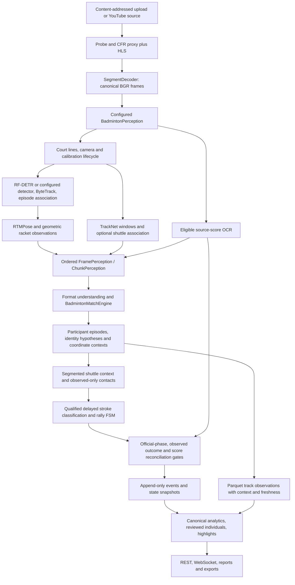

# Deep pipeline engineering overhaul — 13 November 2026

Implemented on `engineering/deep-pipeline-overhaul-20261113`, branched from
`main` after checkpoint `1313370` preserved the existing evaluation progress.
The previous production baseline was `88aa0ad`. No results in this report are
new evaluation results. Runtime correctness, physical accuracy, coverage changes
and performance effects remain unverified.

## A. Architecture, evidence and contracts

The requested `research/evaluation/benchmark/` and `evaluation/evaluation/`
directories do not exist in this checkout. The investigation followed the
actual directory structures and their existing external-artifact links:

- `evaluation/ground_truth_validation/reports/`: current validation index,
  consolidated results v2, first-principles diagnosis specification, Test1/2
  root-cause and production-change registers, and Test3/4/6/7/9/10 component reports.
- `evaluation/ground_truth_validation/component_evaluations/`: class context,
  participant continuity, scene origins/acquisition, shuttle gaps/association,
  cadence, OCR and model alternatives. Historical experiments were read, never run.
- `evaluation/ground_truth_validation/test_*/diagnostics/`, `failure_cases/`,
  `dataset_inventory/` and retained artifact indexes: failure lineage, annotation
  meaning and unsupported metric prerequisites.
- `research/SEQUENTIAL_BENCHMARK_INDEX.md`,
  `CONSOLIDATED_SEQUENTIAL_BENCHMARK_REPORT.md`,
  `CURRENT_BADMINTON_PIPELINE_TECHNICAL_REPORT.md`,
  `PRODUCTION_COMPONENT_INVENTORY.md`, `test_video_benchmarks/` and their linked
  saved runs; architecture/contracts and model research under `docs/`.
- Production implementations, component factories, model manifest, normal and
  experimental profiles, storage, wire format, API analytics and exports.

There were no separate chat file attachments available to inspect. Existing
documents and artifacts were the evidence base. We prioritized diagnosed
source-bound mechanisms over interval statistics, specifications and hypotheses.
The large consolidated file includes repeated historical artifacts; its contents
are not a homogeneous current-code benchmark. Test2's latest completed arm is
`5ae6148`, whereas the newer evaluation cohort uses `88aa0ad`. No metrics were
pooled or recalculated. Generated player/shuttle/winner references remain
diagnostic agreement references, not physical ground truth.

The host is `bai_engine.sport` / `runtime.runner`; badminton remains in its
existing plugin. `ComponentRegistry` selects configured providers and owns their
version/configuration/lifecycle declarations. No second engine, new model,
dependency or generic scheduler was introduced. Camera/court utilities remain
directly composed by badminton perception; they are not newly independent
registered model components. The component graph is a declaration of dependencies,
not a claim of a fully generic DAG executor.

| Boundary | Contract and failure semantics |
|---|---|
| Acquisition → decode | Content identity, selected stream, source metadata and rational canonical CFR timeline. Source VFR timestamps are distinct from proxy indices. Decoder output is HWC uint8 BGR; bounded buffer/thread configuration must be positive. |
| TrackNet | Checkpoint-derived temporal length L, RGB 512×288, concat background, tensor `(B,3*(L+1),288,512)` in [0,1], output finite `(B,L,288,512)` heatmaps. Raw support is uncalibrated. Windows never cross shot/content barriers. |
| Detector → pose/tracker | Image-pixel xyxy boxes; pose crop order must remain associated with the same person. COCO17 output `(N,17,2)` plus `(N,17)` support. Missing crops/joints stay explicit. |
| Perception → temporal engine | Ordered contiguous canonical frames, raw shuttle evidence, selected association, scene/calibration state, pose/racket source stamps and per-person detector match. `WindowObs` now enforces complete array shapes and finite positive FPS. |
| Image → court | Player feet map to calibrated floor metres. This is not airborne shuttle 3D position, speed, landing or line-call truth. Invalid geometry is a barrier. |
| Contacts → classification | Numerical candidate, physical reliability and identity are distinct. A next candidate may bound motion fitting while remaining ineligible as a physical flight endpoint. Endpoint status/reasons/event reference accompany the stroke. |
| Tracks → analytics | Optional generic `context_id` identifies a producer epoch; badminton uses shot/content/coordinate epochs. Person and camera contexts must match. Current detector matches, episode births and valid geometry authorize sampled feet; carries never become observations. |
| Sparse movement | Only explicitly unsampled intermediate frames with valid same-context camera metadata may connect observations, within existing time/speed limits. A detector tick with no subject row, invalid camera or unknown cadence breaks continuity. Median-smoothed travel remains an estimate. |
| Identity → outputs | Track IDs, episode birth IDs, reviewed physical participants, teams and P1/P2 scoring slots remain separate. All four doubles episodes are retained; naming requires evidence/review. |

## B. Diagnosis-to-fix mapping

Every row below is **implemented and statically reviewed; runtime and empirical
effects are unverified**. Observed source-case attribution is distinguished from
new source-inspection findings.

| Observed issue / diagnostic evidence | Root cause in implementation | Component | Actual change made | Expected improvement | Validation status |
|---|---|---|---|---|---|
| Test1 class-context report: anchors3540/6456 change class when new ambiguous candidates shorten their next interval | Every selected next candidate supplied flight duration/receiver despite insufficient physical evidence | Contact/stroke integration | Shared typed endpoint assessment; engine withholds unsupported duration/receiver, retains cutoff, candidate frame and event lineage | Avoid unsupported flight features; unknown coverage may increase | Saved causal finding plus source review; no new execution |
| Test4/6 report many current poses on carried boxes; freshness requirements in architecture | Participant entry, appearance memory and rebind leases consumed explicit carried estimates | Participation/identity | Birth streaks count detector observations, scheduled carries retain pending state without votes; carries cannot bind/rebind/teach appearance or renew observed leases | Separate display continuity from identity evidence | Mechanism confirmed in source; frequency/accuracy impact unmeasured |
| Pose ownership/missing-data contract; malformed outputs are not independently labelled failures | No full per-crop tensor validation; malformed crop/output can misassociate or expose invalid joints | Active RTMPose adapter | Validate crop and output shapes, preserve person indices, zero unsupported joints with missing coordinates, return None for unsupported person | Explicit errors/missing data at inference boundary | Static only |
| Freshness contract; no frequency attributed to a particular video | Temporal conversion copied pose/racket without checking their source stamps | Contact windows and named buffers | Admit exact-frame-stamped pose/equipment only; current person match and geometry required for classification; finite contact coordinates | No stale cue masquerades as current impact evidence | Static only |
| New source-confirmed FSM defect, not an established cause of a particular benchmark FN | Motion-driven rally opening retained pre-rally stationary history | Rally FSM | New opens clear terminal history and seed it with current evidence | No terminal decision based on old idle rest | Static control-flow review only |
| Incomplete anatomical evidence and frame-rate assumptions | Jump features invented zero hip lift and used fixed30fps windows; samples could cross participant episodes | Jump classification | Require complete supported ankle/hip evidence, exact stamps, one track/birth episode; scale windows by actual FPS | Abstain on missing/cross-person anatomy; consistent temporal duration | Static only; physical jump validity unproven |
| Existing shuttle gaps/reconstruction distinctions; spline defect found in source | Average endpoint speed allowed intermediate spline overshoot; fill support could exceed anchors | Shuttle postprocessing | Gate every reconstructed edge using existing speed limit; cap estimated support by weakest contributing anchor; keep interp=True | More defensible inferred context, no manufactured observation | Static only; not claimed to repair raw detector gaps |
| Long-video resource constraints in reports; no OOM attributed to this code | All temporal input stacks were built before batch iteration | TrackNet | Build only the current configured batch of temporal stacks, preserving order/padding/background/averaging | Bound this allocation by batch | Code-level memory bound; no measured memory/throughput result |
| New source-confirmed backend mutation | ONNX export called in-place cpu()/float() on active model | Model lifecycle | Export a detached deep copy | Preserve active backend/device/dtype | Static only; temporary export memory unmeasured |
| NaN/invalid metadata and array contract holes found in source | Nonfinite duration could pass comparisons; broadcasting could hide misaligned shuttle arrays; incomplete window shapes were accepted | Ingestion/contracts | Finite duration/FPS and positive configuration guards; aligned shuttle arrays/support and temporal player shapes | Explicit boundary errors instead of silent contamination | AST/lint/source review only |
| Analytics freshness requirements and propagated-box coverage in reports | Stored visible/confident carries counted as feet observations; missing epoch/cadence could join unrelated samples | Track storage/movement | Persist context and camera detector cadence; require fresh matches, matching camera context and episode; prove all intermediate sparse frames unsampled/valid | Avoid movement/heatmap contamination from stale/cross-context data | Static integration review; old tracks without proof may abstain |
| Source-confirmed unsupported highlight category | Unknown final actor equalled unknown winner (`None == None`) in smash-winner condition | Highlights | Require available score and known winner before awarding smash-winner reason | No unsupported winner category from two unknowns | Static only |
| Provider list can be mistaken for full GPU execution | Initialized ORT providers do not prove per-node placement | Runtime observability | Explicit node_placement_verified=False and provider-priority evidence semantics | Truthful provider reporting | No profiler/GPU experiment run |

## C. Component implementation report

Detailed owned implementation reports:
[perception/models](overhaul-perception-20261113.md),
[tracking/identity/pose](overhaul-tracking-20261113.md),
[events/classification](overhaul-events-20261113.md).

| Component | Previous implementation / weakness | Changes, integration and remaining limits |
|---|---|---|
| Video ingestion/time | Content-addressed source, CFR proxy, CPU PyAV segment decoder; NaN duration and invalid buffer/thread configurations insufficiently guarded | Guards in decode/probe; existing exact timeline, stream selection and aspect handling retained. Test10's300-second full-count timeout belongs to a research preparation helper, not a new production inference failure; its retry evidence remains preserved and no new count was attempted. Generic VFR source-frame correspondence remains incomplete. |
| Court/calibration | Lines/OpenCV homography with scene/camera/calibration lifecycle, not a neural court detector | Investigated; retained current geometry algorithms rather than tune one-frame generated-corner disagreements. Persisted camera/context barriers now constrain downstream movement/classification. Multiple courts, incomplete views and rapid camera changes remain perception limitations. |
| Player detection | Configurable RF-DETR/YOLOX proposals already included athletes at some diagnosed misses | No detector replacement/threshold reduction. Fix downstream lifecycle and pose contracts; preserve existing first-birth and court-origin repairs already on main. Spectator/off-court aliases and missing real detections remain unresolved. |
| Tracking/identity/format | ByteTrack, persistent motion/optional appearance association, participant episodes, sustained format inference and separate review | Fresh-only lifecycle and rebind/appearance memory, cadence-aware pending births and startup observation semantics. Singles/doubles/unknown format capability gates retained. Four-player physical identity switches are not empirically solved. |
| Pose/movement | RTMPose top-down crops, source stamps, temporal body cues; no finite/shape/order enforcement on output | Per-person missing output, exact stamps and anatomy guards; path inputs require fresh matched feet and valid camera context. Current pose on a carried crop remains image inference on uncertain geometry. |
| Shuttle | TrackNet raw heatmaps, optional association, observed/estimated trajectories and bounded filling | Batched stack construction, finite tensor/array contracts, nonmutating export and plausible anchor-bounded reconstruction. Existing association candidate/provenance rules retained. Floor-logo/shoe aliases and no-peak gaps need future physical labels/model work. |
| Racket/contact | Classical ellipse/shaft near wrists, anatomical admission, heuristic motion/proximity/pose fusion | Enforce exact source stamps and finite temporal evidence. No trained racket model or proof of physical impact added. Body/banner contours remain possible false racket candidates. |
| Shots/events | Rule classification with optional singles BST shadow; duration depended on every next numerical candidate | Endpoint eligibility and lineage; fresh calibrated geometry in named/provisional singles/doubles contexts; supported single-episode FPS-aware jump anatomy. Stronger learned classification still needs suitable labels/weights. |
| Rally/activity | Replaceable legacy/evidence/tracklet FSMs, observed motion, optional reconstruction continuation and short-exchange witnesses | Terminal rest belongs to a new exchange only after it opens. Existing gap/merge/duration policies preserved. No arbitrary extension to fit generated reference boundaries; missing physical exchanges remain unresolved. |
| Outcomes/OCR/scoring | RapidOCR source readings, row/name hypotheses, observed-terminal outcome and transactional legal scoring | Audited active acquisition and guarded consumption; retained uncertainty rather than create points from OCR totals/near-far hypotheses. New identity/geometry contracts constrain upstream evidence. Automatic physical identity/row mapping and complete scores remain unresolved. |
| Court analytics/doubles | Canonical match fold plus explicit reviewed four-person individual analytics and separate estimates | Generic optional stored context, observed-only paths and camera cadence proof; reviewed individual paths share the same gates. No new named heatmaps are fabricated where roster review is absent. |
| Highlights/outputs | Event-backed ranking and existing REST/wire/export folds | Guard unknown smash winner; add context provenance to storage/wire and pose/match metadata to previews. Estimated event descriptions retain lineage and uncertainty. Relevance and API/client behavior are untested. |
| Performance/lifecycle | Sequential perception prevents unsafe cache state reuse; provider/model registry and bounded frame buffers already exist | Bound TrackNet input stacks and isolate export; label ORT placement uncertainty. No additional GPU parallelism or dependency was introduced. CPU decode/OCR, pose per-crop calls and duplicate initialization remain potential costs. |

## D. Model audit

This is code inspection of loading, invocation and consumption, supplemented by
the saved model inventory. It is not a claim that models were loaded during this
task or that historical missing files are still absent at this instant.

| Model/component | Existing status | Loaded / invoked / output consumed in source? | Problems identified / changes | Remaining limitations |
|---|---|---|---|---|
| RF-DETR nano/small/medium ONNX | Configured person detector; small in saved evaluation | Yes when selected / detector cadence / boxes enter tracking and pose | Active path verified; fixed downstream observation ownership instead of replacing detector | Export mirror and exact weight rights/pins remain separate; no new AP/recall evidence |
| YOLOX HumanArt ONNX | Explicit detector alternative | Yes if selected / same detector seam / boxes consumed | Inspected, unchanged | Not automatically selected or proven stronger on these cameras |
| RTMPose M/body7 and X alias | Configurable top-down pose | Yes / scheduled crops / COCO17 body/racket/contact cues | Output ordering, finite shape/missing-joint validation and stamp consumers fixed | `halpe26` alias actually identifies body7 export; no26-keypoint claim. rtmlib per-crop loop and transient initial ORT construction remain. |
| ByteTrack / trackers dependency | Active tracker, existing one-observation birth adapter | Constructed / update called / IDs and boxes consumed | Preserve upstream association; fresh participant lifecycle/rebind integration corrected | Occlusion/return/partner swaps require labelled persistent IDs |
| OSNet-AIN x0.25 | Optional appearance; unavailable in relevant saved runs | Loader exists / conditional embed / features consumed by association when enabled | Audited, no download or default promotion | Missing historical checkpoint; appearance cannot supply names or solve identical clothing alone |
| HSV appearance | Active heuristic descriptor | Builtin / crops computed / provisional identity memories | Carries no longer teach identity memory | Uncalibrated and lighting/uniform dependent |
| TrackNetV3 | Active Torch/optional ORT temporal detector | Yes / detect→forward / raw and associated positions consumed | Bounded input stacks, tensor/frame guards, isolated export | Existing checkpoint and precision retained; no measured detector gain |
| InpaintNet | Registry weights present in saved inventory, no active adapter | No live loader / no forward / no consumed output | Explicit unsupported capability retained; classical fill is not InpaintNet | Adding a name or cached checkpoint does not integrate this model |
| Racket geometry | Active OpenCV component, no pretrained weights | Builtin / scheduled detect / qualified cues consumed | Exact-frame source requirement enforced downstream | Ellipse/shaft score is not a probability or impact certificate |
| RacketVision BallTrack / racket pose | Candidate manifest entries | No production adapters / no live invocation / no live output consumption | Alternatives reviewed, not superficially wired | Racket pose requires a detector too; checkpoint provenance/rights, dependency and quality evidence needed |
| BST-CG-AP | Explicit pinned singles shadow adapter; rule default | Optional research loader / explicit predict_sequence only / not default stroke labels | Audited singles gate and separate weight-rights limitation | Not four-player doubles; no production promotion |
| RapidOCR / PP-OCR package models | Active conditional source-board acquisition | Reader initializes / cadence reads / corroborated source transitions consumed separately from accepted points | Existing all-image/eligible source policy and runtime reporting audited | Model execution cannot establish identity/row mapping, actual point decisions or verified scores |
| Court/camera | Classical geometry, not pretrained court model | Constructed / invoked / calibration consumed | Guard downstream geometry/context use | One-frame reference geometry is not full-video calibration validation |
| Contact/stroke/rally/outcome/scoring | Builtin configured rule/evidence components | Constructed / engine invokes / ledger and analytics consume | Temporal/freshness/endpoint/jump/FSM fixes and component version increments | Uncalibrated heuristics; no learned impact or full stroke model added |
| WASB, optional live/second-opinion stages | Research alternatives or unsupported profile selections | No installed active adapter / no invocation / no output consumption | Kept explicitly unsupported | Need verified artifacts, preprocessing, rights and comparable labels before adoption |

External primary sources were rechecked without downloading code or weights.
[TrackNetV3](https://github.com/qaz812345/TrackNetV3) describes temporal prediction
and separate inpainting, and expressly licenses its released checkpoints along
with its code; that does not authenticate this project's mirror bytes.
[ByteTrack](https://github.com/FoundationVision/ByteTrack) associates low-score
detections with tracklets; adopting another tracker name does not repair a
downstream observation/identity contract.
[WASB](https://github.com/nttcom/WASB-SBDT) is a relevant comparator, not local
evidence of superiority.
[RacketVision](https://github.com/OrcustD/RacketVision) describes separate racket
detector and pose stages; the existing pose-only candidate is insufficient for
that pipeline. No external source, weight or training data was incorporated.

## E. Important files changed

| Files | Purpose |
|---|---|
| `engine/src/bai_engine/decode.py`, `media/probe.py` | Positive bounded decoder configuration and finite duration validation |
| `engine/src/bai_engine/runtime/device.py` | Separate provider initialization from verified node execution |
| `engine/src/bai_engine/schema/tracks.py`, `store/tracks.py`, `wire.py` | Optional generic context field, nullable historical schema conformance on read/write, additive wire provenance |
| `sports/badminton/src/bai_badminton/perception/tracknet.py`, `shuttle_post.py` | Bounded stacks, export isolation, tensor/array validation, conservative reconstruction |
| `perception/keypoints.py` | Finite utility guards and comparison with common anatomical support; these helpers currently have no active production callers |
| `perception/players.py`, `participation.py`, `identity.py` | Active pose contract and observed-only participant/identity memory |
| `participant_contact.py`, `events/contact.py`, `events/contact_evidence.py` | Stamped temporal cues, finite coordinates, shared typed flight endpoint eligibility |
| `events/stroke.py`, `events/rally_fsm.py` | Supported FPS-aware jump features and independent terminal history for new rallies |
| `observations.py`, `engine.py` | Enforced window shapes, source-aware integration, contextual track production and endpoint lineage |
| `analytics/spatial.py`, `rebuild.py`, `reviewed_motion.py`, `automatic_individual.py`, `match.py` | Observed and context-qualified paths, named-estimate match checks, unknown-winner highlight guard |
| `plugin.py`, `components.py`, `perception/components.py` | Preview provenance, cache codec26/policy identity and provider versions/type contract |
| This report and three linked workstream reports | Architecture, evidence/fix traceability, model audit and explicit limitations |

Existing evidence files were preserved in the initial checkpoint, not rewritten
to reflect these source changes. Old Parquet files remain readable with null
context. They do not acquire evidence they never stored: movement may now be
unavailable. Track wire v2 gains an additive optional `ctx` column; existing
fields retain their meaning. Sequential diagnostic cache policy changes prevent
silent reuse as current inference; no existing cache was deleted or regenerated.

## F. Unresolved issues and material limitations

- Missing raw shuttle peaks, floor-logo/shoe aliases, spectators, true detector
  misses, occlusions, long-return identity and four-person physical identity
  accuracy remain unsolved. Saved interval FPs/FNs alone do not establish their causes.
- Court/camera components are still directly composed; a full independently
  replaceable court-calibration plugin would need a separate interface migration.
- No new independently reviewed boxes, joints, shuttle visibility/location,
  exhaustive contacts/negatives, strokes, physical identities, winners, legal
  score sequences or highlight relevance labels are supplied by this work.
- Named individual analytics need roster/episode review. All four doubles players
  can be represented independently, but this is not proof of automatic match-long
  identity. P1/P2 score slots must not become individual teammate identities.
- No new weights, model installation, training, packages or licenses were adopted.
  Historical missing OSNet/BST/RacketVision artifacts and unverified candidate
  weight grants remain recorded requirements, not silent fallbacks.
- Endpoint/freshness gates can increase abstentions and move participant entry
  times. Their downstream rally/contact/classification consequences require future
  authorized empirical work; no nonregression claim is made.
- Sparse movement is a bounded displacement estimate between observed feet,
  with median smoothing and existing speed/time gates. It is not biomechanical
  measurement, observed dwell time or inferred missing-frame detections.
- ONNX node placement, GPU utilization, TensorRT execution and actual resource
  savings were not profiled. Export copies temporarily increase memory; per-crop
  pose and duplicate upstream ORT initialization remain unoptimized.
- The Test10 research frame-count deadline and generic source-to-proxy VFR mapping
  remain distinct operational limitations. No deadline tuning or video scan was run.

## G. Final execution status

Source improvements are implemented and integrated in the working branch through
the actual perception, identity, temporal-event, persistence and analytics paths.
All major pipeline components were investigated across the owned workstreams;
this is not a claim that every historical artifact or every source file was read
line by line or that every recorded failure is resolved.

Static checks only: standard-library AST parsing (no application imports), Ruff
lint, Git whitespace/diff inspection and cross-agent source review. Integration
review caught and corrected missing detector-tick barriers, calibration-loss
bridging, jump episode mixing, doubles geometry revalidation, legacy table write
conformance and optional provider versioning.

**No test suite, integration test, application/model construction, model forward,
video decode, frame extraction, semantic replay, new evaluation, FP/FN calculation,
GPU experiment or benchmark was run.** Accuracy, runtime behavior, backward client
compatibility, new coverage and performance remain empirically unverified.
