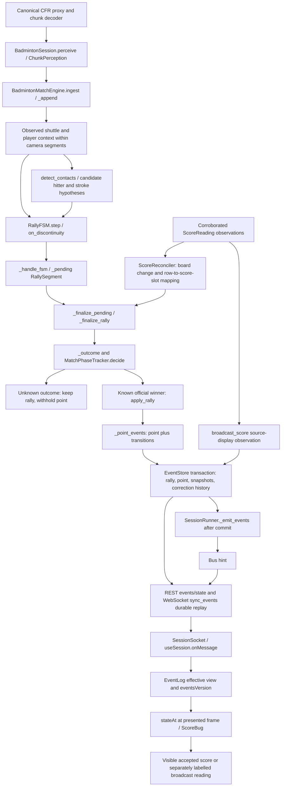

# Event and score integrity investigation

Date: 3 November 2026. Branch: `full_pipeline`. Inspection baseline:
`cc73688630e40d534d94b7ef32bd0cbfed7e0571`. The earlier architecture baseline is
`32a8295d9645d81bd1586a777541bb2f72c08bed`. This investigation extends the
[phase-2 report](full-pipeline-phase-2-report.md); historical findings were checked
against current source rather than assumed to remain open.

The companion [defect ledger](event-score-integrity-ledger-20261103.md) distinguishes
confirmed failures, architectural risks and unverified behavior. Synthetic fixture
passes establish software contracts, not shuttle/contact/winner accuracy.

## Actual score lineage

Source locations (paths are relative to this repository):

- Media and scheduling: `engine/src/bai_engine/media/proxy.py`, `decode.py`,
  `runtime/runner.py` (`SessionRunner.run`, `_create_sport`, `_attach`, `_emit_events`).
- Sport boundary: `sports/badminton/src/bai_badminton/plugin.py`
  (`BadmintonSession.ingest`, `restore`, `handle`). The runner owns the single
  temporal writer per session; there is no independent scoring microservice.
- Domain: `sports/badminton/src/bai_badminton/engine.py`, `events/rally_fsm.py`,
  `events/rally_outcome.py`, `events/match_phase.py`, `score_ocr.py`, `rules/bwf.py`.
- Persistence: `engine/src/bai_engine/store/events.py` and `store/sessions.py`.
  Each session has an SQLite WAL event log and snapshots; the session catalogue
  stores identity/profile/status and analysis generation, not an independent score.
- Delivery: `apps/api/src/bai_api/routes/sessions.py` (`events`, `state`, `correct`),
  `apps/api/src/bai_api/ws.py` (`session_ws`, `sync_events`, `forward`).
- Client: `apps/web/src/lib/socket.ts`, `lib/events.ts`, `stores/session.ts`,
  `features/session/derive.ts`, `features/player/ScoreBug.tsx` and
  `features/session/SessionPage.tsx`.

## Questions answered against the implementation

| Question | Actual behavior and evidence |
|---|---|
| 1. Display origin | `ScoreBug` derives an accepted score from `stateAt(EventLog, presentedFrame)`. A separately labelled corroborated `broadcast_score` can supply source names and numbers. It does not display a REST score counter. |
| 2. Authority | Effective accepted `point` decisions and an explicit opening seed form durable score history. `MatchState` and `states` rows are projections of that history. Previously those projections could commit separately. |
| 3. Rally end | `RallyFSM.step` and `on_discontinuity` produce segments; `_handle_fsm` queues them, and `_finalize_pending` waits for available OCR context. A cut/EOF closes evidence but does not establish a sporting winner. |
| 4. Point eligibility | `_finalize_rally` combines phase eligibility, outcome/OCR evidence and unfinished-match state. Only a known P1/P2 winner reaches `apply_rally`. |
| 5. Winner | `_outcome` supplies bounded terminal geometry where permitted; `winner_from_ocr` validates stable board changes and mapping. Missing, ambiguous or incompatible evidence withholds a point. Reviewer decisions are explicit. |
| 6. Attribution | P1/P2 identify singles score slots or doubles team score slots, not arbitrary visual track IDs. Geometry uses the match's current ends and is suppressed for doubles/ambiguous identity. OCR needs typed-name mapping or supported mapping votes; roster identities are separate. |
| 7. Change trigger | An accepted official result generates a `point` containing `winner`, `state_before`, `state_after`, parent rally ID and rule transitions. A correction retracts affected point history and refolds subsequent decisions. |
| 8. Emit/handle/persist | The sport engine itself writes the event store; there is no separate point consumer or queue between the rules and SQLite. The mutation now commits atomically before notification. |
| 9. Backend response | `/events` returns effective events or raw deltas; `/state` returns the latest snapshot. Snapshot timelines now select the latest revision at each frame while retaining old rows for audit. |
| 10. Client receipt | Msgpack WebSocket `hello` and `events` replay durable sequence pages, then follow bus hints. A seek/reconnect can recover a missed hint. REST supplies session metadata/analytics. |
| 11. Client state | `EventLog.apply` folds supersession/retraction; `eventsVersion` triggers rendering. Client score state now uses the same accepted effective evidence rather than the last raw packet. |
| 12. Staleness/races | Revisions/generations and socket lifecycle guards already exist. Confirmed gaps included delayed metadata overwrites, raw provisional/retracted point projection, queued stale state messages, and non-atomic score mutations. |
| 13. Duplicate/lost/wrong-side | Same event ID and same content now return the original seq; conflicting content is rejected. Repeated rally intervals/review commands do not add points. One engine's score mutations serialize. Unknown mapping stays unresolved. Independent competing temporal engines for one session are not supported. |
| 14. Reload | Durable events/snapshots survive repository/app recreation. `restore_from_log` now requires an accepted point, rather than scoring an orphan rally winner. Historical incomplete decisions require explicit review; they are not silently manufactured. |
| 15. Crash between event and score | New scoring and correction writes share one SQLite transaction. A failure rolls back event rows, snapshots and engine scoring bookkeeping. Notifications happen after commit; a delivery failure leaves durable history available for replay. A crash before commit does not create a point. |
| 16. Reprocessing | Contiguous-ingest guards reject duplicate/out-of-order video chunks. Pending decisions are sorted/deduplicated. Reanalysis backs up and replaces the analysis generation instead of appending a second match's points to the same score. Explicit carried review decisions remain auditable. |
| 17. Uncertainty | A lifecycle-confirmed `rally_end` can still have no winner. Provisional observations, uncalibrated heuristic confidence, identity hypotheses and accepted point decisions are different concepts. The frontend now enforces accepted status too. |

`rules/bwf.py` already supports configured games/target/deuce/cap, service parity,
ends changes and terminal match state. No scoring format was changed. Its default
is 21-point games with a 30-point cap. OCR's 21/30 assumptions remain a separate
configuration risk for custom formats; neither an OCR number nor a floor-plane
shuttle projection is an official line call.

## Root causes and production evidence

The deterministic delayed-OCR reproduction has a stable 3–2 board before a rally,
stable 3–2 after its end, then stable 3–3 within the allowed waiting window. The
baseline selected the first stable post-rally value and returned `unchanged`.
The fix waits past unchanged readings for one supported change and abstains if
multiple incompatible changes make attribution ambiguous. A completed-game score
followed by its 0–0 reset must still represent the same game-winning point.

Failure injection also demonstrated the baseline publishing a rally before its
point, a point before its snapshot, and replacement points before old retractions.
Restore then counted a known rally winner even without a durable point. Those are
separate integrity defects; fixing arithmetic alone would not repair them.

Two concurrent-read regressions exposed a second boundary. Selecting event rows
and then reading superseders could combine old rows with a newer correction and
return no effective point. A single SQL fold fixes that query. Separately,
analytics could read old rallies and new point children in successive queries.
`EventStore.read_snapshot` and `SessionRepository.analysis_snapshot` now bind a
whole API/analytics/WebSocket projection to one SQLite revision. Identity review
mutations explicitly request a write transaction; bus publication follows commit.
These cases failed deterministically before the corresponding changes.

Generic verification is now rejected for score-bearing event types; the rally UI
routes "Confirm winner" through the dedicated winner correction. Reanalysis carry
over also rejects legacy point-only edits whose saved score fields would otherwise
replace freshly derived state. Rally and match-phase review carry over remains
explicit. HTTP 202 feedback says "requested" because command acknowledgement is
not durable completion.

Independent review found a matching analytics acceptance gap: a provisional point
could be excluded by restoration and then reinstated as score evidence by analytics
rebuilding. A candidate without finalized score fields also raised `KeyError`.
Analytics now requires accepted status and a known scoring side before consuming
the point, and only supported decisions contribute point/momentum statistics.
Raw rally outcomes remain available as evidence. Five negative regressions failed
before the fix, while three accepted-status controls passed. This is a reproduced
contract defect, not an observed provisional-point production emission.

Read-only production inspection found eight saved sessions. The recent Sen/Popov
session contained 81 rally ends, 50 broadcast readings, seven official rallies,
zero points and no score snapshot. Its saved P1/P2 names were numeric placeholders,
and inspected broadcast readings had no player mapping. Antonsen/Farhan had 25
rallies, 70 broadcast readings and no points; its configured names did not match
the source names. The doubles He/Ren session contained one human-awarded point,
25 unresolved rallies and 52 historical snapshot rows. Its latest API/point score
agreed at 1–0. These are observations of saved results, not independent labels.

Therefore the delayed-OCR defect is reproducible but is **not established as the
historical cause of every unavailable production score**. Missing mappings,
terminal evidence and official-play evidence explain important limits. Some
saved events contain older outcome-method names, so the running code revision
does not prove which code generated them. No names, identities or winners were
invented; no saved session was modified or reanalysed.

## Temporal and model-artifact audit

Current code already implements the phase-2 segment/coordinate repairs:
observed-only rally support (`vis & ~interp`), adjacent observed velocities,
pre-contact discontinuity handling, bounded wrist/contact suppression, separated
post-contact/receiver context and captured calibration for delayed outcomes.
Missing/unscheduled pose evidence is not a negative detection. The audit found no
new confirmed temporal defect requiring a perception rewrite.

TrackNet already consumes verified checkpoint snapshots, validates cached graph
bytes and tensor contracts, and publishes complete content-addressed graphs before
atomic manifests. TensorRT persistent caches default to disabled. A newly reproduced
registry bug nevertheless allowed independent downloaders to share a `.part` inode:
one could publish and first-use-pin another's incomplete bytes. Private staging,
verification before replacement and scoped failure cleanup correct that path. All
download regressions use mocked responses; no weight download occurred.

Actual fresh ONNX export/parity remains unavailable: this server has neither
`onnx` nor `onnxscript`. No packages were installed, export attempted or native
TensorRT engine built. Legacy `onnx-zip` extraction-cache content binding remains
outside this change. First-use hashes prove later byte integrity, not publisher
authenticity. Source/frame resampling provenance and independent labelled accuracy
remain the limitations recorded in the phase-2 report.

## Runtime and validation record

All execution uses the isolated server worktree
`/home/administrator/Desktop/sport-analytics/event-score-integrity-20261103`, the
existing `Sports_Analytics/.venv`, and `source ../gpu-env.sh`. `PYTHONPATH` selects
the isolated engine/sport/API/agents sources. Git binary patches transfer local
edits without committing or touching the real local index. Logs, patches and the
read-only production inventory are in sibling `event-score-validation-20261103`.

The production application remains on 8010 under its existing `../start-server.sh`.
The disposable test server uses 8011, forwarded to local 18011. The verified
application Cloudflare tunnel was stopped for testing; no training process,
CUDA/FFmpeg configuration, model baseline or untracked `dist.old` was altered.

Executed intermediate evidence:

- Initial score/store/OCR regressions: 17 failed, 2 passed before their fixes.
- Initial frontend projection regressions: 11 failed, 16 passed.
- All three concurrent/interrupted model-fetch cases failed before `_fetch` changed.
- Storage transaction/retry/snapshot cases: seven passed after implementation.
- Frontend projection/metadata focused run: 37 passed after implementation.
- The first cross-layer test exposed an incomplete test fixture without
  media identity; the fixture was changed to provide real encoded proxy/HLS media.

Integrated validation:

| Check | Result / evidence |
|---|---|
| Full engine, badminton, agents, API and research suite | 1,356 passed, 19 HTTP status deprecation warnings, 220.09 s; `backend-full.log` |
| Focused storage/cache/score/OCR/API/read snapshot | 51 passed; `focused-final.log` |
| Analytics acceptance plus existing analytics and identity/service review routes | 45 passed; `analytics-snapshot-green.log` |
| Full frontend suite | 149 passed in 36 files, including the final formatted sources; `frontend-final.log` |
| Typecheck and production build | Both exit 0; `typecheck-final.log`, `build.log` |
| Scoped Python Ruff | Exit 0; `ruff-final.log` |
| Scoped frontend Biome | Exit 0 across 12 changed files; nine test non-null-assertion warnings; `biome-final.log` |
| Real browser score synchronization spec | 1 passed; `browser-score.log`, 32.4 s |

The browser test created controlled observations and real encoded proxy/HLS media,
then used the normal engine/store/API/WebSocket/frontend path. At frame 508 it
verified 1–1, submitted a winner correction through the existing command endpoint,
observed 2–0 without page reload, then verified 2–0 again after reload. The effective
point history stayed at two decisions and no browser page errors were reported.
The API test additionally closes and recreates application/repository instances
and confirms unchanged durable score and sequence. This is not a kill-process or
power-loss test; injected SQLite failures cover transaction rollback behavior.

The built-in browser tool could not start because the Windows sandbox launcher
returned `0x80070020`. Existing Chrome 156 was opened with an isolated temporary
profile for browser access. Playwright and all assertions ran on the GPU server,
using `PW_CDP_ENDPOINT=http://127.0.0.1:19223` over a reverse SSH forward. Browser
HTTP access used the local 8011→remote 8011 forward. No browser binary was downloaded
and no tests ran on Windows. The captured `apps/web/test-results/screens/score-integrity-reloaded.png`
was visually inspected: the score and analytics both show Alpha 2, Beta 0.
The temporary browser, browser-only SSH tunnel and test server were stopped after
capture. Logs, patches and the screenshot remain in the isolated validation paths.
Final Python file hashes match the full-suite run except for the test module's
descriptive docstring; no Python production logic changed after that run.

## Remaining runtime checklist and limits

- The full Python suite and focused regressions passed on the transferred patch.
  Warnings concern the deprecated HTTP 422 constant spelling, including seven
  cases from the added guard tests; they are not failed assertions.
- The automated browser spec ran successfully using the existing remote runner and
  an installed Windows browser over CDP. Repeat with `BAI_E2E_PORT=8011
  PW_CDP_ENDPOINT=http://127.0.0.1:19223 pnpm exec playwright test
  e2e/score-integrity.spec.ts` after starting the isolated server and SSH forwards.
- For real footage, first back up session results; obtain independently reviewed,
  source-bound point/side labels and explicit name/team mapping. Compare saved and
  recomputed decisions without promoting unknowns. No real-video accuracy claim
  follows from this software validation.
- Real ONNX numerical parity/native TensorRT validation requires separately prepared
  exporter/runtime dependencies. Do not install them or adopt old artifacts merely
  to conceal missing readiness.
- The in-memory command bus and HTTP 202 response are not a durable review-command
  receipt. Retry after an interrupted command is safe; it is not an exactly-once
  distributed command queue. Continuous media replay remains sequential.

## Git-state preservation

The initial real index was empty. Unrelated local work comprised 17 tracked
deletions under `Design/production-prototype`, modified `apps/web/package.json`
and `pnpm-lock.yaml`, and untracked `Design/design.md`, `Design/references/`,
`SportsVideoAnalysis/` and `client-website/`. `Part2/` and all other user directories
were left untouched. The task uses a separate temporary Git index solely for patch
creation. No commit, push, reset, clean or deployment of the candidate was made.
The primary server checkout remains at its original revision and preserves its
untracked `apps/web/dist.old/` and `client-website/`.

Final local verification retained branch `full_pipeline` and HEAD
`cc73688630e40d534d94b7ef32bd0cbfed7e0571`; the real index is empty and
`git diff --check` passes. The 17 unrelated deletions, package/lock changes and
untracked user directories remain present. The detached validation checkout is
an uncommitted candidate, not the application currently served on port 8010.
