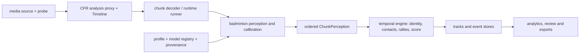

# Full pipeline: architecture and integration contract

Status: working architecture and ownership map, 2 November 2026. Baseline commit:
`32a8295d9645d81bd1586a777541bb2f72c08bed`; branch: `full_pipeline`. This
specification describes existing interfaces and proposed constraints; it is not a
claim that all stages are replaceable or independently validated today.

## Objectives and invariants

- Preserve the current application, TrackNetV3 baseline and independent singles and
  doubles identities. Change algorithms only for a demonstrated defect or a
  comparable labelled evaluation. Missing evidence stays unknown.
- Use the existing `bai_engine.sport.SportPlugin` / `SportSession` seam: the engine
  owns media, decode, scheduling, storage and transport; the badminton plugin owns
  its court, perception, identity, temporal events, rules and analytics.
- Analysis coordinates and indices belong to the CFR proxy `Timeline`; a derived
  proxy PTS is not an original variable-frame-rate source PTS. Do not silently
  treat duplicated proxy frames as independent source observations.
- A `ChunkPerception` is contiguous and ordered. `FramePerception` contains
  per-frame shuttle, player, calibration and scene evidence; `TrackSample` is the
  persisted API/Arrow boundary. Preserve existing field meanings and backward
  compatibility; changes to shared wire/cache schemas require orchestrator review.
- Court coordinates are metres on a calibrated floor plane. Airborne image
  positions are not floor positions or 3D speed measurements. Calibration loss,
  out-of-court candidates and absent pose/shuttle must remain explicit.
- Model predictions, tracker continuity, interpolation/reconstruction, event
  hypotheses, reviewer corrections and unknowns must not be conflated. Scores are
  heuristic unless independently calibrated. Do not turn a predicted location into
  a visible observed shuttle or force a doubles identity or match outcome.
- Existing `ModelRegistry`, profiles, runtime resource selection, and perception
  codec are the starting points. New shared protocols or schema changes need a
  demonstrated replacement use case and compatibility plan, not a parallel framework.

## Workstream ownership and integration order

Only the named owner may edit a production area while work is parallel. Research
agents write only their named document. No agent changes shared engine schemas,
profiles, dependencies, model manifests or other agents' files without the
orchestrator's prior coordination. All work remains in the current checkout; no
worktree reset, SSH, weight downloads, media processing or tests on this device.

| Workstream | Owner | Files | Contract / acceptance |
|---|---|---|---|
| External comparison | Repository research agent | `docs/research/external-repository-analysis.md` | Pinned evidence and existing-project comparison; licensing and gaps explicit; no production edits. |
| Model research | Model research agent | `docs/research/model-and-algorithm-evaluation.md` | Primary sources, model/weight rights separately, uncertainty and realistic resource evidence; no checkpoint downloads. |
| Shuttle integrity | Shuttle agent | `sports/badminton/src/bai_badminton/perception/shuttle_post.py` and dedicated shuttle tests only, if a concrete defect is found | Preserve existing public API and baseline; fail safely on missing/uncertain evidence; write focused regression tests, report unrun tests. |
| Model export integrity | Model-cache agent | `sports/badminton/src/bai_badminton/perception/tracknet.py` and dedicated tests only | Prevent stale derived ONNX reuse after checkpoint changes without changing tensor contracts or loading unrelated weights; keep deterministic provenance and report unrun tests. |
| Contact cut-context integrity | Integration agent | `sports/badminton/src/bai_badminton/observations.py`, `participant_contact.py`, `events/contact.py` and dedicated tests | Preserve existing no-boundary behavior; carry shot/replay boundaries through participant windows and do not derive motion from different segments. |
| Shared contracts, evaluation, integration | Orchestrator | `engine/`, `sports/badminton` outside shuttle ownership, architecture and ledger docs | Inspect before change; no unsupported model replacement or fabricated accuracy; review other work before integration. |

Other domains (player identity, court, contacts, rallies, scoring and exports) remain
owned by the orchestrator until separately delegated. Stage dependencies are source
and time → calibration/players/shuttle → contacts/attribution → rallies/score →
analytics/review. An optional component's failure must remain observable and must not
silently fabricate downstream data. A workstream may report no safe change if its
baseline or needed labels are unavailable.

## Baseline and validation procedure

Starting status on `main` contained tracked deletions under
`Design/production-prototype/`, modifications to `apps/web/package.json` and
`apps/web/pnpm-lock.yaml`, and untracked `Design/design.md`, `Design/references/`,
`SportsVideoAnalysis/`, `client-website/`, and the requested external research
report. They are unrelated user work and must not be reset, moved or committed.
The branch was created at the same starting commit without modifying these files.

Before any major replacement, use match-level development and held-out labels and
record video identity, timeline mapping, calibration, model/configuration hashes,
code revision and exact command. Evaluate player detection and identity switches,
shuttle visibility/localization, contacts and attribution, shot classification,
rally boundaries and scores separately. Unknown labels and measurements remain
unavailable, not zero or a claim of success. Multi-court geometric exclusion is
not shuttle/contact accuracy.

The user requested local work without SSH. The repository's runtime instructions
reserve all tests, inference and media processing for the remote GPU server and
Windows for editing, Git and browser access. These constraints preclude executing
those checks in this session; source-level inspection and Git/diff checks are
allowed. Any test files written here are unexecuted until an authorized runtime is
available. Do not report GPU, real-video, regression, before/after or end-to-end
results without executing them.

## Existing stages and replacement boundaries

| Stage | Current implementation and contract | Evaluation / unresolved boundary |
|---|---|---|
| Ingest and time | `bai_engine.media.probe`, `media.proxy`, `decode.Decoder` / `SegmentDecoder`, `Timeline` and `runtime.runner`. Source is probed, an analysis proxy is encoded CFR, then bounded HLS chunks feed a sport session. | `Timeline` is exact for the proxy, not a per-source-frame PTS map. VFR conversion and duplicated frames require separate source correspondence before treating proxy samples as independent. |
| Court and camera | `bai_badminton.court` fits geometry; `perception.court_lines`, `camera` and `calibration_state` select/track a court and represent quality/loss. | Validate held-out landmarks and selected court under partial views, cuts and calibration loss. A floor H is not an airborne shuttle transform. |
| Player and pose | `PlayerDetector`, `PoseEstimator`, `PlayerTracker`, `PlayerPerception`, `CourtROI`; `PersistentPlayerAssociator` supports motion/appearance and explicit ambiguity. | Individual identity is not a court side. Match-level labelled ID-switch/coverage/precision evidence for four-player amateur footage remains necessary. |
| Identity | `identity.IdentityResolver`, `participants`, `identity_review`, and participant snapshots preserve episodes, names and review separately. | Track episode IDs do not prove persistent people; role and roster attribution require evidence and may remain unknown. |
| Shuttle | `TrackNetV3.detect` / `heatmap_to_point`; `Track` and `process` retain `interp` flags in temporal arrays. | Checkpoint/tensor compatibility and cache provenance matter; internal `vis` includes reconstructed coordinates. Labelled shuttle localization and visibility metrics are not established here. |
| Contact and attribution | `events.contact.score_frame` / `detect_contacts` fuse trajectory, player proximity, pose and optional racket geometry; participant attribution is provisional. | Scores are uncalibrated. An observed racket ellipse, wrist proximity or shuttle turn is not proof of impact. Measure missed contacts and player attribution separately. |
| Shot classification | `StrokeClassifier` accepts `StrokeContext`; rule baseline and optional BST adapter support abstention. | The BST two-player inputs do not establish doubles transfer. Evaluate conditioned classification separately from end-to-end event recall. |
| Rally and rules | `RallyFSM`, `match_phase`, `score_ocr` and badminton `rules/` form streaming state and reconcile evidence. | Derived segments and score are hypotheses absent independent labels. Replay, short gaps and unknown outcomes need regression and real-video review. |
| Analytics and review | `analytics/`, `identity_review`, engine event/track stores, API and web render derived results. | Reports must retain observation/inference/review provenance and avoid physical speed from floor-projected flight. |
| Evaluation | `engine.evaluation`, `research/evaluate_session.py`, `shot_benchmark.py`, `tracking_benchmark.py`, `participant_benchmark.py`. | Reviewed, exhaustive source-bound labels and held-out recording splits are prerequisites for accuracy claims. State split independence and reviewer attestation rather than treating them as verified automatically. |

The above is a map, not a claim that all stage-specific interfaces are separately
replaceable today. In particular, `BadmintonPerception` still composes several
specific adapters, and finer detector/tracker/reconstructor plug-ins require an
independently justified migration plan and compatibility tests.

## Runtime inventory, 2 November 2026

The local Windows device reports Python 3.12.10 and Intel UHD Graphics via
`Win32_VideoController`; it does not report an NVIDIA GPU. These are read-only
inventory results, not a CUDA/provider test or a model benchmark. No server
inventory was obtained because this session is local-only. The local workspace
contains configuration and historical server reports, but they cannot establish
current server VRAM, availability or throughput.

## Change ledger and remaining gates

- Rally annotation eligibility now requires explicit human-review attestation for
  `status=reviewed`; draft labels remain explicit and unreviewed. Migration:
  reviewed manifests without `review.human_verified=true` must be inspected and
  attested by a real reviewer; do not mechanically set the flag.
- Shuttle `process` accepts explicit shot/replay boundaries to keep interpolation
  and spike comparisons inside a segment. The match engine constructs those
  boundaries from recorded shot and replay changes. Cut speed is unknown rather
  than calculated from points in different shots. Source-level implementation and
  authored regression tests are not evidence of runtime correctness or improved
  accuracy until executed and compared with independent labels.
- The same in-window boundaries now reach contact velocity, wrist evidence and
  suppression through `WindowObs` and participant windows. Post-contact shot
  kinematics and next-contact flight timing are separate consumers and may still
  use evidence across a cut; they have not been changed or validated.
- Existing `Track.vis` includes interpolated positions and is still used by the
  rally FSM. The effect on rally continuity has not been changed or validated.
- Temporary camera-pose/calibration loss may mix raw and stabilized coordinates
  within a single shot. This is not solved by shot/replay segmentation and needs a
  separately reviewed coordinate-frame contract and regression tests.
- Model ONNX exports and other derived caches need checkpoint, model-code,
  configuration and toolchain provenance. First-fetch hashing records bytes but
  does not independently authenticate a checkpoint's origin.
- No baseline/after event or shuttle metrics were produced in this session; no
  evidence establishes real-video, GPU, singles or doubles accuracy improvement.
