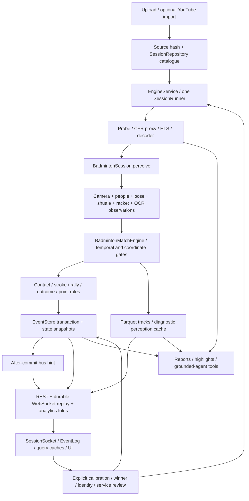

# Full pipeline phase 2 ledger

## Current audit — 3 November 2026

This section supersedes the historical completion/authorization statements below.
The current branch is `full_pipeline`, HEAD
`cc73688630e40d534d94b7ef32bd0cbfed7e0571`. The current user explicitly requires
**no commits**. All audit/score changes are uncommitted. Changes are authored in the
Windows checkout and transferred using binary Git diffs from a temporary index
to `/home/administrator/Desktop/sport-analytics/event-score-integrity-20261103`.
The real local index and unrelated work are preserved. The primary server checkout,
its existing environment/model files and port-8010 application are not deployment
targets of this audit. Cloudflare remains disabled during testing.

The earlier score repair is part of this candidate, not an unrelated replacement.
Its [defect ledger](event-score-integrity-ledger-20261103.md) records S1–S12 and C1;
the [score lineage](event-score-integrity-20261103.md) traces the visible score back
through accepted point decisions to canonical-frame evidence. The expanded
[contract inventory](full-pipeline-contracts-20261103.md) and
[validation record](full-pipeline-phase-2-validation.md) are the current references.

The subsequent user-approved [real-video/runtime continuation](real-video-runtime-validation-20261103.md)
resolved the missing ONNX exporter and private Redis-service prerequisites.
Fresh ONNX CPU/CUDA parity and cache reuse passed; all13 real Redis/external
API-worker stages passed. Fresh inference covered SampleRally480 frames,
Test7 10,725 frames and an A02 1,800-frame prefix. Full backend regression is now
**1,418 passed**. Test7 has33 unknown outcomes and zero accepted points; target
accuracy remains unmeasured. Four approved additive exporter packages are the
only installed-distribution changes; no production deployment or commit occurred.

### Inventory and ownership

The three linked inventories are constituent parts of this ledger. They identify
actual functions/routes, inputs, outputs, consumers, state/persistence, identifiers,
time/coordinate contracts, failure behavior, tests and next actions. Paths are
source-grounded, rather than proposed module names. A discovered test is not a
passing test; executed commands and final status are recorded separately.

| Inventory / owner | Components covered | Authoritative state and dependency boundary | Validation level / next gate |
|---|---|---|---|
| [Backend and runtime](audits/backend-runtime-20261103.md), backend audit owner; root integrates shared runtime | App/CLI/configuration; upload/import/reuse; catalogue; lifecycle/background workers; event/track storage; LocalBus/Redis; registry/archive/ONNX/TensorRT; API/WS; exports; auth; agents; metrics and runtime | `engine/` owns media, execution and generic persistence. One temporal runner per session in one service; per-session SQLite events are the durable domain record. Redis hints/queues are not an exactly-once ledger. | GPU regression, controlled browser workflows, fresh ONNX CPU/CUDA parity and real private-Redis/API-worker checks passed. Crash acknowledgement, general multi-writer/reset safety, LLM providers and native TRT remain unverified. |
| [Perception and timeline](audits/perception-timeline-20261103.md), perception owner; root owns media integration | Probe/proxy/decode; court/calibration; camera/stabilization; person detection/tracking/pose; four-player hypotheses; TrackNet/background; racket; contacts; strokes; rally FSM; terminal outcome; OCR | Canonical CFR indices own analysis time. `sports/badminton/` owns geometry, observations, temporal reasoning and scoring. Raw observations, reconstructed points, identity hypotheses and review are separate. | Temporal/model-contract unit tests and real media integration; historical bounded Torch GPU parity. Current target accuracy is blocked by independently reviewed labels. |
| [Frontend and analytics](audits/frontend-analytics-20261103.md), frontend/analytics owner | Production route tree; requests/upload; socket; session/playback/query stores; video/overlays; score/rallies; tactics/movement/heatmaps/highlights; roster/review/doubles/individual analytics; Q&A/exports/preferences | React/Zustand/Query hold projections and presentation state. Accepted durable events own score; reviewed roster identity is separate from P1/P2 scoring slots and visual tracks. | Vitest/API tests plus real browser/model-free server. Mocked authentication failures and controlled observations are labelled as such. |
| Root / integration | Shared contracts, EventStore/SessionRepository, cancellation/stream selection/transport/configuration, Git transfer, remote tests, evidence reports | Coordinates schemas and production-file ownership; no concurrent agent edits to shared files | Independent source review and integrated validation required before closing a defect. |

No new broker, orchestration framework or model was introduced. The sport engine
writes its own domain transaction; a separate consumer does not award points from
a perception topic. See the contracts document for replay, correction and retry
semantics. The production SPA has no import of the fixture-based prototype entry.

### Expanded defect ledger

P1 affects durable state, lifecycle, isolation or artifact integrity; P2 affects
bounded projections, resource retention or truthful failure presentation. RED
means a regression failed against the relevant pre-fix candidate on the GPU
server. Final GREEN status is in the validation record; no row asserts ML accuracy.

| ID / priority | Expected → observed / root cause | Smallest correction and owner | Reproduction and downstream check |
|---|---|---|---|
| A01 / P1 | Verified ONNX archive bytes should select a complete matching graph bundle → old extracted members were reused across changed archives, partial failures and concurrent extraction. | Private verified archive snapshot; digest-bound complete-directory publication; checked member manifest and safe relative paths. Backend owner, `runtime/registry.py`. Preserve legacy artifacts. | `test_model_archive_integrity.py`: six RED cases; registry/verified artifact suites. No real download. |
| A02 / P1 | Stop/delete/retry must wait for every owned media writer → stop only signalled semantic processing; transcode/sprite could keep writing, and uncaught worker OSError left ingest waiting. | Register/cancel FFmpeg jobs including sprites; join media worker before runner exits; propagate failure and stopped status. Root, `runtime/runner.py`, `media/ffmpeg.py`, `proxy.py`. | `test_runtime_stop_integrity.py`; real media/lifecycle/reanalysis tests. Callback-failure cleanup is separately covered. |
| A03 / P1 | Probe, proxy and warm-start calibration must use the same movie stream → probe excluded artwork while consumers selected first video. | Persist/select the probed global stream index through proxy plan and source sampling. Root, `media/probe.py`, `proxy.py`, `runner.py`. | `test_media_stream_selection.py`: two RED cases; existing rotated/barcode/partial-media tests. Mock artwork ordering is not a genuine mux fixture. |
| A04 / P2 | Finished camera-shot background reservoirs should be released → all old shot IDs retained samples/medians. | Keep backgrounds needed by the current sequential call and evict obsolete IDs. Perception owner, `perception/tracknet.py`. | `test_tracknet_background_retention.py`: retention RED plus preservation controls, sparse-ID case; no model/tensor/threshold change. |
| A05 / P1 | External commands need a shared transport; fractional polling must return → external/no-Redis was silently disconnected, and `int(.5)` made Redis BLPOP wait forever. | Reject unsupported settings; preserve fractional timeout. Root, `config.py`, `bus.py`. | `test_external_lifecycle_contract.py`, `test_redis_timeout_contract.py` RED. Later real Redis7.2.12 fractional timeout, command/pubsub and separate API/worker checks passed; see the continuation report. |
| A06 / P1 | Delete must know the writer stopped → external API queued stop and immediately removed data. | External deletion returns409 until a worker acknowledgement/fence exists. Embedded stop/join deletion remains supported. Root, sessions route. | External lifecycle RED proves catalogue/evidence must survive rejection. Cross-process orchestration remains partial. |
| A07 / P1 | A completed reset must reopen current-generation storage → independent reader retained the old unlinked event database. | Generation-aware handle refresh, with request-snapshot acquisition kept coherent. Root, `store/sessions.py`. | `test_external_generation_refresh.py` RED; independent connections and reset windows. Does not establish general cross-process reset fencing. |
| A08 / P1 | Host overrides must reach the authentication guard → CLI bound to overridden public host while app settings still described localhost. | Resolve one effective host/port Settings for app and Uvicorn. Backend owner, `cli.py:_serve`. | `test_cli_bind_contract.py`: two RED cases. No public listener was opened during this audit. |
| A09 / P1 | Product insights/overview must combine one event revision → correction between separate reads caused missing rally IDs/mislabelled lineage. | Hold whole per-match read snapshot including summary and evidence/lineage. Frontend/analytics owner, `product_analytics.py`. | `test_product_projection_integrity.py`: deterministic separate-WAL correction; five RED cases plus accepted-point control including A10. |
| A10 / P2 | Tactics must count accepted points only → provisional/retracted/unknown decisions still supplied wins/rates. | Require canonical `score_available`; retain observed activity without inventing point totals. Same owner/file. | Invalid-decision variants vs accepted control; existing score/analytics tests. |
| A11 / P1 | Reports must describe one revision; downloads must be complete and keyed to inputs → mixed PDF/CSV snapshots, partial cached clips and stale clips after proxy/FPS changes. | Snapshot projections; private encode staging; atomic publication; metadata fingerprint and pre-publication proxy recheck; explicit timeout/replacement errors. Backend owner, exports route. | `test_export_publication_integrity.py`: failure, timeout, concurrency, snapshot, changed-input and replacement-during-encode RED. Actual media/export integration also required. |
| A12 / P2 | HLS authorization failure must be actionable →401/403 retried forever as “waiting”. | Cancel pending retry, stop load, expose terminal error; keep initial404 recovery. Frontend owner, `useHls.ts`. | Three RED cases and transient404 control in `useHls.failure.test.tsx`. |
| A13 / P2 | Leaving upload must cancel owned work → XHR/progress/error/navigation continued after unmount. | Abort and guard all post-await callbacks by active lifetime. Frontend owner, `LibraryPage.tsx`. | Two RED failures plus control in `LibraryPage.lifecycle.test.tsx`. |
| A14 / P2 | HTTP failure must differ from zero reviewed evidence → individual/pair failures displayed empty results. | Render query ErrorNote before no-data states. Frontend owner, reviewed panels. | `ReviewedAnalytics.failure.test.tsx`: two RED errors, two empty-data controls. |
| A15 / P2 | Same-generation rally correction must refresh movement support → analysed sessions stopped polling and omitted analyticsVersion invalidation. | Invalidate movement evidence for affected session/player on committed analytics change. Frontend owner, `useInsights.ts`. | Two RED support-change directions in `useInsights.refresh.test.tsx`. |
| A16 / P2 | Canonical frame and grounding labels must match evidence → source-frame wording and a semantic grounding guarantee exceeded implementation. | Label analysis proxy frames and scope Q&A citation wording. Frontend owner, SessionPage/Timeline/AskTab. | Copy assertion plus browser evidence navigation; no claim of source-PTS map or semantic answer proof. |
| A17 / P1 | Capability probe must not suspend a background service → FFmpeg NVENC probe inherited terminal interaction and triggered SIGTTOU in browser baseline. | Add `-nostdin`; start disposable server with detached stdin. Root, `media/ffmpeg.py`. | `test_ffmpeg_probe_isolation.py` RED plus observed stopped process/child; interrupted browser run retained, not counted as pass. |

### Unimplemented capabilities, unresolved risks and next gates

| Status | Boundary / evidence | Required next action |
|---|---|---|
| Not implemented | Source-to-proxy PTS/duplicated-observation map; current analysis IDs are CFR proxy IDs. | Preserve source observation identity before treating duplicated CFR pixels as independent corroboration. |
| Not implemented | Independent replay-content recognizer. Current `replay` flag means excluded/non-main view. | Separate view eligibility from live/replay/unknown and evaluate same-camera replays. Duplicate scoring is not demonstrated. |
| Not implemented in live path | InpaintNet, shuttle second opinion/live model, learned racket detector, BST live classifier, 3D shuttle speed/trajectory, authoritative automatic line calls, TorchCodec decoding. | Require artifacts/licenses/contracts and comparable independent labels; retain explicit capabilities/fallbacks. |
| Runtime prerequisites resolved; advanced guarantees unverified | Approved additive packages enabled fresh ONNX export and actual CPU/CUDA parity. A private Redis7.2.12 build enabled13 passing real-service/API-worker stages, including graceful restarts and reanalysis. | Keep Redis acknowledgement/crash tests and general writer/reset fencing open. Remote/local LLM providers and native TensorRT lifecycle still require real execution. These checks do not authorize production deployment. |
| Known incomplete contract | Local commands are in-memory; Redis BLPOP lacks processing ack; generic correction HTTP202 has no durable result receipt. Worker-side failures can be logged without per-command UI failure. | Add correlation/ack/retry only with a bounded durable contract; do not claim exactly-once command delivery. Accepted point persistence itself is transactional. |
| Architecture risk | Cross-process concurrent reset/delete/write, multiple API/engine writers and raw Q&A handles retained across `to_thread`. Local locks are not distributed locks. | External deletion is fenced by rejection; validate reset/read races and design ownership/ack protocol before calling external runtime ready. |
| Configuration/label debt | Inactive profile knobs (`analysis_height`, `chunk_frames`, refinement/cadence knobs); System UI displays profile height while proxy uses Settings.proxy_height; body7 alias named halpe26. | Expose executed configuration, retire/label inactive options. Do not enable new models to match prose. |
| Cache migration limitation | Stream-selection repair governs newly prepared media. Complete existing proxy/HLS takes the pre-existing fast-reuse path and is not forcibly rewritten; media cache has no automatic pipeline-version migration. | If an old proxy is proven to use artwork/wrong media settings, preserve it and its dependent results before explicit regeneration. This audit did not rewrite user media or claim old outputs were repaired. |
| Configuration limitation | OCR assumes standard21/30 game thresholds; custom MatchConfig arithmetic is broader. No complete lets/faults/retirement officiating. | Specify/evaluate supported custom formats and unusual match events separately. |
| Implemented but limited | Single-user signed-cookie auth/CSRF; no tenant/user ownership partition, RBAC or durable audit of individual human identities. | Use intended single-user deployment scope; multi-tenant authorization is new work. |
| Observability debt | Some metrics are declared without updates; health is liveness, not model readiness; no distributed trace/command receipt. | Instrument actual stage failures/latency and command outcomes; avoid unsupported performance claims. |
| Unverified shutdown race | EngineService shutdown does not join its command-consumer thread; an in-flight command may return after the stop flag. Source-review risk, not a reproduced regression in this audit. | Test shutdown/dispatch ordering with real external transport before enabling that deployment. Current media-worker cancellation fixes do not constitute this broader coordination guarantee. |
| Blocked by ground truth | Target shuttle/contact/hitter/stroke/rally/point/score/doubles/line accuracy and comparative quality/performance. | Source-bound, independently reviewed exhaustive labels, match-disjoint splits and artifact/config/runtime fingerprints. Synthetic fixtures and geometric exclusion are not accuracy. |

The audit is **prepared for further validation**, not a production-readiness or
real-world accuracy certification. The current validation document distinguishes
the final executed candidate from historical counts below.

## Historical phase-2 record — 2 November 2026

The following authorization, commits, runtime and counts belong to that earlier
phase. They do not authorize commits or imply fresh validation in the current audit.

## Starting state and authorization

- Local branch `full_pipeline` began at `32a8295d9645d81bd1586a777541bb2f72c08bed`.
  Existing phase-1 changes were inspected and committed as `27e2a20` (22 scoped
  files), then pushed to `origin/full_pipeline` at the user's explicit request.
- Unrelated tracked deletions under `Design/production-prototype/`, web dependency
  edits, and untracked user folders remain local and uncommitted.
- The latest direct user request authorizes SSH, updating an isolated server checkout,
  and server tests/inference. It supersedes the phase brief's default no-SSH restriction.
  No credentials may be written into Git, scripts, documents or application logs.
- Server primary checkout remains on `main` at `510b7039fee99b017a643bfcaf62804f0d9b7564`,
  with untracked `apps/web/dist.old/` and `client-website/`; it was not switched or reset.
- Isolated server worktree: `/home/administrator/Desktop/sport-analytics/full-pipeline-phase2-20261102`,
  tracking `origin/full_pipeline`; each scoped correction was committed locally,
  pushed and pulled before server validation.
- Validation uses the existing `Sports_Analytics/.venv`, sources `../gpu-env.sh`, and
  explicitly places this worktree's packages first in `PYTHONPATH`. No environment
  installation/upgrade, model download, data replacement or deployment is authorized.
- Server runtime inventory: Python 3.12.12; PyTorch 2.14.1+cu126; ORT 1.29.0; two
  GTX 1080 Ti GPUs, 11 GiB each, with no compute jobs reported at initial inspection.
  Cloudflare PID 701600 was stopped before broader tests; it required SIGKILL after TERM.
- Phase-1 targeted tests: **44 passed**. Baseline including research tests:
  **1,148 passed**, 12 existing Starlette deprecation warnings. Server logs are
  under `../full-pipeline-validation-20261102/`.

## Ownership and dependency order

Author code locally; transfer commits through Git. The orchestrator exclusively owns
`bai_badminton/engine.py`, perception integration, shared contract decisions, evidence
reports and server execution. Agents author focused tests first and wait for recorded
server red results before changing production code. No agent installs or runs inference,
uses SSH independently, commits shared work or edits another owner's files.

| Issue | Evidence classification and existing behavior | Expected correction / owner | Regression and runtime gates | Status |
|---|---|---|---|---|
| Reconstructed shuttle visibility reaches rally FSM | Confirmed by server RED: reconstruction could start/extend play | Rally agent plus root: observed mask `vis & ~interp`; velocity requires adjacent observed positions | Initial temporal RED: 33 failed / 4 passed; subsequent focused gates passed | Implemented; final suite passed |
| Non-replay cuts retain stationary/rally state | Confirmed by server RED: old scene history survived | Rally agent: `on_discontinuity(frame)` closes pre-boundary evidence before new contacts, prevents merges, clears history | Open/closed exchange, tentative end, replay, short/long gaps | Implemented; final suite passed |
| Post-contact flight/receiver context crosses cuts | Confirmed by server RED | Temporal agent/root: shared half-open segment bounds, clipped motion, unknown cross-segment flight/receiver; next hit remains an exclusion bound | New segment cases plus existing stroke/contact suites; 28-test correction gate passed | Implemented; final suite passed |
| Raw/stabilized coordinates mix during recovery | Confirmed by server RED; mismatched chunk reference was treated as raw fixed-camera input | Root: private coordinate epoch/context and temporal validity; preserve raw overlay rows; reject incompatible camera pose | Pose loss/recovery, singular/nonfinite transforms, references, calibration, alternate views | Implemented; 24 camera/outcome tests passed |
| Delayed outcomes use replacement calibration | Independent review found old pixels reinterpreted through new homography; RED changed in to out | Root: retain each frame's actual calibration reference and trim with buffers | Shifted recalibration reproducer failed, then passed with camera/outcome gate | Implemented; final review closed |
| Bounded history and preceding cut | New integration review found trimmed start crash and overly broad outcome lookback | Root: unavailable start context stays unknown; outcome lookback begins within current rally | Long motion-only exchange and short completed post-cut rally regressions | Implemented; integration gate passed |
| ONNX/checkpoint artifact lifecycle | 27 cache/snapshot/provider cases failed before correction | Cache agent/root: verified snapshot handoff, digest and ORT IO validation, content-addressed graph plus atomic manifest, lazy graph-digest provider selection | 62 cache/integration tests passed; real Torch CUDA tensor parity exact | Implemented; fresh real ONNX export blocked by missing `onnxscript`/`onnx` |
| First-use pin publication | Separate RED reproduced failed-write and cross-process races | Cache agent: OS advisory transaction lock and fsynced atomic pin replacement | 6 pin/snapshot tests passed, including independent processes | Implemented |
| Native TensorRT engine/timing caches | Compatibility directory alone could not guarantee native build publication safety | Cache agent: persistent caches explicitly disabled by default; internal compatibility namespace requires complete build identity and a lifecycle-aware owner | Version/hardware/model/precision and incomplete-identity tests; no native engine built | Safe default implemented; native cache lifecycle unvalidated |
| Evaluation eligibility and label readiness | RED: unknown/partial review semantics ignored, invalid winners accepted, annotation file reread, media bytes unchecked | Evaluation agent/root: strict v1 semantics, optional timeline/proxy bindings, actual source/proxy hashes, one annotation snapshot | 73 failed / 45 passed before fix; 118 passed after fix | Implemented; split independence still a protocol requirement |
| Full-video accuracy | Existing weights/proxies/caches inventoried; no new independent reviewed target labels | Root: same cached observations replayed into fresh baseline/candidate stores; 27,744 frames complete | Diagnostic counts changed; all compared outcomes unresolved; no accuracy claim | Labelled accuracy unavailable |
| Integrated application | Isolated localhost test server, fresh disposable data, no production reanalysis | Root: build, upload, proxy/HLS, engine, API export and browser playback | Build passed; 240/240 frames analysed; browser readyState 4, no media/console error | Smoke and final Python suite passed |
| Legacy archive extraction | Source audit: `onnx-zip` extraction can reuse stale files; lexical containment is weak | Existing path API unchanged; new snapshot API rejects archives | Separate digest-bound extraction and traversal regression work required | Explicitly outside completed TrackNet cache scope |

## Validation plan

1. Run phase-1 focused tests and broader server baseline before further changes.
2. Commit only new focused regressions, pull them into the isolated worktree, and record
   expected failures. Implement the smallest coordinated fixes locally.
3. Commit/push/pull each scoped correction; rerun its tests, then related suites.
4. Inspect model/export/provider behavior using existing trusted weights and bounded
   synthetic inputs; do not infer model accuracy from tensor parity.
5. Exercise the integrated application on localhost/SSH forward, with existing session
   results preserved and new validation artifacts outside user sessions. Report missing
   labels, unsupported providers and runtime failures explicitly.

## Evidence and current limits

The final integrated command is `python -m pytest -q engine/tests
sports/badminton/tests agents/tests apps/api/tests research/tests`; **1,307 passed**
with 12 existing Starlette deprecation warnings in 203.20 s, exit 0, at code revision
`5f9d0a4`. Evidence is in `phase2-verified-full.log` and
`phase2-verified-full.exit`. An earlier default-path run exposed four
fixtures without required timeline/camera evidence; their 45-test gate passed after
correction. The negative attribution fixtures now also retain valid flight context,
so unknown results must arise from the person-evidence condition under test.

The real GPU probe used the existing pinned TrackNet checkpoint, no download or
installation. Both revisions returned finite FP32 `[1,8,288,512]` heatmaps with
maximum and mean absolute difference **0**. One measured forward after one warmup
was 21.189 ms baseline / 20.892 ms candidate; this is not a throughput benchmark.
Eight existing proxy frames decoded and one detector call completed. Real fresh
ONNX export failed with `ModuleNotFoundError: onnxscript`; no graph was published.

See [full-pipeline-phase-2-report.md](full-pipeline-phase-2-report.md) for exact
commands, replay counts, evidence paths, schema migration and remaining gates.
