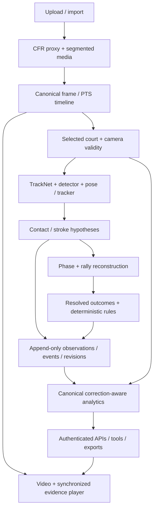

# Production integrity audit — 23 October 2026

This is a measured improvement of the existing implementation. It does not certify
badminton perception accuracy. Read with [analytics](audit-analytics.md),
[temporal](audit-temporal.md), [frontend](audit-frontend.md), and the
[model decision matrix](audit-models-20261023.md).

## Verified starting state and execution plan

- Authoritative server: `/home/administrator/Desktop/sport-analytics/Sports_Analytics`.
- Starting branch `front-end`, commit `d661bc550291218d515b8e3910ceea89c899da00`;
  both `origin/main` and `origin/HEAD` already at that commit following the requested push.
- One existing worktree; sole untracked user directory `apps/web/dist.old/` preserved.
- Work isolated on `codex/production-audit-20261023`; no reset, dependency synchronization,
  model downloads, driver changes, session deletion, or real-session reanalysis.
- Actual hardware: **two GTX 1080 Ti, 11,264 MiB each**, not the proposed RTX 4000 Ada.
  Existing `.venv`, Pascal-compatible CUDA 12.6 / Torch 2.14.1+cu126 and `../gpu-env.sh` used.
- Fresh baseline: **228 backend tests passed in 129.90 s**, two existing warnings;
  frontend **43 tests**, typecheck pass and six pre-existing Biome warnings.
- Existing architecture evidence: `docs/architecture/ROADMAP.md`,
  `docs/multi-court-isolation.md`, `docs/pipeline-validation-notes.md`, repository research
  reports, and `Design/production-prototype/DESIGN_DIRECTION.md`. The separately named
  attachment “Unified Sports Video Intelligence Platform — Comprehensive Reference
  Architecture” was not present in the supplied attachments or repository search.

The approved master prompt supplied the target architecture. Execution used bounded
deliverables rather than replacing the platform: reproduce defects; repair event
acceptance and aggregation; add source-bound evaluation; fix video interaction;
review shared contracts; replay stored observations; run integrated regression.

## Ownership and dependency map

| Responsibility | Owner | Existing boundary and downstream consumers |
|---|---|---|
| Orchestration, research, evaluation, analyst tools, acceptance | Lead | `engine/evaluation.py`, `research`, `agents/tools.py`, this report |
| Temporal acceptance, outcomes, live canonical fold | Temporal specialist | `bai_badminton/engine.py`, `events/match_phase.py` -> event ledger -> analytics/rules |
| Spatial evidence, corrections, metric availability | Analytics specialist | `analytics/{rebuild,match,spatial,heatmaps}.py`, API analytics -> UI, reports, tools |
| Video layout, selected evidence, canonical seeking | Frontend specialist | production React/player/playback store -> backend events/media; prototype preserved |
| Independent review | Temporal and frontend specialists + lead | Cross-owner source review, synthetic regressions, isolated replay, browser tests |

There were three concurrent specialists plus the lead, constrained to separate file
ownership. Engine/API/React contract changes were coordinated before integration.



Platform ingestion/decoding/storage and sport semantics remain separate. No additional
orchestrator, microservice or generic plugin framework was justified by these defects.

## Prioritized findings and acceptance evidence

| Priority | Demonstrated root cause | Result / evidence |
|---|---|---|
| P0 | Cut/EOF terminates a visible exchange, but outcome heuristics inferred a point | Incomplete outcomes abstain; OCR/reviewer resolution retained; synthetic regression and four full cached replays |
| P0 | Missing calibration/stillness counted as affirmative official-play evidence | Initial heuristic promotion requires evidence; explicit authoritative controls retained |
| P0 | Copied rally shot payloads outlive canonical corrections/retractions | Canonical lineage resolution, official rally ownership, live/persisted/analyst consistency |
| P0 | Raw path ignores timestamps, camera validity, missing frames and track switches | Versioned court-plane estimator with coverage and nullable unavailable values; synthetic failure reproductions |
| P1 | Warmup/open hypotheses leak into stroke totals and analyst search | Official containing-rally ownership required |
| P1 | Analyst tools read historical stroke copies and cache analytics after corrections | Corrected evidence IDs/labels; retractions omitted; revision-sensitive cache |
| P1 | Receiver feet labelled as shuttle landing | Explicit receiver source; unsupported landing maps withheld |
| P1 | Evaluator reuses predictions, hardcodes25fps, computes winner metrics only first15 rows and defaults missing calibration error to0 | New pure one-to-one temporal evaluator and read-only source-bound CLI; historical report retained as historical |
| P1 | Fixed picture height, missing selected details, stale clip/session state | Intrinsic video aspect ratio, details beneath player, central selection/clip state and browser regressions |

## Real evidence and evaluation limits

Four stored recordings cover sample singles, broadcast singles, broadcast doubles,
and multi-court VFR CCTV. Canonical rates are30/25/25/30fps. The CCTV source has15fps
with a30fps proxy; duplicated frames do not increase the source temporal resolution.

Full **cached-observation semantic replay** processed47,505 decoded frames, excluding
padded scheduling frontiers. Rally intervals and phase decisions did not change.
Five outcomes at camera cuts became unresolved: singles24->23 points, doubles24->21,
incident50->49; sample remained0. This is conservative behavior, not labelled evidence
that the five previous winners were wrong. Final reproducible replay runtime was23.309s before vs24.135s after;
semantic replay time and must not be represented as end-to-end GPU throughput.

`docs/testing/audit-20261023/` stores replay and model timing artifacts. Model timing
does not measure player precision/recall. Existing geometric-isolation counts do not
measure shuttle/contact/shot/rally accuracy. No replacement model was promoted.

Legacy CSV labels exist for Test1/Test3/Test6/Test7 but lack verified binding to the
four stored sources. The new evaluator rejects mismatched media hashes and drafts
unless explicitly allowed. The16s sample's agent-reviewed contact-sheet draft has
0.5s boundary uncertainty, no verified winner/official phase, and visible legacy
detector overlays. Its diagnostic fails to match the much shorter stored exchange;
that is useful failure evidence, not a publishable accuracy result.

## Reproduction and remaining acceptance work

```sh
cd /home/administrator/Desktop/sport-analytics/Sports_Analytics
source ../gpu-env.sh
.venv/bin/python -m pytest engine/tests sports/badminton/tests agents/tests apps/api/tests -q -m 'not gpu and not slow and not network'
pnpm --dir apps/web test
pnpm --dir apps/web typecheck
pnpm --dir apps/web lint
pnpm --dir apps/web build
cd apps/web && BAI_E2E_PORT=8767 pnpm exec playwright test
```

Run `research/evaluate_session.py --help`, `research/benchmark_cached_models.py --help`
and `research/replay_cached_observations.py --help` for source-bound diagnostics.
Normal application startup remains `../start-server.sh` on8010.

Before any accuracy claim, independently review frozen source-bound labels for
official/non-match intervals, contact times/types/actors, identity continuity and
measured court landmarks/distances; keep held-out matches separate from threshold
selection. Report one-to-one event precision/recall, boundary error, unresolved rate,
per-class confusion, tracking switches and warmup false positives. No such complete
held-out set currently exists here. Four-person doubles identity/rules, shuttle3D
speed, racket evidence, calibrated physiological metrics, validated stroke taxonomy,
and full live-ingest semantics remain unsupported or unverified. Existing running
results are preserved; new semantic rules require backed-up reanalysis to regenerate
old stored events, while correction-aware metric reads apply immediately.

## Final integrated acceptance

- Complete CPU backend regression: **281 passed**, two pre-existing Starlette warnings,
  **129.68 seconds**. GPU/slow/network-marked tests excluded; actual GPU smoke timings
  and full cached-observation replay are reported separately.
- Frontend: **53 passed**; TypeScript passed; Biome passed with six existing explicit-any
  warnings; production build passed in6.80s with the existing Settings import warning.
- Final browser suite: **6 passed in24.9s**, separate disposable model-free test server.
- LiveFeed and Ask citations now share canonical selected-event playback; a missing
  event remains an explicit frame-only seek. Manual scrubbing releases old clip bounds.
- Independent review verified evaluation/benchmark contracts, export nulls and score
  availability. A concurrent analyst correction race was reproduced by mutation in
  memory and covered by a deterministic regression. Changed Python files pass Ruff;
  `git diff --check` passes; prototype/design reference diff is empty.
- PDF smoke generated a real report and extracted its text: missing metrics/scores
  appear as Unavailable rather than None or invented zero. No model-accuracy inference.
- Restarted only the verified application through `../start-server.sh` on8010.
  Existing pid file was stale; listener identity was checked before repairing it.
  Four real sessions remain analysed. Authenticated analytics/insights and byte-range
  delivery checks passed for every recording (HTTP206, correct range and1024 bytes).
  Catalogue, calibration, state and track endpoints also returned200.
- Post-restart browser review at1440px/390px selected real frame615 at20.500s with
  evidence/provenance beneath video, no horizontal overflow and no JavaScript errors.
  Cloudflare tunnel remained running; no real session was reanalysed or deleted.
