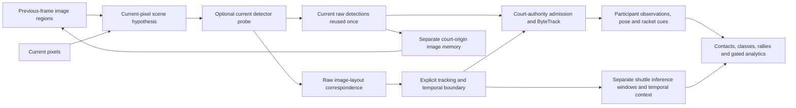

# Consolidated badminton pipeline evaluation — all preserved results

Generated **2026-11-13 (Asia/Kolkata)** from preserved evaluation files, without rerunning inference, rematching events, changing annotations or modifying the pipeline. Tests **1, 2, 3, 4, 6, 7, 9 and 10** are represented; Tests **5 and 8** remain intentionally excluded.

This file contains every saved aggregate metric, tolerance, runtime/resource statistic, component coverage count, annotation schema/semantic field, and interval comparison for the selected completed arms. Dense per-frame coordinate/error arrays and byte-by-byte source/hash manifests remain in linked immutable originals; their retained populations are indexed in the companion consolidation receipt. They are raw observations, not omitted headline scores.

## Read this before comparing scores

**Test10 now completed fresh inference and all-six-file evaluation on88aa0ad.** The original300-second frame-count timeout is preserved separately; only the preparation deadline was extended for this retry. Its older-pipeline result remains separate. Latest Test2 was produced by5ae6148, so there is still no homogeneous eight-video88aa0ad aggregate.

Supplied coarse references, generated rally/point references, diagnostic agent coordinate reviews and independently verified physical labels are distinct. An interval F1 from win_predictions.csv evaluates its timing only; it is not winner accuracy. Player point distance is not bounding-box AP/mAP or tracking IDF1/HOTA. Unknown metrics remain unavailable, not zero. Dataset exposure and edited/repeated broadcast footage prevent a blind match-disjoint generalisation claim.

Matching is the preserved rally-boundaries-v1 policy: zero-origin half-open intervals, IoU≥0.5, maximum cardinality then total IoU with the existing tiny boundary-distance tie term. Boundary and duration errors condition on matched pairs; all missed/extra detections remain in recall/precision. Test1 Full2 is a partial-positive reference: FP, precision and F1 remain unavailable.

Worker elapsed includes media/model initialization and integrated analysis. Parent elapsed includes orchestration overhead. Source fps=canonical frames/elapsed, not isolated NN fps. CPU seconds can exceed wall seconds because multiple cores are used. Stage p50/p95 are milliseconds per stage invocation, generally a chunk, not automatically milliseconds per video frame. Nested/overlapping stage totals are not an exclusive breakdown. Isolated model-loading latency and pure-NN throughput remain unavailable where the saved receipt says null.

## Navigation

- [Test 1](#test-1)

- [Test 2](#test-2)

- [Test 3](#test-3)

- [Test 4](#test-4)

- [Test 6](#test-6)

- [Test 7](#test-7)

- [Test 9](#test-9)

- [Test 10](#test-10)

## Latest completed per-video overview

| Test | Selected arm | Commit | Frames | Video HH:MM:SS | Worker HH:MM:SS | Worker seconds | Source fps | Peak GPU MiB | Coarse F1 | Generated rally F1 | Generated mean IoU |
|---|---|---|---|---|---|---|---|---|---|---|---|
| 1 | latest completed V7 | 88aa0ad | 17268 | 00:09:35.600 | 00:32:33.842 | 1953.84205158 | 8.83797131197 | 2124 | 1 | 1 | 0.870339283752 |
| 2 | latest completed V5 | 5ae6148 | 29296 | 00:16:16.533 | 01:00:45.819 | 3645.8190676 | 8.03550572774 | 2132 | 0.918918918919 | 0.945205479452 | 0.833925081547 |
| 3 | frozen-main evaluation-only | 88aa0ad | 8414 | 00:04:40.467 | 00:16:07.476 | 967.476499791 | 8.69685207012 | 2122 | 0.95652173913 | 0.837209302326 | 0.895383320463 |
| 4 | frozen-main evaluation-only | 88aa0ad | 20034 | 00:11:07.800 | 00:37:05.779 | 2225.77853647 | 9.00089549422 | 2124 | 0.934782608696 | 0.863636363636 | 0.820829196966 |
| 6 | frozen-main evaluation-only | 88aa0ad | 17915 | 00:09:57.167 | 00:36:15.115 | 2175.11466447 | 8.23634739474 | 2124 | 0.888888888889 | 0.777777777778 | 0.879355643346 |
| 7 | frozen-main evaluation-only | 88aa0ad | 10725 | 00:05:57.500 | 00:19:15.961 | 1155.96073061 | 9.27799683503 | 2122 | 0.920634920635 | 0.903225806452 | 0.836646921927 |
| 9 | frozen-main evaluation-only | 88aa0ad | 33157 | 00:18:25.233 | 01:07:44.123 | 4064.1230541 | 8.1584635993 | 2124 | 0.876543209877 | 0.831325301205 | 0.863165449997 |
| 10 | completed retry, preparation deadline only | 88aa0ad | 37133 | 00:20:37.767 | 01:19:28.768 | 4768.7684283 | 7.78670647533 | 2126 | 0.907216494845 | 0.890052356021 | 0.845262949688 |

The latest Test1 V7 native workflow completed, while its independent visual-acceptance review remained pending. Test2 V5 has mixed reference results and the documented short-rally omission; publication of existing fixes did not retroactively make this a passing nonregression result. Completed latest runs preserve artifacts even when local source/proxy media have been deliberately removed.

## Total measured processing time and batch wall-clock scope

| Scope | Tests | Sum worker seconds | Sum worker HH:MM:SS | Sum parent seconds | Sum parent HH:MM:SS |
|---|---|---|---|---|---|
| Completed evaluation-only videos includingTest10retry | [3,4,6,7,9,10] | 15357.2219137 | 04:15:57.222 | 15407.7322817 | 04:16:47.732 |
| Selected latest completed runs, with versions disclosed | [1,2,3,4,6,7,9,10] | 20956.8830329 | 05:49:16.883 | 21024.9877684 | 05:50:24.988 |

The sequential batch wall-clock envelope from Test3 download request to the recorded Test10 failure is **03:59:11.192** (14351.191953000seconds), from `2026-11-12T15:50:44.175683+00:00` to `2026-11-12T19:49:55.367636+00:00` UTC. This includes downloads, preparation, fresh inference, evaluation, visual rendering, retained-artifact verification, cleanup, waiting/orchestration and the failedTest10 preparation. It is not pure GPU compute and not the entire multi-day development effort. Summed nested stage times must not be added again to this envelope.

The report does not invent a total for every earlier investigation/failed attempt where a complete nonoverlapping wall-clock trace was not retained. Each preserved run has its own timings below, and earlier candidates are indexed separately.

## Aggregate results with valid comparison scopes

### New frozen-main evaluation-only cohort includingTest10retry

#### Full.csv — pooled saved counts, not a new matching run

[Exact saved source](/home/administrator/Desktop/sport-analytics/Sports_Analytics/evaluation/ground_truth_validation/reports/CONSOLIDATED_EVALUATION_ALL_RESULTS_20261113_v2.md)

| Saved field / metric | Value |
|---|---|
| tests | [3,4,6,7,9,10] |
| reference_family | Full.csv |
| TP | 293 |
| FP | 40 |
| FN | 21 |
| micro_precision | 0.87987987988 |
| micro_recall | 0.933121019108 |
| micro_F1 | 0.9057187017 |
| macro_precision | 0.885723482655 |
| macro_recall | 0.945057242638 |
| macro_F1 | 0.914097977012 |
| mean_IoU_weighted_by_matched_count | 0.823781885278 |
| macro_mean_IoU | 0.825916249178 |

#### Full_rally.csv — pooled saved counts, not a new matching run

[Exact saved source](/home/administrator/Desktop/sport-analytics/Sports_Analytics/evaluation/ground_truth_validation/reports/CONSOLIDATED_EVALUATION_ALL_RESULTS_20261113_v2.md)

| Saved field / metric | Value |
|---|---|
| tests | [3,4,6,7,9,10] |
| reference_family | Full_rally.csv |
| TP | 273 |
| FP | 60 |
| FN | 34 |
| micro_precision | 0.81981981982 |
| micro_recall | 0.889250814332 |
| micro_F1 | 0.853125 |
| macro_precision | 0.808575469195 |
| macro_recall | 0.899384377545 |
| macro_F1 | 0.850537817903 |
| mean_IoU_weighted_by_matched_count | 0.853178525119 |
| macro_mean_IoU | 0.856773913731 |

Each recording is counted once per reference family. Winner-timing and duplicate T4 aliases are excluded from these aggregates. Test2 is excluded; completedTest10retry is included and its original failed attempt is not counted again. These are descriptive agreement statistics on exposed recordings, not certified physical accuracy or a complete benchmark.

### All completed88aa0ad recordings, including development Test1

#### Full.csv — pooled saved counts, not a new matching run

[Exact saved source](/home/administrator/Desktop/sport-analytics/Sports_Analytics/evaluation/ground_truth_validation/reports/CONSOLIDATED_EVALUATION_ALL_RESULTS_20261113_v2.md)

| Saved field / metric | Value |
|---|---|
| tests | [1,3,4,6,7,9,10] |
| reference_family | Full.csv |
| TP | 329 |
| FP | 40 |
| FN | 21 |
| micro_precision | 0.891598915989 |
| micro_recall | 0.94 |
| micro_F1 | 0.915159944367 |
| macro_precision | 0.902048699419 |
| macro_recall | 0.952906207975 |
| macro_F1 | 0.926369694582 |
| mean_IoU_weighted_by_matched_count | 0.825880875992 |
| macro_mean_IoU | 0.828351689038 |

#### Full_rally.csv — pooled saved counts, not a new matching run

[Exact saved source](/home/administrator/Desktop/sport-analytics/Sports_Analytics/evaluation/ground_truth_validation/reports/CONSOLIDATED_EVALUATION_ALL_RESULTS_20261113_v2.md)

| Saved field / metric | Value |
|---|---|
| tests | [1,3,4,6,7,9,10] |
| reference_family | Full_rally.csv |
| TP | 309 |
| FP | 60 |
| FN | 34 |
| micro_precision | 0.837398373984 |
| micro_recall | 0.900874635569 |
| micro_F1 | 0.86797752809 |
| macro_precision | 0.835921830738 |
| macro_recall | 0.913758037896 |
| macro_F1 | 0.871889558202 |
| mean_IoU_weighted_by_matched_count | 0.855177836804 |
| macro_mean_IoU | 0.858711823734 |

Each recording is counted once per reference family. Winner-timing and duplicate T4 aliases are excluded from these aggregates. Test2 is excluded; completedTest10retry is included and its original failed attempt is not counted again. These are descriptive agreement statistics on exposed recordings, not certified physical accuracy or a complete benchmark.

## Test 1

### Before / original post-fix / latest — reference-by-reference comparison

| Reference | Arm | Commit | TP | FP | FN | Precision | Recall | F1 | Mean IoU |
|---|---|---|---|---|---|---|---|---|---|
| Test1_Full.csv | original fresh baseline | caa9176 | 36 | 0 | 0 | 1 | 1 | 1 | 0.842129905054 |
| Test1_Full2.csv | original fresh baseline | caa9176 | 19 | unavailable | 1 | unavailable | 0.95 | unavailable | 0.846835227142 |
| Test1_Full_rally.csv | original fresh baseline | caa9176 | 36 | 0 | 0 | 1 | 1 | 1 | 0.871025665039 |
| Test1_Full_rev_T.csv | original fresh baseline | caa9176 | 34 | 2 | 1 | 0.944444444444 | 0.971428571429 | 0.957746478873 | 0.867877970322 |
| Test1_Full_rev_T4.csv | original fresh baseline | caa9176 | 36 | 0 | 2 | 1 | 0.947368421053 | 0.972972972973 | 0.871025665039 |
| win_predictions.csv | original fresh baseline | caa9176 | 36 | 0 | 0 | 1 | 1 | 1 | 0.871025665039 |
| Test1_Full.csv | original fresh post-fix | caa9176 | 36 | 0 | 0 | 1 | 1 | 1 | 0.842129905054 |
| Test1_Full2.csv | original fresh post-fix | caa9176 | 19 | unavailable | 1 | unavailable | 0.95 | unavailable | 0.846835227142 |
| Test1_Full_rally.csv | original fresh post-fix | caa9176 | 36 | 0 | 0 | 1 | 1 | 1 | 0.871025665039 |
| Test1_Full_rev_T.csv | original fresh post-fix | caa9176 | 34 | 2 | 1 | 0.944444444444 | 0.971428571429 | 0.957746478873 | 0.867877970322 |
| Test1_Full_rev_T4.csv | original fresh post-fix | caa9176 | 36 | 0 | 2 | 1 | 0.947368421053 | 0.972972972973 | 0.871025665039 |
| win_predictions.csv | original fresh post-fix | caa9176 | 36 | 0 | 0 | 1 | 1 | 1 | 0.871025665039 |
| Test1_Full.csv | latest completed V7 | 88aa0ad | 36 | 0 | 0 | 1 | 1 | 1 | 0.842964328196 |
| Test1_Full2.csv | latest completed V7 | 88aa0ad | 19 | unavailable | 1 | unavailable | 0.95 | unavailable | 0.847596533355 |
| Test1_Full_rally.csv | latest completed V7 | 88aa0ad | 36 | 0 | 0 | 1 | 1 | 1 | 0.870339283752 |
| Test1_Full_rev_T.csv | latest completed V7 | 88aa0ad | 34 | 2 | 1 | 0.944444444444 | 0.971428571429 | 0.957746478873 | 0.868303406148 |
| Test1_Full_rev_T4.csv | latest completed V7 | 88aa0ad | 36 | 0 | 2 | 1 | 0.947368421053 | 0.972972972973 | 0.870339283752 |
| win_predictions.csv | latest completed V7 | 88aa0ad | 36 | 0 | 0 | 1 | 1 | 1 | 0.870339283752 |

Old baseline and original post-fix plans can share a commit while source bytes differed. Recorded source SHA maps, source-change receipts and patches are required to distinguish these arms; commit alone is insufficient.

### Runtime comparison

| Test | Arm | Commit | Frames | Video duration | Worker duration | Worker s | Source fps | Peak GPU MiB | Coarse F1 | Rally F1 | Rally IoU |
|---|---|---|---|---|---|---|---|---|---|---|---|
| 1 | original fresh baseline | caa9176 | 17268 | 00:09:35.600 | 00:28:47.340 | 1727.33974173 | 9.99687530068 | 2122 | 1 | 1 | 0.871025665039 |
| 1 | original fresh post-fix | caa9176 | 17268 | 00:09:35.600 | 00:29:10.791 | 1750.79100229 | 9.86297049586 | 2124 | 1 | 1 | 0.871025665039 |
| 1 | latest completed V7 | 88aa0ad | 17268 | 00:09:35.600 | 00:32:33.842 | 1953.84205158 | 8.83797131197 | 2124 | 1 | 1 | 0.870339283752 |

Latest detection counts are unchanged across all six references, but generated-primary IoU falls from0.871025665039 to0.870339283752 while coarse IoU rises. Improved→latest player point mean decreases with a changed assignment population; this is generated-reference disagreement, not established physical foot accuracy. Fresh latest contacts/strokes are not the separate fixed-perception semantic control.

#### Separate fixed-perception semantic control — not fresh neural inference

| Evidence scope | Contacts | Unknown stroke outputs | Fresh neural inference |
|---|---|---|---|
| Original fresh Test1 post-fix run | 446 | 309 | true |
| Preserved fixed-perception Test1 semantic control | 445 | 301 | false |
| Latest fresh Test1 V7 | 457 | 297 | true |

##### Exact semantic-control scope, counts, equality and limitations

[Exact saved source](/home/administrator/Desktop/sport-analytics/ground-truth-validation-artifacts-20261110/test_02/test1_semantic_regression_v1/semantic_regression_metrics.json)

| Saved field / metric | Value |
|---|---|
| status | completed_controlled_semantic_regression |
| scope | Full-timeline semantic regression over immutable recorded perception; NOT fresh neural inference |
| frames | 17268 |
| new_neural_inference | false |
| all_interval_metrics_equal | true |
| baseline_event_summary.append_only_counts.calibration | 1 |
| baseline_event_summary.append_only_counts.activity_interval | 122 |
| baseline_event_summary.append_only_counts.scene | 17 |
| baseline_event_summary.append_only_counts.participant_observation | 123 |
| baseline_event_summary.append_only_counts.format_decision | 1 |
| baseline_event_summary.append_only_counts.rally_start | 78 |
| baseline_event_summary.append_only_counts.contact | 988 |
| baseline_event_summary.append_only_counts.stroke | 482 |
| baseline_event_summary.append_only_counts.rally_end | 36 |
| baseline_event_summary.append_only_counts.shuttle_turn | 41 |
| baseline_event_summary.append_only_counts.identity_ambiguity | 50 |
| baseline_event_summary.append_only_counts.broadcast_score | 473 |
| baseline_event_summary.append_only_counts.match_phase | 1 |
| baseline_event_summary.append_only_counts.highlight | 3 |
| baseline_event_summary.live_counts.calibration | 1 |
| baseline_event_summary.live_counts.activity_interval | 122 |
| baseline_event_summary.live_counts.scene | 17 |
| baseline_event_summary.live_counts.participant_observation | 123 |
| baseline_event_summary.live_counts.format_decision | 1 |
| baseline_event_summary.live_counts.rally_start | 36 |
| baseline_event_summary.live_counts.stroke | 446 |
| baseline_event_summary.live_counts.contact | 446 |
| baseline_event_summary.live_counts.rally_end | 36 |
| baseline_event_summary.live_counts.shuttle_turn | 41 |
| baseline_event_summary.live_counts.identity_ambiguity | 50 |
| baseline_event_summary.live_counts.broadcast_score | 473 |
| baseline_event_summary.live_counts.match_phase | 1 |
| baseline_event_summary.live_counts.highlight | 3 |
| baseline_event_summary.categories.event_status.confirmed | 1546 |
| baseline_event_summary.categories.event_status.provisional | 250 |
| baseline_event_summary.categories.stroke_actor.unknown | 446 |
| baseline_event_summary.categories.stroke_physical_event_status.ambiguous | 136 |
| baseline_event_summary.categories.stroke_physical_event_status.insufficient | 228 |
| baseline_event_summary.categories.stroke_physical_event_status.probable | 82 |
| baseline_event_summary.categories.stroke_contact_status.estimated | 446 |
| baseline_event_summary.categories.stroke_classification_status.unknown | 309 |
| baseline_event_summary.categories.stroke_classification_status.estimated | 137 |
| baseline_event_summary.categories.stroke_stroke.unknown | 309 |
| baseline_event_summary.categories.stroke_stroke.push | 47 |
| baseline_event_summary.categories.stroke_stroke.lift | 27 |
| baseline_event_summary.categories.stroke_stroke.drive | 2 |
| baseline_event_summary.categories.stroke_stroke.net_shot | 30 |
| baseline_event_summary.categories.stroke_stroke.drop | 21 |
| baseline_event_summary.categories.stroke_stroke.clear | 8 |
| baseline_event_summary.categories.stroke_stroke.smash | 2 |
| baseline_event_summary.categories.stroke_attribution_reason.nearest_proximity | 442 |
| baseline_event_summary.categories.stroke_attribution_reason.ambiguous_proximity | 4 |
| baseline_event_summary.categories.stroke_classification_abstention_reason.unresolved_initial_contact | 6 |
| baseline_event_summary.categories.stroke_classification_abstention_reason.missing_required_evidence | 303 |
| baseline_event_summary.categories.contact_actor.unknown | 446 |
| baseline_event_summary.categories.contact_physical_event_status.ambiguous | 136 |
| baseline_event_summary.categories.contact_physical_event_status.insufficient | 228 |
| baseline_event_summary.categories.contact_physical_event_status.probable | 82 |
| baseline_event_summary.categories.contact_contact_status.estimated | 446 |
| baseline_event_summary.categories.contact_attribution_reason.nearest_proximity | 442 |
| baseline_event_summary.categories.contact_attribution_reason.ambiguous_proximity | 4 |
| baseline_event_summary.categories.contact_trajectory_reliability.probable | 265 |
| baseline_event_summary.categories.contact_trajectory_reliability.ambiguous | 87 |
| baseline_event_summary.categories.contact_trajectory_reliability.insufficient | 94 |
| baseline_event_summary.categories.contact_trajectory_reasons.supported_turn | 200 |
| baseline_event_summary.categories.contact_trajectory_reasons.association_unresolved | 87 |
| baseline_event_summary.categories.contact_trajectory_reasons.coherent_motion_change_unavailable | 94 |
| baseline_event_summary.categories.contact_trajectory_reasons.supported_launch | 65 |
| baseline_event_summary.categories.contact_impact_reliability.ambiguous | 136 |
| baseline_event_summary.categories.contact_impact_reliability.insufficient | 228 |
| baseline_event_summary.categories.contact_impact_reliability.probable | 82 |
| baseline_event_summary.categories.contact_impact_reasons.no_fresh_swing_or_racket_overlap | 20 |
| baseline_event_summary.categories.contact_impact_reasons.association_unresolved | 87 |
| baseline_event_summary.categories.contact_impact_reasons.fresh_player_observation_unavailable | 228 |
| baseline_event_summary.categories.contact_impact_reasons.coherent_motion_change_unavailable | 29 |
| baseline_event_summary.categories.contact_impact_reasons.coherent_motion_and_fresh_contact_cue | 82 |
| baseline_event_summary.categories.contact_attribution_reliability.probable | 164 |
| baseline_event_summary.categories.contact_attribution_reliability.insufficient | 282 |
| baseline_event_summary.categories.contact_attribution_reasons.geometric_attribution_not_verified_identity | 164 |
| baseline_event_summary.categories.contact_attribution_reasons.fresh_player_observation_unavailable | 282 |
| baseline_event_summary.categories.rally_end_reason.gap | 16 |
| baseline_event_summary.categories.rally_end_reason.stationary | 19 |
| baseline_event_summary.categories.rally_end_reason.cut | 1 |
| baseline_event_summary.categories.rally_phase.unknown | 3 |
| baseline_event_summary.categories.rally_phase.match_play | 33 |
| baseline_event_summary.categories.rally_official.False | 16 |
| baseline_event_summary.categories.rally_official.True | 20 |
| baseline_event_summary.categories.rally_match_format_known.True | 36 |
| baseline_event_summary.categories.rally_match_format.singles | 36 |
| baseline_event_summary.categories.rally_winner.None | 36 |
| baseline_event_summary.categories.rally_score_transition_status.unavailable | 30 |
| baseline_event_summary.categories.rally_score_transition_status.candidate | 6 |
| baseline_event_summary.categories.rally_admission_reason.duration_policy | 36 |
| baseline_event_summary.details.retained_entries | 3 |
| baseline_event_summary.physical_accuracy_validated | false |
| baseline_event_summary.semantic_counts.known_rally_winners | 0 |
| baseline_event_summary.semantic_counts.official_rallies | 20 |
| baseline_event_summary.semantic_counts.contacts | 446 |
| baseline_event_summary.semantic_counts.contacts_with_named_actor | 0 |
| baseline_event_summary.semantic_counts.identity_ambiguity_events | 50 |
| baseline_event_summary.semantic_counts.live_type_counts.calibration | 1 |
| baseline_event_summary.semantic_counts.live_type_counts.activity_interval | 122 |
| baseline_event_summary.semantic_counts.live_type_counts.scene | 17 |
| baseline_event_summary.semantic_counts.live_type_counts.participant_observation | 123 |
| baseline_event_summary.semantic_counts.live_type_counts.format_decision | 1 |
| baseline_event_summary.semantic_counts.live_type_counts.rally_start | 36 |
| baseline_event_summary.semantic_counts.live_type_counts.stroke | 446 |
| baseline_event_summary.semantic_counts.live_type_counts.contact | 446 |
| baseline_event_summary.semantic_counts.live_type_counts.rally_end | 36 |
| baseline_event_summary.semantic_counts.live_type_counts.shuttle_turn | 41 |
| baseline_event_summary.semantic_counts.live_type_counts.identity_ambiguity | 50 |
| baseline_event_summary.semantic_counts.live_type_counts.broadcast_score | 473 |
| baseline_event_summary.semantic_counts.live_type_counts.match_phase | 1 |
| baseline_event_summary.semantic_counts.live_type_counts.highlight | 3 |
| semantic_replay_event_summary.append_only_counts.calibration | 1 |
| semantic_replay_event_summary.append_only_counts.activity_interval | 122 |
| semantic_replay_event_summary.append_only_counts.scene | 17 |
| semantic_replay_event_summary.append_only_counts.participant_observation | 123 |
| semantic_replay_event_summary.append_only_counts.racket_observation_ambiguity | 2047 |
| semantic_replay_event_summary.append_only_counts.format_decision | 1 |
| semantic_replay_event_summary.append_only_counts.rally_start | 78 |
| semantic_replay_event_summary.append_only_counts.contact | 986 |
| semantic_replay_event_summary.append_only_counts.stroke | 481 |
| semantic_replay_event_summary.append_only_counts.rally_end | 36 |
| semantic_replay_event_summary.append_only_counts.shuttle_turn | 41 |
| semantic_replay_event_summary.append_only_counts.identity_ambiguity | 50 |
| semantic_replay_event_summary.append_only_counts.broadcast_score | 473 |
| semantic_replay_event_summary.append_only_counts.match_phase | 1 |
| semantic_replay_event_summary.append_only_counts.highlight | 4 |
| semantic_replay_event_summary.live_counts.calibration | 1 |
| semantic_replay_event_summary.live_counts.activity_interval | 122 |
| semantic_replay_event_summary.live_counts.scene | 17 |
| semantic_replay_event_summary.live_counts.participant_observation | 123 |
| semantic_replay_event_summary.live_counts.racket_observation_ambiguity | 2047 |
| semantic_replay_event_summary.live_counts.format_decision | 1 |
| semantic_replay_event_summary.live_counts.rally_start | 36 |
| semantic_replay_event_summary.live_counts.stroke | 445 |
| semantic_replay_event_summary.live_counts.contact | 445 |
| semantic_replay_event_summary.live_counts.rally_end | 36 |
| semantic_replay_event_summary.live_counts.shuttle_turn | 41 |
| semantic_replay_event_summary.live_counts.identity_ambiguity | 50 |
| semantic_replay_event_summary.live_counts.broadcast_score | 473 |
| semantic_replay_event_summary.live_counts.match_phase | 1 |
| semantic_replay_event_summary.live_counts.highlight | 4 |
| semantic_replay_event_summary.categories.event_status.confirmed | 1545 |
| semantic_replay_event_summary.categories.event_status.provisional | 2297 |
| semantic_replay_event_summary.categories.stroke_actor.unknown | 445 |
| semantic_replay_event_summary.categories.stroke_physical_event_status.ambiguous | 138 |
| semantic_replay_event_summary.categories.stroke_physical_event_status.insufficient | 220 |
| semantic_replay_event_summary.categories.stroke_physical_event_status.probable | 87 |
| semantic_replay_event_summary.categories.stroke_contact_status.estimated | 445 |
| semantic_replay_event_summary.categories.stroke_classification_status.unknown | 301 |
| semantic_replay_event_summary.categories.stroke_classification_status.estimated | 144 |
| semantic_replay_event_summary.categories.stroke_stroke.unknown | 301 |
| semantic_replay_event_summary.categories.stroke_stroke.push | 48 |
| semantic_replay_event_summary.categories.stroke_stroke.lift | 28 |
| semantic_replay_event_summary.categories.stroke_stroke.drive | 4 |
| semantic_replay_event_summary.categories.stroke_stroke.net_shot | 32 |
| semantic_replay_event_summary.categories.stroke_stroke.drop | 22 |
| semantic_replay_event_summary.categories.stroke_stroke.clear | 8 |
| semantic_replay_event_summary.categories.stroke_stroke.smash | 2 |
| semantic_replay_event_summary.categories.stroke_attribution_reason.nearest_proximity | 442 |
| semantic_replay_event_summary.categories.stroke_attribution_reason.ambiguous_proximity | 3 |
| semantic_replay_event_summary.categories.stroke_classification_abstention_reason.unresolved_initial_contact | 6 |
| semantic_replay_event_summary.categories.stroke_classification_abstention_reason.missing_required_evidence | 295 |
| semantic_replay_event_summary.categories.contact_actor.unknown | 445 |
| semantic_replay_event_summary.categories.contact_physical_event_status.ambiguous | 138 |
| semantic_replay_event_summary.categories.contact_physical_event_status.insufficient | 220 |
| semantic_replay_event_summary.categories.contact_physical_event_status.probable | 87 |
| semantic_replay_event_summary.categories.contact_contact_status.estimated | 445 |
| semantic_replay_event_summary.categories.contact_attribution_reason.nearest_proximity | 442 |
| semantic_replay_event_summary.categories.contact_attribution_reason.ambiguous_proximity | 3 |
| semantic_replay_event_summary.categories.contact_trajectory_reliability.probable | 262 |
| semantic_replay_event_summary.categories.contact_trajectory_reliability.ambiguous | 85 |
| semantic_replay_event_summary.categories.contact_trajectory_reliability.insufficient | 98 |
| semantic_replay_event_summary.categories.contact_trajectory_reasons.supported_turn | 198 |
| semantic_replay_event_summary.categories.contact_trajectory_reasons.association_unresolved | 85 |
| semantic_replay_event_summary.categories.contact_trajectory_reasons.coherent_motion_change_unavailable | 98 |
| semantic_replay_event_summary.categories.contact_trajectory_reasons.supported_launch | 64 |
| semantic_replay_event_summary.categories.contact_impact_reliability.ambiguous | 138 |
| semantic_replay_event_summary.categories.contact_impact_reliability.insufficient | 220 |
| semantic_replay_event_summary.categories.contact_impact_reliability.probable | 87 |
| semantic_replay_event_summary.categories.contact_impact_reasons.no_fresh_swing_or_racket_overlap | 19 |
| semantic_replay_event_summary.categories.contact_impact_reasons.association_unresolved | 85 |
| semantic_replay_event_summary.categories.contact_impact_reasons.fresh_player_observation_unavailable | 220 |
| semantic_replay_event_summary.categories.contact_impact_reasons.coherent_motion_change_unavailable | 34 |
| semantic_replay_event_summary.categories.contact_impact_reasons.coherent_motion_and_fresh_contact_cue | 87 |
| semantic_replay_event_summary.categories.contact_attribution_reliability.probable | 173 |
| semantic_replay_event_summary.categories.contact_attribution_reliability.insufficient | 272 |
| semantic_replay_event_summary.categories.contact_attribution_reasons.geometric_attribution_not_verified_identity | 173 |
| semantic_replay_event_summary.categories.contact_attribution_reasons.fresh_player_observation_unavailable | 272 |
| semantic_replay_event_summary.categories.rally_end_reason.gap | 16 |
| semantic_replay_event_summary.categories.rally_end_reason.stationary | 19 |
| semantic_replay_event_summary.categories.rally_end_reason.cut | 1 |
| semantic_replay_event_summary.categories.rally_phase.unknown | 3 |
| semantic_replay_event_summary.categories.rally_phase.match_play | 33 |
| semantic_replay_event_summary.categories.rally_official.False | 16 |
| semantic_replay_event_summary.categories.rally_official.True | 20 |
| semantic_replay_event_summary.categories.rally_match_format_known.True | 36 |
| semantic_replay_event_summary.categories.rally_match_format.singles | 36 |
| semantic_replay_event_summary.categories.rally_winner.None | 36 |
| semantic_replay_event_summary.categories.rally_score_transition_status.unavailable | 30 |
| semantic_replay_event_summary.categories.rally_score_transition_status.candidate | 6 |
| semantic_replay_event_summary.categories.rally_admission_reason.duration_policy | 36 |
| semantic_replay_event_summary.details.retained_entries | 3 |
| semantic_replay_event_summary.physical_accuracy_validated | false |
| semantic_replay_event_summary.semantic_counts.known_rally_winners | 0 |
| semantic_replay_event_summary.semantic_counts.official_rallies | 20 |
| semantic_replay_event_summary.semantic_counts.contacts | 445 |
| semantic_replay_event_summary.semantic_counts.contacts_with_named_actor | 0 |
| semantic_replay_event_summary.semantic_counts.identity_ambiguity_events | 50 |
| semantic_replay_event_summary.semantic_counts.live_type_counts.calibration | 1 |
| semantic_replay_event_summary.semantic_counts.live_type_counts.activity_interval | 122 |
| semantic_replay_event_summary.semantic_counts.live_type_counts.scene | 17 |
| semantic_replay_event_summary.semantic_counts.live_type_counts.participant_observation | 123 |
| semantic_replay_event_summary.semantic_counts.live_type_counts.racket_observation_ambiguity | 2047 |
| semantic_replay_event_summary.semantic_counts.live_type_counts.format_decision | 1 |
| semantic_replay_event_summary.semantic_counts.live_type_counts.rally_start | 36 |
| semantic_replay_event_summary.semantic_counts.live_type_counts.stroke | 445 |
| semantic_replay_event_summary.semantic_counts.live_type_counts.contact | 445 |
| semantic_replay_event_summary.semantic_counts.live_type_counts.rally_end | 36 |
| semantic_replay_event_summary.semantic_counts.live_type_counts.shuttle_turn | 41 |
| semantic_replay_event_summary.semantic_counts.live_type_counts.identity_ambiguity | 50 |
| semantic_replay_event_summary.semantic_counts.live_type_counts.broadcast_score | 473 |
| semantic_replay_event_summary.semantic_counts.live_type_counts.match_phase | 1 |
| semantic_replay_event_summary.semantic_counts.live_type_counts.highlight | 4 |
| full_pipeline_preservation_scope | All compared nonterminal chunk-cadence drivers match with unchanged perception/profile/models. This remains a fixed-perception semantic regression, not fresh neural inference. |
| runtime_seconds_replay_and_comparison | 98.91882395 |
| limitations | ["No new AP/HOTA/contact/racket physical accuracy labels or fresh model evaluation.","Generated reference agreement and partial Full2 limits remain unchanged.","Semantic parity may change by design; unchanged or improved interval metrics do not certify contacts.","A candidate is not automatically accepted by this orchestration helper."] |

### latest completed V7 — producer 88aa0ad

[Permanent complete artifact directory](/home/administrator/Desktop/sport-analytics/ground-truth-validation-artifacts-20261112/pre_test03_v7/test01_candidate_v7) · [Exact component matrix](/home/administrator/Desktop/sport-analytics/ground-truth-validation-artifacts-20261112/pre_test03_v7/test01_candidate_v7/bound_reference_diagnostics/component_reference_metrics.json) · [Worker receipt](/home/administrator/Desktop/sport-analytics/ground-truth-validation-artifacts-20261112/pre_test03_v7/test01_candidate_v7/run/inference.json) · [Parent receipt](/home/administrator/Desktop/sport-analytics/ground-truth-validation-artifacts-20261112/pre_test03_v7/test01_candidate_v7/run.executor.json)

#### Source, canonical media and execution completion

[Exact saved source](/home/administrator/Desktop/sport-analytics/ground-truth-validation-artifacts-20261112/pre_test03_v7/test01_candidate_v7/protocol/plan.json)

| Saved field / metric | Value |
|---|---|
| code_commit | 88aa0ad47d6be8dc1f073d0297efdb430b6ceaa0 |
| source_sha256 | 877c6d39d34ccfb302865ed44f7e08949b0f72be2833f71777066f837e6b8bd6 |
| media.fps_num | 30 |
| media.fps_den | 1 |
| media.n_frames | 17268 |
| media.width | 1280 |
| media.height | 720 |
| media.duration_us | 575600000 |
| media.codec | h264 |
| media.has_audio | true |
| media.source_width | 1920 |
| media.source_height | 1080 |
| media.source_codec | h264 |
| media.source_fps | 30 |
| media.variable_frame_rate | false |
| worker_status | completed |
| worker_frames | 17268 |
| cached_perception_used | false |
| parent_status | completed |
| parent_exit | 0 |
| profile_source_sha256 | 280cbf717568fa2a7a1c3b476921bac1b48e9958bf65be0469fae7b5b2dae756 |
| profile_mutation | passive diagnostics only: 120 evenly spaced 30-frame windows, at most 3600 frames |

#### Measured runtime by orchestration command

| Command stage | Exit code | Elapsed seconds | HH:MM:SS |
|---|---|---|---|
| analysis | 0 | 57.1842032513 | 00:00:57.184 |
| components | 0 | 47.3723058049 | 00:00:47.372 |
| downstream | 0 | 25.8410395789 | 00:00:25.841 |
| inference | 0 | 1983.66744361 | 00:33:03.667 |
| prepare | 0 | 126.602617635 | 00:02:06.603 |
| primary_evaluation | 0 | 20.1844710922 | 00:00:20.184 |
| semantic_replay | 0 | 115.177359499 | 00:01:55.177 |
| timestamps | 0 | 143.49457181 | 00:02:23.495 |

Command times are measured outer call durations. They are distinct from worker and parent elapsed time; do not add nested worker stages to outer command times. Missing commands were not separately timed in this artifact set.

#### Every saved runtime/resource and stage-latency statistic

[Exact saved source](/home/administrator/Desktop/sport-analytics/ground-truth-validation-artifacts-20261112/pre_test03_v7/test01_candidate_v7/analysis/technical_analysis.json)

| Saved field / metric | Value |
|---|---|
| original_parent_status | completed |
| worker_exit_code | 0 |
| physical_gpu_index | 1 |
| allocated_gpu_uuid | GPU-a618f090-66bf-ad80-b0a5-0c91bee61fab |
| worker_pid | 696707 |
| parent_failure_inclusive_elapsed_s | unavailable |
| parent_failure_inclusive_source_fps | unavailable |
| neural_only_throughput_fps | unavailable |
| model_loading_time_s | unavailable |
| media_ready_time_s | 1.93314425182 |
| model_staging_time_s | 1.68640464311 |
| worker_final_cpu_s | 21173.205045 |
| worker_maxrss_bytes | 2926731264 |
| sampled_worker_tree_peak_rss_bytes | 2906279936 |
| sampled_worker_gpu_peak_mib | 2124 |
| sampled_cpu_seconds_max_observed | 21173.3 |
| sampled_cpu_seconds_last_observed | 21173.3 |
| sampled_system_available_ram_min_bytes | 102976577536 |
| sample_count | 949 |
| sampling_error_count | 0 |
| stage_latency.court.calls | 288 |
| stage_latency.court.seconds | 97.1617437848 |
| stage_latency.court.p50_ms | 305.070528993 |
| stage_latency.court.p95_ms | 592.355342046 |
| stage_latency.court.min_ms | 220.828878228 |
| stage_latency.court.max_ms | 1385.28521126 |
| stage_latency.court.scope | existing pipeline stage invocation; scopes may overlap |
| stage_latency.court.frame_population_sum | 17268 |
| stage_latency.content_continuity_and_players.calls | 288 |
| stage_latency.content_continuity_and_players.seconds | 940.555226257 |
| stage_latency.content_continuity_and_players.p50_ms | 3513.83221406 |
| stage_latency.content_continuity_and_players.p95_ms | 3805.51231343 |
| stage_latency.content_continuity_and_players.min_ms | 1274.75206088 |
| stage_latency.content_continuity_and_players.max_ms | 4097.83667186 |
| stage_latency.content_continuity_and_players.scope | existing pipeline stage invocation; scopes may overlap |
| stage_latency.content_continuity_and_players.frame_population_sum | 17268 |
| stage_latency.shuttle.calls | 288 |
| stage_latency.shuttle.seconds | 252.803308718 |
| stage_latency.shuttle.p50_ms | 865.929475054 |
| stage_latency.shuttle.p95_ms | 1030.36909841 |
| stage_latency.shuttle.min_ms | 681.324705947 |
| stage_latency.shuttle.max_ms | 1257.114999 |
| stage_latency.shuttle.scope | existing pipeline stage invocation; scopes may overlap |
| stage_latency.shuttle.frame_population_sum | 17268 |
| stage_latency.players.calls | 288 |
| stage_latency.players.seconds | 67.8996334779 |
| stage_latency.players.p50_ms | 223.055494484 |
| stage_latency.players.p95_ms | 489.747303212 |
| stage_latency.players.min_ms | 8.44591110945 |
| stage_latency.players.max_ms | 772.352198139 |
| stage_latency.players.scope | existing pipeline stage invocation; scopes may overlap |
| stage_latency.players.frame_population_sum | 17268 |
| stage_latency.ocr.calls | 288 |
| stage_latency.ocr.seconds | 262.66323788 |
| stage_latency.ocr.p50_ms | 844.14098016 |
| stage_latency.ocr.p95_ms | 1353.78487774 |
| stage_latency.ocr.min_ms | 363.998464774 |
| stage_latency.ocr.max_ms | 1697.0605962 |
| stage_latency.ocr.scope | existing pipeline stage invocation; scopes may overlap |
| stage_latency.ocr.frame_population_sum | 17268 |
| resource_series.retained_entries | 949 |
| limits | ["Normal completed worker/parent timing scopes remain separate; they include initialization/media/postprocessing.","Component initialization includes model construction and is not isolated model-loading latency.","Pure neural-only throughput remains unavailable; saved stage wall scopes can overlap.","GPU peaks use the allocated GPU UUID and worker PID only; sampling can miss short peaks.","Tree RSS may double-count shared pages; CPU snapshots omit exited children and are not final worker CPU usage.","Other workers may share host CPU/RAM/storage; establish actual overlap from parent start/end times and PID receipts before comparing performance."] |
| parent_completed_elapsed_s | 1961.02150556 |
| parent_completed_source_fps | 8.80561480384 |
| worker_elapsed_s | 1953.84205158 |
| worker_source_fps | 8.83797131197 |
| component_initialization_including_models_s | 8.69049190916 |
| visible_torch_devices[0].logical_index | 0 |
| visible_torch_devices[0].name | NVIDIA GeForce GTX 1080 Ti |
| visible_torch_devices[0].uuid | a618f090-66bf-ad80-b0a5-0c91bee61fab |
| runner_stage_seconds.component_initialization_including_models_s | 8.69049190916 |
| runner_stage_seconds.decode_perception_cache_s | 1735.64156869 |

#### Original worker timing, backend and execution declarations

[Exact saved source](/home/administrator/Desktop/sport-analytics/ground-truth-validation-artifacts-20261112/pre_test03_v7/test01_candidate_v7/run/inference.json)

| Saved field / metric | Value |
|---|---|
| status | completed |
| mode | fresh generic full-upload SessionRunner; no labels consumed |
| elapsed_s | 1953.84205158 |
| media_ready_s | 1.93314425182 |
| model_staging_s | 1.68640464311 |
| runner_stage_seconds.component_initialization_including_models_s | 8.69049190916 |
| runner_stage_seconds.decode_perception_cache_s | 1735.64156869 |
| frontier_frame | 17267 |
| frames_processed | 17268 |
| cached_perception_used | false |
| execution_backends.shuttle.requested_backend | torch-cuda |
| execution_backends.shuttle.actual_backend | torch-cuda |
| execution_backends.shuttle.device | cuda:0 |
| execution_backends.shuttle.dtype | torch.float16 |
| execution_backends.shuttle.backend_fallback | false |
| execution_backends.shuttle.requested_precision | fp16 |
| execution_backends.shuttle.checkpoint_sha256 | df867641a02712b021f04548ff4b1208ddfdb47f629ab2094ceb978667e83b1a |
| execution_backends.shuttle_association.backend | numpy-cpu |
| execution_backends.shuttle_association.weights | unavailable |
| execution_backends.content_continuity.backend | opencv-cpu |
| execution_backends.content_continuity.weights | unavailable |
| execution_backends.content_continuity.input_dtype | uint8 |
| execution_backends.content_continuity.mode | barrier_detector_layout_v2 |
| execution_backends.content_continuity.barrier_enabled | true |
| execution_backends.content_continuity.evidence_schema | foreground-scene-hypothesis:v5 |
| execution_backends.content_continuity.score_semantics | uncalibrated_pixel_and_ratio_evidence |
| execution_backends.player_detector.requested_backend | onnx-cuda |
| execution_backends.player_detector.providers | ["CUDAExecutionProvider","CPUExecutionProvider"] |
| execution_backends.player_detector.actual_backend | onnx-cuda |
| execution_backends.player_detector.backend_fallback | false |
| execution_backends.pose.requested_backend | onnx-cuda |
| execution_backends.pose.providers | ["CUDAExecutionProvider","CPUExecutionProvider"] |
| execution_backends.pose.actual_backend | onnx-cuda |
| execution_backends.pose.backend_fallback | false |
| execution_backends.ocr.package_version | 3.10.0 |
| execution_backends.ocr.requested_backend | onnx-cpu |
| execution_backends.ocr.parser_policy | nearest-name-current-column-v2 |
| execution_backends.ocr.requested_num_threads | unavailable |
| execution_backends.ocr.stages.det.model_file | PP-OCRv6_det_small.onnx |
| execution_backends.ocr.stages.det.sha256 | 090f04abcd9d9a7498bc4ebf677e4cb9bdce1fe4197ddb7e529f1ef44e1ff94f |
| execution_backends.ocr.stages.det.configured_ocr_version | PP-OCRv6 |
| execution_backends.ocr.stages.det.providers | ["CPUExecutionProvider"] |
| execution_backends.ocr.stages.det.session_options.intra_op_num_threads | 0 |
| execution_backends.ocr.stages.det.session_options.inter_op_num_threads | 0 |
| execution_backends.ocr.stages.cls.model_file | ch_ppocr_mobile_v2.0_cls_mobile.onnx |
| execution_backends.ocr.stages.cls.sha256 | e47acedf663230f8863ff1ab0e64dd2d82b838fceb5957146dab185a89d6215c |
| execution_backends.ocr.stages.cls.configured_ocr_version | PP-OCRv4 |
| execution_backends.ocr.stages.cls.providers | ["CPUExecutionProvider"] |
| execution_backends.ocr.stages.cls.session_options.intra_op_num_threads | 0 |
| execution_backends.ocr.stages.cls.session_options.inter_op_num_threads | 0 |
| execution_backends.ocr.stages.rec.model_file | PP-OCRv6_rec_small.onnx |
| execution_backends.ocr.stages.rec.sha256 | 6f327246b50388f3c176ae304bd95767ea6dc0c9ae92153ef8cbe210b3c14884 |
| execution_backends.ocr.stages.rec.configured_ocr_version | PP-OCRv6 |
| execution_backends.ocr.stages.rec.providers | ["CPUExecutionProvider"] |
| execution_backends.ocr.stages.rec.session_options.intra_op_num_threads | 0 |
| execution_backends.ocr.stages.rec.session_options.inter_op_num_threads | 0 |
| execution_backends.ocr.backend_fallback | false |
| execution_backends.racket.requested_backend | opencv-cpu |
| execution_backends.racket.actual_backend | opencv-cpu |
| execution_backends.racket.backend_fallback | false |
| execution_backends.racket.method | opencv_ellipse_shaft_v1 |
| degraded[0].stage | player_identity |
| degraded[0].reason | osnet_ain_x0_25: osnet_ain_x0_25 is not downloaded; run `bai models fetch osnet_ain_x0_25` |
| degraded[1].stage | player_reid |
| degraded[1].reason | baseline player_reid provider is unavailable |
| perception_stage_seconds.court | 97.1617437848 |
| perception_stage_seconds.content_continuity_and_players | 940.555226257 |
| perception_stage_seconds.shuttle | 252.803308718 |
| perception_stage_seconds.players | 67.8996334779 |
| perception_stage_seconds.ocr | 262.66323788 |
| perception_stage_latency.court.calls | 288 |
| perception_stage_latency.court.seconds | 97.1617437848 |
| perception_stage_latency.court.p50_ms | 305.070528993 |
| perception_stage_latency.court.p95_ms | 592.355342046 |
| perception_stage_latency.court.min_ms | 220.828878228 |
| perception_stage_latency.court.max_ms | 1385.28521126 |
| perception_stage_latency.court.scope | existing pipeline stage invocation; scopes may overlap |
| perception_stage_latency.court.frame_population_sum | 17268 |
| perception_stage_latency.content_continuity_and_players.calls | 288 |
| perception_stage_latency.content_continuity_and_players.seconds | 940.555226257 |
| perception_stage_latency.content_continuity_and_players.p50_ms | 3513.83221406 |
| perception_stage_latency.content_continuity_and_players.p95_ms | 3805.51231343 |
| perception_stage_latency.content_continuity_and_players.min_ms | 1274.75206088 |
| perception_stage_latency.content_continuity_and_players.max_ms | 4097.83667186 |
| perception_stage_latency.content_continuity_and_players.scope | existing pipeline stage invocation; scopes may overlap |
| perception_stage_latency.content_continuity_and_players.frame_population_sum | 17268 |
| perception_stage_latency.shuttle.calls | 288 |
| perception_stage_latency.shuttle.seconds | 252.803308718 |
| perception_stage_latency.shuttle.p50_ms | 865.929475054 |
| perception_stage_latency.shuttle.p95_ms | 1030.36909841 |
| perception_stage_latency.shuttle.min_ms | 681.324705947 |
| perception_stage_latency.shuttle.max_ms | 1257.114999 |
| perception_stage_latency.shuttle.scope | existing pipeline stage invocation; scopes may overlap |
| perception_stage_latency.shuttle.frame_population_sum | 17268 |
| perception_stage_latency.players.calls | 288 |
| perception_stage_latency.players.seconds | 67.8996334779 |
| perception_stage_latency.players.p50_ms | 223.055494484 |
| perception_stage_latency.players.p95_ms | 489.747303212 |
| perception_stage_latency.players.min_ms | 8.44591110945 |
| perception_stage_latency.players.max_ms | 772.352198139 |
| perception_stage_latency.players.scope | existing pipeline stage invocation; scopes may overlap |
| perception_stage_latency.players.frame_population_sum | 17268 |
| perception_stage_latency.ocr.calls | 288 |
| perception_stage_latency.ocr.seconds | 262.66323788 |
| perception_stage_latency.ocr.p50_ms | 844.14098016 |
| perception_stage_latency.ocr.p95_ms | 1353.78487774 |
| perception_stage_latency.ocr.min_ms | 363.998464774 |
| perception_stage_latency.ocr.max_ms | 1697.0605962 |
| perception_stage_latency.ocr.scope | existing pipeline stage invocation; scopes may overlap |
| perception_stage_latency.ocr.frame_population_sum | 17268 |
| stage_latency_samples_sha256 | 6306f5a37b233c6236099bf876c96601dcfdd7c0f27fbbe0e52db6aeef53d3c8 |
| worker_cpu_s | 21173.205045 |
| worker_maxrss_kib | 2858136 |
| cuda_visible_devices | GPU-a618f090-66bf-ad80-b0a5-0c91bee61fab |
| visible_torch_devices[0].logical_index | 0 |
| visible_torch_devices[0].name | NVIDIA GeForce GTX 1080 Ti |
| visible_torch_devices[0].uuid | a618f090-66bf-ad80-b0a5-0c91bee61fab |
| runtime_scope | worker CPU/RSS; perception stage scopes overlap; GPU PID samples external; no target-hardware/generalization claim |
| perception_cache_catalog_seconds | 12.7322885701 |

#### Test1_Full.csv — latest completed V7

Reference role: `coarse_legacy_label_agreement`. These values compare predictions with this specific supplied reference; they are not an independent physical accuracy certificate.

##### Every saved interval aggregate, tolerance and matching rule

[Exact saved source](/home/administrator/Desktop/sport-analytics/ground-truth-validation-artifacts-20261112/pre_test03_v7/test01_candidate_v7/bound_reference_diagnostics/component_reference_metrics.json)

| Saved field / metric | Value |
|---|---|
| status | evaluated |
| matching_policy.version | rally-boundaries-v1 |
| matching_policy.minimum_iou | 0.5 |
| matching_policy.assignment | maximum cardinality, then total IoU + 1e-9/(1 + boundary distance seconds) |
| matching_policy.intervals | [start timestamp, end timestamp); duration=end-start; no inclusive-frame addition |
| matching_policy.tolerance_denominators | matched pairs and all ground-truth rallies reported separately |
| matching_policy.zero_denominators | precision/recall/F1=0; unavailable conditional metrics=null |
| fps | 30 |
| detection.ground_truth_count | 36 |
| detection.predicted_count | 36 |
| detection.matched_count | 36 |
| detection.true_positives | 36 |
| detection.false_positives | 0 |
| detection.false_negatives | 0 |
| detection.precision | 1 |
| detection.recall | 1 |
| detection.f1 | 1 |
| boundary_and_duration_errors.start_frame.mae | 30.8055555556 |
| boundary_and_duration_errors.start_frame.median_absolute_error | 22.5 |
| boundary_and_duration_errors.start_frame.rmse | 41.2489057094 |
| boundary_and_duration_errors.start_frame.max_absolute_error | 97 |
| boundary_and_duration_errors.start_frame.p90_absolute_error | 73 |
| boundary_and_duration_errors.start_frame.mean_signed_error | 30.6944444444 |
| boundary_and_duration_errors.start_frame.median_signed_error | 22.5 |
| boundary_and_duration_errors.end_frame.mae | 13.8333333333 |
| boundary_and_duration_errors.end_frame.median_absolute_error | 12.5 |
| boundary_and_duration_errors.end_frame.rmse | 16.6916479447 |
| boundary_and_duration_errors.end_frame.max_absolute_error | 44 |
| boundary_and_duration_errors.end_frame.p90_absolute_error | 26 |
| boundary_and_duration_errors.end_frame.mean_signed_error | 0.611111111111 |
| boundary_and_duration_errors.end_frame.median_signed_error | 2 |
| boundary_and_duration_errors.start_time_sec.mae | 1.02685185185 |
| boundary_and_duration_errors.start_time_sec.median_absolute_error | 0.75 |
| boundary_and_duration_errors.start_time_sec.rmse | 1.37496352365 |
| boundary_and_duration_errors.start_time_sec.max_absolute_error | 3.23333333333 |
| boundary_and_duration_errors.start_time_sec.p90_absolute_error | 2.43333333333 |
| boundary_and_duration_errors.start_time_sec.mean_signed_error | 1.02314814815 |
| boundary_and_duration_errors.start_time_sec.median_signed_error | 0.75 |
| boundary_and_duration_errors.end_time_sec.mae | 0.461111111111 |
| boundary_and_duration_errors.end_time_sec.median_absolute_error | 0.416666666667 |
| boundary_and_duration_errors.end_time_sec.rmse | 0.556388264825 |
| boundary_and_duration_errors.end_time_sec.max_absolute_error | 1.46666666667 |
| boundary_and_duration_errors.end_time_sec.p90_absolute_error | 0.866666666667 |
| boundary_and_duration_errors.end_time_sec.mean_signed_error | 0.0203703703704 |
| boundary_and_duration_errors.end_time_sec.median_signed_error | 0.0666666666667 |
| boundary_and_duration_errors.duration_sec.mae | 1.16203703704 |
| boundary_and_duration_errors.duration_sec.median_absolute_error | 0.75 |
| boundary_and_duration_errors.duration_sec.rmse | 1.49279132029 |
| boundary_and_duration_errors.duration_sec.max_absolute_error | 3.66666666667 |
| boundary_and_duration_errors.duration_sec.p90_absolute_error | 2.48333333333 |
| boundary_and_duration_errors.duration_sec.mean_signed_error | -1.00277777778 |
| boundary_and_duration_errors.duration_sec.median_signed_error | -0.75 |
| overlap.mean_iou | 0.842964328196 |
| overlap.median_iou | 0.865878787879 |
| overlap.minimum_iou | 0.644736842105 |
| overlap.percent_strictly_exceeding.0.5 | 100 |
| overlap.percent_strictly_exceeding.0.75 | 75 |
| overlap.percent_strictly_exceeding.0.9 | 44.4444444444 |
| overlap.percent_strictly_exceeding.0.95 | 19.4444444444 |
| boundary_tolerances.start[0].frames | 1 |
| boundary_tolerances.start[0].seconds | 0.0333333333333 |
| boundary_tolerances.start[0].within_count | 1 |
| boundary_tolerances.start[0].matched_accuracy | 0.0277777777778 |
| boundary_tolerances.start[0].all_gt_accuracy | 0.0277777777778 |
| boundary_tolerances.start[1].frames | 3 |
| boundary_tolerances.start[1].seconds | 0.1 |
| boundary_tolerances.start[1].within_count | 4 |
| boundary_tolerances.start[1].matched_accuracy | 0.111111111111 |
| boundary_tolerances.start[1].all_gt_accuracy | 0.111111111111 |
| boundary_tolerances.start[2].frames | 5 |
| boundary_tolerances.start[2].seconds | 0.166666666667 |
| boundary_tolerances.start[2].within_count | 8 |
| boundary_tolerances.start[2].matched_accuracy | 0.222222222222 |
| boundary_tolerances.start[2].all_gt_accuracy | 0.222222222222 |
| boundary_tolerances.start[3].frames | 10 |
| boundary_tolerances.start[3].seconds | 0.333333333333 |
| boundary_tolerances.start[3].within_count | 11 |
| boundary_tolerances.start[3].matched_accuracy | 0.305555555556 |
| boundary_tolerances.start[3].all_gt_accuracy | 0.305555555556 |
| boundary_tolerances.start[4].frames | 15 |
| boundary_tolerances.start[4].seconds | 0.5 |
| boundary_tolerances.start[4].within_count | 15 |
| boundary_tolerances.start[4].matched_accuracy | 0.416666666667 |
| boundary_tolerances.start[4].all_gt_accuracy | 0.416666666667 |
| boundary_tolerances.start[5].frames | 30 |
| boundary_tolerances.start[5].seconds | 1 |
| boundary_tolerances.start[5].within_count | 22 |
| boundary_tolerances.start[5].matched_accuracy | 0.611111111111 |
| boundary_tolerances.start[5].all_gt_accuracy | 0.611111111111 |
| boundary_tolerances.end[0].frames | 1 |
| boundary_tolerances.end[0].seconds | 0.0333333333333 |
| boundary_tolerances.end[0].within_count | 1 |
| boundary_tolerances.end[0].matched_accuracy | 0.0277777777778 |
| boundary_tolerances.end[0].all_gt_accuracy | 0.0277777777778 |
| boundary_tolerances.end[1].frames | 3 |
| boundary_tolerances.end[1].seconds | 0.1 |
| boundary_tolerances.end[1].within_count | 4 |
| boundary_tolerances.end[1].matched_accuracy | 0.111111111111 |
| boundary_tolerances.end[1].all_gt_accuracy | 0.111111111111 |
| boundary_tolerances.end[2].frames | 5 |
| boundary_tolerances.end[2].seconds | 0.166666666667 |
| boundary_tolerances.end[2].within_count | 6 |
| boundary_tolerances.end[2].matched_accuracy | 0.166666666667 |
| boundary_tolerances.end[2].all_gt_accuracy | 0.166666666667 |
| boundary_tolerances.end[3].frames | 10 |
| boundary_tolerances.end[3].seconds | 0.333333333333 |
| boundary_tolerances.end[3].within_count | 16 |
| boundary_tolerances.end[3].matched_accuracy | 0.444444444444 |
| boundary_tolerances.end[3].all_gt_accuracy | 0.444444444444 |
| boundary_tolerances.end[4].frames | 15 |
| boundary_tolerances.end[4].seconds | 0.5 |
| boundary_tolerances.end[4].within_count | 24 |
| boundary_tolerances.end[4].matched_accuracy | 0.666666666667 |
| boundary_tolerances.end[4].all_gt_accuracy | 0.666666666667 |
| boundary_tolerances.end[5].frames | 30 |
| boundary_tolerances.end[5].seconds | 1 |
| boundary_tolerances.end[5].within_count | 34 |
| boundary_tolerances.end[5].matched_accuracy | 0.944444444444 |
| boundary_tolerances.end[5].all_gt_accuracy | 0.944444444444 |
| missed_gt_rallies | [] |
| unmatched_predictions | [] |
| conditional_metrics_note | Boundary/duration/IoU metrics condition on IoU-qualified matches; misses and extras remain in detection metrics. |
| no_matches_reason | unavailable |

##### Reference inclusion, blank/invalid rows and exclusions

[Exact saved source](/home/administrator/Desktop/sport-analytics/ground-truth-validation-artifacts-20261112/pre_test03_v7/test01_candidate_v7/bound_reference_diagnostics/component_reference_metrics.json)

| Saved field / metric | Value |
|---|---|
| role | coarse_legacy_label_agreement |
| independent_physical_accuracy | false |
| matching_policy.version | rally-boundaries-v1 |
| matching_policy.minimum_iou | 0.5 |
| matching_policy.assignment | maximum cardinality, then total IoU + 1e-9/(1 + boundary distance seconds) |
| matching_policy.intervals | [start timestamp, end timestamp); duration=end-start; no inclusive-frame addition |
| matching_policy.tolerance_denominators | matched pairs and all ground-truth rallies reported separately |
| matching_policy.zero_denominators | precision/recall/F1=0; unavailable conditional metrics=null |
| reference_source_rows | [1,2,3,4,5,6,7,8,9,10,11,12,13,14,15,16,17,18,19,20,21,22,23,24,25,26,27,28,29,30,31,32,33,34,35,36] |
| invalid_rows | [] |
| blank_rows | [] |

##### Every reference-to-prediction comparison

| CSV row | Reference ID | Prediction ID | Status | Ref start | Ref end | Pred start | Pred end | Start error frames | End error frames | Duration error s | IoU |
|---|---|---|---|---|---|---|---|---|---|---|---|
| 1 | 1 | 1 | matched | 240 | 720 | 264 | 717 | 24 | -3 | -0.9 | 0.94375 |
| 2 | 2 | 2 | matched | 810 | 1260 | 890 | 1255 | 80 | -5 | -2.83333333333 | 0.811111111111 |
| 3 | 3 | 3 | matched | 1320 | 1650 | 1402 | 1659 | 82 | 9 | -2.43333333333 | 0.731563421829 |
| 4 | 4 | 4 | matched | 1800 | 2160 | 1803 | 2167 | 3 | 7 | 0.133333333333 | 0.972752043597 |
| 5 | 5 | 5 | matched | 2250 | 2490 | 2308 | 2496 | 58 | 6 | -1.73333333333 | 0.739837398374 |
| 6 | 6 | 6 | matched | 2580 | 2820 | 2578 | 2799 | -2 | -21 | -0.633333333333 | 0.904958677686 |
| 7 | 7 | 7 | matched | 2880 | 3390 | 2977 | 3377 | 97 | -13 | -3.66666666667 | 0.78431372549 |
| 8 | 8 | 8 | matched | 3450 | 3690 | 3519 | 3699 | 69 | 9 | -2 | 0.686746987952 |
| 9 | 9 | 9 | matched | 3780 | 4050 | 3857 | 4059 | 77 | 9 | -2.26666666667 | 0.691756272401 |
| 10 | 10 | 10 | matched | 4260 | 4800 | 4272 | 4804 | 12 | 4 | -0.266666666667 | 0.970588235294 |
| 11 | 11 | 11 | matched | 4890 | 5010 | 4901 | 5027 | 11 | 17 | 0.2 | 0.795620437956 |
| 12 | 12 | 12 | matched | 5430 | 5880 | 5455 | 5887 | 25 | 7 | -0.6 | 0.929978118162 |
| 13 | 13 | 13 | matched | 5940 | 6300 | 5979 | 6315 | 39 | 15 | -0.8 | 0.856 |
| 14 | 14 | 14 | matched | 6390 | 6660 | 6450 | 6639 | 60 | -21 | -2.7 | 0.7 |
| 15 | 15 | 15 | matched | 6750 | 6900 | 6802 | 6902 | 52 | 2 | -1.66666666667 | 0.644736842105 |
| 16 | 16 | 16 | matched | 6990 | 7470 | 7006 | 7502 | 16 | 32 | 0.533333333333 | 0.90625 |
| 17 | 17 | 17 | matched | 7530 | 7740 | 7537 | 7731 | 7 | -9 | -0.533333333333 | 0.92380952381 |
| 18 | 18 | 18 | matched | 7920 | 8040 | 7953 | 8052 | 33 | 12 | -0.7 | 0.659090909091 |
| 19 | 19 | 19 | matched | 8100 | 8640 | 8108 | 8627 | 8 | -13 | -0.7 | 0.961111111111 |
| 20 | 20 | 20 | matched | 8670 | 9960 | 8715 | 9947 | 45 | -13 | -1.93333333333 | 0.95503875969 |
| 21 | 21 | 21 | matched | 10230 | 10560 | 10249 | 10538 | 19 | -22 | -1.36666666667 | 0.875757575758 |
| 22 | 22 | 22 | matched | 10590 | 10710 | 10605 | 10738 | 15 | 28 | 0.433333333333 | 0.709459459459 |
| 23 | 23 | 23 | matched | 10770 | 11070 | 10775 | 11085 | 5 | 15 | 0.333333333333 | 0.936507936508 |
| 24 | 24 | 24 | matched | 11250 | 11370 | 11274 | 11397 | 24 | 27 | 0.1 | 0.65306122449 |
| 25 | 25 | 25 | matched | 11550 | 11880 | 11613 | 11867 | 63 | -13 | -2.53333333333 | 0.769696969697 |
| 26 | 26 | 26 | matched | 11970 | 12240 | 11982 | 12196 | 12 | -44 | -1.86666666667 | 0.792592592593 |
| 27 | 27 | 27 | matched | 12450 | 12960 | 12455 | 12954 | 5 | -6 | -0.366666666667 | 0.978431372549 |
| 28 | 28 | 28 | matched | 13110 | 13440 | 13115 | 13439 | 5 | -1 | -0.2 | 0.981818181818 |
| 29 | 29 | 29 | matched | 13650 | 13980 | 13686 | 13982 | 36 | 2 | -1.13333333333 | 0.885542168675 |
| 30 | 30 | 30 | matched | 14220 | 14340 | 14222 | 14331 | 2 | -9 | -0.366666666667 | 0.908333333333 |
| 31 | 31 | 31 | matched | 14430 | 15150 | 14430 | 15171 | 0 | 21 | 0.7 | 0.971659919028 |
| 32 | 32 | 32 | matched | 15330 | 15540 | 15354 | 15529 | 24 | -11 | -1.16666666667 | 0.833333333333 |
| 33 | 33 | 33 | matched | 15600 | 15960 | 15664 | 15951 | 64 | -9 | -2.43333333333 | 0.797222222222 |
| 34 | 34 | 34 | matched | 15990 | 16410 | 16000 | 16385 | 10 | -25 | -1.16666666667 | 0.916666666667 |
| 35 | 35 | 35 | matched | 16500 | 17010 | 16521 | 17031 | 21 | 21 | 0 | 0.920903954802 |
| 36 | 36 | 36 | matched | 17070 | 17190 | 17074 | 17207 | 4 | 17 | 0.433333333333 | 0.846715328467 |

Signed errors are prediction minus reference. Missing interval endpoints/errors are unavailable, never fabricated. Additional saved per-row fields, including seconds and absolute errors, remain in the exact source linked above.

##### False detections or unscored extra predictions

| status |
|---|
| none recorded |

#### Test1_Full2.csv — latest completed V7

Reference role: `partial_mixed_label_candidate`. These values compare predictions with this specific supplied reference; they are not an independent physical accuracy certificate.

##### Every saved interval aggregate, tolerance and matching rule

[Exact saved source](/home/administrator/Desktop/sport-analytics/ground-truth-validation-artifacts-20261112/pre_test03_v7/test01_candidate_v7/bound_reference_diagnostics/component_reference_metrics.json)

| Saved field / metric | Value |
|---|---|
| status | evaluated |
| matching_policy.version | rally-boundaries-v1 |
| matching_policy.minimum_iou | 0.5 |
| matching_policy.assignment | maximum cardinality, then total IoU + 1e-9/(1 + boundary distance seconds) |
| matching_policy.intervals | [start timestamp, end timestamp); duration=end-start; no inclusive-frame addition |
| matching_policy.tolerance_denominators | matched pairs and all ground-truth rallies reported separately |
| matching_policy.zero_denominators | precision/recall/F1=0; unavailable conditional metrics=null |
| fps | 30 |
| detection.ground_truth_count | 20 |
| detection.predicted_count | 36 |
| detection.matched_count | 19 |
| detection.true_positives | 19 |
| detection.false_positives | unavailable |
| detection.false_negatives | 1 |
| detection.precision | unavailable |
| detection.recall | 0.95 |
| detection.f1 | unavailable |
| boundary_and_duration_errors.start_frame.mae | 32.7894736842 |
| boundary_and_duration_errors.start_frame.median_absolute_error | 25 |
| boundary_and_duration_errors.start_frame.rmse | 44.9028190417 |
| boundary_and_duration_errors.start_frame.max_absolute_error | 106 |
| boundary_and_duration_errors.start_frame.p90_absolute_error | 74 |
| boundary_and_duration_errors.start_frame.mean_signed_error | 25.3157894737 |
| boundary_and_duration_errors.start_frame.median_signed_error | 21 |
| boundary_and_duration_errors.end_frame.mae | 12.7894736842 |
| boundary_and_duration_errors.end_frame.median_absolute_error | 9 |
| boundary_and_duration_errors.end_frame.rmse | 18.1673507034 |
| boundary_and_duration_errors.end_frame.max_absolute_error | 46 |
| boundary_and_duration_errors.end_frame.p90_absolute_error | 29.6 |
| boundary_and_duration_errors.end_frame.mean_signed_error | 7.73684210526 |
| boundary_and_duration_errors.end_frame.median_signed_error | 6 |
| boundary_and_duration_errors.start_time_sec.mae | 1.09298245614 |
| boundary_and_duration_errors.start_time_sec.median_absolute_error | 0.833333333333 |
| boundary_and_duration_errors.start_time_sec.rmse | 1.49676063472 |
| boundary_and_duration_errors.start_time_sec.max_absolute_error | 3.53333333333 |
| boundary_and_duration_errors.start_time_sec.p90_absolute_error | 2.46666666667 |
| boundary_and_duration_errors.start_time_sec.mean_signed_error | 0.843859649123 |
| boundary_and_duration_errors.start_time_sec.median_signed_error | 0.7 |
| boundary_and_duration_errors.end_time_sec.mae | 0.426315789474 |
| boundary_and_duration_errors.end_time_sec.median_absolute_error | 0.3 |
| boundary_and_duration_errors.end_time_sec.rmse | 0.605578356779 |
| boundary_and_duration_errors.end_time_sec.max_absolute_error | 1.53333333333 |
| boundary_and_duration_errors.end_time_sec.p90_absolute_error | 0.986666666667 |
| boundary_and_duration_errors.end_time_sec.mean_signed_error | 0.257894736842 |
| boundary_and_duration_errors.end_time_sec.median_signed_error | 0.2 |
| boundary_and_duration_errors.duration_sec.mae | 1.0701754386 |
| boundary_and_duration_errors.duration_sec.median_absolute_error | 0.666666666667 |
| boundary_and_duration_errors.duration_sec.rmse | 1.40666749813 |
| boundary_and_duration_errors.duration_sec.max_absolute_error | 2.9 |
| boundary_and_duration_errors.duration_sec.p90_absolute_error | 2.58666666667 |
| boundary_and_duration_errors.duration_sec.mean_signed_error | -0.585964912281 |
| boundary_and_duration_errors.duration_sec.median_signed_error | -0.5 |
| overlap.mean_iou | 0.847596533355 |
| overlap.median_iou | 0.904761904762 |
| overlap.minimum_iou | 0.534759358289 |
| overlap.percent_strictly_exceeding.0.5 | 100 |
| overlap.percent_strictly_exceeding.0.75 | 78.9473684211 |
| overlap.percent_strictly_exceeding.0.9 | 52.6315789474 |
| overlap.percent_strictly_exceeding.0.95 | 26.3157894737 |
| boundary_tolerances.start[0].frames | 1 |
| boundary_tolerances.start[0].seconds | 0.0333333333333 |
| boundary_tolerances.start[0].within_count | 1 |
| boundary_tolerances.start[0].matched_accuracy | 0.0526315789474 |
| boundary_tolerances.start[0].all_gt_accuracy | 0.05 |
| boundary_tolerances.start[1].frames | 3 |
| boundary_tolerances.start[1].seconds | 0.1 |
| boundary_tolerances.start[1].within_count | 3 |
| boundary_tolerances.start[1].matched_accuracy | 0.157894736842 |
| boundary_tolerances.start[1].all_gt_accuracy | 0.15 |
| boundary_tolerances.start[2].frames | 5 |
| boundary_tolerances.start[2].seconds | 0.166666666667 |
| boundary_tolerances.start[2].within_count | 5 |
| boundary_tolerances.start[2].matched_accuracy | 0.263157894737 |
| boundary_tolerances.start[2].all_gt_accuracy | 0.25 |
| boundary_tolerances.start[3].frames | 10 |
| boundary_tolerances.start[3].seconds | 0.333333333333 |
| boundary_tolerances.start[3].within_count | 6 |
| boundary_tolerances.start[3].matched_accuracy | 0.315789473684 |
| boundary_tolerances.start[3].all_gt_accuracy | 0.3 |
| boundary_tolerances.start[4].frames | 15 |
| boundary_tolerances.start[4].seconds | 0.5 |
| boundary_tolerances.start[4].within_count | 6 |
| boundary_tolerances.start[4].matched_accuracy | 0.315789473684 |
| boundary_tolerances.start[4].all_gt_accuracy | 0.3 |
| boundary_tolerances.start[5].frames | 30 |
| boundary_tolerances.start[5].seconds | 1 |
| boundary_tolerances.start[5].within_count | 13 |
| boundary_tolerances.start[5].matched_accuracy | 0.684210526316 |
| boundary_tolerances.start[5].all_gt_accuracy | 0.65 |
| boundary_tolerances.end[0].frames | 1 |
| boundary_tolerances.end[0].seconds | 0.0333333333333 |
| boundary_tolerances.end[0].within_count | 4 |
| boundary_tolerances.end[0].matched_accuracy | 0.210526315789 |
| boundary_tolerances.end[0].all_gt_accuracy | 0.2 |
| boundary_tolerances.end[1].frames | 3 |
| boundary_tolerances.end[1].seconds | 0.1 |
| boundary_tolerances.end[1].within_count | 5 |
| boundary_tolerances.end[1].matched_accuracy | 0.263157894737 |
| boundary_tolerances.end[1].all_gt_accuracy | 0.25 |
| boundary_tolerances.end[2].frames | 5 |
| boundary_tolerances.end[2].seconds | 0.166666666667 |
| boundary_tolerances.end[2].within_count | 5 |
| boundary_tolerances.end[2].matched_accuracy | 0.263157894737 |
| boundary_tolerances.end[2].all_gt_accuracy | 0.25 |
| boundary_tolerances.end[3].frames | 10 |
| boundary_tolerances.end[3].seconds | 0.333333333333 |
| boundary_tolerances.end[3].within_count | 11 |
| boundary_tolerances.end[3].matched_accuracy | 0.578947368421 |
| boundary_tolerances.end[3].all_gt_accuracy | 0.55 |
| boundary_tolerances.end[4].frames | 15 |
| boundary_tolerances.end[4].seconds | 0.5 |
| boundary_tolerances.end[4].within_count | 14 |
| boundary_tolerances.end[4].matched_accuracy | 0.736842105263 |
| boundary_tolerances.end[4].all_gt_accuracy | 0.7 |
| boundary_tolerances.end[5].frames | 30 |
| boundary_tolerances.end[5].seconds | 1 |
| boundary_tolerances.end[5].within_count | 17 |
| boundary_tolerances.end[5].matched_accuracy | 0.894736842105 |
| boundary_tolerances.end[5].all_gt_accuracy | 0.85 |
| missed_gt_rallies | [5] |
| unmatched_predictions | [] |
| conditional_metrics_note | Boundary/duration/IoU metrics condition on IoU-qualified matches; misses and extras remain in detection metrics. Partial reference: precision/F1/FP unavailable; recall describes agreement only with supplied positive rows. |
| no_matches_reason | unavailable |

##### Reference inclusion, blank/invalid rows and exclusions

[Exact saved source](/home/administrator/Desktop/sport-analytics/ground-truth-validation-artifacts-20261112/pre_test03_v7/test01_candidate_v7/bound_reference_diagnostics/component_reference_metrics.json)

| Saved field / metric | Value |
|---|---|
| role | partial_mixed_label_candidate |
| independent_physical_accuracy | false |
| matching_policy.version | rally-boundaries-v1 |
| matching_policy.minimum_iou | 0.5 |
| matching_policy.assignment | maximum cardinality, then total IoU + 1e-9/(1 + boundary distance seconds) |
| matching_policy.intervals | [start timestamp, end timestamp); duration=end-start; no inclusive-frame addition |
| matching_policy.tolerance_denominators | matched pairs and all ground-truth rallies reported separately |
| matching_policy.zero_denominators | precision/recall/F1=0; unavailable conditional metrics=null |
| reference_source_rows | [1,2,3,4,5,6,7,8,9,10,11,12,13,14,15,16,17,18,19,20] |
| invalid_rows[0].source_data_row | 21 |
| invalid_rows[0].reason | invalid literal for int() with base 10: '...' |
| invalid_rows[0].raw.Start_Frame | ... |
| invalid_rows[0].raw.End_Frame | unavailable |
| invalid_rows[0].raw.Start_Time_sec | unavailable |
| invalid_rows[0].raw.End_Time_sec | unavailable |
| invalid_rows[0].raw.Duration_sec | unavailable |
| invalid_rows[0].raw.win_point_player | unavailable |
| invalid_rows[0].raw.win_reason | unavailable |
| invalid_rows[0].raw.ball_types | unavailable |
| invalid_rows[0].raw.lose_reason | unavailable |
| invalid_rows[0].raw.roundscore_A | unavailable |
| invalid_rows[0].raw.roundscore_B | unavailable |
| blank_rows | [] |
| partial_reference_policy | Only supplied valid positive rows scored; unmatched current proposals remain unscored because annotation completeness is unknown. No inferred negative/coverage interval. |
| unscored_current_prediction_ids | [5,21,22,23,24,25,26,27,28,29,30,31,32,33,34,35,36] |
| unscored_current_predictions[0].pred_rally | 5 |
| unscored_current_predictions[0].start_frame | 2308 |
| unscored_current_predictions[0].end_frame | 2496 |
| unscored_current_predictions[0].start | 76.9333333333 |
| unscored_current_predictions[0].end | 83.2 |
| unscored_current_predictions[1].pred_rally | 21 |
| unscored_current_predictions[1].start_frame | 10249 |
| unscored_current_predictions[1].end_frame | 10538 |
| unscored_current_predictions[1].start | 341.633333333 |
| unscored_current_predictions[1].end | 351.266666667 |
| unscored_current_predictions[2].pred_rally | 22 |
| unscored_current_predictions[2].start_frame | 10605 |
| unscored_current_predictions[2].end_frame | 10738 |
| unscored_current_predictions[2].start | 353.5 |
| unscored_current_predictions[2].end | 357.933333333 |
| unscored_current_predictions[3].pred_rally | 23 |
| unscored_current_predictions[3].start_frame | 10775 |
| unscored_current_predictions[3].end_frame | 11085 |
| unscored_current_predictions[3].start | 359.166666667 |
| unscored_current_predictions[3].end | 369.5 |
| unscored_current_predictions[4].pred_rally | 24 |
| unscored_current_predictions[4].start_frame | 11274 |
| unscored_current_predictions[4].end_frame | 11397 |
| unscored_current_predictions[4].start | 375.8 |
| unscored_current_predictions[4].end | 379.9 |
| unscored_current_predictions[5].pred_rally | 25 |
| unscored_current_predictions[5].start_frame | 11613 |
| unscored_current_predictions[5].end_frame | 11867 |
| unscored_current_predictions[5].start | 387.1 |
| unscored_current_predictions[5].end | 395.566666667 |
| unscored_current_predictions[6].pred_rally | 26 |
| unscored_current_predictions[6].start_frame | 11982 |
| unscored_current_predictions[6].end_frame | 12196 |
| unscored_current_predictions[6].start | 399.4 |
| unscored_current_predictions[6].end | 406.533333333 |
| unscored_current_predictions[7].pred_rally | 27 |
| unscored_current_predictions[7].start_frame | 12455 |
| unscored_current_predictions[7].end_frame | 12954 |
| unscored_current_predictions[7].start | 415.166666667 |
| unscored_current_predictions[7].end | 431.8 |
| unscored_current_predictions[8].pred_rally | 28 |
| unscored_current_predictions[8].start_frame | 13115 |
| unscored_current_predictions[8].end_frame | 13439 |
| unscored_current_predictions[8].start | 437.166666667 |
| unscored_current_predictions[8].end | 447.966666667 |
| unscored_current_predictions[9].pred_rally | 29 |
| unscored_current_predictions[9].start_frame | 13686 |
| unscored_current_predictions[9].end_frame | 13982 |
| unscored_current_predictions[9].start | 456.2 |
| unscored_current_predictions[9].end | 466.066666667 |
| unscored_current_predictions[10].pred_rally | 30 |
| unscored_current_predictions[10].start_frame | 14222 |
| unscored_current_predictions[10].end_frame | 14331 |
| unscored_current_predictions[10].start | 474.066666667 |
| unscored_current_predictions[10].end | 477.7 |
| unscored_current_predictions[11].pred_rally | 31 |
| unscored_current_predictions[11].start_frame | 14430 |
| unscored_current_predictions[11].end_frame | 15171 |
| unscored_current_predictions[11].start | 481 |
| unscored_current_predictions[11].end | 505.7 |
| unscored_current_predictions[12].pred_rally | 32 |
| unscored_current_predictions[12].start_frame | 15354 |
| unscored_current_predictions[12].end_frame | 15529 |
| unscored_current_predictions[12].start | 511.8 |
| unscored_current_predictions[12].end | 517.633333333 |
| unscored_current_predictions[13].pred_rally | 33 |
| unscored_current_predictions[13].start_frame | 15664 |
| unscored_current_predictions[13].end_frame | 15951 |
| unscored_current_predictions[13].start | 522.133333333 |
| unscored_current_predictions[13].end | 531.7 |
| unscored_current_predictions[14].pred_rally | 34 |
| unscored_current_predictions[14].start_frame | 16000 |
| unscored_current_predictions[14].end_frame | 16385 |
| unscored_current_predictions[14].start | 533.333333333 |
| unscored_current_predictions[14].end | 546.166666667 |
| unscored_current_predictions[15].pred_rally | 35 |
| unscored_current_predictions[15].start_frame | 16521 |
| unscored_current_predictions[15].end_frame | 17031 |
| unscored_current_predictions[15].start | 550.7 |
| unscored_current_predictions[15].end | 567.7 |
| unscored_current_predictions[16].pred_rally | 36 |
| unscored_current_predictions[16].start_frame | 17074 |
| unscored_current_predictions[16].end_frame | 17207 |
| unscored_current_predictions[16].start | 569.133333333 |
| unscored_current_predictions[16].end | 573.566666667 |

##### Every reference-to-prediction comparison

| CSV row | Reference ID | Prediction ID | Status | Ref start | Ref end | Pred start | Pred end | Start error frames | End error frames | Duration error s | IoU |
|---|---|---|---|---|---|---|---|---|---|---|---|
| 1 | 1 | 1 | matched | 243 | 715 | 264 | 717 | 21 | 2 | -0.633333333333 | 0.951476793249 |
| 2 | 2 | 2 | matched | 887 | 1209 | 890 | 1255 | 3 | 46 | 1.43333333333 | 0.866847826087 |
| 3 | 3 | 3 | matched | 1398 | 1651 | 1402 | 1659 | 4 | 8 | 0.133333333333 | 0.954022988506 |
| 4 | 4 | 4 | matched | 1874 | 2161 | 1803 | 2167 | -71 | 6 | 2.56666666667 | 0.788461538462 |
| 5 | 5 | unavailable | missed | 2410 | 2500 | unavailable | unavailable | unavailable | unavailable | unavailable | unavailable |
| 6 | 6 | 6 | matched | 2558 | 2806 | 2578 | 2799 | 20 | -7 | -0.9 | 0.891129032258 |
| 7 | 7 | 7 | matched | 2976 | 3377 | 2977 | 3377 | 1 | 0 | -0.0333333333333 | 0.997506234414 |
| 8 | 8 | 8 | matched | 3451 | 3685 | 3519 | 3699 | 68 | 14 | -1.8 | 0.66935483871 |
| 9 | 9 | 9 | matched | 3751 | 4033 | 3857 | 4059 | 106 | 26 | -2.66666666667 | 0.571428571429 |
| 10 | 10 | 10 | matched | 4247 | 4812 | 4272 | 4804 | 25 | -8 | -1.1 | 0.941592920354 |
| 11 | 11 | 11 | matched | 4872 | 5018 | 4901 | 5027 | 29 | 9 | -0.666666666667 | 0.754838709677 |
| 12 | 12 | 12 | matched | 5430 | 5871 | 5455 | 5887 | 25 | 16 | -0.3 | 0.910284463895 |
| 13 | 13 | 13 | matched | 5958 | 6302 | 5979 | 6315 | 21 | 13 | -0.266666666667 | 0.904761904762 |
| 14 | 14 | 14 | matched | 6382 | 6628 | 6450 | 6639 | 68 | 11 | -1.9 | 0.692607003891 |
| 15 | 15 | 15 | matched | 6716 | 6903 | 6802 | 6902 | 86 | -1 | -2.9 | 0.534759358289 |
| 16 | 16 | 16 | matched | 6976 | 7458 | 7006 | 7502 | 30 | 44 | 0.466666666667 | 0.859315589354 |
| 17 | 17 | 17 | matched | 7532 | 7741 | 7537 | 7731 | 5 | -10 | -0.5 | 0.928229665072 |
| 18 | 18 | 18 | matched | 7947 | 8053 | 7953 | 8052 | 6 | -1 | -0.233333333333 | 0.933962264151 |
| 19 | 19 | 19 | matched | 8106 | 8628 | 8108 | 8627 | 2 | -1 | -0.1 | 0.994252873563 |
| 20 | 20 | 20 | matched | 8683 | 9967 | 8715 | 9947 | 32 | -20 | -1.73333333333 | 0.959501557632 |

Signed errors are prediction minus reference. Missing interval endpoints/errors are unavailable, never fabricated. Additional saved per-row fields, including seconds and absolute errors, remain in the exact source linked above.

##### False detections or unscored extra predictions

| end | end_frame | pred_rally | start | start_frame |
|---|---|---|---|---|
| 83.2 | 2496 | 5 | 76.9333333333 | 2308 |
| 351.266666667 | 10538 | 21 | 341.633333333 | 10249 |
| 357.933333333 | 10738 | 22 | 353.5 | 10605 |
| 369.5 | 11085 | 23 | 359.166666667 | 10775 |
| 379.9 | 11397 | 24 | 375.8 | 11274 |
| 395.566666667 | 11867 | 25 | 387.1 | 11613 |
| 406.533333333 | 12196 | 26 | 399.4 | 11982 |
| 431.8 | 12954 | 27 | 415.166666667 | 12455 |
| 447.966666667 | 13439 | 28 | 437.166666667 | 13115 |
| 466.066666667 | 13982 | 29 | 456.2 | 13686 |
| 477.7 | 14331 | 30 | 474.066666667 | 14222 |
| 505.7 | 15171 | 31 | 481 | 14430 |
| 517.633333333 | 15529 | 32 | 511.8 | 15354 |
| 531.7 | 15951 | 33 | 522.133333333 | 15664 |
| 546.166666667 | 16385 | 34 | 533.333333333 | 16000 |
| 567.7 | 17031 | 35 | 550.7 | 16521 |
| 573.566666667 | 17207 | 36 | 569.133333333 | 17074 |

#### Test1_Full_rally.csv — latest completed V7

Reference role: `legacy_generated_reference_agreement`. These values compare predictions with this specific supplied reference; they are not an independent physical accuracy certificate.

##### Every saved interval aggregate, tolerance and matching rule

[Exact saved source](/home/administrator/Desktop/sport-analytics/ground-truth-validation-artifacts-20261112/pre_test03_v7/test01_candidate_v7/bound_reference_diagnostics/component_reference_metrics.json)

| Saved field / metric | Value |
|---|---|
| status | evaluated |
| matching_policy.version | rally-boundaries-v1 |
| matching_policy.minimum_iou | 0.5 |
| matching_policy.assignment | maximum cardinality, then total IoU + 1e-9/(1 + boundary distance seconds) |
| matching_policy.intervals | [start timestamp, end timestamp); duration=end-start; no inclusive-frame addition |
| matching_policy.tolerance_denominators | matched pairs and all ground-truth rallies reported separately |
| matching_policy.zero_denominators | precision/recall/F1=0; unavailable conditional metrics=null |
| fps | 30 |
| detection.ground_truth_count | 36 |
| detection.predicted_count | 36 |
| detection.matched_count | 36 |
| detection.true_positives | 36 |
| detection.false_positives | 0 |
| detection.false_negatives | 0 |
| detection.precision | 1 |
| detection.recall | 1 |
| detection.f1 | 1 |
| boundary_and_duration_errors.start_frame.mae | 28.1666666667 |
| boundary_and_duration_errors.start_frame.median_absolute_error | 20.5 |
| boundary_and_duration_errors.start_frame.rmse | 41.1670040472 |
| boundary_and_duration_errors.start_frame.max_absolute_error | 106 |
| boundary_and_duration_errors.start_frame.p90_absolute_error | 69.5 |
| boundary_and_duration_errors.start_frame.mean_signed_error | 24.1111111111 |
| boundary_and_duration_errors.start_frame.median_signed_error | 14 |
| boundary_and_duration_errors.end_frame.mae | 10.6388888889 |
| boundary_and_duration_errors.end_frame.median_absolute_error | 6.5 |
| boundary_and_duration_errors.end_frame.rmse | 14.739402973 |
| boundary_and_duration_errors.end_frame.max_absolute_error | 44 |
| boundary_and_duration_errors.end_frame.p90_absolute_error | 22.5 |
| boundary_and_duration_errors.end_frame.mean_signed_error | -2.36111111111 |
| boundary_and_duration_errors.end_frame.median_signed_error | -2.5 |
| boundary_and_duration_errors.start_time_sec.mae | 0.938888888889 |
| boundary_and_duration_errors.start_time_sec.median_absolute_error | 0.683333333333 |
| boundary_and_duration_errors.start_time_sec.rmse | 1.37223346824 |
| boundary_and_duration_errors.start_time_sec.max_absolute_error | 3.53333333333 |
| boundary_and_duration_errors.start_time_sec.p90_absolute_error | 2.31666666667 |
| boundary_and_duration_errors.start_time_sec.mean_signed_error | 0.803703703704 |
| boundary_and_duration_errors.start_time_sec.median_signed_error | 0.466666666667 |
| boundary_and_duration_errors.end_time_sec.mae | 0.35462962963 |
| boundary_and_duration_errors.end_time_sec.median_absolute_error | 0.216666666667 |
| boundary_and_duration_errors.end_time_sec.rmse | 0.491313432433 |
| boundary_and_duration_errors.end_time_sec.max_absolute_error | 1.46666666667 |
| boundary_and_duration_errors.end_time_sec.p90_absolute_error | 0.75 |
| boundary_and_duration_errors.end_time_sec.mean_signed_error | -0.0787037037037 |
| boundary_and_duration_errors.end_time_sec.median_signed_error | -0.0833333333334 |
| boundary_and_duration_errors.duration_sec.mae | 1.11388888889 |
| boundary_and_duration_errors.duration_sec.median_absolute_error | 0.633333333333 |
| boundary_and_duration_errors.duration_sec.rmse | 1.53904932978 |
| boundary_and_duration_errors.duration_sec.max_absolute_error | 4 |
| boundary_and_duration_errors.duration_sec.p90_absolute_error | 2.7 |
| boundary_and_duration_errors.duration_sec.mean_signed_error | -0.882407407407 |
| boundary_and_duration_errors.duration_sec.median_signed_error | -0.566666666667 |
| overlap.mean_iou | 0.870339283752 |
| overlap.median_iou | 0.919257064483 |
| overlap.minimum_iou | 0.507614213198 |
| overlap.percent_strictly_exceeding.0.5 | 100 |
| overlap.percent_strictly_exceeding.0.75 | 83.3333333333 |
| overlap.percent_strictly_exceeding.0.9 | 55.5555555556 |
| overlap.percent_strictly_exceeding.0.95 | 27.7777777778 |
| boundary_tolerances.start[0].frames | 1 |
| boundary_tolerances.start[0].seconds | 0.0333333333333 |
| boundary_tolerances.start[0].within_count | 1 |
| boundary_tolerances.start[0].matched_accuracy | 0.0277777777778 |
| boundary_tolerances.start[0].all_gt_accuracy | 0.0277777777778 |
| boundary_tolerances.start[1].frames | 3 |
| boundary_tolerances.start[1].seconds | 0.1 |
| boundary_tolerances.start[1].within_count | 7 |
| boundary_tolerances.start[1].matched_accuracy | 0.194444444444 |
| boundary_tolerances.start[1].all_gt_accuracy | 0.194444444444 |
| boundary_tolerances.start[2].frames | 5 |
| boundary_tolerances.start[2].seconds | 0.166666666667 |
| boundary_tolerances.start[2].within_count | 12 |
| boundary_tolerances.start[2].matched_accuracy | 0.333333333333 |
| boundary_tolerances.start[2].all_gt_accuracy | 0.333333333333 |
| boundary_tolerances.start[3].frames | 10 |
| boundary_tolerances.start[3].seconds | 0.333333333333 |
| boundary_tolerances.start[3].within_count | 17 |
| boundary_tolerances.start[3].matched_accuracy | 0.472222222222 |
| boundary_tolerances.start[3].all_gt_accuracy | 0.472222222222 |
| boundary_tolerances.start[4].frames | 15 |
| boundary_tolerances.start[4].seconds | 0.5 |
| boundary_tolerances.start[4].within_count | 17 |
| boundary_tolerances.start[4].matched_accuracy | 0.472222222222 |
| boundary_tolerances.start[4].all_gt_accuracy | 0.472222222222 |
| boundary_tolerances.start[5].frames | 30 |
| boundary_tolerances.start[5].seconds | 1 |
| boundary_tolerances.start[5].within_count | 25 |
| boundary_tolerances.start[5].matched_accuracy | 0.694444444444 |
| boundary_tolerances.start[5].all_gt_accuracy | 0.694444444444 |
| boundary_tolerances.end[0].frames | 1 |
| boundary_tolerances.end[0].seconds | 0.0333333333333 |
| boundary_tolerances.end[0].within_count | 4 |
| boundary_tolerances.end[0].matched_accuracy | 0.111111111111 |
| boundary_tolerances.end[0].all_gt_accuracy | 0.111111111111 |
| boundary_tolerances.end[1].frames | 3 |
| boundary_tolerances.end[1].seconds | 0.1 |
| boundary_tolerances.end[1].within_count | 9 |
| boundary_tolerances.end[1].matched_accuracy | 0.25 |
| boundary_tolerances.end[1].all_gt_accuracy | 0.25 |
| boundary_tolerances.end[2].frames | 5 |
| boundary_tolerances.end[2].seconds | 0.166666666667 |
| boundary_tolerances.end[2].within_count | 16 |
| boundary_tolerances.end[2].matched_accuracy | 0.444444444444 |
| boundary_tolerances.end[2].all_gt_accuracy | 0.444444444444 |
| boundary_tolerances.end[3].frames | 10 |
| boundary_tolerances.end[3].seconds | 0.333333333333 |
| boundary_tolerances.end[3].within_count | 22 |
| boundary_tolerances.end[3].matched_accuracy | 0.611111111111 |
| boundary_tolerances.end[3].all_gt_accuracy | 0.611111111111 |
| boundary_tolerances.end[4].frames | 15 |
| boundary_tolerances.end[4].seconds | 0.5 |
| boundary_tolerances.end[4].within_count | 26 |
| boundary_tolerances.end[4].matched_accuracy | 0.722222222222 |
| boundary_tolerances.end[4].all_gt_accuracy | 0.722222222222 |
| boundary_tolerances.end[5].frames | 30 |
| boundary_tolerances.end[5].seconds | 1 |
| boundary_tolerances.end[5].within_count | 34 |
| boundary_tolerances.end[5].matched_accuracy | 0.944444444444 |
| boundary_tolerances.end[5].all_gt_accuracy | 0.944444444444 |
| missed_gt_rallies | [] |
| unmatched_predictions | [] |
| conditional_metrics_note | Boundary/duration/IoU metrics condition on IoU-qualified matches; misses and extras remain in detection metrics. |
| no_matches_reason | unavailable |

##### Reference inclusion, blank/invalid rows and exclusions

[Exact saved source](/home/administrator/Desktop/sport-analytics/ground-truth-validation-artifacts-20261112/pre_test03_v7/test01_candidate_v7/bound_reference_diagnostics/component_reference_metrics.json)

| Saved field / metric | Value |
|---|---|
| role | legacy_generated_reference_agreement |
| independent_physical_accuracy | false |
| matching_policy.version | rally-boundaries-v1 |
| matching_policy.minimum_iou | 0.5 |
| matching_policy.assignment | maximum cardinality, then total IoU + 1e-9/(1 + boundary distance seconds) |
| matching_policy.intervals | [start timestamp, end timestamp); duration=end-start; no inclusive-frame addition |
| matching_policy.tolerance_denominators | matched pairs and all ground-truth rallies reported separately |
| matching_policy.zero_denominators | precision/recall/F1=0; unavailable conditional metrics=null |
| reference_source_rows | [1,2,3,4,5,6,7,8,9,10,11,12,13,14,15,16,17,18,19,20,21,22,23,24,25,26,27,28,29,30,31,32,33,34,35,36] |
| invalid_rows | [] |
| blank_rows | [] |

##### Every reference-to-prediction comparison

| CSV row | Reference ID | Prediction ID | Status | Ref start | Ref end | Pred start | Pred end | Start error frames | End error frames | Duration error s | IoU |
|---|---|---|---|---|---|---|---|---|---|---|---|
| 1 | 1 | 1 | matched | 243 | 715 | 264 | 717 | 21 | 2 | -0.633333333333 | 0.951476793249 |
| 2 | 2 | 2 | matched | 887 | 1262 | 890 | 1255 | 3 | -7 | -0.333333333333 | 0.973333333333 |
| 3 | 3 | 3 | matched | 1398 | 1664 | 1402 | 1659 | 4 | -5 | -0.3 | 0.966165413534 |
| 4 | 4 | 4 | matched | 1874 | 2161 | 1803 | 2167 | -71 | 6 | 2.56666666667 | 0.788461538462 |
| 5 | 5 | 5 | matched | 2210 | 2500 | 2308 | 2496 | 98 | -4 | -3.4 | 0.648275862069 |
| 6 | 6 | 6 | matched | 2558 | 2806 | 2578 | 2799 | 20 | -7 | -0.9 | 0.891129032258 |
| 7 | 7 | 7 | matched | 2976 | 3377 | 2977 | 3377 | 1 | 0 | -0.0333333333333 | 0.997506234414 |
| 8 | 8 | 8 | matched | 3451 | 3695 | 3519 | 3699 | 68 | 4 | -2.13333333333 | 0.709677419355 |
| 9 | 9 | 9 | matched | 3751 | 4073 | 3857 | 4059 | 106 | -14 | -4 | 0.627329192547 |
| 10 | 10 | 10 | matched | 4247 | 4839 | 4272 | 4804 | 25 | -35 | -2 | 0.898648648649 |
| 11 | 11 | 11 | matched | 4872 | 5045 | 4901 | 5027 | 29 | -18 | -1.56666666667 | 0.728323699422 |
| 12 | 12 | 12 | matched | 5430 | 5871 | 5455 | 5887 | 25 | 16 | -0.3 | 0.910284463895 |
| 13 | 13 | 13 | matched | 5958 | 6312 | 5979 | 6315 | 21 | 3 | -0.6 | 0.932773109244 |
| 14 | 14 | 14 | matched | 6382 | 6656 | 6450 | 6639 | 68 | -17 | -2.83333333333 | 0.689781021898 |
| 15 | 15 | 15 | matched | 6716 | 6913 | 6802 | 6902 | 86 | -11 | -3.23333333333 | 0.507614213198 |
| 16 | 16 | 16 | matched | 6976 | 7458 | 7006 | 7502 | 30 | 44 | 0.466666666667 | 0.859315589354 |
| 17 | 17 | 17 | matched | 7532 | 7741 | 7537 | 7731 | 5 | -10 | -0.5 | 0.928229665072 |
| 18 | 18 | 18 | matched | 7947 | 8053 | 7953 | 8052 | 6 | -1 | -0.233333333333 | 0.933962264151 |
| 19 | 19 | 19 | matched | 8106 | 8628 | 8108 | 8627 | 2 | -1 | -0.1 | 0.994252873563 |
| 20 | 20 | 20 | matched | 8683 | 9967 | 8715 | 9947 | 32 | -20 | -1.73333333333 | 0.959501557632 |
| 21 | 21 | 21 | matched | 10245 | 10563 | 10249 | 10538 | 4 | -25 | -0.966666666667 | 0.908805031447 |
| 22 | 22 | 22 | matched | 10607 | 10708 | 10605 | 10738 | -2 | 30 | 1.06666666667 | 0.759398496241 |
| 23 | 23 | 23 | matched | 10733 | 11078 | 10775 | 11085 | 42 | 7 | -1.16666666667 | 0.860795454545 |
| 24 | 24 | 24 | matched | 11271 | 11392 | 11274 | 11397 | 3 | 5 | 0.0666666666666 | 0.936507936508 |
| 25 | 25 | 25 | matched | 11568 | 11865 | 11613 | 11867 | 45 | 2 | -1.43333333333 | 0.842809364548 |
| 26 | 26 | 26 | matched | 11976 | 12197 | 11982 | 12196 | 6 | -1 | -0.233333333333 | 0.968325791855 |
| 27 | 27 | 27 | matched | 12451 | 12966 | 12455 | 12954 | 4 | -12 | -0.533333333333 | 0.968932038835 |
| 28 | 28 | 28 | matched | 13054 | 13442 | 13115 | 13439 | 61 | -3 | -2.13333333333 | 0.835051546392 |
| 29 | 29 | 29 | matched | 13679 | 13994 | 13686 | 13982 | 7 | -12 | -0.633333333333 | 0.939682539683 |
| 30 | 30 | 30 | matched | 14219 | 14335 | 14222 | 14331 | 3 | -4 | -0.233333333333 | 0.939655172414 |
| 31 | 31 | 31 | matched | 14404 | 15151 | 14430 | 15171 | 26 | 20 | -0.2 | 0.940026075619 |
| 32 | 32 | 32 | matched | 15350 | 15535 | 15354 | 15529 | 4 | -6 | -0.333333333333 | 0.945945945946 |
| 33 | 33 | 33 | matched | 15596 | 15946 | 15664 | 15951 | 68 | 5 | -2.1 | 0.794366197183 |
| 34 | 34 | 34 | matched | 15998 | 16387 | 16000 | 16385 | 2 | -2 | -0.133333333333 | 0.98971722365 |
| 35 | 35 | 35 | matched | 16513 | 17026 | 16521 | 17031 | 8 | 5 | -0.1 | 0.974903474903 |
| 36 | 36 | 36 | matched | 17066 | 17226 | 17074 | 17207 | 8 | -19 | -0.9 | 0.83125 |

Signed errors are prediction minus reference. Missing interval endpoints/errors are unavailable, never fabricated. Additional saved per-row fields, including seconds and absolute errors, remain in the exact source linked above.

##### False detections or unscored extra predictions

| status |
|---|
| none recorded |

#### Test1_Full_rev_T.csv — latest completed V7

Reference role: `legacy_generated_reference_agreement`. These values compare predictions with this specific supplied reference; they are not an independent physical accuracy certificate.

##### Every saved interval aggregate, tolerance and matching rule

[Exact saved source](/home/administrator/Desktop/sport-analytics/ground-truth-validation-artifacts-20261112/pre_test03_v7/test01_candidate_v7/bound_reference_diagnostics/component_reference_metrics.json)

| Saved field / metric | Value |
|---|---|
| status | evaluated |
| matching_policy.version | rally-boundaries-v1 |
| matching_policy.minimum_iou | 0.5 |
| matching_policy.assignment | maximum cardinality, then total IoU + 1e-9/(1 + boundary distance seconds) |
| matching_policy.intervals | [start timestamp, end timestamp); duration=end-start; no inclusive-frame addition |
| matching_policy.tolerance_denominators | matched pairs and all ground-truth rallies reported separately |
| matching_policy.zero_denominators | precision/recall/F1=0; unavailable conditional metrics=null |
| fps | 30 |
| detection.ground_truth_count | 35 |
| detection.predicted_count | 36 |
| detection.matched_count | 34 |
| detection.true_positives | 34 |
| detection.false_positives | 2 |
| detection.false_negatives | 1 |
| detection.precision | 0.944444444444 |
| detection.recall | 0.971428571429 |
| detection.f1 | 0.957746478873 |
| boundary_and_duration_errors.start_frame.mae | 26.7058823529 |
| boundary_and_duration_errors.start_frame.median_absolute_error | 20.5 |
| boundary_and_duration_errors.start_frame.rmse | 38.8594753378 |
| boundary_and_duration_errors.start_frame.max_absolute_error | 106 |
| boundary_and_duration_errors.start_frame.p90_absolute_error | 68 |
| boundary_and_duration_errors.start_frame.mean_signed_error | 22.4117647059 |
| boundary_and_duration_errors.start_frame.median_signed_error | 14 |
| boundary_and_duration_errors.end_frame.mae | 11.5294117647 |
| boundary_and_duration_errors.end_frame.median_absolute_error | 7.5 |
| boundary_and_duration_errors.end_frame.rmse | 16.6362467487 |
| boundary_and_duration_errors.end_frame.max_absolute_error | 46 |
| boundary_and_duration_errors.end_frame.p90_absolute_error | 25.1 |
| boundary_and_duration_errors.end_frame.mean_signed_error | 7.35294117647 |
| boundary_and_duration_errors.end_frame.median_signed_error | 5.5 |
| boundary_and_duration_errors.start_time_sec.mae | 0.890196078431 |
| boundary_and_duration_errors.start_time_sec.median_absolute_error | 0.683333333333 |
| boundary_and_duration_errors.start_time_sec.rmse | 1.29531584459 |
| boundary_and_duration_errors.start_time_sec.max_absolute_error | 3.53333333333 |
| boundary_and_duration_errors.start_time_sec.p90_absolute_error | 2.26666666667 |
| boundary_and_duration_errors.start_time_sec.mean_signed_error | 0.747058823529 |
| boundary_and_duration_errors.start_time_sec.median_signed_error | 0.466666666667 |
| boundary_and_duration_errors.end_time_sec.mae | 0.38431372549 |
| boundary_and_duration_errors.end_time_sec.median_absolute_error | 0.25 |
| boundary_and_duration_errors.end_time_sec.rmse | 0.554541558289 |
| boundary_and_duration_errors.end_time_sec.max_absolute_error | 1.53333333333 |
| boundary_and_duration_errors.end_time_sec.p90_absolute_error | 0.836666666667 |
| boundary_and_duration_errors.end_time_sec.mean_signed_error | 0.245098039216 |
| boundary_and_duration_errors.end_time_sec.median_signed_error | 0.183333333333 |
| boundary_and_duration_errors.duration_sec.mae | 0.913725490196 |
| boundary_and_duration_errors.duration_sec.median_absolute_error | 0.583333333333 |
| boundary_and_duration_errors.duration_sec.rmse | 1.24957509118 |
| boundary_and_duration_errors.duration_sec.max_absolute_error | 2.9 |
| boundary_and_duration_errors.duration_sec.p90_absolute_error | 2.12333333333 |
| boundary_and_duration_errors.duration_sec.mean_signed_error | -0.501960784314 |
| boundary_and_duration_errors.duration_sec.median_signed_error | -0.283333333333 |
| overlap.mean_iou | 0.868303406148 |
| overlap.median_iou | 0.919257064483 |
| overlap.minimum_iou | 0.534759358289 |
| overlap.percent_strictly_exceeding.0.5 | 100 |
| overlap.percent_strictly_exceeding.0.75 | 85.2941176471 |
| overlap.percent_strictly_exceeding.0.9 | 55.8823529412 |
| overlap.percent_strictly_exceeding.0.95 | 29.4117647059 |
| boundary_tolerances.start[0].frames | 1 |
| boundary_tolerances.start[0].seconds | 0.0333333333333 |
| boundary_tolerances.start[0].within_count | 1 |
| boundary_tolerances.start[0].matched_accuracy | 0.0294117647059 |
| boundary_tolerances.start[0].all_gt_accuracy | 0.0285714285714 |
| boundary_tolerances.start[1].frames | 3 |
| boundary_tolerances.start[1].seconds | 0.1 |
| boundary_tolerances.start[1].within_count | 7 |
| boundary_tolerances.start[1].matched_accuracy | 0.205882352941 |
| boundary_tolerances.start[1].all_gt_accuracy | 0.2 |
| boundary_tolerances.start[2].frames | 5 |
| boundary_tolerances.start[2].seconds | 0.166666666667 |
| boundary_tolerances.start[2].within_count | 12 |
| boundary_tolerances.start[2].matched_accuracy | 0.352941176471 |
| boundary_tolerances.start[2].all_gt_accuracy | 0.342857142857 |
| boundary_tolerances.start[3].frames | 10 |
| boundary_tolerances.start[3].seconds | 0.333333333333 |
| boundary_tolerances.start[3].within_count | 16 |
| boundary_tolerances.start[3].matched_accuracy | 0.470588235294 |
| boundary_tolerances.start[3].all_gt_accuracy | 0.457142857143 |
| boundary_tolerances.start[4].frames | 15 |
| boundary_tolerances.start[4].seconds | 0.5 |
| boundary_tolerances.start[4].within_count | 16 |
| boundary_tolerances.start[4].matched_accuracy | 0.470588235294 |
| boundary_tolerances.start[4].all_gt_accuracy | 0.457142857143 |
| boundary_tolerances.start[5].frames | 30 |
| boundary_tolerances.start[5].seconds | 1 |
| boundary_tolerances.start[5].within_count | 24 |
| boundary_tolerances.start[5].matched_accuracy | 0.705882352941 |
| boundary_tolerances.start[5].all_gt_accuracy | 0.685714285714 |
| boundary_tolerances.end[0].frames | 1 |
| boundary_tolerances.end[0].seconds | 0.0333333333333 |
| boundary_tolerances.end[0].within_count | 4 |
| boundary_tolerances.end[0].matched_accuracy | 0.117647058824 |
| boundary_tolerances.end[0].all_gt_accuracy | 0.114285714286 |
| boundary_tolerances.end[1].frames | 3 |
| boundary_tolerances.end[1].seconds | 0.1 |
| boundary_tolerances.end[1].within_count | 9 |
| boundary_tolerances.end[1].matched_accuracy | 0.264705882353 |
| boundary_tolerances.end[1].all_gt_accuracy | 0.257142857143 |
| boundary_tolerances.end[2].frames | 5 |
| boundary_tolerances.end[2].seconds | 0.166666666667 |
| boundary_tolerances.end[2].within_count | 12 |
| boundary_tolerances.end[2].matched_accuracy | 0.352941176471 |
| boundary_tolerances.end[2].all_gt_accuracy | 0.342857142857 |
| boundary_tolerances.end[3].frames | 10 |
| boundary_tolerances.end[3].seconds | 0.333333333333 |
| boundary_tolerances.end[3].within_count | 22 |
| boundary_tolerances.end[3].matched_accuracy | 0.647058823529 |
| boundary_tolerances.end[3].all_gt_accuracy | 0.628571428571 |
| boundary_tolerances.end[4].frames | 15 |
| boundary_tolerances.end[4].seconds | 0.5 |
| boundary_tolerances.end[4].within_count | 26 |
| boundary_tolerances.end[4].matched_accuracy | 0.764705882353 |
| boundary_tolerances.end[4].all_gt_accuracy | 0.742857142857 |
| boundary_tolerances.end[5].frames | 30 |
| boundary_tolerances.end[5].seconds | 1 |
| boundary_tolerances.end[5].within_count | 31 |
| boundary_tolerances.end[5].matched_accuracy | 0.911764705882 |
| boundary_tolerances.end[5].all_gt_accuracy | 0.885714285714 |
| missed_gt_rallies | [5] |
| unmatched_predictions[0].pred_rally | 5 |
| unmatched_predictions[0].start_frame | 2308 |
| unmatched_predictions[0].end_frame | 2496 |
| unmatched_predictions[0].start | 76.9333333333 |
| unmatched_predictions[0].end | 83.2 |
| unmatched_predictions[1].pred_rally | 36 |
| unmatched_predictions[1].start_frame | 17074 |
| unmatched_predictions[1].end_frame | 17207 |
| unmatched_predictions[1].start | 569.133333333 |
| unmatched_predictions[1].end | 573.566666667 |
| conditional_metrics_note | Boundary/duration/IoU metrics condition on IoU-qualified matches; misses and extras remain in detection metrics. |
| no_matches_reason | unavailable |

##### Reference inclusion, blank/invalid rows and exclusions

[Exact saved source](/home/administrator/Desktop/sport-analytics/ground-truth-validation-artifacts-20261112/pre_test03_v7/test01_candidate_v7/bound_reference_diagnostics/component_reference_metrics.json)

| Saved field / metric | Value |
|---|---|
| role | legacy_generated_reference_agreement |
| independent_physical_accuracy | false |
| matching_policy.version | rally-boundaries-v1 |
| matching_policy.minimum_iou | 0.5 |
| matching_policy.assignment | maximum cardinality, then total IoU + 1e-9/(1 + boundary distance seconds) |
| matching_policy.intervals | [start timestamp, end timestamp); duration=end-start; no inclusive-frame addition |
| matching_policy.tolerance_denominators | matched pairs and all ground-truth rallies reported separately |
| matching_policy.zero_denominators | precision/recall/F1=0; unavailable conditional metrics=null |
| reference_source_rows | [1,2,3,4,5,6,7,8,9,10,11,12,13,14,15,16,17,18,19,20,21,22,23,24,25,26,27,28,29,30,31,32,33,34,35] |
| invalid_rows | [] |
| blank_rows | [] |

##### Every reference-to-prediction comparison

| CSV row | Reference ID | Prediction ID | Status | Ref start | Ref end | Pred start | Pred end | Start error frames | End error frames | Duration error s | IoU |
|---|---|---|---|---|---|---|---|---|---|---|---|
| 1 | 1 | 1 | matched | 243 | 715 | 264 | 717 | 21 | 2 | -0.633333333333 | 0.951476793249 |
| 2 | 2 | 2 | matched | 887 | 1209 | 890 | 1255 | 3 | 46 | 1.43333333333 | 0.866847826087 |
| 3 | 3 | 3 | matched | 1398 | 1651 | 1402 | 1659 | 4 | 8 | 0.133333333333 | 0.954022988506 |
| 4 | 4 | 4 | matched | 1874 | 2161 | 1803 | 2167 | -71 | 6 | 2.56666666667 | 0.788461538462 |
| 5 | 5 | unavailable | missed | 2410 | 2500 | unavailable | unavailable | unavailable | unavailable | unavailable | unavailable |
| 6 | 6 | 6 | matched | 2558 | 2806 | 2578 | 2799 | 20 | -7 | -0.9 | 0.891129032258 |
| 7 | 7 | 7 | matched | 2976 | 3377 | 2977 | 3377 | 1 | 0 | -0.0333333333333 | 0.997506234414 |
| 8 | 8 | 8 | matched | 3451 | 3685 | 3519 | 3699 | 68 | 14 | -1.8 | 0.66935483871 |
| 9 | 9 | 9 | matched | 3751 | 4033 | 3857 | 4059 | 106 | 26 | -2.66666666667 | 0.571428571429 |
| 10 | 10 | 10 | matched | 4247 | 4812 | 4272 | 4804 | 25 | -8 | -1.1 | 0.941592920354 |
| 11 | 11 | 11 | matched | 4872 | 5018 | 4901 | 5027 | 29 | 9 | -0.666666666667 | 0.754838709677 |
| 12 | 12 | 12 | matched | 5430 | 5871 | 5455 | 5887 | 25 | 16 | -0.3 | 0.910284463895 |
| 13 | 13 | 13 | matched | 5958 | 6302 | 5979 | 6315 | 21 | 13 | -0.266666666667 | 0.904761904762 |
| 14 | 14 | 14 | matched | 6382 | 6628 | 6450 | 6639 | 68 | 11 | -1.9 | 0.692607003891 |
| 15 | 15 | 15 | matched | 6716 | 6903 | 6802 | 6902 | 86 | -1 | -2.9 | 0.534759358289 |
| 16 | 16 | 16 | matched | 6976 | 7458 | 7006 | 7502 | 30 | 44 | 0.466666666667 | 0.859315589354 |
| 17 | 17 | 17 | matched | 7532 | 7741 | 7537 | 7731 | 5 | -10 | -0.5 | 0.928229665072 |
| 18 | 18 | 18 | matched | 7947 | 8053 | 7953 | 8052 | 6 | -1 | -0.233333333333 | 0.933962264151 |
| 19 | 19 | 19 | matched | 8106 | 8628 | 8108 | 8627 | 2 | -1 | -0.1 | 0.994252873563 |
| 20 | 20 | 20 | matched | 8683 | 9967 | 8715 | 9947 | 32 | -20 | -1.73333333333 | 0.959501557632 |
| 21 | 21 | 21 | matched | 10245 | 10531 | 10249 | 10538 | 4 | 7 | 0.1 | 0.962457337884 |
| 22 | 22 | 22 | matched | 10607 | 10696 | 10605 | 10738 | -2 | 42 | 1.46666666667 | 0.669172932331 |
| 23 | 23 | 23 | matched | 10733 | 11078 | 10775 | 11085 | 42 | 7 | -1.16666666667 | 0.860795454545 |
| 24 | 24 | 24 | matched | 11271 | 11374 | 11274 | 11397 | 3 | 23 | 0.666666666667 | 0.793650793651 |
| 25 | 25 | 25 | matched | 11568 | 11865 | 11613 | 11867 | 45 | 2 | -1.43333333333 | 0.842809364548 |
| 26 | 26 | 26 | matched | 11976 | 12187 | 11982 | 12196 | 6 | 9 | 0.1 | 0.931818181818 |
| 27 | 27 | 27 | matched | 12451 | 12966 | 12455 | 12954 | 4 | -12 | -0.533333333333 | 0.968932038835 |
| 28 | 28 | 28 | matched | 13054 | 13442 | 13115 | 13439 | 61 | -3 | -2.13333333333 | 0.835051546392 |
| 29 | 29 | 29 | matched | 13679 | 13984 | 13686 | 13982 | 7 | -2 | -0.3 | 0.970491803279 |
| 30 | 30 | 30 | matched | 14219 | 14335 | 14222 | 14331 | 3 | -4 | -0.233333333333 | 0.939655172414 |
| 31 | 31 | 31 | matched | 14404 | 15151 | 14430 | 15171 | 26 | 20 | -0.2 | 0.940026075619 |
| 32 | 32 | 32 | matched | 15350 | 15523 | 15354 | 15529 | 4 | 6 | 0.0666666666667 | 0.944134078212 |
| 33 | 33 | 33 | matched | 15596 | 15946 | 15664 | 15951 | 68 | 5 | -2.1 | 0.794366197183 |
| 34 | 34 | 34 | matched | 15998 | 16387 | 16000 | 16385 | 2 | -2 | -0.133333333333 | 0.98971722365 |
| 35 | 35 | 35 | matched | 16513 | 17026 | 16521 | 17031 | 8 | 5 | -0.1 | 0.974903474903 |

Signed errors are prediction minus reference. Missing interval endpoints/errors are unavailable, never fabricated. Additional saved per-row fields, including seconds and absolute errors, remain in the exact source linked above.

##### False detections or unscored extra predictions

| end | end_frame | pred_rally | start | start_frame |
|---|---|---|---|---|
| 83.2 | 2496 | 5 | 76.9333333333 | 2308 |
| 573.566666667 | 17207 | 36 | 569.133333333 | 17074 |

#### Test1_Full_rev_T4.csv — latest completed V7

Reference role: `legacy_generated_reference_agreement`. These values compare predictions with this specific supplied reference; they are not an independent physical accuracy certificate.

##### Every saved interval aggregate, tolerance and matching rule

[Exact saved source](/home/administrator/Desktop/sport-analytics/ground-truth-validation-artifacts-20261112/pre_test03_v7/test01_candidate_v7/bound_reference_diagnostics/component_reference_metrics.json)

| Saved field / metric | Value |
|---|---|
| status | evaluated |
| matching_policy.version | rally-boundaries-v1 |
| matching_policy.minimum_iou | 0.5 |
| matching_policy.assignment | maximum cardinality, then total IoU + 1e-9/(1 + boundary distance seconds) |
| matching_policy.intervals | [start timestamp, end timestamp); duration=end-start; no inclusive-frame addition |
| matching_policy.tolerance_denominators | matched pairs and all ground-truth rallies reported separately |
| matching_policy.zero_denominators | precision/recall/F1=0; unavailable conditional metrics=null |
| fps | 30 |
| detection.ground_truth_count | 38 |
| detection.predicted_count | 36 |
| detection.matched_count | 36 |
| detection.true_positives | 36 |
| detection.false_positives | 0 |
| detection.false_negatives | 2 |
| detection.precision | 1 |
| detection.recall | 0.947368421053 |
| detection.f1 | 0.972972972973 |
| boundary_and_duration_errors.start_frame.mae | 28.1666666667 |
| boundary_and_duration_errors.start_frame.median_absolute_error | 20.5 |
| boundary_and_duration_errors.start_frame.rmse | 41.1670040472 |
| boundary_and_duration_errors.start_frame.max_absolute_error | 106 |
| boundary_and_duration_errors.start_frame.p90_absolute_error | 69.5 |
| boundary_and_duration_errors.start_frame.mean_signed_error | 24.1111111111 |
| boundary_and_duration_errors.start_frame.median_signed_error | 14 |
| boundary_and_duration_errors.end_frame.mae | 10.6388888889 |
| boundary_and_duration_errors.end_frame.median_absolute_error | 6.5 |
| boundary_and_duration_errors.end_frame.rmse | 14.739402973 |
| boundary_and_duration_errors.end_frame.max_absolute_error | 44 |
| boundary_and_duration_errors.end_frame.p90_absolute_error | 22.5 |
| boundary_and_duration_errors.end_frame.mean_signed_error | -2.36111111111 |
| boundary_and_duration_errors.end_frame.median_signed_error | -2.5 |
| boundary_and_duration_errors.start_time_sec.mae | 0.938888888889 |
| boundary_and_duration_errors.start_time_sec.median_absolute_error | 0.683333333333 |
| boundary_and_duration_errors.start_time_sec.rmse | 1.37223346824 |
| boundary_and_duration_errors.start_time_sec.max_absolute_error | 3.53333333333 |
| boundary_and_duration_errors.start_time_sec.p90_absolute_error | 2.31666666667 |
| boundary_and_duration_errors.start_time_sec.mean_signed_error | 0.803703703704 |
| boundary_and_duration_errors.start_time_sec.median_signed_error | 0.466666666667 |
| boundary_and_duration_errors.end_time_sec.mae | 0.35462962963 |
| boundary_and_duration_errors.end_time_sec.median_absolute_error | 0.216666666667 |
| boundary_and_duration_errors.end_time_sec.rmse | 0.491313432433 |
| boundary_and_duration_errors.end_time_sec.max_absolute_error | 1.46666666667 |
| boundary_and_duration_errors.end_time_sec.p90_absolute_error | 0.75 |
| boundary_and_duration_errors.end_time_sec.mean_signed_error | -0.0787037037037 |
| boundary_and_duration_errors.end_time_sec.median_signed_error | -0.0833333333334 |
| boundary_and_duration_errors.duration_sec.mae | 1.11388888889 |
| boundary_and_duration_errors.duration_sec.median_absolute_error | 0.633333333333 |
| boundary_and_duration_errors.duration_sec.rmse | 1.53904932978 |
| boundary_and_duration_errors.duration_sec.max_absolute_error | 4 |
| boundary_and_duration_errors.duration_sec.p90_absolute_error | 2.7 |
| boundary_and_duration_errors.duration_sec.mean_signed_error | -0.882407407407 |
| boundary_and_duration_errors.duration_sec.median_signed_error | -0.566666666667 |
| overlap.mean_iou | 0.870339283752 |
| overlap.median_iou | 0.919257064483 |
| overlap.minimum_iou | 0.507614213198 |
| overlap.percent_strictly_exceeding.0.5 | 100 |
| overlap.percent_strictly_exceeding.0.75 | 83.3333333333 |
| overlap.percent_strictly_exceeding.0.9 | 55.5555555556 |
| overlap.percent_strictly_exceeding.0.95 | 27.7777777778 |
| boundary_tolerances.start[0].frames | 1 |
| boundary_tolerances.start[0].seconds | 0.0333333333333 |
| boundary_tolerances.start[0].within_count | 1 |
| boundary_tolerances.start[0].matched_accuracy | 0.0277777777778 |
| boundary_tolerances.start[0].all_gt_accuracy | 0.0263157894737 |
| boundary_tolerances.start[1].frames | 3 |
| boundary_tolerances.start[1].seconds | 0.1 |
| boundary_tolerances.start[1].within_count | 7 |
| boundary_tolerances.start[1].matched_accuracy | 0.194444444444 |
| boundary_tolerances.start[1].all_gt_accuracy | 0.184210526316 |
| boundary_tolerances.start[2].frames | 5 |
| boundary_tolerances.start[2].seconds | 0.166666666667 |
| boundary_tolerances.start[2].within_count | 12 |
| boundary_tolerances.start[2].matched_accuracy | 0.333333333333 |
| boundary_tolerances.start[2].all_gt_accuracy | 0.315789473684 |
| boundary_tolerances.start[3].frames | 10 |
| boundary_tolerances.start[3].seconds | 0.333333333333 |
| boundary_tolerances.start[3].within_count | 17 |
| boundary_tolerances.start[3].matched_accuracy | 0.472222222222 |
| boundary_tolerances.start[3].all_gt_accuracy | 0.447368421053 |
| boundary_tolerances.start[4].frames | 15 |
| boundary_tolerances.start[4].seconds | 0.5 |
| boundary_tolerances.start[4].within_count | 17 |
| boundary_tolerances.start[4].matched_accuracy | 0.472222222222 |
| boundary_tolerances.start[4].all_gt_accuracy | 0.447368421053 |
| boundary_tolerances.start[5].frames | 30 |
| boundary_tolerances.start[5].seconds | 1 |
| boundary_tolerances.start[5].within_count | 25 |
| boundary_tolerances.start[5].matched_accuracy | 0.694444444444 |
| boundary_tolerances.start[5].all_gt_accuracy | 0.657894736842 |
| boundary_tolerances.end[0].frames | 1 |
| boundary_tolerances.end[0].seconds | 0.0333333333333 |
| boundary_tolerances.end[0].within_count | 4 |
| boundary_tolerances.end[0].matched_accuracy | 0.111111111111 |
| boundary_tolerances.end[0].all_gt_accuracy | 0.105263157895 |
| boundary_tolerances.end[1].frames | 3 |
| boundary_tolerances.end[1].seconds | 0.1 |
| boundary_tolerances.end[1].within_count | 9 |
| boundary_tolerances.end[1].matched_accuracy | 0.25 |
| boundary_tolerances.end[1].all_gt_accuracy | 0.236842105263 |
| boundary_tolerances.end[2].frames | 5 |
| boundary_tolerances.end[2].seconds | 0.166666666667 |
| boundary_tolerances.end[2].within_count | 16 |
| boundary_tolerances.end[2].matched_accuracy | 0.444444444444 |
| boundary_tolerances.end[2].all_gt_accuracy | 0.421052631579 |
| boundary_tolerances.end[3].frames | 10 |
| boundary_tolerances.end[3].seconds | 0.333333333333 |
| boundary_tolerances.end[3].within_count | 22 |
| boundary_tolerances.end[3].matched_accuracy | 0.611111111111 |
| boundary_tolerances.end[3].all_gt_accuracy | 0.578947368421 |
| boundary_tolerances.end[4].frames | 15 |
| boundary_tolerances.end[4].seconds | 0.5 |
| boundary_tolerances.end[4].within_count | 26 |
| boundary_tolerances.end[4].matched_accuracy | 0.722222222222 |
| boundary_tolerances.end[4].all_gt_accuracy | 0.684210526316 |
| boundary_tolerances.end[5].frames | 30 |
| boundary_tolerances.end[5].seconds | 1 |
| boundary_tolerances.end[5].within_count | 34 |
| boundary_tolerances.end[5].matched_accuracy | 0.944444444444 |
| boundary_tolerances.end[5].all_gt_accuracy | 0.894736842105 |
| missed_gt_rallies | [2,8] |
| unmatched_predictions | [] |
| conditional_metrics_note | Boundary/duration/IoU metrics condition on IoU-qualified matches; misses and extras remain in detection metrics. |
| no_matches_reason | unavailable |

##### Reference inclusion, blank/invalid rows and exclusions

[Exact saved source](/home/administrator/Desktop/sport-analytics/ground-truth-validation-artifacts-20261112/pre_test03_v7/test01_candidate_v7/bound_reference_diagnostics/component_reference_metrics.json)

| Saved field / metric | Value |
|---|---|
| role | legacy_generated_reference_agreement |
| independent_physical_accuracy | false |
| matching_policy.version | rally-boundaries-v1 |
| matching_policy.minimum_iou | 0.5 |
| matching_policy.assignment | maximum cardinality, then total IoU + 1e-9/(1 + boundary distance seconds) |
| matching_policy.intervals | [start timestamp, end timestamp); duration=end-start; no inclusive-frame addition |
| matching_policy.tolerance_denominators | matched pairs and all ground-truth rallies reported separately |
| matching_policy.zero_denominators | precision/recall/F1=0; unavailable conditional metrics=null |
| reference_source_rows | [1,2,3,4,5,6,7,8,9,10,11,12,13,14,15,16,17,18,19,20,21,22,23,24,25,26,27,28,29,30,31,32,33,34,35,36,37,38] |
| invalid_rows | [] |
| blank_rows | [] |

##### Every reference-to-prediction comparison

| CSV row | Reference ID | Prediction ID | Status | Ref start | Ref end | Pred start | Pred end | Start error frames | End error frames | Duration error s | IoU |
|---|---|---|---|---|---|---|---|---|---|---|---|
| 1 | 1 | 1 | matched | 243 | 715 | 264 | 717 | 21 | 2 | -0.633333333333 | 0.951476793249 |
| 2 | 2 | unavailable | missed | 794 | 860 | unavailable | unavailable | unavailable | unavailable | unavailable | unavailable |
| 3 | 3 | 2 | matched | 887 | 1262 | 890 | 1255 | 3 | -7 | -0.333333333333 | 0.973333333333 |
| 4 | 4 | 3 | matched | 1398 | 1664 | 1402 | 1659 | 4 | -5 | -0.3 | 0.966165413534 |
| 5 | 5 | 4 | matched | 1874 | 2161 | 1803 | 2167 | -71 | 6 | 2.56666666667 | 0.788461538462 |
| 6 | 6 | 5 | matched | 2210 | 2500 | 2308 | 2496 | 98 | -4 | -3.4 | 0.648275862069 |
| 7 | 7 | 6 | matched | 2558 | 2806 | 2578 | 2799 | 20 | -7 | -0.9 | 0.891129032258 |
| 8 | 8 | unavailable | missed | 2889 | 2943 | unavailable | unavailable | unavailable | unavailable | unavailable | unavailable |
| 9 | 9 | 7 | matched | 2976 | 3377 | 2977 | 3377 | 1 | 0 | -0.0333333333333 | 0.997506234414 |
| 10 | 10 | 8 | matched | 3451 | 3695 | 3519 | 3699 | 68 | 4 | -2.13333333333 | 0.709677419355 |
| 11 | 11 | 9 | matched | 3751 | 4073 | 3857 | 4059 | 106 | -14 | -4 | 0.627329192547 |
| 12 | 12 | 10 | matched | 4247 | 4839 | 4272 | 4804 | 25 | -35 | -2 | 0.898648648649 |
| 13 | 13 | 11 | matched | 4872 | 5045 | 4901 | 5027 | 29 | -18 | -1.56666666667 | 0.728323699422 |
| 14 | 14 | 12 | matched | 5430 | 5871 | 5455 | 5887 | 25 | 16 | -0.3 | 0.910284463895 |
| 15 | 15 | 13 | matched | 5958 | 6312 | 5979 | 6315 | 21 | 3 | -0.6 | 0.932773109244 |
| 16 | 16 | 14 | matched | 6382 | 6656 | 6450 | 6639 | 68 | -17 | -2.83333333333 | 0.689781021898 |
| 17 | 17 | 15 | matched | 6716 | 6913 | 6802 | 6902 | 86 | -11 | -3.23333333333 | 0.507614213198 |
| 18 | 18 | 16 | matched | 6976 | 7458 | 7006 | 7502 | 30 | 44 | 0.466666666667 | 0.859315589354 |
| 19 | 19 | 17 | matched | 7532 | 7741 | 7537 | 7731 | 5 | -10 | -0.5 | 0.928229665072 |
| 20 | 20 | 18 | matched | 7947 | 8053 | 7953 | 8052 | 6 | -1 | -0.233333333333 | 0.933962264151 |
| 21 | 21 | 19 | matched | 8106 | 8628 | 8108 | 8627 | 2 | -1 | -0.1 | 0.994252873563 |
| 22 | 22 | 20 | matched | 8683 | 9967 | 8715 | 9947 | 32 | -20 | -1.73333333333 | 0.959501557632 |
| 23 | 23 | 21 | matched | 10245 | 10563 | 10249 | 10538 | 4 | -25 | -0.966666666667 | 0.908805031447 |
| 24 | 24 | 22 | matched | 10607 | 10708 | 10605 | 10738 | -2 | 30 | 1.06666666667 | 0.759398496241 |
| 25 | 25 | 23 | matched | 10733 | 11078 | 10775 | 11085 | 42 | 7 | -1.16666666667 | 0.860795454545 |
| 26 | 26 | 24 | matched | 11271 | 11392 | 11274 | 11397 | 3 | 5 | 0.0666666666666 | 0.936507936508 |
| 27 | 27 | 25 | matched | 11568 | 11865 | 11613 | 11867 | 45 | 2 | -1.43333333333 | 0.842809364548 |
| 28 | 28 | 26 | matched | 11976 | 12197 | 11982 | 12196 | 6 | -1 | -0.233333333333 | 0.968325791855 |
| 29 | 29 | 27 | matched | 12451 | 12966 | 12455 | 12954 | 4 | -12 | -0.533333333333 | 0.968932038835 |
| 30 | 30 | 28 | matched | 13054 | 13442 | 13115 | 13439 | 61 | -3 | -2.13333333333 | 0.835051546392 |
| 31 | 31 | 29 | matched | 13679 | 13994 | 13686 | 13982 | 7 | -12 | -0.633333333333 | 0.939682539683 |
| 32 | 32 | 30 | matched | 14219 | 14335 | 14222 | 14331 | 3 | -4 | -0.233333333333 | 0.939655172414 |
| 33 | 33 | 31 | matched | 14404 | 15151 | 14430 | 15171 | 26 | 20 | -0.2 | 0.940026075619 |
| 34 | 34 | 32 | matched | 15350 | 15535 | 15354 | 15529 | 4 | -6 | -0.333333333333 | 0.945945945946 |
| 35 | 35 | 33 | matched | 15596 | 15946 | 15664 | 15951 | 68 | 5 | -2.1 | 0.794366197183 |
| 36 | 36 | 34 | matched | 15998 | 16387 | 16000 | 16385 | 2 | -2 | -0.133333333333 | 0.98971722365 |
| 37 | 37 | 35 | matched | 16513 | 17026 | 16521 | 17031 | 8 | 5 | -0.1 | 0.974903474903 |
| 38 | 38 | 36 | matched | 17066 | 17226 | 17074 | 17207 | 8 | -19 | -0.9 | 0.83125 |

Signed errors are prediction minus reference. Missing interval endpoints/errors are unavailable, never fabricated. Additional saved per-row fields, including seconds and absolute errors, remain in the exact source linked above.

##### False detections or unscored extra predictions

| status |
|---|
| none recorded |

#### win_predictions.csv — latest completed V7

Reference role: `legacy_generated_reference_agreement`. These values compare predictions with this specific supplied reference; they are not an independent physical accuracy certificate.

##### Every saved interval aggregate, tolerance and matching rule

[Exact saved source](/home/administrator/Desktop/sport-analytics/ground-truth-validation-artifacts-20261112/pre_test03_v7/test01_candidate_v7/bound_reference_diagnostics/component_reference_metrics.json)

| Saved field / metric | Value |
|---|---|
| status | evaluated |
| matching_policy.version | rally-boundaries-v1 |
| matching_policy.minimum_iou | 0.5 |
| matching_policy.assignment | maximum cardinality, then total IoU + 1e-9/(1 + boundary distance seconds) |
| matching_policy.intervals | [start timestamp, end timestamp); duration=end-start; no inclusive-frame addition |
| matching_policy.tolerance_denominators | matched pairs and all ground-truth rallies reported separately |
| matching_policy.zero_denominators | precision/recall/F1=0; unavailable conditional metrics=null |
| fps | 30 |
| detection.ground_truth_count | 36 |
| detection.predicted_count | 36 |
| detection.matched_count | 36 |
| detection.true_positives | 36 |
| detection.false_positives | 0 |
| detection.false_negatives | 0 |
| detection.precision | 1 |
| detection.recall | 1 |
| detection.f1 | 1 |
| boundary_and_duration_errors.start_frame.mae | 28.1666666667 |
| boundary_and_duration_errors.start_frame.median_absolute_error | 20.5 |
| boundary_and_duration_errors.start_frame.rmse | 41.1670040472 |
| boundary_and_duration_errors.start_frame.max_absolute_error | 106 |
| boundary_and_duration_errors.start_frame.p90_absolute_error | 69.5 |
| boundary_and_duration_errors.start_frame.mean_signed_error | 24.1111111111 |
| boundary_and_duration_errors.start_frame.median_signed_error | 14 |
| boundary_and_duration_errors.end_frame.mae | 10.6388888889 |
| boundary_and_duration_errors.end_frame.median_absolute_error | 6.5 |
| boundary_and_duration_errors.end_frame.rmse | 14.739402973 |
| boundary_and_duration_errors.end_frame.max_absolute_error | 44 |
| boundary_and_duration_errors.end_frame.p90_absolute_error | 22.5 |
| boundary_and_duration_errors.end_frame.mean_signed_error | -2.36111111111 |
| boundary_and_duration_errors.end_frame.median_signed_error | -2.5 |
| boundary_and_duration_errors.start_time_sec.mae | 0.938888888889 |
| boundary_and_duration_errors.start_time_sec.median_absolute_error | 0.683333333333 |
| boundary_and_duration_errors.start_time_sec.rmse | 1.37223346824 |
| boundary_and_duration_errors.start_time_sec.max_absolute_error | 3.53333333333 |
| boundary_and_duration_errors.start_time_sec.p90_absolute_error | 2.31666666667 |
| boundary_and_duration_errors.start_time_sec.mean_signed_error | 0.803703703704 |
| boundary_and_duration_errors.start_time_sec.median_signed_error | 0.466666666667 |
| boundary_and_duration_errors.end_time_sec.mae | 0.35462962963 |
| boundary_and_duration_errors.end_time_sec.median_absolute_error | 0.216666666667 |
| boundary_and_duration_errors.end_time_sec.rmse | 0.491313432433 |
| boundary_and_duration_errors.end_time_sec.max_absolute_error | 1.46666666667 |
| boundary_and_duration_errors.end_time_sec.p90_absolute_error | 0.75 |
| boundary_and_duration_errors.end_time_sec.mean_signed_error | -0.0787037037037 |
| boundary_and_duration_errors.end_time_sec.median_signed_error | -0.0833333333334 |
| boundary_and_duration_errors.duration_sec.mae | 1.11388888889 |
| boundary_and_duration_errors.duration_sec.median_absolute_error | 0.633333333333 |
| boundary_and_duration_errors.duration_sec.rmse | 1.53904932978 |
| boundary_and_duration_errors.duration_sec.max_absolute_error | 4 |
| boundary_and_duration_errors.duration_sec.p90_absolute_error | 2.7 |
| boundary_and_duration_errors.duration_sec.mean_signed_error | -0.882407407407 |
| boundary_and_duration_errors.duration_sec.median_signed_error | -0.566666666667 |
| overlap.mean_iou | 0.870339283752 |
| overlap.median_iou | 0.919257064483 |
| overlap.minimum_iou | 0.507614213198 |
| overlap.percent_strictly_exceeding.0.5 | 100 |
| overlap.percent_strictly_exceeding.0.75 | 83.3333333333 |
| overlap.percent_strictly_exceeding.0.9 | 55.5555555556 |
| overlap.percent_strictly_exceeding.0.95 | 27.7777777778 |
| boundary_tolerances.start[0].frames | 1 |
| boundary_tolerances.start[0].seconds | 0.0333333333333 |
| boundary_tolerances.start[0].within_count | 1 |
| boundary_tolerances.start[0].matched_accuracy | 0.0277777777778 |
| boundary_tolerances.start[0].all_gt_accuracy | 0.0277777777778 |
| boundary_tolerances.start[1].frames | 3 |
| boundary_tolerances.start[1].seconds | 0.1 |
| boundary_tolerances.start[1].within_count | 7 |
| boundary_tolerances.start[1].matched_accuracy | 0.194444444444 |
| boundary_tolerances.start[1].all_gt_accuracy | 0.194444444444 |
| boundary_tolerances.start[2].frames | 5 |
| boundary_tolerances.start[2].seconds | 0.166666666667 |
| boundary_tolerances.start[2].within_count | 12 |
| boundary_tolerances.start[2].matched_accuracy | 0.333333333333 |
| boundary_tolerances.start[2].all_gt_accuracy | 0.333333333333 |
| boundary_tolerances.start[3].frames | 10 |
| boundary_tolerances.start[3].seconds | 0.333333333333 |
| boundary_tolerances.start[3].within_count | 17 |
| boundary_tolerances.start[3].matched_accuracy | 0.472222222222 |
| boundary_tolerances.start[3].all_gt_accuracy | 0.472222222222 |
| boundary_tolerances.start[4].frames | 15 |
| boundary_tolerances.start[4].seconds | 0.5 |
| boundary_tolerances.start[4].within_count | 17 |
| boundary_tolerances.start[4].matched_accuracy | 0.472222222222 |
| boundary_tolerances.start[4].all_gt_accuracy | 0.472222222222 |
| boundary_tolerances.start[5].frames | 30 |
| boundary_tolerances.start[5].seconds | 1 |
| boundary_tolerances.start[5].within_count | 25 |
| boundary_tolerances.start[5].matched_accuracy | 0.694444444444 |
| boundary_tolerances.start[5].all_gt_accuracy | 0.694444444444 |
| boundary_tolerances.end[0].frames | 1 |
| boundary_tolerances.end[0].seconds | 0.0333333333333 |
| boundary_tolerances.end[0].within_count | 4 |
| boundary_tolerances.end[0].matched_accuracy | 0.111111111111 |
| boundary_tolerances.end[0].all_gt_accuracy | 0.111111111111 |
| boundary_tolerances.end[1].frames | 3 |
| boundary_tolerances.end[1].seconds | 0.1 |
| boundary_tolerances.end[1].within_count | 9 |
| boundary_tolerances.end[1].matched_accuracy | 0.25 |
| boundary_tolerances.end[1].all_gt_accuracy | 0.25 |
| boundary_tolerances.end[2].frames | 5 |
| boundary_tolerances.end[2].seconds | 0.166666666667 |
| boundary_tolerances.end[2].within_count | 16 |
| boundary_tolerances.end[2].matched_accuracy | 0.444444444444 |
| boundary_tolerances.end[2].all_gt_accuracy | 0.444444444444 |
| boundary_tolerances.end[3].frames | 10 |
| boundary_tolerances.end[3].seconds | 0.333333333333 |
| boundary_tolerances.end[3].within_count | 22 |
| boundary_tolerances.end[3].matched_accuracy | 0.611111111111 |
| boundary_tolerances.end[3].all_gt_accuracy | 0.611111111111 |
| boundary_tolerances.end[4].frames | 15 |
| boundary_tolerances.end[4].seconds | 0.5 |
| boundary_tolerances.end[4].within_count | 26 |
| boundary_tolerances.end[4].matched_accuracy | 0.722222222222 |
| boundary_tolerances.end[4].all_gt_accuracy | 0.722222222222 |
| boundary_tolerances.end[5].frames | 30 |
| boundary_tolerances.end[5].seconds | 1 |
| boundary_tolerances.end[5].within_count | 34 |
| boundary_tolerances.end[5].matched_accuracy | 0.944444444444 |
| boundary_tolerances.end[5].all_gt_accuracy | 0.944444444444 |
| missed_gt_rallies | [] |
| unmatched_predictions | [] |
| conditional_metrics_note | Boundary/duration/IoU metrics condition on IoU-qualified matches; misses and extras remain in detection metrics. |
| no_matches_reason | unavailable |

##### Reference inclusion, blank/invalid rows and exclusions

[Exact saved source](/home/administrator/Desktop/sport-analytics/ground-truth-validation-artifacts-20261112/pre_test03_v7/test01_candidate_v7/bound_reference_diagnostics/component_reference_metrics.json)

| Saved field / metric | Value |
|---|---|
| role | legacy_generated_reference_agreement |
| independent_physical_accuracy | false |
| matching_policy.version | rally-boundaries-v1 |
| matching_policy.minimum_iou | 0.5 |
| matching_policy.assignment | maximum cardinality, then total IoU + 1e-9/(1 + boundary distance seconds) |
| matching_policy.intervals | [start timestamp, end timestamp); duration=end-start; no inclusive-frame addition |
| matching_policy.tolerance_denominators | matched pairs and all ground-truth rallies reported separately |
| matching_policy.zero_denominators | precision/recall/F1=0; unavailable conditional metrics=null |
| reference_source_rows | [1,2,3,4,5,6,7,8,9,10,11,12,13,14,15,16,17,18,19,20,21,22,23,24,25,26,27,28,29,30,31,32,33,34,35,36] |
| invalid_rows | [] |
| blank_rows | [] |

##### Every reference-to-prediction comparison

| CSV row | Reference ID | Prediction ID | Status | Ref start | Ref end | Pred start | Pred end | Start error frames | End error frames | Duration error s | IoU |
|---|---|---|---|---|---|---|---|---|---|---|---|
| 1 | 1 | 1 | matched | 243 | 715 | 264 | 717 | 21 | 2 | -0.633333333333 | 0.951476793249 |
| 2 | 2 | 2 | matched | 887 | 1262 | 890 | 1255 | 3 | -7 | -0.333333333333 | 0.973333333333 |
| 3 | 3 | 3 | matched | 1398 | 1664 | 1402 | 1659 | 4 | -5 | -0.3 | 0.966165413534 |
| 4 | 4 | 4 | matched | 1874 | 2161 | 1803 | 2167 | -71 | 6 | 2.56666666667 | 0.788461538462 |
| 5 | 5 | 5 | matched | 2210 | 2500 | 2308 | 2496 | 98 | -4 | -3.4 | 0.648275862069 |
| 6 | 6 | 6 | matched | 2558 | 2806 | 2578 | 2799 | 20 | -7 | -0.9 | 0.891129032258 |
| 7 | 7 | 7 | matched | 2976 | 3377 | 2977 | 3377 | 1 | 0 | -0.0333333333333 | 0.997506234414 |
| 8 | 8 | 8 | matched | 3451 | 3695 | 3519 | 3699 | 68 | 4 | -2.13333333333 | 0.709677419355 |
| 9 | 9 | 9 | matched | 3751 | 4073 | 3857 | 4059 | 106 | -14 | -4 | 0.627329192547 |
| 10 | 10 | 10 | matched | 4247 | 4839 | 4272 | 4804 | 25 | -35 | -2 | 0.898648648649 |
| 11 | 11 | 11 | matched | 4872 | 5045 | 4901 | 5027 | 29 | -18 | -1.56666666667 | 0.728323699422 |
| 12 | 12 | 12 | matched | 5430 | 5871 | 5455 | 5887 | 25 | 16 | -0.3 | 0.910284463895 |
| 13 | 13 | 13 | matched | 5958 | 6312 | 5979 | 6315 | 21 | 3 | -0.6 | 0.932773109244 |
| 14 | 14 | 14 | matched | 6382 | 6656 | 6450 | 6639 | 68 | -17 | -2.83333333333 | 0.689781021898 |
| 15 | 15 | 15 | matched | 6716 | 6913 | 6802 | 6902 | 86 | -11 | -3.23333333333 | 0.507614213198 |
| 16 | 16 | 16 | matched | 6976 | 7458 | 7006 | 7502 | 30 | 44 | 0.466666666667 | 0.859315589354 |
| 17 | 17 | 17 | matched | 7532 | 7741 | 7537 | 7731 | 5 | -10 | -0.5 | 0.928229665072 |
| 18 | 18 | 18 | matched | 7947 | 8053 | 7953 | 8052 | 6 | -1 | -0.233333333333 | 0.933962264151 |
| 19 | 19 | 19 | matched | 8106 | 8628 | 8108 | 8627 | 2 | -1 | -0.1 | 0.994252873563 |
| 20 | 20 | 20 | matched | 8683 | 9967 | 8715 | 9947 | 32 | -20 | -1.73333333333 | 0.959501557632 |
| 21 | 21 | 21 | matched | 10245 | 10563 | 10249 | 10538 | 4 | -25 | -0.966666666667 | 0.908805031447 |
| 22 | 22 | 22 | matched | 10607 | 10708 | 10605 | 10738 | -2 | 30 | 1.06666666667 | 0.759398496241 |
| 23 | 23 | 23 | matched | 10733 | 11078 | 10775 | 11085 | 42 | 7 | -1.16666666667 | 0.860795454545 |
| 24 | 24 | 24 | matched | 11271 | 11392 | 11274 | 11397 | 3 | 5 | 0.0666666666666 | 0.936507936508 |
| 25 | 25 | 25 | matched | 11568 | 11865 | 11613 | 11867 | 45 | 2 | -1.43333333333 | 0.842809364548 |
| 26 | 26 | 26 | matched | 11976 | 12197 | 11982 | 12196 | 6 | -1 | -0.233333333333 | 0.968325791855 |
| 27 | 27 | 27 | matched | 12451 | 12966 | 12455 | 12954 | 4 | -12 | -0.533333333333 | 0.968932038835 |
| 28 | 28 | 28 | matched | 13054 | 13442 | 13115 | 13439 | 61 | -3 | -2.13333333333 | 0.835051546392 |
| 29 | 29 | 29 | matched | 13679 | 13994 | 13686 | 13982 | 7 | -12 | -0.633333333333 | 0.939682539683 |
| 30 | 30 | 30 | matched | 14219 | 14335 | 14222 | 14331 | 3 | -4 | -0.233333333333 | 0.939655172414 |
| 31 | 31 | 31 | matched | 14404 | 15151 | 14430 | 15171 | 26 | 20 | -0.2 | 0.940026075619 |
| 32 | 32 | 32 | matched | 15350 | 15535 | 15354 | 15529 | 4 | -6 | -0.333333333333 | 0.945945945946 |
| 33 | 33 | 33 | matched | 15596 | 15946 | 15664 | 15951 | 68 | 5 | -2.1 | 0.794366197183 |
| 34 | 34 | 34 | matched | 15998 | 16387 | 16000 | 16385 | 2 | -2 | -0.133333333333 | 0.98971722365 |
| 35 | 35 | 35 | matched | 16513 | 17026 | 16521 | 17031 | 8 | 5 | -0.1 | 0.974903474903 |
| 36 | 36 | 36 | matched | 17066 | 17226 | 17074 | 17207 | 8 | -19 | -0.9 | 0.83125 |

Signed errors are prediction minus reference. Missing interval endpoints/errors are unavailable, never fabricated. Additional saved per-row fields, including seconds and absolute errors, remain in the exact source linked above.

##### False detections or unscored extra predictions

| status |
|---|
| none recorded |

#### Player and shuttle reference disagreement

[Exact saved source](/home/administrator/Desktop/sport-analytics/ground-truth-validation-artifacts-20261112/pre_test03_v7/test01_candidate_v7/bound_reference_diagnostics/component_reference_metrics.json)

| Saved field / metric | Value |
|---|---|
| classification | legacy_generated_output_disagreement; NOT physical ground-truth accuracy |
| coordinate_binding.status | diagnostic_coordinate_binding_declared |
| coordinate_binding.certificate.status | source_and_coordinate_semantics_verified |
| coordinate_binding.certificate.source_sha256 | 877c6d39d34ccfb302865ed44f7e08949b0f72be2833f71777066f837e6b8bd6 |
| coordinate_binding.certificate.frame_size | [1280,720] |
| coordinate_binding.certificate.fps_num | 30 |
| coordinate_binding.certificate.fps_den | 1 |
| coordinate_binding.certificate.reviewed_frames | [0,8634,9000] |
| coordinate_binding.certificate.reviewer_type | agent_diagnostic |
| coordinate_binding.certificate.evidence[0].path | /home/administrator/Desktop/sport-analytics/Sports_Analytics/evaluation/ground_truth_validation/test_01/diagnostics/annotation_visual_review/frame_00000_legacy_overlay.png |
| coordinate_binding.certificate.evidence[0].sha256 | 9b2d0050ea856a8a33d48274f64109bf2c433ae6de12bdde42158eff01f8c373 |
| coordinate_binding.certificate.evidence[1].path | /home/administrator/Desktop/sport-analytics/Sports_Analytics/evaluation/ground_truth_validation/test_01/diagnostics/annotation_visual_review/frame_08634_legacy_overlay.png |
| coordinate_binding.certificate.evidence[1].sha256 | 66ce61e0a9f7abfc99f75c1cb6295a294f0d633e13cb35b48042c324a844de2d |
| coordinate_binding.certificate.evidence[2].path | /home/administrator/Desktop/sport-analytics/Sports_Analytics/evaluation/ground_truth_validation/test_01/diagnostics/annotation_visual_review/frame_09000_legacy_overlay.png |
| coordinate_binding.certificate.evidence[2].sha256 | 5e5bc9afe6ef8cced94d5e6fec4711238762799acbe5f332d0a8eb13f73a3abf |
| coordinate_binding.certificate.reference_sha256.player_detections.csv | a7cb333f542ffcc76cb235898821df2abfc278a667d3f6ef09ab3f6c787d5c16 |
| coordinate_binding.certificate.reference_sha256.Test1_Full_ball_filled.csv | e4fc8b4ea366f33f324fe2b1513271daf448211b8129371b5389c79aca694f23 |
| coordinate_binding.certificate.reference_sha256.Test1_Full_court.json | 2a277cda90bc99becef97cf3e548a00ab781ac28cfa364d2896fc08ac12b99d9 |
| coordinate_binding.certificate.legacy_player_point | bbox_bottom_center |
| coordinate_binding.certificate.legacy_shuttle_point | analysis_image_xy |
| coordinate_binding.certificate.court_corner_semantics | outer_singles_floor_corners |
| coordinate_binding.certificate.limitations | ["Qualitative source-bound geometry/coordinate review only, not adjudicated physical player/shuttle labels.","Player slots are unordered observations and swap physical athletes.","Legacy filled shuttle may be interpolated or wrong; frame9000 confirms plotting in analysis-image basis only, not physical location correctness.","Court manual corners qualitatively align inner singles sidelines and baselines; no all-frame annotation accuracy claimed."] |
| coordinate_binding.independent_physical_accuracy | false |
| coordinate_binding.limitation | A qualitative source-bound diagnostic review does not convert generated historical outputs into independently labelled truth |
| frame_population | 17268 |
| legacy_player_slots_present | 33768 |
| current_player_rows | 33956 |
| shuttle_presence_cross_counts.legacy_shuttle_visible=False,current_raw_present=False | 3071 |
| shuttle_presence_cross_counts.legacy_shuttle_visible=True,current_raw_present=False | 2160 |
| shuttle_presence_cross_counts.legacy_shuttle_visible=False,current_raw_present=True | 183 |
| shuttle_presence_cross_counts.legacy_shuttle_visible=True,current_raw_present=True | 11854 |
| player_bottom_center_distance_px.count | 33706 |
| player_bottom_center_distance_px.values.retained_entries | 33706 |
| player_bottom_center_distance_px.mean | 2.61406135299 |
| player_bottom_center_distance_px.median | 1.40499519946 |
| player_bottom_center_distance_px.minimum | 0.0135986547282 |
| player_bottom_center_distance_px.maximum | 70.4355942462 |
| player_bottom_center_distance_px.p90 | 6.46098587185 |
| player_bottom_center_distance_px.p95 | 8.79229305195 |
| fresh_detector_bottom_center_distance_px.count | 15243 |
| fresh_detector_bottom_center_distance_px.values.retained_entries | 15243 |
| fresh_detector_bottom_center_distance_px.mean | 1.46608691184 |
| fresh_detector_bottom_center_distance_px.median | 1.02488880776 |
| fresh_detector_bottom_center_distance_px.minimum | 0.0135986547282 |
| fresh_detector_bottom_center_distance_px.maximum | 68.9371845409 |
| fresh_detector_bottom_center_distance_px.p90 | 2.62530778246 |
| fresh_detector_bottom_center_distance_px.p95 | 4.00958757435 |
| shuttle_raw_distance_px_both_present.count | 11854 |
| shuttle_raw_distance_px_both_present.values.retained_entries | 11854 |
| shuttle_raw_distance_px_both_present.mean | 7.45987932278 |
| shuttle_raw_distance_px_both_present.median | 1.47867946865 |
| shuttle_raw_distance_px_both_present.minimum | 0.028962643395 |
| shuttle_raw_distance_px_both_present.maximum | 561.768698242 |
| shuttle_raw_distance_px_both_present.p90 | 2.65796772687 |
| shuttle_raw_distance_px_both_present.p95 | 3.33576881625 |
| unmatched_point_counts.all_current_rows_reference_points | 62 |
| unmatched_point_counts.all_current_rows_current_points | 250 |
| unmatched_point_counts.fresh_detector_rows_reference_points | 18525 |
| unmatched_point_counts.fresh_detector_rows_current_points | 125 |
| largest_shuttle_disagreements[0].frame | 13153 |
| largest_shuttle_disagreements[0].time_s | 438.433333333 |
| largest_shuttle_disagreements[0].distance_px | 561.768698242 |
| largest_shuttle_disagreements[0].reference_xy | [508.0,55.0] |
| largest_shuttle_disagreements[0].current_raw_xy | [472.38021219553934,615.6382978723404] |
| largest_shuttle_disagreements[1].frame | 13152 |
| largest_shuttle_disagreements[1].time_s | 438.4 |
| largest_shuttle_disagreements[1].distance_px | 560.566086647 |
| largest_shuttle_disagreements[1].reference_xy | [511.0,53.0] |
| largest_shuttle_disagreements[1].current_raw_xy | [473.2952661139342,612.296603369885] |
| largest_shuttle_disagreements[2].frame | 13154 |
| largest_shuttle_disagreements[2].time_s | 438.466666667 |
| largest_shuttle_disagreements[2].distance_px | 559.6036525 |
| largest_shuttle_disagreements[2].reference_xy | [505.0,57.0] |
| largest_shuttle_disagreements[2].current_raw_xy | [472.7275488167012,615.6722982093045] |
| largest_shuttle_disagreements[3].frame | 13151 |
| largest_shuttle_disagreements[3].time_s | 438.366666667 |
| largest_shuttle_disagreements[3].distance_px | 558.749607171 |
| largest_shuttle_disagreements[3].reference_xy | [513.0,51.0] |
| largest_shuttle_disagreements[3].current_raw_xy | [474.41083767729424,608.4154645007476] |
| largest_shuttle_disagreements[4].frame | 13149 |
| largest_shuttle_disagreements[4].time_s | 438.3 |
| largest_shuttle_disagreements[4].distance_px | 557.752999648 |
| largest_shuttle_disagreements[4].reference_xy | [519.0,47.0] |
| largest_shuttle_disagreements[4].current_raw_xy | [474.626727407472,602.9850908932385] |
| largest_shuttle_disagreements[5].frame | 13155 |
| largest_shuttle_disagreements[5].time_s | 438.5 |
| largest_shuttle_disagreements[5].distance_px | 557.04602178 |
| largest_shuttle_disagreements[5].reference_xy | [502.0,59.0] |
| largest_shuttle_disagreements[5].current_raw_xy | [472.24993288075785,615.2510259655583] |
| largest_shuttle_disagreements[6].frame | 13150 |
| largest_shuttle_disagreements[6].time_s | 438.333333333 |
| largest_shuttle_disagreements[6].distance_px | 555.895855649 |
| largest_shuttle_disagreements[6].reference_xy | [516.0,49.0] |
| largest_shuttle_disagreements[6].current_raw_xy | [475.05481648964144,603.3858712798401] |
| largest_shuttle_disagreements[7].frame | 13148 |
| largest_shuttle_disagreements[7].time_s | 438.266666667 |
| largest_shuttle_disagreements[7].distance_px | 554.895460734 |
| largest_shuttle_disagreements[7].reference_xy | [522.0,46.0] |
| largest_shuttle_disagreements[7].current_raw_xy | [476.49850290944016,599.0267499011355] |
| largest_shuttle_disagreements[8].frame | 6766 |
| largest_shuttle_disagreements[8].time_s | 225.533333333 |
| largest_shuttle_disagreements[8].distance_px | 459.659928643 |
| largest_shuttle_disagreements[8].reference_xy | [595.0,4.0] |
| largest_shuttle_disagreements[8].current_raw_xy | [670.0,457.5] |
| largest_shuttle_disagreements[9].frame | 11619 |
| largest_shuttle_disagreements[9].time_s | 387.3 |
| largest_shuttle_disagreements[9].distance_px | 458.811128905 |
| largest_shuttle_disagreements[9].reference_xy | [769.0,16.0] |
| largest_shuttle_disagreements[9].current_raw_xy | [757.8184003752785,474.67485633868887] |
| largest_shuttle_disagreements[10].frame | 11618 |
| largest_shuttle_disagreements[10].time_s | 387.266666667 |
| largest_shuttle_disagreements[10].distance_px | 458.635206722 |
| largest_shuttle_disagreements[10].reference_xy | [765.0,16.0] |
| largest_shuttle_disagreements[10].current_raw_xy | [757.2921137339056,474.57043225015326] |
| largest_shuttle_disagreements[11].frame | 11613 |
| largest_shuttle_disagreements[11].time_s | 387.1 |
| largest_shuttle_disagreements[11].distance_px | 457.859334337 |
| largest_shuttle_disagreements[11].reference_xy | [745.0,16.0] |
| largest_shuttle_disagreements[11].current_raw_xy | [755.4907000654266,473.73913449855127] |
| largest_shuttle_disagreements[12].frame | 11614 |
| largest_shuttle_disagreements[12].time_s | 387.133333333 |
| largest_shuttle_disagreements[12].distance_px | 457.801028456 |
| largest_shuttle_disagreements[12].reference_xy | [749.0,16.0] |
| largest_shuttle_disagreements[12].current_raw_xy | [756.2302474369845,473.74392970014645] |
| largest_shuttle_disagreements[13].frame | 11617 |
| largest_shuttle_disagreements[13].time_s | 387.233333333 |
| largest_shuttle_disagreements[13].distance_px | 457.764058428 |
| largest_shuttle_disagreements[13].reference_xy | [761.0,16.0] |
| largest_shuttle_disagreements[13].current_raw_xy | [756.2622194416203,473.73954015797295] |
| largest_shuttle_disagreements[14].frame | 11616 |
| largest_shuttle_disagreements[14].time_s | 387.2 |
| largest_shuttle_disagreements[14].distance_px | 457.742536774 |
| largest_shuttle_disagreements[14].reference_xy | [757.0,16.0] |
| largest_shuttle_disagreements[14].current_raw_xy | [756.2635570575292,473.7419443571204] |
| largest_shuttle_disagreements[15].frame | 11615 |
| largest_shuttle_disagreements[15].time_s | 387.166666667 |
| largest_shuttle_disagreements[15].distance_px | 457.737050213 |
| largest_shuttle_disagreements[15].reference_xy | [753.0,16.0] |
| largest_shuttle_disagreements[15].current_raw_xy | [756.2428927486565,473.72556273853104] |
| largest_shuttle_disagreements[16].frame | 11612 |
| largest_shuttle_disagreements[16].time_s | 387.066666667 |
| largest_shuttle_disagreements[16].distance_px | 457.037679567 |
| largest_shuttle_disagreements[16].reference_xy | [741.0,16.0] |
| largest_shuttle_disagreements[16].current_raw_xy | [755.2915025659387,472.81417830290013] |
| largest_shuttle_disagreements[17].frame | 10936 |
| largest_shuttle_disagreements[17].time_s | 364.533333333 |
| largest_shuttle_disagreements[17].distance_px | 452.768165929 |
| largest_shuttle_disagreements[17].reference_xy | [848.0,10.0] |
| largest_shuttle_disagreements[17].current_raw_xy | [741.233843944471,450.0] |
| largest_shuttle_disagreements[18].frame | 13169 |
| largest_shuttle_disagreements[18].time_s | 438.966666667 |
| largest_shuttle_disagreements[18].distance_px | 421.948160323 |
| largest_shuttle_disagreements[18].reference_xy | [477.0,65.0] |
| largest_shuttle_disagreements[18].current_raw_xy | [517.5,485.0] |
| largest_shuttle_disagreements[19].frame | 12749 |
| largest_shuttle_disagreements[19].time_s | 424.966666667 |
| largest_shuttle_disagreements[19].distance_px | 411.668190609 |
| largest_shuttle_disagreements[19].reference_xy | [498.0,10.0] |
| largest_shuttle_disagreements[19].current_raw_xy | [643.7590448625181,395.0] |
| largest_shuttle_disagreements[20].frame | 12744 |
| largest_shuttle_disagreements[20].time_s | 424.8 |
| largest_shuttle_disagreements[20].distance_px | 411.495423784 |
| largest_shuttle_disagreements[20].reference_xy | [493.0,10.0] |
| largest_shuttle_disagreements[20].current_raw_xy | [643.1290790427846,393.13149625332363] |
| largest_shuttle_disagreements[21].frame | 12746 |
| largest_shuttle_disagreements[21].time_s | 424.866666667 |
| largest_shuttle_disagreements[21].distance_px | 411.354972533 |
| largest_shuttle_disagreements[21].reference_xy | [495.0,10.0] |
| largest_shuttle_disagreements[21].current_raw_xy | [644.1762041010968,393.35280559529485] |
| largest_shuttle_disagreements[22].frame | 12745 |
| largest_shuttle_disagreements[22].time_s | 424.833333333 |
| largest_shuttle_disagreements[22].distance_px | 411.13595477 |
| largest_shuttle_disagreements[22].reference_xy | [494.0,10.0] |
| largest_shuttle_disagreements[22].current_raw_xy | [643.1320057238254,393.1349868829] |
| largest_shuttle_disagreements[23].frame | 12747 |
| largest_shuttle_disagreements[23].time_s | 424.9 |
| largest_shuttle_disagreements[23].distance_px | 411.06840979 |
| largest_shuttle_disagreements[23].reference_xy | [496.0,10.0] |
| largest_shuttle_disagreements[23].current_raw_xy | [643.9916570771002,393.50450709627927] |
| largest_shuttle_disagreements[24].frame | 2939 |
| largest_shuttle_disagreements[24].time_s | 97.9666666667 |
| largest_shuttle_disagreements[24].distance_px | 410.96083188 |
| largest_shuttle_disagreements[24].reference_xy | [712.0,5.0] |
| largest_shuttle_disagreements[24].current_raw_xy | [583.9956937799043,395.5172248803828] |
| largest_shuttle_disagreements[25].frame | 12748 |
| largest_shuttle_disagreements[25].time_s | 424.933333333 |
| largest_shuttle_disagreements[25].distance_px | 410.053526976 |
| largest_shuttle_disagreements[25].reference_xy | [497.0,10.0] |
| largest_shuttle_disagreements[25].current_raw_xy | [643.1329954139512,393.1305817040792] |
| largest_shuttle_disagreements[26].frame | 12750 |
| largest_shuttle_disagreements[26].time_s | 425 |
| largest_shuttle_disagreements[26].distance_px | 409.508098245 |
| largest_shuttle_disagreements[26].reference_xy | [499.0,10.0] |
| largest_shuttle_disagreements[26].current_raw_xy | [644.279597149904,392.8716771718279] |
| largest_shuttle_disagreements[27].frame | 12755 |
| largest_shuttle_disagreements[27].time_s | 425.166666667 |
| largest_shuttle_disagreements[27].distance_px | 409.465186647 |
| largest_shuttle_disagreements[27].reference_xy | [505.0,9.0] |
| largest_shuttle_disagreements[27].current_raw_xy | [645.9238511879357,393.4505263906672] |
| largest_shuttle_disagreements[28].frame | 12752 |
| largest_shuttle_disagreements[28].time_s | 425.066666667 |
| largest_shuttle_disagreements[28].distance_px | 409.36373482 |
| largest_shuttle_disagreements[28].reference_xy | [502.0,10.0] |
| largest_shuttle_disagreements[28].current_raw_xy | [645.5038629492777,393.3866308364125] |
| largest_shuttle_disagreements[29].frame | 12756 |
| largest_shuttle_disagreements[29].time_s | 425.2 |
| largest_shuttle_disagreements[29].distance_px | 409.115021776 |
| largest_shuttle_disagreements[29].reference_xy | [506.0,9.0] |
| largest_shuttle_disagreements[29].current_raw_xy | [645.9255752465343,393.44236815778186] |
| distance_metric_prerequisite | Optional coordinate-binding review certificate described in helper-validation.md; no confidence threshold or distance cutoff tuned to these annotations |

#### Court geometry diagnostic

[Exact saved source](/home/administrator/Desktop/sport-analytics/ground-truth-validation-artifacts-20261112/pre_test03_v7/test01_candidate_v7/bound_reference_diagnostics/component_reference_metrics.json)

| Saved field / metric | Value |
|---|---|
| reference_frame | 8634 |
| reference.frame_no | 8634 |
| reference.frame_size.width | 1280 |
| reference.frame_size.height | 720 |
| reference.corners.TL | [448.2036268535751,303.93440816070006] |
| reference.corners.TR | [825.6641539592964,300.2458838012018] |
| reference.corners.BR | [930.1727689559945,653.1147141932057] |
| reference.corners.BL | [344.9245249744852,655.5737304328712] |
| reference.net.net_top_Y | 306.3934244 |
| reference.net.net_Y | 429.958990394 |
| reference.net.left_bottom | [367.05576109143306,429.3442363836422] |
| reference.net.right_bottom | [904.3529934862221,430.573744503475] |
| reference.net.cable_left | [359.67868238578376,306.3934244003656] |
| reference.net.cable_right | [906.8120197214384,306.3934244003656] |
| reference.source | manual |
| current_content_epoch | 5 |
| current_calibration_state | VALID |
| coordinate_binding_status | diagnostic_coordinate_binding_declared |
| reference_sha256 | 2a277cda90bc99becef97cf3e548a00ab781ac28cfa364d2896fc08ac12b99d9 |
| metric.classification | single-frame manual-reference disagreement after diagnostic agent/human review; not adjudicated all-frame calibration accuracy |
| metric.declared_corner_semantics | outer_singles_floor_corners |
| metric.corner_error_px.TL | 3.52958164212 |
| metric.corner_error_px.TR | 1.07676947379 |
| metric.corner_error_px.BR | 1.46773565589 |
| metric.corner_error_px.BL | 1.11620238452 |
| metric.mean_corner_error_px | 1.79757228908 |
| metric.maximum_corner_error_px | 3.52958164212 |
| prerequisite | Source/frame binding plus explicit outer_singles_floor_corners or outer_doubles_floor_corners interpretation of manual TL/TR/BR/BL; current VALID main-view geometry and matching calibration reference |
| current_candidate_outer_doubles_corners.TL | [415.54360903838887,300.59990586034513] |
| current_candidate_outer_doubles_corners.TR | [858.8585279882859,299.0854007848177] |
| current_candidate_outer_doubles_corners.BR | [980.955879347787,653.9934640153184] |
| current_candidate_outer_doubles_corners.BL | [294.2669682900734,656.0052919696708] |
| calibration_event_id | 01M784JXW9WZP0ZNTZZ93NHRJ3 |
| calibration_source | auto |
| calibration_method | court_lines_v1 |
| cache_calibration_ref | 1866490011 |
| current_effective_H[0] | [88.24970053550597,20.462410266633082,637.2577923888006] |
| current_effective_H[1] | [-0.3380358630843257,-11.157347936075652,439.17554042298224] |
| current_effective_H[2] | [-0.00012100791851292418,0.032145405404815315,1.0] |
| current_candidate_outer_singles_corners.TL | [448.95514669365434,300.48576139735263] |
| current_candidate_outer_singles_corners.TR | [825.4094452348667,299.19967351383343] |
| current_candidate_outer_singles_corners.BR | [929.1277210671886,654.1453076463608] |
| current_candidate_outer_singles_corners.BL | [346.005042414462,655.8537122628316] |

#### Outcome, stroke and score coverage

[Exact saved source](/home/administrator/Desktop/sport-analytics/ground-truth-validation-artifacts-20261112/pre_test03_v7/test01_candidate_v7/bound_reference_diagnostics/component_reference_metrics.json)

| Saved field / metric | Value |
|---|---|
| predicted_rallies | 36 |
| known_winner_outputs | 0 |
| winner_comparison_status | unavailable_without_source_bound_identity_and_outcome_adjudication |
| stroke_label_counts.unknown | 297 |
| stroke_label_counts.push | 52 |
| stroke_label_counts.lift | 31 |
| stroke_label_counts.drive | 5 |
| stroke_label_counts.net_shot | 35 |
| stroke_label_counts.drop | 26 |
| stroke_label_counts.clear | 9 |
| stroke_label_counts.smash | 2 |

#### Detection/pose/shuttle/calibration/cache coverage

[Exact saved source](/home/administrator/Desktop/sport-analytics/ground-truth-validation-artifacts-20261112/pre_test03_v7/test01_candidate_v7/bound_reference_diagnostics/component_reference_metrics.json)

| Saved field / metric | Value |
|---|---|
| counts.frames | 17268 |
| counts.raw_shuttle_present | 12037 |
| counts.detector_executed_frames | 7686 |
| counts.person_rows | 33956 |
| counts.scene_telemetry_present | 3727 |
| counts.scene_raw_hypotheses | 13 |
| counts.actual_content_epoch_increments | 14 |
| counts.content_epoch_decreases | 0 |
| counts.detailed_diagnostic_frames | 3600 |
| counts.person_current_detector_matches | 15368 |
| counts.person_propagated_or_unmatched | 18588 |
| counts.pose_present_rows | 29401 |
| counts.pose_current_source_rows | 29401 |
| counts.pose_present_without_current_source | 0 |
| counts.pose_current_on_propagated_box | 14095 |
| counts.racket_present_rows | 12360 |
| counts.racket_current_source_rows | 12360 |
| counts.racket_present_without_current_source | 0 |
| counts.racket_current_on_propagated_box | 0 |
| counts.scene_decision_records | 160 |
| counts.scene_positive_correspondence_vetoes | 0 |
| counts.scene_current_detector_probes | 160 |
| categories.view.main | 16983 |
| categories.view.none | 285 |
| categories.calibration_state.REACQUIRING | 42 |
| categories.calibration_state.VALID | 16941 |
| categories.calibration_state.LOST | 285 |
| categories.player_population.2 | 16973 |
| categories.player_population.0 | 285 |
| categories.player_population.1 | 10 |
| categories.association_status.missing | 4946 |
| categories.association_status.observed | 11947 |
| categories.association_status.invalid | 285 |
| categories.association_status.ambiguous | 90 |
| categories.association_reason.no_accepted_raw_observation | 4946 |
| categories.association_reason.fresh_selection_retained | 11943 |
| categories.association_reason.image_view_invalid | 285 |
| categories.association_reason.unique_observed_moving_candidate_recovered | 4 |
| categories.association_reason.coobserved_competing_static_hypothesis | 90 |
| categories.scene_raw_status.unknown | 108 |
| categories.scene_raw_status.measured | 3606 |
| categories.scene_raw_status.hypothesis | 13 |
| categories.person_detector_match.True | 15368 |
| categories.person_detector_match.False | 18588 |
| categories.person_identity_method.bytetrack_v1 | 33956 |
| categories.scene_decision.unknown | 146 |
| categories.scene_decision.barrier | 14 |
| categories.scene_decision_reason.relative_acquisition_without_complete_court_replacement | 146 |
| categories.scene_decision_reason.raw_change_and_current_layout_discontinuity | 13 |
| categories.scene_decision_reason.relative_change_and_complete_court_replacement | 1 |
| scene_records.retained_entries | 160 |
| limits | ["Counts are technical coverage, not reviewed component accuracy.","Raw shuttle is pre-association decoder output that already passed court masking.","Current pose execution and current box/person association are separate.","Content epochs measure actual tracking action; raw hypotheses remain separate."] |

#### Unsupported physical accuracy metrics and prerequisites

[Exact saved source](/home/administrator/Desktop/sport-analytics/ground-truth-validation-artifacts-20261112/pre_test03_v7/test01_candidate_v7/bound_reference_diagnostics/component_reference_metrics.json)

| Saved field / metric | Value |
|---|---|
| player_AP_mAP_IoU.value | unavailable |
| player_AP_mAP_IoU.status | unavailable |
| player_AP_mAP_IoU.prerequisite | Reviewed bounding boxes and exhaustive positive/negative coverage; existing CSV has only two generated point slots |
| tracking_IDF1_HOTA_ID_switches_fragmentation.value | unavailable |
| tracking_IDF1_HOTA_ID_switches_fragmentation.status | unavailable |
| tracking_IDF1_HOTA_ID_switches_fragmentation.prerequisite | Reviewed persistent athlete identities and complete box/visibility labels; generated slots are not persistent IDs |
| pose_PCK_OKS.value | unavailable |
| pose_PCK_OKS.status | unavailable |
| pose_PCK_OKS.prerequisite | Reviewed keypoint positions/joint visibility plus scale/skeleton convention |
| shuttle_physical_localization_PR.value | unavailable |
| shuttle_physical_localization_PR.status | unavailable |
| shuttle_physical_localization_PR.prerequisite | Independent reviewed coordinates/visibility and explicit observed-vs-filled flags; generated filled trajectory is diagnostic only |
| racket_contact_PR_F1_temporal_error.value | unavailable |
| racket_contact_PR_F1_temporal_error.status | unavailable |
| racket_contact_PR_F1_temporal_error.prerequisite | Reviewed racket/contact times and negative windows, not rally-level labels |
| stroke_per_class_PR_F1_confusion.value | unavailable |
| stroke_per_class_PR_F1_confusion.status | unavailable |
| stroke_per_class_PR_F1_confusion.prerequisite | Exhaustive per-contact stroke labels and declared taxonomy; one ball_types label per rally is insufficient |
| winner_outcome_accuracy_PR_F1_confusion.value | unavailable |
| winner_outcome_accuracy_PR_F1_confusion.status | unavailable |
| winner_outcome_accuracy_PR_F1_confusion.prerequisite | Verified Player A/B mapping and source-bound adjudicated rally outcomes; win_predictions is generated and Full2 is partial/conflicting |
| score_sequence_accuracy.value | unavailable |
| score_sequence_accuracy.status | unavailable |
| score_sequence_accuracy.prerequisite | Verified identity, point-to-rally mapping, edited-video completeness and reviewed score sequence |
| highlight_quality.value | unavailable |
| highlight_quality.status | unavailable |
| highlight_quality.prerequisite | Reviewed highlight boundaries/relevance; rally overlap alone is only a proxy |
| player_analytics_accuracy.value | unavailable |
| player_analytics_accuracy.status | unavailable |
| player_analytics_accuracy.prerequisite | Reviewed named-player identity and metric-specific movement/event labels |

#### Additional event evidence

[Exact saved source](/home/administrator/Desktop/sport-analytics/ground-truth-validation-artifacts-20261112/pre_test03_v7/test01_candidate_v7/analysis/technical_analysis.json)

| Saved field / metric | Value |
|---|---|
| append_only_counts.calibration | 1 |
| append_only_counts.activity_interval | 108 |
| append_only_counts.scene | 17 |
| append_only_counts.participant_observation | 79 |
| append_only_counts.racket_observation_ambiguity | 2228 |
| append_only_counts.format_decision | 1 |
| append_only_counts.rally_start | 78 |
| append_only_counts.contact | 1010 |
| append_only_counts.stroke | 493 |
| append_only_counts.rally_end | 36 |
| append_only_counts.shuttle_turn | 32 |
| append_only_counts.identity_ambiguity | 51 |
| append_only_counts.broadcast_score | 473 |
| append_only_counts.match_phase | 1 |
| append_only_counts.highlight | 4 |
| live_counts.calibration | 1 |
| live_counts.activity_interval | 108 |
| live_counts.scene | 17 |
| live_counts.participant_observation | 79 |
| live_counts.racket_observation_ambiguity | 2228 |
| live_counts.format_decision | 1 |
| live_counts.rally_start | 36 |
| live_counts.stroke | 457 |
| live_counts.contact | 457 |
| live_counts.rally_end | 36 |
| live_counts.shuttle_turn | 32 |
| live_counts.identity_ambiguity | 51 |
| live_counts.broadcast_score | 473 |
| live_counts.match_phase | 1 |
| live_counts.highlight | 4 |
| categories.event_status.confirmed | 1555 |
| categories.event_status.provisional | 2426 |
| categories.stroke_actor.unknown | 457 |
| categories.stroke_physical_event_status.ambiguous | 146 |
| categories.stroke_physical_event_status.probable | 101 |
| categories.stroke_physical_event_status.insufficient | 210 |
| categories.stroke_contact_status.estimated | 457 |
| categories.stroke_classification_status.unknown | 297 |
| categories.stroke_classification_status.estimated | 160 |
| categories.stroke_stroke.unknown | 297 |
| categories.stroke_stroke.push | 52 |
| categories.stroke_stroke.lift | 31 |
| categories.stroke_stroke.drive | 5 |
| categories.stroke_stroke.net_shot | 35 |
| categories.stroke_stroke.drop | 26 |
| categories.stroke_stroke.clear | 9 |
| categories.stroke_stroke.smash | 2 |
| categories.stroke_attribution_reason.nearest_proximity | 455 |
| categories.stroke_attribution_reason.ambiguous_proximity | 2 |
| categories.stroke_classification_abstention_reason.unresolved_initial_contact | 8 |
| categories.stroke_classification_abstention_reason.missing_required_evidence | 289 |
| categories.contact_actor.unknown | 457 |
| categories.contact_physical_event_status.ambiguous | 146 |
| categories.contact_physical_event_status.probable | 101 |
| categories.contact_physical_event_status.insufficient | 210 |
| categories.contact_contact_status.estimated | 457 |
| categories.contact_attribution_reason.nearest_proximity | 455 |
| categories.contact_attribution_reason.ambiguous_proximity | 2 |
| categories.contact_trajectory_reliability.probable | 269 |
| categories.contact_trajectory_reliability.ambiguous | 91 |
| categories.contact_trajectory_reliability.insufficient | 97 |
| categories.contact_trajectory_reasons.supported_turn | 201 |
| categories.contact_trajectory_reasons.association_unresolved | 91 |
| categories.contact_trajectory_reasons.coherent_motion_change_unavailable | 97 |
| categories.contact_trajectory_reasons.supported_launch | 68 |
| categories.contact_impact_reliability.ambiguous | 146 |
| categories.contact_impact_reliability.probable | 101 |
| categories.contact_impact_reliability.insufficient | 210 |
| categories.contact_impact_reasons.no_fresh_swing_or_racket_overlap | 16 |
| categories.contact_impact_reasons.association_unresolved | 91 |
| categories.contact_impact_reasons.coherent_motion_and_fresh_contact_cue | 101 |
| categories.contact_impact_reasons.fresh_player_observation_unavailable | 210 |
| categories.contact_impact_reasons.coherent_motion_change_unavailable | 39 |
| categories.contact_attribution_reliability.probable | 192 |
| categories.contact_attribution_reliability.insufficient | 265 |
| categories.contact_attribution_reasons.geometric_attribution_not_verified_identity | 192 |
| categories.contact_attribution_reasons.fresh_player_observation_unavailable | 265 |
| categories.rally_end_reason.gap | 16 |
| categories.rally_end_reason.stationary | 19 |
| categories.rally_end_reason.cut | 1 |
| categories.rally_phase.unknown | 3 |
| categories.rally_phase.match_play | 33 |
| categories.rally_official.False | 16 |
| categories.rally_official.True | 20 |
| categories.rally_match_format_known.True | 36 |
| categories.rally_match_format.singles | 36 |
| categories.rally_winner.None | 36 |
| categories.rally_score_transition_status.unavailable | 30 |
| categories.rally_score_transition_status.candidate | 6 |
| categories.rally_admission_reason.duration_policy | 36 |
| details.retained_entries | 3 |
| physical_accuracy_validated | false |

#### Additional OCR evidence

[Exact saved source](/home/administrator/Desktop/sport-analytics/ground-truth-validation-artifacts-20261112/pre_test03_v7/test01_candidate_v7/analysis/technical_analysis.json)

| Saved field / metric | Value |
|---|---|
| readout_count | 506 |
| label_counts.AN S.Y. | 491 |
| label_counts.INTANON | 506 |
| label_counts.ANS.Y. | 15 |
| context_counts.{"acquisition_policy":"main_camera","actual_replay_status":"unknown","analysis_excluded":false,"view":"main"} | 506 |
| readouts.retained_entries | 506 |
| accuracy_validated | false |
| limit | Observed labels are not verified athlete identities/scores. Known branding-string absence does not certify OCR accuracy. |

#### Observation-track evidence

[Exact saved source](/home/administrator/Desktop/sport-analytics/ground-truth-validation-artifacts-20261112/pre_test03_v7/test01_candidate_v7/analysis/technical_analysis.json)

| Saved field / metric | Value |
|---|---|
| counts.camera_rows | 17268 |
| counts.player_rows | 33874 |
| counts.nonfinite_projected_court_rows | 0 |
| counts.player_projected_court_rows | 33245 |
| counts.projected_court_on_propagated_box | 18237 |
| counts.racket_rows | 12324 |
| counts.shuttle_rows | 17268 |
| categories.player_id.None | 33874 |
| categories.detector_matched.False | 18561 |
| categories.detector_matched.True | 15313 |
| invalid_geometry_frame_count | 327 |
| player_rows_on_invalid_geometry | [] |
| limit | Anonymous projected positions and detector flags are evidence coverage, not physical identity or metric accuracy. |

#### Disk usage at analysis time

[Exact saved source](/home/administrator/Desktop/sport-analytics/ground-truth-validation-artifacts-20261112/pre_test03_v7/test01_candidate_v7/analysis/technical_analysis.json)

| Saved field / metric | Value |
|---|---|
| regular_files | 1757 |
| logical_bytes | 736154111 |
| allocated_bytes | 739741696 |
| staged_model_bytes | 361041769 |
| perception_cache_bytes | 85368871 |

#### Actual component implementations/configuration

[Exact saved source](/home/administrator/Desktop/sport-analytics/ground-truth-validation-artifacts-20261112/pre_test03_v7/test01_candidate_v7/analysis/technical_analysis.json)

| Saved field / metric | Value |
|---|---|
| stroke.model | none |
| stroke.implementation | stroke-rules-v0 |
| stroke.backend | none |
| stroke.precision | fp32 |
| stroke.batch | 1 |
| stroke.input_size | unavailable |
| rally.model | none |
| rally.implementation | rally-evidence-tracklets-v1 |
| rally.backend | none |
| rally.precision | fp32 |
| rally.batch | 1 |
| rally.input_size | unavailable |
| rally.params.use_reconstruction | false |
| rally.params.motion_guard | false |
| rally.params.use_exit_recovery | true |
| rally.params.use_curve_exit | false |
| rally.params.use_short_exchange_evidence | true |
| rally.params.use_terminal_contact_evidence | false |
| shuttle_association.model | none |
| shuttle_association.implementation | coobserved-static-hypotheses-v1 |
| shuttle_association.backend | none |
| shuttle_association.precision | fp32 |
| shuttle_association.batch | 1 |
| shuttle_association.input_size | unavailable |
| contact.model | none |
| contact.implementation | contact-evidence-v1 |
| contact.backend | none |
| contact.precision | fp32 |
| contact.batch | 1 |
| contact.input_size | unavailable |
| contact.params.spatial_sigma_px | 0.721687836487 |
| content_continuity.model | none |
| content_continuity.implementation | foreground-content-continuity-v2 |
| content_continuity.backend | none |
| content_continuity.precision | fp32 |
| content_continuity.batch | 1 |
| content_continuity.input_size | unavailable |
| content_continuity.params.mode | barrier_detector_layout_v2 |

#### Actual model versions and checkpoint verification

[Exact saved source](/home/administrator/Desktop/sport-analytics/ground-truth-validation-artifacts-20261112/pre_test03_v7/test01_candidate_v7/analysis/technical_analysis.json)

| Saved field / metric | Value |
|---|---|
| registry_artifacts.osnet_ain_x0_25.status | unavailable_not_claimed_loaded |
| registry_artifacts.racketvision_balltrack.status | unavailable_not_claimed_loaded |
| registry_artifacts.rfdetr_small.sha256 | fcd3c3c4e0d3d5533ee9c3a174deb7f02dfe4b042b6fdd3d29040f3c6da7845e |
| registry_artifacts.rfdetr_small.source_path | /home/administrator/Desktop/sport-analytics/pipeline-tracking-repair-20261112/models/cache/rfdetr_small/rfdetr_s_v142_512x512.onnx |
| registry_artifacts.rfdetr_small.staged_path | /home/administrator/Desktop/sport-analytics/ground-truth-validation-artifacts-20261112/pre_test03_v7/test01_candidate_v7/run/models/cache/rfdetr_small/rfdetr_s_v142_512x512.onnx |
| registry_artifacts.rtmpose_m_body7.sha256 | f7fbb6c5c11a1bb70f3d445e4ddec5d144ea89ad5649c081ef976f9b24a0b741 |
| registry_artifacts.rtmpose_m_body7.source_path | /home/administrator/Desktop/sport-analytics/pipeline-tracking-repair-20261112/models/cache/rtmpose_m_body7/rtmpose-m_simcc-body7_pt-body7_420e-256x192-e48f03d0_20230504.zip |
| registry_artifacts.rtmpose_m_body7.staged_path | /home/administrator/Desktop/sport-analytics/ground-truth-validation-artifacts-20261112/pre_test03_v7/test01_candidate_v7/run/models/cache/rtmpose_m_body7/rtmpose-m_simcc-body7_pt-body7_420e-256x192-e48f03d0_20230504.zip |
| registry_artifacts.tracknetv3.sha256 | df867641a02712b021f04548ff4b1208ddfdb47f629ab2094ceb978667e83b1a |
| registry_artifacts.tracknetv3.source_path | /home/administrator/Desktop/sport-analytics/pipeline-tracking-repair-20261112/models/cache/tracknetv3/TrackNet_best.pt |
| registry_artifacts.tracknetv3.staged_path | /home/administrator/Desktop/sport-analytics/ground-truth-validation-artifacts-20261112/pre_test03_v7/test01_candidate_v7/run/models/cache/tracknetv3/TrackNet_best.pt |
| package_ocr_artifacts.det.path | /home/administrator/Desktop/sport-analytics/pipeline-tracking-repair-20261112/.venv/lib/python3.12/site-packages/rapidocr/models/PP-OCRv6_det_small.onnx |
| package_ocr_artifacts.det.sha256 | 090f04abcd9d9a7498bc4ebf677e4cb9bdce1fe4197ddb7e529f1ef44e1ff94f |
| package_ocr_artifacts.cls.path | /home/administrator/Desktop/sport-analytics/pipeline-tracking-repair-20261112/.venv/lib/python3.12/site-packages/rapidocr/models/ch_ppocr_mobile_v2.0_cls_mobile.onnx |
| package_ocr_artifacts.cls.sha256 | e47acedf663230f8863ff1ab0e64dd2d82b838fceb5957146dab185a89d6215c |
| package_ocr_artifacts.rec.path | /home/administrator/Desktop/sport-analytics/pipeline-tracking-repair-20261112/.venv/lib/python3.12/site-packages/rapidocr/models/PP-OCRv6_rec_small.onnx |
| package_ocr_artifacts.rec.sha256 | 6f327246b50388f3c176ae304bd95767ea6dc0c9ae92153ef8cbe210b3c14884 |

#### Runtime versions recorded by the actual caches

[Exact saved source](/home/administrator/Desktop/sport-analytics/ground-truth-validation-artifacts-20261112/pre_test03_v7/test01_candidate_v7/analysis/technical_analysis.json)

| Saved field / metric | Value |
|---|---|
| [0].value.shuttle.requested_backend | torch-cuda |
| [0].value.shuttle.actual_backend | torch-cuda |
| [0].value.shuttle.device | cuda:0 |
| [0].value.shuttle.dtype | torch.float16 |
| [0].value.shuttle.backend_fallback | false |
| [0].value.shuttle.requested_precision | fp16 |
| [0].value.shuttle.checkpoint_sha256 | df867641a02712b021f04548ff4b1208ddfdb47f629ab2094ceb978667e83b1a |
| [0].value.shuttle_association.backend | numpy-cpu |
| [0].value.shuttle_association.weights | unavailable |
| [0].value.content_continuity.backend | opencv-cpu |
| [0].value.content_continuity.weights | unavailable |
| [0].value.content_continuity.input_dtype | uint8 |
| [0].value.content_continuity.mode | barrier_detector_layout_v2 |
| [0].value.content_continuity.barrier_enabled | true |
| [0].value.content_continuity.evidence_schema | foreground-scene-hypothesis:v5 |
| [0].value.content_continuity.score_semantics | uncalibrated_pixel_and_ratio_evidence |
| [0].value.player_detector.requested_backend | onnx-cuda |
| [0].value.player_detector.providers | ["CUDAExecutionProvider","CPUExecutionProvider"] |
| [0].value.player_detector.actual_backend | onnx-cuda |
| [0].value.player_detector.backend_fallback | false |
| [0].value.pose.requested_backend | onnx-cuda |
| [0].value.pose.providers | ["CUDAExecutionProvider","CPUExecutionProvider"] |
| [0].value.pose.actual_backend | onnx-cuda |
| [0].value.pose.backend_fallback | false |
| [0].value.ocr.package_version | 3.10.0 |
| [0].value.ocr.requested_backend | onnx-cpu |
| [0].value.ocr.parser_policy | nearest-name-current-column-v2 |
| [0].value.ocr.requested_num_threads | unavailable |
| [0].value.ocr.stages.det.model_file | PP-OCRv6_det_small.onnx |
| [0].value.ocr.stages.det.sha256 | 090f04abcd9d9a7498bc4ebf677e4cb9bdce1fe4197ddb7e529f1ef44e1ff94f |
| [0].value.ocr.stages.det.configured_ocr_version | PP-OCRv6 |
| [0].value.ocr.stages.det.providers | ["CPUExecutionProvider"] |
| [0].value.ocr.stages.det.session_options.intra_op_num_threads | 0 |
| [0].value.ocr.stages.det.session_options.inter_op_num_threads | 0 |
| [0].value.ocr.stages.cls.model_file | ch_ppocr_mobile_v2.0_cls_mobile.onnx |
| [0].value.ocr.stages.cls.sha256 | e47acedf663230f8863ff1ab0e64dd2d82b838fceb5957146dab185a89d6215c |
| [0].value.ocr.stages.cls.configured_ocr_version | PP-OCRv4 |
| [0].value.ocr.stages.cls.providers | ["CPUExecutionProvider"] |
| [0].value.ocr.stages.cls.session_options.intra_op_num_threads | 0 |
| [0].value.ocr.stages.cls.session_options.inter_op_num_threads | 0 |
| [0].value.ocr.stages.rec.model_file | PP-OCRv6_rec_small.onnx |
| [0].value.ocr.stages.rec.sha256 | 6f327246b50388f3c176ae304bd95767ea6dc0c9ae92153ef8cbe210b3c14884 |
| [0].value.ocr.stages.rec.configured_ocr_version | PP-OCRv6 |
| [0].value.ocr.stages.rec.providers | ["CPUExecutionProvider"] |
| [0].value.ocr.stages.rec.session_options.intra_op_num_threads | 0 |
| [0].value.ocr.stages.rec.session_options.inter_op_num_threads | 0 |
| [0].value.ocr.backend_fallback | false |
| [0].value.racket.requested_backend | opencv-cpu |
| [0].value.racket.actual_backend | opencv-cpu |
| [0].value.racket.backend_fallback | false |
| [0].value.racket.method | opencv_ellipse_shaft_v1 |
| [0].frames | 17268 |
| [0].canonical_sha256 | f6e5a78da78ab0edfac6e58fa11f9db89c072bfb279828f76231477f147af99b |

#### Original model/staging/checkpoint metadata

[Exact saved source](/home/administrator/Desktop/sport-analytics/ground-truth-validation-artifacts-20261112/pre_test03_v7/test01_candidate_v7/run/inference.json)

| Saved field / metric | Value |
|---|---|
| manifest_sha256 | b5590b8ff1437945da036b42b01729f521728259a0dfc4c3299a926216ba8df3 |
| pins_sha256 | 7bd228ead493bba31c1417c46346d35e3cd00e1760ba7d7b35485d3babf5219f |
| artifacts.osnet_ain_x0_25.source_path | /home/administrator/Desktop/sport-analytics/pipeline-tracking-repair-20261112/models/cache/osnet_ain_x0_25/osnet_ain_x0_25.pt |
| artifacts.osnet_ain_x0_25.expected_sha256 | ce171fe160b3608f5e4c19489774991419be965b1d6f4bdccc4b4cfd2ef95347 |
| artifacts.osnet_ain_x0_25.version | 1 |
| artifacts.osnet_ain_x0_25.status | missing_artifact_or_existing_pin |
| artifacts.racketvision_balltrack.source_path | /home/administrator/Desktop/sport-analytics/pipeline-tracking-repair-20261112/models/cache/racketvision_balltrack/balltrack_best.pth |
| artifacts.racketvision_balltrack.expected_sha256 | unavailable |
| artifacts.racketvision_balltrack.version | 1.0 |
| artifacts.racketvision_balltrack.status | missing_artifact_or_existing_pin |
| artifacts.rfdetr_small.source_path | /home/administrator/Desktop/sport-analytics/pipeline-tracking-repair-20261112/models/cache/rfdetr_small/rfdetr_s_v142_512x512.onnx |
| artifacts.rfdetr_small.expected_sha256 | fcd3c3c4e0d3d5533ee9c3a174deb7f02dfe4b042b6fdd3d29040f3c6da7845e |
| artifacts.rfdetr_small.version | 1.4.2 |
| artifacts.rfdetr_small.status | verified_copy |
| artifacts.rfdetr_small.sha256 | fcd3c3c4e0d3d5533ee9c3a174deb7f02dfe4b042b6fdd3d29040f3c6da7845e |
| artifacts.rfdetr_small.staged_path | /home/administrator/Desktop/sport-analytics/ground-truth-validation-artifacts-20261112/pre_test03_v7/test01_candidate_v7/run/models/cache/rfdetr_small/rfdetr_s_v142_512x512.onnx |
| artifacts.rtmpose_m_body7.source_path | /home/administrator/Desktop/sport-analytics/pipeline-tracking-repair-20261112/models/cache/rtmpose_m_body7/rtmpose-m_simcc-body7_pt-body7_420e-256x192-e48f03d0_20230504.zip |
| artifacts.rtmpose_m_body7.expected_sha256 | f7fbb6c5c11a1bb70f3d445e4ddec5d144ea89ad5649c081ef976f9b24a0b741 |
| artifacts.rtmpose_m_body7.version | 1.0 |
| artifacts.rtmpose_m_body7.status | verified_copy |
| artifacts.rtmpose_m_body7.sha256 | f7fbb6c5c11a1bb70f3d445e4ddec5d144ea89ad5649c081ef976f9b24a0b741 |
| artifacts.rtmpose_m_body7.staged_path | /home/administrator/Desktop/sport-analytics/ground-truth-validation-artifacts-20261112/pre_test03_v7/test01_candidate_v7/run/models/cache/rtmpose_m_body7/rtmpose-m_simcc-body7_pt-body7_420e-256x192-e48f03d0_20230504.zip |
| artifacts.tracknetv3.source_path | /home/administrator/Desktop/sport-analytics/pipeline-tracking-repair-20261112/models/cache/tracknetv3/TrackNet_best.pt |
| artifacts.tracknetv3.expected_sha256 | df867641a02712b021f04548ff4b1208ddfdb47f629ab2094ceb978667e83b1a |
| artifacts.tracknetv3.version | 3.0 |
| artifacts.tracknetv3.status | verified_copy |
| artifacts.tracknetv3.sha256 | df867641a02712b021f04548ff4b1208ddfdb47f629ab2094ceb978667e83b1a |
| artifacts.tracknetv3.staged_path | /home/administrator/Desktop/sport-analytics/ground-truth-validation-artifacts-20261112/pre_test03_v7/test01_candidate_v7/run/models/cache/tracknetv3/TrackNet_best.pt |
| artifacts.wasb_badminton.status | unknown_registry_entry |

### Every annotation file and its evaluation eligibility

#### Annotation-to-component mapping, field eligibility and ambiguity

[Exact saved source](/home/administrator/Desktop/sport-analytics/ground-truth-validation-artifacts-20261112/pre_test03_v7/test01_candidate_v7/bound_reference_diagnostics/component_reference_metrics.json)

| Saved field / metric | Value |
|---|---|
| [0].file | Test1_Full.csv |
| [0].sha256 | e3466ded0dace3c7df60b237db779de68c7910672ca14218a2ce8cf5f9b45545 |
| [0].status | evaluated_with_disclosed_reference_role |
| [0].role | coarse_legacy_label_agreement |
| [0].valid_positive_rows | 36 |
| [0].invalid_rows | [] |
| [1].file | Test1_Full2.csv |
| [1].sha256 | 8a6838b3d9536d64ad31c8109cf1eb283c4401b1ffbd7d2cab4868aef1068675 |
| [1].status | evaluated_with_disclosed_reference_role |
| [1].role | partial_mixed_label_candidate |
| [1].valid_positive_rows | 20 |
| [1].invalid_rows[0].source_data_row | 21 |
| [1].invalid_rows[0].reason | invalid literal for int() with base 10: '...' |
| [1].invalid_rows[0].raw.Start_Frame | ... |
| [1].invalid_rows[0].raw.End_Frame | unavailable |
| [1].invalid_rows[0].raw.Start_Time_sec | unavailable |
| [1].invalid_rows[0].raw.End_Time_sec | unavailable |
| [1].invalid_rows[0].raw.Duration_sec | unavailable |
| [1].invalid_rows[0].raw.win_point_player | unavailable |
| [1].invalid_rows[0].raw.win_reason | unavailable |
| [1].invalid_rows[0].raw.ball_types | unavailable |
| [1].invalid_rows[0].raw.lose_reason | unavailable |
| [1].invalid_rows[0].raw.roundscore_A | unavailable |
| [1].invalid_rows[0].raw.roundscore_B | unavailable |
| [2].file | Test1_Full_ball_filled.csv |
| [2].sha256 | e4fc8b4ea366f33f324fe2b1513271daf448211b8129371b5389c79aca694f23 |
| [2].status | generated_trajectory_diagnostic |
| [2].role | filtered/filled model estimate; no observed-vs-filled marker |
| [3].file | Test1_Full_court.json |
| [3].sha256 | 2a277cda90bc99becef97cf3e548a00ab781ac28cfa364d2896fc08ac12b99d9 |
| [3].status | court_single_frame_candidate |
| [3].role | manual asserted at frame8634; source and corner interpretation require review |
| [4].file | Test1_Full_rally.csv |
| [4].sha256 | 30651cf7238924d6a5072b1dd71d34ca5839cd5b842f696e745229033ae4f887 |
| [4].status | evaluated_with_disclosed_reference_role |
| [4].role | legacy_generated_reference_agreement |
| [4].valid_positive_rows | 36 |
| [4].invalid_rows | [] |
| [5].file | Test1_Full_rev_T.csv |
| [5].sha256 | 836f73ee0253da4af68010efc84b1aba02605b904eda28b9fce3cbd72273f022 |
| [5].status | evaluated_with_disclosed_reference_role |
| [5].role | legacy_generated_reference_agreement |
| [5].valid_positive_rows | 35 |
| [5].invalid_rows | [] |
| [6].file | Test1_Full_rev_T4.csv |
| [6].sha256 | 12ea3eab46656e47e8e3a7059bebdf43f2aa29298f8a006f67c15c13d416ce96 |
| [6].status | evaluated_with_disclosed_reference_role |
| [6].role | legacy_generated_reference_agreement |
| [6].valid_positive_rows | 38 |
| [6].invalid_rows | [] |
| [7].file | player_detections.csv |
| [7].sha256 | a7cb333f542ffcc76cb235898821df2abfc278a667d3f6ef09ab3f6c787d5c16 |
| [7].status | generated_two_point_slot_diagnostic |
| [7].role | points only; no boxes or stable identities |
| [8].file | win_predictions.csv |
| [8].sha256 | 93fbe796053a9bef2dc86c7a8582a0ed0572b1e39a9e00f5744f2778bdb31c88 |
| [8].status | evaluated_with_disclosed_reference_role |
| [8].role | legacy_generated_reference_agreement |
| [8].valid_positive_rows | 36 |
| [8].invalid_rows | [] |

#### Test1_Full.csv — original schema and semantic coverage

[Unmodified original](/home/administrator/Desktop/sport-analytics/Sports_Analytics/Part2/dataset/Test1_Full/Test1_Full.csv); SHA256 `e3466ded0dace3c7df60b237db779de68c7910672ca14218a2ce8cf5f9b45545`.

Original data rows: **36**. Columns in order: `start_time`, `end_time`, `win_point_player`, `win_reason`, `ball_types`, `lose_reason`, `roundscore_A`, `roundscore_B`.

##### All original event/interval/outcome rows

| start_time | end_time | win_point_player | win_reason | ball_types | lose_reason | roundscore_A | roundscore_B |
|---|---|---|---|---|---|---|---|
| 0:08 | 0:24 | Player B | Opponent Out of Bounds | Lift Shot | Hit Out of Bounds | 0 | 1 |
| 0:27 | 0:42 | Player A | Opponent Hit the Net | Push Shot | Hit the Net | 1 | 1 |
| 0:44 | 0:55 | Player B | Winner Shot | Push Shot | Opponent Failed to Return | 1 | 2 |
| 1:00 | 1:12 | Player B | Opponent Out of Bounds | Lift Shot | Hit Out of Bounds | 1 | 3 |
| 1:15 | 1:23 | Player B | Winner Shot | Lift Shot | Opponent Failed to Return | 1 | 4 |
| 1:26 | 1:34 | Player A | Opponent Hit the Net | Smash | Hit the Net | 2 | 4 |
| 1:36 | 1:53 | Player B | Opponent Out of Bounds | Push Shot | Hit Out of Bounds | 2 | 5 |
| 1:55 | 2:03 | Player A | Opponent Hit the Net | Block Shot | Hit the Net | 3 | 5 |
| 2:06 | 2:15 | Player B | Opponent Hit the Net | Drop Shot | Hit the Net | 3 | 6 |
| 2:22 | 2:40 | Player A | Winner Shot | Smash | Opponent Failed to Return | 4 | 6 |
| 2:43 | 2:47 | Player A | Opponent Out of Bounds | Push Shot | Hit Out of Bounds | 5 | 6 |
| 3:01 | 3:16 | Player A | Opponent Hit the Net | Slice Shot | Hit the Net | 6 | 6 |
| 3:18 | 3:30 | Player A | Opponent Out of Bounds | Smash | Hit Out of Bounds | 7 | 6 |
| 3:33 | 3:42 | Player A | Winner Shot | Slice Shot | Opponent Failed to Return | 8 | 6 |
| 3:45 | 3:50 | Player A | Winner Shot | Slice Shot | Opponent Failed to Return | 9 | 6 |
| 3:53 | 4:09 | Player B | Opponent Out of Bounds | Defensive Drive Shot | Hit Out of Bounds | 9 | 7 |
| 4:11 | 4:18 | Player B | Winner Shot | Hook Shot | Opponent Failed to Return | 9 | 8 |
| 4:24 | 4:28 | Player B | Opponent Out of Bounds | Defensive Drive Shot | Hit Out of Bounds | 9 | 9 |
| 4:30 | 4:48 | Player A | Opponent Hit the Net | Hook Shot | Hit the Net | 10 | 9 |
| 4:49 | 5:32 | Player A | Opponent Hit the Net | Drop Shot | Hit the Net | 11 | 9 |
| 5:41 | 5:52 | Player A | Opponent Out of Bounds | Slice Shot | Hit Out of Bounds | 12 | 9 |
| 5:53 | 5:57 | Player B | Opponent Hit the Net | Drop Shot | Hit the Net | 12 | 10 |
| 5:59 | 6:09 | Player B | Opponent Hit the Net | Hook Shot | Hit the Net | 12 | 11 |
| 6:15 | 6:19 | Player B | Opponent Hit the Net | Hook Shot | Hit the Net | 12 | 12 |
| 6:25 | 6:36 | Player B | Opponent Hit the Net | Flat Shot | Hit the Net | 12 | 13 |
| 6:39 | 6:48 | Player B | Opponent Out of Bounds | Smash | Hit Out of Bounds | 12 | 14 |
| 6:55 | 7:12 | Player A | Winner Shot | Defensive Drive Shot | Opponent Failed to Return | 13 | 14 |
| 7:17 | 7:28 | Player A | Opponent Hit the Net | Drop Shot | Hit the Net | 14 | 14 |
| 7:35 | 7:46 | Player B | Opponent Out of Bounds | Push Shot | Hit Out of Bounds | 14 | 15 |
| 7:54 | 7:58 | Player A | Opponent Hit the Net | Defensive Drive Shot | Hit the Net | 15 | 15 |
| 8:01 | 8:25 | Player B | Opponent Hit the Net | Hook Shot | Hit the Net | 15 | 16 |
| 8:31 | 8:38 | Player A | Opponent Out of Bounds | Lift Shot | Hit Out of Bounds | 16 | 16 |
| 8:40 | 8:52 | Player B | Opponent Hit the Net | Drop Shot | Hit the Net | 16 | 17 |
| 8:53 | 9:07 | Player B | Winner Shot | Smash | Opponent Failed to Return | 16 | 18 |
| 9:10 | 9:27 | Player B | Opponent Hit the Net | Slice Shot | Hit the Net | 16 | 19 |
| 9:29 | 9:33 | Player B | Opponent Hit the Net | Drop Shot | Hit the Net | 16 | 20 |

| Semantic field | Original value | Rows |
|---|---|---|
| win_point_player | Player A | 16 |
| win_point_player | Player B | 20 |
| win_reason | Opponent Hit the Net | 17 |
| win_reason | Opponent Out of Bounds | 11 |
| win_reason | Winner Shot | 8 |
| ball_types | Block Shot | 1 |
| ball_types | Defensive Drive Shot | 4 |
| ball_types | Drop Shot | 6 |
| ball_types | Flat Shot | 1 |
| ball_types | Hook Shot | 5 |
| ball_types | Lift Shot | 4 |
| ball_types | Push Shot | 5 |
| ball_types | Slice Shot | 5 |
| ball_types | Smash | 5 |
| lose_reason | Hit Out of Bounds | 11 |
| lose_reason | Hit the Net | 17 |
| lose_reason | Opponent Failed to Return | 8 |
| roundscore_A | 0 | 1 |
| roundscore_A | 1 | 4 |
| roundscore_A | 10 | 1 |
| roundscore_A | 11 | 1 |
| roundscore_A | 12 | 6 |
| roundscore_A | 13 | 1 |
| roundscore_A | 14 | 2 |
| roundscore_A | 15 | 2 |
| roundscore_A | 16 | 5 |
| roundscore_A | 2 | 2 |
| roundscore_A | 3 | 2 |
| roundscore_A | 4 | 1 |
| roundscore_A | 5 | 1 |
| roundscore_A | 6 | 1 |
| roundscore_A | 7 | 1 |
| roundscore_A | 8 | 1 |
| roundscore_A | 9 | 4 |
| roundscore_B | 1 | 2 |
| roundscore_B | 10 | 1 |
| roundscore_B | 11 | 1 |
| roundscore_B | 12 | 1 |
| roundscore_B | 13 | 1 |
| roundscore_B | 14 | 3 |
| roundscore_B | 15 | 2 |
| roundscore_B | 16 | 2 |
| roundscore_B | 17 | 1 |
| roundscore_B | 18 | 1 |
| roundscore_B | 19 | 1 |
| roundscore_B | 2 | 1 |
| roundscore_B | 20 | 1 |
| roundscore_B | 3 | 1 |
| roundscore_B | 4 | 2 |
| roundscore_B | 5 | 2 |
| roundscore_B | 6 | 7 |
| roundscore_B | 7 | 1 |
| roundscore_B | 8 | 1 |
| roundscore_B | 9 | 4 |

#### Test1_Full2.csv — original schema and semantic coverage

[Unmodified original](/home/administrator/Desktop/sport-analytics/Sports_Analytics/Part2/dataset/Test1_Full/Test1_Full2.csv); SHA256 `8a6838b3d9536d64ad31c8109cf1eb283c4401b1ffbd7d2cab4868aef1068675`.

Original data rows: **21**. Columns in order: `Start_Frame`, `End_Frame`, `Start_Time_sec`, `End_Time_sec`, `Duration_sec`, `win_point_player`, `win_reason`, `ball_types`, `lose_reason`, `roundscore_A`, `roundscore_B`.

##### All original event/interval/outcome rows

| Start_Frame | End_Frame | Start_Time_sec | End_Time_sec | Duration_sec | win_point_player | win_reason | ball_types | lose_reason | roundscore_A | roundscore_B |
|---|---|---|---|---|---|---|---|---|---|---|
| 243 | 715 | 8.1 | 23.833333333333332 | 15.733333333333333 | Player B | Opponent Out of Bounds | Lift Shot | Hit Out of Bounds | 0 | 1 |
| 887 | 1209 | 29.566666666666666 | 40.3 | 10.73333333333333 | Player A | Opponent Hit the Net | Push Shot | Hit the Net | 1 | 1 |
| 1398 | 1651 | 46.6 | 55.03333333333333 | 8.43333333333333 | Player B | Winner Shot | Push Shot | Opponent Failed to Return | 1 | 2 |
| 1874 | 2161 | 62.46666666666667 | 72.03333333333333 | 9.566666666666663 | Player B | Opponent Out of Bounds | Lift Shot | Hit Out of Bounds | 1 | 3 |
| 2410 | 2500 | 80.33333333333333 | 83.33333333333333 | 3.0 | Player B | Winner Shot | Lift Shot | Opponent Failed to Return | 1 | 4 |
| 2558 | 2806 | 85.26666666666667 | 93.53333333333333 | 8.266666666666666 | Player A | Opponent Hit the Net | Smash | Hit the Net | 2 | 4 |
| 2976 | 3377 | 99.2 | 112.56666666666666 | 13.36666666666666 | Player B | Opponent Out of Bounds | Push Shot | Hit Out of Bounds | 2 | 5 |
| 3451 | 3685 | 115.03333333333333 | 122.83333333333333 | 7.799999999999997 | Player A | Opponent Hit the Net | Block Shot | Hit the Net | 3 | 5 |
| 3751 | 4033 | 125.03333333333333 | 134.43333333333334 | 9.400000000000006 | Player B | Opponent Hit the Net | Drop Shot | Hit the Net | 3 | 6 |
| 4247 | 4812 | 141.56666666666666 | 160.4 | 18.833333333333343 | Player A | Winner Shot | Smash | Opponent Failed to Return | 4 | 6 |
| 4872 | 5018 | 162.4 | 167.26666666666668 | 4.866666666666674 | Player A | Opponent Out of Bounds | Push Shot | Hit Out of Bounds | 5 | 6 |
| 5430 | 5871 | 181.0 | 195.7 | 14.699999999999989 | Player A | Opponent Hit the Net | Slice Shot | Hit the Net | 6 | 6 |
| 5958 | 6302 | 198.6 | 210.06666666666666 | 11.466666666666669 | Player A | Opponent Out of Bounds | Smash | Hit Out of Bounds | 7 | 6 |
| 6382 | 6628 | 212.73333333333332 | 220.93333333333334 | 8.200000000000017 | Player A | Winner Shot | Slice Shot | Opponent Failed to Return | 8 | 6 |
| 6716 | 6903 | 223.86666666666667 | 230.1 | 6.23333333333332 | Player A | Winner Shot | Slice Shot | Opponent Failed to Return | 9 | 6 |
| 6976 | 7458 | 232.53333333333333 | 248.6 | 16.066666666666663 | Player B | Opponent Out of Bounds | Defensive Drive Shot | Hit Out of Bounds | 9 | 7 |
| 7532 | 7741 | 251.06666666666666 | 258.03333333333336 | 6.966666666666697 | Player B | Winner Shot | Hook Shot | Opponent Failed to Return | 9 | 8 |
| 7947 | 8053 | 264.9 | 268.43333333333334 | 3.53333333333336 | Player B | Opponent Out of Bounds | Defensive Drive Shot | Hit Out of Bounds | 9 | 9 |
| 8106 | 8628 | 270.2 | 287.6 | 17.400000000000034 | Player B | Winner Shot | Lift Shot | Opponent Failed to Return | 9 | 10 |
| 8683 | 9967 | 289.43333333333334 | 332.23333333333335 | 42.80000000000001 | Player A | Opponent Hit the Net | Drop Shot | Hit the Net | 10 | 10 |
| ... | unavailable | unavailable | unavailable | unavailable | unavailable | unavailable | unavailable | unavailable | unavailable | unavailable |

| Semantic field | Original value | Rows |
|---|---|---|
| win_point_player | None | 1 |
| win_point_player | Player A | 10 |
| win_point_player | Player B | 10 |
| win_reason | None | 1 |
| win_reason | Opponent Hit the Net | 6 |
| win_reason | Opponent Out of Bounds | 7 |
| win_reason | Winner Shot | 7 |
| ball_types | Block Shot | 1 |
| ball_types | Defensive Drive Shot | 2 |
| ball_types | Drop Shot | 2 |
| ball_types | Hook Shot | 1 |
| ball_types | Lift Shot | 4 |
| ball_types | None | 1 |
| ball_types | Push Shot | 4 |
| ball_types | Slice Shot | 3 |
| ball_types | Smash | 3 |
| lose_reason | Hit Out of Bounds | 7 |
| lose_reason | Hit the Net | 6 |
| lose_reason | None | 1 |
| lose_reason | Opponent Failed to Return | 7 |
| roundscore_A | 0 | 1 |
| roundscore_A | 1 | 4 |
| roundscore_A | 10 | 1 |
| roundscore_A | 2 | 2 |
| roundscore_A | 3 | 2 |
| roundscore_A | 4 | 1 |
| roundscore_A | 5 | 1 |
| roundscore_A | 6 | 1 |
| roundscore_A | 7 | 1 |
| roundscore_A | 8 | 1 |
| roundscore_A | 9 | 5 |
| roundscore_A | None | 1 |
| roundscore_B | 1 | 2 |
| roundscore_B | 10 | 2 |
| roundscore_B | 2 | 1 |
| roundscore_B | 3 | 1 |
| roundscore_B | 4 | 2 |
| roundscore_B | 5 | 2 |
| roundscore_B | 6 | 7 |
| roundscore_B | 7 | 1 |
| roundscore_B | 8 | 1 |
| roundscore_B | 9 | 1 |
| roundscore_B | None | 1 |

#### Test1_Full_ball_filled.csv — original schema and semantic coverage

[Unmodified original](/home/administrator/Desktop/sport-analytics/Sports_Analytics/Part2/dataset/Test1_Full/Test1_Full_ball_filled.csv); SHA256 `e4fc8b4ea366f33f324fe2b1513271daf448211b8129371b5389c79aca694f23`.

Original data rows: **17268**. Columns in order: `Frame`, `X`, `Y`, `Visibility`, `Confidence`.

Dense per-frame data are retained in the original CSV and the per-frame diagnostic outputs; the report includes every saved aggregate rather than duplicating tens of thousands of raw coordinate rows.

#### Test1_Full_court.json — original schema and semantic coverage

[Unmodified original](/home/administrator/Desktop/sport-analytics/Sports_Analytics/Part2/dataset/Test1_Full/Test1_Full_court.json); SHA256 `2a277cda90bc99becef97cf3e548a00ab781ac28cfa364d2896fc08ac12b99d9`.

##### Original supporting JSON

[Exact saved source](/home/administrator/Desktop/sport-analytics/Sports_Analytics/Part2/dataset/Test1_Full/Test1_Full_court.json)

| Saved field / metric | Value |
|---|---|
| frame_no | 8634 |
| frame_size.width | 1280 |
| frame_size.height | 720 |
| corners.TL | [448.2036268535751,303.93440816070006] |
| corners.TR | [825.6641539592964,300.2458838012018] |
| corners.BR | [930.1727689559945,653.1147141932057] |
| corners.BL | [344.9245249744852,655.5737304328712] |
| net.net_top_Y | 306.3934244 |
| net.net_Y | 429.958990394 |
| net.left_bottom | [367.05576109143306,429.3442363836422] |
| net.right_bottom | [904.3529934862221,430.573744503475] |
| net.cable_left | [359.67868238578376,306.3934244003656] |
| net.cable_right | [906.8120197214384,306.3934244003656] |
| source | manual |

#### Test1_Full_rally.csv — original schema and semantic coverage

[Unmodified original](/home/administrator/Desktop/sport-analytics/Sports_Analytics/Part2/dataset/Test1_Full/Test1_Full_rally.csv); SHA256 `30651cf7238924d6a5072b1dd71d34ca5839cd5b842f696e745229033ae4f887`.

Original data rows: **36**. Columns in order: `Start_Frame`, `End_Frame`, `Start_Time_sec`, `End_Time_sec`, `Duration_sec`, `Start_Time`, `End_Time`.

##### All original event/interval/outcome rows

| Start_Frame | End_Frame | Start_Time_sec | End_Time_sec | Duration_sec | Start_Time | End_Time |
|---|---|---|---|---|---|---|
| 243 | 715 | 8.1 | 23.833333333333332 | 15.733333333333333 | 00:08 | 00:23 |
| 887 | 1262 | 29.566666666666666 | 42.06666666666667 | 12.500000000000004 | 00:29 | 00:42 |
| 1398 | 1664 | 46.6 | 55.46666666666667 | 8.866666666666667 | 00:46 | 00:55 |
| 1874 | 2161 | 62.46666666666667 | 72.03333333333333 | 9.566666666666663 | 01:02 | 01:12 |
| 2210 | 2500 | 73.66666666666667 | 83.33333333333333 | 9.666666666666657 | 01:13 | 01:23 |
| 2558 | 2806 | 85.26666666666667 | 93.53333333333333 | 8.266666666666666 | 01:25 | 01:33 |
| 2976 | 3377 | 99.2 | 112.56666666666666 | 13.36666666666666 | 01:39 | 01:52 |
| 3451 | 3695 | 115.03333333333333 | 123.16666666666667 | 8.13333333333334 | 01:55 | 02:03 |
| 3751 | 4073 | 125.03333333333333 | 135.76666666666668 | 10.733333333333348 | 02:05 | 02:15 |
| 4247 | 4839 | 141.56666666666666 | 161.3 | 19.73333333333335 | 02:21 | 02:41 |
| 4872 | 5045 | 162.4 | 168.16666666666666 | 5.7666666666666515 | 02:42 | 02:48 |
| 5430 | 5871 | 181.0 | 195.7 | 14.699999999999989 | 03:01 | 03:15 |
| 5958 | 6312 | 198.6 | 210.4 | 11.800000000000011 | 03:18 | 03:30 |
| 6382 | 6656 | 212.73333333333332 | 221.86666666666667 | 9.133333333333354 | 03:32 | 03:41 |
| 6716 | 6913 | 223.86666666666667 | 230.43333333333334 | 6.566666666666663 | 03:43 | 03:50 |
| 6976 | 7458 | 232.53333333333333 | 248.6 | 16.066666666666663 | 03:52 | 04:08 |
| 7532 | 7741 | 251.06666666666666 | 258.03333333333336 | 6.966666666666697 | 04:11 | 04:18 |
| 7947 | 8053 | 264.9 | 268.43333333333334 | 3.53333333333336 | 04:24 | 04:28 |
| 8106 | 8628 | 270.2 | 287.6 | 17.400000000000034 | 04:30 | 04:47 |
| 8683 | 9967 | 289.43333333333334 | 332.23333333333335 | 42.80000000000001 | 04:49 | 05:32 |
| 10245 | 10563 | 341.5 | 352.1 | 10.600000000000023 | 05:41 | 05:52 |
| 10607 | 10708 | 353.56666666666666 | 356.93333333333334 | 3.3666666666666742 | 05:53 | 05:56 |
| 10733 | 11078 | 357.76666666666665 | 369.26666666666665 | 11.5 | 05:57 | 06:09 |
| 11271 | 11392 | 375.7 | 379.73333333333335 | 4.03333333333336 | 06:15 | 06:19 |
| 11568 | 11865 | 385.6 | 395.5 | 9.899999999999977 | 06:25 | 06:35 |
| 11976 | 12197 | 399.2 | 406.56666666666666 | 7.366666666666674 | 06:39 | 06:46 |
| 12451 | 12966 | 415.03333333333336 | 432.2 | 17.16666666666663 | 06:55 | 07:12 |
| 13054 | 13442 | 435.1333333333333 | 448.06666666666666 | 12.933333333333337 | 07:15 | 07:28 |
| 13679 | 13994 | 455.96666666666664 | 466.46666666666664 | 10.5 | 07:35 | 07:46 |
| 14219 | 14335 | 473.96666666666664 | 477.8333333333333 | 3.8666666666666742 | 07:53 | 07:57 |
| 14404 | 15151 | 480.1333333333333 | 505.03333333333336 | 24.900000000000034 | 08:00 | 08:25 |
| 15350 | 15535 | 511.6666666666667 | 517.8333333333334 | 6.166666666666686 | 08:31 | 08:37 |
| 15596 | 15946 | 519.8666666666667 | 531.5333333333333 | 11.666666666666629 | 08:39 | 08:51 |
| 15998 | 16387 | 533.2666666666667 | 546.2333333333333 | 12.966666666666697 | 08:53 | 09:06 |
| 16513 | 17026 | 550.4333333333333 | 567.5333333333333 | 17.100000000000023 | 09:10 | 09:27 |
| 17066 | 17226 | 568.8666666666667 | 574.2 | 5.333333333333371 | 09:28 | 09:34 |

#### Test1_Full_rev_T.csv — original schema and semantic coverage

[Unmodified original](/home/administrator/Desktop/sport-analytics/Sports_Analytics/Part2/dataset/Test1_Full/Test1_Full_rev_T.csv); SHA256 `836f73ee0253da4af68010efc84b1aba02605b904eda28b9fce3cbd72273f022`.

Original data rows: **35**. Columns in order: `Start_Frame`, `End_Frame`, `Start_Time_sec`, `End_Time_sec`, `Duration_sec`, `Start_Time`, `End_Time`.

##### All original event/interval/outcome rows

| Start_Frame | End_Frame | Start_Time_sec | End_Time_sec | Duration_sec | Start_Time | End_Time |
|---|---|---|---|---|---|---|
| 243 | 715 | 8.1 | 23.833333333333332 | 15.733333333333333 | 00:08 | 00:23 |
| 887 | 1209 | 29.566666666666666 | 40.3 | 10.73333333333333 | 00:29 | 00:40 |
| 1398 | 1651 | 46.6 | 55.03333333333333 | 8.43333333333333 | 00:46 | 00:55 |
| 1874 | 2161 | 62.46666666666667 | 72.03333333333333 | 9.566666666666663 | 01:02 | 01:12 |
| 2410 | 2500 | 80.33333333333333 | 83.33333333333333 | 3.0 | 01:20 | 01:23 |
| 2558 | 2806 | 85.26666666666667 | 93.53333333333333 | 8.266666666666666 | 01:25 | 01:33 |
| 2976 | 3377 | 99.2 | 112.56666666666666 | 13.36666666666666 | 01:39 | 01:52 |
| 3451 | 3685 | 115.03333333333333 | 122.83333333333333 | 7.799999999999997 | 01:55 | 02:02 |
| 3751 | 4033 | 125.03333333333333 | 134.43333333333334 | 9.400000000000006 | 02:05 | 02:14 |
| 4247 | 4812 | 141.56666666666666 | 160.4 | 18.833333333333343 | 02:21 | 02:40 |
| 4872 | 5018 | 162.4 | 167.26666666666668 | 4.866666666666674 | 02:42 | 02:47 |
| 5430 | 5871 | 181.0 | 195.7 | 14.699999999999989 | 03:01 | 03:15 |
| 5958 | 6302 | 198.6 | 210.06666666666666 | 11.466666666666669 | 03:18 | 03:30 |
| 6382 | 6628 | 212.73333333333332 | 220.93333333333334 | 8.200000000000017 | 03:32 | 03:40 |
| 6716 | 6903 | 223.86666666666667 | 230.1 | 6.23333333333332 | 03:43 | 03:50 |
| 6976 | 7458 | 232.53333333333333 | 248.6 | 16.066666666666663 | 03:52 | 04:08 |
| 7532 | 7741 | 251.06666666666666 | 258.03333333333336 | 6.966666666666697 | 04:11 | 04:18 |
| 7947 | 8053 | 264.9 | 268.43333333333334 | 3.53333333333336 | 04:24 | 04:28 |
| 8106 | 8628 | 270.2 | 287.6 | 17.400000000000034 | 04:30 | 04:47 |
| 8683 | 9967 | 289.43333333333334 | 332.23333333333335 | 42.80000000000001 | 04:49 | 05:32 |
| 10245 | 10531 | 341.5 | 351.03333333333336 | 9.53333333333336 | 05:41 | 05:51 |
| 10607 | 10696 | 353.56666666666666 | 356.53333333333336 | 2.966666666666697 | 05:53 | 05:56 |
| 10733 | 11078 | 357.76666666666665 | 369.26666666666665 | 11.5 | 05:57 | 06:09 |
| 11271 | 11374 | 375.7 | 379.1333333333333 | 3.433333333333337 | 06:15 | 06:19 |
| 11568 | 11865 | 385.6 | 395.5 | 9.899999999999977 | 06:25 | 06:35 |
| 11976 | 12187 | 399.2 | 406.23333333333335 | 7.03333333333336 | 06:39 | 06:46 |
| 12451 | 12966 | 415.03333333333336 | 432.2 | 17.16666666666663 | 06:55 | 07:12 |
| 13054 | 13442 | 435.1333333333333 | 448.06666666666666 | 12.933333333333337 | 07:15 | 07:28 |
| 13679 | 13984 | 455.96666666666664 | 466.1333333333333 | 10.166666666666686 | 07:35 | 07:46 |
| 14219 | 14335 | 473.96666666666664 | 477.8333333333333 | 3.8666666666666742 | 07:53 | 07:57 |
| 14404 | 15151 | 480.1333333333333 | 505.03333333333336 | 24.900000000000034 | 08:00 | 08:25 |
| 15350 | 15523 | 511.6666666666667 | 517.4333333333333 | 5.766666666666595 | 08:31 | 08:37 |
| 15596 | 15946 | 519.8666666666667 | 531.5333333333333 | 11.666666666666629 | 08:39 | 08:51 |
| 15998 | 16387 | 533.2666666666667 | 546.2333333333333 | 12.966666666666697 | 08:53 | 09:06 |
| 16513 | 17026 | 550.4333333333333 | 567.5333333333333 | 17.100000000000023 | 09:10 | 09:27 |

#### Test1_Full_rev_T4.csv — original schema and semantic coverage

[Unmodified original](/home/administrator/Desktop/sport-analytics/Sports_Analytics/Part2/dataset/Test1_Full/Test1_Full_rev_T4.csv); SHA256 `12ea3eab46656e47e8e3a7059bebdf43f2aa29298f8a006f67c15c13d416ce96`.

Original data rows: **38**. Columns in order: `Start_Frame`, `End_Frame`, `Start_Time_sec`, `End_Time_sec`, `Duration_sec`, `Start_Time`, `End_Time`.

##### All original event/interval/outcome rows

| Start_Frame | End_Frame | Start_Time_sec | End_Time_sec | Duration_sec | Start_Time | End_Time |
|---|---|---|---|---|---|---|
| 243 | 715 | 8.1 | 23.833333333333332 | 15.733333333333333 | 00:08 | 00:23 |
| 794 | 860 | 26.466666666666665 | 28.666666666666668 | 2.200000000000003 | 00:26 | 00:28 |
| 887 | 1262 | 29.566666666666666 | 42.06666666666667 | 12.500000000000004 | 00:29 | 00:42 |
| 1398 | 1664 | 46.6 | 55.46666666666667 | 8.866666666666667 | 00:46 | 00:55 |
| 1874 | 2161 | 62.46666666666667 | 72.03333333333333 | 9.566666666666663 | 01:02 | 01:12 |
| 2210 | 2500 | 73.66666666666667 | 83.33333333333333 | 9.666666666666657 | 01:13 | 01:23 |
| 2558 | 2806 | 85.26666666666667 | 93.53333333333333 | 8.266666666666666 | 01:25 | 01:33 |
| 2889 | 2943 | 96.3 | 98.1 | 1.7999999999999972 | 01:36 | 01:38 |
| 2976 | 3377 | 99.2 | 112.56666666666666 | 13.36666666666666 | 01:39 | 01:52 |
| 3451 | 3695 | 115.03333333333333 | 123.16666666666667 | 8.13333333333334 | 01:55 | 02:03 |
| 3751 | 4073 | 125.03333333333333 | 135.76666666666668 | 10.733333333333348 | 02:05 | 02:15 |
| 4247 | 4839 | 141.56666666666666 | 161.3 | 19.73333333333335 | 02:21 | 02:41 |
| 4872 | 5045 | 162.4 | 168.16666666666666 | 5.7666666666666515 | 02:42 | 02:48 |
| 5430 | 5871 | 181.0 | 195.7 | 14.699999999999989 | 03:01 | 03:15 |
| 5958 | 6312 | 198.6 | 210.4 | 11.800000000000011 | 03:18 | 03:30 |
| 6382 | 6656 | 212.73333333333332 | 221.86666666666667 | 9.133333333333354 | 03:32 | 03:41 |
| 6716 | 6913 | 223.86666666666667 | 230.43333333333334 | 6.566666666666663 | 03:43 | 03:50 |
| 6976 | 7458 | 232.53333333333333 | 248.6 | 16.066666666666663 | 03:52 | 04:08 |
| 7532 | 7741 | 251.06666666666666 | 258.03333333333336 | 6.966666666666697 | 04:11 | 04:18 |
| 7947 | 8053 | 264.9 | 268.43333333333334 | 3.53333333333336 | 04:24 | 04:28 |
| 8106 | 8628 | 270.2 | 287.6 | 17.400000000000034 | 04:30 | 04:47 |
| 8683 | 9967 | 289.43333333333334 | 332.23333333333335 | 42.80000000000001 | 04:49 | 05:32 |
| 10245 | 10563 | 341.5 | 352.1 | 10.600000000000023 | 05:41 | 05:52 |
| 10607 | 10708 | 353.56666666666666 | 356.93333333333334 | 3.3666666666666742 | 05:53 | 05:56 |
| 10733 | 11078 | 357.76666666666665 | 369.26666666666665 | 11.5 | 05:57 | 06:09 |
| 11271 | 11392 | 375.7 | 379.73333333333335 | 4.03333333333336 | 06:15 | 06:19 |
| 11568 | 11865 | 385.6 | 395.5 | 9.899999999999977 | 06:25 | 06:35 |
| 11976 | 12197 | 399.2 | 406.56666666666666 | 7.366666666666674 | 06:39 | 06:46 |
| 12451 | 12966 | 415.03333333333336 | 432.2 | 17.16666666666663 | 06:55 | 07:12 |
| 13054 | 13442 | 435.1333333333333 | 448.06666666666666 | 12.933333333333337 | 07:15 | 07:28 |
| 13679 | 13994 | 455.96666666666664 | 466.46666666666664 | 10.5 | 07:35 | 07:46 |
| 14219 | 14335 | 473.96666666666664 | 477.8333333333333 | 3.8666666666666742 | 07:53 | 07:57 |
| 14404 | 15151 | 480.1333333333333 | 505.03333333333336 | 24.900000000000034 | 08:00 | 08:25 |
| 15350 | 15535 | 511.6666666666667 | 517.8333333333334 | 6.166666666666686 | 08:31 | 08:37 |
| 15596 | 15946 | 519.8666666666667 | 531.5333333333333 | 11.666666666666629 | 08:39 | 08:51 |
| 15998 | 16387 | 533.2666666666667 | 546.2333333333333 | 12.966666666666697 | 08:53 | 09:06 |
| 16513 | 17026 | 550.4333333333333 | 567.5333333333333 | 17.100000000000023 | 09:10 | 09:27 |
| 17066 | 17226 | 568.8666666666667 | 574.2 | 5.333333333333371 | 09:28 | 09:34 |

#### player_detections.csv — original schema and semantic coverage

[Unmodified original](/home/administrator/Desktop/sport-analytics/Sports_Analytics/Part2/dataset/Test1_Full/player_detections.csv); SHA256 `a7cb333f542ffcc76cb235898821df2abfc278a667d3f6ef09ab3f6c787d5c16`.

Original data rows: **17268**. Columns in order: `frame_no`, `player_1_x`, `player_1_y`, `player_1_conf`, `player_2_x`, `player_2_y`, `player_2_conf`.

Dense per-frame data are retained in the original CSV and the per-frame diagnostic outputs; the report includes every saved aggregate rather than duplicating tens of thousands of raw coordinate rows.

#### win_predictions.csv — original schema and semantic coverage

[Unmodified original](/home/administrator/Desktop/sport-analytics/Sports_Analytics/Part2/dataset/Test1_Full/win_predictions.csv); SHA256 `93fbe796053a9bef2dc86c7a8582a0ed0572b1e39a9e00f5744f2778bdb31c88`.

Original data rows: **36**. Columns in order: `rally_idx`, `start_frame`, `end_frame`, `start_time`, `end_time`, `winner`, `loser`, `win_reason`, `reason_src`, `fault_side`, `fault_src`, `cnn_class`, `cnn_conf`, `cnn_oob`, `cnn_hn`, `cnn_wbl`, `score_Player A`, `score_Player B`.

##### All original event/interval/outcome rows

| rally_idx | start_frame | end_frame | start_time | end_time | winner | loser | win_reason | reason_src | fault_side | fault_src | cnn_class | cnn_conf | cnn_oob | cnn_hn | cnn_wbl | score_Player A | score_Player B |
|---|---|---|---|---|---|---|---|---|---|---|---|---|---|---|---|---|---|
| 0 | 243 | 715 | 00:08 | 00:23 | Player B | Player A | out_of_bounds | ML_RF | far | RULE | out_of_bounds | 0.9966 | 0.9966 | 0.0014 | 0.002 | 0 | 1 |
| 1 | 887 | 1262 | 00:29 | 00:42 | Player A | Player B | hits_net | ML_HN_I | near | RULE | hits_net | 0.9997 | 0.0002 | 0.9997 | 0.0002 | 1 | 1 |
| 2 | 1398 | 1664 | 00:46 | 00:55 | Player B | Player A | wins_by_landing | ML_RF | far | WBL_Y | wins_by_landing | 0.9547 | 0.0301 | 0.0152 | 0.9547 | 1 | 2 |
| 3 | 1874 | 2161 | 01:02 | 01:12 | Player B | Player A | out_of_bounds | ML_RF | far | RULE | out_of_bounds | 0.9986 | 0.9986 | 0.0005 | 0.0009 | 1 | 3 |
| 4 | 2210 | 2500 | 01:13 | 01:23 | Player B | Player A | wins_by_landing | ML_RF | far | WBL_Y | wins_by_landing | 0.9741 | 0.0027 | 0.0231 | 0.9741 | 1 | 4 |
| 5 | 2558 | 2806 | 01:25 | 01:33 | Player A | Player B | hits_net | ML_HN | near | RULE | hits_net | 0.9849 | 0.005 | 0.9849 | 0.01 | 2 | 4 |
| 6 | 2976 | 3377 | 01:39 | 01:52 | Player B | Player A | out_of_bounds | ML_RF | far | RULE | out_of_bounds | 0.9861 | 0.9861 | 0.0038 | 0.0101 | 2 | 5 |
| 7 | 3451 | 3695 | 01:55 | 02:03 | Player A | Player B | hits_net | ML_HN_I | near | RULE | hits_net | 0.9998 | 0.0001 | 0.9998 | 0.0001 | 3 | 5 |
| 8 | 3751 | 4073 | 02:05 | 02:15 | Player A | Player B | hits_net | ML_HN_I | near | RULE | hits_net | 0.9998 | 0.0001 | 0.9998 | 0.0001 | 4 | 5 |
| 9 | 4247 | 4839 | 02:21 | 02:41 | Player A | Player B | wins_by_landing | ML_RF | near | WBL_Y | wins_by_landing | 0.9967 | 0.0023 | 0.001 | 0.9967 | 5 | 5 |
| 10 | 4872 | 5045 | 02:42 | 02:48 | Player A | Player B | out_of_bounds | ML_RF | near | RULE | out_of_bounds | 0.9973 | 0.9973 | 0.0014 | 0.0012 | 6 | 5 |
| 11 | 5430 | 5871 | 03:01 | 03:15 | Player B | Player A | hits_net | ML_HN_I | far | RULE | hits_net | 0.9995 | 0.0002 | 0.9995 | 0.0003 | 6 | 6 |
| 12 | 5958 | 6312 | 03:18 | 03:30 | Player A | Player B | out_of_bounds | ML_RF | near | RULE | out_of_bounds | 0.907 | 0.907 | 0.0857 | 0.0073 | 7 | 6 |
| 13 | 6382 | 6656 | 03:32 | 03:41 | Player B | Player A | wins_by_landing | ML_RF | far | WBL_Y | wins_by_landing | 0.9783 | 0.0021 | 0.0196 | 0.9783 | 7 | 7 |
| 14 | 6716 | 6913 | 03:43 | 03:50 | Player B | Player A | wins_by_landing | ML_RF | far | WBL_Y | wins_by_landing | 0.8122 | 0.0177 | 0.1701 | 0.8122 | 7 | 8 |
| 15 | 6976 | 7458 | 03:52 | 04:08 | Player B | Player A | out_of_bounds | ML_RF | far | RULE | out_of_bounds | 0.9999 | 0.9999 | 0.0001 | 0.0001 | 7 | 9 |
| 16 | 7532 | 7741 | 04:11 | 04:18 | Player B | Player A | wins_by_landing | ML_RF | far | WBL_Y | wins_by_landing | 0.9566 | 0.0353 | 0.0081 | 0.9566 | 7 | 10 |
| 17 | 7947 | 8053 | 04:24 | 04:28 | Player B | Player A | out_of_bounds | ML_RF | far | RULE | out_of_bounds | 0.969 | 0.969 | 0.0031 | 0.0279 | 7 | 11 |
| 18 | 8106 | 8628 | 04:30 | 04:47 | Player A | Player B | hits_net | ML_HN | near | RULE | hits_net | 0.9981 | 0.0007 | 0.9981 | 0.0012 | 8 | 11 |
| 19 | 8683 | 9967 | 04:49 | 05:32 | Player B | Player A | hits_net | ML_HN_I | far | RULE | hits_net | 0.9993 | 0.0003 | 0.9993 | 0.0004 | 8 | 12 |
| 20 | 10245 | 10563 | 05:41 | 05:52 | Player A | Player B | out_of_bounds | ML_RF | near | RULE | out_of_bounds | 0.9996 | 0.9996 | 0.0003 | 0.0001 | 9 | 12 |
| 21 | 10607 | 10708 | 05:53 | 05:56 | Player A | Player B | hits_net | ML_HN_I | near | RULE | hits_net | 0.9998 | 0.0001 | 0.9998 | 0.0001 | 10 | 12 |
| 22 | 10733 | 11078 | 05:57 | 06:09 | Player A | Player B | hits_net | ML_HN_I | near | RULE | hits_net | 0.9993 | 0.0001 | 0.9993 | 0.0006 | 11 | 12 |
| 23 | 11271 | 11392 | 06:15 | 06:19 | Player B | Player A | hits_net | ML_HN_I | far | RULE | hits_net | 0.9999 | 0.0001 | 0.9999 | 0.0001 | 11 | 13 |
| 24 | 11568 | 11865 | 06:25 | 06:35 | Player B | Player A | hits_net | ML_HN_I | far | RULE | hits_net | 0.9997 | 0.0001 | 0.9997 | 0.0002 | 11 | 14 |
| 25 | 11976 | 12197 | 06:39 | 06:46 | Player B | Player A | out_of_bounds | ML_RF | far | RULE | out_of_bounds | 0.7987 | 0.7987 | 0.0039 | 0.1974 | 11 | 15 |
| 26 | 12451 | 12966 | 06:55 | 07:12 | Player A | Player B | wins_by_landing | ML_RF | near | WBL_Y | wins_by_landing | 0.9992 | 0.0006 | 0.0002 | 0.9992 | 12 | 15 |
| 27 | 13054 | 13442 | 07:15 | 07:28 | Player A | Player B | hits_net | ML_HN | near | RULE | hits_net | 0.998 | 0.0003 | 0.998 | 0.0017 | 13 | 15 |
| 28 | 13679 | 13994 | 07:35 | 07:46 | Player B | Player A | out_of_bounds | ML_RF | far | RULE | out_of_bounds | 0.9945 | 0.9945 | 0.0007 | 0.0047 | 13 | 16 |
| 29 | 14219 | 14335 | 07:53 | 07:57 | Player B | Player A | hits_net | ML_HN | far | RULE | hits_net | 0.7978 | 0.0929 | 0.7978 | 0.1093 | 13 | 17 |
| 30 | 14404 | 15151 | 08:00 | 08:25 | Player B | Player A | hits_net | ML_HN_I | far | RULE | hits_net | 0.9999 | 0.0 | 0.9999 | 0.0 | 13 | 18 |
| 31 | 15350 | 15535 | 08:31 | 08:37 | Player A | Player B | out_of_bounds | ML_RF | near | RULE | out_of_bounds | 0.9994 | 0.9994 | 0.0003 | 0.0003 | 14 | 18 |
| 32 | 15596 | 15946 | 08:39 | 08:51 | Player B | Player A | hits_net | ML_HN_I | far | RULE | hits_net | 0.9998 | 0.0001 | 0.9998 | 0.0001 | 14 | 19 |
| 33 | 15998 | 16387 | 08:53 | 09:06 | Player B | Player A | wins_by_landing | ML_RF | far | WBL_Y | wins_by_landing | 0.9868 | 0.0082 | 0.0049 | 0.9868 | 14 | 20 |
| 34 | 16513 | 17026 | 09:10 | 09:27 | Player B | Player A | hits_net | ML_HN_I | far | RULE | hits_net | 0.9995 | 0.0003 | 0.9995 | 0.0003 | 14 | 21 |
| 35 | 17066 | 17226 | 09:28 | 09:34 | Player B | Player A | hits_net | ML_HN | far | RULE | hits_net | 0.9997 | 0.0002 | 0.9997 | 0.0001 | 14 | 22 |

| Semantic field | Original value | Rows |
|---|---|---|
| winner | Player A | 14 |
| winner | Player B | 22 |
| win_reason | hits_net | 17 |
| win_reason | out_of_bounds | 11 |
| win_reason | wins_by_landing | 8 |

#### Downstream analytics — highlights.json

[Exact saved source](/home/administrator/Desktop/sport-analytics/ground-truth-validation-artifacts-20261112/pre_test03_v7/test01_candidate_v7/downstream_exports/highlights.json)

| Saved field / metric | Value |
|---|---|
| highlights[0].rally_id | 01M7865K7Q7G9QFK13844PE61R |
| highlights[0].rally_no | 1 |
| highlights[0].frame_start | 14430 |
| highlights[0].frame_end | 15171 |
| highlights[0].score | 4.5 |
| highlights[0].categories | ["longest_rally"] |
| highlights[0].reasons.length | 3 |
| highlights[0].reasons.variety | 1.5 |
| highlights[0].player | unavailable |
| highlights[0].evidence_ids | ["01M7865K7Q7G9QFK13844PE61R","01M786329DDTG3M96KTZJX0CMC","01M78638T393N7FYF65HCRECK1","01M78638TH5YRX31M2B8E1KJX4","01M7863H4G7P6FYMSAD9EJQ6D5","01M7863H4VAX20G2X7M9YMX9JA","01M7863H53555CTNAYZ7SPAX1Z","01M7863QPNYZWAW92DCPRGZZY9","01M7863Y0HJVXQGRPGNN78PYT0","01M7863Y14YYHSVJTC8XX2KMP7","01M78644EYMYWPWC7B0155ZGF7","01M78644FDRS7PMYT0VCPWD8QD","01M7864D588QXB5936WGH2NZDW","01M7864KFE66JSDMSEMHFZWHNZ","01M7864KFS13JDZZH0G743T4P4","01M7864KG13JB8XN5FY2QJ4P3H","01M7864KGE5ZN922NN32XF4H1H","01M7864T26HP48XW59VA0YP2WP","01M78650ECYSDQK6FPD4KXB728","01M78650F4CZXZG0MK17J9ZS8Z","01M78658WB2EA2E3048A1Z1560","01M78658WN0XBFA75PW3B6D0VC","01M7865EC7RFRCRJ8MQDZ5XS0X","01M7865ECVYPFBV4ZF9VNH8BA6","01M7865K6W4KQP2HFCJN36673H"] |
| highlights[0].evidence_status | estimated_events |
| highlights[0].score_semantics | ranking_score_not_probability |
| highlights[1].rally_id | 01M786CD0VSGG6ZY3C5FS0RYKR |
| highlights[1].rally_no | 1 |
| highlights[1].frame_start | 16521 |
| highlights[1].frame_end | 17031 |
| highlights[1].score | 4.5 |
| highlights[1].categories | [] |
| highlights[1].reasons.length | 3 |
| highlights[1].reasons.variety | 1.5 |
| highlights[1].player | unavailable |
| highlights[1].evidence_ids | ["01M786CD0VSGG6ZY3C5FS0RYKR","01M786ACWN1T7265E4RB3ATXKC","01M786AKPC9WR7JDQAE88XM1Y2","01M786AKPTZH478SCRKHACKKXA","01M786ATADQWF8GDKAC9BKTWPC","01M786ATAPZKBNJ88VGFFNX6VB","01M786ATB8H16HFG5V9JDXDWCH","01M786B0VC9DW3KP9QG209F62Y","01M786B0VQS5TE4VZJ5R33T8SG","01M786B0W2GT62E07VK966JBTY","01M786B9ZKYZXSE8H6QT782FE2","01M786BA07CB90YVRPGPCT846J","01M786BG744166W7QC14WATJ76","01M786BG7PWNFAXB9PZ2JW7ZEK","01M786BPMRFPF6QDYE04PEDK2T","01M786BPMZNYQQE8CMK29QE1HN","01M786BPN811V44QBX5Q7W9SDP","01M786BPNK3C81BAVV00VTK7N5","01M786BX7KWZSYDFK0X14CC97Z","01M786C6AW5KQC0TNNFRM01EGD","01M786CD00DWF1Y6MDB1HVKNN7"] |
| highlights[1].evidence_status | estimated_events |
| highlights[1].score_semantics | ranking_score_not_probability |
| highlights[2].rally_id | 01M7852FXVA046ZM9EK43MX22H |
| highlights[2].rally_no | 1 |
| highlights[2].frame_start | 4272 |
| highlights[2].frame_end | 4804 |
| highlights[2].score | 3.93 |
| highlights[2].categories | ["net_battle"] |
| highlights[2].reasons.length | 2.33 |
| highlights[2].reasons.variety | 0.6 |
| highlights[2].reasons.net_play | 1 |
| highlights[2].player | unavailable |
| highlights[2].evidence_ids | ["01M7852FXVA046ZM9EK43MX22H","01M7850PP0RGJD5PZ4A7H8JAPM","01M7850PPGH3HM8190H644MM5J","01M7850X3M4037EKRK5ASWTAQS","01M7850X4F9CFRV6QG3Q0FAFJW","01M78513A7GZERA362N8J3WQ7T","01M78519WTJF7D051DX4KM0YV8","01M78519XA9E78HEVJARA419KK","01M7851G3CMRT6FQ5RP4SRZWJ1","01M7851G3PM8X2ZX0F0WJG2D9R","01M7851PGM9Q9T7DHGSXXXNB5W","01M7851PH3CENS0W1R6N8BSG7M","01M7851WWNK87QJGYF0YKW92BE","01M7851WX15PJCS1BWD63E126E","01M7852FXNR3044ED8E7R5Y4X0"] |
| highlights[2].evidence_status | estimated_events |
| highlights[2].score_semantics | ranking_score_not_probability |
| highlights[3].rally_id | 01M7855VYVVJSRRG5PK41YJGPY |
| highlights[3].rally_no | 1 |
| highlights[3].frame_start | 5455 |
| highlights[3].frame_end | 5887 |
| highlights[3].score | 4.33 |
| highlights[3].categories | [] |
| highlights[3].reasons.length | 2.83 |
| highlights[3].reasons.variety | 1.5 |
| highlights[3].player | unavailable |
| highlights[3].evidence_ids | ["01M7855VYVVJSRRG5PK41YJGPY","01M78540NZHH7ZSHCDPC7PJF8T","01M78547JD182K5NZK7SWGHG6V","01M7854DZ4B7GP3MSJCE7WZ0VJ","01M7854DZEEQWDJ32ZEYBY89S2","01M7854DZMKAV6T4D8ZXN62ACY","01M7854DZYMW8PY9YHDRGXYKSV","01M7854M93EVS7RMMHD5FS2R00","01M7854TRQRBVJSNXB20Y8J63T","01M78551HQVTQW5N14629GHRTV","01M78551J803NJHADVVT4H73G1","01M78557R9185ZGNC8BTYVKM22","01M78557RP9AKHMSKR09QKRMXR","01M78557SA8MZKC6759TZMWYRG","01M7855DTC259N4ZN6D256X8PH","01M7855DTKMWYCZ49J62JCCCSE","01M7855DTX6TA59P37DD1BQZR8","01M7855VYJEH7PK5VZB27PEH7G"] |
| highlights[3].evidence_status | estimated_events |
| highlights[3].score_semantics | ranking_score_not_probability |
| highlights[4].rally_id | 01M785BQHD8KEYDNV1ECMZJ2JR |
| highlights[4].rally_no | 1 |
| highlights[4].frame_start | 7006 |
| highlights[4].frame_end | 7502 |
| highlights[4].score | 4.2 |
| highlights[4].categories | [] |
| highlights[4].reasons.length | 3 |
| highlights[4].reasons.variety | 1.2 |
| highlights[4].player | unavailable |
| highlights[4].evidence_ids | ["01M785BQHD8KEYDNV1ECMZJ2JR","01M7859NFC9GM6FYFBXHH43NJT","01M7859NG4ZCVS4KEZMSRFJ1TF","01M7859WPFQ3CTM5F9DD6T17MT","01M7859WPP2R319MGCNAK3AK93","01M7859WQ0K8ZEC4NNYDCF0P5Z","01M7859WQPFZ10RK3FFYFSNTKY","01M785A4V09BXHPG0KNPQK1Q23","01M785A4W1WATDJMHR8YAYENAY","01M785ABV96KV15YHE4PHM169N","01M785AJXD264VCNDJ7CFV62XS","01M785AJXRZ7NRTKK5V9YWMSPV","01M785AJY33ZGCF5RBY0NX6C42","01M785ASKMDAN852A5430MM6SY","01M785ASM84BHTBRRCSNPKGTZG","01M785B1PCT6QWVK4FYDR3VJKZ","01M785B1Q1CZG5SAEC3RWFEYX4","01M785B93HCE69RCG7SH03VRWP","01M785B945464KDPKQSRTTPKDY","01M785B94V5YA1DRFHZ01VBJQ7","01M785BQH4B47YT9J86FRXSPR6"] |
| highlights[4].evidence_status | estimated_events |
| highlights[4].score_semantics | ranking_score_not_probability |
| highlights[5].rally_id | 01M786A3M9XBN6P8HGJ35X99BA |
| highlights[5].rally_no | 1 |
| highlights[5].frame_start | 16000 |
| highlights[5].frame_end | 16385 |
| highlights[5].score | 3.73 |
| highlights[5].categories | [] |
| highlights[5].reasons.length | 2.83 |
| highlights[5].reasons.variety | 0.9 |
| highlights[5].player | unavailable |
| highlights[5].evidence_ids | ["01M786A3M9XBN6P8HGJ35X99BA","01M7868P1TG83ZYQM284CGCNJS","01M7868P23T3ZDQBM7FXC7KE35","01M7868P2JWKA90E6TB4AJHD8S","01M7868WGH9TB69NAEK1K3JQWG","01M7868WGVFM37P3MPVRFTKT9S","01M78692WC8PF8JYNEV1GM7S6C","01M78692WNNAFWXPM3X47P5CBX","01M78692X3EY7GKRE15JJ8634Q","01M78699B81MKPW5G9T9TBPEM4","01M78699BGEV25QCVSG07MZCBP","01M78699BY9PS0ZB8GDK4M4SHC","01M7869J5YF4BZ92FXJMMW60GQ","01M7869J66EBZGCD2DG6MF5MTZ","01M7869J6WRTKVC63AMN89SYX7","01M7869RGF61M6DX1CTT4THFNQ","01M7869RGQDVHD7BET1FH7V0MA","01M786A3KACBKPN8BQT2BH7W7T"] |
| highlights[5].evidence_status | estimated_events |
| highlights[5].score_semantics | ranking_score_not_probability |
| highlights[6].rally_id | 01M784T732B6YKVE36N6SB18SW |
| highlights[6].rally_no | 1 |
| highlights[6].frame_start | 1803 |
| highlights[6].frame_end | 2167 |
| highlights[6].score | 3.37 |
| highlights[6].categories | [] |
| highlights[6].reasons.length | 2.17 |
| highlights[6].reasons.variety | 1.2 |
| highlights[6].player | unavailable |
| highlights[6].evidence_ids | ["01M784T732B6YKVE36N6SB18SW","01M784RM5S3P0KRX42W5GBHRN9","01M784RTJGJY5ZJ80KA0SZTF4D","01M784S0Z4RAAB5JPSXE1CG940","01M784S0ZD1DHSHNW4PC4C5BNE","01M784S0ZTG2WGVZGYKDJYWXCB","01M784S77NDP6APA4W5R9GPJ0A","01M784S78JG5YWG1CW66CF1SA9","01M784SDQNW6R9ENRD8BCQF8NH","01M784SDR6MBDBB1PMGWVB19G0","01M784SKZ2BAJ8C14YRVZJ81ZP","01M784SKZFAZVTR720WPHEYF0H","01M784STDGC5FFA40NNE589KNB","01M784T72XQVTYRQHC6KAEHAGB"] |
| highlights[6].evidence_status | estimated_events |
| highlights[6].score_semantics | ranking_score_not_probability |
| highlights[7].rally_id | 01M7868CZSE2AX2XX9RHBDNWWB |
| highlights[7].rally_no | 1 |
| highlights[7].frame_start | 15664 |
| highlights[7].frame_end | 15951 |
| highlights[7].score | 3.37 |
| highlights[7].categories | [] |
| highlights[7].reasons.length | 2.17 |
| highlights[7].reasons.variety | 1.2 |
| highlights[7].player | unavailable |
| highlights[7].evidence_ids | ["01M7868CZSE2AX2XX9RHBDNWWB","01M78679YB4GZ1T9EQCRZ1M9VS","01M78679YR8VQ5TVPJYJAJP0W8","01M7867GEE2N4N6Q5SZ8ZNBM8Q","01M7867GEQ2KCNSVFSVBES0518","01M7867SC24PF9T8QY54RXP7W2","01M7867SCKRKTYKAY14QF31793","01M7867ZPBSBZTX16NW11Y254J","01M7867ZPK6TBFJZQGD975A94B","01M7867ZPYGNRXMXAYAVTPV1FH","01M7867ZQ605M49FWWJE9MBK2E","01M786862C0J4WKNRRDPM7HFJJ","01M786862V8AGSZ8X71XNG3RBS","01M7868CZ0PNMPCFTGT34WCJ3D"] |
| highlights[7].evidence_status | estimated_events |
| highlights[7].score_semantics | ranking_score_not_probability |
| highlights[8].rally_id | 01M78579ZJRY1J6QM4JA6JW9ST |
| highlights[8].rally_no | 1 |
| highlights[8].frame_start | 5979 |
| highlights[8].frame_end | 6315 |
| highlights[8].score | 2.9 |
| highlights[8].categories | [] |
| highlights[8].reasons.length | 2 |
| highlights[8].reasons.variety | 0.9 |
| highlights[8].player | unavailable |
| highlights[8].evidence_ids | ["01M78579ZJRY1J6QM4JA6JW9ST","01M7855VX0P7J26E7Z8M9XW6GH","01M78562TREMMMVX3NPYTHTD1Q","01M78562V6PZA5NAR5RE169C36","01M78569C98PM33P6JPHKS1X58","01M78569CK2WTMYNZ8Z88XZA6E","01M78569CVFH9KP8F98WGSAVD2","01M7856G60TJ4T851KY2FG0ZGH","01M7856QXVWHCQNPDFBDEAV0ZV","01M7856QY9HCTD6ZP4TXE1681E","01M7856YH0FH4ADPV5H1HCPDWF","01M7856YHS792EG3VPK9N5WRTC","01M78579Z6E8V117FEKFCBPWR5"] |
| highlights[8].evidence_status | estimated_events |
| highlights[8].score_semantics | ranking_score_not_probability |
| highlights[9].rally_id | 01M784YW90K401RHEYM7QSYV8V |
| highlights[9].rally_no | 1 |
| highlights[9].frame_start | 3519 |
| highlights[9].frame_end | 3699 |
| highlights[9].score | 2.53 |
| highlights[9].categories | [] |
| highlights[9].reasons.length | 1.33 |
| highlights[9].reasons.variety | 1.2 |
| highlights[9].player | unavailable |
| highlights[9].evidence_ids | ["01M784YW90K401RHEYM7QSYV8V","01M784Y50YKPE51FEMPVYN5401","01M784YBRQDT5DBY43VEZPT56K","01M784YJ99YBV91TQCNPN8N0CC","01M784YJ9NVMS5QSF8NPMYYZ0T","01M784YJ9ZWSZJYWWG3KPGAC17","01M784YQVJ12EQJYDY9JEC7XXD","01M784YQVXJS82H4VS1GBCW4YN","01M784YW8VN149CWYVX183S34C"] |
| highlights[9].evidence_status | estimated_events |
| highlights[9].score_semantics | ranking_score_not_probability |
| highlights[10].rally_id | 01M785T9DVD6C8K4WFVSSX178V |
| highlights[10].rally_no | 1 |
| highlights[10].frame_start | 11613 |
| highlights[10].frame_end | 11867 |
| highlights[10].score | 2.43 |
| highlights[10].categories | [] |
| highlights[10].reasons.length | 1.83 |
| highlights[10].reasons.variety | 0.6 |
| highlights[10].player | unavailable |
| highlights[10].evidence_ids | ["01M785T9DVD6C8K4WFVSSX178V","01M785S940H4VQ2VRW0XXNRAX8","01M785SFNHZ786F0XRG4XAFH4H","01M785SFNZR2G3S8JDN68BYG0J","01M785SFPB1DR4GVX554FMVE52","01M785SR16DT8VFNNWYT0WTKFV","01M785SR1JA0E7NN09C2FCJTKJ","01M785SYFJ0B7D5D6JNB63VK55","01M785SYG2R77YPWFVRHA029SB","01M785SYGCE4AB2QHAKK3QW866","01M785T4RQAPTC08E7EWJQSTYT","01M785T9DBTX738TKRF0NBXEG2"] |
| highlights[10].evidence_status | estimated_events |
| highlights[10].score_semantics | ranking_score_not_probability |
| highlights[11].rally_id | 01M784V383NAMPCMHRCYCD2FP3 |
| highlights[11].rally_no | 1 |
| highlights[11].frame_start | 2308 |
| highlights[11].frame_end | 2496 |
| highlights[11].score | 2.4 |
| highlights[11].categories | [] |
| highlights[11].reasons.length | 1.5 |
| highlights[11].reasons.variety | 0.9 |
| highlights[11].player | unavailable |
| highlights[11].evidence_ids | ["01M784V383NAMPCMHRCYCD2FP3","01M784TD49JSMAPM4TDC7FR15M","01M784TKEENNZ3NWXZ81X8GHZ7","01M784TKEWP1MR87MN8HDA6K3X","01M784TKF4EKKPJAQQ5CBQXJ3H","01M784TKFGYN5V04GETZH5W2HD","01M784TKG1X03PVWXNC05Y8AB3","01M784TSHMVNXKRZNW0V2WTDXE","01M784TYMCZQ2GVRY9BGC2D8NW","01M784V37Y5C8J6GN7VA9CM4EZ"] |
| highlights[11].evidence_status | estimated_events |
| highlights[11].score_semantics | ranking_score_not_probability |
| checks[0].rally_id | 01M7865K7Q7G9QFK13844PE61R |
| checks[0].evidence_ids | ["01M7865K7Q7G9QFK13844PE61R","01M786329DDTG3M96KTZJX0CMC","01M78638T393N7FYF65HCRECK1","01M78638TH5YRX31M2B8E1KJX4","01M7863H4G7P6FYMSAD9EJQ6D5","01M7863H4VAX20G2X7M9YMX9JA","01M7863H53555CTNAYZ7SPAX1Z","01M7863QPNYZWAW92DCPRGZZY9","01M7863Y0HJVXQGRPGNN78PYT0","01M7863Y14YYHSVJTC8XX2KMP7","01M78644EYMYWPWC7B0155ZGF7","01M78644FDRS7PMYT0VCPWD8QD","01M7864D588QXB5936WGH2NZDW","01M7864KFE66JSDMSEMHFZWHNZ","01M7864KFS13JDZZH0G743T4P4","01M7864KG13JB8XN5FY2QJ4P3H","01M7864KGE5ZN922NN32XF4H1H","01M7864T26HP48XW59VA0YP2WP","01M78650ECYSDQK6FPD4KXB728","01M78650F4CZXZG0MK17J9ZS8Z","01M78658WB2EA2E3048A1Z1560","01M78658WN0XBFA75PW3B6D0VC","01M7865EC7RFRCRJ8MQDZ5XS0X","01M7865ECVYPFBV4ZF9VNH8BA6","01M7865K6W4KQP2HFCJN36673H"] |
| checks[0].all_ids_live_same_session | true |
| checks[0].bounds_valid | true |
| checks[1].rally_id | 01M786CD0VSGG6ZY3C5FS0RYKR |
| checks[1].evidence_ids | ["01M786CD0VSGG6ZY3C5FS0RYKR","01M786ACWN1T7265E4RB3ATXKC","01M786AKPC9WR7JDQAE88XM1Y2","01M786AKPTZH478SCRKHACKKXA","01M786ATADQWF8GDKAC9BKTWPC","01M786ATAPZKBNJ88VGFFNX6VB","01M786ATB8H16HFG5V9JDXDWCH","01M786B0VC9DW3KP9QG209F62Y","01M786B0VQS5TE4VZJ5R33T8SG","01M786B0W2GT62E07VK966JBTY","01M786B9ZKYZXSE8H6QT782FE2","01M786BA07CB90YVRPGPCT846J","01M786BG744166W7QC14WATJ76","01M786BG7PWNFAXB9PZ2JW7ZEK","01M786BPMRFPF6QDYE04PEDK2T","01M786BPMZNYQQE8CMK29QE1HN","01M786BPN811V44QBX5Q7W9SDP","01M786BPNK3C81BAVV00VTK7N5","01M786BX7KWZSYDFK0X14CC97Z","01M786C6AW5KQC0TNNFRM01EGD","01M786CD00DWF1Y6MDB1HVKNN7"] |
| checks[1].all_ids_live_same_session | true |
| checks[1].bounds_valid | true |
| checks[2].rally_id | 01M7852FXVA046ZM9EK43MX22H |
| checks[2].evidence_ids | ["01M7852FXVA046ZM9EK43MX22H","01M7850PP0RGJD5PZ4A7H8JAPM","01M7850PPGH3HM8190H644MM5J","01M7850X3M4037EKRK5ASWTAQS","01M7850X4F9CFRV6QG3Q0FAFJW","01M78513A7GZERA362N8J3WQ7T","01M78519WTJF7D051DX4KM0YV8","01M78519XA9E78HEVJARA419KK","01M7851G3CMRT6FQ5RP4SRZWJ1","01M7851G3PM8X2ZX0F0WJG2D9R","01M7851PGM9Q9T7DHGSXXXNB5W","01M7851PH3CENS0W1R6N8BSG7M","01M7851WWNK87QJGYF0YKW92BE","01M7851WX15PJCS1BWD63E126E","01M7852FXNR3044ED8E7R5Y4X0"] |
| checks[2].all_ids_live_same_session | true |
| checks[2].bounds_valid | true |
| checks[3].rally_id | 01M7855VYVVJSRRG5PK41YJGPY |
| checks[3].evidence_ids | ["01M7855VYVVJSRRG5PK41YJGPY","01M78540NZHH7ZSHCDPC7PJF8T","01M78547JD182K5NZK7SWGHG6V","01M7854DZ4B7GP3MSJCE7WZ0VJ","01M7854DZEEQWDJ32ZEYBY89S2","01M7854DZMKAV6T4D8ZXN62ACY","01M7854DZYMW8PY9YHDRGXYKSV","01M7854M93EVS7RMMHD5FS2R00","01M7854TRQRBVJSNXB20Y8J63T","01M78551HQVTQW5N14629GHRTV","01M78551J803NJHADVVT4H73G1","01M78557R9185ZGNC8BTYVKM22","01M78557RP9AKHMSKR09QKRMXR","01M78557SA8MZKC6759TZMWYRG","01M7855DTC259N4ZN6D256X8PH","01M7855DTKMWYCZ49J62JCCCSE","01M7855DTX6TA59P37DD1BQZR8","01M7855VYJEH7PK5VZB27PEH7G"] |
| checks[3].all_ids_live_same_session | true |
| checks[3].bounds_valid | true |
| checks[4].rally_id | 01M785BQHD8KEYDNV1ECMZJ2JR |
| checks[4].evidence_ids | ["01M785BQHD8KEYDNV1ECMZJ2JR","01M7859NFC9GM6FYFBXHH43NJT","01M7859NG4ZCVS4KEZMSRFJ1TF","01M7859WPFQ3CTM5F9DD6T17MT","01M7859WPP2R319MGCNAK3AK93","01M7859WQ0K8ZEC4NNYDCF0P5Z","01M7859WQPFZ10RK3FFYFSNTKY","01M785A4V09BXHPG0KNPQK1Q23","01M785A4W1WATDJMHR8YAYENAY","01M785ABV96KV15YHE4PHM169N","01M785AJXD264VCNDJ7CFV62XS","01M785AJXRZ7NRTKK5V9YWMSPV","01M785AJY33ZGCF5RBY0NX6C42","01M785ASKMDAN852A5430MM6SY","01M785ASM84BHTBRRCSNPKGTZG","01M785B1PCT6QWVK4FYDR3VJKZ","01M785B1Q1CZG5SAEC3RWFEYX4","01M785B93HCE69RCG7SH03VRWP","01M785B945464KDPKQSRTTPKDY","01M785B94V5YA1DRFHZ01VBJQ7","01M785BQH4B47YT9J86FRXSPR6"] |
| checks[4].all_ids_live_same_session | true |
| checks[4].bounds_valid | true |
| checks[5].rally_id | 01M786A3M9XBN6P8HGJ35X99BA |
| checks[5].evidence_ids | ["01M786A3M9XBN6P8HGJ35X99BA","01M7868P1TG83ZYQM284CGCNJS","01M7868P23T3ZDQBM7FXC7KE35","01M7868P2JWKA90E6TB4AJHD8S","01M7868WGH9TB69NAEK1K3JQWG","01M7868WGVFM37P3MPVRFTKT9S","01M78692WC8PF8JYNEV1GM7S6C","01M78692WNNAFWXPM3X47P5CBX","01M78692X3EY7GKRE15JJ8634Q","01M78699B81MKPW5G9T9TBPEM4","01M78699BGEV25QCVSG07MZCBP","01M78699BY9PS0ZB8GDK4M4SHC","01M7869J5YF4BZ92FXJMMW60GQ","01M7869J66EBZGCD2DG6MF5MTZ","01M7869J6WRTKVC63AMN89SYX7","01M7869RGF61M6DX1CTT4THFNQ","01M7869RGQDVHD7BET1FH7V0MA","01M786A3KACBKPN8BQT2BH7W7T"] |
| checks[5].all_ids_live_same_session | true |
| checks[5].bounds_valid | true |
| checks[6].rally_id | 01M784T732B6YKVE36N6SB18SW |
| checks[6].evidence_ids | ["01M784T732B6YKVE36N6SB18SW","01M784RM5S3P0KRX42W5GBHRN9","01M784RTJGJY5ZJ80KA0SZTF4D","01M784S0Z4RAAB5JPSXE1CG940","01M784S0ZD1DHSHNW4PC4C5BNE","01M784S0ZTG2WGVZGYKDJYWXCB","01M784S77NDP6APA4W5R9GPJ0A","01M784S78JG5YWG1CW66CF1SA9","01M784SDQNW6R9ENRD8BCQF8NH","01M784SDR6MBDBB1PMGWVB19G0","01M784SKZ2BAJ8C14YRVZJ81ZP","01M784SKZFAZVTR720WPHEYF0H","01M784STDGC5FFA40NNE589KNB","01M784T72XQVTYRQHC6KAEHAGB"] |
| checks[6].all_ids_live_same_session | true |
| checks[6].bounds_valid | true |
| checks[7].rally_id | 01M7868CZSE2AX2XX9RHBDNWWB |
| checks[7].evidence_ids | ["01M7868CZSE2AX2XX9RHBDNWWB","01M78679YB4GZ1T9EQCRZ1M9VS","01M78679YR8VQ5TVPJYJAJP0W8","01M7867GEE2N4N6Q5SZ8ZNBM8Q","01M7867GEQ2KCNSVFSVBES0518","01M7867SC24PF9T8QY54RXP7W2","01M7867SCKRKTYKAY14QF31793","01M7867ZPBSBZTX16NW11Y254J","01M7867ZPK6TBFJZQGD975A94B","01M7867ZPYGNRXMXAYAVTPV1FH","01M7867ZQ605M49FWWJE9MBK2E","01M786862C0J4WKNRRDPM7HFJJ","01M786862V8AGSZ8X71XNG3RBS","01M7868CZ0PNMPCFTGT34WCJ3D"] |
| checks[7].all_ids_live_same_session | true |
| checks[7].bounds_valid | true |
| checks[8].rally_id | 01M78579ZJRY1J6QM4JA6JW9ST |
| checks[8].evidence_ids | ["01M78579ZJRY1J6QM4JA6JW9ST","01M7855VX0P7J26E7Z8M9XW6GH","01M78562TREMMMVX3NPYTHTD1Q","01M78562V6PZA5NAR5RE169C36","01M78569C98PM33P6JPHKS1X58","01M78569CK2WTMYNZ8Z88XZA6E","01M78569CVFH9KP8F98WGSAVD2","01M7856G60TJ4T851KY2FG0ZGH","01M7856QXVWHCQNPDFBDEAV0ZV","01M7856QY9HCTD6ZP4TXE1681E","01M7856YH0FH4ADPV5H1HCPDWF","01M7856YHS792EG3VPK9N5WRTC","01M78579Z6E8V117FEKFCBPWR5"] |
| checks[8].all_ids_live_same_session | true |
| checks[8].bounds_valid | true |
| checks[9].rally_id | 01M784YW90K401RHEYM7QSYV8V |
| checks[9].evidence_ids | ["01M784YW90K401RHEYM7QSYV8V","01M784Y50YKPE51FEMPVYN5401","01M784YBRQDT5DBY43VEZPT56K","01M784YJ99YBV91TQCNPN8N0CC","01M784YJ9NVMS5QSF8NPMYYZ0T","01M784YJ9ZWSZJYWWG3KPGAC17","01M784YQVJ12EQJYDY9JEC7XXD","01M784YQVXJS82H4VS1GBCW4YN","01M784YW8VN149CWYVX183S34C"] |
| checks[9].all_ids_live_same_session | true |
| checks[9].bounds_valid | true |
| checks[10].rally_id | 01M785T9DVD6C8K4WFVSSX178V |
| checks[10].evidence_ids | ["01M785T9DVD6C8K4WFVSSX178V","01M785S940H4VQ2VRW0XXNRAX8","01M785SFNHZ786F0XRG4XAFH4H","01M785SFNZR2G3S8JDN68BYG0J","01M785SFPB1DR4GVX554FMVE52","01M785SR16DT8VFNNWYT0WTKFV","01M785SR1JA0E7NN09C2FCJTKJ","01M785SYFJ0B7D5D6JNB63VK55","01M785SYG2R77YPWFVRHA029SB","01M785SYGCE4AB2QHAKK3QW866","01M785T4RQAPTC08E7EWJQSTYT","01M785T9DBTX738TKRF0NBXEG2"] |
| checks[10].all_ids_live_same_session | true |
| checks[10].bounds_valid | true |
| checks[11].rally_id | 01M784V383NAMPCMHRCYCD2FP3 |
| checks[11].evidence_ids | ["01M784V383NAMPCMHRCYCD2FP3","01M784TD49JSMAPM4TDC7FR15M","01M784TKEENNZ3NWXZ81X8GHZ7","01M784TKEWP1MR87MN8HDA6K3X","01M784TKF4EKKPJAQQ5CBQXJ3H","01M784TKFGYN5V04GETZH5W2HD","01M784TKG1X03PVWXNC05Y8AB3","01M784TSHMVNXKRZNW0V2WTDXE","01M784TYMCZQ2GVRY9BGC2D8NW","01M784V37Y5C8J6GN7VA9CM4EZ"] |
| checks[11].all_ids_live_same_session | true |
| checks[11].bounds_valid | true |
| clip_rendering_performed | false |
| relevance_accuracy_validated | false |

#### Downstream analytics — unavailable_and_limits.json

[Exact saved source](/home/administrator/Desktop/sport-analytics/ground-truth-validation-artifacts-20261112/pre_test03_v7/test01_candidate_v7/downstream_exports/unavailable_and_limits.json)

| Saved field / metric | Value |
|---|---|
| session_degraded[0].stage | player_identity |
| session_degraded[0].reason | osnet_ain_x0_25: osnet_ain_x0_25 is not downloaded; run `bai models fetch osnet_ain_x0_25` |
| session_degraded[1].stage | player_reid |
| session_degraded[1].reason | baseline player_reid provider is unavailable |
| source_worker_degraded[0].stage | player_identity |
| source_worker_degraded[0].reason | osnet_ain_x0_25: osnet_ain_x0_25 is not downloaded; run `bai models fetch osnet_ain_x0_25` |
| source_worker_degraded[1].stage | player_reid |
| source_worker_degraded[1].reason | baseline player_reid provider is unavailable |
| ground_truth_accuracy | unavailable |
| neural_inference_performed | false |
| semantic_observation_replay_performed | false |
| llm_calls | 0 |
| official_score_policy | Only original canonical point events count; unknown winners remain unknown. Numerical empty counts are not verified0-0 score. |
| individual_policy | Canonical reviewed identities and separately labelled model estimates are exported independently. |
| highlights | Actual canonical heuristic ranks/evidence references; no relevance labels or rendered highlight video claimed. |

#### Downstream analytics — export_receipt.json

[Exact saved source](/home/administrator/Desktop/sport-analytics/ground-truth-validation-artifacts-20261112/pre_test03_v7/test01_candidate_v7/downstream_exports/export_receipt.json)

| Saved field / metric | Value |
|---|---|
| status | completed |
| source_run | /home/administrator/Desktop/sport-analytics/ground-truth-validation-artifacts-20261112/pre_test03_v7/test01_candidate_v7/run |
| session_id | UPLOADTEST1 |
| source_completion_receipt | /home/administrator/Desktop/sport-analytics/ground-truth-validation-artifacts-20261112/pre_test03_v7/test01_candidate_v7/run/inference.json |
| source_completion_sha256 | c1730a6a4f22a6ff3fbc09bdd185786fda1dc42aacd0d6cafea4ba5a44ef544b |
| explicit_historical_completion_recovery | unavailable |
| frames | 17268 |
| input_sha256.retained_entries | 1161 |
| original_sqlite_opened | false |
| original_artifacts_unchanged | true |
| detached_ledger_policy | Recreated from verified complete JSONL, original event IDs/payloads/correction lineage and order preserved. No original SQLite opened. |
| sequence_remapping.retained_entries | 0 |
| exported_live_events | 3981 |
| original_append_only_events | 4612 |
| highlights | 12 |
| elapsed_export_s | 5.54445860581 |
| exporter_sha256 | 9c4419b2b703b1235a4efc5fc2892e6e2d6e6121a43d9756c72e799fcf3ee3fe |
| output_sha256.retained_entries | 8 |

#### Reproducibility, visual evidence and retained predictions

| Artifact | Location |
|---|---|
| Recorded exact source/config/model plan | [Open](/home/administrator/Desktop/sport-analytics/ground-truth-validation-artifacts-20261112/pre_test03_v7/test01_candidate_v7/protocol/plan.json) |
| Immutable perception completion catalogue | [Open](/home/administrator/Desktop/sport-analytics/ground-truth-validation-artifacts-20261112/pre_test03_v7/test01_candidate_v7/run/perception_completion_catalog.json) |
| Actual predicted rallies | [Open](/home/administrator/Desktop/sport-analytics/ground-truth-validation-artifacts-20261112/pre_test03_v7/test01_candidate_v7/run/predicted_rallies.csv) |
| Complete event predictions | [Open](/home/administrator/Desktop/sport-analytics/ground-truth-validation-artifacts-20261112/pre_test03_v7/test01_candidate_v7/run/events.jsonl) |
| Canonical analytics | [Open](/home/administrator/Desktop/sport-analytics/ground-truth-validation-artifacts-20261112/pre_test03_v7/test01_candidate_v7/downstream_exports/analytics.json) |
| Individual analytics | [Open](/home/administrator/Desktop/sport-analytics/ground-truth-validation-artifacts-20261112/pre_test03_v7/test01_candidate_v7/downstream_exports/individual_analytics.json) |
| Estimated individual analytics | [Open](/home/administrator/Desktop/sport-analytics/ground-truth-validation-artifacts-20261112/pre_test03_v7/test01_candidate_v7/downstream_exports/estimated_individual_analytics.json) |
| Rally outcomes and scores | [Open](/home/administrator/Desktop/sport-analytics/ground-truth-validation-artifacts-20261112/pre_test03_v7/test01_candidate_v7/downstream_exports/rally_outcome_records.json) |
| Prediction/source PTS audit | [Open](/home/administrator/Desktop/sport-analytics/ground-truth-validation-artifacts-20261112/pre_test03_v7/test01_candidate_v7/timestamps/timestamp_audit.json) |
| Completion and retained artifact hash inventory | [Open](/home/administrator/Desktop/sport-analytics/ground-truth-validation-artifacts-20261112/pre_test03_v7/test01_candidate_v7/completion.json) |

#### Completion scope and flags

[Exact saved source](/home/administrator/Desktop/sport-analytics/ground-truth-validation-artifacts-20261112/pre_test03_v7/test01_candidate_v7/completion.json)

| Saved field / metric | Value |
|---|---|
| status | completed_fresh_candidate_regression_root_visual_review_pending |
| test | 1 |
| frames | 17268 |
| source_sha256 | 877c6d39d34ccfb302865ed44f7e08949b0f72be2833f71777066f837e6b8bd6 |
| candidate_commit | 88aa0ad47d6be8dc1f073d0297efdb430b6ceaa0 |
| new_neural_inference | true |
| own_run_semantic_parity | true |
| annotations_and_baselines_unchanged | true |
| source_helpers_models_profile_frozen | true |
| actual_model_identity_equal | true |
| no_cleanup | true |
| no_test3 | true |
| independent_physical_accuracy_claimed | false |

### Preserved earlier baseline and post-fix arms — complete metric inventories

### original fresh baseline — producer caa9176

[Permanent complete artifact directory](/home/administrator/Desktop/sport-analytics/ground-truth-validation-artifacts-20261110/test_01/baseline_v1) · [Exact component matrix](/home/administrator/Desktop/sport-analytics/ground-truth-validation-artifacts-20261110/test_01/baseline_v1/all_reference_components/component_reference_metrics.json) · [Worker receipt](/home/administrator/Desktop/sport-analytics/ground-truth-validation-artifacts-20261110/test_01/baseline_v1/run/inference.json) · [Parent receipt](/home/administrator/Desktop/sport-analytics/ground-truth-validation-artifacts-20261110/test_01/baseline_v1/run.executor.json)

#### Source, canonical media and execution completion

[Exact saved source](/home/administrator/Desktop/sport-analytics/ground-truth-validation-artifacts-20261110/test_01/baseline_v1/protocol/plan.json)

| Saved field / metric | Value |
|---|---|
| code_commit | caa91761948d09f2cfe4937b0db743fff8643a12 |
| source_sha256 | 877c6d39d34ccfb302865ed44f7e08949b0f72be2833f71777066f837e6b8bd6 |
| media.fps_num | 30 |
| media.fps_den | 1 |
| media.n_frames | 17268 |
| media.width | 1280 |
| media.height | 720 |
| media.duration_us | 575600000 |
| media.codec | h264 |
| media.has_audio | true |
| media.source_width | 1920 |
| media.source_height | 1080 |
| media.source_codec | h264 |
| media.source_fps | 30 |
| media.variable_frame_rate | false |
| worker_status | completed |
| worker_frames | 17268 |
| cached_perception_used | false |
| parent_status | completed |
| parent_exit | 0 |
| profile_source_sha256 | 280cbf717568fa2a7a1c3b476921bac1b48e9958bf65be0469fae7b5b2dae756 |
| profile_mutation | passive diagnostics only: 120 evenly spaced 30-frame windows, at most 3600 frames |

#### Measured runtime by orchestration command

| Command stage | Exit code | Elapsed seconds | HH:MM:SS |
|---|---|---|---|
| none recorded | — | — | — |

Command times are measured outer call durations. They are distinct from worker and parent elapsed time; do not add nested worker stages to outer command times. Missing commands were not separately timed in this artifact set.

#### Every saved runtime/resource and stage-latency statistic

[Exact saved source](/home/administrator/Desktop/sport-analytics/ground-truth-validation-artifacts-20261110/test_01/baseline_v1/analysis/technical_analysis.json)

| Saved field / metric | Value |
|---|---|
| original_parent_status | completed |
| worker_exit_code | 0 |
| physical_gpu_index | 1 |
| allocated_gpu_uuid | GPU-a618f090-66bf-ad80-b0a5-0c91bee61fab |
| worker_pid | 3663485 |
| parent_failure_inclusive_elapsed_s | unavailable |
| parent_failure_inclusive_source_fps | unavailable |
| neural_only_throughput_fps | unavailable |
| model_loading_time_s | unavailable |
| media_ready_time_s | 2.09231561702 |
| model_staging_time_s | 1.76152082486 |
| worker_final_cpu_s | 21011.967037 |
| worker_maxrss_bytes | 2876694528 |
| sampled_worker_tree_peak_rss_bytes | 2877272064 |
| sampled_worker_gpu_peak_mib | 2122 |
| sampled_cpu_seconds_max_observed | 21012.86 |
| sampled_cpu_seconds_last_observed | 21012.86 |
| sampled_system_available_ram_min_bytes | 108177231872 |
| sample_count | 838 |
| sampling_error_count | 0 |
| stage_latency.court.calls | 288 |
| stage_latency.court.seconds | 96.3641442824 |
| stage_latency.court.p50_ms | 304.206616245 |
| stage_latency.court.p95_ms | 584.807543526 |
| stage_latency.court.min_ms | 224.036511965 |
| stage_latency.court.max_ms | 1393.01846782 |
| stage_latency.court.scope | existing pipeline stage invocation; scopes may overlap |
| stage_latency.court.frame_population_sum | 17268 |
| stage_latency.content_continuity_and_players.calls | 288 |
| stage_latency.content_continuity_and_players.seconds | 767.070447496 |
| stage_latency.content_continuity_and_players.p50_ms | 3044.69691124 |
| stage_latency.content_continuity_and_players.p95_ms | 3271.62217831 |
| stage_latency.content_continuity_and_players.min_ms | 948.594149668 |
| stage_latency.content_continuity_and_players.max_ms | 3375.84777316 |
| stage_latency.content_continuity_and_players.scope | existing pipeline stage invocation; scopes may overlap |
| stage_latency.content_continuity_and_players.frame_population_sum | 17268 |
| stage_latency.shuttle.calls | 288 |
| stage_latency.shuttle.seconds | 247.450536462 |
| stage_latency.shuttle.p50_ms | 841.103716521 |
| stage_latency.shuttle.p95_ms | 1019.46444137 |
| stage_latency.shuttle.min_ms | 610.534915235 |
| stage_latency.shuttle.max_ms | 1231.13416974 |
| stage_latency.shuttle.scope | existing pipeline stage invocation; scopes may overlap |
| stage_latency.shuttle.frame_population_sum | 17268 |
| stage_latency.players.calls | 288 |
| stage_latency.players.seconds | 62.2971008676 |
| stage_latency.players.p50_ms | 197.635110002 |
| stage_latency.players.p95_ms | 453.017758811 |
| stage_latency.players.min_ms | 4.91216499358 |
| stage_latency.players.max_ms | 669.023204129 |
| stage_latency.players.scope | existing pipeline stage invocation; scopes may overlap |
| stage_latency.players.frame_population_sum | 17268 |
| stage_latency.ocr.calls | 288 |
| stage_latency.ocr.seconds | 244.639151835 |
| stage_latency.ocr.p50_ms | 814.005783061 |
| stage_latency.ocr.p95_ms | 1238.14984201 |
| stage_latency.ocr.min_ms | 340.001964942 |
| stage_latency.ocr.max_ms | 1937.80185888 |
| stage_latency.ocr.scope | existing pipeline stage invocation; scopes may overlap |
| stage_latency.ocr.frame_population_sum | 17268 |
| resource_series.retained_entries | 838 |
| limits | ["Normal completed worker/parent timing scopes remain separate; they include initialization/media/postprocessing.","Component initialization includes model construction and is not isolated model-loading latency.","Pure neural-only throughput remains unavailable; saved stage wall scopes can overlap.","GPU peaks use the allocated GPU UUID and worker PID only; sampling can miss short peaks.","Tree RSS may double-count shared pages; CPU snapshots omit exited children and are not final worker CPU usage.","Other workers may share host CPU/RAM/storage; establish actual overlap from parent start/end times and PID receipts before comparing performance."] |
| parent_completed_elapsed_s | 1735.47988302 |
| parent_completed_source_fps | 9.94998568923 |
| worker_elapsed_s | 1727.33974173 |
| worker_source_fps | 9.99687530068 |
| component_initialization_including_models_s | 9.1902996432 |
| visible_torch_devices[0].logical_index | 0 |
| visible_torch_devices[0].name | NVIDIA GeForce GTX 1080 Ti |
| visible_torch_devices[0].uuid | a618f090-66bf-ad80-b0a5-0c91bee61fab |
| runner_stage_seconds.component_initialization_including_models_s | 9.1902996432 |
| runner_stage_seconds.decode_perception_cache_s | 1525.01125369 |

#### Original worker timing, backend and execution declarations

[Exact saved source](/home/administrator/Desktop/sport-analytics/ground-truth-validation-artifacts-20261110/test_01/baseline_v1/run/inference.json)

| Saved field / metric | Value |
|---|---|
| status | completed |
| mode | fresh generic full-upload SessionRunner; no labels consumed |
| elapsed_s | 1727.33974173 |
| media_ready_s | 2.09231561702 |
| model_staging_s | 1.76152082486 |
| runner_stage_seconds.component_initialization_including_models_s | 9.1902996432 |
| runner_stage_seconds.decode_perception_cache_s | 1525.01125369 |
| frontier_frame | 17267 |
| frames_processed | 17268 |
| cached_perception_used | false |
| execution_backends.shuttle.requested_backend | torch-cuda |
| execution_backends.shuttle.actual_backend | torch-cuda |
| execution_backends.shuttle.device | cuda:0 |
| execution_backends.shuttle.dtype | torch.float16 |
| execution_backends.shuttle.backend_fallback | false |
| execution_backends.shuttle.requested_precision | fp16 |
| execution_backends.shuttle.checkpoint_sha256 | df867641a02712b021f04548ff4b1208ddfdb47f629ab2094ceb978667e83b1a |
| execution_backends.shuttle_association.backend | numpy-cpu |
| execution_backends.shuttle_association.weights | unavailable |
| execution_backends.content_continuity.backend | opencv-cpu |
| execution_backends.content_continuity.weights | unavailable |
| execution_backends.content_continuity.input_dtype | uint8 |
| execution_backends.content_continuity.mode | barrier_detector_layout_v2 |
| execution_backends.content_continuity.barrier_enabled | true |
| execution_backends.content_continuity.evidence_schema | foreground-scene-hypothesis:v2 |
| execution_backends.content_continuity.score_semantics | uncalibrated_pixel_and_ratio_evidence |
| execution_backends.player_detector.requested_backend | onnx-cuda |
| execution_backends.player_detector.providers | ["CUDAExecutionProvider","CPUExecutionProvider"] |
| execution_backends.player_detector.actual_backend | onnx-cuda |
| execution_backends.player_detector.backend_fallback | false |
| execution_backends.pose.requested_backend | onnx-cuda |
| execution_backends.pose.providers | ["CUDAExecutionProvider","CPUExecutionProvider"] |
| execution_backends.pose.actual_backend | onnx-cuda |
| execution_backends.pose.backend_fallback | false |
| execution_backends.ocr.package_version | 3.10.0 |
| execution_backends.ocr.requested_backend | onnx-cpu |
| execution_backends.ocr.parser_policy | nearest-name-current-column-v2 |
| execution_backends.ocr.requested_num_threads | unavailable |
| execution_backends.ocr.stages.det.model_file | PP-OCRv6_det_small.onnx |
| execution_backends.ocr.stages.det.sha256 | 090f04abcd9d9a7498bc4ebf677e4cb9bdce1fe4197ddb7e529f1ef44e1ff94f |
| execution_backends.ocr.stages.det.configured_ocr_version | PP-OCRv6 |
| execution_backends.ocr.stages.det.providers | ["CPUExecutionProvider"] |
| execution_backends.ocr.stages.det.session_options.intra_op_num_threads | 0 |
| execution_backends.ocr.stages.det.session_options.inter_op_num_threads | 0 |
| execution_backends.ocr.stages.cls.model_file | ch_ppocr_mobile_v2.0_cls_mobile.onnx |
| execution_backends.ocr.stages.cls.sha256 | e47acedf663230f8863ff1ab0e64dd2d82b838fceb5957146dab185a89d6215c |
| execution_backends.ocr.stages.cls.configured_ocr_version | PP-OCRv4 |
| execution_backends.ocr.stages.cls.providers | ["CPUExecutionProvider"] |
| execution_backends.ocr.stages.cls.session_options.intra_op_num_threads | 0 |
| execution_backends.ocr.stages.cls.session_options.inter_op_num_threads | 0 |
| execution_backends.ocr.stages.rec.model_file | PP-OCRv6_rec_small.onnx |
| execution_backends.ocr.stages.rec.sha256 | 6f327246b50388f3c176ae304bd95767ea6dc0c9ae92153ef8cbe210b3c14884 |
| execution_backends.ocr.stages.rec.configured_ocr_version | PP-OCRv6 |
| execution_backends.ocr.stages.rec.providers | ["CPUExecutionProvider"] |
| execution_backends.ocr.stages.rec.session_options.intra_op_num_threads | 0 |
| execution_backends.ocr.stages.rec.session_options.inter_op_num_threads | 0 |
| execution_backends.ocr.backend_fallback | false |
| execution_backends.racket.requested_backend | opencv-cpu |
| execution_backends.racket.actual_backend | opencv-cpu |
| execution_backends.racket.backend_fallback | false |
| execution_backends.racket.method | opencv_ellipse_shaft_v1 |
| degraded[0].stage | player_identity |
| degraded[0].reason | osnet_ain_x0_25: osnet_ain_x0_25 is not downloaded; run `bai models fetch osnet_ain_x0_25` |
| degraded[1].stage | player_reid |
| degraded[1].reason | baseline player_reid provider is unavailable |
| perception_stage_seconds.court | 96.3641442824 |
| perception_stage_seconds.content_continuity_and_players | 767.070447496 |
| perception_stage_seconds.shuttle | 247.450536462 |
| perception_stage_seconds.players | 62.2971008676 |
| perception_stage_seconds.ocr | 244.639151835 |
| perception_stage_latency.court.calls | 288 |
| perception_stage_latency.court.seconds | 96.3641442824 |
| perception_stage_latency.court.p50_ms | 304.206616245 |
| perception_stage_latency.court.p95_ms | 584.807543526 |
| perception_stage_latency.court.min_ms | 224.036511965 |
| perception_stage_latency.court.max_ms | 1393.01846782 |
| perception_stage_latency.court.scope | existing pipeline stage invocation; scopes may overlap |
| perception_stage_latency.court.frame_population_sum | 17268 |
| perception_stage_latency.content_continuity_and_players.calls | 288 |
| perception_stage_latency.content_continuity_and_players.seconds | 767.070447496 |
| perception_stage_latency.content_continuity_and_players.p50_ms | 3044.69691124 |
| perception_stage_latency.content_continuity_and_players.p95_ms | 3271.62217831 |
| perception_stage_latency.content_continuity_and_players.min_ms | 948.594149668 |
| perception_stage_latency.content_continuity_and_players.max_ms | 3375.84777316 |
| perception_stage_latency.content_continuity_and_players.scope | existing pipeline stage invocation; scopes may overlap |
| perception_stage_latency.content_continuity_and_players.frame_population_sum | 17268 |
| perception_stage_latency.shuttle.calls | 288 |
| perception_stage_latency.shuttle.seconds | 247.450536462 |
| perception_stage_latency.shuttle.p50_ms | 841.103716521 |
| perception_stage_latency.shuttle.p95_ms | 1019.46444137 |
| perception_stage_latency.shuttle.min_ms | 610.534915235 |
| perception_stage_latency.shuttle.max_ms | 1231.13416974 |
| perception_stage_latency.shuttle.scope | existing pipeline stage invocation; scopes may overlap |
| perception_stage_latency.shuttle.frame_population_sum | 17268 |
| perception_stage_latency.players.calls | 288 |
| perception_stage_latency.players.seconds | 62.2971008676 |
| perception_stage_latency.players.p50_ms | 197.635110002 |
| perception_stage_latency.players.p95_ms | 453.017758811 |
| perception_stage_latency.players.min_ms | 4.91216499358 |
| perception_stage_latency.players.max_ms | 669.023204129 |
| perception_stage_latency.players.scope | existing pipeline stage invocation; scopes may overlap |
| perception_stage_latency.players.frame_population_sum | 17268 |
| perception_stage_latency.ocr.calls | 288 |
| perception_stage_latency.ocr.seconds | 244.639151835 |
| perception_stage_latency.ocr.p50_ms | 814.005783061 |
| perception_stage_latency.ocr.p95_ms | 1238.14984201 |
| perception_stage_latency.ocr.min_ms | 340.001964942 |
| perception_stage_latency.ocr.max_ms | 1937.80185888 |
| perception_stage_latency.ocr.scope | existing pipeline stage invocation; scopes may overlap |
| perception_stage_latency.ocr.frame_population_sum | 17268 |
| stage_latency_samples_sha256 | b7409c29db1814dc45f238847e155fa0a4d4ef5e5ce5206f2fcbc6bbafa25a16 |
| worker_cpu_s | 21011.967037 |
| worker_maxrss_kib | 2809272 |
| cuda_visible_devices | GPU-a618f090-66bf-ad80-b0a5-0c91bee61fab |
| visible_torch_devices[0].logical_index | 0 |
| visible_torch_devices[0].name | NVIDIA GeForce GTX 1080 Ti |
| visible_torch_devices[0].uuid | a618f090-66bf-ad80-b0a5-0c91bee61fab |
| runtime_scope | worker CPU/RSS; perception stage scopes overlap; GPU PID samples external; no target-hardware/generalization claim |
| perception_cache_catalog_seconds | 4.0550575261 |

#### Test1_Full.csv — original fresh baseline

Reference role: `coarse_legacy_label_agreement`. These values compare predictions with this specific supplied reference; they are not an independent physical accuracy certificate.

##### Every saved interval aggregate, tolerance and matching rule

[Exact saved source](/home/administrator/Desktop/sport-analytics/ground-truth-validation-artifacts-20261110/test_01/baseline_v1/all_reference_components/component_reference_metrics.json)

| Saved field / metric | Value |
|---|---|
| status | evaluated |
| matching_policy.version | rally-boundaries-v1 |
| matching_policy.minimum_iou | 0.5 |
| matching_policy.assignment | maximum cardinality, then total IoU + 1e-9/(1 + boundary distance seconds) |
| matching_policy.intervals | [start timestamp, end timestamp); duration=end-start; no inclusive-frame addition |
| matching_policy.tolerance_denominators | matched pairs and all ground-truth rallies reported separately |
| matching_policy.zero_denominators | precision/recall/F1=0; unavailable conditional metrics=null |
| fps | 30 |
| detection.ground_truth_count | 36 |
| detection.predicted_count | 36 |
| detection.matched_count | 36 |
| detection.true_positives | 36 |
| detection.false_positives | 0 |
| detection.false_negatives | 0 |
| detection.precision | 1 |
| detection.recall | 1 |
| detection.f1 | 1 |
| boundary_and_duration_errors.start_frame.mae | 30.8888888889 |
| boundary_and_duration_errors.start_frame.median_absolute_error | 22.5 |
| boundary_and_duration_errors.start_frame.rmse | 41.2680936748 |
| boundary_and_duration_errors.start_frame.max_absolute_error | 97 |
| boundary_and_duration_errors.start_frame.p90_absolute_error | 73 |
| boundary_and_duration_errors.start_frame.mean_signed_error | 30.7777777778 |
| boundary_and_duration_errors.start_frame.median_signed_error | 22.5 |
| boundary_and_duration_errors.end_frame.mae | 14 |
| boundary_and_duration_errors.end_frame.median_absolute_error | 12.5 |
| boundary_and_duration_errors.end_frame.rmse | 16.7414986718 |
| boundary_and_duration_errors.end_frame.max_absolute_error | 44 |
| boundary_and_duration_errors.end_frame.p90_absolute_error | 26 |
| boundary_and_duration_errors.end_frame.mean_signed_error | 0.777777777778 |
| boundary_and_duration_errors.end_frame.median_signed_error | 3 |
| boundary_and_duration_errors.start_time_sec.mae | 1.02962962963 |
| boundary_and_duration_errors.start_time_sec.median_absolute_error | 0.75 |
| boundary_and_duration_errors.start_time_sec.rmse | 1.37560312249 |
| boundary_and_duration_errors.start_time_sec.max_absolute_error | 3.23333333333 |
| boundary_and_duration_errors.start_time_sec.p90_absolute_error | 2.43333333333 |
| boundary_and_duration_errors.start_time_sec.mean_signed_error | 1.02592592593 |
| boundary_and_duration_errors.start_time_sec.median_signed_error | 0.75 |
| boundary_and_duration_errors.end_time_sec.mae | 0.466666666667 |
| boundary_and_duration_errors.end_time_sec.median_absolute_error | 0.416666666667 |
| boundary_and_duration_errors.end_time_sec.rmse | 0.558049955727 |
| boundary_and_duration_errors.end_time_sec.max_absolute_error | 1.46666666667 |
| boundary_and_duration_errors.end_time_sec.p90_absolute_error | 0.866666666667 |
| boundary_and_duration_errors.end_time_sec.mean_signed_error | 0.0259259259259 |
| boundary_and_duration_errors.end_time_sec.median_signed_error | 0.1 |
| boundary_and_duration_errors.duration_sec.mae | 1.15925925926 |
| boundary_and_duration_errors.duration_sec.median_absolute_error | 0.8 |
| boundary_and_duration_errors.duration_sec.rmse | 1.48834981949 |
| boundary_and_duration_errors.duration_sec.max_absolute_error | 3.66666666667 |
| boundary_and_duration_errors.duration_sec.p90_absolute_error | 2.48333333333 |
| boundary_and_duration_errors.duration_sec.mean_signed_error | -1 |
| boundary_and_duration_errors.duration_sec.median_signed_error | -0.8 |
| overlap.mean_iou | 0.842129905054 |
| overlap.median_iou | 0.865878787879 |
| overlap.minimum_iou | 0.620253164557 |
| overlap.percent_strictly_exceeding.0.5 | 100 |
| overlap.percent_strictly_exceeding.0.75 | 75 |
| overlap.percent_strictly_exceeding.0.9 | 44.4444444444 |
| overlap.percent_strictly_exceeding.0.95 | 19.4444444444 |
| boundary_tolerances.start[0].frames | 1 |
| boundary_tolerances.start[0].seconds | 0.0333333333333 |
| boundary_tolerances.start[0].within_count | 1 |
| boundary_tolerances.start[0].matched_accuracy | 0.0277777777778 |
| boundary_tolerances.start[0].all_gt_accuracy | 0.0277777777778 |
| boundary_tolerances.start[1].frames | 3 |
| boundary_tolerances.start[1].seconds | 0.1 |
| boundary_tolerances.start[1].within_count | 4 |
| boundary_tolerances.start[1].matched_accuracy | 0.111111111111 |
| boundary_tolerances.start[1].all_gt_accuracy | 0.111111111111 |
| boundary_tolerances.start[2].frames | 5 |
| boundary_tolerances.start[2].seconds | 0.166666666667 |
| boundary_tolerances.start[2].within_count | 8 |
| boundary_tolerances.start[2].matched_accuracy | 0.222222222222 |
| boundary_tolerances.start[2].all_gt_accuracy | 0.222222222222 |
| boundary_tolerances.start[3].frames | 10 |
| boundary_tolerances.start[3].seconds | 0.333333333333 |
| boundary_tolerances.start[3].within_count | 10 |
| boundary_tolerances.start[3].matched_accuracy | 0.277777777778 |
| boundary_tolerances.start[3].all_gt_accuracy | 0.277777777778 |
| boundary_tolerances.start[4].frames | 15 |
| boundary_tolerances.start[4].seconds | 0.5 |
| boundary_tolerances.start[4].within_count | 15 |
| boundary_tolerances.start[4].matched_accuracy | 0.416666666667 |
| boundary_tolerances.start[4].all_gt_accuracy | 0.416666666667 |
| boundary_tolerances.start[5].frames | 30 |
| boundary_tolerances.start[5].seconds | 1 |
| boundary_tolerances.start[5].within_count | 22 |
| boundary_tolerances.start[5].matched_accuracy | 0.611111111111 |
| boundary_tolerances.start[5].all_gt_accuracy | 0.611111111111 |
| boundary_tolerances.end[0].frames | 1 |
| boundary_tolerances.end[0].seconds | 0.0333333333333 |
| boundary_tolerances.end[0].within_count | 1 |
| boundary_tolerances.end[0].matched_accuracy | 0.0277777777778 |
| boundary_tolerances.end[0].all_gt_accuracy | 0.0277777777778 |
| boundary_tolerances.end[1].frames | 3 |
| boundary_tolerances.end[1].seconds | 0.1 |
| boundary_tolerances.end[1].within_count | 3 |
| boundary_tolerances.end[1].matched_accuracy | 0.0833333333333 |
| boundary_tolerances.end[1].all_gt_accuracy | 0.0833333333333 |
| boundary_tolerances.end[2].frames | 5 |
| boundary_tolerances.end[2].seconds | 0.166666666667 |
| boundary_tolerances.end[2].within_count | 5 |
| boundary_tolerances.end[2].matched_accuracy | 0.138888888889 |
| boundary_tolerances.end[2].all_gt_accuracy | 0.138888888889 |
| boundary_tolerances.end[3].frames | 10 |
| boundary_tolerances.end[3].seconds | 0.333333333333 |
| boundary_tolerances.end[3].within_count | 16 |
| boundary_tolerances.end[3].matched_accuracy | 0.444444444444 |
| boundary_tolerances.end[3].all_gt_accuracy | 0.444444444444 |
| boundary_tolerances.end[4].frames | 15 |
| boundary_tolerances.end[4].seconds | 0.5 |
| boundary_tolerances.end[4].within_count | 24 |
| boundary_tolerances.end[4].matched_accuracy | 0.666666666667 |
| boundary_tolerances.end[4].all_gt_accuracy | 0.666666666667 |
| boundary_tolerances.end[5].frames | 30 |
| boundary_tolerances.end[5].seconds | 1 |
| boundary_tolerances.end[5].within_count | 34 |
| boundary_tolerances.end[5].matched_accuracy | 0.944444444444 |
| boundary_tolerances.end[5].all_gt_accuracy | 0.944444444444 |
| missed_gt_rallies | [] |
| unmatched_predictions | [] |
| conditional_metrics_note | Boundary/duration/IoU metrics condition on IoU-qualified matches; misses and extras remain in detection metrics. |
| no_matches_reason | unavailable |

##### Reference inclusion, blank/invalid rows and exclusions

[Exact saved source](/home/administrator/Desktop/sport-analytics/ground-truth-validation-artifacts-20261110/test_01/baseline_v1/all_reference_components/component_reference_metrics.json)

| Saved field / metric | Value |
|---|---|
| role | coarse_legacy_label_agreement |
| independent_physical_accuracy | false |
| matching_policy.version | rally-boundaries-v1 |
| matching_policy.minimum_iou | 0.5 |
| matching_policy.assignment | maximum cardinality, then total IoU + 1e-9/(1 + boundary distance seconds) |
| matching_policy.intervals | [start timestamp, end timestamp); duration=end-start; no inclusive-frame addition |
| matching_policy.tolerance_denominators | matched pairs and all ground-truth rallies reported separately |
| matching_policy.zero_denominators | precision/recall/F1=0; unavailable conditional metrics=null |
| reference_source_rows | [1,2,3,4,5,6,7,8,9,10,11,12,13,14,15,16,17,18,19,20,21,22,23,24,25,26,27,28,29,30,31,32,33,34,35,36] |
| invalid_rows | [] |
| blank_rows | [] |

##### Every reference-to-prediction comparison

| CSV row | Reference ID | Prediction ID | Status | Ref start | Ref end | Pred start | Pred end | Start error frames | End error frames | Duration error s | IoU |
|---|---|---|---|---|---|---|---|---|---|---|---|
| 1 | 1 | 1 | matched | 240 | 720 | 264 | 717 | 24 | -3 | -0.9 | 0.94375 |
| 2 | 2 | 2 | matched | 810 | 1260 | 890 | 1255 | 80 | -5 | -2.83333333333 | 0.811111111111 |
| 3 | 3 | 3 | matched | 1320 | 1650 | 1402 | 1659 | 82 | 9 | -2.43333333333 | 0.731563421829 |
| 4 | 4 | 4 | matched | 1800 | 2160 | 1803 | 2167 | 3 | 7 | 0.133333333333 | 0.972752043597 |
| 5 | 5 | 5 | matched | 2250 | 2490 | 2308 | 2496 | 58 | 6 | -1.73333333333 | 0.739837398374 |
| 6 | 6 | 6 | matched | 2580 | 2820 | 2578 | 2799 | -2 | -21 | -0.633333333333 | 0.904958677686 |
| 7 | 7 | 7 | matched | 2880 | 3390 | 2977 | 3377 | 97 | -13 | -3.66666666667 | 0.78431372549 |
| 8 | 8 | 8 | matched | 3450 | 3690 | 3519 | 3699 | 69 | 9 | -2 | 0.686746987952 |
| 9 | 9 | 9 | matched | 3780 | 4050 | 3857 | 4059 | 77 | 9 | -2.26666666667 | 0.691756272401 |
| 10 | 10 | 10 | matched | 4260 | 4800 | 4272 | 4804 | 12 | 4 | -0.266666666667 | 0.970588235294 |
| 11 | 11 | 11 | matched | 4890 | 5010 | 4901 | 5027 | 11 | 17 | 0.2 | 0.795620437956 |
| 12 | 12 | 12 | matched | 5430 | 5880 | 5455 | 5887 | 25 | 7 | -0.6 | 0.929978118162 |
| 13 | 13 | 13 | matched | 5940 | 6300 | 5979 | 6315 | 39 | 15 | -0.8 | 0.856 |
| 14 | 14 | 14 | matched | 6390 | 6660 | 6450 | 6639 | 60 | -21 | -2.7 | 0.7 |
| 15 | 15 | 15 | matched | 6750 | 6900 | 6802 | 6908 | 52 | 8 | -1.46666666667 | 0.620253164557 |
| 16 | 16 | 16 | matched | 6990 | 7470 | 7006 | 7502 | 16 | 32 | 0.533333333333 | 0.90625 |
| 17 | 17 | 17 | matched | 7530 | 7740 | 7537 | 7731 | 7 | -9 | -0.533333333333 | 0.92380952381 |
| 18 | 18 | 18 | matched | 7920 | 8040 | 7953 | 8052 | 33 | 12 | -0.7 | 0.659090909091 |
| 19 | 19 | 19 | matched | 8100 | 8640 | 8111 | 8627 | 11 | -13 | -0.8 | 0.955555555556 |
| 20 | 20 | 20 | matched | 8670 | 9960 | 8715 | 9947 | 45 | -13 | -1.93333333333 | 0.95503875969 |
| 21 | 21 | 21 | matched | 10230 | 10560 | 10249 | 10538 | 19 | -22 | -1.36666666667 | 0.875757575758 |
| 22 | 22 | 22 | matched | 10590 | 10710 | 10605 | 10738 | 15 | 28 | 0.433333333333 | 0.709459459459 |
| 23 | 23 | 23 | matched | 10770 | 11070 | 10775 | 11085 | 5 | 15 | 0.333333333333 | 0.936507936508 |
| 24 | 24 | 24 | matched | 11250 | 11370 | 11274 | 11397 | 24 | 27 | 0.1 | 0.65306122449 |
| 25 | 25 | 25 | matched | 11550 | 11880 | 11613 | 11867 | 63 | -13 | -2.53333333333 | 0.769696969697 |
| 26 | 26 | 26 | matched | 11970 | 12240 | 11982 | 12196 | 12 | -44 | -1.86666666667 | 0.792592592593 |
| 27 | 27 | 27 | matched | 12450 | 12960 | 12455 | 12954 | 5 | -6 | -0.366666666667 | 0.978431372549 |
| 28 | 28 | 28 | matched | 13110 | 13440 | 13115 | 13439 | 5 | -1 | -0.2 | 0.981818181818 |
| 29 | 29 | 29 | matched | 13650 | 13980 | 13686 | 13982 | 36 | 2 | -1.13333333333 | 0.885542168675 |
| 30 | 30 | 30 | matched | 14220 | 14340 | 14222 | 14331 | 2 | -9 | -0.366666666667 | 0.908333333333 |
| 31 | 31 | 31 | matched | 14430 | 15150 | 14430 | 15171 | 0 | 21 | 0.7 | 0.971659919028 |
| 32 | 32 | 32 | matched | 15330 | 15540 | 15354 | 15529 | 24 | -11 | -1.16666666667 | 0.833333333333 |
| 33 | 33 | 33 | matched | 15600 | 15960 | 15664 | 15951 | 64 | -9 | -2.43333333333 | 0.797222222222 |
| 34 | 34 | 34 | matched | 15990 | 16410 | 16000 | 16385 | 10 | -25 | -1.16666666667 | 0.916666666667 |
| 35 | 35 | 35 | matched | 16500 | 17010 | 16521 | 17031 | 21 | 21 | 0 | 0.920903954802 |
| 36 | 36 | 36 | matched | 17070 | 17190 | 17074 | 17207 | 4 | 17 | 0.433333333333 | 0.846715328467 |

Signed errors are prediction minus reference. Missing interval endpoints/errors are unavailable, never fabricated. Additional saved per-row fields, including seconds and absolute errors, remain in the exact source linked above.

##### False detections or unscored extra predictions

| status |
|---|
| none recorded |

#### Test1_Full2.csv — original fresh baseline

Reference role: `partial_mixed_label_candidate`. These values compare predictions with this specific supplied reference; they are not an independent physical accuracy certificate.

##### Every saved interval aggregate, tolerance and matching rule

[Exact saved source](/home/administrator/Desktop/sport-analytics/ground-truth-validation-artifacts-20261110/test_01/baseline_v1/all_reference_components/component_reference_metrics.json)

| Saved field / metric | Value |
|---|---|
| status | evaluated |
| matching_policy.version | rally-boundaries-v1 |
| matching_policy.minimum_iou | 0.5 |
| matching_policy.assignment | maximum cardinality, then total IoU + 1e-9/(1 + boundary distance seconds) |
| matching_policy.intervals | [start timestamp, end timestamp); duration=end-start; no inclusive-frame addition |
| matching_policy.tolerance_denominators | matched pairs and all ground-truth rallies reported separately |
| matching_policy.zero_denominators | precision/recall/F1=0; unavailable conditional metrics=null |
| fps | 30 |
| detection.ground_truth_count | 20 |
| detection.predicted_count | 36 |
| detection.matched_count | 19 |
| detection.true_positives | 19 |
| detection.false_positives | unavailable |
| detection.false_negatives | 1 |
| detection.precision | unavailable |
| detection.recall | 0.95 |
| detection.f1 | unavailable |
| boundary_and_duration_errors.start_frame.mae | 32.9473684211 |
| boundary_and_duration_errors.start_frame.median_absolute_error | 25 |
| boundary_and_duration_errors.start_frame.rmse | 44.9151246358 |
| boundary_and_duration_errors.start_frame.max_absolute_error | 106 |
| boundary_and_duration_errors.start_frame.p90_absolute_error | 74 |
| boundary_and_duration_errors.start_frame.mean_signed_error | 25.4736842105 |
| boundary_and_duration_errors.start_frame.median_signed_error | 21 |
| boundary_and_duration_errors.end_frame.mae | 13 |
| boundary_and_duration_errors.end_frame.median_absolute_error | 9 |
| boundary_and_duration_errors.end_frame.rmse | 18.2020820093 |
| boundary_and_duration_errors.end_frame.max_absolute_error | 46 |
| boundary_and_duration_errors.end_frame.p90_absolute_error | 29.6 |
| boundary_and_duration_errors.end_frame.mean_signed_error | 8.05263157895 |
| boundary_and_duration_errors.end_frame.median_signed_error | 6 |
| boundary_and_duration_errors.start_time_sec.mae | 1.09824561404 |
| boundary_and_duration_errors.start_time_sec.median_absolute_error | 0.833333333333 |
| boundary_and_duration_errors.start_time_sec.rmse | 1.49717082119 |
| boundary_and_duration_errors.start_time_sec.max_absolute_error | 3.53333333333 |
| boundary_and_duration_errors.start_time_sec.p90_absolute_error | 2.46666666667 |
| boundary_and_duration_errors.start_time_sec.mean_signed_error | 0.849122807018 |
| boundary_and_duration_errors.start_time_sec.median_signed_error | 0.7 |
| boundary_and_duration_errors.end_time_sec.mae | 0.433333333333 |
| boundary_and_duration_errors.end_time_sec.median_absolute_error | 0.3 |
| boundary_and_duration_errors.end_time_sec.rmse | 0.606736066977 |
| boundary_and_duration_errors.end_time_sec.max_absolute_error | 1.53333333333 |
| boundary_and_duration_errors.end_time_sec.p90_absolute_error | 0.986666666667 |
| boundary_and_duration_errors.end_time_sec.mean_signed_error | 0.268421052632 |
| boundary_and_duration_errors.end_time_sec.median_signed_error | 0.2 |
| boundary_and_duration_errors.duration_sec.mae | 1.0649122807 |
| boundary_and_duration_errors.duration_sec.median_absolute_error | 0.666666666667 |
| boundary_and_duration_errors.duration_sec.rmse | 1.38612590671 |
| boundary_and_duration_errors.duration_sec.max_absolute_error | 2.7 |
| boundary_and_duration_errors.duration_sec.p90_absolute_error | 2.58666666667 |
| boundary_and_duration_errors.duration_sec.mean_signed_error | -0.580701754386 |
| boundary_and_duration_errors.duration_sec.median_signed_error | -0.5 |
| overlap.mean_iou | 0.846835227142 |
| overlap.median_iou | 0.904761904762 |
| overlap.minimum_iou | 0.526041666667 |
| overlap.percent_strictly_exceeding.0.5 | 100 |
| overlap.percent_strictly_exceeding.0.75 | 78.9473684211 |
| overlap.percent_strictly_exceeding.0.9 | 52.6315789474 |
| overlap.percent_strictly_exceeding.0.95 | 26.3157894737 |
| boundary_tolerances.start[0].frames | 1 |
| boundary_tolerances.start[0].seconds | 0.0333333333333 |
| boundary_tolerances.start[0].within_count | 1 |
| boundary_tolerances.start[0].matched_accuracy | 0.0526315789474 |
| boundary_tolerances.start[0].all_gt_accuracy | 0.05 |
| boundary_tolerances.start[1].frames | 3 |
| boundary_tolerances.start[1].seconds | 0.1 |
| boundary_tolerances.start[1].within_count | 2 |
| boundary_tolerances.start[1].matched_accuracy | 0.105263157895 |
| boundary_tolerances.start[1].all_gt_accuracy | 0.1 |
| boundary_tolerances.start[2].frames | 5 |
| boundary_tolerances.start[2].seconds | 0.166666666667 |
| boundary_tolerances.start[2].within_count | 5 |
| boundary_tolerances.start[2].matched_accuracy | 0.263157894737 |
| boundary_tolerances.start[2].all_gt_accuracy | 0.25 |
| boundary_tolerances.start[3].frames | 10 |
| boundary_tolerances.start[3].seconds | 0.333333333333 |
| boundary_tolerances.start[3].within_count | 6 |
| boundary_tolerances.start[3].matched_accuracy | 0.315789473684 |
| boundary_tolerances.start[3].all_gt_accuracy | 0.3 |
| boundary_tolerances.start[4].frames | 15 |
| boundary_tolerances.start[4].seconds | 0.5 |
| boundary_tolerances.start[4].within_count | 6 |
| boundary_tolerances.start[4].matched_accuracy | 0.315789473684 |
| boundary_tolerances.start[4].all_gt_accuracy | 0.3 |
| boundary_tolerances.start[5].frames | 30 |
| boundary_tolerances.start[5].seconds | 1 |
| boundary_tolerances.start[5].within_count | 13 |
| boundary_tolerances.start[5].matched_accuracy | 0.684210526316 |
| boundary_tolerances.start[5].all_gt_accuracy | 0.65 |
| boundary_tolerances.end[0].frames | 1 |
| boundary_tolerances.end[0].seconds | 0.0333333333333 |
| boundary_tolerances.end[0].within_count | 3 |
| boundary_tolerances.end[0].matched_accuracy | 0.157894736842 |
| boundary_tolerances.end[0].all_gt_accuracy | 0.15 |
| boundary_tolerances.end[1].frames | 3 |
| boundary_tolerances.end[1].seconds | 0.1 |
| boundary_tolerances.end[1].within_count | 4 |
| boundary_tolerances.end[1].matched_accuracy | 0.210526315789 |
| boundary_tolerances.end[1].all_gt_accuracy | 0.2 |
| boundary_tolerances.end[2].frames | 5 |
| boundary_tolerances.end[2].seconds | 0.166666666667 |
| boundary_tolerances.end[2].within_count | 5 |
| boundary_tolerances.end[2].matched_accuracy | 0.263157894737 |
| boundary_tolerances.end[2].all_gt_accuracy | 0.25 |
| boundary_tolerances.end[3].frames | 10 |
| boundary_tolerances.end[3].seconds | 0.333333333333 |
| boundary_tolerances.end[3].within_count | 11 |
| boundary_tolerances.end[3].matched_accuracy | 0.578947368421 |
| boundary_tolerances.end[3].all_gt_accuracy | 0.55 |
| boundary_tolerances.end[4].frames | 15 |
| boundary_tolerances.end[4].seconds | 0.5 |
| boundary_tolerances.end[4].within_count | 14 |
| boundary_tolerances.end[4].matched_accuracy | 0.736842105263 |
| boundary_tolerances.end[4].all_gt_accuracy | 0.7 |
| boundary_tolerances.end[5].frames | 30 |
| boundary_tolerances.end[5].seconds | 1 |
| boundary_tolerances.end[5].within_count | 17 |
| boundary_tolerances.end[5].matched_accuracy | 0.894736842105 |
| boundary_tolerances.end[5].all_gt_accuracy | 0.85 |
| missed_gt_rallies | [5] |
| unmatched_predictions | [] |
| conditional_metrics_note | Boundary/duration/IoU metrics condition on IoU-qualified matches; misses and extras remain in detection metrics. Partial reference: precision/F1/FP unavailable; recall describes agreement only with supplied positive rows. |
| no_matches_reason | unavailable |

##### Reference inclusion, blank/invalid rows and exclusions

[Exact saved source](/home/administrator/Desktop/sport-analytics/ground-truth-validation-artifacts-20261110/test_01/baseline_v1/all_reference_components/component_reference_metrics.json)

| Saved field / metric | Value |
|---|---|
| role | partial_mixed_label_candidate |
| independent_physical_accuracy | false |
| matching_policy.version | rally-boundaries-v1 |
| matching_policy.minimum_iou | 0.5 |
| matching_policy.assignment | maximum cardinality, then total IoU + 1e-9/(1 + boundary distance seconds) |
| matching_policy.intervals | [start timestamp, end timestamp); duration=end-start; no inclusive-frame addition |
| matching_policy.tolerance_denominators | matched pairs and all ground-truth rallies reported separately |
| matching_policy.zero_denominators | precision/recall/F1=0; unavailable conditional metrics=null |
| reference_source_rows | [1,2,3,4,5,6,7,8,9,10,11,12,13,14,15,16,17,18,19,20] |
| invalid_rows[0].source_data_row | 21 |
| invalid_rows[0].reason | invalid literal for int() with base 10: '...' |
| invalid_rows[0].raw.Start_Frame | ... |
| invalid_rows[0].raw.End_Frame | unavailable |
| invalid_rows[0].raw.Start_Time_sec | unavailable |
| invalid_rows[0].raw.End_Time_sec | unavailable |
| invalid_rows[0].raw.Duration_sec | unavailable |
| invalid_rows[0].raw.win_point_player | unavailable |
| invalid_rows[0].raw.win_reason | unavailable |
| invalid_rows[0].raw.ball_types | unavailable |
| invalid_rows[0].raw.lose_reason | unavailable |
| invalid_rows[0].raw.roundscore_A | unavailable |
| invalid_rows[0].raw.roundscore_B | unavailable |
| blank_rows | [] |
| partial_reference_policy | Only supplied valid positive rows scored; unmatched current proposals remain unscored because annotation completeness is unknown. No inferred negative/coverage interval. |
| unscored_current_prediction_ids | [5,21,22,23,24,25,26,27,28,29,30,31,32,33,34,35,36] |
| unscored_current_predictions[0].pred_rally | 5 |
| unscored_current_predictions[0].start_frame | 2308 |
| unscored_current_predictions[0].end_frame | 2496 |
| unscored_current_predictions[0].start | 76.9333333333 |
| unscored_current_predictions[0].end | 83.2 |
| unscored_current_predictions[1].pred_rally | 21 |
| unscored_current_predictions[1].start_frame | 10249 |
| unscored_current_predictions[1].end_frame | 10538 |
| unscored_current_predictions[1].start | 341.633333333 |
| unscored_current_predictions[1].end | 351.266666667 |
| unscored_current_predictions[2].pred_rally | 22 |
| unscored_current_predictions[2].start_frame | 10605 |
| unscored_current_predictions[2].end_frame | 10738 |
| unscored_current_predictions[2].start | 353.5 |
| unscored_current_predictions[2].end | 357.933333333 |
| unscored_current_predictions[3].pred_rally | 23 |
| unscored_current_predictions[3].start_frame | 10775 |
| unscored_current_predictions[3].end_frame | 11085 |
| unscored_current_predictions[3].start | 359.166666667 |
| unscored_current_predictions[3].end | 369.5 |
| unscored_current_predictions[4].pred_rally | 24 |
| unscored_current_predictions[4].start_frame | 11274 |
| unscored_current_predictions[4].end_frame | 11397 |
| unscored_current_predictions[4].start | 375.8 |
| unscored_current_predictions[4].end | 379.9 |
| unscored_current_predictions[5].pred_rally | 25 |
| unscored_current_predictions[5].start_frame | 11613 |
| unscored_current_predictions[5].end_frame | 11867 |
| unscored_current_predictions[5].start | 387.1 |
| unscored_current_predictions[5].end | 395.566666667 |
| unscored_current_predictions[6].pred_rally | 26 |
| unscored_current_predictions[6].start_frame | 11982 |
| unscored_current_predictions[6].end_frame | 12196 |
| unscored_current_predictions[6].start | 399.4 |
| unscored_current_predictions[6].end | 406.533333333 |
| unscored_current_predictions[7].pred_rally | 27 |
| unscored_current_predictions[7].start_frame | 12455 |
| unscored_current_predictions[7].end_frame | 12954 |
| unscored_current_predictions[7].start | 415.166666667 |
| unscored_current_predictions[7].end | 431.8 |
| unscored_current_predictions[8].pred_rally | 28 |
| unscored_current_predictions[8].start_frame | 13115 |
| unscored_current_predictions[8].end_frame | 13439 |
| unscored_current_predictions[8].start | 437.166666667 |
| unscored_current_predictions[8].end | 447.966666667 |
| unscored_current_predictions[9].pred_rally | 29 |
| unscored_current_predictions[9].start_frame | 13686 |
| unscored_current_predictions[9].end_frame | 13982 |
| unscored_current_predictions[9].start | 456.2 |
| unscored_current_predictions[9].end | 466.066666667 |
| unscored_current_predictions[10].pred_rally | 30 |
| unscored_current_predictions[10].start_frame | 14222 |
| unscored_current_predictions[10].end_frame | 14331 |
| unscored_current_predictions[10].start | 474.066666667 |
| unscored_current_predictions[10].end | 477.7 |
| unscored_current_predictions[11].pred_rally | 31 |
| unscored_current_predictions[11].start_frame | 14430 |
| unscored_current_predictions[11].end_frame | 15171 |
| unscored_current_predictions[11].start | 481 |
| unscored_current_predictions[11].end | 505.7 |
| unscored_current_predictions[12].pred_rally | 32 |
| unscored_current_predictions[12].start_frame | 15354 |
| unscored_current_predictions[12].end_frame | 15529 |
| unscored_current_predictions[12].start | 511.8 |
| unscored_current_predictions[12].end | 517.633333333 |
| unscored_current_predictions[13].pred_rally | 33 |
| unscored_current_predictions[13].start_frame | 15664 |
| unscored_current_predictions[13].end_frame | 15951 |
| unscored_current_predictions[13].start | 522.133333333 |
| unscored_current_predictions[13].end | 531.7 |
| unscored_current_predictions[14].pred_rally | 34 |
| unscored_current_predictions[14].start_frame | 16000 |
| unscored_current_predictions[14].end_frame | 16385 |
| unscored_current_predictions[14].start | 533.333333333 |
| unscored_current_predictions[14].end | 546.166666667 |
| unscored_current_predictions[15].pred_rally | 35 |
| unscored_current_predictions[15].start_frame | 16521 |
| unscored_current_predictions[15].end_frame | 17031 |
| unscored_current_predictions[15].start | 550.7 |
| unscored_current_predictions[15].end | 567.7 |
| unscored_current_predictions[16].pred_rally | 36 |
| unscored_current_predictions[16].start_frame | 17074 |
| unscored_current_predictions[16].end_frame | 17207 |
| unscored_current_predictions[16].start | 569.133333333 |
| unscored_current_predictions[16].end | 573.566666667 |

##### Every reference-to-prediction comparison

| CSV row | Reference ID | Prediction ID | Status | Ref start | Ref end | Pred start | Pred end | Start error frames | End error frames | Duration error s | IoU |
|---|---|---|---|---|---|---|---|---|---|---|---|
| 1 | 1 | 1 | matched | 243 | 715 | 264 | 717 | 21 | 2 | -0.633333333333 | 0.951476793249 |
| 2 | 2 | 2 | matched | 887 | 1209 | 890 | 1255 | 3 | 46 | 1.43333333333 | 0.866847826087 |
| 3 | 3 | 3 | matched | 1398 | 1651 | 1402 | 1659 | 4 | 8 | 0.133333333333 | 0.954022988506 |
| 4 | 4 | 4 | matched | 1874 | 2161 | 1803 | 2167 | -71 | 6 | 2.56666666667 | 0.788461538462 |
| 5 | 5 | unavailable | missed | 2410 | 2500 | unavailable | unavailable | unavailable | unavailable | unavailable | unavailable |
| 6 | 6 | 6 | matched | 2558 | 2806 | 2578 | 2799 | 20 | -7 | -0.9 | 0.891129032258 |
| 7 | 7 | 7 | matched | 2976 | 3377 | 2977 | 3377 | 1 | 0 | -0.0333333333333 | 0.997506234414 |
| 8 | 8 | 8 | matched | 3451 | 3685 | 3519 | 3699 | 68 | 14 | -1.8 | 0.66935483871 |
| 9 | 9 | 9 | matched | 3751 | 4033 | 3857 | 4059 | 106 | 26 | -2.66666666667 | 0.571428571429 |
| 10 | 10 | 10 | matched | 4247 | 4812 | 4272 | 4804 | 25 | -8 | -1.1 | 0.941592920354 |
| 11 | 11 | 11 | matched | 4872 | 5018 | 4901 | 5027 | 29 | 9 | -0.666666666667 | 0.754838709677 |
| 12 | 12 | 12 | matched | 5430 | 5871 | 5455 | 5887 | 25 | 16 | -0.3 | 0.910284463895 |
| 13 | 13 | 13 | matched | 5958 | 6302 | 5979 | 6315 | 21 | 13 | -0.266666666667 | 0.904761904762 |
| 14 | 14 | 14 | matched | 6382 | 6628 | 6450 | 6639 | 68 | 11 | -1.9 | 0.692607003891 |
| 15 | 15 | 15 | matched | 6716 | 6903 | 6802 | 6908 | 86 | 5 | -2.7 | 0.526041666667 |
| 16 | 16 | 16 | matched | 6976 | 7458 | 7006 | 7502 | 30 | 44 | 0.466666666667 | 0.859315589354 |
| 17 | 17 | 17 | matched | 7532 | 7741 | 7537 | 7731 | 5 | -10 | -0.5 | 0.928229665072 |
| 18 | 18 | 18 | matched | 7947 | 8053 | 7953 | 8052 | 6 | -1 | -0.233333333333 | 0.933962264151 |
| 19 | 19 | 19 | matched | 8106 | 8628 | 8111 | 8627 | 5 | -1 | -0.2 | 0.988505747126 |
| 20 | 20 | 20 | matched | 8683 | 9967 | 8715 | 9947 | 32 | -20 | -1.73333333333 | 0.959501557632 |

Signed errors are prediction minus reference. Missing interval endpoints/errors are unavailable, never fabricated. Additional saved per-row fields, including seconds and absolute errors, remain in the exact source linked above.

##### False detections or unscored extra predictions

| end | end_frame | pred_rally | start | start_frame |
|---|---|---|---|---|
| 83.2 | 2496 | 5 | 76.9333333333 | 2308 |
| 351.266666667 | 10538 | 21 | 341.633333333 | 10249 |
| 357.933333333 | 10738 | 22 | 353.5 | 10605 |
| 369.5 | 11085 | 23 | 359.166666667 | 10775 |
| 379.9 | 11397 | 24 | 375.8 | 11274 |
| 395.566666667 | 11867 | 25 | 387.1 | 11613 |
| 406.533333333 | 12196 | 26 | 399.4 | 11982 |
| 431.8 | 12954 | 27 | 415.166666667 | 12455 |
| 447.966666667 | 13439 | 28 | 437.166666667 | 13115 |
| 466.066666667 | 13982 | 29 | 456.2 | 13686 |
| 477.7 | 14331 | 30 | 474.066666667 | 14222 |
| 505.7 | 15171 | 31 | 481 | 14430 |
| 517.633333333 | 15529 | 32 | 511.8 | 15354 |
| 531.7 | 15951 | 33 | 522.133333333 | 15664 |
| 546.166666667 | 16385 | 34 | 533.333333333 | 16000 |
| 567.7 | 17031 | 35 | 550.7 | 16521 |
| 573.566666667 | 17207 | 36 | 569.133333333 | 17074 |

#### Test1_Full_rally.csv — original fresh baseline

Reference role: `legacy_generated_reference_agreement`. These values compare predictions with this specific supplied reference; they are not an independent physical accuracy certificate.

##### Every saved interval aggregate, tolerance and matching rule

[Exact saved source](/home/administrator/Desktop/sport-analytics/ground-truth-validation-artifacts-20261110/test_01/baseline_v1/all_reference_components/component_reference_metrics.json)

| Saved field / metric | Value |
|---|---|
| status | evaluated |
| matching_policy.version | rally-boundaries-v1 |
| matching_policy.minimum_iou | 0.5 |
| matching_policy.assignment | maximum cardinality, then total IoU + 1e-9/(1 + boundary distance seconds) |
| matching_policy.intervals | [start timestamp, end timestamp); duration=end-start; no inclusive-frame addition |
| matching_policy.tolerance_denominators | matched pairs and all ground-truth rallies reported separately |
| matching_policy.zero_denominators | precision/recall/F1=0; unavailable conditional metrics=null |
| fps | 30 |
| detection.ground_truth_count | 36 |
| detection.predicted_count | 36 |
| detection.matched_count | 36 |
| detection.true_positives | 36 |
| detection.false_positives | 0 |
| detection.false_negatives | 0 |
| detection.precision | 1 |
| detection.recall | 1 |
| detection.f1 | 1 |
| boundary_and_duration_errors.start_frame.mae | 28.25 |
| boundary_and_duration_errors.start_frame.median_absolute_error | 20.5 |
| boundary_and_duration_errors.start_frame.rmse | 41.1740883998 |
| boundary_and_duration_errors.start_frame.max_absolute_error | 106 |
| boundary_and_duration_errors.start_frame.p90_absolute_error | 69.5 |
| boundary_and_duration_errors.start_frame.mean_signed_error | 24.1944444444 |
| boundary_and_duration_errors.start_frame.median_signed_error | 14 |
| boundary_and_duration_errors.end_frame.mae | 10.4722222222 |
| boundary_and_duration_errors.end_frame.median_absolute_error | 6 |
| boundary_and_duration_errors.end_frame.rmse | 14.6486631927 |
| boundary_and_duration_errors.end_frame.max_absolute_error | 44 |
| boundary_and_duration_errors.end_frame.p90_absolute_error | 22.5 |
| boundary_and_duration_errors.end_frame.mean_signed_error | -2.19444444444 |
| boundary_and_duration_errors.end_frame.median_signed_error | -2.5 |
| boundary_and_duration_errors.start_time_sec.mae | 0.941666666667 |
| boundary_and_duration_errors.start_time_sec.median_absolute_error | 0.683333333333 |
| boundary_and_duration_errors.start_time_sec.rmse | 1.37246961333 |
| boundary_and_duration_errors.start_time_sec.max_absolute_error | 3.53333333333 |
| boundary_and_duration_errors.start_time_sec.p90_absolute_error | 2.31666666667 |
| boundary_and_duration_errors.start_time_sec.mean_signed_error | 0.806481481481 |
| boundary_and_duration_errors.start_time_sec.median_signed_error | 0.466666666667 |
| boundary_and_duration_errors.end_time_sec.mae | 0.349074074074 |
| boundary_and_duration_errors.end_time_sec.median_absolute_error | 0.2 |
| boundary_and_duration_errors.end_time_sec.rmse | 0.48828877309 |
| boundary_and_duration_errors.end_time_sec.max_absolute_error | 1.46666666667 |
| boundary_and_duration_errors.end_time_sec.p90_absolute_error | 0.75 |
| boundary_and_duration_errors.end_time_sec.mean_signed_error | -0.0731481481482 |
| boundary_and_duration_errors.end_time_sec.median_signed_error | -0.0833333333334 |
| boundary_and_duration_errors.duration_sec.mae | 1.11111111111 |
| boundary_and_duration_errors.duration_sec.median_absolute_error | 0.633333333333 |
| boundary_and_duration_errors.duration_sec.rmse | 1.52796968492 |
| boundary_and_duration_errors.duration_sec.max_absolute_error | 4 |
| boundary_and_duration_errors.duration_sec.p90_absolute_error | 2.7 |
| boundary_and_duration_errors.duration_sec.mean_signed_error | -0.87962962963 |
| boundary_and_duration_errors.duration_sec.median_signed_error | -0.566666666667 |
| overlap.mean_iou | 0.871025665039 |
| overlap.median_iou | 0.919257064483 |
| overlap.minimum_iou | 0.53807106599 |
| overlap.percent_strictly_exceeding.0.5 | 100 |
| overlap.percent_strictly_exceeding.0.75 | 83.3333333333 |
| overlap.percent_strictly_exceeding.0.9 | 55.5555555556 |
| overlap.percent_strictly_exceeding.0.95 | 27.7777777778 |
| boundary_tolerances.start[0].frames | 1 |
| boundary_tolerances.start[0].seconds | 0.0333333333333 |
| boundary_tolerances.start[0].within_count | 1 |
| boundary_tolerances.start[0].matched_accuracy | 0.0277777777778 |
| boundary_tolerances.start[0].all_gt_accuracy | 0.0277777777778 |
| boundary_tolerances.start[1].frames | 3 |
| boundary_tolerances.start[1].seconds | 0.1 |
| boundary_tolerances.start[1].within_count | 6 |
| boundary_tolerances.start[1].matched_accuracy | 0.166666666667 |
| boundary_tolerances.start[1].all_gt_accuracy | 0.166666666667 |
| boundary_tolerances.start[2].frames | 5 |
| boundary_tolerances.start[2].seconds | 0.166666666667 |
| boundary_tolerances.start[2].within_count | 12 |
| boundary_tolerances.start[2].matched_accuracy | 0.333333333333 |
| boundary_tolerances.start[2].all_gt_accuracy | 0.333333333333 |
| boundary_tolerances.start[3].frames | 10 |
| boundary_tolerances.start[3].seconds | 0.333333333333 |
| boundary_tolerances.start[3].within_count | 17 |
| boundary_tolerances.start[3].matched_accuracy | 0.472222222222 |
| boundary_tolerances.start[3].all_gt_accuracy | 0.472222222222 |
| boundary_tolerances.start[4].frames | 15 |
| boundary_tolerances.start[4].seconds | 0.5 |
| boundary_tolerances.start[4].within_count | 17 |
| boundary_tolerances.start[4].matched_accuracy | 0.472222222222 |
| boundary_tolerances.start[4].all_gt_accuracy | 0.472222222222 |
| boundary_tolerances.start[5].frames | 30 |
| boundary_tolerances.start[5].seconds | 1 |
| boundary_tolerances.start[5].within_count | 25 |
| boundary_tolerances.start[5].matched_accuracy | 0.694444444444 |
| boundary_tolerances.start[5].all_gt_accuracy | 0.694444444444 |
| boundary_tolerances.end[0].frames | 1 |
| boundary_tolerances.end[0].seconds | 0.0333333333333 |
| boundary_tolerances.end[0].within_count | 4 |
| boundary_tolerances.end[0].matched_accuracy | 0.111111111111 |
| boundary_tolerances.end[0].all_gt_accuracy | 0.111111111111 |
| boundary_tolerances.end[1].frames | 3 |
| boundary_tolerances.end[1].seconds | 0.1 |
| boundary_tolerances.end[1].within_count | 9 |
| boundary_tolerances.end[1].matched_accuracy | 0.25 |
| boundary_tolerances.end[1].all_gt_accuracy | 0.25 |
| boundary_tolerances.end[2].frames | 5 |
| boundary_tolerances.end[2].seconds | 0.166666666667 |
| boundary_tolerances.end[2].within_count | 17 |
| boundary_tolerances.end[2].matched_accuracy | 0.472222222222 |
| boundary_tolerances.end[2].all_gt_accuracy | 0.472222222222 |
| boundary_tolerances.end[3].frames | 10 |
| boundary_tolerances.end[3].seconds | 0.333333333333 |
| boundary_tolerances.end[3].within_count | 23 |
| boundary_tolerances.end[3].matched_accuracy | 0.638888888889 |
| boundary_tolerances.end[3].all_gt_accuracy | 0.638888888889 |
| boundary_tolerances.end[4].frames | 15 |
| boundary_tolerances.end[4].seconds | 0.5 |
| boundary_tolerances.end[4].within_count | 26 |
| boundary_tolerances.end[4].matched_accuracy | 0.722222222222 |
| boundary_tolerances.end[4].all_gt_accuracy | 0.722222222222 |
| boundary_tolerances.end[5].frames | 30 |
| boundary_tolerances.end[5].seconds | 1 |
| boundary_tolerances.end[5].within_count | 34 |
| boundary_tolerances.end[5].matched_accuracy | 0.944444444444 |
| boundary_tolerances.end[5].all_gt_accuracy | 0.944444444444 |
| missed_gt_rallies | [] |
| unmatched_predictions | [] |
| conditional_metrics_note | Boundary/duration/IoU metrics condition on IoU-qualified matches; misses and extras remain in detection metrics. |
| no_matches_reason | unavailable |

##### Reference inclusion, blank/invalid rows and exclusions

[Exact saved source](/home/administrator/Desktop/sport-analytics/ground-truth-validation-artifacts-20261110/test_01/baseline_v1/all_reference_components/component_reference_metrics.json)

| Saved field / metric | Value |
|---|---|
| role | legacy_generated_reference_agreement |
| independent_physical_accuracy | false |
| matching_policy.version | rally-boundaries-v1 |
| matching_policy.minimum_iou | 0.5 |
| matching_policy.assignment | maximum cardinality, then total IoU + 1e-9/(1 + boundary distance seconds) |
| matching_policy.intervals | [start timestamp, end timestamp); duration=end-start; no inclusive-frame addition |
| matching_policy.tolerance_denominators | matched pairs and all ground-truth rallies reported separately |
| matching_policy.zero_denominators | precision/recall/F1=0; unavailable conditional metrics=null |
| reference_source_rows | [1,2,3,4,5,6,7,8,9,10,11,12,13,14,15,16,17,18,19,20,21,22,23,24,25,26,27,28,29,30,31,32,33,34,35,36] |
| invalid_rows | [] |
| blank_rows | [] |

##### Every reference-to-prediction comparison

| CSV row | Reference ID | Prediction ID | Status | Ref start | Ref end | Pred start | Pred end | Start error frames | End error frames | Duration error s | IoU |
|---|---|---|---|---|---|---|---|---|---|---|---|
| 1 | 1 | 1 | matched | 243 | 715 | 264 | 717 | 21 | 2 | -0.633333333333 | 0.951476793249 |
| 2 | 2 | 2 | matched | 887 | 1262 | 890 | 1255 | 3 | -7 | -0.333333333333 | 0.973333333333 |
| 3 | 3 | 3 | matched | 1398 | 1664 | 1402 | 1659 | 4 | -5 | -0.3 | 0.966165413534 |
| 4 | 4 | 4 | matched | 1874 | 2161 | 1803 | 2167 | -71 | 6 | 2.56666666667 | 0.788461538462 |
| 5 | 5 | 5 | matched | 2210 | 2500 | 2308 | 2496 | 98 | -4 | -3.4 | 0.648275862069 |
| 6 | 6 | 6 | matched | 2558 | 2806 | 2578 | 2799 | 20 | -7 | -0.9 | 0.891129032258 |
| 7 | 7 | 7 | matched | 2976 | 3377 | 2977 | 3377 | 1 | 0 | -0.0333333333333 | 0.997506234414 |
| 8 | 8 | 8 | matched | 3451 | 3695 | 3519 | 3699 | 68 | 4 | -2.13333333333 | 0.709677419355 |
| 9 | 9 | 9 | matched | 3751 | 4073 | 3857 | 4059 | 106 | -14 | -4 | 0.627329192547 |
| 10 | 10 | 10 | matched | 4247 | 4839 | 4272 | 4804 | 25 | -35 | -2 | 0.898648648649 |
| 11 | 11 | 11 | matched | 4872 | 5045 | 4901 | 5027 | 29 | -18 | -1.56666666667 | 0.728323699422 |
| 12 | 12 | 12 | matched | 5430 | 5871 | 5455 | 5887 | 25 | 16 | -0.3 | 0.910284463895 |
| 13 | 13 | 13 | matched | 5958 | 6312 | 5979 | 6315 | 21 | 3 | -0.6 | 0.932773109244 |
| 14 | 14 | 14 | matched | 6382 | 6656 | 6450 | 6639 | 68 | -17 | -2.83333333333 | 0.689781021898 |
| 15 | 15 | 15 | matched | 6716 | 6913 | 6802 | 6908 | 86 | -5 | -3.03333333333 | 0.53807106599 |
| 16 | 16 | 16 | matched | 6976 | 7458 | 7006 | 7502 | 30 | 44 | 0.466666666667 | 0.859315589354 |
| 17 | 17 | 17 | matched | 7532 | 7741 | 7537 | 7731 | 5 | -10 | -0.5 | 0.928229665072 |
| 18 | 18 | 18 | matched | 7947 | 8053 | 7953 | 8052 | 6 | -1 | -0.233333333333 | 0.933962264151 |
| 19 | 19 | 19 | matched | 8106 | 8628 | 8111 | 8627 | 5 | -1 | -0.2 | 0.988505747126 |
| 20 | 20 | 20 | matched | 8683 | 9967 | 8715 | 9947 | 32 | -20 | -1.73333333333 | 0.959501557632 |
| 21 | 21 | 21 | matched | 10245 | 10563 | 10249 | 10538 | 4 | -25 | -0.966666666667 | 0.908805031447 |
| 22 | 22 | 22 | matched | 10607 | 10708 | 10605 | 10738 | -2 | 30 | 1.06666666667 | 0.759398496241 |
| 23 | 23 | 23 | matched | 10733 | 11078 | 10775 | 11085 | 42 | 7 | -1.16666666667 | 0.860795454545 |
| 24 | 24 | 24 | matched | 11271 | 11392 | 11274 | 11397 | 3 | 5 | 0.0666666666666 | 0.936507936508 |
| 25 | 25 | 25 | matched | 11568 | 11865 | 11613 | 11867 | 45 | 2 | -1.43333333333 | 0.842809364548 |
| 26 | 26 | 26 | matched | 11976 | 12197 | 11982 | 12196 | 6 | -1 | -0.233333333333 | 0.968325791855 |
| 27 | 27 | 27 | matched | 12451 | 12966 | 12455 | 12954 | 4 | -12 | -0.533333333333 | 0.968932038835 |
| 28 | 28 | 28 | matched | 13054 | 13442 | 13115 | 13439 | 61 | -3 | -2.13333333333 | 0.835051546392 |
| 29 | 29 | 29 | matched | 13679 | 13994 | 13686 | 13982 | 7 | -12 | -0.633333333333 | 0.939682539683 |
| 30 | 30 | 30 | matched | 14219 | 14335 | 14222 | 14331 | 3 | -4 | -0.233333333333 | 0.939655172414 |
| 31 | 31 | 31 | matched | 14404 | 15151 | 14430 | 15171 | 26 | 20 | -0.2 | 0.940026075619 |
| 32 | 32 | 32 | matched | 15350 | 15535 | 15354 | 15529 | 4 | -6 | -0.333333333333 | 0.945945945946 |
| 33 | 33 | 33 | matched | 15596 | 15946 | 15664 | 15951 | 68 | 5 | -2.1 | 0.794366197183 |
| 34 | 34 | 34 | matched | 15998 | 16387 | 16000 | 16385 | 2 | -2 | -0.133333333333 | 0.98971722365 |
| 35 | 35 | 35 | matched | 16513 | 17026 | 16521 | 17031 | 8 | 5 | -0.1 | 0.974903474903 |
| 36 | 36 | 36 | matched | 17066 | 17226 | 17074 | 17207 | 8 | -19 | -0.9 | 0.83125 |

Signed errors are prediction minus reference. Missing interval endpoints/errors are unavailable, never fabricated. Additional saved per-row fields, including seconds and absolute errors, remain in the exact source linked above.

##### False detections or unscored extra predictions

| status |
|---|
| none recorded |

#### Test1_Full_rev_T.csv — original fresh baseline

Reference role: `legacy_generated_reference_agreement`. These values compare predictions with this specific supplied reference; they are not an independent physical accuracy certificate.

##### Every saved interval aggregate, tolerance and matching rule

[Exact saved source](/home/administrator/Desktop/sport-analytics/ground-truth-validation-artifacts-20261110/test_01/baseline_v1/all_reference_components/component_reference_metrics.json)

| Saved field / metric | Value |
|---|---|
| status | evaluated |
| matching_policy.version | rally-boundaries-v1 |
| matching_policy.minimum_iou | 0.5 |
| matching_policy.assignment | maximum cardinality, then total IoU + 1e-9/(1 + boundary distance seconds) |
| matching_policy.intervals | [start timestamp, end timestamp); duration=end-start; no inclusive-frame addition |
| matching_policy.tolerance_denominators | matched pairs and all ground-truth rallies reported separately |
| matching_policy.zero_denominators | precision/recall/F1=0; unavailable conditional metrics=null |
| fps | 30 |
| detection.ground_truth_count | 35 |
| detection.predicted_count | 36 |
| detection.matched_count | 34 |
| detection.true_positives | 34 |
| detection.false_positives | 2 |
| detection.false_negatives | 1 |
| detection.precision | 0.944444444444 |
| detection.recall | 0.971428571429 |
| detection.f1 | 0.957746478873 |
| boundary_and_duration_errors.start_frame.mae | 26.7941176471 |
| boundary_and_duration_errors.start_frame.median_absolute_error | 20.5 |
| boundary_and_duration_errors.start_frame.rmse | 38.8674217126 |
| boundary_and_duration_errors.start_frame.max_absolute_error | 106 |
| boundary_and_duration_errors.start_frame.p90_absolute_error | 68 |
| boundary_and_duration_errors.start_frame.mean_signed_error | 22.5 |
| boundary_and_duration_errors.start_frame.median_signed_error | 14 |
| boundary_and_duration_errors.end_frame.mae | 11.6470588235 |
| boundary_and_duration_errors.end_frame.median_absolute_error | 7.5 |
| boundary_and_duration_errors.end_frame.rmse | 16.6574484311 |
| boundary_and_duration_errors.end_frame.max_absolute_error | 46 |
| boundary_and_duration_errors.end_frame.p90_absolute_error | 25.1 |
| boundary_and_duration_errors.end_frame.mean_signed_error | 7.52941176471 |
| boundary_and_duration_errors.end_frame.median_signed_error | 5.5 |
| boundary_and_duration_errors.start_time_sec.mae | 0.893137254902 |
| boundary_and_duration_errors.start_time_sec.median_absolute_error | 0.683333333333 |
| boundary_and_duration_errors.start_time_sec.rmse | 1.29558072375 |
| boundary_and_duration_errors.start_time_sec.max_absolute_error | 3.53333333333 |
| boundary_and_duration_errors.start_time_sec.p90_absolute_error | 2.26666666667 |
| boundary_and_duration_errors.start_time_sec.mean_signed_error | 0.75 |
| boundary_and_duration_errors.start_time_sec.median_signed_error | 0.466666666667 |
| boundary_and_duration_errors.end_time_sec.mae | 0.388235294118 |
| boundary_and_duration_errors.end_time_sec.median_absolute_error | 0.25 |
| boundary_and_duration_errors.end_time_sec.rmse | 0.555248281037 |
| boundary_and_duration_errors.end_time_sec.max_absolute_error | 1.53333333333 |
| boundary_and_duration_errors.end_time_sec.p90_absolute_error | 0.836666666667 |
| boundary_and_duration_errors.end_time_sec.mean_signed_error | 0.250980392157 |
| boundary_and_duration_errors.end_time_sec.median_signed_error | 0.183333333333 |
| boundary_and_duration_errors.duration_sec.mae | 0.910784313725 |
| boundary_and_duration_errors.duration_sec.median_absolute_error | 0.583333333333 |
| boundary_and_duration_errors.duration_sec.rmse | 1.23668067219 |
| boundary_and_duration_errors.duration_sec.max_absolute_error | 2.7 |
| boundary_and_duration_errors.duration_sec.p90_absolute_error | 2.12333333333 |
| boundary_and_duration_errors.duration_sec.mean_signed_error | -0.499019607843 |
| boundary_and_duration_errors.duration_sec.median_signed_error | -0.283333333333 |
| overlap.mean_iou | 0.867877970322 |
| overlap.median_iou | 0.919257064483 |
| overlap.minimum_iou | 0.526041666667 |
| overlap.percent_strictly_exceeding.0.5 | 100 |
| overlap.percent_strictly_exceeding.0.75 | 85.2941176471 |
| overlap.percent_strictly_exceeding.0.9 | 55.8823529412 |
| overlap.percent_strictly_exceeding.0.95 | 29.4117647059 |
| boundary_tolerances.start[0].frames | 1 |
| boundary_tolerances.start[0].seconds | 0.0333333333333 |
| boundary_tolerances.start[0].within_count | 1 |
| boundary_tolerances.start[0].matched_accuracy | 0.0294117647059 |
| boundary_tolerances.start[0].all_gt_accuracy | 0.0285714285714 |
| boundary_tolerances.start[1].frames | 3 |
| boundary_tolerances.start[1].seconds | 0.1 |
| boundary_tolerances.start[1].within_count | 6 |
| boundary_tolerances.start[1].matched_accuracy | 0.176470588235 |
| boundary_tolerances.start[1].all_gt_accuracy | 0.171428571429 |
| boundary_tolerances.start[2].frames | 5 |
| boundary_tolerances.start[2].seconds | 0.166666666667 |
| boundary_tolerances.start[2].within_count | 12 |
| boundary_tolerances.start[2].matched_accuracy | 0.352941176471 |
| boundary_tolerances.start[2].all_gt_accuracy | 0.342857142857 |
| boundary_tolerances.start[3].frames | 10 |
| boundary_tolerances.start[3].seconds | 0.333333333333 |
| boundary_tolerances.start[3].within_count | 16 |
| boundary_tolerances.start[3].matched_accuracy | 0.470588235294 |
| boundary_tolerances.start[3].all_gt_accuracy | 0.457142857143 |
| boundary_tolerances.start[4].frames | 15 |
| boundary_tolerances.start[4].seconds | 0.5 |
| boundary_tolerances.start[4].within_count | 16 |
| boundary_tolerances.start[4].matched_accuracy | 0.470588235294 |
| boundary_tolerances.start[4].all_gt_accuracy | 0.457142857143 |
| boundary_tolerances.start[5].frames | 30 |
| boundary_tolerances.start[5].seconds | 1 |
| boundary_tolerances.start[5].within_count | 24 |
| boundary_tolerances.start[5].matched_accuracy | 0.705882352941 |
| boundary_tolerances.start[5].all_gt_accuracy | 0.685714285714 |
| boundary_tolerances.end[0].frames | 1 |
| boundary_tolerances.end[0].seconds | 0.0333333333333 |
| boundary_tolerances.end[0].within_count | 3 |
| boundary_tolerances.end[0].matched_accuracy | 0.0882352941176 |
| boundary_tolerances.end[0].all_gt_accuracy | 0.0857142857143 |
| boundary_tolerances.end[1].frames | 3 |
| boundary_tolerances.end[1].seconds | 0.1 |
| boundary_tolerances.end[1].within_count | 8 |
| boundary_tolerances.end[1].matched_accuracy | 0.235294117647 |
| boundary_tolerances.end[1].all_gt_accuracy | 0.228571428571 |
| boundary_tolerances.end[2].frames | 5 |
| boundary_tolerances.end[2].seconds | 0.166666666667 |
| boundary_tolerances.end[2].within_count | 12 |
| boundary_tolerances.end[2].matched_accuracy | 0.352941176471 |
| boundary_tolerances.end[2].all_gt_accuracy | 0.342857142857 |
| boundary_tolerances.end[3].frames | 10 |
| boundary_tolerances.end[3].seconds | 0.333333333333 |
| boundary_tolerances.end[3].within_count | 22 |
| boundary_tolerances.end[3].matched_accuracy | 0.647058823529 |
| boundary_tolerances.end[3].all_gt_accuracy | 0.628571428571 |
| boundary_tolerances.end[4].frames | 15 |
| boundary_tolerances.end[4].seconds | 0.5 |
| boundary_tolerances.end[4].within_count | 26 |
| boundary_tolerances.end[4].matched_accuracy | 0.764705882353 |
| boundary_tolerances.end[4].all_gt_accuracy | 0.742857142857 |
| boundary_tolerances.end[5].frames | 30 |
| boundary_tolerances.end[5].seconds | 1 |
| boundary_tolerances.end[5].within_count | 31 |
| boundary_tolerances.end[5].matched_accuracy | 0.911764705882 |
| boundary_tolerances.end[5].all_gt_accuracy | 0.885714285714 |
| missed_gt_rallies | [5] |
| unmatched_predictions[0].pred_rally | 5 |
| unmatched_predictions[0].start_frame | 2308 |
| unmatched_predictions[0].end_frame | 2496 |
| unmatched_predictions[0].start | 76.9333333333 |
| unmatched_predictions[0].end | 83.2 |
| unmatched_predictions[1].pred_rally | 36 |
| unmatched_predictions[1].start_frame | 17074 |
| unmatched_predictions[1].end_frame | 17207 |
| unmatched_predictions[1].start | 569.133333333 |
| unmatched_predictions[1].end | 573.566666667 |
| conditional_metrics_note | Boundary/duration/IoU metrics condition on IoU-qualified matches; misses and extras remain in detection metrics. |
| no_matches_reason | unavailable |

##### Reference inclusion, blank/invalid rows and exclusions

[Exact saved source](/home/administrator/Desktop/sport-analytics/ground-truth-validation-artifacts-20261110/test_01/baseline_v1/all_reference_components/component_reference_metrics.json)

| Saved field / metric | Value |
|---|---|
| role | legacy_generated_reference_agreement |
| independent_physical_accuracy | false |
| matching_policy.version | rally-boundaries-v1 |
| matching_policy.minimum_iou | 0.5 |
| matching_policy.assignment | maximum cardinality, then total IoU + 1e-9/(1 + boundary distance seconds) |
| matching_policy.intervals | [start timestamp, end timestamp); duration=end-start; no inclusive-frame addition |
| matching_policy.tolerance_denominators | matched pairs and all ground-truth rallies reported separately |
| matching_policy.zero_denominators | precision/recall/F1=0; unavailable conditional metrics=null |
| reference_source_rows | [1,2,3,4,5,6,7,8,9,10,11,12,13,14,15,16,17,18,19,20,21,22,23,24,25,26,27,28,29,30,31,32,33,34,35] |
| invalid_rows | [] |
| blank_rows | [] |

##### Every reference-to-prediction comparison

| CSV row | Reference ID | Prediction ID | Status | Ref start | Ref end | Pred start | Pred end | Start error frames | End error frames | Duration error s | IoU |
|---|---|---|---|---|---|---|---|---|---|---|---|
| 1 | 1 | 1 | matched | 243 | 715 | 264 | 717 | 21 | 2 | -0.633333333333 | 0.951476793249 |
| 2 | 2 | 2 | matched | 887 | 1209 | 890 | 1255 | 3 | 46 | 1.43333333333 | 0.866847826087 |
| 3 | 3 | 3 | matched | 1398 | 1651 | 1402 | 1659 | 4 | 8 | 0.133333333333 | 0.954022988506 |
| 4 | 4 | 4 | matched | 1874 | 2161 | 1803 | 2167 | -71 | 6 | 2.56666666667 | 0.788461538462 |
| 5 | 5 | unavailable | missed | 2410 | 2500 | unavailable | unavailable | unavailable | unavailable | unavailable | unavailable |
| 6 | 6 | 6 | matched | 2558 | 2806 | 2578 | 2799 | 20 | -7 | -0.9 | 0.891129032258 |
| 7 | 7 | 7 | matched | 2976 | 3377 | 2977 | 3377 | 1 | 0 | -0.0333333333333 | 0.997506234414 |
| 8 | 8 | 8 | matched | 3451 | 3685 | 3519 | 3699 | 68 | 14 | -1.8 | 0.66935483871 |
| 9 | 9 | 9 | matched | 3751 | 4033 | 3857 | 4059 | 106 | 26 | -2.66666666667 | 0.571428571429 |
| 10 | 10 | 10 | matched | 4247 | 4812 | 4272 | 4804 | 25 | -8 | -1.1 | 0.941592920354 |
| 11 | 11 | 11 | matched | 4872 | 5018 | 4901 | 5027 | 29 | 9 | -0.666666666667 | 0.754838709677 |
| 12 | 12 | 12 | matched | 5430 | 5871 | 5455 | 5887 | 25 | 16 | -0.3 | 0.910284463895 |
| 13 | 13 | 13 | matched | 5958 | 6302 | 5979 | 6315 | 21 | 13 | -0.266666666667 | 0.904761904762 |
| 14 | 14 | 14 | matched | 6382 | 6628 | 6450 | 6639 | 68 | 11 | -1.9 | 0.692607003891 |
| 15 | 15 | 15 | matched | 6716 | 6903 | 6802 | 6908 | 86 | 5 | -2.7 | 0.526041666667 |
| 16 | 16 | 16 | matched | 6976 | 7458 | 7006 | 7502 | 30 | 44 | 0.466666666667 | 0.859315589354 |
| 17 | 17 | 17 | matched | 7532 | 7741 | 7537 | 7731 | 5 | -10 | -0.5 | 0.928229665072 |
| 18 | 18 | 18 | matched | 7947 | 8053 | 7953 | 8052 | 6 | -1 | -0.233333333333 | 0.933962264151 |
| 19 | 19 | 19 | matched | 8106 | 8628 | 8111 | 8627 | 5 | -1 | -0.2 | 0.988505747126 |
| 20 | 20 | 20 | matched | 8683 | 9967 | 8715 | 9947 | 32 | -20 | -1.73333333333 | 0.959501557632 |
| 21 | 21 | 21 | matched | 10245 | 10531 | 10249 | 10538 | 4 | 7 | 0.1 | 0.962457337884 |
| 22 | 22 | 22 | matched | 10607 | 10696 | 10605 | 10738 | -2 | 42 | 1.46666666667 | 0.669172932331 |
| 23 | 23 | 23 | matched | 10733 | 11078 | 10775 | 11085 | 42 | 7 | -1.16666666667 | 0.860795454545 |
| 24 | 24 | 24 | matched | 11271 | 11374 | 11274 | 11397 | 3 | 23 | 0.666666666667 | 0.793650793651 |
| 25 | 25 | 25 | matched | 11568 | 11865 | 11613 | 11867 | 45 | 2 | -1.43333333333 | 0.842809364548 |
| 26 | 26 | 26 | matched | 11976 | 12187 | 11982 | 12196 | 6 | 9 | 0.1 | 0.931818181818 |
| 27 | 27 | 27 | matched | 12451 | 12966 | 12455 | 12954 | 4 | -12 | -0.533333333333 | 0.968932038835 |
| 28 | 28 | 28 | matched | 13054 | 13442 | 13115 | 13439 | 61 | -3 | -2.13333333333 | 0.835051546392 |
| 29 | 29 | 29 | matched | 13679 | 13984 | 13686 | 13982 | 7 | -2 | -0.3 | 0.970491803279 |
| 30 | 30 | 30 | matched | 14219 | 14335 | 14222 | 14331 | 3 | -4 | -0.233333333333 | 0.939655172414 |
| 31 | 31 | 31 | matched | 14404 | 15151 | 14430 | 15171 | 26 | 20 | -0.2 | 0.940026075619 |
| 32 | 32 | 32 | matched | 15350 | 15523 | 15354 | 15529 | 4 | 6 | 0.0666666666667 | 0.944134078212 |
| 33 | 33 | 33 | matched | 15596 | 15946 | 15664 | 15951 | 68 | 5 | -2.1 | 0.794366197183 |
| 34 | 34 | 34 | matched | 15998 | 16387 | 16000 | 16385 | 2 | -2 | -0.133333333333 | 0.98971722365 |
| 35 | 35 | 35 | matched | 16513 | 17026 | 16521 | 17031 | 8 | 5 | -0.1 | 0.974903474903 |

Signed errors are prediction minus reference. Missing interval endpoints/errors are unavailable, never fabricated. Additional saved per-row fields, including seconds and absolute errors, remain in the exact source linked above.

##### False detections or unscored extra predictions

| end | end_frame | pred_rally | start | start_frame |
|---|---|---|---|---|
| 83.2 | 2496 | 5 | 76.9333333333 | 2308 |
| 573.566666667 | 17207 | 36 | 569.133333333 | 17074 |

#### Test1_Full_rev_T4.csv — original fresh baseline

Reference role: `legacy_generated_reference_agreement`. These values compare predictions with this specific supplied reference; they are not an independent physical accuracy certificate.

##### Every saved interval aggregate, tolerance and matching rule

[Exact saved source](/home/administrator/Desktop/sport-analytics/ground-truth-validation-artifacts-20261110/test_01/baseline_v1/all_reference_components/component_reference_metrics.json)

| Saved field / metric | Value |
|---|---|
| status | evaluated |
| matching_policy.version | rally-boundaries-v1 |
| matching_policy.minimum_iou | 0.5 |
| matching_policy.assignment | maximum cardinality, then total IoU + 1e-9/(1 + boundary distance seconds) |
| matching_policy.intervals | [start timestamp, end timestamp); duration=end-start; no inclusive-frame addition |
| matching_policy.tolerance_denominators | matched pairs and all ground-truth rallies reported separately |
| matching_policy.zero_denominators | precision/recall/F1=0; unavailable conditional metrics=null |
| fps | 30 |
| detection.ground_truth_count | 38 |
| detection.predicted_count | 36 |
| detection.matched_count | 36 |
| detection.true_positives | 36 |
| detection.false_positives | 0 |
| detection.false_negatives | 2 |
| detection.precision | 1 |
| detection.recall | 0.947368421053 |
| detection.f1 | 0.972972972973 |
| boundary_and_duration_errors.start_frame.mae | 28.25 |
| boundary_and_duration_errors.start_frame.median_absolute_error | 20.5 |
| boundary_and_duration_errors.start_frame.rmse | 41.1740883998 |
| boundary_and_duration_errors.start_frame.max_absolute_error | 106 |
| boundary_and_duration_errors.start_frame.p90_absolute_error | 69.5 |
| boundary_and_duration_errors.start_frame.mean_signed_error | 24.1944444444 |
| boundary_and_duration_errors.start_frame.median_signed_error | 14 |
| boundary_and_duration_errors.end_frame.mae | 10.4722222222 |
| boundary_and_duration_errors.end_frame.median_absolute_error | 6 |
| boundary_and_duration_errors.end_frame.rmse | 14.6486631927 |
| boundary_and_duration_errors.end_frame.max_absolute_error | 44 |
| boundary_and_duration_errors.end_frame.p90_absolute_error | 22.5 |
| boundary_and_duration_errors.end_frame.mean_signed_error | -2.19444444444 |
| boundary_and_duration_errors.end_frame.median_signed_error | -2.5 |
| boundary_and_duration_errors.start_time_sec.mae | 0.941666666667 |
| boundary_and_duration_errors.start_time_sec.median_absolute_error | 0.683333333333 |
| boundary_and_duration_errors.start_time_sec.rmse | 1.37246961333 |
| boundary_and_duration_errors.start_time_sec.max_absolute_error | 3.53333333333 |
| boundary_and_duration_errors.start_time_sec.p90_absolute_error | 2.31666666667 |
| boundary_and_duration_errors.start_time_sec.mean_signed_error | 0.806481481481 |
| boundary_and_duration_errors.start_time_sec.median_signed_error | 0.466666666667 |
| boundary_and_duration_errors.end_time_sec.mae | 0.349074074074 |
| boundary_and_duration_errors.end_time_sec.median_absolute_error | 0.2 |
| boundary_and_duration_errors.end_time_sec.rmse | 0.48828877309 |
| boundary_and_duration_errors.end_time_sec.max_absolute_error | 1.46666666667 |
| boundary_and_duration_errors.end_time_sec.p90_absolute_error | 0.75 |
| boundary_and_duration_errors.end_time_sec.mean_signed_error | -0.0731481481482 |
| boundary_and_duration_errors.end_time_sec.median_signed_error | -0.0833333333334 |
| boundary_and_duration_errors.duration_sec.mae | 1.11111111111 |
| boundary_and_duration_errors.duration_sec.median_absolute_error | 0.633333333333 |
| boundary_and_duration_errors.duration_sec.rmse | 1.52796968492 |
| boundary_and_duration_errors.duration_sec.max_absolute_error | 4 |
| boundary_and_duration_errors.duration_sec.p90_absolute_error | 2.7 |
| boundary_and_duration_errors.duration_sec.mean_signed_error | -0.87962962963 |
| boundary_and_duration_errors.duration_sec.median_signed_error | -0.566666666667 |
| overlap.mean_iou | 0.871025665039 |
| overlap.median_iou | 0.919257064483 |
| overlap.minimum_iou | 0.53807106599 |
| overlap.percent_strictly_exceeding.0.5 | 100 |
| overlap.percent_strictly_exceeding.0.75 | 83.3333333333 |
| overlap.percent_strictly_exceeding.0.9 | 55.5555555556 |
| overlap.percent_strictly_exceeding.0.95 | 27.7777777778 |
| boundary_tolerances.start[0].frames | 1 |
| boundary_tolerances.start[0].seconds | 0.0333333333333 |
| boundary_tolerances.start[0].within_count | 1 |
| boundary_tolerances.start[0].matched_accuracy | 0.0277777777778 |
| boundary_tolerances.start[0].all_gt_accuracy | 0.0263157894737 |
| boundary_tolerances.start[1].frames | 3 |
| boundary_tolerances.start[1].seconds | 0.1 |
| boundary_tolerances.start[1].within_count | 6 |
| boundary_tolerances.start[1].matched_accuracy | 0.166666666667 |
| boundary_tolerances.start[1].all_gt_accuracy | 0.157894736842 |
| boundary_tolerances.start[2].frames | 5 |
| boundary_tolerances.start[2].seconds | 0.166666666667 |
| boundary_tolerances.start[2].within_count | 12 |
| boundary_tolerances.start[2].matched_accuracy | 0.333333333333 |
| boundary_tolerances.start[2].all_gt_accuracy | 0.315789473684 |
| boundary_tolerances.start[3].frames | 10 |
| boundary_tolerances.start[3].seconds | 0.333333333333 |
| boundary_tolerances.start[3].within_count | 17 |
| boundary_tolerances.start[3].matched_accuracy | 0.472222222222 |
| boundary_tolerances.start[3].all_gt_accuracy | 0.447368421053 |
| boundary_tolerances.start[4].frames | 15 |
| boundary_tolerances.start[4].seconds | 0.5 |
| boundary_tolerances.start[4].within_count | 17 |
| boundary_tolerances.start[4].matched_accuracy | 0.472222222222 |
| boundary_tolerances.start[4].all_gt_accuracy | 0.447368421053 |
| boundary_tolerances.start[5].frames | 30 |
| boundary_tolerances.start[5].seconds | 1 |
| boundary_tolerances.start[5].within_count | 25 |
| boundary_tolerances.start[5].matched_accuracy | 0.694444444444 |
| boundary_tolerances.start[5].all_gt_accuracy | 0.657894736842 |
| boundary_tolerances.end[0].frames | 1 |
| boundary_tolerances.end[0].seconds | 0.0333333333333 |
| boundary_tolerances.end[0].within_count | 4 |
| boundary_tolerances.end[0].matched_accuracy | 0.111111111111 |
| boundary_tolerances.end[0].all_gt_accuracy | 0.105263157895 |
| boundary_tolerances.end[1].frames | 3 |
| boundary_tolerances.end[1].seconds | 0.1 |
| boundary_tolerances.end[1].within_count | 9 |
| boundary_tolerances.end[1].matched_accuracy | 0.25 |
| boundary_tolerances.end[1].all_gt_accuracy | 0.236842105263 |
| boundary_tolerances.end[2].frames | 5 |
| boundary_tolerances.end[2].seconds | 0.166666666667 |
| boundary_tolerances.end[2].within_count | 17 |
| boundary_tolerances.end[2].matched_accuracy | 0.472222222222 |
| boundary_tolerances.end[2].all_gt_accuracy | 0.447368421053 |
| boundary_tolerances.end[3].frames | 10 |
| boundary_tolerances.end[3].seconds | 0.333333333333 |
| boundary_tolerances.end[3].within_count | 23 |
| boundary_tolerances.end[3].matched_accuracy | 0.638888888889 |
| boundary_tolerances.end[3].all_gt_accuracy | 0.605263157895 |
| boundary_tolerances.end[4].frames | 15 |
| boundary_tolerances.end[4].seconds | 0.5 |
| boundary_tolerances.end[4].within_count | 26 |
| boundary_tolerances.end[4].matched_accuracy | 0.722222222222 |
| boundary_tolerances.end[4].all_gt_accuracy | 0.684210526316 |
| boundary_tolerances.end[5].frames | 30 |
| boundary_tolerances.end[5].seconds | 1 |
| boundary_tolerances.end[5].within_count | 34 |
| boundary_tolerances.end[5].matched_accuracy | 0.944444444444 |
| boundary_tolerances.end[5].all_gt_accuracy | 0.894736842105 |
| missed_gt_rallies | [2,8] |
| unmatched_predictions | [] |
| conditional_metrics_note | Boundary/duration/IoU metrics condition on IoU-qualified matches; misses and extras remain in detection metrics. |
| no_matches_reason | unavailable |

##### Reference inclusion, blank/invalid rows and exclusions

[Exact saved source](/home/administrator/Desktop/sport-analytics/ground-truth-validation-artifacts-20261110/test_01/baseline_v1/all_reference_components/component_reference_metrics.json)

| Saved field / metric | Value |
|---|---|
| role | legacy_generated_reference_agreement |
| independent_physical_accuracy | false |
| matching_policy.version | rally-boundaries-v1 |
| matching_policy.minimum_iou | 0.5 |
| matching_policy.assignment | maximum cardinality, then total IoU + 1e-9/(1 + boundary distance seconds) |
| matching_policy.intervals | [start timestamp, end timestamp); duration=end-start; no inclusive-frame addition |
| matching_policy.tolerance_denominators | matched pairs and all ground-truth rallies reported separately |
| matching_policy.zero_denominators | precision/recall/F1=0; unavailable conditional metrics=null |
| reference_source_rows | [1,2,3,4,5,6,7,8,9,10,11,12,13,14,15,16,17,18,19,20,21,22,23,24,25,26,27,28,29,30,31,32,33,34,35,36,37,38] |
| invalid_rows | [] |
| blank_rows | [] |

##### Every reference-to-prediction comparison

| CSV row | Reference ID | Prediction ID | Status | Ref start | Ref end | Pred start | Pred end | Start error frames | End error frames | Duration error s | IoU |
|---|---|---|---|---|---|---|---|---|---|---|---|
| 1 | 1 | 1 | matched | 243 | 715 | 264 | 717 | 21 | 2 | -0.633333333333 | 0.951476793249 |
| 2 | 2 | unavailable | missed | 794 | 860 | unavailable | unavailable | unavailable | unavailable | unavailable | unavailable |
| 3 | 3 | 2 | matched | 887 | 1262 | 890 | 1255 | 3 | -7 | -0.333333333333 | 0.973333333333 |
| 4 | 4 | 3 | matched | 1398 | 1664 | 1402 | 1659 | 4 | -5 | -0.3 | 0.966165413534 |
| 5 | 5 | 4 | matched | 1874 | 2161 | 1803 | 2167 | -71 | 6 | 2.56666666667 | 0.788461538462 |
| 6 | 6 | 5 | matched | 2210 | 2500 | 2308 | 2496 | 98 | -4 | -3.4 | 0.648275862069 |
| 7 | 7 | 6 | matched | 2558 | 2806 | 2578 | 2799 | 20 | -7 | -0.9 | 0.891129032258 |
| 8 | 8 | unavailable | missed | 2889 | 2943 | unavailable | unavailable | unavailable | unavailable | unavailable | unavailable |
| 9 | 9 | 7 | matched | 2976 | 3377 | 2977 | 3377 | 1 | 0 | -0.0333333333333 | 0.997506234414 |
| 10 | 10 | 8 | matched | 3451 | 3695 | 3519 | 3699 | 68 | 4 | -2.13333333333 | 0.709677419355 |
| 11 | 11 | 9 | matched | 3751 | 4073 | 3857 | 4059 | 106 | -14 | -4 | 0.627329192547 |
| 12 | 12 | 10 | matched | 4247 | 4839 | 4272 | 4804 | 25 | -35 | -2 | 0.898648648649 |
| 13 | 13 | 11 | matched | 4872 | 5045 | 4901 | 5027 | 29 | -18 | -1.56666666667 | 0.728323699422 |
| 14 | 14 | 12 | matched | 5430 | 5871 | 5455 | 5887 | 25 | 16 | -0.3 | 0.910284463895 |
| 15 | 15 | 13 | matched | 5958 | 6312 | 5979 | 6315 | 21 | 3 | -0.6 | 0.932773109244 |
| 16 | 16 | 14 | matched | 6382 | 6656 | 6450 | 6639 | 68 | -17 | -2.83333333333 | 0.689781021898 |
| 17 | 17 | 15 | matched | 6716 | 6913 | 6802 | 6908 | 86 | -5 | -3.03333333333 | 0.53807106599 |
| 18 | 18 | 16 | matched | 6976 | 7458 | 7006 | 7502 | 30 | 44 | 0.466666666667 | 0.859315589354 |
| 19 | 19 | 17 | matched | 7532 | 7741 | 7537 | 7731 | 5 | -10 | -0.5 | 0.928229665072 |
| 20 | 20 | 18 | matched | 7947 | 8053 | 7953 | 8052 | 6 | -1 | -0.233333333333 | 0.933962264151 |
| 21 | 21 | 19 | matched | 8106 | 8628 | 8111 | 8627 | 5 | -1 | -0.2 | 0.988505747126 |
| 22 | 22 | 20 | matched | 8683 | 9967 | 8715 | 9947 | 32 | -20 | -1.73333333333 | 0.959501557632 |
| 23 | 23 | 21 | matched | 10245 | 10563 | 10249 | 10538 | 4 | -25 | -0.966666666667 | 0.908805031447 |
| 24 | 24 | 22 | matched | 10607 | 10708 | 10605 | 10738 | -2 | 30 | 1.06666666667 | 0.759398496241 |
| 25 | 25 | 23 | matched | 10733 | 11078 | 10775 | 11085 | 42 | 7 | -1.16666666667 | 0.860795454545 |
| 26 | 26 | 24 | matched | 11271 | 11392 | 11274 | 11397 | 3 | 5 | 0.0666666666666 | 0.936507936508 |
| 27 | 27 | 25 | matched | 11568 | 11865 | 11613 | 11867 | 45 | 2 | -1.43333333333 | 0.842809364548 |
| 28 | 28 | 26 | matched | 11976 | 12197 | 11982 | 12196 | 6 | -1 | -0.233333333333 | 0.968325791855 |
| 29 | 29 | 27 | matched | 12451 | 12966 | 12455 | 12954 | 4 | -12 | -0.533333333333 | 0.968932038835 |
| 30 | 30 | 28 | matched | 13054 | 13442 | 13115 | 13439 | 61 | -3 | -2.13333333333 | 0.835051546392 |
| 31 | 31 | 29 | matched | 13679 | 13994 | 13686 | 13982 | 7 | -12 | -0.633333333333 | 0.939682539683 |
| 32 | 32 | 30 | matched | 14219 | 14335 | 14222 | 14331 | 3 | -4 | -0.233333333333 | 0.939655172414 |
| 33 | 33 | 31 | matched | 14404 | 15151 | 14430 | 15171 | 26 | 20 | -0.2 | 0.940026075619 |
| 34 | 34 | 32 | matched | 15350 | 15535 | 15354 | 15529 | 4 | -6 | -0.333333333333 | 0.945945945946 |
| 35 | 35 | 33 | matched | 15596 | 15946 | 15664 | 15951 | 68 | 5 | -2.1 | 0.794366197183 |
| 36 | 36 | 34 | matched | 15998 | 16387 | 16000 | 16385 | 2 | -2 | -0.133333333333 | 0.98971722365 |
| 37 | 37 | 35 | matched | 16513 | 17026 | 16521 | 17031 | 8 | 5 | -0.1 | 0.974903474903 |
| 38 | 38 | 36 | matched | 17066 | 17226 | 17074 | 17207 | 8 | -19 | -0.9 | 0.83125 |

Signed errors are prediction minus reference. Missing interval endpoints/errors are unavailable, never fabricated. Additional saved per-row fields, including seconds and absolute errors, remain in the exact source linked above.

##### False detections or unscored extra predictions

| status |
|---|
| none recorded |

#### win_predictions.csv — original fresh baseline

Reference role: `legacy_generated_reference_agreement`. These values compare predictions with this specific supplied reference; they are not an independent physical accuracy certificate.

##### Every saved interval aggregate, tolerance and matching rule

[Exact saved source](/home/administrator/Desktop/sport-analytics/ground-truth-validation-artifacts-20261110/test_01/baseline_v1/all_reference_components/component_reference_metrics.json)

| Saved field / metric | Value |
|---|---|
| status | evaluated |
| matching_policy.version | rally-boundaries-v1 |
| matching_policy.minimum_iou | 0.5 |
| matching_policy.assignment | maximum cardinality, then total IoU + 1e-9/(1 + boundary distance seconds) |
| matching_policy.intervals | [start timestamp, end timestamp); duration=end-start; no inclusive-frame addition |
| matching_policy.tolerance_denominators | matched pairs and all ground-truth rallies reported separately |
| matching_policy.zero_denominators | precision/recall/F1=0; unavailable conditional metrics=null |
| fps | 30 |
| detection.ground_truth_count | 36 |
| detection.predicted_count | 36 |
| detection.matched_count | 36 |
| detection.true_positives | 36 |
| detection.false_positives | 0 |
| detection.false_negatives | 0 |
| detection.precision | 1 |
| detection.recall | 1 |
| detection.f1 | 1 |
| boundary_and_duration_errors.start_frame.mae | 28.25 |
| boundary_and_duration_errors.start_frame.median_absolute_error | 20.5 |
| boundary_and_duration_errors.start_frame.rmse | 41.1740883998 |
| boundary_and_duration_errors.start_frame.max_absolute_error | 106 |
| boundary_and_duration_errors.start_frame.p90_absolute_error | 69.5 |
| boundary_and_duration_errors.start_frame.mean_signed_error | 24.1944444444 |
| boundary_and_duration_errors.start_frame.median_signed_error | 14 |
| boundary_and_duration_errors.end_frame.mae | 10.4722222222 |
| boundary_and_duration_errors.end_frame.median_absolute_error | 6 |
| boundary_and_duration_errors.end_frame.rmse | 14.6486631927 |
| boundary_and_duration_errors.end_frame.max_absolute_error | 44 |
| boundary_and_duration_errors.end_frame.p90_absolute_error | 22.5 |
| boundary_and_duration_errors.end_frame.mean_signed_error | -2.19444444444 |
| boundary_and_duration_errors.end_frame.median_signed_error | -2.5 |
| boundary_and_duration_errors.start_time_sec.mae | 0.941666666667 |
| boundary_and_duration_errors.start_time_sec.median_absolute_error | 0.683333333333 |
| boundary_and_duration_errors.start_time_sec.rmse | 1.37246961333 |
| boundary_and_duration_errors.start_time_sec.max_absolute_error | 3.53333333333 |
| boundary_and_duration_errors.start_time_sec.p90_absolute_error | 2.31666666667 |
| boundary_and_duration_errors.start_time_sec.mean_signed_error | 0.806481481481 |
| boundary_and_duration_errors.start_time_sec.median_signed_error | 0.466666666667 |
| boundary_and_duration_errors.end_time_sec.mae | 0.349074074074 |
| boundary_and_duration_errors.end_time_sec.median_absolute_error | 0.2 |
| boundary_and_duration_errors.end_time_sec.rmse | 0.48828877309 |
| boundary_and_duration_errors.end_time_sec.max_absolute_error | 1.46666666667 |
| boundary_and_duration_errors.end_time_sec.p90_absolute_error | 0.75 |
| boundary_and_duration_errors.end_time_sec.mean_signed_error | -0.0731481481482 |
| boundary_and_duration_errors.end_time_sec.median_signed_error | -0.0833333333334 |
| boundary_and_duration_errors.duration_sec.mae | 1.11111111111 |
| boundary_and_duration_errors.duration_sec.median_absolute_error | 0.633333333333 |
| boundary_and_duration_errors.duration_sec.rmse | 1.52796968492 |
| boundary_and_duration_errors.duration_sec.max_absolute_error | 4 |
| boundary_and_duration_errors.duration_sec.p90_absolute_error | 2.7 |
| boundary_and_duration_errors.duration_sec.mean_signed_error | -0.87962962963 |
| boundary_and_duration_errors.duration_sec.median_signed_error | -0.566666666667 |
| overlap.mean_iou | 0.871025665039 |
| overlap.median_iou | 0.919257064483 |
| overlap.minimum_iou | 0.53807106599 |
| overlap.percent_strictly_exceeding.0.5 | 100 |
| overlap.percent_strictly_exceeding.0.75 | 83.3333333333 |
| overlap.percent_strictly_exceeding.0.9 | 55.5555555556 |
| overlap.percent_strictly_exceeding.0.95 | 27.7777777778 |
| boundary_tolerances.start[0].frames | 1 |
| boundary_tolerances.start[0].seconds | 0.0333333333333 |
| boundary_tolerances.start[0].within_count | 1 |
| boundary_tolerances.start[0].matched_accuracy | 0.0277777777778 |
| boundary_tolerances.start[0].all_gt_accuracy | 0.0277777777778 |
| boundary_tolerances.start[1].frames | 3 |
| boundary_tolerances.start[1].seconds | 0.1 |
| boundary_tolerances.start[1].within_count | 6 |
| boundary_tolerances.start[1].matched_accuracy | 0.166666666667 |
| boundary_tolerances.start[1].all_gt_accuracy | 0.166666666667 |
| boundary_tolerances.start[2].frames | 5 |
| boundary_tolerances.start[2].seconds | 0.166666666667 |
| boundary_tolerances.start[2].within_count | 12 |
| boundary_tolerances.start[2].matched_accuracy | 0.333333333333 |
| boundary_tolerances.start[2].all_gt_accuracy | 0.333333333333 |
| boundary_tolerances.start[3].frames | 10 |
| boundary_tolerances.start[3].seconds | 0.333333333333 |
| boundary_tolerances.start[3].within_count | 17 |
| boundary_tolerances.start[3].matched_accuracy | 0.472222222222 |
| boundary_tolerances.start[3].all_gt_accuracy | 0.472222222222 |
| boundary_tolerances.start[4].frames | 15 |
| boundary_tolerances.start[4].seconds | 0.5 |
| boundary_tolerances.start[4].within_count | 17 |
| boundary_tolerances.start[4].matched_accuracy | 0.472222222222 |
| boundary_tolerances.start[4].all_gt_accuracy | 0.472222222222 |
| boundary_tolerances.start[5].frames | 30 |
| boundary_tolerances.start[5].seconds | 1 |
| boundary_tolerances.start[5].within_count | 25 |
| boundary_tolerances.start[5].matched_accuracy | 0.694444444444 |
| boundary_tolerances.start[5].all_gt_accuracy | 0.694444444444 |
| boundary_tolerances.end[0].frames | 1 |
| boundary_tolerances.end[0].seconds | 0.0333333333333 |
| boundary_tolerances.end[0].within_count | 4 |
| boundary_tolerances.end[0].matched_accuracy | 0.111111111111 |
| boundary_tolerances.end[0].all_gt_accuracy | 0.111111111111 |
| boundary_tolerances.end[1].frames | 3 |
| boundary_tolerances.end[1].seconds | 0.1 |
| boundary_tolerances.end[1].within_count | 9 |
| boundary_tolerances.end[1].matched_accuracy | 0.25 |
| boundary_tolerances.end[1].all_gt_accuracy | 0.25 |
| boundary_tolerances.end[2].frames | 5 |
| boundary_tolerances.end[2].seconds | 0.166666666667 |
| boundary_tolerances.end[2].within_count | 17 |
| boundary_tolerances.end[2].matched_accuracy | 0.472222222222 |
| boundary_tolerances.end[2].all_gt_accuracy | 0.472222222222 |
| boundary_tolerances.end[3].frames | 10 |
| boundary_tolerances.end[3].seconds | 0.333333333333 |
| boundary_tolerances.end[3].within_count | 23 |
| boundary_tolerances.end[3].matched_accuracy | 0.638888888889 |
| boundary_tolerances.end[3].all_gt_accuracy | 0.638888888889 |
| boundary_tolerances.end[4].frames | 15 |
| boundary_tolerances.end[4].seconds | 0.5 |
| boundary_tolerances.end[4].within_count | 26 |
| boundary_tolerances.end[4].matched_accuracy | 0.722222222222 |
| boundary_tolerances.end[4].all_gt_accuracy | 0.722222222222 |
| boundary_tolerances.end[5].frames | 30 |
| boundary_tolerances.end[5].seconds | 1 |
| boundary_tolerances.end[5].within_count | 34 |
| boundary_tolerances.end[5].matched_accuracy | 0.944444444444 |
| boundary_tolerances.end[5].all_gt_accuracy | 0.944444444444 |
| missed_gt_rallies | [] |
| unmatched_predictions | [] |
| conditional_metrics_note | Boundary/duration/IoU metrics condition on IoU-qualified matches; misses and extras remain in detection metrics. |
| no_matches_reason | unavailable |

##### Reference inclusion, blank/invalid rows and exclusions

[Exact saved source](/home/administrator/Desktop/sport-analytics/ground-truth-validation-artifacts-20261110/test_01/baseline_v1/all_reference_components/component_reference_metrics.json)

| Saved field / metric | Value |
|---|---|
| role | legacy_generated_reference_agreement |
| independent_physical_accuracy | false |
| matching_policy.version | rally-boundaries-v1 |
| matching_policy.minimum_iou | 0.5 |
| matching_policy.assignment | maximum cardinality, then total IoU + 1e-9/(1 + boundary distance seconds) |
| matching_policy.intervals | [start timestamp, end timestamp); duration=end-start; no inclusive-frame addition |
| matching_policy.tolerance_denominators | matched pairs and all ground-truth rallies reported separately |
| matching_policy.zero_denominators | precision/recall/F1=0; unavailable conditional metrics=null |
| reference_source_rows | [1,2,3,4,5,6,7,8,9,10,11,12,13,14,15,16,17,18,19,20,21,22,23,24,25,26,27,28,29,30,31,32,33,34,35,36] |
| invalid_rows | [] |
| blank_rows | [] |

##### Every reference-to-prediction comparison

| CSV row | Reference ID | Prediction ID | Status | Ref start | Ref end | Pred start | Pred end | Start error frames | End error frames | Duration error s | IoU |
|---|---|---|---|---|---|---|---|---|---|---|---|
| 1 | 1 | 1 | matched | 243 | 715 | 264 | 717 | 21 | 2 | -0.633333333333 | 0.951476793249 |
| 2 | 2 | 2 | matched | 887 | 1262 | 890 | 1255 | 3 | -7 | -0.333333333333 | 0.973333333333 |
| 3 | 3 | 3 | matched | 1398 | 1664 | 1402 | 1659 | 4 | -5 | -0.3 | 0.966165413534 |
| 4 | 4 | 4 | matched | 1874 | 2161 | 1803 | 2167 | -71 | 6 | 2.56666666667 | 0.788461538462 |
| 5 | 5 | 5 | matched | 2210 | 2500 | 2308 | 2496 | 98 | -4 | -3.4 | 0.648275862069 |
| 6 | 6 | 6 | matched | 2558 | 2806 | 2578 | 2799 | 20 | -7 | -0.9 | 0.891129032258 |
| 7 | 7 | 7 | matched | 2976 | 3377 | 2977 | 3377 | 1 | 0 | -0.0333333333333 | 0.997506234414 |
| 8 | 8 | 8 | matched | 3451 | 3695 | 3519 | 3699 | 68 | 4 | -2.13333333333 | 0.709677419355 |
| 9 | 9 | 9 | matched | 3751 | 4073 | 3857 | 4059 | 106 | -14 | -4 | 0.627329192547 |
| 10 | 10 | 10 | matched | 4247 | 4839 | 4272 | 4804 | 25 | -35 | -2 | 0.898648648649 |
| 11 | 11 | 11 | matched | 4872 | 5045 | 4901 | 5027 | 29 | -18 | -1.56666666667 | 0.728323699422 |
| 12 | 12 | 12 | matched | 5430 | 5871 | 5455 | 5887 | 25 | 16 | -0.3 | 0.910284463895 |
| 13 | 13 | 13 | matched | 5958 | 6312 | 5979 | 6315 | 21 | 3 | -0.6 | 0.932773109244 |
| 14 | 14 | 14 | matched | 6382 | 6656 | 6450 | 6639 | 68 | -17 | -2.83333333333 | 0.689781021898 |
| 15 | 15 | 15 | matched | 6716 | 6913 | 6802 | 6908 | 86 | -5 | -3.03333333333 | 0.53807106599 |
| 16 | 16 | 16 | matched | 6976 | 7458 | 7006 | 7502 | 30 | 44 | 0.466666666667 | 0.859315589354 |
| 17 | 17 | 17 | matched | 7532 | 7741 | 7537 | 7731 | 5 | -10 | -0.5 | 0.928229665072 |
| 18 | 18 | 18 | matched | 7947 | 8053 | 7953 | 8052 | 6 | -1 | -0.233333333333 | 0.933962264151 |
| 19 | 19 | 19 | matched | 8106 | 8628 | 8111 | 8627 | 5 | -1 | -0.2 | 0.988505747126 |
| 20 | 20 | 20 | matched | 8683 | 9967 | 8715 | 9947 | 32 | -20 | -1.73333333333 | 0.959501557632 |
| 21 | 21 | 21 | matched | 10245 | 10563 | 10249 | 10538 | 4 | -25 | -0.966666666667 | 0.908805031447 |
| 22 | 22 | 22 | matched | 10607 | 10708 | 10605 | 10738 | -2 | 30 | 1.06666666667 | 0.759398496241 |
| 23 | 23 | 23 | matched | 10733 | 11078 | 10775 | 11085 | 42 | 7 | -1.16666666667 | 0.860795454545 |
| 24 | 24 | 24 | matched | 11271 | 11392 | 11274 | 11397 | 3 | 5 | 0.0666666666666 | 0.936507936508 |
| 25 | 25 | 25 | matched | 11568 | 11865 | 11613 | 11867 | 45 | 2 | -1.43333333333 | 0.842809364548 |
| 26 | 26 | 26 | matched | 11976 | 12197 | 11982 | 12196 | 6 | -1 | -0.233333333333 | 0.968325791855 |
| 27 | 27 | 27 | matched | 12451 | 12966 | 12455 | 12954 | 4 | -12 | -0.533333333333 | 0.968932038835 |
| 28 | 28 | 28 | matched | 13054 | 13442 | 13115 | 13439 | 61 | -3 | -2.13333333333 | 0.835051546392 |
| 29 | 29 | 29 | matched | 13679 | 13994 | 13686 | 13982 | 7 | -12 | -0.633333333333 | 0.939682539683 |
| 30 | 30 | 30 | matched | 14219 | 14335 | 14222 | 14331 | 3 | -4 | -0.233333333333 | 0.939655172414 |
| 31 | 31 | 31 | matched | 14404 | 15151 | 14430 | 15171 | 26 | 20 | -0.2 | 0.940026075619 |
| 32 | 32 | 32 | matched | 15350 | 15535 | 15354 | 15529 | 4 | -6 | -0.333333333333 | 0.945945945946 |
| 33 | 33 | 33 | matched | 15596 | 15946 | 15664 | 15951 | 68 | 5 | -2.1 | 0.794366197183 |
| 34 | 34 | 34 | matched | 15998 | 16387 | 16000 | 16385 | 2 | -2 | -0.133333333333 | 0.98971722365 |
| 35 | 35 | 35 | matched | 16513 | 17026 | 16521 | 17031 | 8 | 5 | -0.1 | 0.974903474903 |
| 36 | 36 | 36 | matched | 17066 | 17226 | 17074 | 17207 | 8 | -19 | -0.9 | 0.83125 |

Signed errors are prediction minus reference. Missing interval endpoints/errors are unavailable, never fabricated. Additional saved per-row fields, including seconds and absolute errors, remain in the exact source linked above.

##### False detections or unscored extra predictions

| status |
|---|
| none recorded |

#### Player and shuttle reference disagreement

[Exact saved source](/home/administrator/Desktop/sport-analytics/ground-truth-validation-artifacts-20261110/test_01/baseline_v1/all_reference_components/component_reference_metrics.json)

| Saved field / metric | Value |
|---|---|
| classification | legacy_generated_output_disagreement; NOT physical ground-truth accuracy |
| coordinate_binding.status | unverified |
| coordinate_binding.reason | No source/frame/point-semantics review certificate supplied; diagnostic coordinates exported but distance metrics unavailable |
| frame_population | 17268 |
| legacy_player_slots_present | 33768 |
| current_player_rows | 33716 |
| shuttle_presence_cross_counts.legacy_shuttle_visible=False,current_raw_present=False | 3071 |
| shuttle_presence_cross_counts.legacy_shuttle_visible=True,current_raw_present=False | 2161 |
| shuttle_presence_cross_counts.legacy_shuttle_visible=False,current_raw_present=True | 183 |
| shuttle_presence_cross_counts.legacy_shuttle_visible=True,current_raw_present=True | 11853 |
| player_bottom_center_distance_px | unavailable |
| fresh_detector_bottom_center_distance_px | unavailable |
| shuttle_raw_distance_px_both_present | unavailable |
| unmatched_point_counts | unavailable |
| largest_shuttle_disagreements | [] |
| distance_metric_prerequisite | Optional coordinate-binding review certificate described in helper-validation.md; no confidence threshold or distance cutoff tuned to these annotations |

#### Court geometry diagnostic

[Exact saved source](/home/administrator/Desktop/sport-analytics/ground-truth-validation-artifacts-20261110/test_01/baseline_v1/all_reference_components/component_reference_metrics.json)

| Saved field / metric | Value |
|---|---|
| reference_frame | 8634 |
| reference.frame_no | 8634 |
| reference.frame_size.width | 1280 |
| reference.frame_size.height | 720 |
| reference.corners.TL | [448.2036268535751,303.93440816070006] |
| reference.corners.TR | [825.6641539592964,300.2458838012018] |
| reference.corners.BR | [930.1727689559945,653.1147141932057] |
| reference.corners.BL | [344.9245249744852,655.5737304328712] |
| reference.net.net_top_Y | 306.3934244 |
| reference.net.net_Y | 429.958990394 |
| reference.net.left_bottom | [367.05576109143306,429.3442363836422] |
| reference.net.right_bottom | [904.3529934862221,430.573744503475] |
| reference.net.cable_left | [359.67868238578376,306.3934244003656] |
| reference.net.cable_right | [906.8120197214384,306.3934244003656] |
| reference.source | manual |
| current_content_epoch | 5 |
| current_calibration_state | VALID |
| coordinate_binding_status | unverified |
| reference_sha256 | 2a277cda90bc99becef97cf3e548a00ab781ac28cfa364d2896fc08ac12b99d9 |
| metric | unavailable |
| prerequisite | Source/frame binding plus explicit outer_singles_floor_corners or outer_doubles_floor_corners interpretation of manual TL/TR/BR/BL; current VALID main-view geometry and matching calibration reference |
| current_candidate_outer_doubles_corners.TL | [415.54360903838887,300.59990586034513] |
| current_candidate_outer_doubles_corners.TR | [858.8585279882859,299.0854007848177] |
| current_candidate_outer_doubles_corners.BR | [980.955879347787,653.9934640153184] |
| current_candidate_outer_doubles_corners.BL | [294.2669682900734,656.0052919696708] |
| calibration_event_id | 01M7334C2FVG5CSRBDSZR4A7VM |
| calibration_source | auto |
| calibration_method | court_lines_v1 |
| cache_calibration_ref | 1866490011 |
| current_effective_H[0] | [88.24970053550597,20.462410266633082,637.2577923888006] |
| current_effective_H[1] | [-0.3380358630843257,-11.157347936075652,439.17554042298224] |
| current_effective_H[2] | [-0.00012100791851292418,0.032145405404815315,1.0] |
| current_candidate_outer_singles_corners.TL | [448.95514669365434,300.48576139735263] |
| current_candidate_outer_singles_corners.TR | [825.4094452348667,299.19967351383343] |
| current_candidate_outer_singles_corners.BR | [929.1277210671886,654.1453076463608] |
| current_candidate_outer_singles_corners.BL | [346.005042414462,655.8537122628316] |

#### Outcome, stroke and score coverage

[Exact saved source](/home/administrator/Desktop/sport-analytics/ground-truth-validation-artifacts-20261110/test_01/baseline_v1/all_reference_components/component_reference_metrics.json)

| Saved field / metric | Value |
|---|---|
| predicted_rallies | 36 |
| known_winner_outputs | 0 |
| winner_comparison_status | unavailable_without_source_bound_identity_and_outcome_adjudication |
| stroke_label_counts.unknown | 309 |
| stroke_label_counts.push | 47 |
| stroke_label_counts.lift | 27 |
| stroke_label_counts.drive | 2 |
| stroke_label_counts.net_shot | 30 |
| stroke_label_counts.drop | 21 |
| stroke_label_counts.clear | 8 |
| stroke_label_counts.smash | 2 |

#### Detection/pose/shuttle/calibration/cache coverage

[Exact saved source](/home/administrator/Desktop/sport-analytics/ground-truth-validation-artifacts-20261110/test_01/baseline_v1/all_reference_components/component_reference_metrics.json)

| Saved field / metric | Value |
|---|---|
| counts.frames | 17268 |
| counts.raw_shuttle_present | 12036 |
| counts.detector_executed_frames | 7091 |
| counts.person_rows | 33716 |
| counts.scene_telemetry_present | 3610 |
| counts.scene_raw_hypotheses | 13 |
| counts.actual_content_epoch_increments | 13 |
| counts.content_epoch_decreases | 0 |
| counts.detailed_diagnostic_frames | 3600 |
| counts.person_current_detector_matches | 14091 |
| counts.person_propagated_or_unmatched | 19625 |
| counts.pose_present_rows | 26752 |
| counts.pose_current_source_rows | 26752 |
| counts.pose_present_without_current_source | 0 |
| counts.pose_current_on_propagated_box | 12661 |
| counts.racket_present_rows | 11385 |
| counts.racket_current_source_rows | 11385 |
| counts.racket_present_without_current_source | 0 |
| counts.racket_current_on_propagated_box | 0 |
| counts.scene_decision_records | 13 |
| counts.scene_positive_correspondence_vetoes | 0 |
| counts.scene_current_detector_probes | 13 |
| categories.view.main | 16983 |
| categories.view.none | 285 |
| categories.calibration_state.REACQUIRING | 42 |
| categories.calibration_state.VALID | 16941 |
| categories.calibration_state.LOST | 285 |
| categories.player_population.0 | 354 |
| categories.player_population.2 | 16802 |
| categories.player_population.1 | 112 |
| categories.association_status.missing | 4947 |
| categories.association_status.observed | 11947 |
| categories.association_status.invalid | 285 |
| categories.association_status.ambiguous | 89 |
| categories.association_reason.no_accepted_raw_observation | 4947 |
| categories.association_reason.fresh_selection_retained | 11947 |
| categories.association_reason.image_view_invalid | 285 |
| categories.association_reason.coobserved_competing_static_hypothesis | 89 |
| categories.scene_raw_status.unknown | 154 |
| categories.scene_raw_status.measured | 3443 |
| categories.scene_raw_status.hypothesis | 13 |
| categories.person_detector_match.True | 14091 |
| categories.person_detector_match.False | 19625 |
| categories.person_identity_method.bytetrack_v1 | 33716 |
| categories.scene_decision.barrier | 13 |
| categories.scene_decision_reason.raw_change_and_current_layout_discontinuity | 13 |
| scene_records.retained_entries | 13 |
| limits | ["Counts are technical coverage, not reviewed component accuracy.","Raw shuttle is pre-association decoder output that already passed court masking.","Current pose execution and current box/person association are separate.","Content epochs measure actual tracking action; raw hypotheses remain separate."] |

#### Unsupported physical accuracy metrics and prerequisites

[Exact saved source](/home/administrator/Desktop/sport-analytics/ground-truth-validation-artifacts-20261110/test_01/baseline_v1/all_reference_components/component_reference_metrics.json)

| Saved field / metric | Value |
|---|---|
| player_AP_mAP_IoU.value | unavailable |
| player_AP_mAP_IoU.status | unavailable |
| player_AP_mAP_IoU.prerequisite | Reviewed bounding boxes and exhaustive positive/negative coverage; existing CSV has only two generated point slots |
| tracking_IDF1_HOTA_ID_switches_fragmentation.value | unavailable |
| tracking_IDF1_HOTA_ID_switches_fragmentation.status | unavailable |
| tracking_IDF1_HOTA_ID_switches_fragmentation.prerequisite | Reviewed persistent athlete identities and complete box/visibility labels; generated slots are not persistent IDs |
| pose_PCK_OKS.value | unavailable |
| pose_PCK_OKS.status | unavailable |
| pose_PCK_OKS.prerequisite | Reviewed keypoint positions/joint visibility plus scale/skeleton convention |
| shuttle_physical_localization_PR.value | unavailable |
| shuttle_physical_localization_PR.status | unavailable |
| shuttle_physical_localization_PR.prerequisite | Independent reviewed coordinates/visibility and explicit observed-vs-filled flags; generated filled trajectory is diagnostic only |
| racket_contact_PR_F1_temporal_error.value | unavailable |
| racket_contact_PR_F1_temporal_error.status | unavailable |
| racket_contact_PR_F1_temporal_error.prerequisite | Reviewed racket/contact times and negative windows, not rally-level labels |
| stroke_per_class_PR_F1_confusion.value | unavailable |
| stroke_per_class_PR_F1_confusion.status | unavailable |
| stroke_per_class_PR_F1_confusion.prerequisite | Exhaustive per-contact stroke labels and declared taxonomy; one ball_types label per rally is insufficient |
| winner_outcome_accuracy_PR_F1_confusion.value | unavailable |
| winner_outcome_accuracy_PR_F1_confusion.status | unavailable |
| winner_outcome_accuracy_PR_F1_confusion.prerequisite | Verified Player A/B mapping and source-bound adjudicated rally outcomes; win_predictions is generated and Full2 is partial/conflicting |
| score_sequence_accuracy.value | unavailable |
| score_sequence_accuracy.status | unavailable |
| score_sequence_accuracy.prerequisite | Verified identity, point-to-rally mapping, edited-video completeness and reviewed score sequence |
| highlight_quality.value | unavailable |
| highlight_quality.status | unavailable |
| highlight_quality.prerequisite | Reviewed highlight boundaries/relevance; rally overlap alone is only a proxy |
| player_analytics_accuracy.value | unavailable |
| player_analytics_accuracy.status | unavailable |
| player_analytics_accuracy.prerequisite | Reviewed named-player identity and metric-specific movement/event labels |

#### Additional event evidence

[Exact saved source](/home/administrator/Desktop/sport-analytics/ground-truth-validation-artifacts-20261110/test_01/baseline_v1/analysis/technical_analysis.json)

| Saved field / metric | Value |
|---|---|
| append_only_counts.calibration | 1 |
| append_only_counts.activity_interval | 122 |
| append_only_counts.scene | 17 |
| append_only_counts.participant_observation | 123 |
| append_only_counts.format_decision | 1 |
| append_only_counts.rally_start | 78 |
| append_only_counts.contact | 988 |
| append_only_counts.stroke | 482 |
| append_only_counts.rally_end | 36 |
| append_only_counts.shuttle_turn | 41 |
| append_only_counts.identity_ambiguity | 50 |
| append_only_counts.broadcast_score | 473 |
| append_only_counts.match_phase | 1 |
| append_only_counts.highlight | 3 |
| live_counts.calibration | 1 |
| live_counts.activity_interval | 122 |
| live_counts.scene | 17 |
| live_counts.participant_observation | 123 |
| live_counts.format_decision | 1 |
| live_counts.rally_start | 36 |
| live_counts.stroke | 446 |
| live_counts.contact | 446 |
| live_counts.rally_end | 36 |
| live_counts.shuttle_turn | 41 |
| live_counts.identity_ambiguity | 50 |
| live_counts.broadcast_score | 473 |
| live_counts.match_phase | 1 |
| live_counts.highlight | 3 |
| categories.event_status.confirmed | 1546 |
| categories.event_status.provisional | 250 |
| categories.stroke_actor.unknown | 446 |
| categories.stroke_physical_event_status.ambiguous | 136 |
| categories.stroke_physical_event_status.insufficient | 228 |
| categories.stroke_physical_event_status.probable | 82 |
| categories.stroke_contact_status.estimated | 446 |
| categories.stroke_classification_status.unknown | 309 |
| categories.stroke_classification_status.estimated | 137 |
| categories.stroke_stroke.unknown | 309 |
| categories.stroke_stroke.push | 47 |
| categories.stroke_stroke.lift | 27 |
| categories.stroke_stroke.drive | 2 |
| categories.stroke_stroke.net_shot | 30 |
| categories.stroke_stroke.drop | 21 |
| categories.stroke_stroke.clear | 8 |
| categories.stroke_stroke.smash | 2 |
| categories.stroke_attribution_reason.nearest_proximity | 442 |
| categories.stroke_attribution_reason.ambiguous_proximity | 4 |
| categories.stroke_classification_abstention_reason.unresolved_initial_contact | 6 |
| categories.stroke_classification_abstention_reason.missing_required_evidence | 303 |
| categories.contact_actor.unknown | 446 |
| categories.contact_physical_event_status.ambiguous | 136 |
| categories.contact_physical_event_status.insufficient | 228 |
| categories.contact_physical_event_status.probable | 82 |
| categories.contact_contact_status.estimated | 446 |
| categories.contact_attribution_reason.nearest_proximity | 442 |
| categories.contact_attribution_reason.ambiguous_proximity | 4 |
| categories.contact_trajectory_reliability.probable | 265 |
| categories.contact_trajectory_reliability.ambiguous | 87 |
| categories.contact_trajectory_reliability.insufficient | 94 |
| categories.contact_trajectory_reasons.supported_turn | 200 |
| categories.contact_trajectory_reasons.association_unresolved | 87 |
| categories.contact_trajectory_reasons.coherent_motion_change_unavailable | 94 |
| categories.contact_trajectory_reasons.supported_launch | 65 |
| categories.contact_impact_reliability.ambiguous | 136 |
| categories.contact_impact_reliability.insufficient | 228 |
| categories.contact_impact_reliability.probable | 82 |
| categories.contact_impact_reasons.no_fresh_swing_or_racket_overlap | 20 |
| categories.contact_impact_reasons.association_unresolved | 87 |
| categories.contact_impact_reasons.fresh_player_observation_unavailable | 228 |
| categories.contact_impact_reasons.coherent_motion_change_unavailable | 29 |
| categories.contact_impact_reasons.coherent_motion_and_fresh_contact_cue | 82 |
| categories.contact_attribution_reliability.probable | 164 |
| categories.contact_attribution_reliability.insufficient | 282 |
| categories.contact_attribution_reasons.geometric_attribution_not_verified_identity | 164 |
| categories.contact_attribution_reasons.fresh_player_observation_unavailable | 282 |
| categories.rally_end_reason.gap | 16 |
| categories.rally_end_reason.stationary | 19 |
| categories.rally_end_reason.cut | 1 |
| categories.rally_phase.unknown | 3 |
| categories.rally_phase.match_play | 33 |
| categories.rally_official.False | 16 |
| categories.rally_official.True | 20 |
| categories.rally_match_format_known.True | 36 |
| categories.rally_match_format.singles | 36 |
| categories.rally_winner.None | 36 |
| categories.rally_score_transition_status.unavailable | 30 |
| categories.rally_score_transition_status.candidate | 6 |
| categories.rally_admission_reason.duration_policy | 36 |
| details.retained_entries | 3 |
| physical_accuracy_validated | false |

#### Additional OCR evidence

[Exact saved source](/home/administrator/Desktop/sport-analytics/ground-truth-validation-artifacts-20261110/test_01/baseline_v1/analysis/technical_analysis.json)

| Saved field / metric | Value |
|---|---|
| readout_count | 506 |
| label_counts.AN S.Y. | 491 |
| label_counts.INTANON | 506 |
| label_counts.ANS.Y. | 15 |
| context_counts.{"acquisition_policy":"main_camera","actual_replay_status":"unknown","analysis_excluded":false,"view":"main"} | 506 |
| readouts.retained_entries | 506 |
| accuracy_validated | false |
| limit | Observed labels are not verified athlete identities/scores. Known branding-string absence does not certify OCR accuracy. |

#### Observation-track evidence

[Exact saved source](/home/administrator/Desktop/sport-analytics/ground-truth-validation-artifacts-20261110/test_01/baseline_v1/analysis/technical_analysis.json)

| Saved field / metric | Value |
|---|---|
| counts.camera_rows | 17268 |
| counts.player_rows | 33702 |
| counts.nonfinite_projected_court_rows | 0 |
| counts.player_projected_court_rows | 33045 |
| counts.projected_court_on_propagated_box | 19281 |
| counts.racket_rows | 11376 |
| counts.shuttle_rows | 17268 |
| categories.player_id.None | 33702 |
| categories.detector_matched.True | 14077 |
| categories.detector_matched.False | 19625 |
| invalid_geometry_frame_count | 327 |
| player_rows_on_invalid_geometry | [] |
| limit | Anonymous projected positions and detector flags are evidence coverage, not physical identity or metric accuracy. |

#### Disk usage at analysis time

[Exact saved source](/home/administrator/Desktop/sport-analytics/ground-truth-validation-artifacts-20261110/test_01/baseline_v1/analysis/technical_analysis.json)

| Saved field / metric | Value |
|---|---|
| regular_files | 1757 |
| logical_bytes | 714235056 |
| allocated_bytes | 717848576 |
| staged_model_bytes | 361041769 |
| perception_cache_bytes | 72971704 |

#### Actual component implementations/configuration

[Exact saved source](/home/administrator/Desktop/sport-analytics/ground-truth-validation-artifacts-20261110/test_01/baseline_v1/analysis/technical_analysis.json)

| Saved field / metric | Value |
|---|---|
| stroke.model | none |
| stroke.implementation | stroke-rules-v0 |
| stroke.backend | none |
| stroke.precision | fp32 |
| stroke.batch | 1 |
| stroke.input_size | unavailable |
| rally.model | none |
| rally.implementation | rally-evidence-tracklets-v1 |
| rally.backend | none |
| rally.precision | fp32 |
| rally.batch | 1 |
| rally.input_size | unavailable |
| rally.params.use_reconstruction | false |
| rally.params.motion_guard | false |
| rally.params.use_exit_recovery | true |
| rally.params.use_curve_exit | false |
| rally.params.use_short_exchange_evidence | true |
| rally.params.use_terminal_contact_evidence | false |
| shuttle_association.model | none |
| shuttle_association.implementation | coobserved-static-hypotheses-v1 |
| shuttle_association.backend | none |
| shuttle_association.precision | fp32 |
| shuttle_association.batch | 1 |
| shuttle_association.input_size | unavailable |
| contact.model | none |
| contact.implementation | contact-evidence-v1 |
| contact.backend | none |
| contact.precision | fp32 |
| contact.batch | 1 |
| contact.input_size | unavailable |
| contact.params.spatial_sigma_px | 0.721687836487 |
| content_continuity.model | none |
| content_continuity.implementation | foreground-content-continuity-v2 |
| content_continuity.backend | none |
| content_continuity.precision | fp32 |
| content_continuity.batch | 1 |
| content_continuity.input_size | unavailable |
| content_continuity.params.mode | barrier_detector_layout_v2 |

#### Actual model versions and checkpoint verification

[Exact saved source](/home/administrator/Desktop/sport-analytics/ground-truth-validation-artifacts-20261110/test_01/baseline_v1/analysis/technical_analysis.json)

| Saved field / metric | Value |
|---|---|
| registry_artifacts.osnet_ain_x0_25.status | unavailable_not_claimed_loaded |
| registry_artifacts.racketvision_balltrack.status | unavailable_not_claimed_loaded |
| registry_artifacts.rfdetr_small.sha256 | fcd3c3c4e0d3d5533ee9c3a174deb7f02dfe4b042b6fdd3d29040f3c6da7845e |
| registry_artifacts.rfdetr_small.source_path | /home/administrator/Desktop/sport-analytics/Sports_Analytics/models/cache/rfdetr_small/rfdetr_s_v142_512x512.onnx |
| registry_artifacts.rfdetr_small.staged_path | /home/administrator/Desktop/sport-analytics/ground-truth-validation-artifacts-20261110/test_01/baseline_v1/run/models/cache/rfdetr_small/rfdetr_s_v142_512x512.onnx |
| registry_artifacts.rtmpose_m_body7.sha256 | f7fbb6c5c11a1bb70f3d445e4ddec5d144ea89ad5649c081ef976f9b24a0b741 |
| registry_artifacts.rtmpose_m_body7.source_path | /home/administrator/Desktop/sport-analytics/Sports_Analytics/models/cache/rtmpose_m_body7/rtmpose-m_simcc-body7_pt-body7_420e-256x192-e48f03d0_20230504.zip |
| registry_artifacts.rtmpose_m_body7.staged_path | /home/administrator/Desktop/sport-analytics/ground-truth-validation-artifacts-20261110/test_01/baseline_v1/run/models/cache/rtmpose_m_body7/rtmpose-m_simcc-body7_pt-body7_420e-256x192-e48f03d0_20230504.zip |
| registry_artifacts.tracknetv3.sha256 | df867641a02712b021f04548ff4b1208ddfdb47f629ab2094ceb978667e83b1a |
| registry_artifacts.tracknetv3.source_path | /home/administrator/Desktop/sport-analytics/Sports_Analytics/models/cache/tracknetv3/TrackNet_best.pt |
| registry_artifacts.tracknetv3.staged_path | /home/administrator/Desktop/sport-analytics/ground-truth-validation-artifacts-20261110/test_01/baseline_v1/run/models/cache/tracknetv3/TrackNet_best.pt |
| package_ocr_artifacts.det.path | /home/administrator/Desktop/sport-analytics/Sports_Analytics/.venv/lib/python3.12/site-packages/rapidocr/models/PP-OCRv6_det_small.onnx |
| package_ocr_artifacts.det.sha256 | 090f04abcd9d9a7498bc4ebf677e4cb9bdce1fe4197ddb7e529f1ef44e1ff94f |
| package_ocr_artifacts.cls.path | /home/administrator/Desktop/sport-analytics/Sports_Analytics/.venv/lib/python3.12/site-packages/rapidocr/models/ch_ppocr_mobile_v2.0_cls_mobile.onnx |
| package_ocr_artifacts.cls.sha256 | e47acedf663230f8863ff1ab0e64dd2d82b838fceb5957146dab185a89d6215c |
| package_ocr_artifacts.rec.path | /home/administrator/Desktop/sport-analytics/Sports_Analytics/.venv/lib/python3.12/site-packages/rapidocr/models/PP-OCRv6_rec_small.onnx |
| package_ocr_artifacts.rec.sha256 | 6f327246b50388f3c176ae304bd95767ea6dc0c9ae92153ef8cbe210b3c14884 |

#### Runtime versions recorded by the actual caches

[Exact saved source](/home/administrator/Desktop/sport-analytics/ground-truth-validation-artifacts-20261110/test_01/baseline_v1/analysis/technical_analysis.json)

| Saved field / metric | Value |
|---|---|
| [0].value.shuttle.requested_backend | torch-cuda |
| [0].value.shuttle.actual_backend | torch-cuda |
| [0].value.shuttle.device | cuda:0 |
| [0].value.shuttle.dtype | torch.float16 |
| [0].value.shuttle.backend_fallback | false |
| [0].value.shuttle.requested_precision | fp16 |
| [0].value.shuttle.checkpoint_sha256 | df867641a02712b021f04548ff4b1208ddfdb47f629ab2094ceb978667e83b1a |
| [0].value.shuttle_association.backend | numpy-cpu |
| [0].value.shuttle_association.weights | unavailable |
| [0].value.content_continuity.backend | opencv-cpu |
| [0].value.content_continuity.weights | unavailable |
| [0].value.content_continuity.input_dtype | uint8 |
| [0].value.content_continuity.mode | barrier_detector_layout_v2 |
| [0].value.content_continuity.barrier_enabled | true |
| [0].value.content_continuity.evidence_schema | foreground-scene-hypothesis:v2 |
| [0].value.content_continuity.score_semantics | uncalibrated_pixel_and_ratio_evidence |
| [0].value.player_detector.requested_backend | onnx-cuda |
| [0].value.player_detector.providers | ["CUDAExecutionProvider","CPUExecutionProvider"] |
| [0].value.player_detector.actual_backend | onnx-cuda |
| [0].value.player_detector.backend_fallback | false |
| [0].value.pose.requested_backend | onnx-cuda |
| [0].value.pose.providers | ["CUDAExecutionProvider","CPUExecutionProvider"] |
| [0].value.pose.actual_backend | onnx-cuda |
| [0].value.pose.backend_fallback | false |
| [0].value.ocr.package_version | 3.10.0 |
| [0].value.ocr.requested_backend | onnx-cpu |
| [0].value.ocr.parser_policy | nearest-name-current-column-v2 |
| [0].value.ocr.requested_num_threads | unavailable |
| [0].value.ocr.stages.det.model_file | PP-OCRv6_det_small.onnx |
| [0].value.ocr.stages.det.sha256 | 090f04abcd9d9a7498bc4ebf677e4cb9bdce1fe4197ddb7e529f1ef44e1ff94f |
| [0].value.ocr.stages.det.configured_ocr_version | PP-OCRv6 |
| [0].value.ocr.stages.det.providers | ["CPUExecutionProvider"] |
| [0].value.ocr.stages.det.session_options.intra_op_num_threads | 0 |
| [0].value.ocr.stages.det.session_options.inter_op_num_threads | 0 |
| [0].value.ocr.stages.cls.model_file | ch_ppocr_mobile_v2.0_cls_mobile.onnx |
| [0].value.ocr.stages.cls.sha256 | e47acedf663230f8863ff1ab0e64dd2d82b838fceb5957146dab185a89d6215c |
| [0].value.ocr.stages.cls.configured_ocr_version | PP-OCRv4 |
| [0].value.ocr.stages.cls.providers | ["CPUExecutionProvider"] |
| [0].value.ocr.stages.cls.session_options.intra_op_num_threads | 0 |
| [0].value.ocr.stages.cls.session_options.inter_op_num_threads | 0 |
| [0].value.ocr.stages.rec.model_file | PP-OCRv6_rec_small.onnx |
| [0].value.ocr.stages.rec.sha256 | 6f327246b50388f3c176ae304bd95767ea6dc0c9ae92153ef8cbe210b3c14884 |
| [0].value.ocr.stages.rec.configured_ocr_version | PP-OCRv6 |
| [0].value.ocr.stages.rec.providers | ["CPUExecutionProvider"] |
| [0].value.ocr.stages.rec.session_options.intra_op_num_threads | 0 |
| [0].value.ocr.stages.rec.session_options.inter_op_num_threads | 0 |
| [0].value.ocr.backend_fallback | false |
| [0].value.racket.requested_backend | opencv-cpu |
| [0].value.racket.actual_backend | opencv-cpu |
| [0].value.racket.backend_fallback | false |
| [0].value.racket.method | opencv_ellipse_shaft_v1 |
| [0].frames | 17268 |
| [0].canonical_sha256 | 81e41f18d858ed37c34ce9d07ae34a34268f27e57c0e5f878e07253be309066f |

#### Original model/staging/checkpoint metadata

[Exact saved source](/home/administrator/Desktop/sport-analytics/ground-truth-validation-artifacts-20261110/test_01/baseline_v1/run/inference.json)

| Saved field / metric | Value |
|---|---|
| manifest_sha256 | b5590b8ff1437945da036b42b01729f521728259a0dfc4c3299a926216ba8df3 |
| pins_sha256 | 7bd228ead493bba31c1417c46346d35e3cd00e1760ba7d7b35485d3babf5219f |
| artifacts.osnet_ain_x0_25.source_path | /home/administrator/Desktop/sport-analytics/Sports_Analytics/models/cache/osnet_ain_x0_25/osnet_ain_x0_25.pt |
| artifacts.osnet_ain_x0_25.expected_sha256 | ce171fe160b3608f5e4c19489774991419be965b1d6f4bdccc4b4cfd2ef95347 |
| artifacts.osnet_ain_x0_25.version | 1 |
| artifacts.osnet_ain_x0_25.status | missing_artifact_or_existing_pin |
| artifacts.racketvision_balltrack.source_path | /home/administrator/Desktop/sport-analytics/Sports_Analytics/models/cache/racketvision_balltrack/balltrack_best.pth |
| artifacts.racketvision_balltrack.expected_sha256 | unavailable |
| artifacts.racketvision_balltrack.version | 1.0 |
| artifacts.racketvision_balltrack.status | missing_artifact_or_existing_pin |
| artifacts.rfdetr_small.source_path | /home/administrator/Desktop/sport-analytics/Sports_Analytics/models/cache/rfdetr_small/rfdetr_s_v142_512x512.onnx |
| artifacts.rfdetr_small.expected_sha256 | fcd3c3c4e0d3d5533ee9c3a174deb7f02dfe4b042b6fdd3d29040f3c6da7845e |
| artifacts.rfdetr_small.version | 1.4.2 |
| artifacts.rfdetr_small.status | verified_copy |
| artifacts.rfdetr_small.sha256 | fcd3c3c4e0d3d5533ee9c3a174deb7f02dfe4b042b6fdd3d29040f3c6da7845e |
| artifacts.rfdetr_small.staged_path | /home/administrator/Desktop/sport-analytics/ground-truth-validation-artifacts-20261110/test_01/baseline_v1/run/models/cache/rfdetr_small/rfdetr_s_v142_512x512.onnx |
| artifacts.rtmpose_m_body7.source_path | /home/administrator/Desktop/sport-analytics/Sports_Analytics/models/cache/rtmpose_m_body7/rtmpose-m_simcc-body7_pt-body7_420e-256x192-e48f03d0_20230504.zip |
| artifacts.rtmpose_m_body7.expected_sha256 | f7fbb6c5c11a1bb70f3d445e4ddec5d144ea89ad5649c081ef976f9b24a0b741 |
| artifacts.rtmpose_m_body7.version | 1.0 |
| artifacts.rtmpose_m_body7.status | verified_copy |
| artifacts.rtmpose_m_body7.sha256 | f7fbb6c5c11a1bb70f3d445e4ddec5d144ea89ad5649c081ef976f9b24a0b741 |
| artifacts.rtmpose_m_body7.staged_path | /home/administrator/Desktop/sport-analytics/ground-truth-validation-artifacts-20261110/test_01/baseline_v1/run/models/cache/rtmpose_m_body7/rtmpose-m_simcc-body7_pt-body7_420e-256x192-e48f03d0_20230504.zip |
| artifacts.tracknetv3.source_path | /home/administrator/Desktop/sport-analytics/Sports_Analytics/models/cache/tracknetv3/TrackNet_best.pt |
| artifacts.tracknetv3.expected_sha256 | df867641a02712b021f04548ff4b1208ddfdb47f629ab2094ceb978667e83b1a |
| artifacts.tracknetv3.version | 3.0 |
| artifacts.tracknetv3.status | verified_copy |
| artifacts.tracknetv3.sha256 | df867641a02712b021f04548ff4b1208ddfdb47f629ab2094ceb978667e83b1a |
| artifacts.tracknetv3.staged_path | /home/administrator/Desktop/sport-analytics/ground-truth-validation-artifacts-20261110/test_01/baseline_v1/run/models/cache/tracknetv3/TrackNet_best.pt |
| artifacts.wasb_badminton.status | unknown_registry_entry |

#### Downstream analytics — highlights.json

[Exact saved source](/home/administrator/Desktop/sport-analytics/ground-truth-validation-artifacts-20261110/test_01/baseline_v1/downstream_exports/highlights.json)

| Saved field / metric | Value |
|---|---|
| highlights[0].rally_id | 01M734Q7M2GBBY3MSV8JMTCWCR |
| highlights[0].rally_no | 1 |
| highlights[0].frame_start | 16521 |
| highlights[0].frame_end | 17031 |
| highlights[0].score | 4.5 |
| highlights[0].categories | [] |
| highlights[0].reasons.length | 3 |
| highlights[0].reasons.variety | 1.5 |
| highlights[0].player | unavailable |
| highlights[0].evidence_ids | ["01M734Q7M2GBBY3MSV8JMTCWCR","01M734NEDQKTN18G4SJ2WQXZXK","01M734NMB60SSS0MQWM1K6KHEM","01M734NMBP51VW5CACKM1KX1ZB","01M734NTFE0C61GPDY3BATB831","01M734NTFQEWFVW3PH8VGRRA0W","01M734NTG9CH0Q8KBJX5C1XGN8","01M734P0ER0PC4PKSFEDVWX18T","01M734P0F22YYMZ2PYKVM6KY00","01M734P0FDWRW8HW6B34PE70VH","01M734P8X74W7575Y5QFJ9N0PY","01M734P8XZQQYFSJ3VC7B67624","01M734PERZGQDRCX2M220PXA3T","01M734PESH974S3A5EMEGB15BQ","01M734PMEC4J5VQ8NJ1CA71T6Z","01M734PMEKBWSFEMEKDG8DS8EM","01M734PMEWDS5RNNCTYZ7TAB3X","01M734PMF6A8CZK8QS5ZZWFGEX","01M734PTMQDMXWFZRDAFQGPYKY","01M734Q33F0WH2XJKAGGNC5QD6","01M734Q7K7XPHERJKC8T0Y26QS"] |
| highlights[0].evidence_status | estimated_events |
| highlights[0].score_semantics | ranking_score_not_probability |
| highlights[1].rally_id | 01M733JJG81PG0ADX3MPQDF34K |
| highlights[1].rally_no | 1 |
| highlights[1].frame_start | 4272 |
| highlights[1].frame_end | 4804 |
| highlights[1].score | 3.93 |
| highlights[1].categories | ["net_battle"] |
| highlights[1].reasons.length | 2.33 |
| highlights[1].reasons.variety | 0.6 |
| highlights[1].reasons.net_play | 1 |
| highlights[1].player | unavailable |
| highlights[1].evidence_ids | ["01M733JJG81PG0ADX3MPQDF34K","01M733H0TYNDNMG664T3HD0VQR","01M733H0VE695PEN62NJ32SEF3","01M733H6H70HVT8SD5KSBPFR8W","01M733H6J2CKVMQV229C60MXSE","01M733HC2JJHSNRP32XX3CP41T","01M733HJ0R9F0N7QX5KMEKK0GJ","01M733HJ18182D70D7B7G5VF5K","01M733HQGADF0PVF9AZ2FHEAP0","01M733HQGMY47RFJY3395G9QVB","01M733HXC69ZRB7WYR0AWEVPDV","01M733HXCN6MC619EP3NWSEYRX","01M733J2YS008BWNS1R88GYHKR","01M733J2Z3RY1QSDT8W50P3XVR","01M733JJG2RT1S8BP364QTVBQR"] |
| highlights[1].evidence_status | estimated_events |
| highlights[1].score_semantics | ranking_score_not_probability |
| highlights[2].rally_id | 01M734H68YBHZYE3GZ8VYB092R |
| highlights[2].rally_no | 1 |
| highlights[2].frame_start | 14430 |
| highlights[2].frame_end | 15171 |
| highlights[2].score | 3.9 |
| highlights[2].categories | ["longest_rally"] |
| highlights[2].reasons.length | 3 |
| highlights[2].reasons.variety | 0.9 |
| highlights[2].player | unavailable |
| highlights[2].evidence_ids | ["01M734H68YBHZYE3GZ8VYB092R","01M734EVPWSJZBYXCFVJGVW7FM","01M734F1MG4Q6SCEDF6YGJE8QX","01M734F1MX7EBEZG566BBP0N2Z","01M734F9HYCSM3A9BRFAC9DZ0K","01M734F9J9736FW5CWC6YKKVKE","01M734F9JHMSZ0F4GEWPERNP56","01M734FFP1JYW92B96XTXCJRW4","01M734FNE2W1H9MJ5MH0VTD2PR","01M734FNEMMMCQ8473MVJWZV9Z","01M734FVASM7ZSFPV4SN3KGWDM","01M734FVB8519DZM208407QXTH","01M734G37BHHW9P93DKCSSA772","01M734G904VTBSJE0M9J4PY1MQ","01M734G90FMXEAPH7350N2YMZK","01M734G90Q30CKBNH26FGJZM33","01M734G915JCKH0Z6X1S1VNT91","01M734GF87ZAN0PEYPK3SE75S1","01M734GN34S6YEJKC0R9PQDEVN","01M734GN3VZ319VSSWY2Z1ZN5D","01M734GX0V1VC3XXQMC2D6B37Z","01M734GX15EVQ76CR1AYTTJ2XY","01M734H225BNBR3D6RPAZD5WMH","01M734H22Q4D85A9J1HD2Z9Y88","01M734H6849JJ32TSMRXE7Z8SB"] |
| highlights[2].evidence_status | estimated_events |
| highlights[2].score_semantics | ranking_score_not_probability |
| highlights[3].rally_id | 01M733NGGFBPD610MDGST5R07Z |
| highlights[3].rally_no | 1 |
| highlights[3].frame_start | 5455 |
| highlights[3].frame_end | 5887 |
| highlights[3].score | 4.33 |
| highlights[3].categories | [] |
| highlights[3].reasons.length | 2.83 |
| highlights[3].reasons.variety | 1.5 |
| highlights[3].player | unavailable |
| highlights[3].evidence_ids | ["01M733NGGFBPD610MDGST5R07Z","01M733KXHQ1C3BHM1XJ0E3N21W","01M733M3MRA5GGWNGWRXE8GHVX","01M733M98YBKWKC32GJPAPW5R9","01M733M99837MKK6J5Q0SJDR1D","01M733M99F8ZJWW9X6M86D9SAE","01M733M99YWXFNW19T96E1H0E7","01M733MF5V267JH3MXWGBBGY80","01M733MN0Z0HJAM69BBGPJYRP1","01M733MVBMTCSJNN3V964YBH67","01M733MVC1FS3MGZ0V2EPHDRZA","01M733N0Y1NST0VCY4FXZHFSQT","01M733N0Y91NR8D49C67QB6417","01M733N0YY7JNYD73M8X32K05T","01M733N6DK2RF6QZWTC2XW5Z0G","01M733N6DTVEMM8XF8T8CPVDZV","01M733N6E3MPQG3NPXV7KFRG97","01M733NGG7BM1MQZ007RG6YK7M"] |
| highlights[3].evidence_status | estimated_events |
| highlights[3].score_semantics | ranking_score_not_probability |
| highlights[4].rally_id | 01M733T50RWTVHTGQ6XVJ5JCNX |
| highlights[4].rally_no | 1 |
| highlights[4].frame_start | 7006 |
| highlights[4].frame_end | 7502 |
| highlights[4].score | 4.2 |
| highlights[4].categories | [] |
| highlights[4].reasons.length | 3 |
| highlights[4].reasons.variety | 1.2 |
| highlights[4].player | unavailable |
| highlights[4].evidence_ids | ["01M733T50RWTVHTGQ6XVJ5JCNX","01M733RGNZ9Z3QN64WPSAW6PJR","01M733RGPREM2QD31TH72G1DJA","01M733RPM7KBK4BRQDNKYHXSRJ","01M733RPMEA73MD3Y5CEDS0TNG","01M733RPMPW1PNFBGT7FBYCNVC","01M733RPN74E72F41TAAR5HSEQ","01M733RXHDGH724X2E0876QQF5","01M733RXJEFAT0X053JPCWNYQW","01M733S33T172J5J77JZMHJAKM","01M733S8Q1AXX1GY9XTM0K8D8Z","01M733S8QBXZ1YYYVWJ71S3M62","01M733S8QKF48CD2HQ6N7ECQ2Z","01M733SEKVJQ87246RWPFZ2MMP","01M733SEME4WAQE2BZJ1996EM8","01M733SND48YH695613HFYEN9T","01M733SNDNMNT0NZCP6Y2486S1","01M733SV13FTG1QJRCD4NVR40T","01M733SV1MV47HV2X92ES0FPEK","01M733SV2712ZJJQY0EGE3B67D","01M733T50GPGF989NJGHV9FMSZ"] |
| highlights[4].evidence_status | estimated_events |
| highlights[4].score_semantics | ranking_score_not_probability |
| highlights[5].rally_id | 01M734N76R7H703PW88QW3410Z |
| highlights[5].rally_no | 1 |
| highlights[5].frame_start | 16000 |
| highlights[5].frame_end | 16385 |
| highlights[5].score | 3.73 |
| highlights[5].categories | [] |
| highlights[5].reasons.length | 2.83 |
| highlights[5].reasons.variety | 0.9 |
| highlights[5].player | unavailable |
| highlights[5].evidence_ids | ["01M734N76R7H703PW88QW3410Z","01M734KXC7DJ04ZA7PJZX6784N","01M734KXCH51JS0NNA9ANX2RHV","01M734KXD3ZM45E2RVNN11HHQX","01M734M37D0QG05KKGD2TYC5SK","01M734M37RDJ9QTQDQ5NJ9YS7K","01M734M96XV3XR8E4FSZ1FWDQH","01M734M9754WMKBS567RD3T711","01M734M97JNJJ6SJDN8C64WW3W","01M734MF5Z8PARFVF72ZBEYPA9","01M734MF68MXXBEHKSYQDTN631","01M734MF6P22JCJNNZHT9PYY09","01M734MQC8XQBTZVA22SNWV6SB","01M734MQCG7DB7GJ8A7QH7CZD2","01M734MQD6DNH1BDG10419YR9X","01M734MX7VP5CC74N31J044FMJ","01M734MX84DWEXGP7ZAXSPGVCE","01M734N75T5F9F38N72QA3DSQZ"] |
| highlights[5].evidence_status | estimated_events |
| highlights[5].score_semantics | ranking_score_not_probability |
| highlights[6].rally_id | 01M734KMT36WBBRDB0ZR1R53R8 |
| highlights[6].rally_no | 1 |
| highlights[6].frame_start | 15664 |
| highlights[6].frame_end | 15951 |
| highlights[6].score | 3.53 |
| highlights[6].categories | [] |
| highlights[6].reasons.length | 2.33 |
| highlights[6].reasons.variety | 1.2 |
| highlights[6].player | unavailable |
| highlights[6].evidence_ids | ["01M734KMT36WBBRDB0ZR1R53R8","01M734JP2C1J74AP41ZN948T4G","01M734JP2SC0VYRPFBCMD6QD9M","01M734JVZ5M8CB2XJEP887M23C","01M734JVZE00GD9GMJ1Z451BB0","01M734K4GES4D6R0C0EMHDRM1N","01M734K4GNYYQ3CP1FRH44SVH0","01M734K4H5NE0BZ8DERNZCDK5H","01M734KABQ4W9S7XFMPSRW09BA","01M734KAC03K3XS3NX6D2Z8785","01M734KACAKRNQDGR9MB189VTE","01M734KACR1D53AHN0BFRAM7RY","01M734KG6B5DHEAFR6DD4VWP1F","01M734KG6TZWMZ37ZHMKPJ3FK9","01M734KMSAFGPSAE6734032W0D"] |
| highlights[6].evidence_status | estimated_events |
| highlights[6].score_semantics | ranking_score_not_probability |
| highlights[7].rally_id | 01M733B94ZFY0058Q477GN6D6G |
| highlights[7].rally_no | 1 |
| highlights[7].frame_start | 1803 |
| highlights[7].frame_end | 2167 |
| highlights[7].score | 3.37 |
| highlights[7].categories | [] |
| highlights[7].reasons.length | 2.17 |
| highlights[7].reasons.variety | 1.2 |
| highlights[7].player | unavailable |
| highlights[7].evidence_ids | ["01M733B94ZFY0058Q477GN6D6G","01M7339TR8E8XVT24MBBVQW92A","01M733A0XGJN2X3XY7ESJHJF72","01M733A6X7E7R9C29MVEBA5G1K","01M733A6XGETDBQGYRTRBJKWVG","01M733A6XX9FY7QZ2NB3YGNZX4","01M733ACPB57TPCZDNCD3Y1JMX","01M733ACQ83B71KTD6X1A3ZYRY","01M733AJH1R0YMYFQ047PQFH0V","01M733AJHJRMRRYXVPZSD01D7J","01M733AR11T6AW4Y119QY98ZBB","01M733AR1DCMV49P7TES5KMGQV","01M733AXTGKHJRPQAQ6FT4F2AR","01M733B94VXW27EZCRZE0P4C2P"] |
| highlights[7].evidence_status | estimated_events |
| highlights[7].score_semantics | ranking_score_not_probability |
| highlights[8].rally_id | 01M733PP48C8ZQD9F0X63WWQG7 |
| highlights[8].rally_no | 1 |
| highlights[8].frame_start | 5979 |
| highlights[8].frame_end | 6315 |
| highlights[8].score | 2.9 |
| highlights[8].categories | [] |
| highlights[8].reasons.length | 2 |
| highlights[8].reasons.variety | 0.9 |
| highlights[8].player | unavailable |
| highlights[8].evidence_ids | ["01M733PP48C8ZQD9F0X63WWQG7","01M733NGEVR4MA6EBKXZ7V4635","01M733NPBZM0TT2NP5BW84X48R","01M733NPCGGN0498R978J48EHW","01M733NVY19BK41CWGYT979RYD","01M733NVYADRZB9B4VKB3JCZYP","01M733NVYK08ENXY78Y29S8DRA","01M733P1KBNJC6JRB5R8X87JXZ","01M733P806EZF42S0Y107PYQ9C","01M733P80HPXYK047F7CEN1P44","01M733PDB1163RQRYN1QJZERQF","01M733PDBNXDBF8T9DPD3N8ZQ3","01M733PP3ZC35VV9JKW15254J2"] |
| highlights[8].evidence_status | estimated_events |
| highlights[8].score_semantics | ranking_score_not_probability |
| highlights[9].rally_id | 01M7346Z9Q0M83VSHZ4K8P60S9 |
| highlights[9].rally_no | 1 |
| highlights[9].frame_start | 11613 |
| highlights[9].frame_end | 11867 |
| highlights[9].score | 2.43 |
| highlights[9].categories | [] |
| highlights[9].reasons.length | 1.83 |
| highlights[9].reasons.variety | 0.6 |
| highlights[9].player | unavailable |
| highlights[9].evidence_ids | ["01M7346Z9Q0M83VSHZ4K8P60S9","01M7346286TFG6ES138AEFVGB8","01M734685WH27QWEXXWJ7Q66VW","01M734686ATXJWYPK3DGKWE4D6","01M734686PSDXRT1P942HTBGZA","01M7346FHJM9N64A3PE3W5V84P","01M7346FHYT04JHB7D02VN2FGT","01M7346NF26HFXNYR03EX1TCX8","01M7346NFJ5CJC6YWNQ1XWY17J","01M7346NFXTA0YYK6WAVPW1BKP","01M7346V4YG1GMM98ZJHGREQWS","01M7346Z9727F0AS50KGTN2SB0"] |
| highlights[9].evidence_status | estimated_events |
| highlights[9].score_semantics | ranking_score_not_probability |
| highlights[10].rally_id | 01M733GCW7Y5K9MRPGRBMZE3AW |
| highlights[10].rally_no | 1 |
| highlights[10].frame_start | 3857 |
| highlights[10].frame_end | 4059 |
| highlights[10].score | 2.23 |
| highlights[10].categories | [] |
| highlights[10].reasons.length | 1.33 |
| highlights[10].reasons.variety | 0.9 |
| highlights[10].player | unavailable |
| highlights[10].evidence_ids | ["01M733GCW7Y5K9MRPGRBMZE3AW","01M733FQWY61W7TT0VMH3D67CN","01M733FQXFS8TKERJT4NFFW5EN","01M733FXKVJJ64MEG2GCR7CMCH","01M733G36SNK9PZ50STYPZ20QG","01M733G378C1EY0E583C9A2VFC","01M733G37G8CMA3WDPFK310XC6","01M733G8YTCHK3WBHY06828T6G","01M733GCW1TB2MFKHQSSV36M2N"] |
| highlights[10].evidence_status | estimated_events |
| highlights[10].score_semantics | ranking_score_not_probability |
| highlights[11].rally_id | 01M733C17A4GJRMJ3TR108ARN7 |
| highlights[11].rally_no | 1 |
| highlights[11].frame_start | 2308 |
| highlights[11].frame_end | 2496 |
| highlights[11].score | 2.1 |
| highlights[11].categories | [] |
| highlights[11].reasons.length | 1.5 |
| highlights[11].reasons.variety | 0.6 |
| highlights[11].player | unavailable |
| highlights[11].evidence_ids | ["01M733C17A4GJRMJ3TR108ARN7","01M733BD8B9XASRAGX3GAYEH2E","01M733BJX7KWVGTSHAVCW0182W","01M733BJXGPH9N86EBVKK0BV7E","01M733BJXVJA76BCK6PTJYFNZE","01M733BJY7RGYQK14H7B8C4QED","01M733BJYQE07XQA56HDBY0RSB","01M733BRD9F5GHZ5ZMC7Z0EXEJ","01M733BX8JC2AZFCNCCQYMV0ET","01M733C1765ABPG6R5HX17NTNZ"] |
| highlights[11].evidence_status | estimated_events |
| highlights[11].score_semantics | ranking_score_not_probability |
| checks[0].rally_id | 01M734Q7M2GBBY3MSV8JMTCWCR |
| checks[0].evidence_ids | ["01M734Q7M2GBBY3MSV8JMTCWCR","01M734NEDQKTN18G4SJ2WQXZXK","01M734NMB60SSS0MQWM1K6KHEM","01M734NMBP51VW5CACKM1KX1ZB","01M734NTFE0C61GPDY3BATB831","01M734NTFQEWFVW3PH8VGRRA0W","01M734NTG9CH0Q8KBJX5C1XGN8","01M734P0ER0PC4PKSFEDVWX18T","01M734P0F22YYMZ2PYKVM6KY00","01M734P0FDWRW8HW6B34PE70VH","01M734P8X74W7575Y5QFJ9N0PY","01M734P8XZQQYFSJ3VC7B67624","01M734PERZGQDRCX2M220PXA3T","01M734PESH974S3A5EMEGB15BQ","01M734PMEC4J5VQ8NJ1CA71T6Z","01M734PMEKBWSFEMEKDG8DS8EM","01M734PMEWDS5RNNCTYZ7TAB3X","01M734PMF6A8CZK8QS5ZZWFGEX","01M734PTMQDMXWFZRDAFQGPYKY","01M734Q33F0WH2XJKAGGNC5QD6","01M734Q7K7XPHERJKC8T0Y26QS"] |
| checks[0].all_ids_live_same_session | true |
| checks[0].bounds_valid | true |
| checks[1].rally_id | 01M733JJG81PG0ADX3MPQDF34K |
| checks[1].evidence_ids | ["01M733JJG81PG0ADX3MPQDF34K","01M733H0TYNDNMG664T3HD0VQR","01M733H0VE695PEN62NJ32SEF3","01M733H6H70HVT8SD5KSBPFR8W","01M733H6J2CKVMQV229C60MXSE","01M733HC2JJHSNRP32XX3CP41T","01M733HJ0R9F0N7QX5KMEKK0GJ","01M733HJ18182D70D7B7G5VF5K","01M733HQGADF0PVF9AZ2FHEAP0","01M733HQGMY47RFJY3395G9QVB","01M733HXC69ZRB7WYR0AWEVPDV","01M733HXCN6MC619EP3NWSEYRX","01M733J2YS008BWNS1R88GYHKR","01M733J2Z3RY1QSDT8W50P3XVR","01M733JJG2RT1S8BP364QTVBQR"] |
| checks[1].all_ids_live_same_session | true |
| checks[1].bounds_valid | true |
| checks[2].rally_id | 01M734H68YBHZYE3GZ8VYB092R |
| checks[2].evidence_ids | ["01M734H68YBHZYE3GZ8VYB092R","01M734EVPWSJZBYXCFVJGVW7FM","01M734F1MG4Q6SCEDF6YGJE8QX","01M734F1MX7EBEZG566BBP0N2Z","01M734F9HYCSM3A9BRFAC9DZ0K","01M734F9J9736FW5CWC6YKKVKE","01M734F9JHMSZ0F4GEWPERNP56","01M734FFP1JYW92B96XTXCJRW4","01M734FNE2W1H9MJ5MH0VTD2PR","01M734FNEMMMCQ8473MVJWZV9Z","01M734FVASM7ZSFPV4SN3KGWDM","01M734FVB8519DZM208407QXTH","01M734G37BHHW9P93DKCSSA772","01M734G904VTBSJE0M9J4PY1MQ","01M734G90FMXEAPH7350N2YMZK","01M734G90Q30CKBNH26FGJZM33","01M734G915JCKH0Z6X1S1VNT91","01M734GF87ZAN0PEYPK3SE75S1","01M734GN34S6YEJKC0R9PQDEVN","01M734GN3VZ319VSSWY2Z1ZN5D","01M734GX0V1VC3XXQMC2D6B37Z","01M734GX15EVQ76CR1AYTTJ2XY","01M734H225BNBR3D6RPAZD5WMH","01M734H22Q4D85A9J1HD2Z9Y88","01M734H6849JJ32TSMRXE7Z8SB"] |
| checks[2].all_ids_live_same_session | true |
| checks[2].bounds_valid | true |
| checks[3].rally_id | 01M733NGGFBPD610MDGST5R07Z |
| checks[3].evidence_ids | ["01M733NGGFBPD610MDGST5R07Z","01M733KXHQ1C3BHM1XJ0E3N21W","01M733M3MRA5GGWNGWRXE8GHVX","01M733M98YBKWKC32GJPAPW5R9","01M733M99837MKK6J5Q0SJDR1D","01M733M99F8ZJWW9X6M86D9SAE","01M733M99YWXFNW19T96E1H0E7","01M733MF5V267JH3MXWGBBGY80","01M733MN0Z0HJAM69BBGPJYRP1","01M733MVBMTCSJNN3V964YBH67","01M733MVC1FS3MGZ0V2EPHDRZA","01M733N0Y1NST0VCY4FXZHFSQT","01M733N0Y91NR8D49C67QB6417","01M733N0YY7JNYD73M8X32K05T","01M733N6DK2RF6QZWTC2XW5Z0G","01M733N6DTVEMM8XF8T8CPVDZV","01M733N6E3MPQG3NPXV7KFRG97","01M733NGG7BM1MQZ007RG6YK7M"] |
| checks[3].all_ids_live_same_session | true |
| checks[3].bounds_valid | true |
| checks[4].rally_id | 01M733T50RWTVHTGQ6XVJ5JCNX |
| checks[4].evidence_ids | ["01M733T50RWTVHTGQ6XVJ5JCNX","01M733RGNZ9Z3QN64WPSAW6PJR","01M733RGPREM2QD31TH72G1DJA","01M733RPM7KBK4BRQDNKYHXSRJ","01M733RPMEA73MD3Y5CEDS0TNG","01M733RPMPW1PNFBGT7FBYCNVC","01M733RPN74E72F41TAAR5HSEQ","01M733RXHDGH724X2E0876QQF5","01M733RXJEFAT0X053JPCWNYQW","01M733S33T172J5J77JZMHJAKM","01M733S8Q1AXX1GY9XTM0K8D8Z","01M733S8QBXZ1YYYVWJ71S3M62","01M733S8QKF48CD2HQ6N7ECQ2Z","01M733SEKVJQ87246RWPFZ2MMP","01M733SEME4WAQE2BZJ1996EM8","01M733SND48YH695613HFYEN9T","01M733SNDNMNT0NZCP6Y2486S1","01M733SV13FTG1QJRCD4NVR40T","01M733SV1MV47HV2X92ES0FPEK","01M733SV2712ZJJQY0EGE3B67D","01M733T50GPGF989NJGHV9FMSZ"] |
| checks[4].all_ids_live_same_session | true |
| checks[4].bounds_valid | true |
| checks[5].rally_id | 01M734N76R7H703PW88QW3410Z |
| checks[5].evidence_ids | ["01M734N76R7H703PW88QW3410Z","01M734KXC7DJ04ZA7PJZX6784N","01M734KXCH51JS0NNA9ANX2RHV","01M734KXD3ZM45E2RVNN11HHQX","01M734M37D0QG05KKGD2TYC5SK","01M734M37RDJ9QTQDQ5NJ9YS7K","01M734M96XV3XR8E4FSZ1FWDQH","01M734M9754WMKBS567RD3T711","01M734M97JNJJ6SJDN8C64WW3W","01M734MF5Z8PARFVF72ZBEYPA9","01M734MF68MXXBEHKSYQDTN631","01M734MF6P22JCJNNZHT9PYY09","01M734MQC8XQBTZVA22SNWV6SB","01M734MQCG7DB7GJ8A7QH7CZD2","01M734MQD6DNH1BDG10419YR9X","01M734MX7VP5CC74N31J044FMJ","01M734MX84DWEXGP7ZAXSPGVCE","01M734N75T5F9F38N72QA3DSQZ"] |
| checks[5].all_ids_live_same_session | true |
| checks[5].bounds_valid | true |
| checks[6].rally_id | 01M734KMT36WBBRDB0ZR1R53R8 |
| checks[6].evidence_ids | ["01M734KMT36WBBRDB0ZR1R53R8","01M734JP2C1J74AP41ZN948T4G","01M734JP2SC0VYRPFBCMD6QD9M","01M734JVZ5M8CB2XJEP887M23C","01M734JVZE00GD9GMJ1Z451BB0","01M734K4GES4D6R0C0EMHDRM1N","01M734K4GNYYQ3CP1FRH44SVH0","01M734K4H5NE0BZ8DERNZCDK5H","01M734KABQ4W9S7XFMPSRW09BA","01M734KAC03K3XS3NX6D2Z8785","01M734KACAKRNQDGR9MB189VTE","01M734KACR1D53AHN0BFRAM7RY","01M734KG6B5DHEAFR6DD4VWP1F","01M734KG6TZWMZ37ZHMKPJ3FK9","01M734KMSAFGPSAE6734032W0D"] |
| checks[6].all_ids_live_same_session | true |
| checks[6].bounds_valid | true |
| checks[7].rally_id | 01M733B94ZFY0058Q477GN6D6G |
| checks[7].evidence_ids | ["01M733B94ZFY0058Q477GN6D6G","01M7339TR8E8XVT24MBBVQW92A","01M733A0XGJN2X3XY7ESJHJF72","01M733A6X7E7R9C29MVEBA5G1K","01M733A6XGETDBQGYRTRBJKWVG","01M733A6XX9FY7QZ2NB3YGNZX4","01M733ACPB57TPCZDNCD3Y1JMX","01M733ACQ83B71KTD6X1A3ZYRY","01M733AJH1R0YMYFQ047PQFH0V","01M733AJHJRMRRYXVPZSD01D7J","01M733AR11T6AW4Y119QY98ZBB","01M733AR1DCMV49P7TES5KMGQV","01M733AXTGKHJRPQAQ6FT4F2AR","01M733B94VXW27EZCRZE0P4C2P"] |
| checks[7].all_ids_live_same_session | true |
| checks[7].bounds_valid | true |
| checks[8].rally_id | 01M733PP48C8ZQD9F0X63WWQG7 |
| checks[8].evidence_ids | ["01M733PP48C8ZQD9F0X63WWQG7","01M733NGEVR4MA6EBKXZ7V4635","01M733NPBZM0TT2NP5BW84X48R","01M733NPCGGN0498R978J48EHW","01M733NVY19BK41CWGYT979RYD","01M733NVYADRZB9B4VKB3JCZYP","01M733NVYK08ENXY78Y29S8DRA","01M733P1KBNJC6JRB5R8X87JXZ","01M733P806EZF42S0Y107PYQ9C","01M733P80HPXYK047F7CEN1P44","01M733PDB1163RQRYN1QJZERQF","01M733PDBNXDBF8T9DPD3N8ZQ3","01M733PP3ZC35VV9JKW15254J2"] |
| checks[8].all_ids_live_same_session | true |
| checks[8].bounds_valid | true |
| checks[9].rally_id | 01M7346Z9Q0M83VSHZ4K8P60S9 |
| checks[9].evidence_ids | ["01M7346Z9Q0M83VSHZ4K8P60S9","01M7346286TFG6ES138AEFVGB8","01M734685WH27QWEXXWJ7Q66VW","01M734686ATXJWYPK3DGKWE4D6","01M734686PSDXRT1P942HTBGZA","01M7346FHJM9N64A3PE3W5V84P","01M7346FHYT04JHB7D02VN2FGT","01M7346NF26HFXNYR03EX1TCX8","01M7346NFJ5CJC6YWNQ1XWY17J","01M7346NFXTA0YYK6WAVPW1BKP","01M7346V4YG1GMM98ZJHGREQWS","01M7346Z9727F0AS50KGTN2SB0"] |
| checks[9].all_ids_live_same_session | true |
| checks[9].bounds_valid | true |
| checks[10].rally_id | 01M733GCW7Y5K9MRPGRBMZE3AW |
| checks[10].evidence_ids | ["01M733GCW7Y5K9MRPGRBMZE3AW","01M733FQWY61W7TT0VMH3D67CN","01M733FQXFS8TKERJT4NFFW5EN","01M733FXKVJJ64MEG2GCR7CMCH","01M733G36SNK9PZ50STYPZ20QG","01M733G378C1EY0E583C9A2VFC","01M733G37G8CMA3WDPFK310XC6","01M733G8YTCHK3WBHY06828T6G","01M733GCW1TB2MFKHQSSV36M2N"] |
| checks[10].all_ids_live_same_session | true |
| checks[10].bounds_valid | true |
| checks[11].rally_id | 01M733C17A4GJRMJ3TR108ARN7 |
| checks[11].evidence_ids | ["01M733C17A4GJRMJ3TR108ARN7","01M733BD8B9XASRAGX3GAYEH2E","01M733BJX7KWVGTSHAVCW0182W","01M733BJXGPH9N86EBVKK0BV7E","01M733BJXVJA76BCK6PTJYFNZE","01M733BJY7RGYQK14H7B8C4QED","01M733BJYQE07XQA56HDBY0RSB","01M733BRD9F5GHZ5ZMC7Z0EXEJ","01M733BX8JC2AZFCNCCQYMV0ET","01M733C1765ABPG6R5HX17NTNZ"] |
| checks[11].all_ids_live_same_session | true |
| checks[11].bounds_valid | true |
| clip_rendering_performed | false |
| relevance_accuracy_validated | false |

#### Downstream analytics — unavailable_and_limits.json

[Exact saved source](/home/administrator/Desktop/sport-analytics/ground-truth-validation-artifacts-20261110/test_01/baseline_v1/downstream_exports/unavailable_and_limits.json)

| Saved field / metric | Value |
|---|---|
| session_degraded[0].stage | player_identity |
| session_degraded[0].reason | osnet_ain_x0_25: osnet_ain_x0_25 is not downloaded; run `bai models fetch osnet_ain_x0_25` |
| session_degraded[1].stage | player_reid |
| session_degraded[1].reason | baseline player_reid provider is unavailable |
| source_worker_degraded[0].stage | player_identity |
| source_worker_degraded[0].reason | osnet_ain_x0_25: osnet_ain_x0_25 is not downloaded; run `bai models fetch osnet_ain_x0_25` |
| source_worker_degraded[1].stage | player_reid |
| source_worker_degraded[1].reason | baseline player_reid provider is unavailable |
| ground_truth_accuracy | unavailable |
| neural_inference_performed | false |
| semantic_observation_replay_performed | false |
| llm_calls | 0 |
| official_score_policy | Only original canonical point events count; unknown winners remain unknown. Numerical empty counts are not verified0-0 score. |
| individual_policy | Canonical reviewed identities and separately labelled model estimates are exported independently. |
| highlights | Actual canonical heuristic ranks/evidence references; no relevance labels or rendered highlight video claimed. |

#### Downstream analytics — export_receipt.json

[Exact saved source](/home/administrator/Desktop/sport-analytics/ground-truth-validation-artifacts-20261110/test_01/baseline_v1/downstream_exports/export_receipt.json)

| Saved field / metric | Value |
|---|---|
| status | completed |
| source_run | /home/administrator/Desktop/sport-analytics/ground-truth-validation-artifacts-20261110/test_01/baseline_v1/run |
| session_id | UPLOADTEST1 |
| source_completion_receipt | /home/administrator/Desktop/sport-analytics/ground-truth-validation-artifacts-20261110/test_01/baseline_v1/run/inference.json |
| source_completion_sha256 | ccc11c2966915269eaea1b0cbf94b6a350a5f2b789358138c10c69edf3d637fd |
| explicit_historical_completion_recovery | unavailable |
| frames | 17268 |
| input_sha256.retained_entries | 1161 |
| original_sqlite_opened | false |
| original_artifacts_unchanged | true |
| detached_ledger_policy | Recreated from verified complete JSONL, original event IDs/payloads/correction lineage and order preserved. No original SQLite opened. |
| sequence_remapping.retained_entries | 0 |
| exported_live_events | 1796 |
| original_append_only_events | 2416 |
| highlights | 12 |
| elapsed_export_s | 5.01588780386 |
| exporter_sha256 | 9c4419b2b703b1235a4efc5fc2892e6e2d6e6121a43d9756c72e799fcf3ee3fe |
| output_sha256.retained_entries | 8 |

#### Reproducibility, visual evidence and retained predictions

| Artifact | Location |
|---|---|
| Recorded exact source/config/model plan | [Open](/home/administrator/Desktop/sport-analytics/ground-truth-validation-artifacts-20261110/test_01/baseline_v1/protocol/plan.json) |
| Immutable perception completion catalogue | [Open](/home/administrator/Desktop/sport-analytics/ground-truth-validation-artifacts-20261110/test_01/baseline_v1/run/perception_completion_catalog.json) |
| Actual predicted rallies | [Open](/home/administrator/Desktop/sport-analytics/ground-truth-validation-artifacts-20261110/test_01/baseline_v1/run/predicted_rallies.csv) |
| Complete event predictions | [Open](/home/administrator/Desktop/sport-analytics/ground-truth-validation-artifacts-20261110/test_01/baseline_v1/run/events.jsonl) |
| Canonical analytics | [Open](/home/administrator/Desktop/sport-analytics/ground-truth-validation-artifacts-20261110/test_01/baseline_v1/downstream_exports/analytics.json) |
| Individual analytics | [Open](/home/administrator/Desktop/sport-analytics/ground-truth-validation-artifacts-20261110/test_01/baseline_v1/downstream_exports/individual_analytics.json) |
| Estimated individual analytics | [Open](/home/administrator/Desktop/sport-analytics/ground-truth-validation-artifacts-20261110/test_01/baseline_v1/downstream_exports/estimated_individual_analytics.json) |
| Rally outcomes and scores | [Open](/home/administrator/Desktop/sport-analytics/ground-truth-validation-artifacts-20261110/test_01/baseline_v1/downstream_exports/rally_outcome_records.json) |
| Prediction/source PTS audit | [Open](/home/administrator/Desktop/sport-analytics/ground-truth-validation-artifacts-20261110/test_01/baseline_v1/timestamps/timestamp_audit.json) |

### original fresh post-fix — producer caa9176

[Permanent complete artifact directory](/home/administrator/Desktop/sport-analytics/ground-truth-validation-artifacts-20261110/test_01/improved_v1) · [Exact component matrix](/home/administrator/Desktop/sport-analytics/ground-truth-validation-artifacts-20261110/test_01/improved_v1/bound_reference_diagnostics/component_reference_metrics.json) · [Worker receipt](/home/administrator/Desktop/sport-analytics/ground-truth-validation-artifacts-20261110/test_01/improved_v1/run/inference.json) · [Parent receipt](/home/administrator/Desktop/sport-analytics/ground-truth-validation-artifacts-20261110/test_01/improved_v1/run.executor.json)

#### Source, canonical media and execution completion

[Exact saved source](/home/administrator/Desktop/sport-analytics/ground-truth-validation-artifacts-20261110/test_01/improved_v1/protocol/plan.json)

| Saved field / metric | Value |
|---|---|
| code_commit | caa91761948d09f2cfe4937b0db743fff8643a12 |
| source_sha256 | 877c6d39d34ccfb302865ed44f7e08949b0f72be2833f71777066f837e6b8bd6 |
| media.fps_num | 30 |
| media.fps_den | 1 |
| media.n_frames | 17268 |
| media.width | 1280 |
| media.height | 720 |
| media.duration_us | 575600000 |
| media.codec | h264 |
| media.has_audio | true |
| media.source_width | 1920 |
| media.source_height | 1080 |
| media.source_codec | h264 |
| media.source_fps | 30 |
| media.variable_frame_rate | false |
| worker_status | completed |
| worker_frames | 17268 |
| cached_perception_used | false |
| parent_status | completed |
| parent_exit | 0 |
| profile_source_sha256 | 280cbf717568fa2a7a1c3b476921bac1b48e9958bf65be0469fae7b5b2dae756 |
| profile_mutation | passive diagnostics only: 120 evenly spaced 30-frame windows, at most 3600 frames |

#### Measured runtime by orchestration command

| Command stage | Exit code | Elapsed seconds | HH:MM:SS |
|---|---|---|---|
| none recorded | — | — | — |

Command times are measured outer call durations. They are distinct from worker and parent elapsed time; do not add nested worker stages to outer command times. Missing commands were not separately timed in this artifact set.

#### Every saved runtime/resource and stage-latency statistic

[Exact saved source](/home/administrator/Desktop/sport-analytics/ground-truth-validation-artifacts-20261110/test_01/improved_v1/analysis/technical_analysis.json)

| Saved field / metric | Value |
|---|---|
| original_parent_status | completed |
| worker_exit_code | 0 |
| physical_gpu_index | 1 |
| allocated_gpu_uuid | GPU-a618f090-66bf-ad80-b0a5-0c91bee61fab |
| worker_pid | 3713778 |
| parent_failure_inclusive_elapsed_s | unavailable |
| parent_failure_inclusive_source_fps | unavailable |
| neural_only_throughput_fps | unavailable |
| model_loading_time_s | unavailable |
| media_ready_time_s | 1.95313967718 |
| model_staging_time_s | 1.72189595317 |
| worker_final_cpu_s | 20979.958542 |
| worker_maxrss_bytes | 2841280512 |
| sampled_worker_tree_peak_rss_bytes | 2847993856 |
| sampled_worker_gpu_peak_mib | 2124 |
| sampled_cpu_seconds_max_observed | 20979.89 |
| sampled_cpu_seconds_last_observed | 20979.89 |
| sampled_system_available_ram_min_bytes | 107879612416 |
| sample_count | 849 |
| sampling_error_count | 0 |
| stage_latency.court.calls | 288 |
| stage_latency.court.seconds | 97.0081111514 |
| stage_latency.court.p50_ms | 306.377233937 |
| stage_latency.court.p95_ms | 600.647051586 |
| stage_latency.court.min_ms | 226.169794798 |
| stage_latency.court.max_ms | 1437.05415074 |
| stage_latency.court.scope | existing pipeline stage invocation; scopes may overlap |
| stage_latency.court.frame_population_sum | 17268 |
| stage_latency.content_continuity_and_players.calls | 288 |
| stage_latency.content_continuity_and_players.seconds | 779.635243399 |
| stage_latency.content_continuity_and_players.p50_ms | 3084.48721794 |
| stage_latency.content_continuity_and_players.p95_ms | 3324.33022656 |
| stage_latency.content_continuity_and_players.min_ms | 961.184551939 |
| stage_latency.content_continuity_and_players.max_ms | 3401.98707581 |
| stage_latency.content_continuity_and_players.scope | existing pipeline stage invocation; scopes may overlap |
| stage_latency.content_continuity_and_players.frame_population_sum | 17268 |
| stage_latency.shuttle.calls | 288 |
| stage_latency.shuttle.seconds | 254.929777099 |
| stage_latency.shuttle.p50_ms | 868.768010521 |
| stage_latency.shuttle.p95_ms | 1035.71282907 |
| stage_latency.shuttle.min_ms | 674.652934074 |
| stage_latency.shuttle.max_ms | 1308.92209616 |
| stage_latency.shuttle.scope | existing pipeline stage invocation; scopes may overlap |
| stage_latency.shuttle.frame_population_sum | 17268 |
| stage_latency.players.calls | 288 |
| stage_latency.players.seconds | 70.2898192704 |
| stage_latency.players.p50_ms | 224.150281399 |
| stage_latency.players.p95_ms | 524.021318019 |
| stage_latency.players.min_ms | 5.1068039611 |
| stage_latency.players.max_ms | 746.614353266 |
| stage_latency.players.scope | existing pipeline stage invocation; scopes may overlap |
| stage_latency.players.frame_population_sum | 17268 |
| stage_latency.ocr.calls | 288 |
| stage_latency.ocr.seconds | 238.65013948 |
| stage_latency.ocr.p50_ms | 811.7475498 |
| stage_latency.ocr.p95_ms | 1005.88559434 |
| stage_latency.ocr.min_ms | 329.223785084 |
| stage_latency.ocr.max_ms | 1486.85026495 |
| stage_latency.ocr.scope | existing pipeline stage invocation; scopes may overlap |
| stage_latency.ocr.frame_population_sum | 17268 |
| resource_series.retained_entries | 849 |
| limits | ["Normal completed worker/parent timing scopes remain separate; they include initialization/media/postprocessing.","Component initialization includes model construction and is not isolated model-loading latency.","Pure neural-only throughput remains unavailable; saved stage wall scopes can overlap.","GPU peaks use the allocated GPU UUID and worker PID only; sampling can miss short peaks.","Tree RSS may double-count shared pages; CPU snapshots omit exited children and are not final worker CPU usage.","Other workers may share host CPU/RAM/storage; establish actual overlap from parent start/end times and PID receipts before comparing performance."] |
| parent_completed_elapsed_s | 1757.93540049 |
| parent_completed_source_fps | 9.82288654932 |
| worker_elapsed_s | 1750.79100229 |
| worker_source_fps | 9.86297049586 |
| component_initialization_including_models_s | 8.7830297281 |
| visible_torch_devices[0].logical_index | 0 |
| visible_torch_devices[0].name | NVIDIA GeForce GTX 1080 Ti |
| visible_torch_devices[0].uuid | a618f090-66bf-ad80-b0a5-0c91bee61fab |
| runner_stage_seconds.component_initialization_including_models_s | 8.7830297281 |
| runner_stage_seconds.decode_perception_cache_s | 1547.05570747 |

#### Original worker timing, backend and execution declarations

[Exact saved source](/home/administrator/Desktop/sport-analytics/ground-truth-validation-artifacts-20261110/test_01/improved_v1/run/inference.json)

| Saved field / metric | Value |
|---|---|
| status | completed |
| mode | fresh generic full-upload SessionRunner; no labels consumed |
| elapsed_s | 1750.79100229 |
| media_ready_s | 1.95313967718 |
| model_staging_s | 1.72189595317 |
| runner_stage_seconds.component_initialization_including_models_s | 8.7830297281 |
| runner_stage_seconds.decode_perception_cache_s | 1547.05570747 |
| frontier_frame | 17267 |
| frames_processed | 17268 |
| cached_perception_used | false |
| execution_backends.shuttle.requested_backend | torch-cuda |
| execution_backends.shuttle.actual_backend | torch-cuda |
| execution_backends.shuttle.device | cuda:0 |
| execution_backends.shuttle.dtype | torch.float16 |
| execution_backends.shuttle.backend_fallback | false |
| execution_backends.shuttle.requested_precision | fp16 |
| execution_backends.shuttle.checkpoint_sha256 | df867641a02712b021f04548ff4b1208ddfdb47f629ab2094ceb978667e83b1a |
| execution_backends.shuttle_association.backend | numpy-cpu |
| execution_backends.shuttle_association.weights | unavailable |
| execution_backends.content_continuity.backend | opencv-cpu |
| execution_backends.content_continuity.weights | unavailable |
| execution_backends.content_continuity.input_dtype | uint8 |
| execution_backends.content_continuity.mode | barrier_detector_layout_v2 |
| execution_backends.content_continuity.barrier_enabled | true |
| execution_backends.content_continuity.evidence_schema | foreground-scene-hypothesis:v2 |
| execution_backends.content_continuity.score_semantics | uncalibrated_pixel_and_ratio_evidence |
| execution_backends.player_detector.requested_backend | onnx-cuda |
| execution_backends.player_detector.providers | ["CUDAExecutionProvider","CPUExecutionProvider"] |
| execution_backends.player_detector.actual_backend | onnx-cuda |
| execution_backends.player_detector.backend_fallback | false |
| execution_backends.pose.requested_backend | onnx-cuda |
| execution_backends.pose.providers | ["CUDAExecutionProvider","CPUExecutionProvider"] |
| execution_backends.pose.actual_backend | onnx-cuda |
| execution_backends.pose.backend_fallback | false |
| execution_backends.ocr.package_version | 3.10.0 |
| execution_backends.ocr.requested_backend | onnx-cpu |
| execution_backends.ocr.parser_policy | nearest-name-current-column-v2 |
| execution_backends.ocr.requested_num_threads | unavailable |
| execution_backends.ocr.stages.det.model_file | PP-OCRv6_det_small.onnx |
| execution_backends.ocr.stages.det.sha256 | 090f04abcd9d9a7498bc4ebf677e4cb9bdce1fe4197ddb7e529f1ef44e1ff94f |
| execution_backends.ocr.stages.det.configured_ocr_version | PP-OCRv6 |
| execution_backends.ocr.stages.det.providers | ["CPUExecutionProvider"] |
| execution_backends.ocr.stages.det.session_options.intra_op_num_threads | 0 |
| execution_backends.ocr.stages.det.session_options.inter_op_num_threads | 0 |
| execution_backends.ocr.stages.cls.model_file | ch_ppocr_mobile_v2.0_cls_mobile.onnx |
| execution_backends.ocr.stages.cls.sha256 | e47acedf663230f8863ff1ab0e64dd2d82b838fceb5957146dab185a89d6215c |
| execution_backends.ocr.stages.cls.configured_ocr_version | PP-OCRv4 |
| execution_backends.ocr.stages.cls.providers | ["CPUExecutionProvider"] |
| execution_backends.ocr.stages.cls.session_options.intra_op_num_threads | 0 |
| execution_backends.ocr.stages.cls.session_options.inter_op_num_threads | 0 |
| execution_backends.ocr.stages.rec.model_file | PP-OCRv6_rec_small.onnx |
| execution_backends.ocr.stages.rec.sha256 | 6f327246b50388f3c176ae304bd95767ea6dc0c9ae92153ef8cbe210b3c14884 |
| execution_backends.ocr.stages.rec.configured_ocr_version | PP-OCRv6 |
| execution_backends.ocr.stages.rec.providers | ["CPUExecutionProvider"] |
| execution_backends.ocr.stages.rec.session_options.intra_op_num_threads | 0 |
| execution_backends.ocr.stages.rec.session_options.inter_op_num_threads | 0 |
| execution_backends.ocr.backend_fallback | false |
| execution_backends.racket.requested_backend | opencv-cpu |
| execution_backends.racket.actual_backend | opencv-cpu |
| execution_backends.racket.backend_fallback | false |
| execution_backends.racket.method | opencv_ellipse_shaft_v1 |
| degraded[0].stage | player_identity |
| degraded[0].reason | osnet_ain_x0_25: osnet_ain_x0_25 is not downloaded; run `bai models fetch osnet_ain_x0_25` |
| degraded[1].stage | player_reid |
| degraded[1].reason | baseline player_reid provider is unavailable |
| perception_stage_seconds.court | 97.0081111514 |
| perception_stage_seconds.content_continuity_and_players | 779.635243399 |
| perception_stage_seconds.shuttle | 254.929777099 |
| perception_stage_seconds.players | 70.2898192704 |
| perception_stage_seconds.ocr | 238.65013948 |
| perception_stage_latency.court.calls | 288 |
| perception_stage_latency.court.seconds | 97.0081111514 |
| perception_stage_latency.court.p50_ms | 306.377233937 |
| perception_stage_latency.court.p95_ms | 600.647051586 |
| perception_stage_latency.court.min_ms | 226.169794798 |
| perception_stage_latency.court.max_ms | 1437.05415074 |
| perception_stage_latency.court.scope | existing pipeline stage invocation; scopes may overlap |
| perception_stage_latency.court.frame_population_sum | 17268 |
| perception_stage_latency.content_continuity_and_players.calls | 288 |
| perception_stage_latency.content_continuity_and_players.seconds | 779.635243399 |
| perception_stage_latency.content_continuity_and_players.p50_ms | 3084.48721794 |
| perception_stage_latency.content_continuity_and_players.p95_ms | 3324.33022656 |
| perception_stage_latency.content_continuity_and_players.min_ms | 961.184551939 |
| perception_stage_latency.content_continuity_and_players.max_ms | 3401.98707581 |
| perception_stage_latency.content_continuity_and_players.scope | existing pipeline stage invocation; scopes may overlap |
| perception_stage_latency.content_continuity_and_players.frame_population_sum | 17268 |
| perception_stage_latency.shuttle.calls | 288 |
| perception_stage_latency.shuttle.seconds | 254.929777099 |
| perception_stage_latency.shuttle.p50_ms | 868.768010521 |
| perception_stage_latency.shuttle.p95_ms | 1035.71282907 |
| perception_stage_latency.shuttle.min_ms | 674.652934074 |
| perception_stage_latency.shuttle.max_ms | 1308.92209616 |
| perception_stage_latency.shuttle.scope | existing pipeline stage invocation; scopes may overlap |
| perception_stage_latency.shuttle.frame_population_sum | 17268 |
| perception_stage_latency.players.calls | 288 |
| perception_stage_latency.players.seconds | 70.2898192704 |
| perception_stage_latency.players.p50_ms | 224.150281399 |
| perception_stage_latency.players.p95_ms | 524.021318019 |
| perception_stage_latency.players.min_ms | 5.1068039611 |
| perception_stage_latency.players.max_ms | 746.614353266 |
| perception_stage_latency.players.scope | existing pipeline stage invocation; scopes may overlap |
| perception_stage_latency.players.frame_population_sum | 17268 |
| perception_stage_latency.ocr.calls | 288 |
| perception_stage_latency.ocr.seconds | 238.65013948 |
| perception_stage_latency.ocr.p50_ms | 811.7475498 |
| perception_stage_latency.ocr.p95_ms | 1005.88559434 |
| perception_stage_latency.ocr.min_ms | 329.223785084 |
| perception_stage_latency.ocr.max_ms | 1486.85026495 |
| perception_stage_latency.ocr.scope | existing pipeline stage invocation; scopes may overlap |
| perception_stage_latency.ocr.frame_population_sum | 17268 |
| stage_latency_samples_sha256 | e6ae5e502362db4fa2df45602333f71ff4d552daacc575b550e45490710a701e |
| worker_cpu_s | 20979.958542 |
| worker_maxrss_kib | 2774688 |
| cuda_visible_devices | GPU-a618f090-66bf-ad80-b0a5-0c91bee61fab |
| visible_torch_devices[0].logical_index | 0 |
| visible_torch_devices[0].name | NVIDIA GeForce GTX 1080 Ti |
| visible_torch_devices[0].uuid | a618f090-66bf-ad80-b0a5-0c91bee61fab |
| runtime_scope | worker CPU/RSS; perception stage scopes overlap; GPU PID samples external; no target-hardware/generalization claim |
| perception_cache_catalog_seconds | 3.73104723357 |

#### Test1_Full.csv — original fresh post-fix

Reference role: `coarse_legacy_label_agreement`. These values compare predictions with this specific supplied reference; they are not an independent physical accuracy certificate.

##### Every saved interval aggregate, tolerance and matching rule

[Exact saved source](/home/administrator/Desktop/sport-analytics/ground-truth-validation-artifacts-20261110/test_01/improved_v1/bound_reference_diagnostics/component_reference_metrics.json)

| Saved field / metric | Value |
|---|---|
| status | evaluated |
| matching_policy.version | rally-boundaries-v1 |
| matching_policy.minimum_iou | 0.5 |
| matching_policy.assignment | maximum cardinality, then total IoU + 1e-9/(1 + boundary distance seconds) |
| matching_policy.intervals | [start timestamp, end timestamp); duration=end-start; no inclusive-frame addition |
| matching_policy.tolerance_denominators | matched pairs and all ground-truth rallies reported separately |
| matching_policy.zero_denominators | precision/recall/F1=0; unavailable conditional metrics=null |
| fps | 30 |
| detection.ground_truth_count | 36 |
| detection.predicted_count | 36 |
| detection.matched_count | 36 |
| detection.true_positives | 36 |
| detection.false_positives | 0 |
| detection.false_negatives | 0 |
| detection.precision | 1 |
| detection.recall | 1 |
| detection.f1 | 1 |
| boundary_and_duration_errors.start_frame.mae | 30.8888888889 |
| boundary_and_duration_errors.start_frame.median_absolute_error | 22.5 |
| boundary_and_duration_errors.start_frame.rmse | 41.2680936748 |
| boundary_and_duration_errors.start_frame.max_absolute_error | 97 |
| boundary_and_duration_errors.start_frame.p90_absolute_error | 73 |
| boundary_and_duration_errors.start_frame.mean_signed_error | 30.7777777778 |
| boundary_and_duration_errors.start_frame.median_signed_error | 22.5 |
| boundary_and_duration_errors.end_frame.mae | 14 |
| boundary_and_duration_errors.end_frame.median_absolute_error | 12.5 |
| boundary_and_duration_errors.end_frame.rmse | 16.7414986718 |
| boundary_and_duration_errors.end_frame.max_absolute_error | 44 |
| boundary_and_duration_errors.end_frame.p90_absolute_error | 26 |
| boundary_and_duration_errors.end_frame.mean_signed_error | 0.777777777778 |
| boundary_and_duration_errors.end_frame.median_signed_error | 3 |
| boundary_and_duration_errors.start_time_sec.mae | 1.02962962963 |
| boundary_and_duration_errors.start_time_sec.median_absolute_error | 0.75 |
| boundary_and_duration_errors.start_time_sec.rmse | 1.37560312249 |
| boundary_and_duration_errors.start_time_sec.max_absolute_error | 3.23333333333 |
| boundary_and_duration_errors.start_time_sec.p90_absolute_error | 2.43333333333 |
| boundary_and_duration_errors.start_time_sec.mean_signed_error | 1.02592592593 |
| boundary_and_duration_errors.start_time_sec.median_signed_error | 0.75 |
| boundary_and_duration_errors.end_time_sec.mae | 0.466666666667 |
| boundary_and_duration_errors.end_time_sec.median_absolute_error | 0.416666666667 |
| boundary_and_duration_errors.end_time_sec.rmse | 0.558049955727 |
| boundary_and_duration_errors.end_time_sec.max_absolute_error | 1.46666666667 |
| boundary_and_duration_errors.end_time_sec.p90_absolute_error | 0.866666666667 |
| boundary_and_duration_errors.end_time_sec.mean_signed_error | 0.0259259259259 |
| boundary_and_duration_errors.end_time_sec.median_signed_error | 0.1 |
| boundary_and_duration_errors.duration_sec.mae | 1.15925925926 |
| boundary_and_duration_errors.duration_sec.median_absolute_error | 0.8 |
| boundary_and_duration_errors.duration_sec.rmse | 1.48834981949 |
| boundary_and_duration_errors.duration_sec.max_absolute_error | 3.66666666667 |
| boundary_and_duration_errors.duration_sec.p90_absolute_error | 2.48333333333 |
| boundary_and_duration_errors.duration_sec.mean_signed_error | -1 |
| boundary_and_duration_errors.duration_sec.median_signed_error | -0.8 |
| overlap.mean_iou | 0.842129905054 |
| overlap.median_iou | 0.865878787879 |
| overlap.minimum_iou | 0.620253164557 |
| overlap.percent_strictly_exceeding.0.5 | 100 |
| overlap.percent_strictly_exceeding.0.75 | 75 |
| overlap.percent_strictly_exceeding.0.9 | 44.4444444444 |
| overlap.percent_strictly_exceeding.0.95 | 19.4444444444 |
| boundary_tolerances.start[0].frames | 1 |
| boundary_tolerances.start[0].seconds | 0.0333333333333 |
| boundary_tolerances.start[0].within_count | 1 |
| boundary_tolerances.start[0].matched_accuracy | 0.0277777777778 |
| boundary_tolerances.start[0].all_gt_accuracy | 0.0277777777778 |
| boundary_tolerances.start[1].frames | 3 |
| boundary_tolerances.start[1].seconds | 0.1 |
| boundary_tolerances.start[1].within_count | 4 |
| boundary_tolerances.start[1].matched_accuracy | 0.111111111111 |
| boundary_tolerances.start[1].all_gt_accuracy | 0.111111111111 |
| boundary_tolerances.start[2].frames | 5 |
| boundary_tolerances.start[2].seconds | 0.166666666667 |
| boundary_tolerances.start[2].within_count | 8 |
| boundary_tolerances.start[2].matched_accuracy | 0.222222222222 |
| boundary_tolerances.start[2].all_gt_accuracy | 0.222222222222 |
| boundary_tolerances.start[3].frames | 10 |
| boundary_tolerances.start[3].seconds | 0.333333333333 |
| boundary_tolerances.start[3].within_count | 10 |
| boundary_tolerances.start[3].matched_accuracy | 0.277777777778 |
| boundary_tolerances.start[3].all_gt_accuracy | 0.277777777778 |
| boundary_tolerances.start[4].frames | 15 |
| boundary_tolerances.start[4].seconds | 0.5 |
| boundary_tolerances.start[4].within_count | 15 |
| boundary_tolerances.start[4].matched_accuracy | 0.416666666667 |
| boundary_tolerances.start[4].all_gt_accuracy | 0.416666666667 |
| boundary_tolerances.start[5].frames | 30 |
| boundary_tolerances.start[5].seconds | 1 |
| boundary_tolerances.start[5].within_count | 22 |
| boundary_tolerances.start[5].matched_accuracy | 0.611111111111 |
| boundary_tolerances.start[5].all_gt_accuracy | 0.611111111111 |
| boundary_tolerances.end[0].frames | 1 |
| boundary_tolerances.end[0].seconds | 0.0333333333333 |
| boundary_tolerances.end[0].within_count | 1 |
| boundary_tolerances.end[0].matched_accuracy | 0.0277777777778 |
| boundary_tolerances.end[0].all_gt_accuracy | 0.0277777777778 |
| boundary_tolerances.end[1].frames | 3 |
| boundary_tolerances.end[1].seconds | 0.1 |
| boundary_tolerances.end[1].within_count | 3 |
| boundary_tolerances.end[1].matched_accuracy | 0.0833333333333 |
| boundary_tolerances.end[1].all_gt_accuracy | 0.0833333333333 |
| boundary_tolerances.end[2].frames | 5 |
| boundary_tolerances.end[2].seconds | 0.166666666667 |
| boundary_tolerances.end[2].within_count | 5 |
| boundary_tolerances.end[2].matched_accuracy | 0.138888888889 |
| boundary_tolerances.end[2].all_gt_accuracy | 0.138888888889 |
| boundary_tolerances.end[3].frames | 10 |
| boundary_tolerances.end[3].seconds | 0.333333333333 |
| boundary_tolerances.end[3].within_count | 16 |
| boundary_tolerances.end[3].matched_accuracy | 0.444444444444 |
| boundary_tolerances.end[3].all_gt_accuracy | 0.444444444444 |
| boundary_tolerances.end[4].frames | 15 |
| boundary_tolerances.end[4].seconds | 0.5 |
| boundary_tolerances.end[4].within_count | 24 |
| boundary_tolerances.end[4].matched_accuracy | 0.666666666667 |
| boundary_tolerances.end[4].all_gt_accuracy | 0.666666666667 |
| boundary_tolerances.end[5].frames | 30 |
| boundary_tolerances.end[5].seconds | 1 |
| boundary_tolerances.end[5].within_count | 34 |
| boundary_tolerances.end[5].matched_accuracy | 0.944444444444 |
| boundary_tolerances.end[5].all_gt_accuracy | 0.944444444444 |
| missed_gt_rallies | [] |
| unmatched_predictions | [] |
| conditional_metrics_note | Boundary/duration/IoU metrics condition on IoU-qualified matches; misses and extras remain in detection metrics. |
| no_matches_reason | unavailable |

##### Reference inclusion, blank/invalid rows and exclusions

[Exact saved source](/home/administrator/Desktop/sport-analytics/ground-truth-validation-artifacts-20261110/test_01/improved_v1/bound_reference_diagnostics/component_reference_metrics.json)

| Saved field / metric | Value |
|---|---|
| role | coarse_legacy_label_agreement |
| independent_physical_accuracy | false |
| matching_policy.version | rally-boundaries-v1 |
| matching_policy.minimum_iou | 0.5 |
| matching_policy.assignment | maximum cardinality, then total IoU + 1e-9/(1 + boundary distance seconds) |
| matching_policy.intervals | [start timestamp, end timestamp); duration=end-start; no inclusive-frame addition |
| matching_policy.tolerance_denominators | matched pairs and all ground-truth rallies reported separately |
| matching_policy.zero_denominators | precision/recall/F1=0; unavailable conditional metrics=null |
| reference_source_rows | [1,2,3,4,5,6,7,8,9,10,11,12,13,14,15,16,17,18,19,20,21,22,23,24,25,26,27,28,29,30,31,32,33,34,35,36] |
| invalid_rows | [] |
| blank_rows | [] |

##### Every reference-to-prediction comparison

| CSV row | Reference ID | Prediction ID | Status | Ref start | Ref end | Pred start | Pred end | Start error frames | End error frames | Duration error s | IoU |
|---|---|---|---|---|---|---|---|---|---|---|---|
| 1 | 1 | 1 | matched | 240 | 720 | 264 | 717 | 24 | -3 | -0.9 | 0.94375 |
| 2 | 2 | 2 | matched | 810 | 1260 | 890 | 1255 | 80 | -5 | -2.83333333333 | 0.811111111111 |
| 3 | 3 | 3 | matched | 1320 | 1650 | 1402 | 1659 | 82 | 9 | -2.43333333333 | 0.731563421829 |
| 4 | 4 | 4 | matched | 1800 | 2160 | 1803 | 2167 | 3 | 7 | 0.133333333333 | 0.972752043597 |
| 5 | 5 | 5 | matched | 2250 | 2490 | 2308 | 2496 | 58 | 6 | -1.73333333333 | 0.739837398374 |
| 6 | 6 | 6 | matched | 2580 | 2820 | 2578 | 2799 | -2 | -21 | -0.633333333333 | 0.904958677686 |
| 7 | 7 | 7 | matched | 2880 | 3390 | 2977 | 3377 | 97 | -13 | -3.66666666667 | 0.78431372549 |
| 8 | 8 | 8 | matched | 3450 | 3690 | 3519 | 3699 | 69 | 9 | -2 | 0.686746987952 |
| 9 | 9 | 9 | matched | 3780 | 4050 | 3857 | 4059 | 77 | 9 | -2.26666666667 | 0.691756272401 |
| 10 | 10 | 10 | matched | 4260 | 4800 | 4272 | 4804 | 12 | 4 | -0.266666666667 | 0.970588235294 |
| 11 | 11 | 11 | matched | 4890 | 5010 | 4901 | 5027 | 11 | 17 | 0.2 | 0.795620437956 |
| 12 | 12 | 12 | matched | 5430 | 5880 | 5455 | 5887 | 25 | 7 | -0.6 | 0.929978118162 |
| 13 | 13 | 13 | matched | 5940 | 6300 | 5979 | 6315 | 39 | 15 | -0.8 | 0.856 |
| 14 | 14 | 14 | matched | 6390 | 6660 | 6450 | 6639 | 60 | -21 | -2.7 | 0.7 |
| 15 | 15 | 15 | matched | 6750 | 6900 | 6802 | 6908 | 52 | 8 | -1.46666666667 | 0.620253164557 |
| 16 | 16 | 16 | matched | 6990 | 7470 | 7006 | 7502 | 16 | 32 | 0.533333333333 | 0.90625 |
| 17 | 17 | 17 | matched | 7530 | 7740 | 7537 | 7731 | 7 | -9 | -0.533333333333 | 0.92380952381 |
| 18 | 18 | 18 | matched | 7920 | 8040 | 7953 | 8052 | 33 | 12 | -0.7 | 0.659090909091 |
| 19 | 19 | 19 | matched | 8100 | 8640 | 8111 | 8627 | 11 | -13 | -0.8 | 0.955555555556 |
| 20 | 20 | 20 | matched | 8670 | 9960 | 8715 | 9947 | 45 | -13 | -1.93333333333 | 0.95503875969 |
| 21 | 21 | 21 | matched | 10230 | 10560 | 10249 | 10538 | 19 | -22 | -1.36666666667 | 0.875757575758 |
| 22 | 22 | 22 | matched | 10590 | 10710 | 10605 | 10738 | 15 | 28 | 0.433333333333 | 0.709459459459 |
| 23 | 23 | 23 | matched | 10770 | 11070 | 10775 | 11085 | 5 | 15 | 0.333333333333 | 0.936507936508 |
| 24 | 24 | 24 | matched | 11250 | 11370 | 11274 | 11397 | 24 | 27 | 0.1 | 0.65306122449 |
| 25 | 25 | 25 | matched | 11550 | 11880 | 11613 | 11867 | 63 | -13 | -2.53333333333 | 0.769696969697 |
| 26 | 26 | 26 | matched | 11970 | 12240 | 11982 | 12196 | 12 | -44 | -1.86666666667 | 0.792592592593 |
| 27 | 27 | 27 | matched | 12450 | 12960 | 12455 | 12954 | 5 | -6 | -0.366666666667 | 0.978431372549 |
| 28 | 28 | 28 | matched | 13110 | 13440 | 13115 | 13439 | 5 | -1 | -0.2 | 0.981818181818 |
| 29 | 29 | 29 | matched | 13650 | 13980 | 13686 | 13982 | 36 | 2 | -1.13333333333 | 0.885542168675 |
| 30 | 30 | 30 | matched | 14220 | 14340 | 14222 | 14331 | 2 | -9 | -0.366666666667 | 0.908333333333 |
| 31 | 31 | 31 | matched | 14430 | 15150 | 14430 | 15171 | 0 | 21 | 0.7 | 0.971659919028 |
| 32 | 32 | 32 | matched | 15330 | 15540 | 15354 | 15529 | 24 | -11 | -1.16666666667 | 0.833333333333 |
| 33 | 33 | 33 | matched | 15600 | 15960 | 15664 | 15951 | 64 | -9 | -2.43333333333 | 0.797222222222 |
| 34 | 34 | 34 | matched | 15990 | 16410 | 16000 | 16385 | 10 | -25 | -1.16666666667 | 0.916666666667 |
| 35 | 35 | 35 | matched | 16500 | 17010 | 16521 | 17031 | 21 | 21 | 0 | 0.920903954802 |
| 36 | 36 | 36 | matched | 17070 | 17190 | 17074 | 17207 | 4 | 17 | 0.433333333333 | 0.846715328467 |

Signed errors are prediction minus reference. Missing interval endpoints/errors are unavailable, never fabricated. Additional saved per-row fields, including seconds and absolute errors, remain in the exact source linked above.

##### False detections or unscored extra predictions

| status |
|---|
| none recorded |

#### Test1_Full2.csv — original fresh post-fix

Reference role: `partial_mixed_label_candidate`. These values compare predictions with this specific supplied reference; they are not an independent physical accuracy certificate.

##### Every saved interval aggregate, tolerance and matching rule

[Exact saved source](/home/administrator/Desktop/sport-analytics/ground-truth-validation-artifacts-20261110/test_01/improved_v1/bound_reference_diagnostics/component_reference_metrics.json)

| Saved field / metric | Value |
|---|---|
| status | evaluated |
| matching_policy.version | rally-boundaries-v1 |
| matching_policy.minimum_iou | 0.5 |
| matching_policy.assignment | maximum cardinality, then total IoU + 1e-9/(1 + boundary distance seconds) |
| matching_policy.intervals | [start timestamp, end timestamp); duration=end-start; no inclusive-frame addition |
| matching_policy.tolerance_denominators | matched pairs and all ground-truth rallies reported separately |
| matching_policy.zero_denominators | precision/recall/F1=0; unavailable conditional metrics=null |
| fps | 30 |
| detection.ground_truth_count | 20 |
| detection.predicted_count | 36 |
| detection.matched_count | 19 |
| detection.true_positives | 19 |
| detection.false_positives | unavailable |
| detection.false_negatives | 1 |
| detection.precision | unavailable |
| detection.recall | 0.95 |
| detection.f1 | unavailable |
| boundary_and_duration_errors.start_frame.mae | 32.9473684211 |
| boundary_and_duration_errors.start_frame.median_absolute_error | 25 |
| boundary_and_duration_errors.start_frame.rmse | 44.9151246358 |
| boundary_and_duration_errors.start_frame.max_absolute_error | 106 |
| boundary_and_duration_errors.start_frame.p90_absolute_error | 74 |
| boundary_and_duration_errors.start_frame.mean_signed_error | 25.4736842105 |
| boundary_and_duration_errors.start_frame.median_signed_error | 21 |
| boundary_and_duration_errors.end_frame.mae | 13 |
| boundary_and_duration_errors.end_frame.median_absolute_error | 9 |
| boundary_and_duration_errors.end_frame.rmse | 18.2020820093 |
| boundary_and_duration_errors.end_frame.max_absolute_error | 46 |
| boundary_and_duration_errors.end_frame.p90_absolute_error | 29.6 |
| boundary_and_duration_errors.end_frame.mean_signed_error | 8.05263157895 |
| boundary_and_duration_errors.end_frame.median_signed_error | 6 |
| boundary_and_duration_errors.start_time_sec.mae | 1.09824561404 |
| boundary_and_duration_errors.start_time_sec.median_absolute_error | 0.833333333333 |
| boundary_and_duration_errors.start_time_sec.rmse | 1.49717082119 |
| boundary_and_duration_errors.start_time_sec.max_absolute_error | 3.53333333333 |
| boundary_and_duration_errors.start_time_sec.p90_absolute_error | 2.46666666667 |
| boundary_and_duration_errors.start_time_sec.mean_signed_error | 0.849122807018 |
| boundary_and_duration_errors.start_time_sec.median_signed_error | 0.7 |
| boundary_and_duration_errors.end_time_sec.mae | 0.433333333333 |
| boundary_and_duration_errors.end_time_sec.median_absolute_error | 0.3 |
| boundary_and_duration_errors.end_time_sec.rmse | 0.606736066977 |
| boundary_and_duration_errors.end_time_sec.max_absolute_error | 1.53333333333 |
| boundary_and_duration_errors.end_time_sec.p90_absolute_error | 0.986666666667 |
| boundary_and_duration_errors.end_time_sec.mean_signed_error | 0.268421052632 |
| boundary_and_duration_errors.end_time_sec.median_signed_error | 0.2 |
| boundary_and_duration_errors.duration_sec.mae | 1.0649122807 |
| boundary_and_duration_errors.duration_sec.median_absolute_error | 0.666666666667 |
| boundary_and_duration_errors.duration_sec.rmse | 1.38612590671 |
| boundary_and_duration_errors.duration_sec.max_absolute_error | 2.7 |
| boundary_and_duration_errors.duration_sec.p90_absolute_error | 2.58666666667 |
| boundary_and_duration_errors.duration_sec.mean_signed_error | -0.580701754386 |
| boundary_and_duration_errors.duration_sec.median_signed_error | -0.5 |
| overlap.mean_iou | 0.846835227142 |
| overlap.median_iou | 0.904761904762 |
| overlap.minimum_iou | 0.526041666667 |
| overlap.percent_strictly_exceeding.0.5 | 100 |
| overlap.percent_strictly_exceeding.0.75 | 78.9473684211 |
| overlap.percent_strictly_exceeding.0.9 | 52.6315789474 |
| overlap.percent_strictly_exceeding.0.95 | 26.3157894737 |
| boundary_tolerances.start[0].frames | 1 |
| boundary_tolerances.start[0].seconds | 0.0333333333333 |
| boundary_tolerances.start[0].within_count | 1 |
| boundary_tolerances.start[0].matched_accuracy | 0.0526315789474 |
| boundary_tolerances.start[0].all_gt_accuracy | 0.05 |
| boundary_tolerances.start[1].frames | 3 |
| boundary_tolerances.start[1].seconds | 0.1 |
| boundary_tolerances.start[1].within_count | 2 |
| boundary_tolerances.start[1].matched_accuracy | 0.105263157895 |
| boundary_tolerances.start[1].all_gt_accuracy | 0.1 |
| boundary_tolerances.start[2].frames | 5 |
| boundary_tolerances.start[2].seconds | 0.166666666667 |
| boundary_tolerances.start[2].within_count | 5 |
| boundary_tolerances.start[2].matched_accuracy | 0.263157894737 |
| boundary_tolerances.start[2].all_gt_accuracy | 0.25 |
| boundary_tolerances.start[3].frames | 10 |
| boundary_tolerances.start[3].seconds | 0.333333333333 |
| boundary_tolerances.start[3].within_count | 6 |
| boundary_tolerances.start[3].matched_accuracy | 0.315789473684 |
| boundary_tolerances.start[3].all_gt_accuracy | 0.3 |
| boundary_tolerances.start[4].frames | 15 |
| boundary_tolerances.start[4].seconds | 0.5 |
| boundary_tolerances.start[4].within_count | 6 |
| boundary_tolerances.start[4].matched_accuracy | 0.315789473684 |
| boundary_tolerances.start[4].all_gt_accuracy | 0.3 |
| boundary_tolerances.start[5].frames | 30 |
| boundary_tolerances.start[5].seconds | 1 |
| boundary_tolerances.start[5].within_count | 13 |
| boundary_tolerances.start[5].matched_accuracy | 0.684210526316 |
| boundary_tolerances.start[5].all_gt_accuracy | 0.65 |
| boundary_tolerances.end[0].frames | 1 |
| boundary_tolerances.end[0].seconds | 0.0333333333333 |
| boundary_tolerances.end[0].within_count | 3 |
| boundary_tolerances.end[0].matched_accuracy | 0.157894736842 |
| boundary_tolerances.end[0].all_gt_accuracy | 0.15 |
| boundary_tolerances.end[1].frames | 3 |
| boundary_tolerances.end[1].seconds | 0.1 |
| boundary_tolerances.end[1].within_count | 4 |
| boundary_tolerances.end[1].matched_accuracy | 0.210526315789 |
| boundary_tolerances.end[1].all_gt_accuracy | 0.2 |
| boundary_tolerances.end[2].frames | 5 |
| boundary_tolerances.end[2].seconds | 0.166666666667 |
| boundary_tolerances.end[2].within_count | 5 |
| boundary_tolerances.end[2].matched_accuracy | 0.263157894737 |
| boundary_tolerances.end[2].all_gt_accuracy | 0.25 |
| boundary_tolerances.end[3].frames | 10 |
| boundary_tolerances.end[3].seconds | 0.333333333333 |
| boundary_tolerances.end[3].within_count | 11 |
| boundary_tolerances.end[3].matched_accuracy | 0.578947368421 |
| boundary_tolerances.end[3].all_gt_accuracy | 0.55 |
| boundary_tolerances.end[4].frames | 15 |
| boundary_tolerances.end[4].seconds | 0.5 |
| boundary_tolerances.end[4].within_count | 14 |
| boundary_tolerances.end[4].matched_accuracy | 0.736842105263 |
| boundary_tolerances.end[4].all_gt_accuracy | 0.7 |
| boundary_tolerances.end[5].frames | 30 |
| boundary_tolerances.end[5].seconds | 1 |
| boundary_tolerances.end[5].within_count | 17 |
| boundary_tolerances.end[5].matched_accuracy | 0.894736842105 |
| boundary_tolerances.end[5].all_gt_accuracy | 0.85 |
| missed_gt_rallies | [5] |
| unmatched_predictions | [] |
| conditional_metrics_note | Boundary/duration/IoU metrics condition on IoU-qualified matches; misses and extras remain in detection metrics. Partial reference: precision/F1/FP unavailable; recall describes agreement only with supplied positive rows. |
| no_matches_reason | unavailable |

##### Reference inclusion, blank/invalid rows and exclusions

[Exact saved source](/home/administrator/Desktop/sport-analytics/ground-truth-validation-artifacts-20261110/test_01/improved_v1/bound_reference_diagnostics/component_reference_metrics.json)

| Saved field / metric | Value |
|---|---|
| role | partial_mixed_label_candidate |
| independent_physical_accuracy | false |
| matching_policy.version | rally-boundaries-v1 |
| matching_policy.minimum_iou | 0.5 |
| matching_policy.assignment | maximum cardinality, then total IoU + 1e-9/(1 + boundary distance seconds) |
| matching_policy.intervals | [start timestamp, end timestamp); duration=end-start; no inclusive-frame addition |
| matching_policy.tolerance_denominators | matched pairs and all ground-truth rallies reported separately |
| matching_policy.zero_denominators | precision/recall/F1=0; unavailable conditional metrics=null |
| reference_source_rows | [1,2,3,4,5,6,7,8,9,10,11,12,13,14,15,16,17,18,19,20] |
| invalid_rows[0].source_data_row | 21 |
| invalid_rows[0].reason | invalid literal for int() with base 10: '...' |
| invalid_rows[0].raw.Start_Frame | ... |
| invalid_rows[0].raw.End_Frame | unavailable |
| invalid_rows[0].raw.Start_Time_sec | unavailable |
| invalid_rows[0].raw.End_Time_sec | unavailable |
| invalid_rows[0].raw.Duration_sec | unavailable |
| invalid_rows[0].raw.win_point_player | unavailable |
| invalid_rows[0].raw.win_reason | unavailable |
| invalid_rows[0].raw.ball_types | unavailable |
| invalid_rows[0].raw.lose_reason | unavailable |
| invalid_rows[0].raw.roundscore_A | unavailable |
| invalid_rows[0].raw.roundscore_B | unavailable |
| blank_rows | [] |
| partial_reference_policy | Only supplied valid positive rows scored; unmatched current proposals remain unscored because annotation completeness is unknown. No inferred negative/coverage interval. |
| unscored_current_prediction_ids | [5,21,22,23,24,25,26,27,28,29,30,31,32,33,34,35,36] |
| unscored_current_predictions[0].pred_rally | 5 |
| unscored_current_predictions[0].start_frame | 2308 |
| unscored_current_predictions[0].end_frame | 2496 |
| unscored_current_predictions[0].start | 76.9333333333 |
| unscored_current_predictions[0].end | 83.2 |
| unscored_current_predictions[1].pred_rally | 21 |
| unscored_current_predictions[1].start_frame | 10249 |
| unscored_current_predictions[1].end_frame | 10538 |
| unscored_current_predictions[1].start | 341.633333333 |
| unscored_current_predictions[1].end | 351.266666667 |
| unscored_current_predictions[2].pred_rally | 22 |
| unscored_current_predictions[2].start_frame | 10605 |
| unscored_current_predictions[2].end_frame | 10738 |
| unscored_current_predictions[2].start | 353.5 |
| unscored_current_predictions[2].end | 357.933333333 |
| unscored_current_predictions[3].pred_rally | 23 |
| unscored_current_predictions[3].start_frame | 10775 |
| unscored_current_predictions[3].end_frame | 11085 |
| unscored_current_predictions[3].start | 359.166666667 |
| unscored_current_predictions[3].end | 369.5 |
| unscored_current_predictions[4].pred_rally | 24 |
| unscored_current_predictions[4].start_frame | 11274 |
| unscored_current_predictions[4].end_frame | 11397 |
| unscored_current_predictions[4].start | 375.8 |
| unscored_current_predictions[4].end | 379.9 |
| unscored_current_predictions[5].pred_rally | 25 |
| unscored_current_predictions[5].start_frame | 11613 |
| unscored_current_predictions[5].end_frame | 11867 |
| unscored_current_predictions[5].start | 387.1 |
| unscored_current_predictions[5].end | 395.566666667 |
| unscored_current_predictions[6].pred_rally | 26 |
| unscored_current_predictions[6].start_frame | 11982 |
| unscored_current_predictions[6].end_frame | 12196 |
| unscored_current_predictions[6].start | 399.4 |
| unscored_current_predictions[6].end | 406.533333333 |
| unscored_current_predictions[7].pred_rally | 27 |
| unscored_current_predictions[7].start_frame | 12455 |
| unscored_current_predictions[7].end_frame | 12954 |
| unscored_current_predictions[7].start | 415.166666667 |
| unscored_current_predictions[7].end | 431.8 |
| unscored_current_predictions[8].pred_rally | 28 |
| unscored_current_predictions[8].start_frame | 13115 |
| unscored_current_predictions[8].end_frame | 13439 |
| unscored_current_predictions[8].start | 437.166666667 |
| unscored_current_predictions[8].end | 447.966666667 |
| unscored_current_predictions[9].pred_rally | 29 |
| unscored_current_predictions[9].start_frame | 13686 |
| unscored_current_predictions[9].end_frame | 13982 |
| unscored_current_predictions[9].start | 456.2 |
| unscored_current_predictions[9].end | 466.066666667 |
| unscored_current_predictions[10].pred_rally | 30 |
| unscored_current_predictions[10].start_frame | 14222 |
| unscored_current_predictions[10].end_frame | 14331 |
| unscored_current_predictions[10].start | 474.066666667 |
| unscored_current_predictions[10].end | 477.7 |
| unscored_current_predictions[11].pred_rally | 31 |
| unscored_current_predictions[11].start_frame | 14430 |
| unscored_current_predictions[11].end_frame | 15171 |
| unscored_current_predictions[11].start | 481 |
| unscored_current_predictions[11].end | 505.7 |
| unscored_current_predictions[12].pred_rally | 32 |
| unscored_current_predictions[12].start_frame | 15354 |
| unscored_current_predictions[12].end_frame | 15529 |
| unscored_current_predictions[12].start | 511.8 |
| unscored_current_predictions[12].end | 517.633333333 |
| unscored_current_predictions[13].pred_rally | 33 |
| unscored_current_predictions[13].start_frame | 15664 |
| unscored_current_predictions[13].end_frame | 15951 |
| unscored_current_predictions[13].start | 522.133333333 |
| unscored_current_predictions[13].end | 531.7 |
| unscored_current_predictions[14].pred_rally | 34 |
| unscored_current_predictions[14].start_frame | 16000 |
| unscored_current_predictions[14].end_frame | 16385 |
| unscored_current_predictions[14].start | 533.333333333 |
| unscored_current_predictions[14].end | 546.166666667 |
| unscored_current_predictions[15].pred_rally | 35 |
| unscored_current_predictions[15].start_frame | 16521 |
| unscored_current_predictions[15].end_frame | 17031 |
| unscored_current_predictions[15].start | 550.7 |
| unscored_current_predictions[15].end | 567.7 |
| unscored_current_predictions[16].pred_rally | 36 |
| unscored_current_predictions[16].start_frame | 17074 |
| unscored_current_predictions[16].end_frame | 17207 |
| unscored_current_predictions[16].start | 569.133333333 |
| unscored_current_predictions[16].end | 573.566666667 |

##### Every reference-to-prediction comparison

| CSV row | Reference ID | Prediction ID | Status | Ref start | Ref end | Pred start | Pred end | Start error frames | End error frames | Duration error s | IoU |
|---|---|---|---|---|---|---|---|---|---|---|---|
| 1 | 1 | 1 | matched | 243 | 715 | 264 | 717 | 21 | 2 | -0.633333333333 | 0.951476793249 |
| 2 | 2 | 2 | matched | 887 | 1209 | 890 | 1255 | 3 | 46 | 1.43333333333 | 0.866847826087 |
| 3 | 3 | 3 | matched | 1398 | 1651 | 1402 | 1659 | 4 | 8 | 0.133333333333 | 0.954022988506 |
| 4 | 4 | 4 | matched | 1874 | 2161 | 1803 | 2167 | -71 | 6 | 2.56666666667 | 0.788461538462 |
| 5 | 5 | unavailable | missed | 2410 | 2500 | unavailable | unavailable | unavailable | unavailable | unavailable | unavailable |
| 6 | 6 | 6 | matched | 2558 | 2806 | 2578 | 2799 | 20 | -7 | -0.9 | 0.891129032258 |
| 7 | 7 | 7 | matched | 2976 | 3377 | 2977 | 3377 | 1 | 0 | -0.0333333333333 | 0.997506234414 |
| 8 | 8 | 8 | matched | 3451 | 3685 | 3519 | 3699 | 68 | 14 | -1.8 | 0.66935483871 |
| 9 | 9 | 9 | matched | 3751 | 4033 | 3857 | 4059 | 106 | 26 | -2.66666666667 | 0.571428571429 |
| 10 | 10 | 10 | matched | 4247 | 4812 | 4272 | 4804 | 25 | -8 | -1.1 | 0.941592920354 |
| 11 | 11 | 11 | matched | 4872 | 5018 | 4901 | 5027 | 29 | 9 | -0.666666666667 | 0.754838709677 |
| 12 | 12 | 12 | matched | 5430 | 5871 | 5455 | 5887 | 25 | 16 | -0.3 | 0.910284463895 |
| 13 | 13 | 13 | matched | 5958 | 6302 | 5979 | 6315 | 21 | 13 | -0.266666666667 | 0.904761904762 |
| 14 | 14 | 14 | matched | 6382 | 6628 | 6450 | 6639 | 68 | 11 | -1.9 | 0.692607003891 |
| 15 | 15 | 15 | matched | 6716 | 6903 | 6802 | 6908 | 86 | 5 | -2.7 | 0.526041666667 |
| 16 | 16 | 16 | matched | 6976 | 7458 | 7006 | 7502 | 30 | 44 | 0.466666666667 | 0.859315589354 |
| 17 | 17 | 17 | matched | 7532 | 7741 | 7537 | 7731 | 5 | -10 | -0.5 | 0.928229665072 |
| 18 | 18 | 18 | matched | 7947 | 8053 | 7953 | 8052 | 6 | -1 | -0.233333333333 | 0.933962264151 |
| 19 | 19 | 19 | matched | 8106 | 8628 | 8111 | 8627 | 5 | -1 | -0.2 | 0.988505747126 |
| 20 | 20 | 20 | matched | 8683 | 9967 | 8715 | 9947 | 32 | -20 | -1.73333333333 | 0.959501557632 |

Signed errors are prediction minus reference. Missing interval endpoints/errors are unavailable, never fabricated. Additional saved per-row fields, including seconds and absolute errors, remain in the exact source linked above.

##### False detections or unscored extra predictions

| end | end_frame | pred_rally | start | start_frame |
|---|---|---|---|---|
| 83.2 | 2496 | 5 | 76.9333333333 | 2308 |
| 351.266666667 | 10538 | 21 | 341.633333333 | 10249 |
| 357.933333333 | 10738 | 22 | 353.5 | 10605 |
| 369.5 | 11085 | 23 | 359.166666667 | 10775 |
| 379.9 | 11397 | 24 | 375.8 | 11274 |
| 395.566666667 | 11867 | 25 | 387.1 | 11613 |
| 406.533333333 | 12196 | 26 | 399.4 | 11982 |
| 431.8 | 12954 | 27 | 415.166666667 | 12455 |
| 447.966666667 | 13439 | 28 | 437.166666667 | 13115 |
| 466.066666667 | 13982 | 29 | 456.2 | 13686 |
| 477.7 | 14331 | 30 | 474.066666667 | 14222 |
| 505.7 | 15171 | 31 | 481 | 14430 |
| 517.633333333 | 15529 | 32 | 511.8 | 15354 |
| 531.7 | 15951 | 33 | 522.133333333 | 15664 |
| 546.166666667 | 16385 | 34 | 533.333333333 | 16000 |
| 567.7 | 17031 | 35 | 550.7 | 16521 |
| 573.566666667 | 17207 | 36 | 569.133333333 | 17074 |

#### Test1_Full_rally.csv — original fresh post-fix

Reference role: `legacy_generated_reference_agreement`. These values compare predictions with this specific supplied reference; they are not an independent physical accuracy certificate.

##### Every saved interval aggregate, tolerance and matching rule

[Exact saved source](/home/administrator/Desktop/sport-analytics/ground-truth-validation-artifacts-20261110/test_01/improved_v1/bound_reference_diagnostics/component_reference_metrics.json)

| Saved field / metric | Value |
|---|---|
| status | evaluated |
| matching_policy.version | rally-boundaries-v1 |
| matching_policy.minimum_iou | 0.5 |
| matching_policy.assignment | maximum cardinality, then total IoU + 1e-9/(1 + boundary distance seconds) |
| matching_policy.intervals | [start timestamp, end timestamp); duration=end-start; no inclusive-frame addition |
| matching_policy.tolerance_denominators | matched pairs and all ground-truth rallies reported separately |
| matching_policy.zero_denominators | precision/recall/F1=0; unavailable conditional metrics=null |
| fps | 30 |
| detection.ground_truth_count | 36 |
| detection.predicted_count | 36 |
| detection.matched_count | 36 |
| detection.true_positives | 36 |
| detection.false_positives | 0 |
| detection.false_negatives | 0 |
| detection.precision | 1 |
| detection.recall | 1 |
| detection.f1 | 1 |
| boundary_and_duration_errors.start_frame.mae | 28.25 |
| boundary_and_duration_errors.start_frame.median_absolute_error | 20.5 |
| boundary_and_duration_errors.start_frame.rmse | 41.1740883998 |
| boundary_and_duration_errors.start_frame.max_absolute_error | 106 |
| boundary_and_duration_errors.start_frame.p90_absolute_error | 69.5 |
| boundary_and_duration_errors.start_frame.mean_signed_error | 24.1944444444 |
| boundary_and_duration_errors.start_frame.median_signed_error | 14 |
| boundary_and_duration_errors.end_frame.mae | 10.4722222222 |
| boundary_and_duration_errors.end_frame.median_absolute_error | 6 |
| boundary_and_duration_errors.end_frame.rmse | 14.6486631927 |
| boundary_and_duration_errors.end_frame.max_absolute_error | 44 |
| boundary_and_duration_errors.end_frame.p90_absolute_error | 22.5 |
| boundary_and_duration_errors.end_frame.mean_signed_error | -2.19444444444 |
| boundary_and_duration_errors.end_frame.median_signed_error | -2.5 |
| boundary_and_duration_errors.start_time_sec.mae | 0.941666666667 |
| boundary_and_duration_errors.start_time_sec.median_absolute_error | 0.683333333333 |
| boundary_and_duration_errors.start_time_sec.rmse | 1.37246961333 |
| boundary_and_duration_errors.start_time_sec.max_absolute_error | 3.53333333333 |
| boundary_and_duration_errors.start_time_sec.p90_absolute_error | 2.31666666667 |
| boundary_and_duration_errors.start_time_sec.mean_signed_error | 0.806481481481 |
| boundary_and_duration_errors.start_time_sec.median_signed_error | 0.466666666667 |
| boundary_and_duration_errors.end_time_sec.mae | 0.349074074074 |
| boundary_and_duration_errors.end_time_sec.median_absolute_error | 0.2 |
| boundary_and_duration_errors.end_time_sec.rmse | 0.48828877309 |
| boundary_and_duration_errors.end_time_sec.max_absolute_error | 1.46666666667 |
| boundary_and_duration_errors.end_time_sec.p90_absolute_error | 0.75 |
| boundary_and_duration_errors.end_time_sec.mean_signed_error | -0.0731481481482 |
| boundary_and_duration_errors.end_time_sec.median_signed_error | -0.0833333333334 |
| boundary_and_duration_errors.duration_sec.mae | 1.11111111111 |
| boundary_and_duration_errors.duration_sec.median_absolute_error | 0.633333333333 |
| boundary_and_duration_errors.duration_sec.rmse | 1.52796968492 |
| boundary_and_duration_errors.duration_sec.max_absolute_error | 4 |
| boundary_and_duration_errors.duration_sec.p90_absolute_error | 2.7 |
| boundary_and_duration_errors.duration_sec.mean_signed_error | -0.87962962963 |
| boundary_and_duration_errors.duration_sec.median_signed_error | -0.566666666667 |
| overlap.mean_iou | 0.871025665039 |
| overlap.median_iou | 0.919257064483 |
| overlap.minimum_iou | 0.53807106599 |
| overlap.percent_strictly_exceeding.0.5 | 100 |
| overlap.percent_strictly_exceeding.0.75 | 83.3333333333 |
| overlap.percent_strictly_exceeding.0.9 | 55.5555555556 |
| overlap.percent_strictly_exceeding.0.95 | 27.7777777778 |
| boundary_tolerances.start[0].frames | 1 |
| boundary_tolerances.start[0].seconds | 0.0333333333333 |
| boundary_tolerances.start[0].within_count | 1 |
| boundary_tolerances.start[0].matched_accuracy | 0.0277777777778 |
| boundary_tolerances.start[0].all_gt_accuracy | 0.0277777777778 |
| boundary_tolerances.start[1].frames | 3 |
| boundary_tolerances.start[1].seconds | 0.1 |
| boundary_tolerances.start[1].within_count | 6 |
| boundary_tolerances.start[1].matched_accuracy | 0.166666666667 |
| boundary_tolerances.start[1].all_gt_accuracy | 0.166666666667 |
| boundary_tolerances.start[2].frames | 5 |
| boundary_tolerances.start[2].seconds | 0.166666666667 |
| boundary_tolerances.start[2].within_count | 12 |
| boundary_tolerances.start[2].matched_accuracy | 0.333333333333 |
| boundary_tolerances.start[2].all_gt_accuracy | 0.333333333333 |
| boundary_tolerances.start[3].frames | 10 |
| boundary_tolerances.start[3].seconds | 0.333333333333 |
| boundary_tolerances.start[3].within_count | 17 |
| boundary_tolerances.start[3].matched_accuracy | 0.472222222222 |
| boundary_tolerances.start[3].all_gt_accuracy | 0.472222222222 |
| boundary_tolerances.start[4].frames | 15 |
| boundary_tolerances.start[4].seconds | 0.5 |
| boundary_tolerances.start[4].within_count | 17 |
| boundary_tolerances.start[4].matched_accuracy | 0.472222222222 |
| boundary_tolerances.start[4].all_gt_accuracy | 0.472222222222 |
| boundary_tolerances.start[5].frames | 30 |
| boundary_tolerances.start[5].seconds | 1 |
| boundary_tolerances.start[5].within_count | 25 |
| boundary_tolerances.start[5].matched_accuracy | 0.694444444444 |
| boundary_tolerances.start[5].all_gt_accuracy | 0.694444444444 |
| boundary_tolerances.end[0].frames | 1 |
| boundary_tolerances.end[0].seconds | 0.0333333333333 |
| boundary_tolerances.end[0].within_count | 4 |
| boundary_tolerances.end[0].matched_accuracy | 0.111111111111 |
| boundary_tolerances.end[0].all_gt_accuracy | 0.111111111111 |
| boundary_tolerances.end[1].frames | 3 |
| boundary_tolerances.end[1].seconds | 0.1 |
| boundary_tolerances.end[1].within_count | 9 |
| boundary_tolerances.end[1].matched_accuracy | 0.25 |
| boundary_tolerances.end[1].all_gt_accuracy | 0.25 |
| boundary_tolerances.end[2].frames | 5 |
| boundary_tolerances.end[2].seconds | 0.166666666667 |
| boundary_tolerances.end[2].within_count | 17 |
| boundary_tolerances.end[2].matched_accuracy | 0.472222222222 |
| boundary_tolerances.end[2].all_gt_accuracy | 0.472222222222 |
| boundary_tolerances.end[3].frames | 10 |
| boundary_tolerances.end[3].seconds | 0.333333333333 |
| boundary_tolerances.end[3].within_count | 23 |
| boundary_tolerances.end[3].matched_accuracy | 0.638888888889 |
| boundary_tolerances.end[3].all_gt_accuracy | 0.638888888889 |
| boundary_tolerances.end[4].frames | 15 |
| boundary_tolerances.end[4].seconds | 0.5 |
| boundary_tolerances.end[4].within_count | 26 |
| boundary_tolerances.end[4].matched_accuracy | 0.722222222222 |
| boundary_tolerances.end[4].all_gt_accuracy | 0.722222222222 |
| boundary_tolerances.end[5].frames | 30 |
| boundary_tolerances.end[5].seconds | 1 |
| boundary_tolerances.end[5].within_count | 34 |
| boundary_tolerances.end[5].matched_accuracy | 0.944444444444 |
| boundary_tolerances.end[5].all_gt_accuracy | 0.944444444444 |
| missed_gt_rallies | [] |
| unmatched_predictions | [] |
| conditional_metrics_note | Boundary/duration/IoU metrics condition on IoU-qualified matches; misses and extras remain in detection metrics. |
| no_matches_reason | unavailable |

##### Reference inclusion, blank/invalid rows and exclusions

[Exact saved source](/home/administrator/Desktop/sport-analytics/ground-truth-validation-artifacts-20261110/test_01/improved_v1/bound_reference_diagnostics/component_reference_metrics.json)

| Saved field / metric | Value |
|---|---|
| role | legacy_generated_reference_agreement |
| independent_physical_accuracy | false |
| matching_policy.version | rally-boundaries-v1 |
| matching_policy.minimum_iou | 0.5 |
| matching_policy.assignment | maximum cardinality, then total IoU + 1e-9/(1 + boundary distance seconds) |
| matching_policy.intervals | [start timestamp, end timestamp); duration=end-start; no inclusive-frame addition |
| matching_policy.tolerance_denominators | matched pairs and all ground-truth rallies reported separately |
| matching_policy.zero_denominators | precision/recall/F1=0; unavailable conditional metrics=null |
| reference_source_rows | [1,2,3,4,5,6,7,8,9,10,11,12,13,14,15,16,17,18,19,20,21,22,23,24,25,26,27,28,29,30,31,32,33,34,35,36] |
| invalid_rows | [] |
| blank_rows | [] |

##### Every reference-to-prediction comparison

| CSV row | Reference ID | Prediction ID | Status | Ref start | Ref end | Pred start | Pred end | Start error frames | End error frames | Duration error s | IoU |
|---|---|---|---|---|---|---|---|---|---|---|---|
| 1 | 1 | 1 | matched | 243 | 715 | 264 | 717 | 21 | 2 | -0.633333333333 | 0.951476793249 |
| 2 | 2 | 2 | matched | 887 | 1262 | 890 | 1255 | 3 | -7 | -0.333333333333 | 0.973333333333 |
| 3 | 3 | 3 | matched | 1398 | 1664 | 1402 | 1659 | 4 | -5 | -0.3 | 0.966165413534 |
| 4 | 4 | 4 | matched | 1874 | 2161 | 1803 | 2167 | -71 | 6 | 2.56666666667 | 0.788461538462 |
| 5 | 5 | 5 | matched | 2210 | 2500 | 2308 | 2496 | 98 | -4 | -3.4 | 0.648275862069 |
| 6 | 6 | 6 | matched | 2558 | 2806 | 2578 | 2799 | 20 | -7 | -0.9 | 0.891129032258 |
| 7 | 7 | 7 | matched | 2976 | 3377 | 2977 | 3377 | 1 | 0 | -0.0333333333333 | 0.997506234414 |
| 8 | 8 | 8 | matched | 3451 | 3695 | 3519 | 3699 | 68 | 4 | -2.13333333333 | 0.709677419355 |
| 9 | 9 | 9 | matched | 3751 | 4073 | 3857 | 4059 | 106 | -14 | -4 | 0.627329192547 |
| 10 | 10 | 10 | matched | 4247 | 4839 | 4272 | 4804 | 25 | -35 | -2 | 0.898648648649 |
| 11 | 11 | 11 | matched | 4872 | 5045 | 4901 | 5027 | 29 | -18 | -1.56666666667 | 0.728323699422 |
| 12 | 12 | 12 | matched | 5430 | 5871 | 5455 | 5887 | 25 | 16 | -0.3 | 0.910284463895 |
| 13 | 13 | 13 | matched | 5958 | 6312 | 5979 | 6315 | 21 | 3 | -0.6 | 0.932773109244 |
| 14 | 14 | 14 | matched | 6382 | 6656 | 6450 | 6639 | 68 | -17 | -2.83333333333 | 0.689781021898 |
| 15 | 15 | 15 | matched | 6716 | 6913 | 6802 | 6908 | 86 | -5 | -3.03333333333 | 0.53807106599 |
| 16 | 16 | 16 | matched | 6976 | 7458 | 7006 | 7502 | 30 | 44 | 0.466666666667 | 0.859315589354 |
| 17 | 17 | 17 | matched | 7532 | 7741 | 7537 | 7731 | 5 | -10 | -0.5 | 0.928229665072 |
| 18 | 18 | 18 | matched | 7947 | 8053 | 7953 | 8052 | 6 | -1 | -0.233333333333 | 0.933962264151 |
| 19 | 19 | 19 | matched | 8106 | 8628 | 8111 | 8627 | 5 | -1 | -0.2 | 0.988505747126 |
| 20 | 20 | 20 | matched | 8683 | 9967 | 8715 | 9947 | 32 | -20 | -1.73333333333 | 0.959501557632 |
| 21 | 21 | 21 | matched | 10245 | 10563 | 10249 | 10538 | 4 | -25 | -0.966666666667 | 0.908805031447 |
| 22 | 22 | 22 | matched | 10607 | 10708 | 10605 | 10738 | -2 | 30 | 1.06666666667 | 0.759398496241 |
| 23 | 23 | 23 | matched | 10733 | 11078 | 10775 | 11085 | 42 | 7 | -1.16666666667 | 0.860795454545 |
| 24 | 24 | 24 | matched | 11271 | 11392 | 11274 | 11397 | 3 | 5 | 0.0666666666666 | 0.936507936508 |
| 25 | 25 | 25 | matched | 11568 | 11865 | 11613 | 11867 | 45 | 2 | -1.43333333333 | 0.842809364548 |
| 26 | 26 | 26 | matched | 11976 | 12197 | 11982 | 12196 | 6 | -1 | -0.233333333333 | 0.968325791855 |
| 27 | 27 | 27 | matched | 12451 | 12966 | 12455 | 12954 | 4 | -12 | -0.533333333333 | 0.968932038835 |
| 28 | 28 | 28 | matched | 13054 | 13442 | 13115 | 13439 | 61 | -3 | -2.13333333333 | 0.835051546392 |
| 29 | 29 | 29 | matched | 13679 | 13994 | 13686 | 13982 | 7 | -12 | -0.633333333333 | 0.939682539683 |
| 30 | 30 | 30 | matched | 14219 | 14335 | 14222 | 14331 | 3 | -4 | -0.233333333333 | 0.939655172414 |
| 31 | 31 | 31 | matched | 14404 | 15151 | 14430 | 15171 | 26 | 20 | -0.2 | 0.940026075619 |
| 32 | 32 | 32 | matched | 15350 | 15535 | 15354 | 15529 | 4 | -6 | -0.333333333333 | 0.945945945946 |
| 33 | 33 | 33 | matched | 15596 | 15946 | 15664 | 15951 | 68 | 5 | -2.1 | 0.794366197183 |
| 34 | 34 | 34 | matched | 15998 | 16387 | 16000 | 16385 | 2 | -2 | -0.133333333333 | 0.98971722365 |
| 35 | 35 | 35 | matched | 16513 | 17026 | 16521 | 17031 | 8 | 5 | -0.1 | 0.974903474903 |
| 36 | 36 | 36 | matched | 17066 | 17226 | 17074 | 17207 | 8 | -19 | -0.9 | 0.83125 |

Signed errors are prediction minus reference. Missing interval endpoints/errors are unavailable, never fabricated. Additional saved per-row fields, including seconds and absolute errors, remain in the exact source linked above.

##### False detections or unscored extra predictions

| status |
|---|
| none recorded |

#### Test1_Full_rev_T.csv — original fresh post-fix

Reference role: `legacy_generated_reference_agreement`. These values compare predictions with this specific supplied reference; they are not an independent physical accuracy certificate.

##### Every saved interval aggregate, tolerance and matching rule

[Exact saved source](/home/administrator/Desktop/sport-analytics/ground-truth-validation-artifacts-20261110/test_01/improved_v1/bound_reference_diagnostics/component_reference_metrics.json)

| Saved field / metric | Value |
|---|---|
| status | evaluated |
| matching_policy.version | rally-boundaries-v1 |
| matching_policy.minimum_iou | 0.5 |
| matching_policy.assignment | maximum cardinality, then total IoU + 1e-9/(1 + boundary distance seconds) |
| matching_policy.intervals | [start timestamp, end timestamp); duration=end-start; no inclusive-frame addition |
| matching_policy.tolerance_denominators | matched pairs and all ground-truth rallies reported separately |
| matching_policy.zero_denominators | precision/recall/F1=0; unavailable conditional metrics=null |
| fps | 30 |
| detection.ground_truth_count | 35 |
| detection.predicted_count | 36 |
| detection.matched_count | 34 |
| detection.true_positives | 34 |
| detection.false_positives | 2 |
| detection.false_negatives | 1 |
| detection.precision | 0.944444444444 |
| detection.recall | 0.971428571429 |
| detection.f1 | 0.957746478873 |
| boundary_and_duration_errors.start_frame.mae | 26.7941176471 |
| boundary_and_duration_errors.start_frame.median_absolute_error | 20.5 |
| boundary_and_duration_errors.start_frame.rmse | 38.8674217126 |
| boundary_and_duration_errors.start_frame.max_absolute_error | 106 |
| boundary_and_duration_errors.start_frame.p90_absolute_error | 68 |
| boundary_and_duration_errors.start_frame.mean_signed_error | 22.5 |
| boundary_and_duration_errors.start_frame.median_signed_error | 14 |
| boundary_and_duration_errors.end_frame.mae | 11.6470588235 |
| boundary_and_duration_errors.end_frame.median_absolute_error | 7.5 |
| boundary_and_duration_errors.end_frame.rmse | 16.6574484311 |
| boundary_and_duration_errors.end_frame.max_absolute_error | 46 |
| boundary_and_duration_errors.end_frame.p90_absolute_error | 25.1 |
| boundary_and_duration_errors.end_frame.mean_signed_error | 7.52941176471 |
| boundary_and_duration_errors.end_frame.median_signed_error | 5.5 |
| boundary_and_duration_errors.start_time_sec.mae | 0.893137254902 |
| boundary_and_duration_errors.start_time_sec.median_absolute_error | 0.683333333333 |
| boundary_and_duration_errors.start_time_sec.rmse | 1.29558072375 |
| boundary_and_duration_errors.start_time_sec.max_absolute_error | 3.53333333333 |
| boundary_and_duration_errors.start_time_sec.p90_absolute_error | 2.26666666667 |
| boundary_and_duration_errors.start_time_sec.mean_signed_error | 0.75 |
| boundary_and_duration_errors.start_time_sec.median_signed_error | 0.466666666667 |
| boundary_and_duration_errors.end_time_sec.mae | 0.388235294118 |
| boundary_and_duration_errors.end_time_sec.median_absolute_error | 0.25 |
| boundary_and_duration_errors.end_time_sec.rmse | 0.555248281037 |
| boundary_and_duration_errors.end_time_sec.max_absolute_error | 1.53333333333 |
| boundary_and_duration_errors.end_time_sec.p90_absolute_error | 0.836666666667 |
| boundary_and_duration_errors.end_time_sec.mean_signed_error | 0.250980392157 |
| boundary_and_duration_errors.end_time_sec.median_signed_error | 0.183333333333 |
| boundary_and_duration_errors.duration_sec.mae | 0.910784313725 |
| boundary_and_duration_errors.duration_sec.median_absolute_error | 0.583333333333 |
| boundary_and_duration_errors.duration_sec.rmse | 1.23668067219 |
| boundary_and_duration_errors.duration_sec.max_absolute_error | 2.7 |
| boundary_and_duration_errors.duration_sec.p90_absolute_error | 2.12333333333 |
| boundary_and_duration_errors.duration_sec.mean_signed_error | -0.499019607843 |
| boundary_and_duration_errors.duration_sec.median_signed_error | -0.283333333333 |
| overlap.mean_iou | 0.867877970322 |
| overlap.median_iou | 0.919257064483 |
| overlap.minimum_iou | 0.526041666667 |
| overlap.percent_strictly_exceeding.0.5 | 100 |
| overlap.percent_strictly_exceeding.0.75 | 85.2941176471 |
| overlap.percent_strictly_exceeding.0.9 | 55.8823529412 |
| overlap.percent_strictly_exceeding.0.95 | 29.4117647059 |
| boundary_tolerances.start[0].frames | 1 |
| boundary_tolerances.start[0].seconds | 0.0333333333333 |
| boundary_tolerances.start[0].within_count | 1 |
| boundary_tolerances.start[0].matched_accuracy | 0.0294117647059 |
| boundary_tolerances.start[0].all_gt_accuracy | 0.0285714285714 |
| boundary_tolerances.start[1].frames | 3 |
| boundary_tolerances.start[1].seconds | 0.1 |
| boundary_tolerances.start[1].within_count | 6 |
| boundary_tolerances.start[1].matched_accuracy | 0.176470588235 |
| boundary_tolerances.start[1].all_gt_accuracy | 0.171428571429 |
| boundary_tolerances.start[2].frames | 5 |
| boundary_tolerances.start[2].seconds | 0.166666666667 |
| boundary_tolerances.start[2].within_count | 12 |
| boundary_tolerances.start[2].matched_accuracy | 0.352941176471 |
| boundary_tolerances.start[2].all_gt_accuracy | 0.342857142857 |
| boundary_tolerances.start[3].frames | 10 |
| boundary_tolerances.start[3].seconds | 0.333333333333 |
| boundary_tolerances.start[3].within_count | 16 |
| boundary_tolerances.start[3].matched_accuracy | 0.470588235294 |
| boundary_tolerances.start[3].all_gt_accuracy | 0.457142857143 |
| boundary_tolerances.start[4].frames | 15 |
| boundary_tolerances.start[4].seconds | 0.5 |
| boundary_tolerances.start[4].within_count | 16 |
| boundary_tolerances.start[4].matched_accuracy | 0.470588235294 |
| boundary_tolerances.start[4].all_gt_accuracy | 0.457142857143 |
| boundary_tolerances.start[5].frames | 30 |
| boundary_tolerances.start[5].seconds | 1 |
| boundary_tolerances.start[5].within_count | 24 |
| boundary_tolerances.start[5].matched_accuracy | 0.705882352941 |
| boundary_tolerances.start[5].all_gt_accuracy | 0.685714285714 |
| boundary_tolerances.end[0].frames | 1 |
| boundary_tolerances.end[0].seconds | 0.0333333333333 |
| boundary_tolerances.end[0].within_count | 3 |
| boundary_tolerances.end[0].matched_accuracy | 0.0882352941176 |
| boundary_tolerances.end[0].all_gt_accuracy | 0.0857142857143 |
| boundary_tolerances.end[1].frames | 3 |
| boundary_tolerances.end[1].seconds | 0.1 |
| boundary_tolerances.end[1].within_count | 8 |
| boundary_tolerances.end[1].matched_accuracy | 0.235294117647 |
| boundary_tolerances.end[1].all_gt_accuracy | 0.228571428571 |
| boundary_tolerances.end[2].frames | 5 |
| boundary_tolerances.end[2].seconds | 0.166666666667 |
| boundary_tolerances.end[2].within_count | 12 |
| boundary_tolerances.end[2].matched_accuracy | 0.352941176471 |
| boundary_tolerances.end[2].all_gt_accuracy | 0.342857142857 |
| boundary_tolerances.end[3].frames | 10 |
| boundary_tolerances.end[3].seconds | 0.333333333333 |
| boundary_tolerances.end[3].within_count | 22 |
| boundary_tolerances.end[3].matched_accuracy | 0.647058823529 |
| boundary_tolerances.end[3].all_gt_accuracy | 0.628571428571 |
| boundary_tolerances.end[4].frames | 15 |
| boundary_tolerances.end[4].seconds | 0.5 |
| boundary_tolerances.end[4].within_count | 26 |
| boundary_tolerances.end[4].matched_accuracy | 0.764705882353 |
| boundary_tolerances.end[4].all_gt_accuracy | 0.742857142857 |
| boundary_tolerances.end[5].frames | 30 |
| boundary_tolerances.end[5].seconds | 1 |
| boundary_tolerances.end[5].within_count | 31 |
| boundary_tolerances.end[5].matched_accuracy | 0.911764705882 |
| boundary_tolerances.end[5].all_gt_accuracy | 0.885714285714 |
| missed_gt_rallies | [5] |
| unmatched_predictions[0].pred_rally | 5 |
| unmatched_predictions[0].start_frame | 2308 |
| unmatched_predictions[0].end_frame | 2496 |
| unmatched_predictions[0].start | 76.9333333333 |
| unmatched_predictions[0].end | 83.2 |
| unmatched_predictions[1].pred_rally | 36 |
| unmatched_predictions[1].start_frame | 17074 |
| unmatched_predictions[1].end_frame | 17207 |
| unmatched_predictions[1].start | 569.133333333 |
| unmatched_predictions[1].end | 573.566666667 |
| conditional_metrics_note | Boundary/duration/IoU metrics condition on IoU-qualified matches; misses and extras remain in detection metrics. |
| no_matches_reason | unavailable |

##### Reference inclusion, blank/invalid rows and exclusions

[Exact saved source](/home/administrator/Desktop/sport-analytics/ground-truth-validation-artifacts-20261110/test_01/improved_v1/bound_reference_diagnostics/component_reference_metrics.json)

| Saved field / metric | Value |
|---|---|
| role | legacy_generated_reference_agreement |
| independent_physical_accuracy | false |
| matching_policy.version | rally-boundaries-v1 |
| matching_policy.minimum_iou | 0.5 |
| matching_policy.assignment | maximum cardinality, then total IoU + 1e-9/(1 + boundary distance seconds) |
| matching_policy.intervals | [start timestamp, end timestamp); duration=end-start; no inclusive-frame addition |
| matching_policy.tolerance_denominators | matched pairs and all ground-truth rallies reported separately |
| matching_policy.zero_denominators | precision/recall/F1=0; unavailable conditional metrics=null |
| reference_source_rows | [1,2,3,4,5,6,7,8,9,10,11,12,13,14,15,16,17,18,19,20,21,22,23,24,25,26,27,28,29,30,31,32,33,34,35] |
| invalid_rows | [] |
| blank_rows | [] |

##### Every reference-to-prediction comparison

| CSV row | Reference ID | Prediction ID | Status | Ref start | Ref end | Pred start | Pred end | Start error frames | End error frames | Duration error s | IoU |
|---|---|---|---|---|---|---|---|---|---|---|---|
| 1 | 1 | 1 | matched | 243 | 715 | 264 | 717 | 21 | 2 | -0.633333333333 | 0.951476793249 |
| 2 | 2 | 2 | matched | 887 | 1209 | 890 | 1255 | 3 | 46 | 1.43333333333 | 0.866847826087 |
| 3 | 3 | 3 | matched | 1398 | 1651 | 1402 | 1659 | 4 | 8 | 0.133333333333 | 0.954022988506 |
| 4 | 4 | 4 | matched | 1874 | 2161 | 1803 | 2167 | -71 | 6 | 2.56666666667 | 0.788461538462 |
| 5 | 5 | unavailable | missed | 2410 | 2500 | unavailable | unavailable | unavailable | unavailable | unavailable | unavailable |
| 6 | 6 | 6 | matched | 2558 | 2806 | 2578 | 2799 | 20 | -7 | -0.9 | 0.891129032258 |
| 7 | 7 | 7 | matched | 2976 | 3377 | 2977 | 3377 | 1 | 0 | -0.0333333333333 | 0.997506234414 |
| 8 | 8 | 8 | matched | 3451 | 3685 | 3519 | 3699 | 68 | 14 | -1.8 | 0.66935483871 |
| 9 | 9 | 9 | matched | 3751 | 4033 | 3857 | 4059 | 106 | 26 | -2.66666666667 | 0.571428571429 |
| 10 | 10 | 10 | matched | 4247 | 4812 | 4272 | 4804 | 25 | -8 | -1.1 | 0.941592920354 |
| 11 | 11 | 11 | matched | 4872 | 5018 | 4901 | 5027 | 29 | 9 | -0.666666666667 | 0.754838709677 |
| 12 | 12 | 12 | matched | 5430 | 5871 | 5455 | 5887 | 25 | 16 | -0.3 | 0.910284463895 |
| 13 | 13 | 13 | matched | 5958 | 6302 | 5979 | 6315 | 21 | 13 | -0.266666666667 | 0.904761904762 |
| 14 | 14 | 14 | matched | 6382 | 6628 | 6450 | 6639 | 68 | 11 | -1.9 | 0.692607003891 |
| 15 | 15 | 15 | matched | 6716 | 6903 | 6802 | 6908 | 86 | 5 | -2.7 | 0.526041666667 |
| 16 | 16 | 16 | matched | 6976 | 7458 | 7006 | 7502 | 30 | 44 | 0.466666666667 | 0.859315589354 |
| 17 | 17 | 17 | matched | 7532 | 7741 | 7537 | 7731 | 5 | -10 | -0.5 | 0.928229665072 |
| 18 | 18 | 18 | matched | 7947 | 8053 | 7953 | 8052 | 6 | -1 | -0.233333333333 | 0.933962264151 |
| 19 | 19 | 19 | matched | 8106 | 8628 | 8111 | 8627 | 5 | -1 | -0.2 | 0.988505747126 |
| 20 | 20 | 20 | matched | 8683 | 9967 | 8715 | 9947 | 32 | -20 | -1.73333333333 | 0.959501557632 |
| 21 | 21 | 21 | matched | 10245 | 10531 | 10249 | 10538 | 4 | 7 | 0.1 | 0.962457337884 |
| 22 | 22 | 22 | matched | 10607 | 10696 | 10605 | 10738 | -2 | 42 | 1.46666666667 | 0.669172932331 |
| 23 | 23 | 23 | matched | 10733 | 11078 | 10775 | 11085 | 42 | 7 | -1.16666666667 | 0.860795454545 |
| 24 | 24 | 24 | matched | 11271 | 11374 | 11274 | 11397 | 3 | 23 | 0.666666666667 | 0.793650793651 |
| 25 | 25 | 25 | matched | 11568 | 11865 | 11613 | 11867 | 45 | 2 | -1.43333333333 | 0.842809364548 |
| 26 | 26 | 26 | matched | 11976 | 12187 | 11982 | 12196 | 6 | 9 | 0.1 | 0.931818181818 |
| 27 | 27 | 27 | matched | 12451 | 12966 | 12455 | 12954 | 4 | -12 | -0.533333333333 | 0.968932038835 |
| 28 | 28 | 28 | matched | 13054 | 13442 | 13115 | 13439 | 61 | -3 | -2.13333333333 | 0.835051546392 |
| 29 | 29 | 29 | matched | 13679 | 13984 | 13686 | 13982 | 7 | -2 | -0.3 | 0.970491803279 |
| 30 | 30 | 30 | matched | 14219 | 14335 | 14222 | 14331 | 3 | -4 | -0.233333333333 | 0.939655172414 |
| 31 | 31 | 31 | matched | 14404 | 15151 | 14430 | 15171 | 26 | 20 | -0.2 | 0.940026075619 |
| 32 | 32 | 32 | matched | 15350 | 15523 | 15354 | 15529 | 4 | 6 | 0.0666666666667 | 0.944134078212 |
| 33 | 33 | 33 | matched | 15596 | 15946 | 15664 | 15951 | 68 | 5 | -2.1 | 0.794366197183 |
| 34 | 34 | 34 | matched | 15998 | 16387 | 16000 | 16385 | 2 | -2 | -0.133333333333 | 0.98971722365 |
| 35 | 35 | 35 | matched | 16513 | 17026 | 16521 | 17031 | 8 | 5 | -0.1 | 0.974903474903 |

Signed errors are prediction minus reference. Missing interval endpoints/errors are unavailable, never fabricated. Additional saved per-row fields, including seconds and absolute errors, remain in the exact source linked above.

##### False detections or unscored extra predictions

| end | end_frame | pred_rally | start | start_frame |
|---|---|---|---|---|
| 83.2 | 2496 | 5 | 76.9333333333 | 2308 |
| 573.566666667 | 17207 | 36 | 569.133333333 | 17074 |

#### Test1_Full_rev_T4.csv — original fresh post-fix

Reference role: `legacy_generated_reference_agreement`. These values compare predictions with this specific supplied reference; they are not an independent physical accuracy certificate.

##### Every saved interval aggregate, tolerance and matching rule

[Exact saved source](/home/administrator/Desktop/sport-analytics/ground-truth-validation-artifacts-20261110/test_01/improved_v1/bound_reference_diagnostics/component_reference_metrics.json)

| Saved field / metric | Value |
|---|---|
| status | evaluated |
| matching_policy.version | rally-boundaries-v1 |
| matching_policy.minimum_iou | 0.5 |
| matching_policy.assignment | maximum cardinality, then total IoU + 1e-9/(1 + boundary distance seconds) |
| matching_policy.intervals | [start timestamp, end timestamp); duration=end-start; no inclusive-frame addition |
| matching_policy.tolerance_denominators | matched pairs and all ground-truth rallies reported separately |
| matching_policy.zero_denominators | precision/recall/F1=0; unavailable conditional metrics=null |
| fps | 30 |
| detection.ground_truth_count | 38 |
| detection.predicted_count | 36 |
| detection.matched_count | 36 |
| detection.true_positives | 36 |
| detection.false_positives | 0 |
| detection.false_negatives | 2 |
| detection.precision | 1 |
| detection.recall | 0.947368421053 |
| detection.f1 | 0.972972972973 |
| boundary_and_duration_errors.start_frame.mae | 28.25 |
| boundary_and_duration_errors.start_frame.median_absolute_error | 20.5 |
| boundary_and_duration_errors.start_frame.rmse | 41.1740883998 |
| boundary_and_duration_errors.start_frame.max_absolute_error | 106 |
| boundary_and_duration_errors.start_frame.p90_absolute_error | 69.5 |
| boundary_and_duration_errors.start_frame.mean_signed_error | 24.1944444444 |
| boundary_and_duration_errors.start_frame.median_signed_error | 14 |
| boundary_and_duration_errors.end_frame.mae | 10.4722222222 |
| boundary_and_duration_errors.end_frame.median_absolute_error | 6 |
| boundary_and_duration_errors.end_frame.rmse | 14.6486631927 |
| boundary_and_duration_errors.end_frame.max_absolute_error | 44 |
| boundary_and_duration_errors.end_frame.p90_absolute_error | 22.5 |
| boundary_and_duration_errors.end_frame.mean_signed_error | -2.19444444444 |
| boundary_and_duration_errors.end_frame.median_signed_error | -2.5 |
| boundary_and_duration_errors.start_time_sec.mae | 0.941666666667 |
| boundary_and_duration_errors.start_time_sec.median_absolute_error | 0.683333333333 |
| boundary_and_duration_errors.start_time_sec.rmse | 1.37246961333 |
| boundary_and_duration_errors.start_time_sec.max_absolute_error | 3.53333333333 |
| boundary_and_duration_errors.start_time_sec.p90_absolute_error | 2.31666666667 |
| boundary_and_duration_errors.start_time_sec.mean_signed_error | 0.806481481481 |
| boundary_and_duration_errors.start_time_sec.median_signed_error | 0.466666666667 |
| boundary_and_duration_errors.end_time_sec.mae | 0.349074074074 |
| boundary_and_duration_errors.end_time_sec.median_absolute_error | 0.2 |
| boundary_and_duration_errors.end_time_sec.rmse | 0.48828877309 |
| boundary_and_duration_errors.end_time_sec.max_absolute_error | 1.46666666667 |
| boundary_and_duration_errors.end_time_sec.p90_absolute_error | 0.75 |
| boundary_and_duration_errors.end_time_sec.mean_signed_error | -0.0731481481482 |
| boundary_and_duration_errors.end_time_sec.median_signed_error | -0.0833333333334 |
| boundary_and_duration_errors.duration_sec.mae | 1.11111111111 |
| boundary_and_duration_errors.duration_sec.median_absolute_error | 0.633333333333 |
| boundary_and_duration_errors.duration_sec.rmse | 1.52796968492 |
| boundary_and_duration_errors.duration_sec.max_absolute_error | 4 |
| boundary_and_duration_errors.duration_sec.p90_absolute_error | 2.7 |
| boundary_and_duration_errors.duration_sec.mean_signed_error | -0.87962962963 |
| boundary_and_duration_errors.duration_sec.median_signed_error | -0.566666666667 |
| overlap.mean_iou | 0.871025665039 |
| overlap.median_iou | 0.919257064483 |
| overlap.minimum_iou | 0.53807106599 |
| overlap.percent_strictly_exceeding.0.5 | 100 |
| overlap.percent_strictly_exceeding.0.75 | 83.3333333333 |
| overlap.percent_strictly_exceeding.0.9 | 55.5555555556 |
| overlap.percent_strictly_exceeding.0.95 | 27.7777777778 |
| boundary_tolerances.start[0].frames | 1 |
| boundary_tolerances.start[0].seconds | 0.0333333333333 |
| boundary_tolerances.start[0].within_count | 1 |
| boundary_tolerances.start[0].matched_accuracy | 0.0277777777778 |
| boundary_tolerances.start[0].all_gt_accuracy | 0.0263157894737 |
| boundary_tolerances.start[1].frames | 3 |
| boundary_tolerances.start[1].seconds | 0.1 |
| boundary_tolerances.start[1].within_count | 6 |
| boundary_tolerances.start[1].matched_accuracy | 0.166666666667 |
| boundary_tolerances.start[1].all_gt_accuracy | 0.157894736842 |
| boundary_tolerances.start[2].frames | 5 |
| boundary_tolerances.start[2].seconds | 0.166666666667 |
| boundary_tolerances.start[2].within_count | 12 |
| boundary_tolerances.start[2].matched_accuracy | 0.333333333333 |
| boundary_tolerances.start[2].all_gt_accuracy | 0.315789473684 |
| boundary_tolerances.start[3].frames | 10 |
| boundary_tolerances.start[3].seconds | 0.333333333333 |
| boundary_tolerances.start[3].within_count | 17 |
| boundary_tolerances.start[3].matched_accuracy | 0.472222222222 |
| boundary_tolerances.start[3].all_gt_accuracy | 0.447368421053 |
| boundary_tolerances.start[4].frames | 15 |
| boundary_tolerances.start[4].seconds | 0.5 |
| boundary_tolerances.start[4].within_count | 17 |
| boundary_tolerances.start[4].matched_accuracy | 0.472222222222 |
| boundary_tolerances.start[4].all_gt_accuracy | 0.447368421053 |
| boundary_tolerances.start[5].frames | 30 |
| boundary_tolerances.start[5].seconds | 1 |
| boundary_tolerances.start[5].within_count | 25 |
| boundary_tolerances.start[5].matched_accuracy | 0.694444444444 |
| boundary_tolerances.start[5].all_gt_accuracy | 0.657894736842 |
| boundary_tolerances.end[0].frames | 1 |
| boundary_tolerances.end[0].seconds | 0.0333333333333 |
| boundary_tolerances.end[0].within_count | 4 |
| boundary_tolerances.end[0].matched_accuracy | 0.111111111111 |
| boundary_tolerances.end[0].all_gt_accuracy | 0.105263157895 |
| boundary_tolerances.end[1].frames | 3 |
| boundary_tolerances.end[1].seconds | 0.1 |
| boundary_tolerances.end[1].within_count | 9 |
| boundary_tolerances.end[1].matched_accuracy | 0.25 |
| boundary_tolerances.end[1].all_gt_accuracy | 0.236842105263 |
| boundary_tolerances.end[2].frames | 5 |
| boundary_tolerances.end[2].seconds | 0.166666666667 |
| boundary_tolerances.end[2].within_count | 17 |
| boundary_tolerances.end[2].matched_accuracy | 0.472222222222 |
| boundary_tolerances.end[2].all_gt_accuracy | 0.447368421053 |
| boundary_tolerances.end[3].frames | 10 |
| boundary_tolerances.end[3].seconds | 0.333333333333 |
| boundary_tolerances.end[3].within_count | 23 |
| boundary_tolerances.end[3].matched_accuracy | 0.638888888889 |
| boundary_tolerances.end[3].all_gt_accuracy | 0.605263157895 |
| boundary_tolerances.end[4].frames | 15 |
| boundary_tolerances.end[4].seconds | 0.5 |
| boundary_tolerances.end[4].within_count | 26 |
| boundary_tolerances.end[4].matched_accuracy | 0.722222222222 |
| boundary_tolerances.end[4].all_gt_accuracy | 0.684210526316 |
| boundary_tolerances.end[5].frames | 30 |
| boundary_tolerances.end[5].seconds | 1 |
| boundary_tolerances.end[5].within_count | 34 |
| boundary_tolerances.end[5].matched_accuracy | 0.944444444444 |
| boundary_tolerances.end[5].all_gt_accuracy | 0.894736842105 |
| missed_gt_rallies | [2,8] |
| unmatched_predictions | [] |
| conditional_metrics_note | Boundary/duration/IoU metrics condition on IoU-qualified matches; misses and extras remain in detection metrics. |
| no_matches_reason | unavailable |

##### Reference inclusion, blank/invalid rows and exclusions

[Exact saved source](/home/administrator/Desktop/sport-analytics/ground-truth-validation-artifacts-20261110/test_01/improved_v1/bound_reference_diagnostics/component_reference_metrics.json)

| Saved field / metric | Value |
|---|---|
| role | legacy_generated_reference_agreement |
| independent_physical_accuracy | false |
| matching_policy.version | rally-boundaries-v1 |
| matching_policy.minimum_iou | 0.5 |
| matching_policy.assignment | maximum cardinality, then total IoU + 1e-9/(1 + boundary distance seconds) |
| matching_policy.intervals | [start timestamp, end timestamp); duration=end-start; no inclusive-frame addition |
| matching_policy.tolerance_denominators | matched pairs and all ground-truth rallies reported separately |
| matching_policy.zero_denominators | precision/recall/F1=0; unavailable conditional metrics=null |
| reference_source_rows | [1,2,3,4,5,6,7,8,9,10,11,12,13,14,15,16,17,18,19,20,21,22,23,24,25,26,27,28,29,30,31,32,33,34,35,36,37,38] |
| invalid_rows | [] |
| blank_rows | [] |

##### Every reference-to-prediction comparison

| CSV row | Reference ID | Prediction ID | Status | Ref start | Ref end | Pred start | Pred end | Start error frames | End error frames | Duration error s | IoU |
|---|---|---|---|---|---|---|---|---|---|---|---|
| 1 | 1 | 1 | matched | 243 | 715 | 264 | 717 | 21 | 2 | -0.633333333333 | 0.951476793249 |
| 2 | 2 | unavailable | missed | 794 | 860 | unavailable | unavailable | unavailable | unavailable | unavailable | unavailable |
| 3 | 3 | 2 | matched | 887 | 1262 | 890 | 1255 | 3 | -7 | -0.333333333333 | 0.973333333333 |
| 4 | 4 | 3 | matched | 1398 | 1664 | 1402 | 1659 | 4 | -5 | -0.3 | 0.966165413534 |
| 5 | 5 | 4 | matched | 1874 | 2161 | 1803 | 2167 | -71 | 6 | 2.56666666667 | 0.788461538462 |
| 6 | 6 | 5 | matched | 2210 | 2500 | 2308 | 2496 | 98 | -4 | -3.4 | 0.648275862069 |
| 7 | 7 | 6 | matched | 2558 | 2806 | 2578 | 2799 | 20 | -7 | -0.9 | 0.891129032258 |
| 8 | 8 | unavailable | missed | 2889 | 2943 | unavailable | unavailable | unavailable | unavailable | unavailable | unavailable |
| 9 | 9 | 7 | matched | 2976 | 3377 | 2977 | 3377 | 1 | 0 | -0.0333333333333 | 0.997506234414 |
| 10 | 10 | 8 | matched | 3451 | 3695 | 3519 | 3699 | 68 | 4 | -2.13333333333 | 0.709677419355 |
| 11 | 11 | 9 | matched | 3751 | 4073 | 3857 | 4059 | 106 | -14 | -4 | 0.627329192547 |
| 12 | 12 | 10 | matched | 4247 | 4839 | 4272 | 4804 | 25 | -35 | -2 | 0.898648648649 |
| 13 | 13 | 11 | matched | 4872 | 5045 | 4901 | 5027 | 29 | -18 | -1.56666666667 | 0.728323699422 |
| 14 | 14 | 12 | matched | 5430 | 5871 | 5455 | 5887 | 25 | 16 | -0.3 | 0.910284463895 |
| 15 | 15 | 13 | matched | 5958 | 6312 | 5979 | 6315 | 21 | 3 | -0.6 | 0.932773109244 |
| 16 | 16 | 14 | matched | 6382 | 6656 | 6450 | 6639 | 68 | -17 | -2.83333333333 | 0.689781021898 |
| 17 | 17 | 15 | matched | 6716 | 6913 | 6802 | 6908 | 86 | -5 | -3.03333333333 | 0.53807106599 |
| 18 | 18 | 16 | matched | 6976 | 7458 | 7006 | 7502 | 30 | 44 | 0.466666666667 | 0.859315589354 |
| 19 | 19 | 17 | matched | 7532 | 7741 | 7537 | 7731 | 5 | -10 | -0.5 | 0.928229665072 |
| 20 | 20 | 18 | matched | 7947 | 8053 | 7953 | 8052 | 6 | -1 | -0.233333333333 | 0.933962264151 |
| 21 | 21 | 19 | matched | 8106 | 8628 | 8111 | 8627 | 5 | -1 | -0.2 | 0.988505747126 |
| 22 | 22 | 20 | matched | 8683 | 9967 | 8715 | 9947 | 32 | -20 | -1.73333333333 | 0.959501557632 |
| 23 | 23 | 21 | matched | 10245 | 10563 | 10249 | 10538 | 4 | -25 | -0.966666666667 | 0.908805031447 |
| 24 | 24 | 22 | matched | 10607 | 10708 | 10605 | 10738 | -2 | 30 | 1.06666666667 | 0.759398496241 |
| 25 | 25 | 23 | matched | 10733 | 11078 | 10775 | 11085 | 42 | 7 | -1.16666666667 | 0.860795454545 |
| 26 | 26 | 24 | matched | 11271 | 11392 | 11274 | 11397 | 3 | 5 | 0.0666666666666 | 0.936507936508 |
| 27 | 27 | 25 | matched | 11568 | 11865 | 11613 | 11867 | 45 | 2 | -1.43333333333 | 0.842809364548 |
| 28 | 28 | 26 | matched | 11976 | 12197 | 11982 | 12196 | 6 | -1 | -0.233333333333 | 0.968325791855 |
| 29 | 29 | 27 | matched | 12451 | 12966 | 12455 | 12954 | 4 | -12 | -0.533333333333 | 0.968932038835 |
| 30 | 30 | 28 | matched | 13054 | 13442 | 13115 | 13439 | 61 | -3 | -2.13333333333 | 0.835051546392 |
| 31 | 31 | 29 | matched | 13679 | 13994 | 13686 | 13982 | 7 | -12 | -0.633333333333 | 0.939682539683 |
| 32 | 32 | 30 | matched | 14219 | 14335 | 14222 | 14331 | 3 | -4 | -0.233333333333 | 0.939655172414 |
| 33 | 33 | 31 | matched | 14404 | 15151 | 14430 | 15171 | 26 | 20 | -0.2 | 0.940026075619 |
| 34 | 34 | 32 | matched | 15350 | 15535 | 15354 | 15529 | 4 | -6 | -0.333333333333 | 0.945945945946 |
| 35 | 35 | 33 | matched | 15596 | 15946 | 15664 | 15951 | 68 | 5 | -2.1 | 0.794366197183 |
| 36 | 36 | 34 | matched | 15998 | 16387 | 16000 | 16385 | 2 | -2 | -0.133333333333 | 0.98971722365 |
| 37 | 37 | 35 | matched | 16513 | 17026 | 16521 | 17031 | 8 | 5 | -0.1 | 0.974903474903 |
| 38 | 38 | 36 | matched | 17066 | 17226 | 17074 | 17207 | 8 | -19 | -0.9 | 0.83125 |

Signed errors are prediction minus reference. Missing interval endpoints/errors are unavailable, never fabricated. Additional saved per-row fields, including seconds and absolute errors, remain in the exact source linked above.

##### False detections or unscored extra predictions

| status |
|---|
| none recorded |

#### win_predictions.csv — original fresh post-fix

Reference role: `legacy_generated_reference_agreement`. These values compare predictions with this specific supplied reference; they are not an independent physical accuracy certificate.

##### Every saved interval aggregate, tolerance and matching rule

[Exact saved source](/home/administrator/Desktop/sport-analytics/ground-truth-validation-artifacts-20261110/test_01/improved_v1/bound_reference_diagnostics/component_reference_metrics.json)

| Saved field / metric | Value |
|---|---|
| status | evaluated |
| matching_policy.version | rally-boundaries-v1 |
| matching_policy.minimum_iou | 0.5 |
| matching_policy.assignment | maximum cardinality, then total IoU + 1e-9/(1 + boundary distance seconds) |
| matching_policy.intervals | [start timestamp, end timestamp); duration=end-start; no inclusive-frame addition |
| matching_policy.tolerance_denominators | matched pairs and all ground-truth rallies reported separately |
| matching_policy.zero_denominators | precision/recall/F1=0; unavailable conditional metrics=null |
| fps | 30 |
| detection.ground_truth_count | 36 |
| detection.predicted_count | 36 |
| detection.matched_count | 36 |
| detection.true_positives | 36 |
| detection.false_positives | 0 |
| detection.false_negatives | 0 |
| detection.precision | 1 |
| detection.recall | 1 |
| detection.f1 | 1 |
| boundary_and_duration_errors.start_frame.mae | 28.25 |
| boundary_and_duration_errors.start_frame.median_absolute_error | 20.5 |
| boundary_and_duration_errors.start_frame.rmse | 41.1740883998 |
| boundary_and_duration_errors.start_frame.max_absolute_error | 106 |
| boundary_and_duration_errors.start_frame.p90_absolute_error | 69.5 |
| boundary_and_duration_errors.start_frame.mean_signed_error | 24.1944444444 |
| boundary_and_duration_errors.start_frame.median_signed_error | 14 |
| boundary_and_duration_errors.end_frame.mae | 10.4722222222 |
| boundary_and_duration_errors.end_frame.median_absolute_error | 6 |
| boundary_and_duration_errors.end_frame.rmse | 14.6486631927 |
| boundary_and_duration_errors.end_frame.max_absolute_error | 44 |
| boundary_and_duration_errors.end_frame.p90_absolute_error | 22.5 |
| boundary_and_duration_errors.end_frame.mean_signed_error | -2.19444444444 |
| boundary_and_duration_errors.end_frame.median_signed_error | -2.5 |
| boundary_and_duration_errors.start_time_sec.mae | 0.941666666667 |
| boundary_and_duration_errors.start_time_sec.median_absolute_error | 0.683333333333 |
| boundary_and_duration_errors.start_time_sec.rmse | 1.37246961333 |
| boundary_and_duration_errors.start_time_sec.max_absolute_error | 3.53333333333 |
| boundary_and_duration_errors.start_time_sec.p90_absolute_error | 2.31666666667 |
| boundary_and_duration_errors.start_time_sec.mean_signed_error | 0.806481481481 |
| boundary_and_duration_errors.start_time_sec.median_signed_error | 0.466666666667 |
| boundary_and_duration_errors.end_time_sec.mae | 0.349074074074 |
| boundary_and_duration_errors.end_time_sec.median_absolute_error | 0.2 |
| boundary_and_duration_errors.end_time_sec.rmse | 0.48828877309 |
| boundary_and_duration_errors.end_time_sec.max_absolute_error | 1.46666666667 |
| boundary_and_duration_errors.end_time_sec.p90_absolute_error | 0.75 |
| boundary_and_duration_errors.end_time_sec.mean_signed_error | -0.0731481481482 |
| boundary_and_duration_errors.end_time_sec.median_signed_error | -0.0833333333334 |
| boundary_and_duration_errors.duration_sec.mae | 1.11111111111 |
| boundary_and_duration_errors.duration_sec.median_absolute_error | 0.633333333333 |
| boundary_and_duration_errors.duration_sec.rmse | 1.52796968492 |
| boundary_and_duration_errors.duration_sec.max_absolute_error | 4 |
| boundary_and_duration_errors.duration_sec.p90_absolute_error | 2.7 |
| boundary_and_duration_errors.duration_sec.mean_signed_error | -0.87962962963 |
| boundary_and_duration_errors.duration_sec.median_signed_error | -0.566666666667 |
| overlap.mean_iou | 0.871025665039 |
| overlap.median_iou | 0.919257064483 |
| overlap.minimum_iou | 0.53807106599 |
| overlap.percent_strictly_exceeding.0.5 | 100 |
| overlap.percent_strictly_exceeding.0.75 | 83.3333333333 |
| overlap.percent_strictly_exceeding.0.9 | 55.5555555556 |
| overlap.percent_strictly_exceeding.0.95 | 27.7777777778 |
| boundary_tolerances.start[0].frames | 1 |
| boundary_tolerances.start[0].seconds | 0.0333333333333 |
| boundary_tolerances.start[0].within_count | 1 |
| boundary_tolerances.start[0].matched_accuracy | 0.0277777777778 |
| boundary_tolerances.start[0].all_gt_accuracy | 0.0277777777778 |
| boundary_tolerances.start[1].frames | 3 |
| boundary_tolerances.start[1].seconds | 0.1 |
| boundary_tolerances.start[1].within_count | 6 |
| boundary_tolerances.start[1].matched_accuracy | 0.166666666667 |
| boundary_tolerances.start[1].all_gt_accuracy | 0.166666666667 |
| boundary_tolerances.start[2].frames | 5 |
| boundary_tolerances.start[2].seconds | 0.166666666667 |
| boundary_tolerances.start[2].within_count | 12 |
| boundary_tolerances.start[2].matched_accuracy | 0.333333333333 |
| boundary_tolerances.start[2].all_gt_accuracy | 0.333333333333 |
| boundary_tolerances.start[3].frames | 10 |
| boundary_tolerances.start[3].seconds | 0.333333333333 |
| boundary_tolerances.start[3].within_count | 17 |
| boundary_tolerances.start[3].matched_accuracy | 0.472222222222 |
| boundary_tolerances.start[3].all_gt_accuracy | 0.472222222222 |
| boundary_tolerances.start[4].frames | 15 |
| boundary_tolerances.start[4].seconds | 0.5 |
| boundary_tolerances.start[4].within_count | 17 |
| boundary_tolerances.start[4].matched_accuracy | 0.472222222222 |
| boundary_tolerances.start[4].all_gt_accuracy | 0.472222222222 |
| boundary_tolerances.start[5].frames | 30 |
| boundary_tolerances.start[5].seconds | 1 |
| boundary_tolerances.start[5].within_count | 25 |
| boundary_tolerances.start[5].matched_accuracy | 0.694444444444 |
| boundary_tolerances.start[5].all_gt_accuracy | 0.694444444444 |
| boundary_tolerances.end[0].frames | 1 |
| boundary_tolerances.end[0].seconds | 0.0333333333333 |
| boundary_tolerances.end[0].within_count | 4 |
| boundary_tolerances.end[0].matched_accuracy | 0.111111111111 |
| boundary_tolerances.end[0].all_gt_accuracy | 0.111111111111 |
| boundary_tolerances.end[1].frames | 3 |
| boundary_tolerances.end[1].seconds | 0.1 |
| boundary_tolerances.end[1].within_count | 9 |
| boundary_tolerances.end[1].matched_accuracy | 0.25 |
| boundary_tolerances.end[1].all_gt_accuracy | 0.25 |
| boundary_tolerances.end[2].frames | 5 |
| boundary_tolerances.end[2].seconds | 0.166666666667 |
| boundary_tolerances.end[2].within_count | 17 |
| boundary_tolerances.end[2].matched_accuracy | 0.472222222222 |
| boundary_tolerances.end[2].all_gt_accuracy | 0.472222222222 |
| boundary_tolerances.end[3].frames | 10 |
| boundary_tolerances.end[3].seconds | 0.333333333333 |
| boundary_tolerances.end[3].within_count | 23 |
| boundary_tolerances.end[3].matched_accuracy | 0.638888888889 |
| boundary_tolerances.end[3].all_gt_accuracy | 0.638888888889 |
| boundary_tolerances.end[4].frames | 15 |
| boundary_tolerances.end[4].seconds | 0.5 |
| boundary_tolerances.end[4].within_count | 26 |
| boundary_tolerances.end[4].matched_accuracy | 0.722222222222 |
| boundary_tolerances.end[4].all_gt_accuracy | 0.722222222222 |
| boundary_tolerances.end[5].frames | 30 |
| boundary_tolerances.end[5].seconds | 1 |
| boundary_tolerances.end[5].within_count | 34 |
| boundary_tolerances.end[5].matched_accuracy | 0.944444444444 |
| boundary_tolerances.end[5].all_gt_accuracy | 0.944444444444 |
| missed_gt_rallies | [] |
| unmatched_predictions | [] |
| conditional_metrics_note | Boundary/duration/IoU metrics condition on IoU-qualified matches; misses and extras remain in detection metrics. |
| no_matches_reason | unavailable |

##### Reference inclusion, blank/invalid rows and exclusions

[Exact saved source](/home/administrator/Desktop/sport-analytics/ground-truth-validation-artifacts-20261110/test_01/improved_v1/bound_reference_diagnostics/component_reference_metrics.json)

| Saved field / metric | Value |
|---|---|
| role | legacy_generated_reference_agreement |
| independent_physical_accuracy | false |
| matching_policy.version | rally-boundaries-v1 |
| matching_policy.minimum_iou | 0.5 |
| matching_policy.assignment | maximum cardinality, then total IoU + 1e-9/(1 + boundary distance seconds) |
| matching_policy.intervals | [start timestamp, end timestamp); duration=end-start; no inclusive-frame addition |
| matching_policy.tolerance_denominators | matched pairs and all ground-truth rallies reported separately |
| matching_policy.zero_denominators | precision/recall/F1=0; unavailable conditional metrics=null |
| reference_source_rows | [1,2,3,4,5,6,7,8,9,10,11,12,13,14,15,16,17,18,19,20,21,22,23,24,25,26,27,28,29,30,31,32,33,34,35,36] |
| invalid_rows | [] |
| blank_rows | [] |

##### Every reference-to-prediction comparison

| CSV row | Reference ID | Prediction ID | Status | Ref start | Ref end | Pred start | Pred end | Start error frames | End error frames | Duration error s | IoU |
|---|---|---|---|---|---|---|---|---|---|---|---|
| 1 | 1 | 1 | matched | 243 | 715 | 264 | 717 | 21 | 2 | -0.633333333333 | 0.951476793249 |
| 2 | 2 | 2 | matched | 887 | 1262 | 890 | 1255 | 3 | -7 | -0.333333333333 | 0.973333333333 |
| 3 | 3 | 3 | matched | 1398 | 1664 | 1402 | 1659 | 4 | -5 | -0.3 | 0.966165413534 |
| 4 | 4 | 4 | matched | 1874 | 2161 | 1803 | 2167 | -71 | 6 | 2.56666666667 | 0.788461538462 |
| 5 | 5 | 5 | matched | 2210 | 2500 | 2308 | 2496 | 98 | -4 | -3.4 | 0.648275862069 |
| 6 | 6 | 6 | matched | 2558 | 2806 | 2578 | 2799 | 20 | -7 | -0.9 | 0.891129032258 |
| 7 | 7 | 7 | matched | 2976 | 3377 | 2977 | 3377 | 1 | 0 | -0.0333333333333 | 0.997506234414 |
| 8 | 8 | 8 | matched | 3451 | 3695 | 3519 | 3699 | 68 | 4 | -2.13333333333 | 0.709677419355 |
| 9 | 9 | 9 | matched | 3751 | 4073 | 3857 | 4059 | 106 | -14 | -4 | 0.627329192547 |
| 10 | 10 | 10 | matched | 4247 | 4839 | 4272 | 4804 | 25 | -35 | -2 | 0.898648648649 |
| 11 | 11 | 11 | matched | 4872 | 5045 | 4901 | 5027 | 29 | -18 | -1.56666666667 | 0.728323699422 |
| 12 | 12 | 12 | matched | 5430 | 5871 | 5455 | 5887 | 25 | 16 | -0.3 | 0.910284463895 |
| 13 | 13 | 13 | matched | 5958 | 6312 | 5979 | 6315 | 21 | 3 | -0.6 | 0.932773109244 |
| 14 | 14 | 14 | matched | 6382 | 6656 | 6450 | 6639 | 68 | -17 | -2.83333333333 | 0.689781021898 |
| 15 | 15 | 15 | matched | 6716 | 6913 | 6802 | 6908 | 86 | -5 | -3.03333333333 | 0.53807106599 |
| 16 | 16 | 16 | matched | 6976 | 7458 | 7006 | 7502 | 30 | 44 | 0.466666666667 | 0.859315589354 |
| 17 | 17 | 17 | matched | 7532 | 7741 | 7537 | 7731 | 5 | -10 | -0.5 | 0.928229665072 |
| 18 | 18 | 18 | matched | 7947 | 8053 | 7953 | 8052 | 6 | -1 | -0.233333333333 | 0.933962264151 |
| 19 | 19 | 19 | matched | 8106 | 8628 | 8111 | 8627 | 5 | -1 | -0.2 | 0.988505747126 |
| 20 | 20 | 20 | matched | 8683 | 9967 | 8715 | 9947 | 32 | -20 | -1.73333333333 | 0.959501557632 |
| 21 | 21 | 21 | matched | 10245 | 10563 | 10249 | 10538 | 4 | -25 | -0.966666666667 | 0.908805031447 |
| 22 | 22 | 22 | matched | 10607 | 10708 | 10605 | 10738 | -2 | 30 | 1.06666666667 | 0.759398496241 |
| 23 | 23 | 23 | matched | 10733 | 11078 | 10775 | 11085 | 42 | 7 | -1.16666666667 | 0.860795454545 |
| 24 | 24 | 24 | matched | 11271 | 11392 | 11274 | 11397 | 3 | 5 | 0.0666666666666 | 0.936507936508 |
| 25 | 25 | 25 | matched | 11568 | 11865 | 11613 | 11867 | 45 | 2 | -1.43333333333 | 0.842809364548 |
| 26 | 26 | 26 | matched | 11976 | 12197 | 11982 | 12196 | 6 | -1 | -0.233333333333 | 0.968325791855 |
| 27 | 27 | 27 | matched | 12451 | 12966 | 12455 | 12954 | 4 | -12 | -0.533333333333 | 0.968932038835 |
| 28 | 28 | 28 | matched | 13054 | 13442 | 13115 | 13439 | 61 | -3 | -2.13333333333 | 0.835051546392 |
| 29 | 29 | 29 | matched | 13679 | 13994 | 13686 | 13982 | 7 | -12 | -0.633333333333 | 0.939682539683 |
| 30 | 30 | 30 | matched | 14219 | 14335 | 14222 | 14331 | 3 | -4 | -0.233333333333 | 0.939655172414 |
| 31 | 31 | 31 | matched | 14404 | 15151 | 14430 | 15171 | 26 | 20 | -0.2 | 0.940026075619 |
| 32 | 32 | 32 | matched | 15350 | 15535 | 15354 | 15529 | 4 | -6 | -0.333333333333 | 0.945945945946 |
| 33 | 33 | 33 | matched | 15596 | 15946 | 15664 | 15951 | 68 | 5 | -2.1 | 0.794366197183 |
| 34 | 34 | 34 | matched | 15998 | 16387 | 16000 | 16385 | 2 | -2 | -0.133333333333 | 0.98971722365 |
| 35 | 35 | 35 | matched | 16513 | 17026 | 16521 | 17031 | 8 | 5 | -0.1 | 0.974903474903 |
| 36 | 36 | 36 | matched | 17066 | 17226 | 17074 | 17207 | 8 | -19 | -0.9 | 0.83125 |

Signed errors are prediction minus reference. Missing interval endpoints/errors are unavailable, never fabricated. Additional saved per-row fields, including seconds and absolute errors, remain in the exact source linked above.

##### False detections or unscored extra predictions

| status |
|---|
| none recorded |

#### Player and shuttle reference disagreement

[Exact saved source](/home/administrator/Desktop/sport-analytics/ground-truth-validation-artifacts-20261110/test_01/improved_v1/bound_reference_diagnostics/component_reference_metrics.json)

| Saved field / metric | Value |
|---|---|
| classification | legacy_generated_output_disagreement; NOT physical ground-truth accuracy |
| coordinate_binding.status | diagnostic_coordinate_binding_declared |
| coordinate_binding.certificate.status | source_and_coordinate_semantics_verified |
| coordinate_binding.certificate.source_sha256 | 877c6d39d34ccfb302865ed44f7e08949b0f72be2833f71777066f837e6b8bd6 |
| coordinate_binding.certificate.frame_size | [1280,720] |
| coordinate_binding.certificate.fps_num | 30 |
| coordinate_binding.certificate.fps_den | 1 |
| coordinate_binding.certificate.reviewed_frames | [0,8634,9000] |
| coordinate_binding.certificate.reviewer_type | agent_diagnostic |
| coordinate_binding.certificate.evidence[0].path | /home/administrator/Desktop/sport-analytics/Sports_Analytics/evaluation/ground_truth_validation/test_01/diagnostics/annotation_visual_review/frame_00000_legacy_overlay.png |
| coordinate_binding.certificate.evidence[0].sha256 | 9b2d0050ea856a8a33d48274f64109bf2c433ae6de12bdde42158eff01f8c373 |
| coordinate_binding.certificate.evidence[1].path | /home/administrator/Desktop/sport-analytics/Sports_Analytics/evaluation/ground_truth_validation/test_01/diagnostics/annotation_visual_review/frame_08634_legacy_overlay.png |
| coordinate_binding.certificate.evidence[1].sha256 | 66ce61e0a9f7abfc99f75c1cb6295a294f0d633e13cb35b48042c324a844de2d |
| coordinate_binding.certificate.evidence[2].path | /home/administrator/Desktop/sport-analytics/Sports_Analytics/evaluation/ground_truth_validation/test_01/diagnostics/annotation_visual_review/frame_09000_legacy_overlay.png |
| coordinate_binding.certificate.evidence[2].sha256 | 5e5bc9afe6ef8cced94d5e6fec4711238762799acbe5f332d0a8eb13f73a3abf |
| coordinate_binding.certificate.reference_sha256.player_detections.csv | a7cb333f542ffcc76cb235898821df2abfc278a667d3f6ef09ab3f6c787d5c16 |
| coordinate_binding.certificate.reference_sha256.Test1_Full_ball_filled.csv | e4fc8b4ea366f33f324fe2b1513271daf448211b8129371b5389c79aca694f23 |
| coordinate_binding.certificate.reference_sha256.Test1_Full_court.json | 2a277cda90bc99becef97cf3e548a00ab781ac28cfa364d2896fc08ac12b99d9 |
| coordinate_binding.certificate.legacy_player_point | bbox_bottom_center |
| coordinate_binding.certificate.legacy_shuttle_point | analysis_image_xy |
| coordinate_binding.certificate.court_corner_semantics | outer_singles_floor_corners |
| coordinate_binding.certificate.limitations | ["Qualitative source-bound geometry/coordinate review only, not adjudicated physical player/shuttle labels.","Player slots are unordered observations and swap physical athletes.","Legacy filled shuttle may be interpolated or wrong; frame9000 confirms plotting in analysis-image basis only, not physical location correctness.","Court manual corners qualitatively align inner singles sidelines and baselines; no all-frame annotation accuracy claimed."] |
| coordinate_binding.independent_physical_accuracy | false |
| coordinate_binding.limitation | A qualitative source-bound diagnostic review does not convert generated historical outputs into independently labelled truth |
| frame_population | 17268 |
| legacy_player_slots_present | 33768 |
| current_player_rows | 33716 |
| shuttle_presence_cross_counts.legacy_shuttle_visible=False,current_raw_present=False | 3071 |
| shuttle_presence_cross_counts.legacy_shuttle_visible=True,current_raw_present=False | 2161 |
| shuttle_presence_cross_counts.legacy_shuttle_visible=False,current_raw_present=True | 183 |
| shuttle_presence_cross_counts.legacy_shuttle_visible=True,current_raw_present=True | 11853 |
| player_bottom_center_distance_px.count | 33466 |
| player_bottom_center_distance_px.values.retained_entries | 33466 |
| player_bottom_center_distance_px.mean | 3.06977716412 |
| player_bottom_center_distance_px.median | 1.50771462672 |
| player_bottom_center_distance_px.minimum | 0.0135986547282 |
| player_bottom_center_distance_px.maximum | 70.4355942462 |
| player_bottom_center_distance_px.p90 | 7.51108890595 |
| player_bottom_center_distance_px.p95 | 10.6456446881 |
| fresh_detector_bottom_center_distance_px.count | 13966 |
| fresh_detector_bottom_center_distance_px.values.retained_entries | 13966 |
| fresh_detector_bottom_center_distance_px.mean | 1.45691642281 |
| fresh_detector_bottom_center_distance_px.median | 1.02570891524 |
| fresh_detector_bottom_center_distance_px.minimum | 0.0135986547282 |
| fresh_detector_bottom_center_distance_px.maximum | 68.9371845409 |
| fresh_detector_bottom_center_distance_px.p90 | 2.60883495719 |
| fresh_detector_bottom_center_distance_px.p95 | 3.94075746023 |
| shuttle_raw_distance_px_both_present.count | 11853 |
| shuttle_raw_distance_px_both_present.values.retained_entries | 11853 |
| shuttle_raw_distance_px_both_present.mean | 7.45997956033 |
| shuttle_raw_distance_px_both_present.median | 1.47851385114 |
| shuttle_raw_distance_px_both_present.minimum | 0.028962643395 |
| shuttle_raw_distance_px_both_present.maximum | 561.768698242 |
| shuttle_raw_distance_px_both_present.p90 | 2.6547696931 |
| shuttle_raw_distance_px_both_present.p95 | 3.33365667423 |
| unmatched_point_counts.all_current_rows_reference_points | 302 |
| unmatched_point_counts.all_current_rows_current_points | 250 |
| unmatched_point_counts.fresh_detector_rows_reference_points | 19802 |
| unmatched_point_counts.fresh_detector_rows_current_points | 125 |
| largest_shuttle_disagreements[0].frame | 13153 |
| largest_shuttle_disagreements[0].time_s | 438.433333333 |
| largest_shuttle_disagreements[0].distance_px | 561.768698242 |
| largest_shuttle_disagreements[0].reference_xy | [508.0,55.0] |
| largest_shuttle_disagreements[0].current_raw_xy | [472.38021219553934,615.6382978723404] |
| largest_shuttle_disagreements[1].frame | 13152 |
| largest_shuttle_disagreements[1].time_s | 438.4 |
| largest_shuttle_disagreements[1].distance_px | 560.566086647 |
| largest_shuttle_disagreements[1].reference_xy | [511.0,53.0] |
| largest_shuttle_disagreements[1].current_raw_xy | [473.2952661139342,612.296603369885] |
| largest_shuttle_disagreements[2].frame | 13154 |
| largest_shuttle_disagreements[2].time_s | 438.466666667 |
| largest_shuttle_disagreements[2].distance_px | 559.6036525 |
| largest_shuttle_disagreements[2].reference_xy | [505.0,57.0] |
| largest_shuttle_disagreements[2].current_raw_xy | [472.7275488167012,615.6722982093045] |
| largest_shuttle_disagreements[3].frame | 13151 |
| largest_shuttle_disagreements[3].time_s | 438.366666667 |
| largest_shuttle_disagreements[3].distance_px | 558.749607171 |
| largest_shuttle_disagreements[3].reference_xy | [513.0,51.0] |
| largest_shuttle_disagreements[3].current_raw_xy | [474.41083767729424,608.4154645007476] |
| largest_shuttle_disagreements[4].frame | 13149 |
| largest_shuttle_disagreements[4].time_s | 438.3 |
| largest_shuttle_disagreements[4].distance_px | 557.752999648 |
| largest_shuttle_disagreements[4].reference_xy | [519.0,47.0] |
| largest_shuttle_disagreements[4].current_raw_xy | [474.626727407472,602.9850908932385] |
| largest_shuttle_disagreements[5].frame | 13155 |
| largest_shuttle_disagreements[5].time_s | 438.5 |
| largest_shuttle_disagreements[5].distance_px | 557.04602178 |
| largest_shuttle_disagreements[5].reference_xy | [502.0,59.0] |
| largest_shuttle_disagreements[5].current_raw_xy | [472.24993288075785,615.2510259655583] |
| largest_shuttle_disagreements[6].frame | 13150 |
| largest_shuttle_disagreements[6].time_s | 438.333333333 |
| largest_shuttle_disagreements[6].distance_px | 555.895855649 |
| largest_shuttle_disagreements[6].reference_xy | [516.0,49.0] |
| largest_shuttle_disagreements[6].current_raw_xy | [475.05481648964144,603.3858712798401] |
| largest_shuttle_disagreements[7].frame | 13148 |
| largest_shuttle_disagreements[7].time_s | 438.266666667 |
| largest_shuttle_disagreements[7].distance_px | 554.895460734 |
| largest_shuttle_disagreements[7].reference_xy | [522.0,46.0] |
| largest_shuttle_disagreements[7].current_raw_xy | [476.49850290944016,599.0267499011355] |
| largest_shuttle_disagreements[8].frame | 6766 |
| largest_shuttle_disagreements[8].time_s | 225.533333333 |
| largest_shuttle_disagreements[8].distance_px | 459.659928643 |
| largest_shuttle_disagreements[8].reference_xy | [595.0,4.0] |
| largest_shuttle_disagreements[8].current_raw_xy | [670.0,457.5] |
| largest_shuttle_disagreements[9].frame | 11619 |
| largest_shuttle_disagreements[9].time_s | 387.3 |
| largest_shuttle_disagreements[9].distance_px | 458.811128905 |
| largest_shuttle_disagreements[9].reference_xy | [769.0,16.0] |
| largest_shuttle_disagreements[9].current_raw_xy | [757.8184003752785,474.67485633868887] |
| largest_shuttle_disagreements[10].frame | 11618 |
| largest_shuttle_disagreements[10].time_s | 387.266666667 |
| largest_shuttle_disagreements[10].distance_px | 458.635206722 |
| largest_shuttle_disagreements[10].reference_xy | [765.0,16.0] |
| largest_shuttle_disagreements[10].current_raw_xy | [757.2921137339056,474.57043225015326] |
| largest_shuttle_disagreements[11].frame | 11613 |
| largest_shuttle_disagreements[11].time_s | 387.1 |
| largest_shuttle_disagreements[11].distance_px | 457.859334337 |
| largest_shuttle_disagreements[11].reference_xy | [745.0,16.0] |
| largest_shuttle_disagreements[11].current_raw_xy | [755.4907000654266,473.73913449855127] |
| largest_shuttle_disagreements[12].frame | 11614 |
| largest_shuttle_disagreements[12].time_s | 387.133333333 |
| largest_shuttle_disagreements[12].distance_px | 457.801028456 |
| largest_shuttle_disagreements[12].reference_xy | [749.0,16.0] |
| largest_shuttle_disagreements[12].current_raw_xy | [756.2302474369845,473.74392970014645] |
| largest_shuttle_disagreements[13].frame | 11617 |
| largest_shuttle_disagreements[13].time_s | 387.233333333 |
| largest_shuttle_disagreements[13].distance_px | 457.764058428 |
| largest_shuttle_disagreements[13].reference_xy | [761.0,16.0] |
| largest_shuttle_disagreements[13].current_raw_xy | [756.2622194416203,473.73954015797295] |
| largest_shuttle_disagreements[14].frame | 11616 |
| largest_shuttle_disagreements[14].time_s | 387.2 |
| largest_shuttle_disagreements[14].distance_px | 457.742536774 |
| largest_shuttle_disagreements[14].reference_xy | [757.0,16.0] |
| largest_shuttle_disagreements[14].current_raw_xy | [756.2635570575292,473.7419443571204] |
| largest_shuttle_disagreements[15].frame | 11615 |
| largest_shuttle_disagreements[15].time_s | 387.166666667 |
| largest_shuttle_disagreements[15].distance_px | 457.737050213 |
| largest_shuttle_disagreements[15].reference_xy | [753.0,16.0] |
| largest_shuttle_disagreements[15].current_raw_xy | [756.2428927486565,473.72556273853104] |
| largest_shuttle_disagreements[16].frame | 11612 |
| largest_shuttle_disagreements[16].time_s | 387.066666667 |
| largest_shuttle_disagreements[16].distance_px | 457.037679567 |
| largest_shuttle_disagreements[16].reference_xy | [741.0,16.0] |
| largest_shuttle_disagreements[16].current_raw_xy | [755.2915025659387,472.81417830290013] |
| largest_shuttle_disagreements[17].frame | 10936 |
| largest_shuttle_disagreements[17].time_s | 364.533333333 |
| largest_shuttle_disagreements[17].distance_px | 452.768165929 |
| largest_shuttle_disagreements[17].reference_xy | [848.0,10.0] |
| largest_shuttle_disagreements[17].current_raw_xy | [741.233843944471,450.0] |
| largest_shuttle_disagreements[18].frame | 13169 |
| largest_shuttle_disagreements[18].time_s | 438.966666667 |
| largest_shuttle_disagreements[18].distance_px | 421.948160323 |
| largest_shuttle_disagreements[18].reference_xy | [477.0,65.0] |
| largest_shuttle_disagreements[18].current_raw_xy | [517.5,485.0] |
| largest_shuttle_disagreements[19].frame | 12749 |
| largest_shuttle_disagreements[19].time_s | 424.966666667 |
| largest_shuttle_disagreements[19].distance_px | 411.668190609 |
| largest_shuttle_disagreements[19].reference_xy | [498.0,10.0] |
| largest_shuttle_disagreements[19].current_raw_xy | [643.7590448625181,395.0] |
| largest_shuttle_disagreements[20].frame | 12744 |
| largest_shuttle_disagreements[20].time_s | 424.8 |
| largest_shuttle_disagreements[20].distance_px | 411.495423784 |
| largest_shuttle_disagreements[20].reference_xy | [493.0,10.0] |
| largest_shuttle_disagreements[20].current_raw_xy | [643.1290790427846,393.13149625332363] |
| largest_shuttle_disagreements[21].frame | 12746 |
| largest_shuttle_disagreements[21].time_s | 424.866666667 |
| largest_shuttle_disagreements[21].distance_px | 411.354972533 |
| largest_shuttle_disagreements[21].reference_xy | [495.0,10.0] |
| largest_shuttle_disagreements[21].current_raw_xy | [644.1762041010968,393.35280559529485] |
| largest_shuttle_disagreements[22].frame | 12745 |
| largest_shuttle_disagreements[22].time_s | 424.833333333 |
| largest_shuttle_disagreements[22].distance_px | 411.13595477 |
| largest_shuttle_disagreements[22].reference_xy | [494.0,10.0] |
| largest_shuttle_disagreements[22].current_raw_xy | [643.1320057238254,393.1349868829] |
| largest_shuttle_disagreements[23].frame | 12747 |
| largest_shuttle_disagreements[23].time_s | 424.9 |
| largest_shuttle_disagreements[23].distance_px | 411.06840979 |
| largest_shuttle_disagreements[23].reference_xy | [496.0,10.0] |
| largest_shuttle_disagreements[23].current_raw_xy | [643.9916570771002,393.50450709627927] |
| largest_shuttle_disagreements[24].frame | 2939 |
| largest_shuttle_disagreements[24].time_s | 97.9666666667 |
| largest_shuttle_disagreements[24].distance_px | 410.96083188 |
| largest_shuttle_disagreements[24].reference_xy | [712.0,5.0] |
| largest_shuttle_disagreements[24].current_raw_xy | [583.9956937799043,395.5172248803828] |
| largest_shuttle_disagreements[25].frame | 12748 |
| largest_shuttle_disagreements[25].time_s | 424.933333333 |
| largest_shuttle_disagreements[25].distance_px | 410.053526976 |
| largest_shuttle_disagreements[25].reference_xy | [497.0,10.0] |
| largest_shuttle_disagreements[25].current_raw_xy | [643.1329954139512,393.1305817040792] |
| largest_shuttle_disagreements[26].frame | 12750 |
| largest_shuttle_disagreements[26].time_s | 425 |
| largest_shuttle_disagreements[26].distance_px | 409.508098245 |
| largest_shuttle_disagreements[26].reference_xy | [499.0,10.0] |
| largest_shuttle_disagreements[26].current_raw_xy | [644.279597149904,392.8716771718279] |
| largest_shuttle_disagreements[27].frame | 12755 |
| largest_shuttle_disagreements[27].time_s | 425.166666667 |
| largest_shuttle_disagreements[27].distance_px | 409.465186647 |
| largest_shuttle_disagreements[27].reference_xy | [505.0,9.0] |
| largest_shuttle_disagreements[27].current_raw_xy | [645.9238511879357,393.4505263906672] |
| largest_shuttle_disagreements[28].frame | 12752 |
| largest_shuttle_disagreements[28].time_s | 425.066666667 |
| largest_shuttle_disagreements[28].distance_px | 409.36373482 |
| largest_shuttle_disagreements[28].reference_xy | [502.0,10.0] |
| largest_shuttle_disagreements[28].current_raw_xy | [645.5038629492777,393.3866308364125] |
| largest_shuttle_disagreements[29].frame | 12756 |
| largest_shuttle_disagreements[29].time_s | 425.2 |
| largest_shuttle_disagreements[29].distance_px | 409.115021776 |
| largest_shuttle_disagreements[29].reference_xy | [506.0,9.0] |
| largest_shuttle_disagreements[29].current_raw_xy | [645.9255752465343,393.44236815778186] |
| distance_metric_prerequisite | Optional coordinate-binding review certificate described in helper-validation.md; no confidence threshold or distance cutoff tuned to these annotations |

#### Court geometry diagnostic

[Exact saved source](/home/administrator/Desktop/sport-analytics/ground-truth-validation-artifacts-20261110/test_01/improved_v1/bound_reference_diagnostics/component_reference_metrics.json)

| Saved field / metric | Value |
|---|---|
| reference_frame | 8634 |
| reference.frame_no | 8634 |
| reference.frame_size.width | 1280 |
| reference.frame_size.height | 720 |
| reference.corners.TL | [448.2036268535751,303.93440816070006] |
| reference.corners.TR | [825.6641539592964,300.2458838012018] |
| reference.corners.BR | [930.1727689559945,653.1147141932057] |
| reference.corners.BL | [344.9245249744852,655.5737304328712] |
| reference.net.net_top_Y | 306.3934244 |
| reference.net.net_Y | 429.958990394 |
| reference.net.left_bottom | [367.05576109143306,429.3442363836422] |
| reference.net.right_bottom | [904.3529934862221,430.573744503475] |
| reference.net.cable_left | [359.67868238578376,306.3934244003656] |
| reference.net.cable_right | [906.8120197214384,306.3934244003656] |
| reference.source | manual |
| current_content_epoch | 5 |
| current_calibration_state | VALID |
| coordinate_binding_status | diagnostic_coordinate_binding_declared |
| reference_sha256 | 2a277cda90bc99becef97cf3e548a00ab781ac28cfa364d2896fc08ac12b99d9 |
| metric.classification | single-frame manual-reference disagreement after diagnostic agent/human review; not adjudicated all-frame calibration accuracy |
| metric.declared_corner_semantics | outer_singles_floor_corners |
| metric.corner_error_px.TL | 3.52958164212 |
| metric.corner_error_px.TR | 1.07676947379 |
| metric.corner_error_px.BR | 1.46773565589 |
| metric.corner_error_px.BL | 1.11620238452 |
| metric.mean_corner_error_px | 1.79757228908 |
| metric.maximum_corner_error_px | 3.52958164212 |
| prerequisite | Source/frame binding plus explicit outer_singles_floor_corners or outer_doubles_floor_corners interpretation of manual TL/TR/BR/BL; current VALID main-view geometry and matching calibration reference |
| current_candidate_outer_doubles_corners.TL | [415.54360903838887,300.59990586034513] |
| current_candidate_outer_doubles_corners.TR | [858.8585279882859,299.0854007848177] |
| current_candidate_outer_doubles_corners.BR | [980.955879347787,653.9934640153184] |
| current_candidate_outer_doubles_corners.BL | [294.2669682900734,656.0052919696708] |
| calibration_event_id | 01M73836JKZYD1F4YNSD02FHQ8 |
| calibration_source | auto |
| calibration_method | court_lines_v1 |
| cache_calibration_ref | 1866490011 |
| current_effective_H[0] | [88.24970053550597,20.462410266633082,637.2577923888006] |
| current_effective_H[1] | [-0.3380358630843257,-11.157347936075652,439.17554042298224] |
| current_effective_H[2] | [-0.00012100791851292418,0.032145405404815315,1.0] |
| current_candidate_outer_singles_corners.TL | [448.95514669365434,300.48576139735263] |
| current_candidate_outer_singles_corners.TR | [825.4094452348667,299.19967351383343] |
| current_candidate_outer_singles_corners.BR | [929.1277210671886,654.1453076463608] |
| current_candidate_outer_singles_corners.BL | [346.005042414462,655.8537122628316] |

#### Outcome, stroke and score coverage

[Exact saved source](/home/administrator/Desktop/sport-analytics/ground-truth-validation-artifacts-20261110/test_01/improved_v1/bound_reference_diagnostics/component_reference_metrics.json)

| Saved field / metric | Value |
|---|---|
| predicted_rallies | 36 |
| known_winner_outputs | 0 |
| winner_comparison_status | unavailable_without_source_bound_identity_and_outcome_adjudication |
| stroke_label_counts.unknown | 309 |
| stroke_label_counts.push | 47 |
| stroke_label_counts.lift | 27 |
| stroke_label_counts.drive | 2 |
| stroke_label_counts.net_shot | 30 |
| stroke_label_counts.drop | 21 |
| stroke_label_counts.clear | 8 |
| stroke_label_counts.smash | 2 |

#### Detection/pose/shuttle/calibration/cache coverage

[Exact saved source](/home/administrator/Desktop/sport-analytics/ground-truth-validation-artifacts-20261110/test_01/improved_v1/bound_reference_diagnostics/component_reference_metrics.json)

| Saved field / metric | Value |
|---|---|
| counts.frames | 17268 |
| counts.raw_shuttle_present | 12036 |
| counts.detector_executed_frames | 7091 |
| counts.person_rows | 33716 |
| counts.scene_telemetry_present | 3610 |
| counts.scene_raw_hypotheses | 13 |
| counts.actual_content_epoch_increments | 13 |
| counts.content_epoch_decreases | 0 |
| counts.detailed_diagnostic_frames | 3600 |
| counts.person_current_detector_matches | 14091 |
| counts.person_propagated_or_unmatched | 19625 |
| counts.pose_present_rows | 26752 |
| counts.pose_current_source_rows | 26752 |
| counts.pose_present_without_current_source | 0 |
| counts.pose_current_on_propagated_box | 12661 |
| counts.racket_present_rows | 11385 |
| counts.racket_current_source_rows | 11385 |
| counts.racket_present_without_current_source | 0 |
| counts.racket_current_on_propagated_box | 0 |
| counts.scene_decision_records | 13 |
| counts.scene_positive_correspondence_vetoes | 0 |
| counts.scene_current_detector_probes | 13 |
| categories.view.main | 16983 |
| categories.view.none | 285 |
| categories.calibration_state.REACQUIRING | 42 |
| categories.calibration_state.VALID | 16941 |
| categories.calibration_state.LOST | 285 |
| categories.player_population.0 | 354 |
| categories.player_population.2 | 16802 |
| categories.player_population.1 | 112 |
| categories.association_status.missing | 4947 |
| categories.association_status.observed | 11947 |
| categories.association_status.invalid | 285 |
| categories.association_status.ambiguous | 89 |
| categories.association_reason.no_accepted_raw_observation | 4947 |
| categories.association_reason.fresh_selection_retained | 11947 |
| categories.association_reason.image_view_invalid | 285 |
| categories.association_reason.coobserved_competing_static_hypothesis | 89 |
| categories.scene_raw_status.unknown | 154 |
| categories.scene_raw_status.measured | 3443 |
| categories.scene_raw_status.hypothesis | 13 |
| categories.person_detector_match.True | 14091 |
| categories.person_detector_match.False | 19625 |
| categories.person_identity_method.bytetrack_v1 | 33716 |
| categories.scene_decision.barrier | 13 |
| categories.scene_decision_reason.raw_change_and_current_layout_discontinuity | 13 |
| scene_records.retained_entries | 13 |
| limits | ["Counts are technical coverage, not reviewed component accuracy.","Raw shuttle is pre-association decoder output that already passed court masking.","Current pose execution and current box/person association are separate.","Content epochs measure actual tracking action; raw hypotheses remain separate."] |

#### Unsupported physical accuracy metrics and prerequisites

[Exact saved source](/home/administrator/Desktop/sport-analytics/ground-truth-validation-artifacts-20261110/test_01/improved_v1/bound_reference_diagnostics/component_reference_metrics.json)

| Saved field / metric | Value |
|---|---|
| player_AP_mAP_IoU.value | unavailable |
| player_AP_mAP_IoU.status | unavailable |
| player_AP_mAP_IoU.prerequisite | Reviewed bounding boxes and exhaustive positive/negative coverage; existing CSV has only two generated point slots |
| tracking_IDF1_HOTA_ID_switches_fragmentation.value | unavailable |
| tracking_IDF1_HOTA_ID_switches_fragmentation.status | unavailable |
| tracking_IDF1_HOTA_ID_switches_fragmentation.prerequisite | Reviewed persistent athlete identities and complete box/visibility labels; generated slots are not persistent IDs |
| pose_PCK_OKS.value | unavailable |
| pose_PCK_OKS.status | unavailable |
| pose_PCK_OKS.prerequisite | Reviewed keypoint positions/joint visibility plus scale/skeleton convention |
| shuttle_physical_localization_PR.value | unavailable |
| shuttle_physical_localization_PR.status | unavailable |
| shuttle_physical_localization_PR.prerequisite | Independent reviewed coordinates/visibility and explicit observed-vs-filled flags; generated filled trajectory is diagnostic only |
| racket_contact_PR_F1_temporal_error.value | unavailable |
| racket_contact_PR_F1_temporal_error.status | unavailable |
| racket_contact_PR_F1_temporal_error.prerequisite | Reviewed racket/contact times and negative windows, not rally-level labels |
| stroke_per_class_PR_F1_confusion.value | unavailable |
| stroke_per_class_PR_F1_confusion.status | unavailable |
| stroke_per_class_PR_F1_confusion.prerequisite | Exhaustive per-contact stroke labels and declared taxonomy; one ball_types label per rally is insufficient |
| winner_outcome_accuracy_PR_F1_confusion.value | unavailable |
| winner_outcome_accuracy_PR_F1_confusion.status | unavailable |
| winner_outcome_accuracy_PR_F1_confusion.prerequisite | Verified Player A/B mapping and source-bound adjudicated rally outcomes; win_predictions is generated and Full2 is partial/conflicting |
| score_sequence_accuracy.value | unavailable |
| score_sequence_accuracy.status | unavailable |
| score_sequence_accuracy.prerequisite | Verified identity, point-to-rally mapping, edited-video completeness and reviewed score sequence |
| highlight_quality.value | unavailable |
| highlight_quality.status | unavailable |
| highlight_quality.prerequisite | Reviewed highlight boundaries/relevance; rally overlap alone is only a proxy |
| player_analytics_accuracy.value | unavailable |
| player_analytics_accuracy.status | unavailable |
| player_analytics_accuracy.prerequisite | Reviewed named-player identity and metric-specific movement/event labels |

#### Additional event evidence

[Exact saved source](/home/administrator/Desktop/sport-analytics/ground-truth-validation-artifacts-20261110/test_01/improved_v1/analysis/technical_analysis.json)

| Saved field / metric | Value |
|---|---|
| append_only_counts.calibration | 1 |
| append_only_counts.activity_interval | 122 |
| append_only_counts.scene | 17 |
| append_only_counts.participant_observation | 123 |
| append_only_counts.format_decision | 1 |
| append_only_counts.rally_start | 78 |
| append_only_counts.contact | 988 |
| append_only_counts.stroke | 482 |
| append_only_counts.rally_end | 36 |
| append_only_counts.shuttle_turn | 41 |
| append_only_counts.identity_ambiguity | 50 |
| append_only_counts.broadcast_score | 473 |
| append_only_counts.match_phase | 1 |
| append_only_counts.highlight | 3 |
| live_counts.calibration | 1 |
| live_counts.activity_interval | 122 |
| live_counts.scene | 17 |
| live_counts.participant_observation | 123 |
| live_counts.format_decision | 1 |
| live_counts.rally_start | 36 |
| live_counts.stroke | 446 |
| live_counts.contact | 446 |
| live_counts.rally_end | 36 |
| live_counts.shuttle_turn | 41 |
| live_counts.identity_ambiguity | 50 |
| live_counts.broadcast_score | 473 |
| live_counts.match_phase | 1 |
| live_counts.highlight | 3 |
| categories.event_status.confirmed | 1546 |
| categories.event_status.provisional | 250 |
| categories.stroke_actor.unknown | 446 |
| categories.stroke_physical_event_status.ambiguous | 136 |
| categories.stroke_physical_event_status.insufficient | 228 |
| categories.stroke_physical_event_status.probable | 82 |
| categories.stroke_contact_status.estimated | 446 |
| categories.stroke_classification_status.unknown | 309 |
| categories.stroke_classification_status.estimated | 137 |
| categories.stroke_stroke.unknown | 309 |
| categories.stroke_stroke.push | 47 |
| categories.stroke_stroke.lift | 27 |
| categories.stroke_stroke.drive | 2 |
| categories.stroke_stroke.net_shot | 30 |
| categories.stroke_stroke.drop | 21 |
| categories.stroke_stroke.clear | 8 |
| categories.stroke_stroke.smash | 2 |
| categories.stroke_attribution_reason.nearest_proximity | 442 |
| categories.stroke_attribution_reason.ambiguous_proximity | 4 |
| categories.stroke_classification_abstention_reason.unresolved_initial_contact | 6 |
| categories.stroke_classification_abstention_reason.missing_required_evidence | 303 |
| categories.contact_actor.unknown | 446 |
| categories.contact_physical_event_status.ambiguous | 136 |
| categories.contact_physical_event_status.insufficient | 228 |
| categories.contact_physical_event_status.probable | 82 |
| categories.contact_contact_status.estimated | 446 |
| categories.contact_attribution_reason.nearest_proximity | 442 |
| categories.contact_attribution_reason.ambiguous_proximity | 4 |
| categories.contact_trajectory_reliability.probable | 265 |
| categories.contact_trajectory_reliability.ambiguous | 87 |
| categories.contact_trajectory_reliability.insufficient | 94 |
| categories.contact_trajectory_reasons.supported_turn | 200 |
| categories.contact_trajectory_reasons.association_unresolved | 87 |
| categories.contact_trajectory_reasons.coherent_motion_change_unavailable | 94 |
| categories.contact_trajectory_reasons.supported_launch | 65 |
| categories.contact_impact_reliability.ambiguous | 136 |
| categories.contact_impact_reliability.insufficient | 228 |
| categories.contact_impact_reliability.probable | 82 |
| categories.contact_impact_reasons.no_fresh_swing_or_racket_overlap | 20 |
| categories.contact_impact_reasons.association_unresolved | 87 |
| categories.contact_impact_reasons.fresh_player_observation_unavailable | 228 |
| categories.contact_impact_reasons.coherent_motion_change_unavailable | 29 |
| categories.contact_impact_reasons.coherent_motion_and_fresh_contact_cue | 82 |
| categories.contact_attribution_reliability.probable | 164 |
| categories.contact_attribution_reliability.insufficient | 282 |
| categories.contact_attribution_reasons.geometric_attribution_not_verified_identity | 164 |
| categories.contact_attribution_reasons.fresh_player_observation_unavailable | 282 |
| categories.rally_end_reason.gap | 16 |
| categories.rally_end_reason.stationary | 19 |
| categories.rally_end_reason.cut | 1 |
| categories.rally_phase.unknown | 3 |
| categories.rally_phase.match_play | 33 |
| categories.rally_official.False | 16 |
| categories.rally_official.True | 20 |
| categories.rally_match_format_known.True | 36 |
| categories.rally_match_format.singles | 36 |
| categories.rally_winner.None | 36 |
| categories.rally_score_transition_status.unavailable | 30 |
| categories.rally_score_transition_status.candidate | 6 |
| categories.rally_admission_reason.duration_policy | 36 |
| details.retained_entries | 3 |
| physical_accuracy_validated | false |

#### Additional OCR evidence

[Exact saved source](/home/administrator/Desktop/sport-analytics/ground-truth-validation-artifacts-20261110/test_01/improved_v1/analysis/technical_analysis.json)

| Saved field / metric | Value |
|---|---|
| readout_count | 506 |
| label_counts.AN S.Y. | 491 |
| label_counts.INTANON | 506 |
| label_counts.ANS.Y. | 15 |
| context_counts.{"acquisition_policy":"main_camera","actual_replay_status":"unknown","analysis_excluded":false,"view":"main"} | 506 |
| readouts.retained_entries | 506 |
| accuracy_validated | false |
| limit | Observed labels are not verified athlete identities/scores. Known branding-string absence does not certify OCR accuracy. |

#### Observation-track evidence

[Exact saved source](/home/administrator/Desktop/sport-analytics/ground-truth-validation-artifacts-20261110/test_01/improved_v1/analysis/technical_analysis.json)

| Saved field / metric | Value |
|---|---|
| counts.camera_rows | 17268 |
| counts.player_rows | 33702 |
| counts.nonfinite_projected_court_rows | 0 |
| counts.player_projected_court_rows | 33045 |
| counts.projected_court_on_propagated_box | 19281 |
| counts.racket_rows | 11376 |
| counts.shuttle_rows | 17268 |
| categories.player_id.None | 33702 |
| categories.detector_matched.True | 14077 |
| categories.detector_matched.False | 19625 |
| invalid_geometry_frame_count | 327 |
| player_rows_on_invalid_geometry | [] |
| limit | Anonymous projected positions and detector flags are evidence coverage, not physical identity or metric accuracy. |

#### Disk usage at analysis time

[Exact saved source](/home/administrator/Desktop/sport-analytics/ground-truth-validation-artifacts-20261110/test_01/improved_v1/analysis/technical_analysis.json)

| Saved field / metric | Value |
|---|---|
| regular_files | 1757 |
| logical_bytes | 714234177 |
| allocated_bytes | 717852672 |
| staged_model_bytes | 361041769 |
| perception_cache_bytes | 72971704 |

#### Actual component implementations/configuration

[Exact saved source](/home/administrator/Desktop/sport-analytics/ground-truth-validation-artifacts-20261110/test_01/improved_v1/analysis/technical_analysis.json)

| Saved field / metric | Value |
|---|---|
| stroke.model | none |
| stroke.implementation | stroke-rules-v0 |
| stroke.backend | none |
| stroke.precision | fp32 |
| stroke.batch | 1 |
| stroke.input_size | unavailable |
| rally.model | none |
| rally.implementation | rally-evidence-tracklets-v1 |
| rally.backend | none |
| rally.precision | fp32 |
| rally.batch | 1 |
| rally.input_size | unavailable |
| rally.params.use_reconstruction | false |
| rally.params.motion_guard | false |
| rally.params.use_exit_recovery | true |
| rally.params.use_curve_exit | false |
| rally.params.use_short_exchange_evidence | true |
| rally.params.use_terminal_contact_evidence | false |
| shuttle_association.model | none |
| shuttle_association.implementation | coobserved-static-hypotheses-v1 |
| shuttle_association.backend | none |
| shuttle_association.precision | fp32 |
| shuttle_association.batch | 1 |
| shuttle_association.input_size | unavailable |
| contact.model | none |
| contact.implementation | contact-evidence-v1 |
| contact.backend | none |
| contact.precision | fp32 |
| contact.batch | 1 |
| contact.input_size | unavailable |
| contact.params.spatial_sigma_px | 0.721687836487 |
| content_continuity.model | none |
| content_continuity.implementation | foreground-content-continuity-v2 |
| content_continuity.backend | none |
| content_continuity.precision | fp32 |
| content_continuity.batch | 1 |
| content_continuity.input_size | unavailable |
| content_continuity.params.mode | barrier_detector_layout_v2 |

#### Actual model versions and checkpoint verification

[Exact saved source](/home/administrator/Desktop/sport-analytics/ground-truth-validation-artifacts-20261110/test_01/improved_v1/analysis/technical_analysis.json)

| Saved field / metric | Value |
|---|---|
| registry_artifacts.osnet_ain_x0_25.status | unavailable_not_claimed_loaded |
| registry_artifacts.racketvision_balltrack.status | unavailable_not_claimed_loaded |
| registry_artifacts.rfdetr_small.sha256 | fcd3c3c4e0d3d5533ee9c3a174deb7f02dfe4b042b6fdd3d29040f3c6da7845e |
| registry_artifacts.rfdetr_small.source_path | /home/administrator/Desktop/sport-analytics/Sports_Analytics/models/cache/rfdetr_small/rfdetr_s_v142_512x512.onnx |
| registry_artifacts.rfdetr_small.staged_path | /home/administrator/Desktop/sport-analytics/ground-truth-validation-artifacts-20261110/test_01/improved_v1/run/models/cache/rfdetr_small/rfdetr_s_v142_512x512.onnx |
| registry_artifacts.rtmpose_m_body7.sha256 | f7fbb6c5c11a1bb70f3d445e4ddec5d144ea89ad5649c081ef976f9b24a0b741 |
| registry_artifacts.rtmpose_m_body7.source_path | /home/administrator/Desktop/sport-analytics/Sports_Analytics/models/cache/rtmpose_m_body7/rtmpose-m_simcc-body7_pt-body7_420e-256x192-e48f03d0_20230504.zip |
| registry_artifacts.rtmpose_m_body7.staged_path | /home/administrator/Desktop/sport-analytics/ground-truth-validation-artifacts-20261110/test_01/improved_v1/run/models/cache/rtmpose_m_body7/rtmpose-m_simcc-body7_pt-body7_420e-256x192-e48f03d0_20230504.zip |
| registry_artifacts.tracknetv3.sha256 | df867641a02712b021f04548ff4b1208ddfdb47f629ab2094ceb978667e83b1a |
| registry_artifacts.tracknetv3.source_path | /home/administrator/Desktop/sport-analytics/Sports_Analytics/models/cache/tracknetv3/TrackNet_best.pt |
| registry_artifacts.tracknetv3.staged_path | /home/administrator/Desktop/sport-analytics/ground-truth-validation-artifacts-20261110/test_01/improved_v1/run/models/cache/tracknetv3/TrackNet_best.pt |
| package_ocr_artifacts.det.path | /home/administrator/Desktop/sport-analytics/Sports_Analytics/.venv/lib/python3.12/site-packages/rapidocr/models/PP-OCRv6_det_small.onnx |
| package_ocr_artifacts.det.sha256 | 090f04abcd9d9a7498bc4ebf677e4cb9bdce1fe4197ddb7e529f1ef44e1ff94f |
| package_ocr_artifacts.cls.path | /home/administrator/Desktop/sport-analytics/Sports_Analytics/.venv/lib/python3.12/site-packages/rapidocr/models/ch_ppocr_mobile_v2.0_cls_mobile.onnx |
| package_ocr_artifacts.cls.sha256 | e47acedf663230f8863ff1ab0e64dd2d82b838fceb5957146dab185a89d6215c |
| package_ocr_artifacts.rec.path | /home/administrator/Desktop/sport-analytics/Sports_Analytics/.venv/lib/python3.12/site-packages/rapidocr/models/PP-OCRv6_rec_small.onnx |
| package_ocr_artifacts.rec.sha256 | 6f327246b50388f3c176ae304bd95767ea6dc0c9ae92153ef8cbe210b3c14884 |

#### Runtime versions recorded by the actual caches

[Exact saved source](/home/administrator/Desktop/sport-analytics/ground-truth-validation-artifacts-20261110/test_01/improved_v1/analysis/technical_analysis.json)

| Saved field / metric | Value |
|---|---|
| [0].value.shuttle.requested_backend | torch-cuda |
| [0].value.shuttle.actual_backend | torch-cuda |
| [0].value.shuttle.device | cuda:0 |
| [0].value.shuttle.dtype | torch.float16 |
| [0].value.shuttle.backend_fallback | false |
| [0].value.shuttle.requested_precision | fp16 |
| [0].value.shuttle.checkpoint_sha256 | df867641a02712b021f04548ff4b1208ddfdb47f629ab2094ceb978667e83b1a |
| [0].value.shuttle_association.backend | numpy-cpu |
| [0].value.shuttle_association.weights | unavailable |
| [0].value.content_continuity.backend | opencv-cpu |
| [0].value.content_continuity.weights | unavailable |
| [0].value.content_continuity.input_dtype | uint8 |
| [0].value.content_continuity.mode | barrier_detector_layout_v2 |
| [0].value.content_continuity.barrier_enabled | true |
| [0].value.content_continuity.evidence_schema | foreground-scene-hypothesis:v2 |
| [0].value.content_continuity.score_semantics | uncalibrated_pixel_and_ratio_evidence |
| [0].value.player_detector.requested_backend | onnx-cuda |
| [0].value.player_detector.providers | ["CUDAExecutionProvider","CPUExecutionProvider"] |
| [0].value.player_detector.actual_backend | onnx-cuda |
| [0].value.player_detector.backend_fallback | false |
| [0].value.pose.requested_backend | onnx-cuda |
| [0].value.pose.providers | ["CUDAExecutionProvider","CPUExecutionProvider"] |
| [0].value.pose.actual_backend | onnx-cuda |
| [0].value.pose.backend_fallback | false |
| [0].value.ocr.package_version | 3.10.0 |
| [0].value.ocr.requested_backend | onnx-cpu |
| [0].value.ocr.parser_policy | nearest-name-current-column-v2 |
| [0].value.ocr.requested_num_threads | unavailable |
| [0].value.ocr.stages.det.model_file | PP-OCRv6_det_small.onnx |
| [0].value.ocr.stages.det.sha256 | 090f04abcd9d9a7498bc4ebf677e4cb9bdce1fe4197ddb7e529f1ef44e1ff94f |
| [0].value.ocr.stages.det.configured_ocr_version | PP-OCRv6 |
| [0].value.ocr.stages.det.providers | ["CPUExecutionProvider"] |
| [0].value.ocr.stages.det.session_options.intra_op_num_threads | 0 |
| [0].value.ocr.stages.det.session_options.inter_op_num_threads | 0 |
| [0].value.ocr.stages.cls.model_file | ch_ppocr_mobile_v2.0_cls_mobile.onnx |
| [0].value.ocr.stages.cls.sha256 | e47acedf663230f8863ff1ab0e64dd2d82b838fceb5957146dab185a89d6215c |
| [0].value.ocr.stages.cls.configured_ocr_version | PP-OCRv4 |
| [0].value.ocr.stages.cls.providers | ["CPUExecutionProvider"] |
| [0].value.ocr.stages.cls.session_options.intra_op_num_threads | 0 |
| [0].value.ocr.stages.cls.session_options.inter_op_num_threads | 0 |
| [0].value.ocr.stages.rec.model_file | PP-OCRv6_rec_small.onnx |
| [0].value.ocr.stages.rec.sha256 | 6f327246b50388f3c176ae304bd95767ea6dc0c9ae92153ef8cbe210b3c14884 |
| [0].value.ocr.stages.rec.configured_ocr_version | PP-OCRv6 |
| [0].value.ocr.stages.rec.providers | ["CPUExecutionProvider"] |
| [0].value.ocr.stages.rec.session_options.intra_op_num_threads | 0 |
| [0].value.ocr.stages.rec.session_options.inter_op_num_threads | 0 |
| [0].value.ocr.backend_fallback | false |
| [0].value.racket.requested_backend | opencv-cpu |
| [0].value.racket.actual_backend | opencv-cpu |
| [0].value.racket.backend_fallback | false |
| [0].value.racket.method | opencv_ellipse_shaft_v1 |
| [0].frames | 17268 |
| [0].canonical_sha256 | 81e41f18d858ed37c34ce9d07ae34a34268f27e57c0e5f878e07253be309066f |

#### Original model/staging/checkpoint metadata

[Exact saved source](/home/administrator/Desktop/sport-analytics/ground-truth-validation-artifacts-20261110/test_01/improved_v1/run/inference.json)

| Saved field / metric | Value |
|---|---|
| manifest_sha256 | b5590b8ff1437945da036b42b01729f521728259a0dfc4c3299a926216ba8df3 |
| pins_sha256 | 7bd228ead493bba31c1417c46346d35e3cd00e1760ba7d7b35485d3babf5219f |
| artifacts.osnet_ain_x0_25.source_path | /home/administrator/Desktop/sport-analytics/Sports_Analytics/models/cache/osnet_ain_x0_25/osnet_ain_x0_25.pt |
| artifacts.osnet_ain_x0_25.expected_sha256 | ce171fe160b3608f5e4c19489774991419be965b1d6f4bdccc4b4cfd2ef95347 |
| artifacts.osnet_ain_x0_25.version | 1 |
| artifacts.osnet_ain_x0_25.status | missing_artifact_or_existing_pin |
| artifacts.racketvision_balltrack.source_path | /home/administrator/Desktop/sport-analytics/Sports_Analytics/models/cache/racketvision_balltrack/balltrack_best.pth |
| artifacts.racketvision_balltrack.expected_sha256 | unavailable |
| artifacts.racketvision_balltrack.version | 1.0 |
| artifacts.racketvision_balltrack.status | missing_artifact_or_existing_pin |
| artifacts.rfdetr_small.source_path | /home/administrator/Desktop/sport-analytics/Sports_Analytics/models/cache/rfdetr_small/rfdetr_s_v142_512x512.onnx |
| artifacts.rfdetr_small.expected_sha256 | fcd3c3c4e0d3d5533ee9c3a174deb7f02dfe4b042b6fdd3d29040f3c6da7845e |
| artifacts.rfdetr_small.version | 1.4.2 |
| artifacts.rfdetr_small.status | verified_copy |
| artifacts.rfdetr_small.sha256 | fcd3c3c4e0d3d5533ee9c3a174deb7f02dfe4b042b6fdd3d29040f3c6da7845e |
| artifacts.rfdetr_small.staged_path | /home/administrator/Desktop/sport-analytics/ground-truth-validation-artifacts-20261110/test_01/improved_v1/run/models/cache/rfdetr_small/rfdetr_s_v142_512x512.onnx |
| artifacts.rtmpose_m_body7.source_path | /home/administrator/Desktop/sport-analytics/Sports_Analytics/models/cache/rtmpose_m_body7/rtmpose-m_simcc-body7_pt-body7_420e-256x192-e48f03d0_20230504.zip |
| artifacts.rtmpose_m_body7.expected_sha256 | f7fbb6c5c11a1bb70f3d445e4ddec5d144ea89ad5649c081ef976f9b24a0b741 |
| artifacts.rtmpose_m_body7.version | 1.0 |
| artifacts.rtmpose_m_body7.status | verified_copy |
| artifacts.rtmpose_m_body7.sha256 | f7fbb6c5c11a1bb70f3d445e4ddec5d144ea89ad5649c081ef976f9b24a0b741 |
| artifacts.rtmpose_m_body7.staged_path | /home/administrator/Desktop/sport-analytics/ground-truth-validation-artifacts-20261110/test_01/improved_v1/run/models/cache/rtmpose_m_body7/rtmpose-m_simcc-body7_pt-body7_420e-256x192-e48f03d0_20230504.zip |
| artifacts.tracknetv3.source_path | /home/administrator/Desktop/sport-analytics/Sports_Analytics/models/cache/tracknetv3/TrackNet_best.pt |
| artifacts.tracknetv3.expected_sha256 | df867641a02712b021f04548ff4b1208ddfdb47f629ab2094ceb978667e83b1a |
| artifacts.tracknetv3.version | 3.0 |
| artifacts.tracknetv3.status | verified_copy |
| artifacts.tracknetv3.sha256 | df867641a02712b021f04548ff4b1208ddfdb47f629ab2094ceb978667e83b1a |
| artifacts.tracknetv3.staged_path | /home/administrator/Desktop/sport-analytics/ground-truth-validation-artifacts-20261110/test_01/improved_v1/run/models/cache/tracknetv3/TrackNet_best.pt |
| artifacts.wasb_badminton.status | unknown_registry_entry |

#### Downstream analytics — highlights.json

[Exact saved source](/home/administrator/Desktop/sport-analytics/ground-truth-validation-artifacts-20261110/test_01/improved_v1/downstream_exports/highlights.json)

| Saved field / metric | Value |
|---|---|
| highlights[0].rally_id | 01M739PS18QHTQMXAXWTANE8NS |
| highlights[0].rally_no | 1 |
| highlights[0].frame_start | 16521 |
| highlights[0].frame_end | 17031 |
| highlights[0].score | 4.5 |
| highlights[0].categories | [] |
| highlights[0].reasons.length | 3 |
| highlights[0].reasons.variety | 1.5 |
| highlights[0].player | unavailable |
| highlights[0].evidence_ids | ["01M739PS18QHTQMXAXWTANE8NS","01M739MYF8744BKGNY0G47WRRB","01M739N4GR3N4AREK351H14AK4","01M739N4H9XQX3EBXSQWH5GR41","01M739NB2H396DF3SNK6E07WN7","01M739NB2TMX65ES03D9ZK3JPE","01M739NB3DZETQY1EYVD1F3G1C","01M739NHG2M8BE8BC9WPA8X9EX","01M739NHGDZD1PJT5JRD40S8GF","01M739NHGSZD526DABW3J8SS0A","01M739NSX6Z2Q3PE2BRTQPH3SG","01M739NSXZDFK2ZH2C6KXN510S","01M739NZT396601BP5N5H4QEAM","01M739NZTNF083ABTXF1XR419N","01M739P5QPYTAYFRAZ8DVH6HJE","01M739P5QYKS6VZEP6XWH7C14W","01M739P5R6C9HJZXCQK2NHCEGX","01M739P5RJPACWMTTQNHSCD4QF","01M739PBQ4JTK8W12D2ZRCGTQX","01M739PMDJHBX2F1WWTM2C9ABQ","01M739PS0C7R4GD7DT2Q8N4MT9"] |
| highlights[0].evidence_status | estimated_events |
| highlights[0].score_semantics | ranking_score_not_probability |
| highlights[1].rally_id | 01M738H8DBA35DPWCM93HS7MA3 |
| highlights[1].rally_no | 1 |
| highlights[1].frame_start | 4272 |
| highlights[1].frame_end | 4804 |
| highlights[1].score | 3.93 |
| highlights[1].categories | ["net_battle"] |
| highlights[1].reasons.length | 2.33 |
| highlights[1].reasons.variety | 0.6 |
| highlights[1].reasons.net_play | 1 |
| highlights[1].player | unavailable |
| highlights[1].evidence_ids | ["01M738H8DBA35DPWCM93HS7MA3","01M738FMRTPRCHA91J1BSZXPV5","01M738FMSBQTCJ683HAMV369RR","01M738FTF3SCP7DQK7HMBKMPJZ","01M738FTFY0Y994SFEZHYZGABV","01M738G0B2PDXGRXTJHQXMZ9ZW","01M738G6NJ0WCQS2ZX2SJ1PB7P","01M738G6P38QJTYY35QYE583Q6","01M738GCGP2C4NBSKYFEF217SK","01M738GCH1811HFFV42EC324MR","01M738GJFG2TXJWSA2Y833ST82","01M738GJG00SWNARDT934XDP37","01M738GR3SDSR7FY5CEK0C7CJ5","01M738GR43YKQTPX2GWWXXDR48","01M738H8D5WG78MNN6F7B6NSAM"] |
| highlights[1].evidence_status | estimated_events |
| highlights[1].score_semantics | ranking_score_not_probability |
| highlights[2].rally_id | 01M739GJ34V0N1FHMDXK9Y39N3 |
| highlights[2].rally_no | 1 |
| highlights[2].frame_start | 14430 |
| highlights[2].frame_end | 15171 |
| highlights[2].score | 3.9 |
| highlights[2].categories | ["longest_rally"] |
| highlights[2].reasons.length | 3 |
| highlights[2].reasons.variety | 0.9 |
| highlights[2].player | unavailable |
| highlights[2].evidence_ids | ["01M739GJ34V0N1FHMDXK9Y39N3","01M739E5EXSPP7H5F9FZRRZP1D","01M739EBMBM08KY9KJWPKZPMS1","01M739EBMSQJYBVQX664TCVM92","01M739EKFJM42MDA4GR9RY142D","01M739EKFXBRZD41DRRW5MB8TS","01M739EKG54ATKFNXJ4T5FCV57","01M739ESQ5E5DCGZMC82Q9R24K","01M739EZMWKYJAGE4N026TD6VM","01M739EZNG8GNKT88FZ94RAK6V","01M739F5NVVEGB5B88Z240WM0C","01M739F5PBAAD900QYKPHMCRR3","01M739FDKQH5X2DR3GBE05FGFP","01M739FKF2TRSBSA4ZBYKV14TK","01M739FKFD7W8WDJWN9FS3X7T9","01M739FKFPXMSG6BW79Z611TP6","01M739FKG44101WQ1HZSA6XGS3","01M739FSKSXF5MQX4TR34T9M61","01M739FZHE0JF4MQDQR2WF4SVH","01M739FZJ6MY79GNBFJH82YP7X","01M739G80C6A8XQ3RNGMKVN7EW","01M739G80N8KRH1P562VVG035E","01M739GDG7EMEP0SH53ZNAK1FJ","01M739GDGY5HERBN0WQ50FM778","01M739GJ2ATGFW79HF8P8DS9GA"] |
| highlights[2].evidence_status | estimated_events |
| highlights[2].score_semantics | ranking_score_not_probability |
| highlights[3].rally_id | 01M738M87B2JNDQ22P5RMPXCBP |
| highlights[3].rally_no | 1 |
| highlights[3].frame_start | 5455 |
| highlights[3].frame_end | 5887 |
| highlights[3].score | 4.33 |
| highlights[3].categories | [] |
| highlights[3].reasons.length | 2.83 |
| highlights[3].reasons.variety | 1.5 |
| highlights[3].player | unavailable |
| highlights[3].evidence_ids | ["01M738M87B2JNDQ22P5RMPXCBP","01M738JM07H3W88Q2MTGK27DD9","01M738JTBY4QQARZ7B5AW9R3ER","01M738K06BGA1JGD10H6ANEJ65","01M738K06NMZ9V8FS97MH4EWMT","01M738K06WEBJ07JA96R7FP84P","01M738K07BBH21F35Q3ZDJKDYC","01M738K62ET2CVCQGN6WT841VX","01M738KC3ZFH30ASTDZ0447YFN","01M738KJETBXX0WJHQCXJ2R4RN","01M738KJF8HBXP0EGZBY1QYK9F","01M738KR4QP5EHBEDEM3EQE7HS","01M738KR4Z60CQRRYM0T6PJT7J","01M738KR5MNFQ3G92R1MPRCQMZ","01M738KXVS8F4PE85Q9YSEE214","01M738KXW0XPA43SVJQFK3AD80","01M738KXW9WMJ49HK8BSBRVSZ5","01M738M8737XG9KAGJ91J6SJK5"] |
| highlights[3].evidence_status | estimated_events |
| highlights[3].score_semantics | ranking_score_not_probability |
| highlights[4].rally_id | 01M738S0K2EG1EQ6B9G8ZRGED6 |
| highlights[4].rally_no | 1 |
| highlights[4].frame_start | 7006 |
| highlights[4].frame_end | 7502 |
| highlights[4].score | 4.2 |
| highlights[4].categories | [] |
| highlights[4].reasons.length | 3 |
| highlights[4].reasons.variety | 1.2 |
| highlights[4].player | unavailable |
| highlights[4].evidence_ids | ["01M738S0K2EG1EQ6B9G8ZRGED6","01M738QARSJ30XM70PVVV0GF0C","01M738QASKMKAZ8T8DEVEFK9J1","01M738QGRGDQQXRMWN9FA5764A","01M738QGRRC7PZFBY560788G47","01M738QGS03TJMW0Q5M4CSG0XN","01M738QGSJ2XSDCKGDT7SJ06ZF","01M738QQKV3R4CVWAY2GHKDQ0T","01M738QQMXGH427NKDHNTQZ9KR","01M738QX84VVF1D4J79HVVD5FR","01M738R345KE8CWYSXB4K5GC6Y","01M738R34F1E308X0DQD1T6AZT","01M738R34RBY4JC8H3TV629V3H","01M738R8YWG7FVKNP2Y0N6314F","01M738R8ZGP0VEECMPPYSYWT0Y","01M738RG30056E7DPT0887HXAQ","01M738RG3KD951VS2JGJAREC6K","01M738RNY13PX2AA1SMW3ANF25","01M738RNYK9RX1V351881Z77A1","01M738RNZ6H2ZZSEZ2ME9ERP08","01M738S0JSZQWWQ45QFFCV5XW6"] |
| highlights[4].evidence_status | estimated_events |
| highlights[4].score_semantics | ranking_score_not_probability |
| highlights[5].rally_id | 01M739MPW3WTHMWAHTFYXDJG71 |
| highlights[5].rally_no | 1 |
| highlights[5].frame_start | 16000 |
| highlights[5].frame_end | 16385 |
| highlights[5].score | 3.73 |
| highlights[5].categories | [] |
| highlights[5].reasons.length | 2.83 |
| highlights[5].reasons.variety | 0.9 |
| highlights[5].player | unavailable |
| highlights[5].evidence_ids | ["01M739MPW3WTHMWAHTFYXDJG71","01M739KBQ42FMNHY486Z7Q4TTE","01M739KBQFG0G4E9MTJFQY7MSC","01M739KBR191Y6MH1KMCS0XEQQ","01M739KJ18RX0TRP3AJJNKX99H","01M739KJ1J37E29EGFZSKCERCH","01M739KR4RAEND9RPYZN40BTG0","01M739KR50TJ2A32TPJAPHC7G9","01M739KR5EF9C27GZ8DRP67G1C","01M739KYB8Z8EGTTCK7GV5D4BG","01M739KYBH096NE5YDQTSHSV40","01M739KYC0ZEBKFZD3J3Q3WMN9","01M739M6VT16G65QWB2K9R8ES0","01M739M6W1G7DKZ4XF0WZNWKXF","01M739M6WR1W9DDFMHPC0A8K7B","01M739MCSR7V7XJXW6XGDCQFPC","01M739MCT0RPC2PZV899G38A26","01M739MPV531CVE14ERY37CCS7"] |
| highlights[5].evidence_status | estimated_events |
| highlights[5].score_semantics | ranking_score_not_probability |
| highlights[6].rally_id | 01M739K2WR1V18SAHWBPPV1PBE |
| highlights[6].rally_no | 1 |
| highlights[6].frame_start | 15664 |
| highlights[6].frame_end | 15951 |
| highlights[6].score | 3.53 |
| highlights[6].categories | [] |
| highlights[6].reasons.length | 2.33 |
| highlights[6].reasons.variety | 1.2 |
| highlights[6].player | unavailable |
| highlights[6].evidence_ids | ["01M739K2WR1V18SAHWBPPV1PBE","01M739J34AAE5Y4CZ2B5DD32T0","01M739J34R4YSG2BED2T2F4FB4","01M739J96M881FPS0M7EM72G9X","01M739J96YSKZ9RKY1NKZWZ9JN","01M739JHTWEMPWG8NMJQ4WQHMR","01M739JHV3BA1CW8A2AW8ENPN2","01M739JHVMS86XZAFQRR830VXC","01M739JQXGQQVK2FXJZFV6X20P","01M739JQXSNASX0HFASJRDA2BN","01M739JQY4YKVD4ZMKBQ1G3ADC","01M739JQYH63J8P8K2JRK32F7W","01M739JY2R5FZE5FA5VQE7EEM6","01M739JY37227AEWZBZQ7M2A80","01M739K2VZD349AJ73NH225B79"] |
| highlights[6].evidence_status | estimated_events |
| highlights[6].score_semantics | ranking_score_not_probability |
| highlights[7].rally_id | 01M7389RD4RCGVQX52DPG3GS1N |
| highlights[7].rally_no | 1 |
| highlights[7].frame_start | 1803 |
| highlights[7].frame_end | 2167 |
| highlights[7].score | 3.37 |
| highlights[7].categories | [] |
| highlights[7].reasons.length | 2.17 |
| highlights[7].reasons.variety | 1.2 |
| highlights[7].player | unavailable |
| highlights[7].evidence_ids | ["01M7389RD4RCGVQX52DPG3GS1N","01M73889E549Y5ABB58J1JGT7E","01M7388F1XN8CJTFWRZC3AQME9","01M7388N3PVV8Q9PWT87ZC4M8H","01M7388N3ZXJTDY8FC1N96QMEG","01M7388N4DS5CGQ76BKA76FYST","01M7388V504BSXYM8FP28MYZV0","01M7388V5YB6S6PVJ8QSD75F84","01M73891175PCVGKA7Y7C65DEC","01M738911SV6V3GZ66B30FRYFK","01M73896SMK4YY23RSQDQ72BP3","01M73896T06BTCVQDSQ5GQVD1Z","01M7389CQYMNB5KPARVSTG4YXM","01M7389RD06020DE2X7MZXF54T"] |
| highlights[7].evidence_status | estimated_events |
| highlights[7].score_semantics | ranking_score_not_probability |
| highlights[8].rally_id | 01M738NF4QJ6R0RQZQB6ZNQWPP |
| highlights[8].rally_no | 1 |
| highlights[8].frame_start | 5979 |
| highlights[8].frame_end | 6315 |
| highlights[8].score | 2.9 |
| highlights[8].categories | [] |
| highlights[8].reasons.length | 2 |
| highlights[8].reasons.variety | 0.9 |
| highlights[8].player | unavailable |
| highlights[8].evidence_ids | ["01M738NF4QJ6R0RQZQB6ZNQWPP","01M738M85QP7FBG806MT7P10KP","01M738ME4WHK8NZGM37X6A4B97","01M738ME5FPSBBHS25750DX94Z","01M738MKWQ11AWN26ZQ0VKVBAF","01M738MKX0ZJ2MTF3C34KZ1J27","01M738MKX98F326SH9Z08HMPVW","01M738MSHDCHK3TE1CHRXQVKJS","01M738N098CSAHM6XHRV060YSN","01M738N09MJX8HWQBK2HARR08S","01M738N5NGP95FCHQZARMR2T2Y","01M738N5P6123HVJTQ8M66YVEQ","01M738NF4D58X76NCJ8TARM2VV"] |
| highlights[8].evidence_status | estimated_events |
| highlights[8].score_semantics | ranking_score_not_probability |
| highlights[9].rally_id | 01M73965BC2STJS55HR9FYJNAB |
| highlights[9].rally_no | 1 |
| highlights[9].frame_start | 11613 |
| highlights[9].frame_end | 11867 |
| highlights[9].score | 2.43 |
| highlights[9].categories | [] |
| highlights[9].reasons.length | 1.83 |
| highlights[9].reasons.variety | 0.6 |
| highlights[9].player | unavailable |
| highlights[9].evidence_ids | ["01M73965BC2STJS55HR9FYJNAB","01M73957FYK4MGSNBJ0Z3JKAND","01M7395DMQJ8EJZC6N8950ZY3Y","01M7395DN6H00EMTF160RB7KBG","01M7395DNJAZDZJKATVG0PFFGT","01M7395MZW2EFCFWTWVX7WDD10","01M7395N09YYQ26Z6BYGVDRA3W","01M7395TVWQ8BFSERWP01HCC4H","01M7395TWD02CMG266RGB4P6NT","01M7395TWRGK42QQ4HFNRKXQDW","01M73960NQ78EXQNBV4AGNNKT1","01M73965AWFE9GGKHNTSH80VSQ"] |
| highlights[9].evidence_status | estimated_events |
| highlights[9].score_semantics | ranking_score_not_probability |
| highlights[10].rally_id | 01M738F07XR4AR68EYAHH5X5YX |
| highlights[10].rally_no | 1 |
| highlights[10].frame_start | 3857 |
| highlights[10].frame_end | 4059 |
| highlights[10].score | 2.23 |
| highlights[10].categories | [] |
| highlights[10].reasons.length | 1.33 |
| highlights[10].reasons.variety | 0.9 |
| highlights[10].player | unavailable |
| highlights[10].evidence_ids | ["01M738F07XR4AR68EYAHH5X5YX","01M738EAP9QPAMMQJJE2X40K7A","01M738EAPVQ9SKHWGT31YK02V6","01M738EGEW7WJZ4E3FFVBHNRDM","01M738EPB3EHJJ1RD7Z2S77NMQ","01M738EPBK7QV2SA6CEZPN3YBK","01M738EPBVSX4V34AYFAMNCTW4","01M738EW5SN5HPRYDNTRY7FA6P","01M738F07RW9YY05DET59D16G2"] |
| highlights[10].evidence_status | estimated_events |
| highlights[10].score_semantics | ranking_score_not_probability |
| highlights[11].rally_id | 01M738AGGN5ZBJSK9NBVNS0Z80 |
| highlights[11].rally_no | 1 |
| highlights[11].frame_start | 2308 |
| highlights[11].frame_end | 2496 |
| highlights[11].score | 2.1 |
| highlights[11].categories | [] |
| highlights[11].reasons.length | 1.5 |
| highlights[11].reasons.variety | 0.6 |
| highlights[11].player | unavailable |
| highlights[11].evidence_ids | ["01M738AGGN5ZBJSK9NBVNS0Z80","01M7389WFSY5P76WXG2DTJ7HCK","01M738A269RFV1ET3Z99DSB4VT","01M738A26K0HP5N6Z12GPBKT3W","01M738A26ZA5GA8M72VZD4QRAG","01M738A27BX1H8R6WRSG4S4398","01M738A27VZG1E55J54J9C9Y32","01M738A7SANPFBJ9SD108QM41J","01M738ACGA786KT6VNY0FR4HQN","01M738AGGHDWHR9WKSD7ABJB10"] |
| highlights[11].evidence_status | estimated_events |
| highlights[11].score_semantics | ranking_score_not_probability |
| checks[0].rally_id | 01M739PS18QHTQMXAXWTANE8NS |
| checks[0].evidence_ids | ["01M739PS18QHTQMXAXWTANE8NS","01M739MYF8744BKGNY0G47WRRB","01M739N4GR3N4AREK351H14AK4","01M739N4H9XQX3EBXSQWH5GR41","01M739NB2H396DF3SNK6E07WN7","01M739NB2TMX65ES03D9ZK3JPE","01M739NB3DZETQY1EYVD1F3G1C","01M739NHG2M8BE8BC9WPA8X9EX","01M739NHGDZD1PJT5JRD40S8GF","01M739NHGSZD526DABW3J8SS0A","01M739NSX6Z2Q3PE2BRTQPH3SG","01M739NSXZDFK2ZH2C6KXN510S","01M739NZT396601BP5N5H4QEAM","01M739NZTNF083ABTXF1XR419N","01M739P5QPYTAYFRAZ8DVH6HJE","01M739P5QYKS6VZEP6XWH7C14W","01M739P5R6C9HJZXCQK2NHCEGX","01M739P5RJPACWMTTQNHSCD4QF","01M739PBQ4JTK8W12D2ZRCGTQX","01M739PMDJHBX2F1WWTM2C9ABQ","01M739PS0C7R4GD7DT2Q8N4MT9"] |
| checks[0].all_ids_live_same_session | true |
| checks[0].bounds_valid | true |
| checks[1].rally_id | 01M738H8DBA35DPWCM93HS7MA3 |
| checks[1].evidence_ids | ["01M738H8DBA35DPWCM93HS7MA3","01M738FMRTPRCHA91J1BSZXPV5","01M738FMSBQTCJ683HAMV369RR","01M738FTF3SCP7DQK7HMBKMPJZ","01M738FTFY0Y994SFEZHYZGABV","01M738G0B2PDXGRXTJHQXMZ9ZW","01M738G6NJ0WCQS2ZX2SJ1PB7P","01M738G6P38QJTYY35QYE583Q6","01M738GCGP2C4NBSKYFEF217SK","01M738GCH1811HFFV42EC324MR","01M738GJFG2TXJWSA2Y833ST82","01M738GJG00SWNARDT934XDP37","01M738GR3SDSR7FY5CEK0C7CJ5","01M738GR43YKQTPX2GWWXXDR48","01M738H8D5WG78MNN6F7B6NSAM"] |
| checks[1].all_ids_live_same_session | true |
| checks[1].bounds_valid | true |
| checks[2].rally_id | 01M739GJ34V0N1FHMDXK9Y39N3 |
| checks[2].evidence_ids | ["01M739GJ34V0N1FHMDXK9Y39N3","01M739E5EXSPP7H5F9FZRRZP1D","01M739EBMBM08KY9KJWPKZPMS1","01M739EBMSQJYBVQX664TCVM92","01M739EKFJM42MDA4GR9RY142D","01M739EKFXBRZD41DRRW5MB8TS","01M739EKG54ATKFNXJ4T5FCV57","01M739ESQ5E5DCGZMC82Q9R24K","01M739EZMWKYJAGE4N026TD6VM","01M739EZNG8GNKT88FZ94RAK6V","01M739F5NVVEGB5B88Z240WM0C","01M739F5PBAAD900QYKPHMCRR3","01M739FDKQH5X2DR3GBE05FGFP","01M739FKF2TRSBSA4ZBYKV14TK","01M739FKFD7W8WDJWN9FS3X7T9","01M739FKFPXMSG6BW79Z611TP6","01M739FKG44101WQ1HZSA6XGS3","01M739FSKSXF5MQX4TR34T9M61","01M739FZHE0JF4MQDQR2WF4SVH","01M739FZJ6MY79GNBFJH82YP7X","01M739G80C6A8XQ3RNGMKVN7EW","01M739G80N8KRH1P562VVG035E","01M739GDG7EMEP0SH53ZNAK1FJ","01M739GDGY5HERBN0WQ50FM778","01M739GJ2ATGFW79HF8P8DS9GA"] |
| checks[2].all_ids_live_same_session | true |
| checks[2].bounds_valid | true |
| checks[3].rally_id | 01M738M87B2JNDQ22P5RMPXCBP |
| checks[3].evidence_ids | ["01M738M87B2JNDQ22P5RMPXCBP","01M738JM07H3W88Q2MTGK27DD9","01M738JTBY4QQARZ7B5AW9R3ER","01M738K06BGA1JGD10H6ANEJ65","01M738K06NMZ9V8FS97MH4EWMT","01M738K06WEBJ07JA96R7FP84P","01M738K07BBH21F35Q3ZDJKDYC","01M738K62ET2CVCQGN6WT841VX","01M738KC3ZFH30ASTDZ0447YFN","01M738KJETBXX0WJHQCXJ2R4RN","01M738KJF8HBXP0EGZBY1QYK9F","01M738KR4QP5EHBEDEM3EQE7HS","01M738KR4Z60CQRRYM0T6PJT7J","01M738KR5MNFQ3G92R1MPRCQMZ","01M738KXVS8F4PE85Q9YSEE214","01M738KXW0XPA43SVJQFK3AD80","01M738KXW9WMJ49HK8BSBRVSZ5","01M738M8737XG9KAGJ91J6SJK5"] |
| checks[3].all_ids_live_same_session | true |
| checks[3].bounds_valid | true |
| checks[4].rally_id | 01M738S0K2EG1EQ6B9G8ZRGED6 |
| checks[4].evidence_ids | ["01M738S0K2EG1EQ6B9G8ZRGED6","01M738QARSJ30XM70PVVV0GF0C","01M738QASKMKAZ8T8DEVEFK9J1","01M738QGRGDQQXRMWN9FA5764A","01M738QGRRC7PZFBY560788G47","01M738QGS03TJMW0Q5M4CSG0XN","01M738QGSJ2XSDCKGDT7SJ06ZF","01M738QQKV3R4CVWAY2GHKDQ0T","01M738QQMXGH427NKDHNTQZ9KR","01M738QX84VVF1D4J79HVVD5FR","01M738R345KE8CWYSXB4K5GC6Y","01M738R34F1E308X0DQD1T6AZT","01M738R34RBY4JC8H3TV629V3H","01M738R8YWG7FVKNP2Y0N6314F","01M738R8ZGP0VEECMPPYSYWT0Y","01M738RG30056E7DPT0887HXAQ","01M738RG3KD951VS2JGJAREC6K","01M738RNY13PX2AA1SMW3ANF25","01M738RNYK9RX1V351881Z77A1","01M738RNZ6H2ZZSEZ2ME9ERP08","01M738S0JSZQWWQ45QFFCV5XW6"] |
| checks[4].all_ids_live_same_session | true |
| checks[4].bounds_valid | true |
| checks[5].rally_id | 01M739MPW3WTHMWAHTFYXDJG71 |
| checks[5].evidence_ids | ["01M739MPW3WTHMWAHTFYXDJG71","01M739KBQ42FMNHY486Z7Q4TTE","01M739KBQFG0G4E9MTJFQY7MSC","01M739KBR191Y6MH1KMCS0XEQQ","01M739KJ18RX0TRP3AJJNKX99H","01M739KJ1J37E29EGFZSKCERCH","01M739KR4RAEND9RPYZN40BTG0","01M739KR50TJ2A32TPJAPHC7G9","01M739KR5EF9C27GZ8DRP67G1C","01M739KYB8Z8EGTTCK7GV5D4BG","01M739KYBH096NE5YDQTSHSV40","01M739KYC0ZEBKFZD3J3Q3WMN9","01M739M6VT16G65QWB2K9R8ES0","01M739M6W1G7DKZ4XF0WZNWKXF","01M739M6WR1W9DDFMHPC0A8K7B","01M739MCSR7V7XJXW6XGDCQFPC","01M739MCT0RPC2PZV899G38A26","01M739MPV531CVE14ERY37CCS7"] |
| checks[5].all_ids_live_same_session | true |
| checks[5].bounds_valid | true |
| checks[6].rally_id | 01M739K2WR1V18SAHWBPPV1PBE |
| checks[6].evidence_ids | ["01M739K2WR1V18SAHWBPPV1PBE","01M739J34AAE5Y4CZ2B5DD32T0","01M739J34R4YSG2BED2T2F4FB4","01M739J96M881FPS0M7EM72G9X","01M739J96YSKZ9RKY1NKZWZ9JN","01M739JHTWEMPWG8NMJQ4WQHMR","01M739JHV3BA1CW8A2AW8ENPN2","01M739JHVMS86XZAFQRR830VXC","01M739JQXGQQVK2FXJZFV6X20P","01M739JQXSNASX0HFASJRDA2BN","01M739JQY4YKVD4ZMKBQ1G3ADC","01M739JQYH63J8P8K2JRK32F7W","01M739JY2R5FZE5FA5VQE7EEM6","01M739JY37227AEWZBZQ7M2A80","01M739K2VZD349AJ73NH225B79"] |
| checks[6].all_ids_live_same_session | true |
| checks[6].bounds_valid | true |
| checks[7].rally_id | 01M7389RD4RCGVQX52DPG3GS1N |
| checks[7].evidence_ids | ["01M7389RD4RCGVQX52DPG3GS1N","01M73889E549Y5ABB58J1JGT7E","01M7388F1XN8CJTFWRZC3AQME9","01M7388N3PVV8Q9PWT87ZC4M8H","01M7388N3ZXJTDY8FC1N96QMEG","01M7388N4DS5CGQ76BKA76FYST","01M7388V504BSXYM8FP28MYZV0","01M7388V5YB6S6PVJ8QSD75F84","01M73891175PCVGKA7Y7C65DEC","01M738911SV6V3GZ66B30FRYFK","01M73896SMK4YY23RSQDQ72BP3","01M73896T06BTCVQDSQ5GQVD1Z","01M7389CQYMNB5KPARVSTG4YXM","01M7389RD06020DE2X7MZXF54T"] |
| checks[7].all_ids_live_same_session | true |
| checks[7].bounds_valid | true |
| checks[8].rally_id | 01M738NF4QJ6R0RQZQB6ZNQWPP |
| checks[8].evidence_ids | ["01M738NF4QJ6R0RQZQB6ZNQWPP","01M738M85QP7FBG806MT7P10KP","01M738ME4WHK8NZGM37X6A4B97","01M738ME5FPSBBHS25750DX94Z","01M738MKWQ11AWN26ZQ0VKVBAF","01M738MKX0ZJ2MTF3C34KZ1J27","01M738MKX98F326SH9Z08HMPVW","01M738MSHDCHK3TE1CHRXQVKJS","01M738N098CSAHM6XHRV060YSN","01M738N09MJX8HWQBK2HARR08S","01M738N5NGP95FCHQZARMR2T2Y","01M738N5P6123HVJTQ8M66YVEQ","01M738NF4D58X76NCJ8TARM2VV"] |
| checks[8].all_ids_live_same_session | true |
| checks[8].bounds_valid | true |
| checks[9].rally_id | 01M73965BC2STJS55HR9FYJNAB |
| checks[9].evidence_ids | ["01M73965BC2STJS55HR9FYJNAB","01M73957FYK4MGSNBJ0Z3JKAND","01M7395DMQJ8EJZC6N8950ZY3Y","01M7395DN6H00EMTF160RB7KBG","01M7395DNJAZDZJKATVG0PFFGT","01M7395MZW2EFCFWTWVX7WDD10","01M7395N09YYQ26Z6BYGVDRA3W","01M7395TVWQ8BFSERWP01HCC4H","01M7395TWD02CMG266RGB4P6NT","01M7395TWRGK42QQ4HFNRKXQDW","01M73960NQ78EXQNBV4AGNNKT1","01M73965AWFE9GGKHNTSH80VSQ"] |
| checks[9].all_ids_live_same_session | true |
| checks[9].bounds_valid | true |
| checks[10].rally_id | 01M738F07XR4AR68EYAHH5X5YX |
| checks[10].evidence_ids | ["01M738F07XR4AR68EYAHH5X5YX","01M738EAP9QPAMMQJJE2X40K7A","01M738EAPVQ9SKHWGT31YK02V6","01M738EGEW7WJZ4E3FFVBHNRDM","01M738EPB3EHJJ1RD7Z2S77NMQ","01M738EPBK7QV2SA6CEZPN3YBK","01M738EPBVSX4V34AYFAMNCTW4","01M738EW5SN5HPRYDNTRY7FA6P","01M738F07RW9YY05DET59D16G2"] |
| checks[10].all_ids_live_same_session | true |
| checks[10].bounds_valid | true |
| checks[11].rally_id | 01M738AGGN5ZBJSK9NBVNS0Z80 |
| checks[11].evidence_ids | ["01M738AGGN5ZBJSK9NBVNS0Z80","01M7389WFSY5P76WXG2DTJ7HCK","01M738A269RFV1ET3Z99DSB4VT","01M738A26K0HP5N6Z12GPBKT3W","01M738A26ZA5GA8M72VZD4QRAG","01M738A27BX1H8R6WRSG4S4398","01M738A27VZG1E55J54J9C9Y32","01M738A7SANPFBJ9SD108QM41J","01M738ACGA786KT6VNY0FR4HQN","01M738AGGHDWHR9WKSD7ABJB10"] |
| checks[11].all_ids_live_same_session | true |
| checks[11].bounds_valid | true |
| clip_rendering_performed | false |
| relevance_accuracy_validated | false |

#### Downstream analytics — unavailable_and_limits.json

[Exact saved source](/home/administrator/Desktop/sport-analytics/ground-truth-validation-artifacts-20261110/test_01/improved_v1/downstream_exports/unavailable_and_limits.json)

| Saved field / metric | Value |
|---|---|
| session_degraded[0].stage | player_identity |
| session_degraded[0].reason | osnet_ain_x0_25: osnet_ain_x0_25 is not downloaded; run `bai models fetch osnet_ain_x0_25` |
| session_degraded[1].stage | player_reid |
| session_degraded[1].reason | baseline player_reid provider is unavailable |
| source_worker_degraded[0].stage | player_identity |
| source_worker_degraded[0].reason | osnet_ain_x0_25: osnet_ain_x0_25 is not downloaded; run `bai models fetch osnet_ain_x0_25` |
| source_worker_degraded[1].stage | player_reid |
| source_worker_degraded[1].reason | baseline player_reid provider is unavailable |
| ground_truth_accuracy | unavailable |
| neural_inference_performed | false |
| semantic_observation_replay_performed | false |
| llm_calls | 0 |
| official_score_policy | Only original canonical point events count; unknown winners remain unknown. Numerical empty counts are not verified0-0 score. |
| individual_policy | Canonical reviewed identities and separately labelled model estimates are exported independently. |
| highlights | Actual canonical heuristic ranks/evidence references; no relevance labels or rendered highlight video claimed. |

#### Downstream analytics — export_receipt.json

[Exact saved source](/home/administrator/Desktop/sport-analytics/ground-truth-validation-artifacts-20261110/test_01/improved_v1/downstream_exports/export_receipt.json)

| Saved field / metric | Value |
|---|---|
| status | completed |
| source_run | /home/administrator/Desktop/sport-analytics/ground-truth-validation-artifacts-20261110/test_01/improved_v1/run |
| session_id | UPLOADTEST1 |
| source_completion_receipt | /home/administrator/Desktop/sport-analytics/ground-truth-validation-artifacts-20261110/test_01/improved_v1/run/inference.json |
| source_completion_sha256 | ba47443cfa6ddd5367dcc72d1054da005f928dafbb5e4c2828b44977dd9a9bf2 |
| explicit_historical_completion_recovery | unavailable |
| frames | 17268 |
| input_sha256.retained_entries | 1161 |
| original_sqlite_opened | false |
| original_artifacts_unchanged | true |
| detached_ledger_policy | Recreated from verified complete JSONL, original event IDs/payloads/correction lineage and order preserved. No original SQLite opened. |
| sequence_remapping.retained_entries | 0 |
| exported_live_events | 1796 |
| original_append_only_events | 2416 |
| highlights | 12 |
| elapsed_export_s | 5.02875909209 |
| exporter_sha256 | 9c4419b2b703b1235a4efc5fc2892e6e2d6e6121a43d9756c72e799fcf3ee3fe |
| output_sha256.retained_entries | 8 |

#### Reproducibility, visual evidence and retained predictions

| Artifact | Location |
|---|---|
| Recorded exact source/config/model plan | [Open](/home/administrator/Desktop/sport-analytics/ground-truth-validation-artifacts-20261110/test_01/improved_v1/protocol/plan.json) |
| Immutable perception completion catalogue | [Open](/home/administrator/Desktop/sport-analytics/ground-truth-validation-artifacts-20261110/test_01/improved_v1/run/perception_completion_catalog.json) |
| Actual predicted rallies | [Open](/home/administrator/Desktop/sport-analytics/ground-truth-validation-artifacts-20261110/test_01/improved_v1/run/predicted_rallies.csv) |
| Complete event predictions | [Open](/home/administrator/Desktop/sport-analytics/ground-truth-validation-artifacts-20261110/test_01/improved_v1/run/events.jsonl) |
| Canonical analytics | [Open](/home/administrator/Desktop/sport-analytics/ground-truth-validation-artifacts-20261110/test_01/improved_v1/downstream_exports/analytics.json) |
| Individual analytics | [Open](/home/administrator/Desktop/sport-analytics/ground-truth-validation-artifacts-20261110/test_01/improved_v1/downstream_exports/individual_analytics.json) |
| Estimated individual analytics | [Open](/home/administrator/Desktop/sport-analytics/ground-truth-validation-artifacts-20261110/test_01/improved_v1/downstream_exports/estimated_individual_analytics.json) |
| Rally outcomes and scores | [Open](/home/administrator/Desktop/sport-analytics/ground-truth-validation-artifacts-20261110/test_01/improved_v1/downstream_exports/rally_outcome_records.json) |
| Prediction/source PTS audit | [Open](/home/administrator/Desktop/sport-analytics/ground-truth-validation-artifacts-20261110/test_01/improved_v1/timestamps/timestamp_audit.json) |

## Test 2

### Before / original post-fix / latest — reference-by-reference comparison

| Reference | Arm | Commit | TP | FP | FN | Precision | Recall | F1 | Mean IoU |
|---|---|---|---|---|---|---|---|---|---|
| Test2_Full.csv | original fresh baseline | a53f95f | 69 | 6 | 6 | 0.92 | 0.92 | 0.92 | 0.83321452842 |
| Test2_Full_rally.csv | original fresh baseline | a53f95f | 68 | 7 | 5 | 0.906666666667 | 0.931506849315 | 0.918918918919 | 0.848134653705 |
| win_predictions.csv | original fresh baseline | a53f95f | 68 | 7 | 5 | 0.906666666667 | 0.931506849315 | 0.918918918919 | 0.848134653705 |
| Test2_Full.csv | original fresh post-fix | a53f95f | 69 | 6 | 6 | 0.92 | 0.92 | 0.92 | 0.830664600157 |
| Test2_Full_rally.csv | original fresh post-fix | a53f95f | 68 | 7 | 5 | 0.906666666667 | 0.931506849315 | 0.918918918919 | 0.849310814603 |
| win_predictions.csv | original fresh post-fix | a53f95f | 68 | 7 | 5 | 0.906666666667 | 0.931506849315 | 0.918918918919 | 0.849310814603 |
| Test2_Full.csv | latest completed V5 | 5ae6148 | 68 | 5 | 7 | 0.931506849315 | 0.906666666667 | 0.918918918919 | 0.84780461795 |
| Test2_Full_rally.csv | latest completed V5 | 5ae6148 | 69 | 4 | 4 | 0.945205479452 | 0.945205479452 | 0.945205479452 | 0.833925081547 |
| win_predictions.csv | latest completed V5 | 5ae6148 | 69 | 4 | 4 | 0.945205479452 | 0.945205479452 | 0.945205479452 | 0.833925081547 |

Old baseline and original post-fix plans can share a commit while source bytes differed. Recorded source SHA maps, source-change receipts and patches are required to distinguish these arms; commit alone is insufficient.

### Runtime comparison

| Test | Arm | Commit | Frames | Video duration | Worker duration | Worker s | Source fps | Peak GPU MiB | Coarse F1 | Rally F1 | Rally IoU |
|---|---|---|---|---|---|---|---|---|---|---|---|
| 2 | original fresh baseline | a53f95f | 29296 | 00:16:16.533 | 00:57:33.065 | 3453.06542418 | 8.48405587535 | 2124 | 0.92 | 0.918918918919 | 0.848134653705 |
| 2 | original fresh post-fix | a53f95f | 29296 | 00:16:16.533 | 00:56:21.987 | 3381.98716598 | 8.66236285422 | 2122 | 0.92 | 0.918918918919 | 0.849310814603 |
| 2 | latest completed V5 | 5ae6148 | 29296 | 00:16:16.533 | 01:00:45.819 | 3645.8190676 | 8.03550572774 | 2132 | 0.918918918919 | 0.945205479452 | 0.833925081547 |

Coarse detection changes69/6/6→68/5/7 (F1.9200→.9189189), while generated rally detection changes68/7/5→69/4/4 (F1.9189189→.9452055). Generated mean IoU nevertheless declines. Coarse reference row33 remains missed. These mixed results must not be described as complete nonregression or improved physical contact accuracy.

### latest completed V5 — producer 5ae6148

[Permanent complete artifact directory](/home/administrator/Desktop/sport-analytics/ground-truth-validation-artifacts-20261112/pre_test03_v5/test02_candidate_v5) · [Exact component matrix](/home/administrator/Desktop/sport-analytics/ground-truth-validation-artifacts-20261112/pre_test03_v5/test02_candidate_v5/bound_reference_diagnostics/component_reference_metrics.json) · [Worker receipt](/home/administrator/Desktop/sport-analytics/ground-truth-validation-artifacts-20261112/pre_test03_v5/test02_candidate_v5/run/inference.json) · [Parent receipt](/home/administrator/Desktop/sport-analytics/ground-truth-validation-artifacts-20261112/pre_test03_v5/test02_candidate_v5/run.executor.json)

#### Source, canonical media and execution completion

[Exact saved source](/home/administrator/Desktop/sport-analytics/ground-truth-validation-artifacts-20261112/pre_test03_v5/test02_candidate_v5/protocol/plan.json)

| Saved field / metric | Value |
|---|---|
| code_commit | 5ae614826e6f909defb02445386962ac13b4641a |
| source_sha256 | 4d687b4240fd501fb723c50588ecd095b9d9863299108c9d43b77c9587ba3c0a |
| media.fps_num | 30 |
| media.fps_den | 1 |
| media.n_frames | 29296 |
| media.width | 1280 |
| media.height | 720 |
| media.duration_us | 976533333 |
| media.codec | h264 |
| media.has_audio | true |
| media.source_width | 1920 |
| media.source_height | 1080 |
| media.source_codec | h264 |
| media.source_fps | 30 |
| media.variable_frame_rate | false |
| worker_status | completed |
| worker_frames | 29296 |
| cached_perception_used | false |
| parent_status | completed |
| parent_exit | 0 |
| profile_source_sha256 | 280cbf717568fa2a7a1c3b476921bac1b48e9958bf65be0469fae7b5b2dae756 |
| profile_mutation | passive diagnostics only: 120 evenly spaced 30-frame windows, at most 3600 frames |

#### Measured runtime by orchestration command

| Command stage | Exit code | Elapsed seconds | HH:MM:SS |
|---|---|---|---|
| analysis | 0 | 82.2715662248 | 00:01:22.272 |
| components | 0 | 81.3606065251 | 00:01:21.361 |
| downstream | 0 | 41.1363687101 | 00:00:41.136 |
| heatmaps | 0 | 48.2697415552 | 00:00:48.270 |
| inference | 0 | 3690.55601783 | 01:01:30.556 |
| prepare | 0 | 281.585243101 | 00:04:41.585 |
| primary_evaluation | 0 | 29.075991747 | 00:00:29.076 |
| semantic_replay | 0 | 287.605543585 | 00:04:47.606 |
| timestamps | 0 | 282.225151633 | 00:04:42.225 |

Command times are measured outer call durations. They are distinct from worker and parent elapsed time; do not add nested worker stages to outer command times. Missing commands were not separately timed in this artifact set.

#### Every saved runtime/resource and stage-latency statistic

[Exact saved source](/home/administrator/Desktop/sport-analytics/ground-truth-validation-artifacts-20261112/pre_test03_v5/test02_candidate_v5/analysis/technical_analysis.json)

| Saved field / metric | Value |
|---|---|
| original_parent_status | completed |
| worker_exit_code | 0 |
| physical_gpu_index | 1 |
| allocated_gpu_uuid | GPU-a618f090-66bf-ad80-b0a5-0c91bee61fab |
| worker_pid | 554893 |
| parent_failure_inclusive_elapsed_s | unavailable |
| parent_failure_inclusive_source_fps | unavailable |
| neural_only_throughput_fps | unavailable |
| model_loading_time_s | unavailable |
| media_ready_time_s | 2.22087013209 |
| model_staging_time_s | 1.75250063464 |
| worker_final_cpu_s | 38341.188248 |
| worker_maxrss_bytes | 2981371904 |
| sampled_worker_tree_peak_rss_bytes | 2964209664 |
| sampled_worker_gpu_peak_mib | 2132 |
| sampled_cpu_seconds_max_observed | 38340.82 |
| sampled_cpu_seconds_last_observed | 38340.82 |
| sampled_system_available_ram_min_bytes | 102214901760 |
| sample_count | 1769 |
| sampling_error_count | 0 |
| stage_latency.court.calls | 489 |
| stage_latency.court.seconds | 154.845452608 |
| stage_latency.court.p50_ms | 306.861539837 |
| stage_latency.court.p95_ms | 387.924111076 |
| stage_latency.court.min_ms | 121.496465057 |
| stage_latency.court.max_ms | 809.802441858 |
| stage_latency.court.scope | existing pipeline stage invocation; scopes may overlap |
| stage_latency.court.frame_population_sum | 29296 |
| stage_latency.content_continuity_and_players.calls | 489 |
| stage_latency.content_continuity_and_players.seconds | 1655.71587383 |
| stage_latency.content_continuity_and_players.p50_ms | 3731.96345661 |
| stage_latency.content_continuity_and_players.p95_ms | 4072.50517374 |
| stage_latency.content_continuity_and_players.min_ms | 1031.40414413 |
| stage_latency.content_continuity_and_players.max_ms | 4442.43339496 |
| stage_latency.content_continuity_and_players.scope | existing pipeline stage invocation; scopes may overlap |
| stage_latency.content_continuity_and_players.frame_population_sum | 29296 |
| stage_latency.shuttle.calls | 489 |
| stage_latency.shuttle.seconds | 429.774617865 |
| stage_latency.shuttle.p50_ms | 859.011472668 |
| stage_latency.shuttle.p95_ms | 1070.32364113 |
| stage_latency.shuttle.min_ms | 256.590444129 |
| stage_latency.shuttle.max_ms | 1394.45169084 |
| stage_latency.shuttle.scope | existing pipeline stage invocation; scopes may overlap |
| stage_latency.shuttle.frame_population_sum | 29296 |
| stage_latency.players.calls | 489 |
| stage_latency.players.seconds | 142.268064381 |
| stage_latency.players.p50_ms | 262.844544835 |
| stage_latency.players.p95_ms | 575.634944998 |
| stage_latency.players.min_ms | 8.68415413424 |
| stage_latency.players.max_ms | 842.628210783 |
| stage_latency.players.scope | existing pipeline stage invocation; scopes may overlap |
| stage_latency.players.frame_population_sum | 29296 |
| stage_latency.ocr.calls | 489 |
| stage_latency.ocr.seconds | 463.096947272 |
| stage_latency.ocr.p50_ms | 940.862860065 |
| stage_latency.ocr.p95_ms | 1289.81060963 |
| stage_latency.ocr.min_ms | 522.77168585 |
| stage_latency.ocr.max_ms | 2010.17999696 |
| stage_latency.ocr.scope | existing pipeline stage invocation; scopes may overlap |
| stage_latency.ocr.frame_population_sum | 29296 |
| limits | ["Normal completed worker/parent timing scopes remain separate; they include initialization/media/postprocessing.","Component initialization includes model construction and is not isolated model-loading latency.","Pure neural-only throughput remains unavailable; saved stage wall scopes can overlap.","GPU peaks use the allocated GPU UUID and worker PID only; sampling can miss short peaks.","Tree RSS may double-count shared pages; CPU snapshots omit exited children and are not final worker CPU usage.","Other workers may share host CPU/RAM/storage; establish actual overlap from parent start/end times and PID receipts before comparing performance."] |
| parent_completed_elapsed_s | 3656.23398114 |
| parent_completed_source_fps | 8.01261630168 |
| worker_elapsed_s | 3645.8190676 |
| worker_source_fps | 8.03550572774 |
| component_initialization_including_models_s | 9.08791050501 |
| visible_torch_devices[0].logical_index | 0 |
| visible_torch_devices[0].name | NVIDIA GeForce GTX 1080 Ti |
| visible_torch_devices[0].uuid | a618f090-66bf-ad80-b0a5-0c91bee61fab |
| runner_stage_seconds.component_initialization_including_models_s | 9.08791050501 |
| runner_stage_seconds.decode_perception_cache_s | 3044.13334827 |

#### Original worker timing, backend and execution declarations

[Exact saved source](/home/administrator/Desktop/sport-analytics/ground-truth-validation-artifacts-20261112/pre_test03_v5/test02_candidate_v5/run/inference.json)

| Saved field / metric | Value |
|---|---|
| status | completed |
| mode | fresh generic full-upload SessionRunner; no labels consumed |
| elapsed_s | 3645.8190676 |
| media_ready_s | 2.22087013209 |
| model_staging_s | 1.75250063464 |
| runner_stage_seconds.component_initialization_including_models_s | 9.08791050501 |
| runner_stage_seconds.decode_perception_cache_s | 3044.13334827 |
| frontier_frame | 29295 |
| frames_processed | 29296 |
| cached_perception_used | false |
| execution_backends.shuttle.requested_backend | torch-cuda |
| execution_backends.shuttle.actual_backend | torch-cuda |
| execution_backends.shuttle.device | cuda:0 |
| execution_backends.shuttle.dtype | torch.float16 |
| execution_backends.shuttle.backend_fallback | false |
| execution_backends.shuttle.requested_precision | fp16 |
| execution_backends.shuttle.checkpoint_sha256 | df867641a02712b021f04548ff4b1208ddfdb47f629ab2094ceb978667e83b1a |
| execution_backends.shuttle_association.backend | numpy-cpu |
| execution_backends.shuttle_association.weights | unavailable |
| execution_backends.content_continuity.backend | opencv-cpu |
| execution_backends.content_continuity.weights | unavailable |
| execution_backends.content_continuity.input_dtype | uint8 |
| execution_backends.content_continuity.mode | barrier_detector_layout_v2 |
| execution_backends.content_continuity.barrier_enabled | true |
| execution_backends.content_continuity.evidence_schema | foreground-scene-hypothesis:v5 |
| execution_backends.content_continuity.score_semantics | uncalibrated_pixel_and_ratio_evidence |
| execution_backends.player_detector.requested_backend | onnx-cuda |
| execution_backends.player_detector.providers | ["CUDAExecutionProvider","CPUExecutionProvider"] |
| execution_backends.player_detector.actual_backend | onnx-cuda |
| execution_backends.player_detector.backend_fallback | false |
| execution_backends.pose.requested_backend | onnx-cuda |
| execution_backends.pose.providers | ["CUDAExecutionProvider","CPUExecutionProvider"] |
| execution_backends.pose.actual_backend | onnx-cuda |
| execution_backends.pose.backend_fallback | false |
| execution_backends.ocr.package_version | 3.10.0 |
| execution_backends.ocr.requested_backend | onnx-cpu |
| execution_backends.ocr.parser_policy | nearest-name-current-column-v2 |
| execution_backends.ocr.requested_num_threads | unavailable |
| execution_backends.ocr.stages.det.model_file | PP-OCRv6_det_small.onnx |
| execution_backends.ocr.stages.det.sha256 | 090f04abcd9d9a7498bc4ebf677e4cb9bdce1fe4197ddb7e529f1ef44e1ff94f |
| execution_backends.ocr.stages.det.configured_ocr_version | PP-OCRv6 |
| execution_backends.ocr.stages.det.providers | ["CPUExecutionProvider"] |
| execution_backends.ocr.stages.det.session_options.intra_op_num_threads | 0 |
| execution_backends.ocr.stages.det.session_options.inter_op_num_threads | 0 |
| execution_backends.ocr.stages.cls.model_file | ch_ppocr_mobile_v2.0_cls_mobile.onnx |
| execution_backends.ocr.stages.cls.sha256 | e47acedf663230f8863ff1ab0e64dd2d82b838fceb5957146dab185a89d6215c |
| execution_backends.ocr.stages.cls.configured_ocr_version | PP-OCRv4 |
| execution_backends.ocr.stages.cls.providers | ["CPUExecutionProvider"] |
| execution_backends.ocr.stages.cls.session_options.intra_op_num_threads | 0 |
| execution_backends.ocr.stages.cls.session_options.inter_op_num_threads | 0 |
| execution_backends.ocr.stages.rec.model_file | PP-OCRv6_rec_small.onnx |
| execution_backends.ocr.stages.rec.sha256 | 6f327246b50388f3c176ae304bd95767ea6dc0c9ae92153ef8cbe210b3c14884 |
| execution_backends.ocr.stages.rec.configured_ocr_version | PP-OCRv6 |
| execution_backends.ocr.stages.rec.providers | ["CPUExecutionProvider"] |
| execution_backends.ocr.stages.rec.session_options.intra_op_num_threads | 0 |
| execution_backends.ocr.stages.rec.session_options.inter_op_num_threads | 0 |
| execution_backends.ocr.backend_fallback | false |
| execution_backends.racket.requested_backend | opencv-cpu |
| execution_backends.racket.actual_backend | opencv-cpu |
| execution_backends.racket.backend_fallback | false |
| execution_backends.racket.method | opencv_ellipse_shaft_v1 |
| degraded[0].stage | player_identity |
| degraded[0].reason | osnet_ain_x0_25: osnet_ain_x0_25 is not downloaded; run `bai models fetch osnet_ain_x0_25` |
| degraded[1].stage | player_reid |
| degraded[1].reason | baseline player_reid provider is unavailable |
| perception_stage_seconds.court | 154.845452608 |
| perception_stage_seconds.content_continuity_and_players | 1655.71587383 |
| perception_stage_seconds.shuttle | 429.774617865 |
| perception_stage_seconds.players | 142.268064381 |
| perception_stage_seconds.ocr | 463.096947272 |
| perception_stage_latency.court.calls | 489 |
| perception_stage_latency.court.seconds | 154.845452608 |
| perception_stage_latency.court.p50_ms | 306.861539837 |
| perception_stage_latency.court.p95_ms | 387.924111076 |
| perception_stage_latency.court.min_ms | 121.496465057 |
| perception_stage_latency.court.max_ms | 809.802441858 |
| perception_stage_latency.court.scope | existing pipeline stage invocation; scopes may overlap |
| perception_stage_latency.court.frame_population_sum | 29296 |
| perception_stage_latency.content_continuity_and_players.calls | 489 |
| perception_stage_latency.content_continuity_and_players.seconds | 1655.71587383 |
| perception_stage_latency.content_continuity_and_players.p50_ms | 3731.96345661 |
| perception_stage_latency.content_continuity_and_players.p95_ms | 4072.50517374 |
| perception_stage_latency.content_continuity_and_players.min_ms | 1031.40414413 |
| perception_stage_latency.content_continuity_and_players.max_ms | 4442.43339496 |
| perception_stage_latency.content_continuity_and_players.scope | existing pipeline stage invocation; scopes may overlap |
| perception_stage_latency.content_continuity_and_players.frame_population_sum | 29296 |
| perception_stage_latency.shuttle.calls | 489 |
| perception_stage_latency.shuttle.seconds | 429.774617865 |
| perception_stage_latency.shuttle.p50_ms | 859.011472668 |
| perception_stage_latency.shuttle.p95_ms | 1070.32364113 |
| perception_stage_latency.shuttle.min_ms | 256.590444129 |
| perception_stage_latency.shuttle.max_ms | 1394.45169084 |
| perception_stage_latency.shuttle.scope | existing pipeline stage invocation; scopes may overlap |
| perception_stage_latency.shuttle.frame_population_sum | 29296 |
| perception_stage_latency.players.calls | 489 |
| perception_stage_latency.players.seconds | 142.268064381 |
| perception_stage_latency.players.p50_ms | 262.844544835 |
| perception_stage_latency.players.p95_ms | 575.634944998 |
| perception_stage_latency.players.min_ms | 8.68415413424 |
| perception_stage_latency.players.max_ms | 842.628210783 |
| perception_stage_latency.players.scope | existing pipeline stage invocation; scopes may overlap |
| perception_stage_latency.players.frame_population_sum | 29296 |
| perception_stage_latency.ocr.calls | 489 |
| perception_stage_latency.ocr.seconds | 463.096947272 |
| perception_stage_latency.ocr.p50_ms | 940.862860065 |
| perception_stage_latency.ocr.p95_ms | 1289.81060963 |
| perception_stage_latency.ocr.min_ms | 522.77168585 |
| perception_stage_latency.ocr.max_ms | 2010.17999696 |
| perception_stage_latency.ocr.scope | existing pipeline stage invocation; scopes may overlap |
| perception_stage_latency.ocr.frame_population_sum | 29296 |
| stage_latency_samples_sha256 | 67ca7b281c8828955578e818f43ae174da7a0d4220a9acdb0075383a393ae880 |
| worker_cpu_s | 38341.188248 |
| worker_maxrss_kib | 2911496 |
| cuda_visible_devices | GPU-a618f090-66bf-ad80-b0a5-0c91bee61fab |
| visible_torch_devices[0].logical_index | 0 |
| visible_torch_devices[0].name | NVIDIA GeForce GTX 1080 Ti |
| visible_torch_devices[0].uuid | a618f090-66bf-ad80-b0a5-0c91bee61fab |
| runtime_scope | worker CPU/RSS; perception stage scopes overlap; GPU PID samples external; no target-hardware/generalization claim |
| perception_cache_catalog_seconds | 17.0278659752 |

#### Test2_Full.csv — latest completed V5

Reference role: `coarse_legacy_label_agreement`. These values compare predictions with this specific supplied reference; they are not an independent physical accuracy certificate.

##### Every saved interval aggregate, tolerance and matching rule

[Exact saved source](/home/administrator/Desktop/sport-analytics/ground-truth-validation-artifacts-20261112/pre_test03_v5/test02_candidate_v5/bound_reference_diagnostics/component_reference_metrics.json)

| Saved field / metric | Value |
|---|---|
| status | evaluated |
| matching_policy.version | rally-boundaries-v1 |
| matching_policy.minimum_iou | 0.5 |
| matching_policy.assignment | maximum cardinality, then total IoU + 1e-9/(1 + boundary distance seconds) |
| matching_policy.intervals | [start timestamp, end timestamp); duration=end-start; no inclusive-frame addition |
| matching_policy.tolerance_denominators | matched pairs and all ground-truth rallies reported separately |
| matching_policy.zero_denominators | precision/recall/F1=0; unavailable conditional metrics=null |
| fps | 30 |
| detection.ground_truth_count | 75 |
| detection.predicted_count | 73 |
| detection.matched_count | 68 |
| detection.true_positives | 68 |
| detection.false_positives | 5 |
| detection.false_negatives | 7 |
| detection.precision | 0.931506849315 |
| detection.recall | 0.906666666667 |
| detection.f1 | 0.918918918919 |
| boundary_and_duration_errors.start_frame.mae | 21.4558823529 |
| boundary_and_duration_errors.start_frame.median_absolute_error | 16.5 |
| boundary_and_duration_errors.start_frame.rmse | 34.4552138973 |
| boundary_and_duration_errors.start_frame.max_absolute_error | 197 |
| boundary_and_duration_errors.start_frame.p90_absolute_error | 35.6 |
| boundary_and_duration_errors.start_frame.mean_signed_error | 7.92647058824 |
| boundary_and_duration_errors.start_frame.median_signed_error | 11.5 |
| boundary_and_duration_errors.end_frame.mae | 17.5882352941 |
| boundary_and_duration_errors.end_frame.median_absolute_error | 9 |
| boundary_and_duration_errors.end_frame.rmse | 41.4398926867 |
| boundary_and_duration_errors.end_frame.max_absolute_error | 305 |
| boundary_and_duration_errors.end_frame.p90_absolute_error | 35.4 |
| boundary_and_duration_errors.end_frame.mean_signed_error | -3.85294117647 |
| boundary_and_duration_errors.end_frame.median_signed_error | -0.5 |
| boundary_and_duration_errors.start_time_sec.mae | 0.715196078431 |
| boundary_and_duration_errors.start_time_sec.median_absolute_error | 0.55 |
| boundary_and_duration_errors.start_time_sec.rmse | 1.14850712991 |
| boundary_and_duration_errors.start_time_sec.max_absolute_error | 6.56666666667 |
| boundary_and_duration_errors.start_time_sec.p90_absolute_error | 1.18666666667 |
| boundary_and_duration_errors.start_time_sec.mean_signed_error | 0.264215686275 |
| boundary_and_duration_errors.start_time_sec.median_signed_error | 0.383333333333 |
| boundary_and_duration_errors.end_time_sec.mae | 0.586274509804 |
| boundary_and_duration_errors.end_time_sec.median_absolute_error | 0.3 |
| boundary_and_duration_errors.end_time_sec.rmse | 1.38132975622 |
| boundary_and_duration_errors.end_time_sec.max_absolute_error | 10.1666666667 |
| boundary_and_duration_errors.end_time_sec.p90_absolute_error | 1.18 |
| boundary_and_duration_errors.end_time_sec.mean_signed_error | -0.128431372549 |
| boundary_and_duration_errors.end_time_sec.median_signed_error | -0.0166666666667 |
| boundary_and_duration_errors.duration_sec.mae | 1.0612745098 |
| boundary_and_duration_errors.duration_sec.median_absolute_error | 0.733333333333 |
| boundary_and_duration_errors.duration_sec.rmse | 1.81332666521 |
| boundary_and_duration_errors.duration_sec.max_absolute_error | 10.6333333333 |
| boundary_and_duration_errors.duration_sec.p90_absolute_error | 1.76333333333 |
| boundary_and_duration_errors.duration_sec.mean_signed_error | -0.392647058824 |
| boundary_and_duration_errors.duration_sec.median_signed_error | -0.483333333333 |
| overlap.mean_iou | 0.84780461795 |
| overlap.median_iou | 0.876388888889 |
| overlap.minimum_iou | 0.569620253165 |
| overlap.percent_strictly_exceeding.0.5 | 100 |
| overlap.percent_strictly_exceeding.0.75 | 76.4705882353 |
| overlap.percent_strictly_exceeding.0.9 | 45.5882352941 |
| overlap.percent_strictly_exceeding.0.95 | 17.6470588235 |
| boundary_tolerances.start[0].frames | 1 |
| boundary_tolerances.start[0].seconds | 0.0333333333333 |
| boundary_tolerances.start[0].within_count | 5 |
| boundary_tolerances.start[0].matched_accuracy | 0.0735294117647 |
| boundary_tolerances.start[0].all_gt_accuracy | 0.0666666666667 |
| boundary_tolerances.start[1].frames | 3 |
| boundary_tolerances.start[1].seconds | 0.1 |
| boundary_tolerances.start[1].within_count | 9 |
| boundary_tolerances.start[1].matched_accuracy | 0.132352941176 |
| boundary_tolerances.start[1].all_gt_accuracy | 0.12 |
| boundary_tolerances.start[2].frames | 5 |
| boundary_tolerances.start[2].seconds | 0.166666666667 |
| boundary_tolerances.start[2].within_count | 12 |
| boundary_tolerances.start[2].matched_accuracy | 0.176470588235 |
| boundary_tolerances.start[2].all_gt_accuracy | 0.16 |
| boundary_tolerances.start[3].frames | 10 |
| boundary_tolerances.start[3].seconds | 0.333333333333 |
| boundary_tolerances.start[3].within_count | 26 |
| boundary_tolerances.start[3].matched_accuracy | 0.382352941176 |
| boundary_tolerances.start[3].all_gt_accuracy | 0.346666666667 |
| boundary_tolerances.start[4].frames | 15 |
| boundary_tolerances.start[4].seconds | 0.5 |
| boundary_tolerances.start[4].within_count | 32 |
| boundary_tolerances.start[4].matched_accuracy | 0.470588235294 |
| boundary_tolerances.start[4].all_gt_accuracy | 0.426666666667 |
| boundary_tolerances.start[5].frames | 30 |
| boundary_tolerances.start[5].seconds | 1 |
| boundary_tolerances.start[5].within_count | 58 |
| boundary_tolerances.start[5].matched_accuracy | 0.852941176471 |
| boundary_tolerances.start[5].all_gt_accuracy | 0.773333333333 |
| boundary_tolerances.end[0].frames | 1 |
| boundary_tolerances.end[0].seconds | 0.0333333333333 |
| boundary_tolerances.end[0].within_count | 11 |
| boundary_tolerances.end[0].matched_accuracy | 0.161764705882 |
| boundary_tolerances.end[0].all_gt_accuracy | 0.146666666667 |
| boundary_tolerances.end[1].frames | 3 |
| boundary_tolerances.end[1].seconds | 0.1 |
| boundary_tolerances.end[1].within_count | 17 |
| boundary_tolerances.end[1].matched_accuracy | 0.25 |
| boundary_tolerances.end[1].all_gt_accuracy | 0.226666666667 |
| boundary_tolerances.end[2].frames | 5 |
| boundary_tolerances.end[2].seconds | 0.166666666667 |
| boundary_tolerances.end[2].within_count | 21 |
| boundary_tolerances.end[2].matched_accuracy | 0.308823529412 |
| boundary_tolerances.end[2].all_gt_accuracy | 0.28 |
| boundary_tolerances.end[3].frames | 10 |
| boundary_tolerances.end[3].seconds | 0.333333333333 |
| boundary_tolerances.end[3].within_count | 35 |
| boundary_tolerances.end[3].matched_accuracy | 0.514705882353 |
| boundary_tolerances.end[3].all_gt_accuracy | 0.466666666667 |
| boundary_tolerances.end[4].frames | 15 |
| boundary_tolerances.end[4].seconds | 0.5 |
| boundary_tolerances.end[4].within_count | 48 |
| boundary_tolerances.end[4].matched_accuracy | 0.705882352941 |
| boundary_tolerances.end[4].all_gt_accuracy | 0.64 |
| boundary_tolerances.end[5].frames | 30 |
| boundary_tolerances.end[5].seconds | 1 |
| boundary_tolerances.end[5].within_count | 60 |
| boundary_tolerances.end[5].matched_accuracy | 0.882352941176 |
| boundary_tolerances.end[5].all_gt_accuracy | 0.8 |
| missed_gt_rallies | [28,33,36,43,48,59,65] |
| unmatched_predictions[0].pred_rally | 34 |
| unmatched_predictions[0].start_frame | 12174 |
| unmatched_predictions[0].end_frame | 12268 |
| unmatched_predictions[0].start | 405.8 |
| unmatched_predictions[0].end | 408.933333333 |
| unmatched_predictions[1].pred_rally | 41 |
| unmatched_predictions[1].start_frame | 14131 |
| unmatched_predictions[1].end_frame | 14293 |
| unmatched_predictions[1].start | 471.033333333 |
| unmatched_predictions[1].end | 476.433333333 |
| unmatched_predictions[2].pred_rally | 46 |
| unmatched_predictions[2].start_frame | 15681 |
| unmatched_predictions[2].end_frame | 16059 |
| unmatched_predictions[2].start | 522.7 |
| unmatched_predictions[2].end | 535.3 |
| unmatched_predictions[3].pred_rally | 56 |
| unmatched_predictions[3].start_frame | 20114 |
| unmatched_predictions[3].end_frame | 20175 |
| unmatched_predictions[3].start | 670.466666667 |
| unmatched_predictions[3].end | 672.5 |
| unmatched_predictions[4].pred_rally | 69 |
| unmatched_predictions[4].start_frame | 27349 |
| unmatched_predictions[4].end_frame | 27649 |
| unmatched_predictions[4].start | 911.633333333 |
| unmatched_predictions[4].end | 921.633333333 |
| conditional_metrics_note | Boundary/duration/IoU metrics condition on IoU-qualified matches; misses and extras remain in detection metrics. |
| no_matches_reason | unavailable |

##### Reference inclusion, blank/invalid rows and exclusions

[Exact saved source](/home/administrator/Desktop/sport-analytics/ground-truth-validation-artifacts-20261112/pre_test03_v5/test02_candidate_v5/bound_reference_diagnostics/component_reference_metrics.json)

| Saved field / metric | Value |
|---|---|
| role | coarse_legacy_label_agreement |
| independent_physical_accuracy | false |
| matching_policy.version | rally-boundaries-v1 |
| matching_policy.minimum_iou | 0.5 |
| matching_policy.assignment | maximum cardinality, then total IoU + 1e-9/(1 + boundary distance seconds) |
| matching_policy.intervals | [start timestamp, end timestamp); duration=end-start; no inclusive-frame addition |
| matching_policy.tolerance_denominators | matched pairs and all ground-truth rallies reported separately |
| matching_policy.zero_denominators | precision/recall/F1=0; unavailable conditional metrics=null |
| reference_source_rows | [1,2,3,4,5,6,7,8,9,10,11,12,13,14,15,16,17,18,19,20,21,22,23,24,25,26,27,28,29,30,31,32,33,34,35,36,37,38,39,40,41,42,43,44,45,46,47,48,49,50,51,52,53,54,55,56,57,58,59,60,61,62,63,64,65,66,67,68,69,70,71,72,73,74,75] |
| invalid_rows | [] |
| blank_rows | [] |

##### Every reference-to-prediction comparison

| CSV row | Reference ID | Prediction ID | Status | Ref start | Ref end | Pred start | Pred end | Start error frames | End error frames | Duration error s | IoU |
|---|---|---|---|---|---|---|---|---|---|---|---|
| 1 | 1 | 1 | matched | 60 | 330 | 82 | 342 | 22 | 12 | -0.333333333333 | 0.879432624113 |
| 2 | 2 | 2 | matched | 360 | 630 | 384 | 647 | 24 | 17 | -0.233333333333 | 0.857142857143 |
| 3 | 3 | 3 | matched | 900 | 1080 | 904 | 1039 | 4 | -41 | -1.5 | 0.75 |
| 4 | 4 | 4 | matched | 1140 | 1770 | 1175 | 1800 | 35 | 30 | -0.166666666667 | 0.901515151515 |
| 5 | 5 | 5 | matched | 2010 | 2400 | 2040 | 2404 | 30 | 4 | -0.866666666667 | 0.913705583756 |
| 6 | 6 | 6 | matched | 2490 | 2610 | 2492 | 2655 | 2 | 45 | 1.43333333333 | 0.715151515152 |
| 7 | 7 | 7 | matched | 2790 | 2880 | 2790 | 2866 | 0 | -14 | -0.466666666667 | 0.844444444444 |
| 8 | 8 | 8 | matched | 2940 | 3090 | 2946 | 3099 | 6 | 9 | 0.1 | 0.905660377358 |
| 9 | 9 | 9 | matched | 3240 | 3360 | 3194 | 3366 | -46 | 6 | 1.73333333333 | 0.697674418605 |
| 10 | 10 | 10 | matched | 3420 | 3840 | 3430 | 3823 | 10 | -17 | -0.9 | 0.935714285714 |
| 11 | 11 | 11 | matched | 3870 | 3960 | 3877 | 3936 | 7 | -24 | -1.03333333333 | 0.655555555556 |
| 12 | 12 | 12 | matched | 3990 | 4230 | 4030 | 4230 | 40 | 0 | -1.33333333333 | 0.833333333333 |
| 13 | 13 | 13 | matched | 4260 | 4530 | 4285 | 4549 | 25 | 19 | -0.2 | 0.847750865052 |
| 14 | 14 | 14 | matched | 4650 | 4770 | 4681 | 4769 | 31 | -1 | -1.06666666667 | 0.733333333333 |
| 15 | 15 | 15 | matched | 4860 | 5130 | 4882 | 5131 | 22 | 1 | -0.7 | 0.915129151292 |
| 16 | 16 | 16 | matched | 5190 | 5430 | 5224 | 5432 | 34 | 2 | -1.06666666667 | 0.851239669421 |
| 17 | 17 | 17 | matched | 5550 | 5910 | 5547 | 5895 | -3 | -15 | -0.4 | 0.95041322314 |
| 18 | 18 | 18 | matched | 5970 | 6090 | 5977 | 6082 | 7 | -8 | -0.5 | 0.875 |
| 19 | 19 | 19 | matched | 6150 | 6300 | 6187 | 6293 | 37 | -7 | -1.46666666667 | 0.706666666667 |
| 20 | 20 | 20 | matched | 6420 | 6690 | 6423 | 6701 | 3 | 11 | 0.266666666667 | 0.950177935943 |
| 21 | 21 | 21 | matched | 6780 | 6990 | 6797 | 6990 | 17 | 0 | -0.566666666667 | 0.919047619048 |
| 22 | 22 | 22 | matched | 7020 | 7140 | 7028 | 7154 | 8 | 14 | 0.2 | 0.835820895522 |
| 23 | 23 | 23 | matched | 7200 | 7590 | 7217 | 7597 | 17 | 7 | -0.333333333333 | 0.939546599496 |
| 24 | 24 | 24 | matched | 7650 | 8550 | 7659 | 8517 | 9 | -33 | -1.4 | 0.953333333333 |
| 25 | 25 | 25 | matched | 8610 | 8730 | 8626 | 8751 | 16 | 21 | 0.166666666667 | 0.737588652482 |
| 26 | 26 | 26 | matched | 8970 | 9450 | 8773 | 9443 | -197 | -7 | 6.33333333333 | 0.698670605613 |
| 27 | 27 | 27 | matched | 9540 | 10200 | 9545 | 10199 | 5 | -1 | -0.2 | 0.990909090909 |
| 28 | 28 | unavailable | missed | 10260 | 10320 | unavailable | unavailable | unavailable | unavailable | unavailable | unavailable |
| 29 | 29 | 28 | matched | 10380 | 10560 | 10381 | 10539 | 1 | -21 | -0.733333333333 | 0.877777777778 |
| 30 | 30 | 29 | matched | 10950 | 11040 | 10976 | 11036 | 26 | -4 | -1 | 0.666666666667 |
| 31 | 31 | 30 | matched | 11070 | 11280 | 11097 | 11285 | 27 | 5 | -0.733333333333 | 0.851162790698 |
| 32 | 32 | 31 | matched | 11370 | 11670 | 11369 | 11657 | -1 | -13 | -0.4 | 0.953488372093 |
| 33 | 33 | unavailable | missed | 11700 | 11760 | unavailable | unavailable | unavailable | unavailable | unavailable | unavailable |
| 34 | 34 | 32 | matched | 11850 | 11940 | 11873 | 11926 | 23 | -14 | -1.23333333333 | 0.588888888889 |
| 35 | 35 | 33 | matched | 12000 | 12060 | 11997 | 12059 | -3 | -1 | 0.0666666666667 | 0.936507936508 |
| 36 | 36 | unavailable | missed | 12150 | 12210 | unavailable | unavailable | unavailable | unavailable | unavailable | unavailable |
| 37 | 37 | 35 | matched | 12300 | 12570 | 12310 | 12555 | 10 | -15 | -0.833333333333 | 0.907407407407 |
| 38 | 38 | 36 | matched | 12630 | 12750 | 12639 | 12751 | 9 | 1 | -0.266666666667 | 0.917355371901 |
| 39 | 39 | 37 | matched | 12840 | 13050 | 12859 | 13051 | 19 | 1 | -0.6 | 0.905213270142 |
| 40 | 40 | 38 | matched | 13140 | 13380 | 13163 | 13366 | 23 | -14 | -1.23333333333 | 0.845833333333 |
| 41 | 41 | 39 | matched | 13470 | 13710 | 13482 | 13718 | 12 | 8 | -0.133333333333 | 0.91935483871 |
| 42 | 42 | 40 | matched | 13830 | 14070 | 13856 | 14051 | 26 | -19 | -1.5 | 0.8125 |
| 43 | 43 | unavailable | missed | 14100 | 14190 | unavailable | unavailable | unavailable | unavailable | unavailable | unavailable |
| 44 | 44 | 42 | matched | 14310 | 14400 | 14320 | 14442 | 10 | 42 | 1.06666666667 | 0.606060606061 |
| 45 | 45 | 43 | matched | 14520 | 14850 | 14533 | 14852 | 13 | 2 | -0.366666666667 | 0.954819277108 |
| 46 | 46 | 44 | matched | 14970 | 15390 | 14966 | 15377 | -4 | -13 | -0.3 | 0.959905660377 |
| 47 | 47 | 45 | matched | 15510 | 15600 | 15451 | 15609 | -59 | 9 | 2.26666666667 | 0.569620253165 |
| 48 | 48 | unavailable | missed | 15720 | 15900 | unavailable | unavailable | unavailable | unavailable | unavailable | unavailable |
| 49 | 49 | 47 | matched | 16170 | 16530 | 16186 | 16532 | 16 | 2 | -0.466666666667 | 0.950276243094 |
| 50 | 50 | 48 | matched | 16650 | 17220 | 16659 | 17202 | 9 | -18 | -0.9 | 0.952631578947 |
| 51 | 51 | 49 | matched | 17280 | 17370 | 17299 | 17373 | 19 | 3 | -0.533333333333 | 0.763440860215 |
| 52 | 52 | 50 | matched | 17460 | 17610 | 17485 | 17662 | 25 | 52 | 0.9 | 0.618811881188 |
| 53 | 53 | 51 | matched | 17670 | 17940 | 17684 | 17939 | 14 | -1 | -0.5 | 0.944444444444 |
| 54 | 54 | 52 | matched | 18120 | 18360 | 18131 | 18331 | 11 | -29 | -1.33333333333 | 0.833333333333 |
| 55 | 55 | 53 | matched | 18600 | 18930 | 18594 | 18947 | -6 | 17 | 0.766666666667 | 0.934844192635 |
| 56 | 56 | 54 | matched | 19050 | 19470 | 19050 | 19531 | 0 | 61 | 2.03333333333 | 0.873180873181 |
| 57 | 57 | 55 | matched | 19590 | 20010 | 19567 | 20055 | -23 | 45 | 2.26666666667 | 0.860655737705 |
| 58 | 58 | 57 | matched | 20100 | 20880 | 20198 | 20883 | 98 | 3 | -3.16666666667 | 0.871008939974 |
| 59 | 59 | unavailable | missed | 20940 | 21000 | unavailable | unavailable | unavailable | unavailable | unavailable | unavailable |
| 60 | 60 | 58 | matched | 21360 | 21630 | 21366 | 21623 | 6 | -7 | -0.433333333333 | 0.951851851852 |
| 61 | 61 | 59 | matched | 22140 | 22380 | 22111 | 22367 | -29 | -13 | 0.533333333333 | 0.843866171004 |
| 62 | 62 | 60 | matched | 22650 | 22920 | 22656 | 22904 | 6 | -16 | -0.733333333333 | 0.918518518519 |
| 63 | 63 | 61 | matched | 23070 | 23220 | 23098 | 23219 | 28 | -1 | -0.966666666667 | 0.806666666667 |
| 64 | 64 | 62 | matched | 23310 | 23670 | 23289 | 23672 | -21 | 2 | 0.766666666667 | 0.939947780679 |
| 65 | 65 | unavailable | missed | 23910 | 24000 | unavailable | unavailable | unavailable | unavailable | unavailable | unavailable |
| 66 | 66 | 63 | matched | 24090 | 24330 | 24117 | 24330 | 27 | 0 | -0.9 | 0.8875 |
| 67 | 67 | 64 | matched | 24690 | 25170 | 24711 | 25155 | 21 | -15 | -1.2 | 0.925 |
| 68 | 68 | 65 | matched | 25230 | 25440 | 25223 | 25427 | -7 | -13 | -0.2 | 0.907834101382 |
| 69 | 69 | 66 | matched | 25620 | 26010 | 25650 | 26018 | 30 | 8 | -0.733333333333 | 0.904522613065 |
| 70 | 70 | 67 | matched | 26280 | 26460 | 26280 | 26455 | 0 | -5 | -0.166666666667 | 0.972222222222 |
| 71 | 71 | 68 | matched | 26640 | 27630 | 26654 | 27325 | 14 | -305 | -10.6333333333 | 0.677777777778 |
| 72 | 72 | 70 | matched | 27780 | 27900 | 27809 | 27891 | 29 | -9 | -1.26666666667 | 0.683333333333 |
| 73 | 73 | 71 | matched | 27990 | 28680 | 28002 | 28671 | 12 | -9 | -0.7 | 0.969565217391 |
| 74 | 74 | 72 | matched | 28710 | 28950 | 28734 | 28958 | 24 | 8 | -0.533333333333 | 0.870967741935 |
| 75 | 75 | 73 | matched | 29100 | 29280 | 29039 | 29274 | -61 | -6 | 1.83333333333 | 0.721991701245 |

Signed errors are prediction minus reference. Missing interval endpoints/errors are unavailable, never fabricated. Additional saved per-row fields, including seconds and absolute errors, remain in the exact source linked above.

##### False detections or unscored extra predictions

| end | end_frame | pred_rally | start | start_frame |
|---|---|---|---|---|
| 408.933333333 | 12268 | 34 | 405.8 | 12174 |
| 476.433333333 | 14293 | 41 | 471.033333333 | 14131 |
| 535.3 | 16059 | 46 | 522.7 | 15681 |
| 672.5 | 20175 | 56 | 670.466666667 | 20114 |
| 921.633333333 | 27649 | 69 | 911.633333333 | 27349 |

#### Test2_Full_rally.csv — latest completed V5

Reference role: `legacy_generated_reference_agreement`. These values compare predictions with this specific supplied reference; they are not an independent physical accuracy certificate.

##### Every saved interval aggregate, tolerance and matching rule

[Exact saved source](/home/administrator/Desktop/sport-analytics/ground-truth-validation-artifacts-20261112/pre_test03_v5/test02_candidate_v5/bound_reference_diagnostics/component_reference_metrics.json)

| Saved field / metric | Value |
|---|---|
| status | evaluated |
| matching_policy.version | rally-boundaries-v1 |
| matching_policy.minimum_iou | 0.5 |
| matching_policy.assignment | maximum cardinality, then total IoU + 1e-9/(1 + boundary distance seconds) |
| matching_policy.intervals | [start timestamp, end timestamp); duration=end-start; no inclusive-frame addition |
| matching_policy.tolerance_denominators | matched pairs and all ground-truth rallies reported separately |
| matching_policy.zero_denominators | precision/recall/F1=0; unavailable conditional metrics=null |
| fps | 30 |
| detection.ground_truth_count | 73 |
| detection.predicted_count | 73 |
| detection.matched_count | 69 |
| detection.true_positives | 69 |
| detection.false_positives | 4 |
| detection.false_negatives | 4 |
| detection.precision | 0.945205479452 |
| detection.recall | 0.945205479452 |
| detection.f1 | 0.945205479452 |
| boundary_and_duration_errors.start_frame.mae | 27.231884058 |
| boundary_and_duration_errors.start_frame.median_absolute_error | 15 |
| boundary_and_duration_errors.start_frame.rmse | 43.9184026002 |
| boundary_and_duration_errors.start_frame.max_absolute_error | 167 |
| boundary_and_duration_errors.start_frame.p90_absolute_error | 75 |
| boundary_and_duration_errors.start_frame.mean_signed_error | 22.768115942 |
| boundary_and_duration_errors.start_frame.median_signed_error | 10 |
| boundary_and_duration_errors.end_frame.mae | 20.9130434783 |
| boundary_and_duration_errors.end_frame.median_absolute_error | 10 |
| boundary_and_duration_errors.end_frame.rmse | 47.6647410171 |
| boundary_and_duration_errors.end_frame.max_absolute_error | 343 |
| boundary_and_duration_errors.end_frame.p90_absolute_error | 44.6 |
| boundary_and_duration_errors.end_frame.mean_signed_error | -8.91304347826 |
| boundary_and_duration_errors.end_frame.median_signed_error | -2 |
| boundary_and_duration_errors.start_time_sec.mae | 0.907729468599 |
| boundary_and_duration_errors.start_time_sec.median_absolute_error | 0.5 |
| boundary_and_duration_errors.start_time_sec.rmse | 1.46394675334 |
| boundary_and_duration_errors.start_time_sec.max_absolute_error | 5.56666666667 |
| boundary_and_duration_errors.start_time_sec.p90_absolute_error | 2.5 |
| boundary_and_duration_errors.start_time_sec.mean_signed_error | 0.758937198068 |
| boundary_and_duration_errors.start_time_sec.median_signed_error | 0.333333333333 |
| boundary_and_duration_errors.end_time_sec.mae | 0.697101449275 |
| boundary_and_duration_errors.end_time_sec.median_absolute_error | 0.333333333333 |
| boundary_and_duration_errors.end_time_sec.rmse | 1.58882470057 |
| boundary_and_duration_errors.end_time_sec.max_absolute_error | 11.4333333333 |
| boundary_and_duration_errors.end_time_sec.p90_absolute_error | 1.48666666667 |
| boundary_and_duration_errors.end_time_sec.mean_signed_error | -0.297101449275 |
| boundary_and_duration_errors.end_time_sec.median_signed_error | -0.0666666666666 |
| boundary_and_duration_errors.duration_sec.mae | 1.39806763285 |
| boundary_and_duration_errors.duration_sec.median_absolute_error | 0.9 |
| boundary_and_duration_errors.duration_sec.rmse | 2.33219433898 |
| boundary_and_duration_errors.duration_sec.max_absolute_error | 12.7 |
| boundary_and_duration_errors.duration_sec.p90_absolute_error | 3.05333333333 |
| boundary_and_duration_errors.duration_sec.mean_signed_error | -1.05603864734 |
| boundary_and_duration_errors.duration_sec.median_signed_error | -0.566666666667 |
| overlap.mean_iou | 0.833925081547 |
| overlap.median_iou | 0.870503597122 |
| overlap.minimum_iou | 0.5 |
| overlap.percent_strictly_exceeding.0.5 | 98.5507246377 |
| overlap.percent_strictly_exceeding.0.75 | 76.8115942029 |
| overlap.percent_strictly_exceeding.0.9 | 43.4782608696 |
| overlap.percent_strictly_exceeding.0.95 | 26.0869565217 |
| boundary_tolerances.start[0].frames | 1 |
| boundary_tolerances.start[0].seconds | 0.0333333333333 |
| boundary_tolerances.start[0].within_count | 10 |
| boundary_tolerances.start[0].matched_accuracy | 0.144927536232 |
| boundary_tolerances.start[0].all_gt_accuracy | 0.13698630137 |
| boundary_tolerances.start[1].frames | 3 |
| boundary_tolerances.start[1].seconds | 0.1 |
| boundary_tolerances.start[1].within_count | 14 |
| boundary_tolerances.start[1].matched_accuracy | 0.202898550725 |
| boundary_tolerances.start[1].all_gt_accuracy | 0.191780821918 |
| boundary_tolerances.start[2].frames | 5 |
| boundary_tolerances.start[2].seconds | 0.166666666667 |
| boundary_tolerances.start[2].within_count | 20 |
| boundary_tolerances.start[2].matched_accuracy | 0.289855072464 |
| boundary_tolerances.start[2].all_gt_accuracy | 0.27397260274 |
| boundary_tolerances.start[3].frames | 10 |
| boundary_tolerances.start[3].seconds | 0.333333333333 |
| boundary_tolerances.start[3].within_count | 29 |
| boundary_tolerances.start[3].matched_accuracy | 0.420289855072 |
| boundary_tolerances.start[3].all_gt_accuracy | 0.397260273973 |
| boundary_tolerances.start[4].frames | 15 |
| boundary_tolerances.start[4].seconds | 0.5 |
| boundary_tolerances.start[4].within_count | 36 |
| boundary_tolerances.start[4].matched_accuracy | 0.521739130435 |
| boundary_tolerances.start[4].all_gt_accuracy | 0.493150684932 |
| boundary_tolerances.start[5].frames | 30 |
| boundary_tolerances.start[5].seconds | 1 |
| boundary_tolerances.start[5].within_count | 51 |
| boundary_tolerances.start[5].matched_accuracy | 0.739130434783 |
| boundary_tolerances.start[5].all_gt_accuracy | 0.698630136986 |
| boundary_tolerances.end[0].frames | 1 |
| boundary_tolerances.end[0].seconds | 0.0333333333333 |
| boundary_tolerances.end[0].within_count | 8 |
| boundary_tolerances.end[0].matched_accuracy | 0.115942028986 |
| boundary_tolerances.end[0].all_gt_accuracy | 0.109589041096 |
| boundary_tolerances.end[1].frames | 3 |
| boundary_tolerances.end[1].seconds | 0.1 |
| boundary_tolerances.end[1].within_count | 15 |
| boundary_tolerances.end[1].matched_accuracy | 0.217391304348 |
| boundary_tolerances.end[1].all_gt_accuracy | 0.205479452055 |
| boundary_tolerances.end[2].frames | 5 |
| boundary_tolerances.end[2].seconds | 0.166666666667 |
| boundary_tolerances.end[2].within_count | 24 |
| boundary_tolerances.end[2].matched_accuracy | 0.347826086957 |
| boundary_tolerances.end[2].all_gt_accuracy | 0.328767123288 |
| boundary_tolerances.end[3].frames | 10 |
| boundary_tolerances.end[3].seconds | 0.333333333333 |
| boundary_tolerances.end[3].within_count | 35 |
| boundary_tolerances.end[3].matched_accuracy | 0.507246376812 |
| boundary_tolerances.end[3].all_gt_accuracy | 0.479452054795 |
| boundary_tolerances.end[4].frames | 15 |
| boundary_tolerances.end[4].seconds | 0.5 |
| boundary_tolerances.end[4].within_count | 43 |
| boundary_tolerances.end[4].matched_accuracy | 0.623188405797 |
| boundary_tolerances.end[4].all_gt_accuracy | 0.58904109589 |
| boundary_tolerances.end[5].frames | 30 |
| boundary_tolerances.end[5].seconds | 1 |
| boundary_tolerances.end[5].within_count | 57 |
| boundary_tolerances.end[5].matched_accuracy | 0.826086956522 |
| boundary_tolerances.end[5].all_gt_accuracy | 0.780821917808 |
| missed_gt_rallies | [31,56,58,63] |
| unmatched_predictions[0].pred_rally | 11 |
| unmatched_predictions[0].start_frame | 3877 |
| unmatched_predictions[0].end_frame | 3936 |
| unmatched_predictions[0].start | 129.233333333 |
| unmatched_predictions[0].end | 131.2 |
| unmatched_predictions[1].pred_rally | 45 |
| unmatched_predictions[1].start_frame | 15451 |
| unmatched_predictions[1].end_frame | 15609 |
| unmatched_predictions[1].start | 515.033333333 |
| unmatched_predictions[1].end | 520.3 |
| unmatched_predictions[2].pred_rally | 56 |
| unmatched_predictions[2].start_frame | 20114 |
| unmatched_predictions[2].end_frame | 20175 |
| unmatched_predictions[2].start | 670.466666667 |
| unmatched_predictions[2].end | 672.5 |
| unmatched_predictions[3].pred_rally | 69 |
| unmatched_predictions[3].start_frame | 27349 |
| unmatched_predictions[3].end_frame | 27649 |
| unmatched_predictions[3].start | 911.633333333 |
| unmatched_predictions[3].end | 921.633333333 |
| conditional_metrics_note | Boundary/duration/IoU metrics condition on IoU-qualified matches; misses and extras remain in detection metrics. |
| no_matches_reason | unavailable |

##### Reference inclusion, blank/invalid rows and exclusions

[Exact saved source](/home/administrator/Desktop/sport-analytics/ground-truth-validation-artifacts-20261112/pre_test03_v5/test02_candidate_v5/bound_reference_diagnostics/component_reference_metrics.json)

| Saved field / metric | Value |
|---|---|
| role | legacy_generated_reference_agreement |
| independent_physical_accuracy | false |
| matching_policy.version | rally-boundaries-v1 |
| matching_policy.minimum_iou | 0.5 |
| matching_policy.assignment | maximum cardinality, then total IoU + 1e-9/(1 + boundary distance seconds) |
| matching_policy.intervals | [start timestamp, end timestamp); duration=end-start; no inclusive-frame addition |
| matching_policy.tolerance_denominators | matched pairs and all ground-truth rallies reported separately |
| matching_policy.zero_denominators | precision/recall/F1=0; unavailable conditional metrics=null |
| reference_source_rows | [1,2,3,4,5,6,7,8,9,10,11,12,13,14,15,16,17,18,19,20,21,22,23,24,25,26,27,28,29,30,31,32,33,34,35,36,37,38,39,40,41,42,43,44,45,46,47,48,49,50,51,52,53,54,55,56,57,58,59,60,61,62,63,64,65,66,67,68,69,70,71,72,73] |
| invalid_rows | [] |
| blank_rows | [] |

##### Every reference-to-prediction comparison

| CSV row | Reference ID | Prediction ID | Status | Ref start | Ref end | Pred start | Pred end | Start error frames | End error frames | Duration error s | IoU |
|---|---|---|---|---|---|---|---|---|---|---|---|
| 1 | 1 | 1 | matched | 53 | 341 | 82 | 342 | 29 | 1 | -0.933333333333 | 0.896193771626 |
| 2 | 2 | 2 | matched | 374 | 632 | 384 | 647 | 10 | 15 | 0.166666666667 | 0.908424908425 |
| 3 | 3 | 3 | matched | 807 | 1040 | 904 | 1039 | 97 | -1 | -3.26666666667 | 0.579399141631 |
| 4 | 4 | 4 | matched | 1159 | 1796 | 1175 | 1800 | 16 | 4 | -0.4 | 0.96879875195 |
| 5 | 5 | 5 | matched | 1955 | 2410 | 2040 | 2404 | 85 | -6 | -3.03333333333 | 0.8 |
| 6 | 6 | 6 | matched | 2477 | 2621 | 2492 | 2655 | 15 | 34 | 0.633333333333 | 0.724719101124 |
| 7 | 7 | 7 | matched | 2811 | 2870 | 2790 | 2866 | -21 | -4 | 0.566666666667 | 0.6875 |
| 8 | 8 | 8 | matched | 2927 | 3157 | 2946 | 3099 | 19 | -58 | -2.56666666667 | 0.665217391304 |
| 9 | 9 | 9 | matched | 3189 | 3365 | 3194 | 3366 | 5 | 1 | -0.133333333333 | 0.966101694915 |
| 10 | 10 | 10 | matched | 3428 | 3839 | 3430 | 3823 | 2 | -16 | -0.6 | 0.956204379562 |
| 11 | 11 | 12 | matched | 3863 | 4215 | 4030 | 4230 | 167 | 15 | -5.06666666667 | 0.50408719346 |
| 12 | 12 | 13 | matched | 4270 | 4532 | 4285 | 4549 | 15 | 17 | 0.0666666666667 | 0.885304659498 |
| 13 | 13 | 14 | matched | 4606 | 4782 | 4681 | 4769 | 75 | -13 | -2.93333333333 | 0.5 |
| 14 | 14 | 15 | matched | 4854 | 5185 | 4882 | 5131 | 28 | -54 | -2.73333333333 | 0.752265861027 |
| 15 | 15 | 16 | matched | 5221 | 5438 | 5224 | 5432 | 3 | -6 | -0.3 | 0.958525345622 |
| 16 | 16 | 17 | matched | 5535 | 5910 | 5547 | 5895 | 12 | -15 | -0.9 | 0.928 |
| 17 | 17 | 18 | matched | 5971 | 6095 | 5977 | 6082 | 6 | -13 | -0.633333333333 | 0.846774193548 |
| 18 | 18 | 19 | matched | 6186 | 6292 | 6187 | 6293 | 1 | 1 | 2.84217094304e-14 | 0.981308411215 |
| 19 | 19 | 20 | matched | 6439 | 6681 | 6423 | 6701 | -16 | 20 | 1.2 | 0.870503597122 |
| 20 | 20 | 21 | matched | 6790 | 6986 | 6797 | 6990 | 7 | 4 | -0.1 | 0.945 |
| 21 | 21 | 22 | matched | 7029 | 7147 | 7028 | 7154 | -1 | 7 | 0.266666666667 | 0.936507936508 |
| 22 | 22 | 23 | matched | 7220 | 7600 | 7217 | 7597 | -3 | -3 | -2.84217094304e-14 | 0.984334203655 |
| 23 | 23 | 24 | matched | 7664 | 8541 | 7659 | 8517 | -5 | -24 | -0.633333333333 | 0.967120181406 |
| 24 | 24 | 25 | matched | 8593 | 8748 | 8626 | 8751 | 33 | 3 | -1 | 0.772151898734 |
| 25 | 25 | 26 | matched | 8772 | 9445 | 8773 | 9443 | 1 | -2 | -0.1 | 0.995542347697 |
| 26 | 26 | 27 | matched | 9550 | 10194 | 9545 | 10199 | -5 | 5 | 0.333333333333 | 0.984709480122 |
| 27 | 27 | 28 | matched | 10353 | 10540 | 10381 | 10539 | 28 | -1 | -0.966666666667 | 0.844919786096 |
| 28 | 28 | 29 | matched | 10968 | 11028 | 10976 | 11036 | 8 | 8 | 0 | 0.764705882353 |
| 29 | 29 | 30 | matched | 11075 | 11295 | 11097 | 11285 | 22 | -10 | -1.06666666667 | 0.854545454545 |
| 30 | 30 | 31 | matched | 11394 | 11661 | 11369 | 11657 | -25 | -4 | 0.7 | 0.900684931507 |
| 31 | 31 | unavailable | missed | 11714 | 11830 | unavailable | unavailable | unavailable | unavailable | unavailable | unavailable |
| 32 | 32 | 32 | matched | 11860 | 11942 | 11873 | 11926 | 13 | -16 | -0.966666666667 | 0.646341463415 |
| 33 | 33 | 33 | matched | 11967 | 12076 | 11997 | 12059 | 30 | -17 | -1.56666666667 | 0.56880733945 |
| 34 | 34 | 34 | matched | 12173 | 12230 | 12174 | 12268 | 1 | 38 | 1.23333333333 | 0.589473684211 |
| 35 | 35 | 35 | matched | 12268 | 12559 | 12310 | 12555 | 42 | -4 | -1.53333333333 | 0.841924398625 |
| 36 | 36 | 36 | matched | 12639 | 12735 | 12639 | 12751 | 0 | 16 | 0.533333333333 | 0.857142857143 |
| 37 | 37 | 37 | matched | 12813 | 13037 | 12859 | 13051 | 46 | 14 | -1.06666666667 | 0.747899159664 |
| 38 | 38 | 38 | matched | 13162 | 13362 | 13163 | 13366 | 1 | 4 | 0.1 | 0.975490196078 |
| 39 | 39 | 39 | matched | 13427 | 13707 | 13482 | 13718 | 55 | 11 | -1.46666666667 | 0.773195876289 |
| 40 | 40 | 40 | matched | 13857 | 14058 | 13856 | 14051 | -1 | -7 | -0.2 | 0.960396039604 |
| 41 | 41 | 41 | matched | 14125 | 14251 | 14131 | 14293 | 6 | 42 | 1.2 | 0.714285714286 |
| 42 | 42 | 42 | matched | 14280 | 14467 | 14320 | 14442 | 40 | -25 | -2.16666666667 | 0.652406417112 |
| 43 | 43 | 43 | matched | 14524 | 14847 | 14533 | 14852 | 9 | 5 | -0.133333333333 | 0.957317073171 |
| 44 | 44 | 44 | matched | 14885 | 15386 | 14966 | 15377 | 81 | -9 | -3 | 0.820359281437 |
| 45 | 45 | 46 | matched | 15675 | 16089 | 15681 | 16059 | 6 | -30 | -1.2 | 0.913043478261 |
| 46 | 46 | 47 | matched | 16170 | 16616 | 16186 | 16532 | 16 | -84 | -3.33333333333 | 0.775784753363 |
| 47 | 47 | 48 | matched | 16659 | 17229 | 16659 | 17202 | 0 | -27 | -0.9 | 0.952631578947 |
| 48 | 48 | 49 | matched | 17293 | 17435 | 17299 | 17373 | 6 | -62 | -2.26666666667 | 0.521126760563 |
| 49 | 49 | 50 | matched | 17480 | 17664 | 17485 | 17662 | 5 | -2 | -0.233333333333 | 0.961956521739 |
| 50 | 50 | 51 | matched | 17700 | 17946 | 17684 | 17939 | -16 | -7 | 0.3 | 0.912213740458 |
| 51 | 51 | 52 | matched | 18120 | 18337 | 18131 | 18331 | 11 | -6 | -0.566666666667 | 0.921658986175 |
| 52 | 52 | 53 | matched | 18522 | 18969 | 18594 | 18947 | 72 | -22 | -3.13333333333 | 0.78970917226 |
| 53 | 53 | 54 | matched | 19021 | 19472 | 19050 | 19531 | 29 | 59 | 1 | 0.827450980392 |
| 54 | 54 | 55 | matched | 19606 | 20020 | 19567 | 20055 | -39 | 35 | 2.46666666667 | 0.848360655738 |
| 55 | 55 | 57 | matched | 20061 | 20884 | 20198 | 20883 | 137 | -1 | -4.6 | 0.832320777643 |
| 56 | 56 | unavailable | missed | 20947 | 21045 | unavailable | unavailable | unavailable | unavailable | unavailable | unavailable |
| 57 | 57 | 58 | matched | 21388 | 21634 | 21366 | 21623 | -22 | -11 | 0.366666666667 | 0.876865671642 |
| 58 | 58 | unavailable | missed | 21736 | 21809 | unavailable | unavailable | unavailable | unavailable | unavailable | unavailable |
| 59 | 59 | 59 | matched | 22098 | 22418 | 22111 | 22367 | 13 | -51 | -2.13333333333 | 0.8 |
| 60 | 60 | 60 | matched | 22652 | 22912 | 22656 | 22904 | 4 | -8 | -0.4 | 0.953846153846 |
| 61 | 61 | 61 | matched | 23025 | 23222 | 23098 | 23219 | 73 | -3 | -2.53333333333 | 0.61421319797 |
| 62 | 62 | 62 | matched | 23284 | 23656 | 23289 | 23672 | 5 | 16 | 0.366666666667 | 0.94587628866 |
| 63 | 63 | unavailable | missed | 23879 | 24012 | unavailable | unavailable | unavailable | unavailable | unavailable | unavailable |
| 64 | 64 | 63 | matched | 24114 | 24327 | 24117 | 24330 | 3 | 3 | 0 | 0.972222222222 |
| 65 | 65 | 64 | matched | 24681 | 25173 | 24711 | 25155 | 30 | -18 | -1.6 | 0.90243902439 |
| 66 | 66 | 65 | matched | 25208 | 25429 | 25223 | 25427 | 15 | -2 | -0.566666666667 | 0.923076923077 |
| 67 | 67 | 66 | matched | 25520 | 26061 | 25650 | 26018 | 130 | -43 | -5.76666666667 | 0.68022181146 |
| 68 | 68 | 67 | matched | 26279 | 26445 | 26280 | 26455 | 1 | 10 | 0.3 | 0.9375 |
| 69 | 69 | 68 | matched | 26616 | 27668 | 26654 | 27325 | 38 | -343 | -12.7 | 0.63783269962 |
| 70 | 70 | 70 | matched | 27808 | 27892 | 27809 | 27891 | 1 | -1 | -0.0666666666667 | 0.97619047619 |
| 71 | 71 | 71 | matched | 27927 | 28667 | 28002 | 28671 | 75 | 4 | -2.36666666667 | 0.893817204301 |
| 72 | 72 | 72 | matched | 28694 | 28937 | 28734 | 28958 | 40 | 21 | -0.633333333333 | 0.768939393939 |
| 73 | 73 | 73 | matched | 29032 | 29273 | 29039 | 29274 | 7 | 1 | -0.2 | 0.96694214876 |

Signed errors are prediction minus reference. Missing interval endpoints/errors are unavailable, never fabricated. Additional saved per-row fields, including seconds and absolute errors, remain in the exact source linked above.

##### False detections or unscored extra predictions

| end | end_frame | pred_rally | start | start_frame |
|---|---|---|---|---|
| 131.2 | 3936 | 11 | 129.233333333 | 3877 |
| 520.3 | 15609 | 45 | 515.033333333 | 15451 |
| 672.5 | 20175 | 56 | 670.466666667 | 20114 |
| 921.633333333 | 27649 | 69 | 911.633333333 | 27349 |

#### win_predictions.csv — latest completed V5

Reference role: `legacy_generated_reference_agreement`. These values compare predictions with this specific supplied reference; they are not an independent physical accuracy certificate.

##### Every saved interval aggregate, tolerance and matching rule

[Exact saved source](/home/administrator/Desktop/sport-analytics/ground-truth-validation-artifacts-20261112/pre_test03_v5/test02_candidate_v5/bound_reference_diagnostics/component_reference_metrics.json)

| Saved field / metric | Value |
|---|---|
| status | evaluated |
| matching_policy.version | rally-boundaries-v1 |
| matching_policy.minimum_iou | 0.5 |
| matching_policy.assignment | maximum cardinality, then total IoU + 1e-9/(1 + boundary distance seconds) |
| matching_policy.intervals | [start timestamp, end timestamp); duration=end-start; no inclusive-frame addition |
| matching_policy.tolerance_denominators | matched pairs and all ground-truth rallies reported separately |
| matching_policy.zero_denominators | precision/recall/F1=0; unavailable conditional metrics=null |
| fps | 30 |
| detection.ground_truth_count | 73 |
| detection.predicted_count | 73 |
| detection.matched_count | 69 |
| detection.true_positives | 69 |
| detection.false_positives | 4 |
| detection.false_negatives | 4 |
| detection.precision | 0.945205479452 |
| detection.recall | 0.945205479452 |
| detection.f1 | 0.945205479452 |
| boundary_and_duration_errors.start_frame.mae | 27.231884058 |
| boundary_and_duration_errors.start_frame.median_absolute_error | 15 |
| boundary_and_duration_errors.start_frame.rmse | 43.9184026002 |
| boundary_and_duration_errors.start_frame.max_absolute_error | 167 |
| boundary_and_duration_errors.start_frame.p90_absolute_error | 75 |
| boundary_and_duration_errors.start_frame.mean_signed_error | 22.768115942 |
| boundary_and_duration_errors.start_frame.median_signed_error | 10 |
| boundary_and_duration_errors.end_frame.mae | 20.9130434783 |
| boundary_and_duration_errors.end_frame.median_absolute_error | 10 |
| boundary_and_duration_errors.end_frame.rmse | 47.6647410171 |
| boundary_and_duration_errors.end_frame.max_absolute_error | 343 |
| boundary_and_duration_errors.end_frame.p90_absolute_error | 44.6 |
| boundary_and_duration_errors.end_frame.mean_signed_error | -8.91304347826 |
| boundary_and_duration_errors.end_frame.median_signed_error | -2 |
| boundary_and_duration_errors.start_time_sec.mae | 0.907729468599 |
| boundary_and_duration_errors.start_time_sec.median_absolute_error | 0.5 |
| boundary_and_duration_errors.start_time_sec.rmse | 1.46394675334 |
| boundary_and_duration_errors.start_time_sec.max_absolute_error | 5.56666666667 |
| boundary_and_duration_errors.start_time_sec.p90_absolute_error | 2.5 |
| boundary_and_duration_errors.start_time_sec.mean_signed_error | 0.758937198068 |
| boundary_and_duration_errors.start_time_sec.median_signed_error | 0.333333333333 |
| boundary_and_duration_errors.end_time_sec.mae | 0.697101449275 |
| boundary_and_duration_errors.end_time_sec.median_absolute_error | 0.333333333333 |
| boundary_and_duration_errors.end_time_sec.rmse | 1.58882470057 |
| boundary_and_duration_errors.end_time_sec.max_absolute_error | 11.4333333333 |
| boundary_and_duration_errors.end_time_sec.p90_absolute_error | 1.48666666667 |
| boundary_and_duration_errors.end_time_sec.mean_signed_error | -0.297101449275 |
| boundary_and_duration_errors.end_time_sec.median_signed_error | -0.0666666666666 |
| boundary_and_duration_errors.duration_sec.mae | 1.39806763285 |
| boundary_and_duration_errors.duration_sec.median_absolute_error | 0.9 |
| boundary_and_duration_errors.duration_sec.rmse | 2.33219433898 |
| boundary_and_duration_errors.duration_sec.max_absolute_error | 12.7 |
| boundary_and_duration_errors.duration_sec.p90_absolute_error | 3.05333333333 |
| boundary_and_duration_errors.duration_sec.mean_signed_error | -1.05603864734 |
| boundary_and_duration_errors.duration_sec.median_signed_error | -0.566666666667 |
| overlap.mean_iou | 0.833925081547 |
| overlap.median_iou | 0.870503597122 |
| overlap.minimum_iou | 0.5 |
| overlap.percent_strictly_exceeding.0.5 | 98.5507246377 |
| overlap.percent_strictly_exceeding.0.75 | 76.8115942029 |
| overlap.percent_strictly_exceeding.0.9 | 43.4782608696 |
| overlap.percent_strictly_exceeding.0.95 | 26.0869565217 |
| boundary_tolerances.start[0].frames | 1 |
| boundary_tolerances.start[0].seconds | 0.0333333333333 |
| boundary_tolerances.start[0].within_count | 10 |
| boundary_tolerances.start[0].matched_accuracy | 0.144927536232 |
| boundary_tolerances.start[0].all_gt_accuracy | 0.13698630137 |
| boundary_tolerances.start[1].frames | 3 |
| boundary_tolerances.start[1].seconds | 0.1 |
| boundary_tolerances.start[1].within_count | 14 |
| boundary_tolerances.start[1].matched_accuracy | 0.202898550725 |
| boundary_tolerances.start[1].all_gt_accuracy | 0.191780821918 |
| boundary_tolerances.start[2].frames | 5 |
| boundary_tolerances.start[2].seconds | 0.166666666667 |
| boundary_tolerances.start[2].within_count | 20 |
| boundary_tolerances.start[2].matched_accuracy | 0.289855072464 |
| boundary_tolerances.start[2].all_gt_accuracy | 0.27397260274 |
| boundary_tolerances.start[3].frames | 10 |
| boundary_tolerances.start[3].seconds | 0.333333333333 |
| boundary_tolerances.start[3].within_count | 29 |
| boundary_tolerances.start[3].matched_accuracy | 0.420289855072 |
| boundary_tolerances.start[3].all_gt_accuracy | 0.397260273973 |
| boundary_tolerances.start[4].frames | 15 |
| boundary_tolerances.start[4].seconds | 0.5 |
| boundary_tolerances.start[4].within_count | 36 |
| boundary_tolerances.start[4].matched_accuracy | 0.521739130435 |
| boundary_tolerances.start[4].all_gt_accuracy | 0.493150684932 |
| boundary_tolerances.start[5].frames | 30 |
| boundary_tolerances.start[5].seconds | 1 |
| boundary_tolerances.start[5].within_count | 51 |
| boundary_tolerances.start[5].matched_accuracy | 0.739130434783 |
| boundary_tolerances.start[5].all_gt_accuracy | 0.698630136986 |
| boundary_tolerances.end[0].frames | 1 |
| boundary_tolerances.end[0].seconds | 0.0333333333333 |
| boundary_tolerances.end[0].within_count | 8 |
| boundary_tolerances.end[0].matched_accuracy | 0.115942028986 |
| boundary_tolerances.end[0].all_gt_accuracy | 0.109589041096 |
| boundary_tolerances.end[1].frames | 3 |
| boundary_tolerances.end[1].seconds | 0.1 |
| boundary_tolerances.end[1].within_count | 15 |
| boundary_tolerances.end[1].matched_accuracy | 0.217391304348 |
| boundary_tolerances.end[1].all_gt_accuracy | 0.205479452055 |
| boundary_tolerances.end[2].frames | 5 |
| boundary_tolerances.end[2].seconds | 0.166666666667 |
| boundary_tolerances.end[2].within_count | 24 |
| boundary_tolerances.end[2].matched_accuracy | 0.347826086957 |
| boundary_tolerances.end[2].all_gt_accuracy | 0.328767123288 |
| boundary_tolerances.end[3].frames | 10 |
| boundary_tolerances.end[3].seconds | 0.333333333333 |
| boundary_tolerances.end[3].within_count | 35 |
| boundary_tolerances.end[3].matched_accuracy | 0.507246376812 |
| boundary_tolerances.end[3].all_gt_accuracy | 0.479452054795 |
| boundary_tolerances.end[4].frames | 15 |
| boundary_tolerances.end[4].seconds | 0.5 |
| boundary_tolerances.end[4].within_count | 43 |
| boundary_tolerances.end[4].matched_accuracy | 0.623188405797 |
| boundary_tolerances.end[4].all_gt_accuracy | 0.58904109589 |
| boundary_tolerances.end[5].frames | 30 |
| boundary_tolerances.end[5].seconds | 1 |
| boundary_tolerances.end[5].within_count | 57 |
| boundary_tolerances.end[5].matched_accuracy | 0.826086956522 |
| boundary_tolerances.end[5].all_gt_accuracy | 0.780821917808 |
| missed_gt_rallies | [31,56,58,63] |
| unmatched_predictions[0].pred_rally | 11 |
| unmatched_predictions[0].start_frame | 3877 |
| unmatched_predictions[0].end_frame | 3936 |
| unmatched_predictions[0].start | 129.233333333 |
| unmatched_predictions[0].end | 131.2 |
| unmatched_predictions[1].pred_rally | 45 |
| unmatched_predictions[1].start_frame | 15451 |
| unmatched_predictions[1].end_frame | 15609 |
| unmatched_predictions[1].start | 515.033333333 |
| unmatched_predictions[1].end | 520.3 |
| unmatched_predictions[2].pred_rally | 56 |
| unmatched_predictions[2].start_frame | 20114 |
| unmatched_predictions[2].end_frame | 20175 |
| unmatched_predictions[2].start | 670.466666667 |
| unmatched_predictions[2].end | 672.5 |
| unmatched_predictions[3].pred_rally | 69 |
| unmatched_predictions[3].start_frame | 27349 |
| unmatched_predictions[3].end_frame | 27649 |
| unmatched_predictions[3].start | 911.633333333 |
| unmatched_predictions[3].end | 921.633333333 |
| conditional_metrics_note | Boundary/duration/IoU metrics condition on IoU-qualified matches; misses and extras remain in detection metrics. |
| no_matches_reason | unavailable |

##### Reference inclusion, blank/invalid rows and exclusions

[Exact saved source](/home/administrator/Desktop/sport-analytics/ground-truth-validation-artifacts-20261112/pre_test03_v5/test02_candidate_v5/bound_reference_diagnostics/component_reference_metrics.json)

| Saved field / metric | Value |
|---|---|
| role | legacy_generated_reference_agreement |
| independent_physical_accuracy | false |
| matching_policy.version | rally-boundaries-v1 |
| matching_policy.minimum_iou | 0.5 |
| matching_policy.assignment | maximum cardinality, then total IoU + 1e-9/(1 + boundary distance seconds) |
| matching_policy.intervals | [start timestamp, end timestamp); duration=end-start; no inclusive-frame addition |
| matching_policy.tolerance_denominators | matched pairs and all ground-truth rallies reported separately |
| matching_policy.zero_denominators | precision/recall/F1=0; unavailable conditional metrics=null |
| reference_source_rows | [1,2,3,4,5,6,7,8,9,10,11,12,13,14,15,16,17,18,19,20,21,22,23,24,25,26,27,28,29,30,31,32,33,34,35,36,37,38,39,40,41,42,43,44,45,46,47,48,49,50,51,52,53,54,55,56,57,58,59,60,61,62,63,64,65,66,67,68,69,70,71,72,73] |
| invalid_rows | [] |
| blank_rows | [] |

##### Every reference-to-prediction comparison

| CSV row | Reference ID | Prediction ID | Status | Ref start | Ref end | Pred start | Pred end | Start error frames | End error frames | Duration error s | IoU |
|---|---|---|---|---|---|---|---|---|---|---|---|
| 1 | 1 | 1 | matched | 53 | 341 | 82 | 342 | 29 | 1 | -0.933333333333 | 0.896193771626 |
| 2 | 2 | 2 | matched | 374 | 632 | 384 | 647 | 10 | 15 | 0.166666666667 | 0.908424908425 |
| 3 | 3 | 3 | matched | 807 | 1040 | 904 | 1039 | 97 | -1 | -3.26666666667 | 0.579399141631 |
| 4 | 4 | 4 | matched | 1159 | 1796 | 1175 | 1800 | 16 | 4 | -0.4 | 0.96879875195 |
| 5 | 5 | 5 | matched | 1955 | 2410 | 2040 | 2404 | 85 | -6 | -3.03333333333 | 0.8 |
| 6 | 6 | 6 | matched | 2477 | 2621 | 2492 | 2655 | 15 | 34 | 0.633333333333 | 0.724719101124 |
| 7 | 7 | 7 | matched | 2811 | 2870 | 2790 | 2866 | -21 | -4 | 0.566666666667 | 0.6875 |
| 8 | 8 | 8 | matched | 2927 | 3157 | 2946 | 3099 | 19 | -58 | -2.56666666667 | 0.665217391304 |
| 9 | 9 | 9 | matched | 3189 | 3365 | 3194 | 3366 | 5 | 1 | -0.133333333333 | 0.966101694915 |
| 10 | 10 | 10 | matched | 3428 | 3839 | 3430 | 3823 | 2 | -16 | -0.6 | 0.956204379562 |
| 11 | 11 | 12 | matched | 3863 | 4215 | 4030 | 4230 | 167 | 15 | -5.06666666667 | 0.50408719346 |
| 12 | 12 | 13 | matched | 4270 | 4532 | 4285 | 4549 | 15 | 17 | 0.0666666666667 | 0.885304659498 |
| 13 | 13 | 14 | matched | 4606 | 4782 | 4681 | 4769 | 75 | -13 | -2.93333333333 | 0.5 |
| 14 | 14 | 15 | matched | 4854 | 5185 | 4882 | 5131 | 28 | -54 | -2.73333333333 | 0.752265861027 |
| 15 | 15 | 16 | matched | 5221 | 5438 | 5224 | 5432 | 3 | -6 | -0.3 | 0.958525345622 |
| 16 | 16 | 17 | matched | 5535 | 5910 | 5547 | 5895 | 12 | -15 | -0.9 | 0.928 |
| 17 | 17 | 18 | matched | 5971 | 6095 | 5977 | 6082 | 6 | -13 | -0.633333333333 | 0.846774193548 |
| 18 | 18 | 19 | matched | 6186 | 6292 | 6187 | 6293 | 1 | 1 | 2.84217094304e-14 | 0.981308411215 |
| 19 | 19 | 20 | matched | 6439 | 6681 | 6423 | 6701 | -16 | 20 | 1.2 | 0.870503597122 |
| 20 | 20 | 21 | matched | 6790 | 6986 | 6797 | 6990 | 7 | 4 | -0.1 | 0.945 |
| 21 | 21 | 22 | matched | 7029 | 7147 | 7028 | 7154 | -1 | 7 | 0.266666666667 | 0.936507936508 |
| 22 | 22 | 23 | matched | 7220 | 7600 | 7217 | 7597 | -3 | -3 | -2.84217094304e-14 | 0.984334203655 |
| 23 | 23 | 24 | matched | 7664 | 8541 | 7659 | 8517 | -5 | -24 | -0.633333333333 | 0.967120181406 |
| 24 | 24 | 25 | matched | 8593 | 8748 | 8626 | 8751 | 33 | 3 | -1 | 0.772151898734 |
| 25 | 25 | 26 | matched | 8772 | 9445 | 8773 | 9443 | 1 | -2 | -0.1 | 0.995542347697 |
| 26 | 26 | 27 | matched | 9550 | 10194 | 9545 | 10199 | -5 | 5 | 0.333333333333 | 0.984709480122 |
| 27 | 27 | 28 | matched | 10353 | 10540 | 10381 | 10539 | 28 | -1 | -0.966666666667 | 0.844919786096 |
| 28 | 28 | 29 | matched | 10968 | 11028 | 10976 | 11036 | 8 | 8 | 0 | 0.764705882353 |
| 29 | 29 | 30 | matched | 11075 | 11295 | 11097 | 11285 | 22 | -10 | -1.06666666667 | 0.854545454545 |
| 30 | 30 | 31 | matched | 11394 | 11661 | 11369 | 11657 | -25 | -4 | 0.7 | 0.900684931507 |
| 31 | 31 | unavailable | missed | 11714 | 11830 | unavailable | unavailable | unavailable | unavailable | unavailable | unavailable |
| 32 | 32 | 32 | matched | 11860 | 11942 | 11873 | 11926 | 13 | -16 | -0.966666666667 | 0.646341463415 |
| 33 | 33 | 33 | matched | 11967 | 12076 | 11997 | 12059 | 30 | -17 | -1.56666666667 | 0.56880733945 |
| 34 | 34 | 34 | matched | 12173 | 12230 | 12174 | 12268 | 1 | 38 | 1.23333333333 | 0.589473684211 |
| 35 | 35 | 35 | matched | 12268 | 12559 | 12310 | 12555 | 42 | -4 | -1.53333333333 | 0.841924398625 |
| 36 | 36 | 36 | matched | 12639 | 12735 | 12639 | 12751 | 0 | 16 | 0.533333333333 | 0.857142857143 |
| 37 | 37 | 37 | matched | 12813 | 13037 | 12859 | 13051 | 46 | 14 | -1.06666666667 | 0.747899159664 |
| 38 | 38 | 38 | matched | 13162 | 13362 | 13163 | 13366 | 1 | 4 | 0.1 | 0.975490196078 |
| 39 | 39 | 39 | matched | 13427 | 13707 | 13482 | 13718 | 55 | 11 | -1.46666666667 | 0.773195876289 |
| 40 | 40 | 40 | matched | 13857 | 14058 | 13856 | 14051 | -1 | -7 | -0.2 | 0.960396039604 |
| 41 | 41 | 41 | matched | 14125 | 14251 | 14131 | 14293 | 6 | 42 | 1.2 | 0.714285714286 |
| 42 | 42 | 42 | matched | 14280 | 14467 | 14320 | 14442 | 40 | -25 | -2.16666666667 | 0.652406417112 |
| 43 | 43 | 43 | matched | 14524 | 14847 | 14533 | 14852 | 9 | 5 | -0.133333333333 | 0.957317073171 |
| 44 | 44 | 44 | matched | 14885 | 15386 | 14966 | 15377 | 81 | -9 | -3 | 0.820359281437 |
| 45 | 45 | 46 | matched | 15675 | 16089 | 15681 | 16059 | 6 | -30 | -1.2 | 0.913043478261 |
| 46 | 46 | 47 | matched | 16170 | 16616 | 16186 | 16532 | 16 | -84 | -3.33333333333 | 0.775784753363 |
| 47 | 47 | 48 | matched | 16659 | 17229 | 16659 | 17202 | 0 | -27 | -0.9 | 0.952631578947 |
| 48 | 48 | 49 | matched | 17293 | 17435 | 17299 | 17373 | 6 | -62 | -2.26666666667 | 0.521126760563 |
| 49 | 49 | 50 | matched | 17480 | 17664 | 17485 | 17662 | 5 | -2 | -0.233333333333 | 0.961956521739 |
| 50 | 50 | 51 | matched | 17700 | 17946 | 17684 | 17939 | -16 | -7 | 0.3 | 0.912213740458 |
| 51 | 51 | 52 | matched | 18120 | 18337 | 18131 | 18331 | 11 | -6 | -0.566666666667 | 0.921658986175 |
| 52 | 52 | 53 | matched | 18522 | 18969 | 18594 | 18947 | 72 | -22 | -3.13333333333 | 0.78970917226 |
| 53 | 53 | 54 | matched | 19021 | 19472 | 19050 | 19531 | 29 | 59 | 1 | 0.827450980392 |
| 54 | 54 | 55 | matched | 19606 | 20020 | 19567 | 20055 | -39 | 35 | 2.46666666667 | 0.848360655738 |
| 55 | 55 | 57 | matched | 20061 | 20884 | 20198 | 20883 | 137 | -1 | -4.6 | 0.832320777643 |
| 56 | 56 | unavailable | missed | 20947 | 21045 | unavailable | unavailable | unavailable | unavailable | unavailable | unavailable |
| 57 | 57 | 58 | matched | 21388 | 21634 | 21366 | 21623 | -22 | -11 | 0.366666666667 | 0.876865671642 |
| 58 | 58 | unavailable | missed | 21736 | 21809 | unavailable | unavailable | unavailable | unavailable | unavailable | unavailable |
| 59 | 59 | 59 | matched | 22098 | 22418 | 22111 | 22367 | 13 | -51 | -2.13333333333 | 0.8 |
| 60 | 60 | 60 | matched | 22652 | 22912 | 22656 | 22904 | 4 | -8 | -0.4 | 0.953846153846 |
| 61 | 61 | 61 | matched | 23025 | 23222 | 23098 | 23219 | 73 | -3 | -2.53333333333 | 0.61421319797 |
| 62 | 62 | 62 | matched | 23284 | 23656 | 23289 | 23672 | 5 | 16 | 0.366666666667 | 0.94587628866 |
| 63 | 63 | unavailable | missed | 23879 | 24012 | unavailable | unavailable | unavailable | unavailable | unavailable | unavailable |
| 64 | 64 | 63 | matched | 24114 | 24327 | 24117 | 24330 | 3 | 3 | 0 | 0.972222222222 |
| 65 | 65 | 64 | matched | 24681 | 25173 | 24711 | 25155 | 30 | -18 | -1.6 | 0.90243902439 |
| 66 | 66 | 65 | matched | 25208 | 25429 | 25223 | 25427 | 15 | -2 | -0.566666666667 | 0.923076923077 |
| 67 | 67 | 66 | matched | 25520 | 26061 | 25650 | 26018 | 130 | -43 | -5.76666666667 | 0.68022181146 |
| 68 | 68 | 67 | matched | 26279 | 26445 | 26280 | 26455 | 1 | 10 | 0.3 | 0.9375 |
| 69 | 69 | 68 | matched | 26616 | 27668 | 26654 | 27325 | 38 | -343 | -12.7 | 0.63783269962 |
| 70 | 70 | 70 | matched | 27808 | 27892 | 27809 | 27891 | 1 | -1 | -0.0666666666667 | 0.97619047619 |
| 71 | 71 | 71 | matched | 27927 | 28667 | 28002 | 28671 | 75 | 4 | -2.36666666667 | 0.893817204301 |
| 72 | 72 | 72 | matched | 28694 | 28937 | 28734 | 28958 | 40 | 21 | -0.633333333333 | 0.768939393939 |
| 73 | 73 | 73 | matched | 29032 | 29273 | 29039 | 29274 | 7 | 1 | -0.2 | 0.96694214876 |

Signed errors are prediction minus reference. Missing interval endpoints/errors are unavailable, never fabricated. Additional saved per-row fields, including seconds and absolute errors, remain in the exact source linked above.

##### False detections or unscored extra predictions

| end | end_frame | pred_rally | start | start_frame |
|---|---|---|---|---|
| 131.2 | 3936 | 11 | 129.233333333 | 3877 |
| 520.3 | 15609 | 45 | 515.033333333 | 15451 |
| 672.5 | 20175 | 56 | 670.466666667 | 20114 |
| 921.633333333 | 27649 | 69 | 911.633333333 | 27349 |

#### Player and shuttle reference disagreement

[Exact saved source](/home/administrator/Desktop/sport-analytics/ground-truth-validation-artifacts-20261112/pre_test03_v5/test02_candidate_v5/bound_reference_diagnostics/component_reference_metrics.json)

| Saved field / metric | Value |
|---|---|
| classification | legacy generated-output disagreement, NOT physical accuracy |
| coordinate_binding.status | diagnostic_coordinate_binding_declared |
| coordinate_binding.certificate.status | source_and_coordinate_semantics_verified |
| coordinate_binding.certificate.source_sha256 | 4d687b4240fd501fb723c50588ecd095b9d9863299108c9d43b77c9587ba3c0a |
| coordinate_binding.certificate.source_bytes | 2453914397 |
| coordinate_binding.certificate.frame_size | [1280,720] |
| coordinate_binding.certificate.fps_num | 30 |
| coordinate_binding.certificate.fps_den | 1 |
| coordinate_binding.certificate.reviewed_frames | [4,6,53,95,300,1594,7703,11346,16246,22924,27325,27349] |
| coordinate_binding.certificate.reviewer_type | agent_diagnostic |
| coordinate_binding.certificate.evidence[0].path | /home/administrator/Desktop/sport-analytics/Sports_Analytics/evaluation/ground_truth_validation/test_02/diagnostics/annotation_visual_review/frame_00004_legacy_overlay.png |
| coordinate_binding.certificate.evidence[0].sha256 | 0a073338f388e25c2ce166b2ef7a20b5348ce6e14f2a1cffacd97c2b055f71a4 |
| coordinate_binding.certificate.evidence[0].source_frame | 4 |
| coordinate_binding.certificate.evidence[0].image_role | overlay_image |
| coordinate_binding.certificate.evidence[1].path | /home/administrator/Desktop/sport-analytics/Sports_Analytics/evaluation/ground_truth_validation/test_02/diagnostics/annotation_visual_review/frame_00006_legacy_overlay.png |
| coordinate_binding.certificate.evidence[1].sha256 | 1aa5bc89484534b9a97484ba3879b6543d353acad8bf5325a7ebc48b445e20e3 |
| coordinate_binding.certificate.evidence[1].source_frame | 6 |
| coordinate_binding.certificate.evidence[1].image_role | overlay_image |
| coordinate_binding.certificate.evidence[2].path | /home/administrator/Desktop/sport-analytics/Sports_Analytics/evaluation/ground_truth_validation/test_02/diagnostics/annotation_visual_review/frame_00053_legacy_overlay.png |
| coordinate_binding.certificate.evidence[2].sha256 | edd2f5d5a00b781a3a4f076dc60260904d7fc1dd20c328e039aa14aa8c7fafff |
| coordinate_binding.certificate.evidence[2].source_frame | 53 |
| coordinate_binding.certificate.evidence[2].image_role | overlay_image |
| coordinate_binding.certificate.evidence[3].path | /home/administrator/Desktop/sport-analytics/Sports_Analytics/evaluation/ground_truth_validation/test_02/diagnostics/annotation_visual_review/frame_00095_legacy_overlay.png |
| coordinate_binding.certificate.evidence[3].sha256 | e56266643ad886cad64825b29f86fbf616a6ca571f6a6b1036258cb34c831f71 |
| coordinate_binding.certificate.evidence[3].source_frame | 95 |
| coordinate_binding.certificate.evidence[3].image_role | overlay_image |
| coordinate_binding.certificate.evidence[4].path | /home/administrator/Desktop/sport-analytics/Sports_Analytics/evaluation/ground_truth_validation/test_02/diagnostics/annotation_visual_review/frame_00300_legacy_overlay.png |
| coordinate_binding.certificate.evidence[4].sha256 | c9978d069918f7011339c01a7db7b9c4a2bcefcd84834e273217f496a5ba49b6 |
| coordinate_binding.certificate.evidence[4].source_frame | 300 |
| coordinate_binding.certificate.evidence[4].image_role | overlay_image |
| coordinate_binding.certificate.evidence[5].path | /home/administrator/Desktop/sport-analytics/Sports_Analytics/evaluation/ground_truth_validation/test_02/diagnostics/annotation_visual_review/frame_01594_legacy_overlay.png |
| coordinate_binding.certificate.evidence[5].sha256 | 9eb2f78b8926ed477c0db6aa2bcbbef43cda27c9508b46b8641b4e247d0f0fc4 |
| coordinate_binding.certificate.evidence[5].source_frame | 1594 |
| coordinate_binding.certificate.evidence[5].image_role | overlay_image |
| coordinate_binding.certificate.evidence[6].path | /home/administrator/Desktop/sport-analytics/Sports_Analytics/evaluation/ground_truth_validation/test_02/diagnostics/annotation_visual_review/frame_07703_source_resized.png |
| coordinate_binding.certificate.evidence[6].sha256 | 8d63c2b58a1e71996d960876c980c604858a6d004c285cd0878fd41cc588a79f |
| coordinate_binding.certificate.evidence[6].source_frame | 7703 |
| coordinate_binding.certificate.evidence[6].image_role | raw_image |
| coordinate_binding.certificate.evidence[7].path | /home/administrator/Desktop/sport-analytics/Sports_Analytics/evaluation/ground_truth_validation/test_02/diagnostics/annotation_visual_review/frame_11346_source_resized.png |
| coordinate_binding.certificate.evidence[7].sha256 | 59ef2ec53afda31ea7f184459ff8754a0e3fe7dcc02ec291cc5451012eee9847 |
| coordinate_binding.certificate.evidence[7].source_frame | 11346 |
| coordinate_binding.certificate.evidence[7].image_role | raw_image |
| coordinate_binding.certificate.evidence[8].path | /home/administrator/Desktop/sport-analytics/Sports_Analytics/evaluation/ground_truth_validation/test_02/diagnostics/annotation_visual_review/frame_16246_legacy_overlay.png |
| coordinate_binding.certificate.evidence[8].sha256 | e58b3961e26f2474a7f543ea3b358b99df7097198db9fe3eba3f1bbd6d1d3529 |
| coordinate_binding.certificate.evidence[8].source_frame | 16246 |
| coordinate_binding.certificate.evidence[8].image_role | overlay_image |
| coordinate_binding.certificate.evidence[9].path | /home/administrator/Desktop/sport-analytics/Sports_Analytics/evaluation/ground_truth_validation/test_02/diagnostics/annotation_visual_review/frame_22924_source_resized.png |
| coordinate_binding.certificate.evidence[9].sha256 | 9b8a7ba2bae40ce8bbcd4775d5029c91c754555803b7dfaf25735380e9348af5 |
| coordinate_binding.certificate.evidence[9].source_frame | 22924 |
| coordinate_binding.certificate.evidence[9].image_role | raw_image |
| coordinate_binding.certificate.evidence[10].path | /home/administrator/Desktop/sport-analytics/Sports_Analytics/evaluation/ground_truth_validation/test_02/diagnostics/annotation_visual_review/frame_27325_source_resized.png |
| coordinate_binding.certificate.evidence[10].sha256 | f9baa8acef9671211ac2e62d45e84ad4a777800b5203935f8254c0738c28cc8c |
| coordinate_binding.certificate.evidence[10].source_frame | 27325 |
| coordinate_binding.certificate.evidence[10].image_role | raw_image |
| coordinate_binding.certificate.evidence[11].path | /home/administrator/Desktop/sport-analytics/Sports_Analytics/evaluation/ground_truth_validation/test_02/diagnostics/annotation_visual_review/frame_27349_source_resized.png |
| coordinate_binding.certificate.evidence[11].sha256 | 0c6e0ae797e6da1c4b9543d7e9e6f306990cae9f5a79df9dd541577ec23026e1 |
| coordinate_binding.certificate.evidence[11].source_frame | 27349 |
| coordinate_binding.certificate.evidence[11].image_role | raw_image |
| coordinate_binding.certificate.reference_sha256.player_detections.csv | 1091af144117f84bb62bcc1a2abc54781481f46cfd1a9526fe4fd81ab54e4982 |
| coordinate_binding.certificate.reference_sha256.Test2_Full_ball_filled.csv | cb3bd1aa62582f7b6c15ffc1869f85846d0359c42acd4ceaeb91bfb56781da24 |
| coordinate_binding.certificate.reference_sha256.Test2_Full_court.json | 700d0e70c316f4f493f78df8f554e19aec0f52e5d9f8efaa928338a5955e2b92 |
| coordinate_binding.certificate.legacy_player_point | bbox_bottom_center |
| coordinate_binding.certificate.legacy_shuttle_point | analysis_image_xy |
| coordinate_binding.certificate.court_corner_semantics | outer_singles_floor_corners |
| coordinate_binding.certificate.independent_physical_accuracy | false |
| coordinate_binding.certificate.source_shape | [1080,1920,3] |
| coordinate_binding.certificate.coordinate_transform.kind | source_resize |
| coordinate_binding.certificate.coordinate_transform.source_width | 1920 |
| coordinate_binding.certificate.coordinate_transform.source_height | 1080 |
| coordinate_binding.certificate.coordinate_transform.analysis_width | 1280 |
| coordinate_binding.certificate.coordinate_transform.analysis_height | 720 |
| coordinate_binding.certificate.coordinate_transform.interpolation | OpenCV INTER_AREA |
| coordinate_binding.certificate.coordinate_transform.legacy_points | drawn unchanged in analysis canvas |
| coordinate_binding.certificate.coordinate_transform.annotation_dependent_fit | false |
| coordinate_binding.certificate.coordinate_transform.time_offset_seconds | 0 |
| coordinate_binding.certificate.reviewed_source_samples[0].source_frame | 4 |
| coordinate_binding.certificate.reviewed_source_samples[0].source_pts | 2048 |
| coordinate_binding.certificate.reviewed_source_samples[0].time_base_num | 1 |
| coordinate_binding.certificate.reviewed_source_samples[0].time_base_den | 15360 |
| coordinate_binding.certificate.reviewed_source_samples[0].seconds | 0.133333333333 |
| coordinate_binding.certificate.reviewed_source_samples[0].source_shape | [1080,1920,3] |
| coordinate_binding.certificate.reviewed_source_samples[0].resized_shape | [720,1280,3] |
| coordinate_binding.certificate.reviewed_source_samples[0].source_pixels_sha256 | d5383bc59a2d0c532587eb0cd6f833417029f94acabb4f0266e03d836cdf0611 |
| coordinate_binding.certificate.reviewed_source_samples[1].source_frame | 6 |
| coordinate_binding.certificate.reviewed_source_samples[1].source_pts | 3072 |
| coordinate_binding.certificate.reviewed_source_samples[1].time_base_num | 1 |
| coordinate_binding.certificate.reviewed_source_samples[1].time_base_den | 15360 |
| coordinate_binding.certificate.reviewed_source_samples[1].seconds | 0.2 |
| coordinate_binding.certificate.reviewed_source_samples[1].source_shape | [1080,1920,3] |
| coordinate_binding.certificate.reviewed_source_samples[1].resized_shape | [720,1280,3] |
| coordinate_binding.certificate.reviewed_source_samples[1].source_pixels_sha256 | 300e66af507121ff979ada909dac0e84bf75ff5e0a9fc39132cbc88a49c33a29 |
| coordinate_binding.certificate.reviewed_source_samples[2].source_frame | 53 |
| coordinate_binding.certificate.reviewed_source_samples[2].source_pts | 27136 |
| coordinate_binding.certificate.reviewed_source_samples[2].time_base_num | 1 |
| coordinate_binding.certificate.reviewed_source_samples[2].time_base_den | 15360 |
| coordinate_binding.certificate.reviewed_source_samples[2].seconds | 1.76666666667 |
| coordinate_binding.certificate.reviewed_source_samples[2].source_shape | [1080,1920,3] |
| coordinate_binding.certificate.reviewed_source_samples[2].resized_shape | [720,1280,3] |
| coordinate_binding.certificate.reviewed_source_samples[2].source_pixels_sha256 | 64502dd44375452f60556ddb977a8f1bfe9340e514af5ac4dfed518c2394f5d8 |
| coordinate_binding.certificate.reviewed_source_samples[3].source_frame | 95 |
| coordinate_binding.certificate.reviewed_source_samples[3].source_pts | 48640 |
| coordinate_binding.certificate.reviewed_source_samples[3].time_base_num | 1 |
| coordinate_binding.certificate.reviewed_source_samples[3].time_base_den | 15360 |
| coordinate_binding.certificate.reviewed_source_samples[3].seconds | 3.16666666667 |
| coordinate_binding.certificate.reviewed_source_samples[3].source_shape | [1080,1920,3] |
| coordinate_binding.certificate.reviewed_source_samples[3].resized_shape | [720,1280,3] |
| coordinate_binding.certificate.reviewed_source_samples[3].source_pixels_sha256 | a92c4dc4ef4231a06f09556932c40c6fa27bd63e291157ffbed40c182136cddd |
| coordinate_binding.certificate.reviewed_source_samples[4].source_frame | 300 |
| coordinate_binding.certificate.reviewed_source_samples[4].source_pts | 153600 |
| coordinate_binding.certificate.reviewed_source_samples[4].time_base_num | 1 |
| coordinate_binding.certificate.reviewed_source_samples[4].time_base_den | 15360 |
| coordinate_binding.certificate.reviewed_source_samples[4].seconds | 10 |
| coordinate_binding.certificate.reviewed_source_samples[4].source_shape | [1080,1920,3] |
| coordinate_binding.certificate.reviewed_source_samples[4].resized_shape | [720,1280,3] |
| coordinate_binding.certificate.reviewed_source_samples[4].source_pixels_sha256 | a8eb102dfe423a2a5472dce4a7d1ff44d05122864666b7ded6afd1b004f6b72f |
| coordinate_binding.certificate.reviewed_source_samples[5].source_frame | 1594 |
| coordinate_binding.certificate.reviewed_source_samples[5].source_pts | 816128 |
| coordinate_binding.certificate.reviewed_source_samples[5].time_base_num | 1 |
| coordinate_binding.certificate.reviewed_source_samples[5].time_base_den | 15360 |
| coordinate_binding.certificate.reviewed_source_samples[5].seconds | 53.1333333333 |
| coordinate_binding.certificate.reviewed_source_samples[5].source_shape | [1080,1920,3] |
| coordinate_binding.certificate.reviewed_source_samples[5].resized_shape | [720,1280,3] |
| coordinate_binding.certificate.reviewed_source_samples[5].source_pixels_sha256 | 738101b864ec6bce748c06b896047bb5f0daca4a6ac84909fe07d983c63b717f |
| coordinate_binding.certificate.reviewed_source_samples[6].source_frame | 7703 |
| coordinate_binding.certificate.reviewed_source_samples[6].source_pts | 3943936 |
| coordinate_binding.certificate.reviewed_source_samples[6].time_base_num | 1 |
| coordinate_binding.certificate.reviewed_source_samples[6].time_base_den | 15360 |
| coordinate_binding.certificate.reviewed_source_samples[6].seconds | 256.766666667 |
| coordinate_binding.certificate.reviewed_source_samples[6].source_shape | [1080,1920,3] |
| coordinate_binding.certificate.reviewed_source_samples[6].resized_shape | [720,1280,3] |
| coordinate_binding.certificate.reviewed_source_samples[6].source_pixels_sha256 | 6b439f8e1b5a3f79bdc0db80b7a97a39a33b8bf63fcbc3a298c7645e99b69788 |
| coordinate_binding.certificate.reviewed_source_samples[7].source_frame | 11346 |
| coordinate_binding.certificate.reviewed_source_samples[7].source_pts | 5809152 |
| coordinate_binding.certificate.reviewed_source_samples[7].time_base_num | 1 |
| coordinate_binding.certificate.reviewed_source_samples[7].time_base_den | 15360 |
| coordinate_binding.certificate.reviewed_source_samples[7].seconds | 378.2 |
| coordinate_binding.certificate.reviewed_source_samples[7].source_shape | [1080,1920,3] |
| coordinate_binding.certificate.reviewed_source_samples[7].resized_shape | [720,1280,3] |
| coordinate_binding.certificate.reviewed_source_samples[7].source_pixels_sha256 | a7ad7c5fc3c22ddc14829a7d36ff6839976c083e229a3656b9822ce8404988f9 |
| coordinate_binding.certificate.reviewed_source_samples[8].source_frame | 16246 |
| coordinate_binding.certificate.reviewed_source_samples[8].source_pts | 8317952 |
| coordinate_binding.certificate.reviewed_source_samples[8].time_base_num | 1 |
| coordinate_binding.certificate.reviewed_source_samples[8].time_base_den | 15360 |
| coordinate_binding.certificate.reviewed_source_samples[8].seconds | 541.533333333 |
| coordinate_binding.certificate.reviewed_source_samples[8].source_shape | [1080,1920,3] |
| coordinate_binding.certificate.reviewed_source_samples[8].resized_shape | [720,1280,3] |
| coordinate_binding.certificate.reviewed_source_samples[8].source_pixels_sha256 | 73713c903320b3494de82641e27e2d6d329f8f324a4dc747549c96598ae44ccf |
| coordinate_binding.certificate.reviewed_source_samples[9].source_frame | 22924 |
| coordinate_binding.certificate.reviewed_source_samples[9].source_pts | 11737088 |
| coordinate_binding.certificate.reviewed_source_samples[9].time_base_num | 1 |
| coordinate_binding.certificate.reviewed_source_samples[9].time_base_den | 15360 |
| coordinate_binding.certificate.reviewed_source_samples[9].seconds | 764.133333333 |
| coordinate_binding.certificate.reviewed_source_samples[9].source_shape | [1080,1920,3] |
| coordinate_binding.certificate.reviewed_source_samples[9].resized_shape | [720,1280,3] |
| coordinate_binding.certificate.reviewed_source_samples[9].source_pixels_sha256 | b56cd5715648f97e99e2760f7082cd362209c879a5b6d6a6ab96b6e34ecc4433 |
| coordinate_binding.certificate.reviewed_source_samples[10].source_frame | 27325 |
| coordinate_binding.certificate.reviewed_source_samples[10].source_pts | 13990400 |
| coordinate_binding.certificate.reviewed_source_samples[10].time_base_num | 1 |
| coordinate_binding.certificate.reviewed_source_samples[10].time_base_den | 15360 |
| coordinate_binding.certificate.reviewed_source_samples[10].seconds | 910.833333333 |
| coordinate_binding.certificate.reviewed_source_samples[10].source_shape | [1080,1920,3] |
| coordinate_binding.certificate.reviewed_source_samples[10].resized_shape | [720,1280,3] |
| coordinate_binding.certificate.reviewed_source_samples[10].source_pixels_sha256 | 60f4ea4399c006167f3bfded8cf29309f32aa3f682ef45de8398dc3ef019603f |
| coordinate_binding.certificate.reviewed_source_samples[11].source_frame | 27349 |
| coordinate_binding.certificate.reviewed_source_samples[11].source_pts | 14002688 |
| coordinate_binding.certificate.reviewed_source_samples[11].time_base_num | 1 |
| coordinate_binding.certificate.reviewed_source_samples[11].time_base_den | 15360 |
| coordinate_binding.certificate.reviewed_source_samples[11].seconds | 911.633333333 |
| coordinate_binding.certificate.reviewed_source_samples[11].source_shape | [1080,1920,3] |
| coordinate_binding.certificate.reviewed_source_samples[11].resized_shape | [720,1280,3] |
| coordinate_binding.certificate.reviewed_source_samples[11].source_pixels_sha256 | 8148024825a1c7ac4e4316edaf1ac88fc3019efa0f8fec1ccf6e4c1caf87dcc4 |
| coordinate_binding.certificate.frame_metadata.path | /home/administrator/Desktop/sport-analytics/Sports_Analytics/evaluation/ground_truth_validation/test_02/diagnostics/annotation_visual_review/frame_metadata.json |
| coordinate_binding.certificate.frame_metadata.sha256 | bfed5935f2b15610a0684687cd5b1d804c8fc3d9333dacbd890b6c95e366027e |
| coordinate_binding.certificate.limitations | ["Agent qualitative source/coordinate review only, not independent human physical GT.","Declared manual court frame300 aligns singles rectangle qualitatively; no all-frame calibration or exact click accuracy claimed.","Legacy player point slots are anonymous detector-order observations and swap athletes.","Court near/far sides change for the athletes; A/B, athlete, scoreboard row and detection slot are not interchangeable.","Legacy filled shuttle includes 50 entries outside the 1280x720 canvas and lacks observed-versus-filled provenance; coordinate semantics do not certify physical locations.","No persistent identity, contact, winner or score sequence GT created."] |
| coordinate_binding.independent_physical_accuracy | false |
| coordinate_binding.limitation | Source-bound agent diagnostic review does not create independently adjudicated labels |
| frame_population | 29296 |
| legacy_player_slots_present | 57839 |
| current_player_rows | 58102 |
| shuttle_presence_cross_counts.legacy_shuttle_visible=False,current_raw_present=False | 4690 |
| shuttle_presence_cross_counts.legacy_shuttle_visible=True,current_raw_present=False | 4582 |
| shuttle_presence_cross_counts.legacy_shuttle_visible=True,current_raw_present=True | 19969 |
| shuttle_presence_cross_counts.legacy_shuttle_visible=False,current_raw_present=True | 55 |
| player_bottom_center_distance_px.count | 57709 |
| player_bottom_center_distance_px.mean | 3.26209824519 |
| player_bottom_center_distance_px.median | 1.55948745619 |
| player_bottom_center_distance_px.minimum | 0.0016969529754 |
| player_bottom_center_distance_px.maximum | 256.206844036 |
| player_bottom_center_distance_px.p90 | 8.06583901118 |
| player_bottom_center_distance_px.p95 | 11.6991919148 |
| fresh_detector_bottom_center_distance_px.count | 24530 |
| fresh_detector_bottom_center_distance_px.mean | 1.61793031826 |
| fresh_detector_bottom_center_distance_px.median | 1.11526164141 |
| fresh_detector_bottom_center_distance_px.minimum | 0.0193019761359 |
| fresh_detector_bottom_center_distance_px.maximum | 80.9155242703 |
| fresh_detector_bottom_center_distance_px.p90 | 2.72136089181 |
| fresh_detector_bottom_center_distance_px.p95 | 4.33047882867 |
| shuttle_raw_distance_px_both_present.count | 19969 |
| shuttle_raw_distance_px_both_present.mean | 6.0468592975 |
| shuttle_raw_distance_px_both_present.median | 1.48788548462 |
| shuttle_raw_distance_px_both_present.minimum | 0.015728282145 |
| shuttle_raw_distance_px_both_present.maximum | 729.121124238 |
| shuttle_raw_distance_px_both_present.p90 | 2.72768599584 |
| shuttle_raw_distance_px_both_present.p95 | 3.52437958309 |
| unmatched_point_counts.all_current_rows_reference_points | 130 |
| unmatched_point_counts.all_current_rows_current_points | 393 |
| unmatched_point_counts.fresh_detector_rows_reference_points | 33309 |
| unmatched_point_counts.fresh_detector_rows_current_points | 181 |
| largest_shuttle_disagreements[0].frame | 1611 |
| largest_shuttle_disagreements[0].time_s | 53.7 |
| largest_shuttle_disagreements[0].distance_px | 729.121124238 |
| largest_shuttle_disagreements[0].reference_xy | [553.0,932.0] |
| largest_shuttle_disagreements[0].current_raw_xy | [654.9423785300825,210.0406069110682] |
| largest_shuttle_disagreements[0].reference_in_image | false |
| largest_shuttle_disagreements[1].frame | 1612 |
| largest_shuttle_disagreements[1].time_s | 53.7333333333 |
| largest_shuttle_disagreements[1].distance_px | 728.604260999 |
| largest_shuttle_disagreements[1].reference_xy | [552.0,932.0] |
| largest_shuttle_disagreements[1].current_raw_xy | [655.3212598258364,210.7587876348073] |
| largest_shuttle_disagreements[1].reference_in_image | false |
| largest_shuttle_disagreements[2].frame | 1610 |
| largest_shuttle_disagreements[2].time_s | 53.6666666667 |
| largest_shuttle_disagreements[2].distance_px | 727.802636292 |
| largest_shuttle_disagreements[2].reference_xy | [553.0,930.0] |
| largest_shuttle_disagreements[2].current_raw_xy | [650.6547962718575,208.7786621577037] |
| largest_shuttle_disagreements[2].reference_in_image | false |
| largest_shuttle_disagreements[3].frame | 1613 |
| largest_shuttle_disagreements[3].time_s | 53.7666666667 |
| largest_shuttle_disagreements[3].distance_px | 724.965510807 |
| largest_shuttle_disagreements[3].reference_xy | [552.0,931.0] |
| largest_shuttle_disagreements[3].current_raw_xy | [659.4035252947748,214.03453736276927] |
| largest_shuttle_disagreements[3].reference_in_image | false |
| largest_shuttle_disagreements[4].frame | 1609 |
| largest_shuttle_disagreements[4].time_s | 53.6333333333 |
| largest_shuttle_disagreements[4].distance_px | 724.801944303 |
| largest_shuttle_disagreements[4].reference_xy | [553.0,928.0] |
| largest_shuttle_disagreements[4].current_raw_xy | [646.8112327875963,209.2946980375149] |
| largest_shuttle_disagreements[4].reference_in_image | false |
| largest_shuttle_disagreements[5].frame | 1614 |
| largest_shuttle_disagreements[5].time_s | 53.8 |
| largest_shuttle_disagreements[5].distance_px | 720.692830751 |
| largest_shuttle_disagreements[5].reference_xy | [551.0,929.0] |
| largest_shuttle_disagreements[5].current_raw_xy | [662.8900427676151,217.0458058096206] |
| largest_shuttle_disagreements[5].reference_in_image | false |
| largest_shuttle_disagreements[6].frame | 1608 |
| largest_shuttle_disagreements[6].time_s | 53.6 |
| largest_shuttle_disagreements[6].distance_px | 719.49640482 |
| largest_shuttle_disagreements[6].reference_xy | [554.0,924.0] |
| largest_shuttle_disagreements[6].current_raw_xy | [642.3963391534938,209.9543685642456] |
| largest_shuttle_disagreements[6].reference_in_image | false |
| largest_shuttle_disagreements[7].frame | 1615 |
| largest_shuttle_disagreements[7].time_s | 53.8333333333 |
| largest_shuttle_disagreements[7].distance_px | 714.429039948 |
| largest_shuttle_disagreements[7].reference_xy | [550.0,927.0] |
| largest_shuttle_disagreements[7].current_raw_xy | [666.2530974505598,222.09286395044077] |
| largest_shuttle_disagreements[7].reference_in_image | false |
| largest_shuttle_disagreements[8].frame | 1607 |
| largest_shuttle_disagreements[8].time_s | 53.5666666667 |
| largest_shuttle_disagreements[8].distance_px | 712.576829877 |
| largest_shuttle_disagreements[8].reference_xy | [554.0,920.0] |
| largest_shuttle_disagreements[8].current_raw_xy | [635.8948031603323,212.1448031603324] |
| largest_shuttle_disagreements[8].reference_in_image | false |
| largest_shuttle_disagreements[9].frame | 1616 |
| largest_shuttle_disagreements[9].time_s | 53.8666666667 |
| largest_shuttle_disagreements[9].distance_px | 704.106875931 |
| largest_shuttle_disagreements[9].reference_xy | [549.0,923.0] |
| largest_shuttle_disagreements[9].current_raw_xy | [670.213462253626,229.40516920788397] |
| largest_shuttle_disagreements[9].reference_in_image | false |
| largest_shuttle_disagreements[10].frame | 1606 |
| largest_shuttle_disagreements[10].time_s | 53.5333333333 |
| largest_shuttle_disagreements[10].distance_px | 701.811889997 |
| largest_shuttle_disagreements[10].reference_xy | [554.0,914.0] |
| largest_shuttle_disagreements[10].current_raw_xy | [631.8496893274854,216.51927997076024] |
| largest_shuttle_disagreements[10].reference_in_image | false |
| largest_shuttle_disagreements[11].frame | 1617 |
| largest_shuttle_disagreements[11].time_s | 53.9 |
| largest_shuttle_disagreements[11].distance_px | 697.504063409 |
| largest_shuttle_disagreements[11].reference_xy | [548.0,918.0] |
| largest_shuttle_disagreements[11].current_raw_xy | [675.2771214300391,232.20669817135814] |
| largest_shuttle_disagreements[11].reference_in_image | false |
| largest_shuttle_disagreements[12].frame | 1605 |
| largest_shuttle_disagreements[12].time_s | 53.5 |
| largest_shuttle_disagreements[12].distance_px | 694.870231284 |
| largest_shuttle_disagreements[12].reference_xy | [554.0,907.0] |
| largest_shuttle_disagreements[12].current_raw_xy | [630.7299391440258,216.37915267200955] |
| largest_shuttle_disagreements[12].reference_in_image | false |
| largest_shuttle_disagreements[13].frame | 1618 |
| largest_shuttle_disagreements[13].time_s | 53.9333333333 |
| largest_shuttle_disagreements[13].distance_px | 690.237340696 |
| largest_shuttle_disagreements[13].reference_xy | [547.0,913.0] |
| largest_shuttle_disagreements[13].current_raw_xy | [676.2664725712534,234.97509960159363] |
| largest_shuttle_disagreements[13].reference_in_image | false |
| largest_shuttle_disagreements[14].frame | 1604 |
| largest_shuttle_disagreements[14].time_s | 53.4666666667 |
| largest_shuttle_disagreements[14].distance_px | 679.97091382 |
| largest_shuttle_disagreements[14].reference_xy | [553.0,898.0] |
| largest_shuttle_disagreements[14].current_raw_xy | [626.0246557796991,221.9616554594941] |
| largest_shuttle_disagreements[14].reference_in_image | false |
| largest_shuttle_disagreements[15].frame | 1620 |
| largest_shuttle_disagreements[15].time_s | 54 |
| largest_shuttle_disagreements[15].distance_px | 679.33658901 |
| largest_shuttle_disagreements[15].reference_xy | [545.0,900.0] |
| largest_shuttle_disagreements[15].current_raw_xy | [678.9847761462931,234.00729663994235] |
| largest_shuttle_disagreements[15].reference_in_image | false |
| largest_shuttle_disagreements[16].frame | 1623 |
| largest_shuttle_disagreements[16].time_s | 54.1 |
| largest_shuttle_disagreements[16].distance_px | 679.249066456 |
| largest_shuttle_disagreements[16].reference_xy | [541.0,874.0] |
| largest_shuttle_disagreements[16].current_raw_xy | [644.1905637494621,202.63497124525645] |
| largest_shuttle_disagreements[16].reference_in_image | false |
| largest_shuttle_disagreements[17].frame | 1622 |
| largest_shuttle_disagreements[17].time_s | 54.0666666667 |
| largest_shuttle_disagreements[17].distance_px | 676.27286434 |
| largest_shuttle_disagreements[17].reference_xy | [543.0,883.0] |
| largest_shuttle_disagreements[17].current_raw_xy | [659.2239290827001,216.78908343427668] |
| largest_shuttle_disagreements[17].reference_in_image | false |
| largest_shuttle_disagreements[18].frame | 1619 |
| largest_shuttle_disagreements[18].time_s | 53.9666666667 |
| largest_shuttle_disagreements[18].distance_px | 674.720721005 |
| largest_shuttle_disagreements[18].reference_xy | [546.0,907.0] |
| largest_shuttle_disagreements[18].current_raw_xy | [679.9959211420803,245.718558803535] |
| largest_shuttle_disagreements[18].reference_in_image | false |
| largest_shuttle_disagreements[19].frame | 1625 |
| largest_shuttle_disagreements[19].time_s | 54.1666666667 |
| largest_shuttle_disagreements[19].distance_px | 671.577282303 |
| largest_shuttle_disagreements[19].reference_xy | [539.0,853.0] |
| largest_shuttle_disagreements[19].current_raw_xy | [634.2859256519328,188.21684852968374] |
| largest_shuttle_disagreements[19].reference_in_image | false |
| largest_shuttle_disagreements[20].frame | 1626 |
| largest_shuttle_disagreements[20].time_s | 54.2 |
| largest_shuttle_disagreements[20].distance_px | 671.197721873 |
| largest_shuttle_disagreements[20].reference_xy | [537.0,842.0] |
| largest_shuttle_disagreements[20].current_raw_xy | [623.0245844161201,176.33780885203976] |
| largest_shuttle_disagreements[20].reference_in_image | false |
| largest_shuttle_disagreements[21].frame | 1624 |
| largest_shuttle_disagreements[21].time_s | 54.1333333333 |
| largest_shuttle_disagreements[21].distance_px | 670.174953204 |
| largest_shuttle_disagreements[21].reference_xy | [540.0,864.0] |
| largest_shuttle_disagreements[21].current_raw_xy | [644.3262458598241,201.99508889481098] |
| largest_shuttle_disagreements[21].reference_in_image | false |
| largest_shuttle_disagreements[22].frame | 1627 |
| largest_shuttle_disagreements[22].time_s | 54.2333333333 |
| largest_shuttle_disagreements[22].distance_px | 667.907445455 |
| largest_shuttle_disagreements[22].reference_xy | [536.0,831.0] |
| largest_shuttle_disagreements[22].current_raw_xy | [612.3644188575929,167.47243370963506] |
| largest_shuttle_disagreements[22].reference_in_image | false |
| largest_shuttle_disagreements[23].frame | 1603 |
| largest_shuttle_disagreements[23].time_s | 53.4333333333 |
| largest_shuttle_disagreements[23].distance_px | 661.646209977 |
| largest_shuttle_disagreements[23].reference_xy | [553.0,888.0] |
| largest_shuttle_disagreements[23].current_raw_xy | [620.3470706731576,229.79024676850764] |
| largest_shuttle_disagreements[23].reference_in_image | false |
| largest_shuttle_disagreements[24].frame | 1628 |
| largest_shuttle_disagreements[24].time_s | 54.2666666667 |
| largest_shuttle_disagreements[24].distance_px | 660.687360133 |
| largest_shuttle_disagreements[24].reference_xy | [534.0,818.0] |
| largest_shuttle_disagreements[24].current_raw_xy | [603.9689265536723,161.02805451330485] |
| largest_shuttle_disagreements[24].reference_in_image | false |
| largest_shuttle_disagreements[25].frame | 1629 |
| largest_shuttle_disagreements[25].time_s | 54.3 |
| largest_shuttle_disagreements[25].distance_px | 651.792009293 |
| largest_shuttle_disagreements[25].reference_xy | [532.0,806.0] |
| largest_shuttle_disagreements[25].current_raw_xy | [594.7313308931739,157.23378363080639] |
| largest_shuttle_disagreements[25].reference_in_image | false |
| largest_shuttle_disagreements[26].frame | 1602 |
| largest_shuttle_disagreements[26].time_s | 53.4 |
| largest_shuttle_disagreements[26].distance_px | 641.827386203 |
| largest_shuttle_disagreements[26].reference_xy | [553.0,877.0] |
| largest_shuttle_disagreements[26].current_raw_xy | [615.634060028008,238.23606222323153] |
| largest_shuttle_disagreements[26].reference_in_image | false |
| largest_shuttle_disagreements[27].frame | 1630 |
| largest_shuttle_disagreements[27].time_s | 54.3333333333 |
| largest_shuttle_disagreements[27].distance_px | 638.800546327 |
| largest_shuttle_disagreements[27].reference_xy | [531.0,792.0] |
| largest_shuttle_disagreements[27].current_raw_xy | [593.7592641609317,156.28983589200635] |
| largest_shuttle_disagreements[27].reference_in_image | false |
| largest_shuttle_disagreements[28].frame | 1631 |
| largest_shuttle_disagreements[28].time_s | 54.3666666667 |
| largest_shuttle_disagreements[28].distance_px | 629.290918525 |
| largest_shuttle_disagreements[28].reference_xy | [529.0,779.0] |
| largest_shuttle_disagreements[28].current_raw_xy | [585.6794889159781,152.26680662783872] |
| largest_shuttle_disagreements[28].reference_in_image | false |
| largest_shuttle_disagreements[29].frame | 1601 |
| largest_shuttle_disagreements[29].time_s | 53.3666666667 |
| largest_shuttle_disagreements[29].distance_px | 617.745491101 |
| largest_shuttle_disagreements[29].reference_xy | [552.0,865.0] |
| largest_shuttle_disagreements[29].current_raw_xy | [609.8664174972315,249.97075719822814] |
| largest_shuttle_disagreements[29].reference_in_image | false |
| reference_shuttle_out_of_image_count | 50 |
| reference_shuttle_out_of_image_frames | [1594,1595,1596,1597,1598,1599,1600,1601,1602,1603,1604,1605,1606,1607,1608,1609,1610,1611,1612,1613,1614,1615,1616,1617,1618,1619,1620,1621,1622,1623,1624,1625,1626,1627,1628,1629,1630,1631,1632,1633,1634,1635,16246,16247,16248,16249,16250,16251,16252,16253] |
| out_of_image_policy | Retained and flagged, no clipping/exclusion; distances diagnose generated disagreement only |
| duplicate_shuttle_tables.byte_identical | true |
| duplicate_shuttle_tables.evaluated_once | true |
| duplicate_shuttle_tables.files | ["Test2_Full_ball_filled.csv","Test2_Full_Rev_ball_filled.csv"] |

#### Court geometry diagnostic

[Exact saved source](/home/administrator/Desktop/sport-analytics/ground-truth-validation-artifacts-20261112/pre_test03_v5/test02_candidate_v5/bound_reference_diagnostics/component_reference_metrics.json)

| Saved field / metric | Value |
|---|---|
| reference_frame | 300 |
| reference.frame_no | 300 |
| reference.frame_size.width | 1280 |
| reference.frame_size.height | 720 |
| reference.corners.TL | [448,305] |
| reference.corners.TR | [829,304] |
| reference.corners.BR | [933,659] |
| reference.corners.BL | [347,659] |
| reference.net.net_Y | 433.5 |
| reference.net.net_top_Y | 310 |
| reference.net.left_bottom | [370,435] |
| reference.net.right_bottom | [908,432] |
| reference.net.cable_left | [365,311] |
| reference.net.cable_right | [912,309] |
| reference.source | manual |
| reference_sha256 | 700d0e70c316f4f493f78df8f554e19aec0f52e5d9f8efaa928338a5955e2b92 |
| current_content_epoch | 0 |
| current_calibration_state | VALID |
| coordinate_binding_status | diagnostic_coordinate_binding_declared |
| metric.classification | single-frame manual-reference diagnostic disagreement, not all-frame physical accuracy |
| metric.declared_corner_semantics | outer_singles_floor_corners |
| metric.corner_error_px.TL | 2.09347455638 |
| metric.corner_error_px.TR | 1.40172135795 |
| metric.corner_error_px.BR | 2.19505271611 |
| metric.corner_error_px.BL | 0.511834043931 |
| metric.mean_corner_error_px | 1.55052066859 |
| metric.maximum_corner_error_px | 2.19505271611 |
| prerequisite | Source-bound explicit singles/doubles corner semantics and valid matching current calibration |
| current_candidate_outer_doubles_floor_corners.TL | [416.2301071048702,304.2290173101037] |
| current_candidate_outer_doubles_floor_corners.TR | [863.0176661857863,302.49855279484706] |
| current_candidate_outer_doubles_floor_corners.BR | [984.9919738565687,656.6485680949323] |
| current_candidate_outer_doubles_floor_corners.BL | [295.37505505012734,658.743685102531] |
| current_candidate_outer_singles_floor_corners.TL | [449.8894984359357,304.0986502461162] |
| current_candidate_outer_singles_floor_corners.TR | [829.2926750170329,302.62917393527215] |
| current_candidate_outer_singles_floor_corners.BR | [932.9098788766878,656.8067980919175] |
| current_candidate_outer_singles_floor_corners.BL | [347.30086550237553,658.5859299117215] |
| calibration_event_id | 01M77S3CGQSWQDJAZPFC29K30E |
| calibration_source | auto |
| calibration_method | court_lines_v1 |
| cache_calibration_ref | 3614370011 |
| current_effective_H[0] | [88.76072583430957,20.37232468178255,639.662382150035] |
| current_effective_H[1] | [-0.4078530124253719,-11.117291657049481,442.6734289440243] |
| current_effective_H[2] | [-0.00020949287265252596,0.03189276528283724,1.0] |

#### Outcome, stroke and score coverage

[Exact saved source](/home/administrator/Desktop/sport-analytics/ground-truth-validation-artifacts-20261112/pre_test03_v5/test02_candidate_v5/bound_reference_diagnostics/component_reference_metrics.json)

| Saved field / metric | Value |
|---|---|
| predicted_rallies | 73 |
| known_winner_outputs | 0 |
| unknown_winner_outputs | 73 |
| stroke_label_counts.unknown | 585 |
| stroke_label_counts.push | 108 |
| stroke_label_counts.lift | 23 |
| stroke_label_counts.clear | 16 |
| stroke_label_counts.drop | 46 |
| stroke_label_counts.net_shot | 28 |
| stroke_label_counts.smash | 1 |
| stroke_label_counts.drive | 11 |
| winner_comparison_status | unavailable_without_verified_identity_and_adjudicated_outcomes |

#### Event coverage

[Exact saved source](/home/administrator/Desktop/sport-analytics/ground-truth-validation-artifacts-20261112/pre_test03_v5/test02_candidate_v5/bound_reference_diagnostics/component_reference_metrics.json)

| Saved field / metric | Value |
|---|---|
| append_only_counts.calibration | 1 |
| append_only_counts.racket_observation_ambiguity | 4299 |
| append_only_counts.activity_interval | 155 |
| append_only_counts.scene | 3 |
| append_only_counts.participant_observation | 253 |
| append_only_counts.rally_start | 159 |
| append_only_counts.contact | 1761 |
| append_only_counts.stroke | 848 |
| append_only_counts.rally_end | 73 |
| append_only_counts.format_decision | 1 |
| append_only_counts.identity_ambiguity | 61 |
| append_only_counts.shuttle_turn | 42 |
| append_only_counts.broadcast_score | 708 |
| append_only_counts.match_phase | 1 |
| append_only_counts.highlight | 5 |
| live_counts.calibration | 1 |
| live_counts.racket_observation_ambiguity | 4299 |
| live_counts.activity_interval | 155 |
| live_counts.scene | 3 |
| live_counts.participant_observation | 253 |
| live_counts.rally_start | 73 |
| live_counts.stroke | 818 |
| live_counts.contact | 818 |
| live_counts.rally_end | 73 |
| live_counts.format_decision | 1 |
| live_counts.identity_ambiguity | 61 |
| live_counts.shuttle_turn | 42 |
| live_counts.broadcast_score | 708 |
| live_counts.match_phase | 1 |
| live_counts.highlight | 5 |
| categories.event_status.confirmed | 2583 |
| categories.event_status.provisional | 4728 |
| categories.stroke_actor.unknown | 818 |
| categories.stroke_physical_event_status.insufficient | 426 |
| categories.stroke_physical_event_status.probable | 114 |
| categories.stroke_physical_event_status.ambiguous | 278 |
| categories.stroke_contact_status.estimated | 818 |
| categories.stroke_classification_status.unknown | 585 |
| categories.stroke_classification_status.estimated | 233 |
| categories.stroke_stroke.unknown | 585 |
| categories.stroke_stroke.push | 108 |
| categories.stroke_stroke.lift | 23 |
| categories.stroke_stroke.clear | 16 |
| categories.stroke_stroke.drop | 46 |
| categories.stroke_stroke.net_shot | 28 |
| categories.stroke_stroke.smash | 1 |
| categories.stroke_stroke.drive | 11 |
| categories.stroke_attribution_reason.nearest_proximity | 811 |
| categories.stroke_attribution_reason.ambiguous_proximity | 7 |
| categories.stroke_classification_abstention_reason.missing_required_evidence | 574 |
| categories.stroke_classification_abstention_reason.unresolved_initial_contact | 11 |
| categories.contact_actor.unknown | 818 |
| categories.contact_physical_event_status.insufficient | 426 |
| categories.contact_physical_event_status.probable | 114 |
| categories.contact_physical_event_status.ambiguous | 278 |
| categories.contact_contact_status.estimated | 818 |
| categories.contact_attribution_reason.nearest_proximity | 811 |
| categories.contact_attribution_reason.ambiguous_proximity | 7 |
| categories.contact_trajectory_reliability.probable | 448 |
| categories.contact_trajectory_reliability.insufficient | 210 |
| categories.contact_trajectory_reliability.ambiguous | 160 |
| categories.contact_trajectory_reasons.supported_turn | 345 |
| categories.contact_trajectory_reasons.coherent_motion_change_unavailable | 210 |
| categories.contact_trajectory_reasons.supported_launch | 103 |
| categories.contact_trajectory_reasons.association_unresolved | 160 |
| categories.contact_impact_reliability.insufficient | 426 |
| categories.contact_impact_reliability.probable | 114 |
| categories.contact_impact_reliability.ambiguous | 278 |
| categories.contact_impact_reasons.fresh_player_observation_unavailable | 426 |
| categories.contact_impact_reasons.coherent_motion_and_fresh_contact_cue | 114 |
| categories.contact_impact_reasons.association_unresolved | 160 |
| categories.contact_impact_reasons.coherent_motion_change_unavailable | 69 |
| categories.contact_impact_reasons.no_fresh_swing_or_racket_overlap | 49 |
| categories.contact_attribution_reliability.insufficient | 524 |
| categories.contact_attribution_reliability.probable | 294 |
| categories.contact_attribution_reasons.fresh_player_observation_unavailable | 524 |
| categories.contact_attribution_reasons.geometric_attribution_not_verified_identity | 294 |
| categories.rally_end_reason.cut | 7 |
| categories.rally_end_reason.gap | 27 |
| categories.rally_end_reason.stationary | 39 |
| categories.rally_phase.unknown | 2 |
| categories.rally_phase.match_play | 71 |
| categories.rally_official.False | 26 |
| categories.rally_official.True | 47 |
| categories.rally_match_format_known.False | 1 |
| categories.rally_match_format_known.True | 72 |
| categories.rally_match_format.unknown | 1 |
| categories.rally_match_format.singles | 72 |
| categories.rally_winner.None | 73 |
| categories.rally_score_transition_status.match_format_unknown | 1 |
| categories.rally_score_transition_status.unavailable | 45 |
| categories.rally_score_transition_status.candidate | 27 |
| categories.rally_admission_reason.duration_policy | 72 |
| categories.rally_admission_reason.independent_contact_and_observed_motion_witnesses | 1 |
| physical_accuracy_validated | false |

#### Detection/pose/shuttle/calibration/cache coverage

[Exact saved source](/home/administrator/Desktop/sport-analytics/ground-truth-validation-artifacts-20261112/pre_test03_v5/test02_candidate_v5/bound_reference_diagnostics/component_reference_metrics.json)

| Saved field / metric | Value |
|---|---|
| counts.frames | 29296 |
| counts.raw_shuttle_present | 20024 |
| counts.detector_executed_frames | 12435 |
| counts.person_rows | 58102 |
| counts.scene_telemetry_present | 3839 |
| counts.scene_raw_hypotheses | 41 |
| counts.actual_content_epoch_increments | 49 |
| counts.content_epoch_decreases | 0 |
| counts.detailed_diagnostic_frames | 3600 |
| counts.person_current_detector_matches | 24711 |
| counts.person_propagated_or_unmatched | 33391 |
| counts.pose_present_rows | 46457 |
| counts.pose_current_source_rows | 46457 |
| counts.pose_present_without_current_source | 0 |
| counts.pose_current_on_propagated_box | 21856 |
| counts.racket_present_rows | 20548 |
| counts.racket_current_source_rows | 20548 |
| counts.racket_present_without_current_source | 0 |
| counts.racket_current_on_propagated_box | 0 |
| counts.scene_decision_records | 274 |
| counts.scene_positive_correspondence_vetoes | 2 |
| counts.scene_current_detector_probes | 274 |
| categories.view.main | 29227 |
| categories.view.none | 69 |
| categories.calibration_state.REACQUIRING | 22 |
| categories.calibration_state.VALID | 29205 |
| categories.calibration_state.LOST | 69 |
| categories.player_population.2 | 28875 |
| categories.player_population.1 | 352 |
| categories.player_population.0 | 69 |
| categories.association_status.missing | 9203 |
| categories.association_status.observed | 19995 |
| categories.association_status.invalid | 69 |
| categories.association_status.ambiguous | 29 |
| categories.association_reason.no_accepted_raw_observation | 9203 |
| categories.association_reason.fresh_selection_retained | 19995 |
| categories.association_reason.image_view_invalid | 69 |
| categories.association_reason.coobserved_competing_static_hypothesis | 29 |
| categories.scene_raw_status.unknown | 62 |
| categories.scene_raw_status.measured | 3736 |
| categories.scene_raw_status.hypothesis | 41 |
| categories.person_detector_match.True | 24711 |
| categories.person_detector_match.False | 33391 |
| categories.person_identity_method.bytetrack_v1 | 58102 |
| categories.scene_decision.unknown | 223 |
| categories.scene_decision.barrier | 49 |
| categories.scene_decision.no_barrier | 2 |
| categories.scene_decision_reason.relative_acquisition_without_complete_court_replacement | 223 |
| categories.scene_decision_reason.relative_change_and_complete_court_replacement | 10 |
| categories.scene_decision_reason.raw_change_and_current_layout_discontinuity | 39 |
| categories.scene_decision_reason.complete_current_layout_correspondence | 2 |
| limits | ["Counts are technical coverage, not reviewed component accuracy.","Raw shuttle is pre-association decoder output that already passed court masking.","Current pose execution and current box/person association are separate.","Content epochs measure actual tracking action; raw hypotheses remain separate."] |

#### Tracking coverage and invalid geometry

[Exact saved source](/home/administrator/Desktop/sport-analytics/ground-truth-validation-artifacts-20261112/pre_test03_v5/test02_candidate_v5/bound_reference_diagnostics/component_reference_metrics.json)

| Saved field / metric | Value |
|---|---|
| counts.camera_rows | 29296 |
| counts.player_rows | 58060 |
| counts.nonfinite_projected_court_rows | 0 |
| counts.player_projected_court_rows | 56990 |
| counts.projected_court_on_propagated_box | 32862 |
| counts.racket_rows | 20520 |
| counts.shuttle_rows | 29296 |
| categories.player_id.None | 58060 |
| categories.detector_matched.False | 33382 |
| categories.detector_matched.True | 24678 |
| invalid_geometry_frame_count | 91 |
| player_rows_on_invalid_geometry | [] |
| limit | Anonymous projected positions and detector flags are evidence coverage, not physical identity or metric accuracy. |

#### OCR coverage

[Exact saved source](/home/administrator/Desktop/sport-analytics/ground-truth-validation-artifacts-20261112/pre_test03_v5/test02_candidate_v5/bound_reference_diagnostics/component_reference_metrics.json)

| Saved field / metric | Value |
|---|---|
| readout_count | 765 |
| label_counts.AXELSEN | 765 |
| label_counts.ANTONSEN | 765 |
| context_counts.{"acquisition_policy":"main_camera","actual_replay_status":"unknown","analysis_excluded":false,"view":"main"} | 765 |
| accuracy_validated | false |
| limit | Observed labels are not verified athlete identities/scores. Known branding-string absence does not certify OCR accuracy. |

#### Unsupported physical accuracy metrics and prerequisites

[Exact saved source](/home/administrator/Desktop/sport-analytics/ground-truth-validation-artifacts-20261112/pre_test03_v5/test02_candidate_v5/bound_reference_diagnostics/component_reference_metrics.json)

| Saved field / metric | Value |
|---|---|
| player_AP_mAP_IoU.value | unavailable |
| player_AP_mAP_IoU.status | unavailable |
| player_AP_mAP_IoU.prerequisite | Independently reviewed boxes and complete positive/negative coverage; supplied generated points are not boxes. |
| tracking_IDF1_HOTA_ID_switches_fragmentation.value | unavailable |
| tracking_IDF1_HOTA_ID_switches_fragmentation.status | unavailable |
| tracking_IDF1_HOTA_ID_switches_fragmentation.prerequisite | Reviewed persistent athlete identities, boxes and visibility; two generated detection slots are not persistent IDs. |
| pose_PCK_OKS.value | unavailable |
| pose_PCK_OKS.status | unavailable |
| pose_PCK_OKS.prerequisite | Reviewed keypoints and joint visibility, skeleton convention and scale. |
| shuttle_physical_localization_PR.value | unavailable |
| shuttle_physical_localization_PR.status | unavailable |
| shuttle_physical_localization_PR.prerequisite | Independent reviewed coordinates/visibility; filled model estimates do not identify interpolated frames. |
| racket_contact_PR_F1_temporal_error.value | unavailable |
| racket_contact_PR_F1_temporal_error.status | unavailable |
| racket_contact_PR_F1_temporal_error.prerequisite | Reviewed contact/racket times and negative windows, not rally-level labels. |
| stroke_per_class_PR_F1_confusion.value | unavailable |
| stroke_per_class_PR_F1_confusion.status | unavailable |
| stroke_per_class_PR_F1_confusion.prerequisite | Complete per-contact stroke taxonomy and labels; a single ball_types field per coarse rally is insufficient. |
| winner_outcome_accuracy_PR_F1_confusion.value | unavailable |
| winner_outcome_accuracy_PR_F1_confusion.status | unavailable |
| winner_outcome_accuracy_PR_F1_confusion.prerequisite | Verified symbolic Player A/B identity and source-bound adjudicated outcomes; win_predictions is generated. |
| score_sequence_accuracy.value | unavailable |
| score_sequence_accuracy.status | unavailable |
| score_sequence_accuracy.prerequisite | Reviewed broadcast identity, point alignment and score sequence, accounting for edited-video omissions. |
| highlight_quality.value | unavailable |
| highlight_quality.status | unavailable |
| highlight_quality.prerequisite | Reviewed highlight relevance/boundaries; rally overlap and execution are not relevance accuracy. |
| player_analytics_accuracy.value | unavailable |
| player_analytics_accuracy.status | unavailable |
| player_analytics_accuracy.prerequisite | Reviewed participant identities and metric-specific physical movement/event labels. |

#### Additional event evidence

[Exact saved source](/home/administrator/Desktop/sport-analytics/ground-truth-validation-artifacts-20261112/pre_test03_v5/test02_candidate_v5/analysis/technical_analysis.json)

| Saved field / metric | Value |
|---|---|
| append_only_counts.calibration | 1 |
| append_only_counts.racket_observation_ambiguity | 4299 |
| append_only_counts.activity_interval | 155 |
| append_only_counts.scene | 3 |
| append_only_counts.participant_observation | 253 |
| append_only_counts.rally_start | 159 |
| append_only_counts.contact | 1761 |
| append_only_counts.stroke | 848 |
| append_only_counts.rally_end | 73 |
| append_only_counts.format_decision | 1 |
| append_only_counts.identity_ambiguity | 61 |
| append_only_counts.shuttle_turn | 42 |
| append_only_counts.broadcast_score | 708 |
| append_only_counts.match_phase | 1 |
| append_only_counts.highlight | 5 |
| live_counts.calibration | 1 |
| live_counts.racket_observation_ambiguity | 4299 |
| live_counts.activity_interval | 155 |
| live_counts.scene | 3 |
| live_counts.participant_observation | 253 |
| live_counts.rally_start | 73 |
| live_counts.stroke | 818 |
| live_counts.contact | 818 |
| live_counts.rally_end | 73 |
| live_counts.format_decision | 1 |
| live_counts.identity_ambiguity | 61 |
| live_counts.shuttle_turn | 42 |
| live_counts.broadcast_score | 708 |
| live_counts.match_phase | 1 |
| live_counts.highlight | 5 |
| categories.event_status.confirmed | 2583 |
| categories.event_status.provisional | 4728 |
| categories.stroke_actor.unknown | 818 |
| categories.stroke_physical_event_status.insufficient | 426 |
| categories.stroke_physical_event_status.probable | 114 |
| categories.stroke_physical_event_status.ambiguous | 278 |
| categories.stroke_contact_status.estimated | 818 |
| categories.stroke_classification_status.unknown | 585 |
| categories.stroke_classification_status.estimated | 233 |
| categories.stroke_stroke.unknown | 585 |
| categories.stroke_stroke.push | 108 |
| categories.stroke_stroke.lift | 23 |
| categories.stroke_stroke.clear | 16 |
| categories.stroke_stroke.drop | 46 |
| categories.stroke_stroke.net_shot | 28 |
| categories.stroke_stroke.smash | 1 |
| categories.stroke_stroke.drive | 11 |
| categories.stroke_attribution_reason.nearest_proximity | 811 |
| categories.stroke_attribution_reason.ambiguous_proximity | 7 |
| categories.stroke_classification_abstention_reason.missing_required_evidence | 574 |
| categories.stroke_classification_abstention_reason.unresolved_initial_contact | 11 |
| categories.contact_actor.unknown | 818 |
| categories.contact_physical_event_status.insufficient | 426 |
| categories.contact_physical_event_status.probable | 114 |
| categories.contact_physical_event_status.ambiguous | 278 |
| categories.contact_contact_status.estimated | 818 |
| categories.contact_attribution_reason.nearest_proximity | 811 |
| categories.contact_attribution_reason.ambiguous_proximity | 7 |
| categories.contact_trajectory_reliability.probable | 448 |
| categories.contact_trajectory_reliability.insufficient | 210 |
| categories.contact_trajectory_reliability.ambiguous | 160 |
| categories.contact_trajectory_reasons.supported_turn | 345 |
| categories.contact_trajectory_reasons.coherent_motion_change_unavailable | 210 |
| categories.contact_trajectory_reasons.supported_launch | 103 |
| categories.contact_trajectory_reasons.association_unresolved | 160 |
| categories.contact_impact_reliability.insufficient | 426 |
| categories.contact_impact_reliability.probable | 114 |
| categories.contact_impact_reliability.ambiguous | 278 |
| categories.contact_impact_reasons.fresh_player_observation_unavailable | 426 |
| categories.contact_impact_reasons.coherent_motion_and_fresh_contact_cue | 114 |
| categories.contact_impact_reasons.association_unresolved | 160 |
| categories.contact_impact_reasons.coherent_motion_change_unavailable | 69 |
| categories.contact_impact_reasons.no_fresh_swing_or_racket_overlap | 49 |
| categories.contact_attribution_reliability.insufficient | 524 |
| categories.contact_attribution_reliability.probable | 294 |
| categories.contact_attribution_reasons.fresh_player_observation_unavailable | 524 |
| categories.contact_attribution_reasons.geometric_attribution_not_verified_identity | 294 |
| categories.rally_end_reason.cut | 7 |
| categories.rally_end_reason.gap | 27 |
| categories.rally_end_reason.stationary | 39 |
| categories.rally_phase.unknown | 2 |
| categories.rally_phase.match_play | 71 |
| categories.rally_official.False | 26 |
| categories.rally_official.True | 47 |
| categories.rally_match_format_known.False | 1 |
| categories.rally_match_format_known.True | 72 |
| categories.rally_match_format.unknown | 1 |
| categories.rally_match_format.singles | 72 |
| categories.rally_winner.None | 73 |
| categories.rally_score_transition_status.match_format_unknown | 1 |
| categories.rally_score_transition_status.unavailable | 45 |
| categories.rally_score_transition_status.candidate | 27 |
| categories.rally_admission_reason.duration_policy | 72 |
| categories.rally_admission_reason.independent_contact_and_observed_motion_witnesses | 1 |
| details.retained_entries | 3 |
| physical_accuracy_validated | false |

#### Additional OCR evidence

[Exact saved source](/home/administrator/Desktop/sport-analytics/ground-truth-validation-artifacts-20261112/pre_test03_v5/test02_candidate_v5/analysis/technical_analysis.json)

| Saved field / metric | Value |
|---|---|
| readout_count | 765 |
| label_counts.AXELSEN | 765 |
| label_counts.ANTONSEN | 765 |
| context_counts.{"acquisition_policy":"main_camera","actual_replay_status":"unknown","analysis_excluded":false,"view":"main"} | 765 |
| readouts.retained_entries | 765 |
| accuracy_validated | false |
| limit | Observed labels are not verified athlete identities/scores. Known branding-string absence does not certify OCR accuracy. |

#### Observation-track evidence

[Exact saved source](/home/administrator/Desktop/sport-analytics/ground-truth-validation-artifacts-20261112/pre_test03_v5/test02_candidate_v5/analysis/technical_analysis.json)

| Saved field / metric | Value |
|---|---|
| counts.camera_rows | 29296 |
| counts.player_rows | 58060 |
| counts.nonfinite_projected_court_rows | 0 |
| counts.player_projected_court_rows | 56990 |
| counts.projected_court_on_propagated_box | 32862 |
| counts.racket_rows | 20520 |
| counts.shuttle_rows | 29296 |
| categories.player_id.None | 58060 |
| categories.detector_matched.False | 33382 |
| categories.detector_matched.True | 24678 |
| invalid_geometry_frame_count | 91 |
| player_rows_on_invalid_geometry | [] |
| limit | Anonymous projected positions and detector flags are evidence coverage, not physical identity or metric accuracy. |

#### Disk usage at analysis time

[Exact saved source](/home/administrator/Desktop/sport-analytics/ground-truth-validation-artifacts-20261112/pre_test03_v5/test02_candidate_v5/analysis/technical_analysis.json)

| Saved field / metric | Value |
|---|---|
| regular_files | 2964 |
| logical_bytes | 1042727773 |
| allocated_bytes | 1048805376 |
| staged_model_bytes | 361041769 |
| perception_cache_bytes | 129046884 |

#### Actual component implementations/configuration

[Exact saved source](/home/administrator/Desktop/sport-analytics/ground-truth-validation-artifacts-20261112/pre_test03_v5/test02_candidate_v5/analysis/technical_analysis.json)

| Saved field / metric | Value |
|---|---|
| stroke.model | none |
| stroke.implementation | stroke-rules-v0 |
| stroke.backend | none |
| stroke.precision | fp32 |
| stroke.batch | 1 |
| stroke.input_size | unavailable |
| rally.model | none |
| rally.implementation | rally-evidence-tracklets-v1 |
| rally.backend | none |
| rally.precision | fp32 |
| rally.batch | 1 |
| rally.input_size | unavailable |
| rally.params.use_reconstruction | false |
| rally.params.motion_guard | false |
| rally.params.use_exit_recovery | true |
| rally.params.use_curve_exit | false |
| rally.params.use_short_exchange_evidence | true |
| rally.params.use_terminal_contact_evidence | false |
| shuttle_association.model | none |
| shuttle_association.implementation | coobserved-static-hypotheses-v1 |
| shuttle_association.backend | none |
| shuttle_association.precision | fp32 |
| shuttle_association.batch | 1 |
| shuttle_association.input_size | unavailable |
| contact.model | none |
| contact.implementation | contact-evidence-v1 |
| contact.backend | none |
| contact.precision | fp32 |
| contact.batch | 1 |
| contact.input_size | unavailable |
| contact.params.spatial_sigma_px | 0.721687836487 |
| content_continuity.model | none |
| content_continuity.implementation | foreground-content-continuity-v2 |
| content_continuity.backend | none |
| content_continuity.precision | fp32 |
| content_continuity.batch | 1 |
| content_continuity.input_size | unavailable |
| content_continuity.params.mode | barrier_detector_layout_v2 |

#### Actual model versions and checkpoint verification

[Exact saved source](/home/administrator/Desktop/sport-analytics/ground-truth-validation-artifacts-20261112/pre_test03_v5/test02_candidate_v5/analysis/technical_analysis.json)

| Saved field / metric | Value |
|---|---|
| registry_artifacts.osnet_ain_x0_25.status | unavailable_not_claimed_loaded |
| registry_artifacts.racketvision_balltrack.status | unavailable_not_claimed_loaded |
| registry_artifacts.rfdetr_small.sha256 | fcd3c3c4e0d3d5533ee9c3a174deb7f02dfe4b042b6fdd3d29040f3c6da7845e |
| registry_artifacts.rfdetr_small.source_path | /home/administrator/Desktop/sport-analytics/test03-scene-overlap-20261112/models/cache/rfdetr_small/rfdetr_s_v142_512x512.onnx |
| registry_artifacts.rfdetr_small.staged_path | /home/administrator/Desktop/sport-analytics/ground-truth-validation-artifacts-20261112/pre_test03_v5/test02_candidate_v5/run/models/cache/rfdetr_small/rfdetr_s_v142_512x512.onnx |
| registry_artifacts.rtmpose_m_body7.sha256 | f7fbb6c5c11a1bb70f3d445e4ddec5d144ea89ad5649c081ef976f9b24a0b741 |
| registry_artifacts.rtmpose_m_body7.source_path | /home/administrator/Desktop/sport-analytics/test03-scene-overlap-20261112/models/cache/rtmpose_m_body7/rtmpose-m_simcc-body7_pt-body7_420e-256x192-e48f03d0_20230504.zip |
| registry_artifacts.rtmpose_m_body7.staged_path | /home/administrator/Desktop/sport-analytics/ground-truth-validation-artifacts-20261112/pre_test03_v5/test02_candidate_v5/run/models/cache/rtmpose_m_body7/rtmpose-m_simcc-body7_pt-body7_420e-256x192-e48f03d0_20230504.zip |
| registry_artifacts.tracknetv3.sha256 | df867641a02712b021f04548ff4b1208ddfdb47f629ab2094ceb978667e83b1a |
| registry_artifacts.tracknetv3.source_path | /home/administrator/Desktop/sport-analytics/test03-scene-overlap-20261112/models/cache/tracknetv3/TrackNet_best.pt |
| registry_artifacts.tracknetv3.staged_path | /home/administrator/Desktop/sport-analytics/ground-truth-validation-artifacts-20261112/pre_test03_v5/test02_candidate_v5/run/models/cache/tracknetv3/TrackNet_best.pt |
| package_ocr_artifacts.det.path | /home/administrator/Desktop/sport-analytics/test03-scene-overlap-20261112/.venv/lib/python3.12/site-packages/rapidocr/models/PP-OCRv6_det_small.onnx |
| package_ocr_artifacts.det.sha256 | 090f04abcd9d9a7498bc4ebf677e4cb9bdce1fe4197ddb7e529f1ef44e1ff94f |
| package_ocr_artifacts.cls.path | /home/administrator/Desktop/sport-analytics/test03-scene-overlap-20261112/.venv/lib/python3.12/site-packages/rapidocr/models/ch_ppocr_mobile_v2.0_cls_mobile.onnx |
| package_ocr_artifacts.cls.sha256 | e47acedf663230f8863ff1ab0e64dd2d82b838fceb5957146dab185a89d6215c |
| package_ocr_artifacts.rec.path | /home/administrator/Desktop/sport-analytics/test03-scene-overlap-20261112/.venv/lib/python3.12/site-packages/rapidocr/models/PP-OCRv6_rec_small.onnx |
| package_ocr_artifacts.rec.sha256 | 6f327246b50388f3c176ae304bd95767ea6dc0c9ae92153ef8cbe210b3c14884 |

#### Runtime versions recorded by the actual caches

[Exact saved source](/home/administrator/Desktop/sport-analytics/ground-truth-validation-artifacts-20261112/pre_test03_v5/test02_candidate_v5/analysis/technical_analysis.json)

| Saved field / metric | Value |
|---|---|
| [0].value.shuttle.requested_backend | torch-cuda |
| [0].value.shuttle.actual_backend | torch-cuda |
| [0].value.shuttle.device | cuda:0 |
| [0].value.shuttle.dtype | torch.float16 |
| [0].value.shuttle.backend_fallback | false |
| [0].value.shuttle.requested_precision | fp16 |
| [0].value.shuttle.checkpoint_sha256 | df867641a02712b021f04548ff4b1208ddfdb47f629ab2094ceb978667e83b1a |
| [0].value.shuttle_association.backend | numpy-cpu |
| [0].value.shuttle_association.weights | unavailable |
| [0].value.content_continuity.backend | opencv-cpu |
| [0].value.content_continuity.weights | unavailable |
| [0].value.content_continuity.input_dtype | uint8 |
| [0].value.content_continuity.mode | barrier_detector_layout_v2 |
| [0].value.content_continuity.barrier_enabled | true |
| [0].value.content_continuity.evidence_schema | foreground-scene-hypothesis:v5 |
| [0].value.content_continuity.score_semantics | uncalibrated_pixel_and_ratio_evidence |
| [0].value.player_detector.requested_backend | onnx-cuda |
| [0].value.player_detector.providers | ["CUDAExecutionProvider","CPUExecutionProvider"] |
| [0].value.player_detector.actual_backend | onnx-cuda |
| [0].value.player_detector.backend_fallback | false |
| [0].value.pose.requested_backend | onnx-cuda |
| [0].value.pose.providers | ["CUDAExecutionProvider","CPUExecutionProvider"] |
| [0].value.pose.actual_backend | onnx-cuda |
| [0].value.pose.backend_fallback | false |
| [0].value.ocr.package_version | 3.10.0 |
| [0].value.ocr.requested_backend | onnx-cpu |
| [0].value.ocr.parser_policy | nearest-name-current-column-v2 |
| [0].value.ocr.requested_num_threads | unavailable |
| [0].value.ocr.stages.det.model_file | PP-OCRv6_det_small.onnx |
| [0].value.ocr.stages.det.sha256 | 090f04abcd9d9a7498bc4ebf677e4cb9bdce1fe4197ddb7e529f1ef44e1ff94f |
| [0].value.ocr.stages.det.configured_ocr_version | PP-OCRv6 |
| [0].value.ocr.stages.det.providers | ["CPUExecutionProvider"] |
| [0].value.ocr.stages.det.session_options.intra_op_num_threads | 0 |
| [0].value.ocr.stages.det.session_options.inter_op_num_threads | 0 |
| [0].value.ocr.stages.cls.model_file | ch_ppocr_mobile_v2.0_cls_mobile.onnx |
| [0].value.ocr.stages.cls.sha256 | e47acedf663230f8863ff1ab0e64dd2d82b838fceb5957146dab185a89d6215c |
| [0].value.ocr.stages.cls.configured_ocr_version | PP-OCRv4 |
| [0].value.ocr.stages.cls.providers | ["CPUExecutionProvider"] |
| [0].value.ocr.stages.cls.session_options.intra_op_num_threads | 0 |
| [0].value.ocr.stages.cls.session_options.inter_op_num_threads | 0 |
| [0].value.ocr.stages.rec.model_file | PP-OCRv6_rec_small.onnx |
| [0].value.ocr.stages.rec.sha256 | 6f327246b50388f3c176ae304bd95767ea6dc0c9ae92153ef8cbe210b3c14884 |
| [0].value.ocr.stages.rec.configured_ocr_version | PP-OCRv6 |
| [0].value.ocr.stages.rec.providers | ["CPUExecutionProvider"] |
| [0].value.ocr.stages.rec.session_options.intra_op_num_threads | 0 |
| [0].value.ocr.stages.rec.session_options.inter_op_num_threads | 0 |
| [0].value.ocr.backend_fallback | false |
| [0].value.racket.requested_backend | opencv-cpu |
| [0].value.racket.actual_backend | opencv-cpu |
| [0].value.racket.backend_fallback | false |
| [0].value.racket.method | opencv_ellipse_shaft_v1 |
| [0].frames | 29296 |
| [0].canonical_sha256 | f6e5a78da78ab0edfac6e58fa11f9db89c072bfb279828f76231477f147af99b |

#### Original model/staging/checkpoint metadata

[Exact saved source](/home/administrator/Desktop/sport-analytics/ground-truth-validation-artifacts-20261112/pre_test03_v5/test02_candidate_v5/run/inference.json)

| Saved field / metric | Value |
|---|---|
| manifest_sha256 | b5590b8ff1437945da036b42b01729f521728259a0dfc4c3299a926216ba8df3 |
| pins_sha256 | 7bd228ead493bba31c1417c46346d35e3cd00e1760ba7d7b35485d3babf5219f |
| artifacts.osnet_ain_x0_25.source_path | /home/administrator/Desktop/sport-analytics/test03-scene-overlap-20261112/models/cache/osnet_ain_x0_25/osnet_ain_x0_25.pt |
| artifacts.osnet_ain_x0_25.expected_sha256 | ce171fe160b3608f5e4c19489774991419be965b1d6f4bdccc4b4cfd2ef95347 |
| artifacts.osnet_ain_x0_25.version | 1 |
| artifacts.osnet_ain_x0_25.status | missing_artifact_or_existing_pin |
| artifacts.racketvision_balltrack.source_path | /home/administrator/Desktop/sport-analytics/test03-scene-overlap-20261112/models/cache/racketvision_balltrack/balltrack_best.pth |
| artifacts.racketvision_balltrack.expected_sha256 | unavailable |
| artifacts.racketvision_balltrack.version | 1.0 |
| artifacts.racketvision_balltrack.status | missing_artifact_or_existing_pin |
| artifacts.rfdetr_small.source_path | /home/administrator/Desktop/sport-analytics/test03-scene-overlap-20261112/models/cache/rfdetr_small/rfdetr_s_v142_512x512.onnx |
| artifacts.rfdetr_small.expected_sha256 | fcd3c3c4e0d3d5533ee9c3a174deb7f02dfe4b042b6fdd3d29040f3c6da7845e |
| artifacts.rfdetr_small.version | 1.4.2 |
| artifacts.rfdetr_small.status | verified_copy |
| artifacts.rfdetr_small.sha256 | fcd3c3c4e0d3d5533ee9c3a174deb7f02dfe4b042b6fdd3d29040f3c6da7845e |
| artifacts.rfdetr_small.staged_path | /home/administrator/Desktop/sport-analytics/ground-truth-validation-artifacts-20261112/pre_test03_v5/test02_candidate_v5/run/models/cache/rfdetr_small/rfdetr_s_v142_512x512.onnx |
| artifacts.rtmpose_m_body7.source_path | /home/administrator/Desktop/sport-analytics/test03-scene-overlap-20261112/models/cache/rtmpose_m_body7/rtmpose-m_simcc-body7_pt-body7_420e-256x192-e48f03d0_20230504.zip |
| artifacts.rtmpose_m_body7.expected_sha256 | f7fbb6c5c11a1bb70f3d445e4ddec5d144ea89ad5649c081ef976f9b24a0b741 |
| artifacts.rtmpose_m_body7.version | 1.0 |
| artifacts.rtmpose_m_body7.status | verified_copy |
| artifacts.rtmpose_m_body7.sha256 | f7fbb6c5c11a1bb70f3d445e4ddec5d144ea89ad5649c081ef976f9b24a0b741 |
| artifacts.rtmpose_m_body7.staged_path | /home/administrator/Desktop/sport-analytics/ground-truth-validation-artifacts-20261112/pre_test03_v5/test02_candidate_v5/run/models/cache/rtmpose_m_body7/rtmpose-m_simcc-body7_pt-body7_420e-256x192-e48f03d0_20230504.zip |
| artifacts.tracknetv3.source_path | /home/administrator/Desktop/sport-analytics/test03-scene-overlap-20261112/models/cache/tracknetv3/TrackNet_best.pt |
| artifacts.tracknetv3.expected_sha256 | df867641a02712b021f04548ff4b1208ddfdb47f629ab2094ceb978667e83b1a |
| artifacts.tracknetv3.version | 3.0 |
| artifacts.tracknetv3.status | verified_copy |
| artifacts.tracknetv3.sha256 | df867641a02712b021f04548ff4b1208ddfdb47f629ab2094ceb978667e83b1a |
| artifacts.tracknetv3.staged_path | /home/administrator/Desktop/sport-analytics/ground-truth-validation-artifacts-20261112/pre_test03_v5/test02_candidate_v5/run/models/cache/tracknetv3/TrackNet_best.pt |
| artifacts.wasb_badminton.status | unknown_registry_entry |

### Every annotation file and its evaluation eligibility

#### Annotation-to-component mapping, field eligibility and ambiguity

[Exact saved source](/home/administrator/Desktop/sport-analytics/ground-truth-validation-artifacts-20261112/pre_test03_v5/test02_candidate_v5/bound_reference_diagnostics/component_reference_metrics.json)

| Saved field / metric | Value |
|---|---|
| [0].file | Test2_Full.csv |
| [0].sha256 | 03dcb642c93f94ff03ce8e0e86b60b850cc0a78cd8fbad8c38360245d209bd74 |
| [0].status | evaluated_with_reference_provenance |
| [0].role | coarse_legacy_label_agreement |
| [0].valid_positive_rows | 75 |
| [0].invalid_rows | [] |
| [1].file | Test2_Full_Rev_ball_filled.csv |
| [1].sha256 | cb3bd1aa62582f7b6c15ffc1869f85846d0359c42acd4ceaeb91bfb56781da24 |
| [1].status | generated_trajectory_diagnostic |
| [1].role | filled model estimate, not independent localization ground truth |
| [2].file | Test2_Full_ball_filled.csv |
| [2].sha256 | cb3bd1aa62582f7b6c15ffc1869f85846d0359c42acd4ceaeb91bfb56781da24 |
| [2].status | generated_trajectory_diagnostic |
| [2].role | filled model estimate, not independent localization ground truth |
| [3].file | Test2_Full_court.json |
| [3].sha256 | 700d0e70c316f4f493f78df8f554e19aec0f52e5d9f8efaa928338a5955e2b92 |
| [3].status | single_frame_manual_calibration_candidate |
| [3].role | manual asserted frame300; source/corner interpretation requires review |
| [4].file | Test2_Full_rally.csv |
| [4].sha256 | 33a671408f26f9aba0824d78c1fcc257607782c854bbd0dfd4981dc3cadc2387 |
| [4].status | evaluated_with_reference_provenance |
| [4].role | legacy_generated_reference_agreement |
| [4].valid_positive_rows | 73 |
| [4].invalid_rows | [] |
| [5].file | player_detections.csv |
| [5].sha256 | 1091af144117f84bb62bcc1a2abc54781481f46cfd1a9526fe4fd81ab54e4982 |
| [5].status | generated_point_slot_diagnostic |
| [5].role | bottom-center points; neither boxes nor stable physical identities |
| [6].file | win_predictions.csv |
| [6].sha256 | b527da55c3579912b12dd4dbb469789ba97403854b395a22a78f1d862e0a40a8 |
| [6].status | evaluated_with_reference_provenance |
| [6].role | legacy_generated_reference_agreement |
| [6].valid_positive_rows | 73 |
| [6].invalid_rows | [] |

#### Test2_Full.csv — original schema and semantic coverage

[Unmodified original](/home/administrator/Desktop/sport-analytics/Sports_Analytics/Part2/dataset/Test2_Full/Test2_Full.csv); SHA256 `03dcb642c93f94ff03ce8e0e86b60b850cc0a78cd8fbad8c38360245d209bd74`.

Original data rows: **75**. Columns in order: `start_time`, `end_time`, `win_point_player`, `win_reason`, `ball_types`, `lose_reason`, `roundscore_A`, `roundscore_B`.

##### All original event/interval/outcome rows

| start_time | end_time | win_point_player | win_reason | ball_types | lose_reason | roundscore_A | roundscore_B |
|---|---|---|---|---|---|---|---|
| 00:02 | 00:11 | Player B | Opponent Out of Bounds | Lift Shot | Out of Bounds | 0 | 1 |
| 00:12 | 00:21 | Player B | Winner Shot | Smash | Opponent Failed to Return | 0 | 2 |
| 00:30 | 00:36 | Player A | Opponent Hit the Net | Lob | Hit the Net | 1 | 2 |
| 00:38 | 00:59 | Player A | Winner Shot | Smash | Opponent Failed to Return | 2 | 3 |
| 01:07 | 01:20 | Player A | Opponent Out of Bounds | Smash | Out of Bounds | 4 | 5 |
| 01:23 | 01:27 | Player A | Opponent Hit the Net | Net Shot | Hit the Net | 5 | 5 |
| 01:33 | 01:36 | Player B | Opponent Hit the Net | Net Shot | Hit the Net | 5 | 6 |
| 01:38 | 01:43 | Player B | Opponent Hit the Net | Net Shot | Hit the Net | 5 | 6 |
| 01:48 | 01:52 | Player A | Winner Shot | Smash | Opponent Failed to Return | 7 | 6 |
| 01:54 | 02:08 | Player A | Winner Shot | Smash | Opponent Failed to Return | 8 | 7 |
| 02:09 | 02:12 | Player B | Opponent Out of Bounds | Drive Defense | Out of Bounds | 9 | 8 |
| 02:13 | 02:21 | Player B | Opponent Out of Bounds | Drive | Out of Bounds | 9 | 9 |
| 02:22 | 02:31 | Player B | Winner Shot | Smash | Opponent Failed to Return | 9 | 10 |
| 02:35 | 02:39 | Player B | Opponent Out of Bounds | Lob | Out of Bounds | 9 | 11 |
| 02:42 | 02:51 | Player B | Winner Shot | Lob | Opponent Failed to Return | 9 | 12 |
| 02:53 | 03:01 | Player B | Winner Shot | Smash | Opponent Failed to Return | 9 | 13 |
| 03:05 | 03:17 | Player A | Opponent Out of Bounds | Clear | Out of Bounds | 10 | 13 |
| 03:19 | 03:23 | Player B | Opponent Out of Bounds | Lob | Out of Bounds | 10 | 14 |
| 03:25 | 03:30 | Player A | Winner Shot | Net Kill | Opponent Failed to Return | 11 | 14 |
| 03:34 | 03:43 | Player A | Opponent Hit the Net | Cross Net Shot | Hit the Net | 13 | 14 |
| 03:46 | 03:53 | Player B | Opponent Out of Bounds | Push Shot | Out of Bounds | 14 | 15 |
| 03:54 | 03:58 | Player B | Opponent Out of Bounds | Push Shot | Out of Bounds | 14 | 16 |
| 04:00 | 04:13 | Player B | Opponent Out of Bounds | Lift Shot | Out of Bounds | 14 | 17 |
| 04:15 | 04:45 | Player A | Opponent Hit the Net | Net Shot | Hit the Net | 15 | 17 |
| 04:47 | 04:51 | Player B | Opponent Hit the Net | Smash | Hit the Net | 15 | 20 |
| 04:59 | 05:15 | Player B | Winner Shot | Net Kill | Opponent Failed to Return | 16 | 21 |
| 05:18 | 05:40 | Player B | Opponent Out of Bounds | Net Kill | Out of Bounds | 0 | 1 |
| 05:42 | 05:44 | Player B | Winner Shot | Long Serve | Opponent Failed to Return | 0 | 2 |
| 05:46 | 05:52 | Player B | Opponent Out of Bounds | Lift Shot | Out of Bounds | 0 | 3 |
| 06:05 | 06:08 | Player B | Opponent Hit the Net | Net Shot | Hit the Net | 0 | 4 |
| 06:09 | 06:16 | Player B | Opponent Out of Bounds | Lift Shot | Out of Bounds | 0 | 5 |
| 06:19 | 06:29 | Player B | Opponent Hit the Net | Slice | Hit the Net | 1 | 6 |
| 06:30 | 06:32 | Player B | Opponent Hit the Net | Net Shot | Hit the Net | 1 | 8 |
| 06:35 | 06:38 | Player B | Opponent Out of Bounds | Smash | Out of Bounds | 1 | 9 |
| 06:40 | 06:42 | Player B | Opponent Out of Bounds | Smash | Out of Bounds | 1 | 10 |
| 06:45 | 06:47 | Player B | Opponent Hit the Net | Net Shot | Hit the Net | 1 | 12 |
| 06:50 | 06:59 | Player B | Opponent Out of Bounds | Smash | Out of Bounds | 1 | 13 |
| 07:01 | 07:05 | Player A | Opponent Hit the Net | Block | Hit the Net | 3 | 13 |
| 07:08 | 07:15 | Player B | Opponent Out of Bounds | Cross Net Shot | Out of Bounds | 3 | 14 |
| 07:18 | 07:26 | Player B | Opponent Hit the Net | Stick Smash | Hit the Net | 3 | 16 |
| 07:29 | 07:37 | Player A | Opponent Out of Bounds | Smash | Out of Bounds | 4 | 16 |
| 07:41 | 07:49 | Player B | Winner Shot | Lift Shot | Opponent Failed to Return | 4 | 17 |
| 07:50 | 07:53 | Player B | Opponent Out of Bounds | Block | Out of Bounds | 4 | 18 |
| 07:57 | 08:00 | Player B | Opponent Out of Bounds | Defensive Slice | Out of Bounds | 5 | 19 |
| 08:04 | 08:15 | Player B | Opponent Out of Bounds | Push Shot | Out of Bounds | 0 | 1 |
| 08:19 | 08:33 | Player B | Opponent Out of Bounds | Lift Shot | Out of Bounds | 0 | 2 |
| 08:37 | 08:40 | Player A | Winner Shot | Smash | Opponent Failed to Return | 1 | 2 |
| 08:44 | 08:50 | Player A | Winner Shot | Smash | Opponent Failed to Return | 2 | 2 |
| 08:59 | 09:11 | Player A | Winner Shot | Net Kill | Opponent Failed to Return | 3 | 2 |
| 09:15 | 09:34 | Player A | Opponent Out of Bounds | Clear | Out of Bounds | 4 | 4 |
| 09:36 | 09:39 | Player A | Opponent Out of Bounds | Cross Net Shot | Out of Bounds | 5 | 4 |
| 09:42 | 09:47 | Player B | Opponent Hit the Net | Net Shot | Hit the Net | 5 | 5 |
| 09:49 | 09:58 | Player B | Opponent Hit the Net | Net Shot | Hit the Net | 5 | 5 |
| 10:04 | 10:12 | Player B | Opponent Out of Bounds | Push Shot | Out of Bounds | 5 | 6 |
| 10:20 | 10:31 | Player A | Winner Shot | Push Shot | Opponent Failed to Return | 6 | 6 |
| 10:35 | 10:49 | Player B | Winner Shot | Smash | Opponent Failed to Return | 6 | 8 |
| 10:53 | 11:07 | Player B | Opponent Hit the Net | Block | Hit the Net | 6 | 9 |
| 11:10 | 11:36 | Player B | Opponent Hit the Net | Net Shot | Hit the Net | 7 | 10 |
| 11:38 | 11:40 | Player A | Opponent Out of Bounds | Long Serve | Out of Bounds | 8 | 10 |
| 11:52 | 12:01 | Player B | Opponent Out of Bounds | Smash | Out of Bounds | 8 | 11 |
| 12:18 | 12:26 | Player A | Opponent Hit the Net | Defensive Slice | Hit the Net | 9 | 11 |
| 12:35 | 12:44 | Player B | Winner Shot | Net Kill | Opponent Failed to Return | 9 | 13 |
| 12:49 | 12:54 | Player B | Opponent Hit the Net | Net Shot | Hit the Net | 9 | 15 |
| 12:57 | 13:09 | Player A | Opponent Out of Bounds | Push Shot | Out of Bounds | 10 | 15 |
| 13:17 | 13:20 | Player A | Opponent Out of Bounds | Push Shot | Out of Bounds | 11 | 15 |
| 13:23 | 13:31 | Player A | Winner Shot | Block | Opponent Failed to Return | 12 | 15 |
| 13:43 | 13:59 | Player A | Winner Shot | Smash | Opponent Failed to Return | 14 | 15 |
| 14:01 | 14:08 | Player B | Winner Shot | Smash | Opponent Failed to Return | 14 | 16 |
| 14:14 | 14:27 | Player A | Opponent Out of Bounds | Lift Shot | Out of Bounds | 15 | 16 |
| 14:36 | 14:42 | Player A | Winner Shot | Lift Shot | Opponent Failed to Return | 16 | 16 |
| 14:48 | 15:21 | Player A | Opponent Hit the Net | Block | Hit the Net | 17 | 16 |
| 15:26 | 15:30 | Player B | Opponent Hit the Net | Block | Hit the Net | 17 | 17 |
| 15:33 | 15:56 | Player B | Winner Shot | Block | Opponent Failed to Return | 17 | 18 |
| 15:57 | 16:05 | Player B | Opponent Out of Bounds | Block | Out of Bounds | 17 | 19 |
| 16:10 | 16:16 | Player B | Opponent Out of Bounds | Drive | Out of Bounds | 17 | 21 |

| Semantic field | Original value | Rows |
|---|---|---|
| win_point_player | Player A | 27 |
| win_point_player | Player B | 48 |
| win_reason | Opponent Hit the Net | 21 |
| win_reason | Opponent Out of Bounds | 32 |
| win_reason | Winner Shot | 22 |
| ball_types | Block | 8 |
| ball_types | Clear | 2 |
| ball_types | Cross Net Shot | 3 |
| ball_types | Defensive Slice | 2 |
| ball_types | Drive | 2 |
| ball_types | Drive Defense | 1 |
| ball_types | Lift Shot | 8 |
| ball_types | Lob | 4 |
| ball_types | Long Serve | 2 |
| ball_types | Net Kill | 5 |
| ball_types | Net Shot | 11 |
| ball_types | Push Shot | 7 |
| ball_types | Slice | 1 |
| ball_types | Smash | 18 |
| ball_types | Stick Smash | 1 |
| lose_reason | Hit the Net | 21 |
| lose_reason | Opponent Failed to Return | 22 |
| lose_reason | Out of Bounds | 32 |
| roundscore_A | 0 | 9 |
| roundscore_A | 1 | 8 |
| roundscore_A | 10 | 3 |
| roundscore_A | 11 | 2 |
| roundscore_A | 12 | 1 |
| roundscore_A | 13 | 1 |
| roundscore_A | 14 | 5 |
| roundscore_A | 15 | 3 |
| roundscore_A | 16 | 2 |
| roundscore_A | 17 | 5 |
| roundscore_A | 2 | 2 |
| roundscore_A | 3 | 4 |
| roundscore_A | 4 | 5 |
| roundscore_A | 5 | 8 |
| roundscore_A | 6 | 3 |
| roundscore_A | 7 | 2 |
| roundscore_A | 8 | 3 |
| roundscore_A | 9 | 9 |
| roundscore_B | 1 | 3 |
| roundscore_B | 10 | 4 |
| roundscore_B | 11 | 3 |
| roundscore_B | 12 | 2 |
| roundscore_B | 13 | 5 |
| roundscore_B | 14 | 4 |
| roundscore_B | 15 | 6 |
| roundscore_B | 16 | 7 |
| roundscore_B | 17 | 4 |
| roundscore_B | 18 | 2 |
| roundscore_B | 19 | 2 |
| roundscore_B | 2 | 7 |
| roundscore_B | 20 | 1 |
| roundscore_B | 21 | 2 |
| roundscore_B | 3 | 2 |
| roundscore_B | 4 | 3 |
| roundscore_B | 5 | 5 |
| roundscore_B | 6 | 6 |
| roundscore_B | 7 | 1 |
| roundscore_B | 8 | 3 |
| roundscore_B | 9 | 3 |

#### Test2_Full_Rev_ball_filled.csv — original schema and semantic coverage

[Unmodified original](/home/administrator/Desktop/sport-analytics/Sports_Analytics/Part2/dataset/Test2_Full/Test2_Full_Rev_ball_filled.csv); SHA256 `cb3bd1aa62582f7b6c15ffc1869f85846d0359c42acd4ceaeb91bfb56781da24`.

Original data rows: **29296**. Columns in order: `Frame`, `X`, `Y`, `Visibility`, `Confidence`.

Dense per-frame data are retained in the original CSV and the per-frame diagnostic outputs; the report includes every saved aggregate rather than duplicating tens of thousands of raw coordinate rows.

#### Test2_Full_ball_filled.csv — original schema and semantic coverage

[Unmodified original](/home/administrator/Desktop/sport-analytics/Sports_Analytics/Part2/dataset/Test2_Full/Test2_Full_ball_filled.csv); SHA256 `cb3bd1aa62582f7b6c15ffc1869f85846d0359c42acd4ceaeb91bfb56781da24`.

Original data rows: **29296**. Columns in order: `Frame`, `X`, `Y`, `Visibility`, `Confidence`.

Dense per-frame data are retained in the original CSV and the per-frame diagnostic outputs; the report includes every saved aggregate rather than duplicating tens of thousands of raw coordinate rows.

#### Test2_Full_court.json — original schema and semantic coverage

[Unmodified original](/home/administrator/Desktop/sport-analytics/Sports_Analytics/Part2/dataset/Test2_Full/Test2_Full_court.json); SHA256 `700d0e70c316f4f493f78df8f554e19aec0f52e5d9f8efaa928338a5955e2b92`.

##### Original supporting JSON

[Exact saved source](/home/administrator/Desktop/sport-analytics/Sports_Analytics/Part2/dataset/Test2_Full/Test2_Full_court.json)

| Saved field / metric | Value |
|---|---|
| frame_no | 300 |
| frame_size.width | 1280 |
| frame_size.height | 720 |
| corners.TL | [448,305] |
| corners.TR | [829,304] |
| corners.BR | [933,659] |
| corners.BL | [347,659] |
| net.net_Y | 433.5 |
| net.net_top_Y | 310 |
| net.left_bottom | [370,435] |
| net.right_bottom | [908,432] |
| net.cable_left | [365,311] |
| net.cable_right | [912,309] |
| source | manual |

#### Test2_Full_rally.csv — original schema and semantic coverage

[Unmodified original](/home/administrator/Desktop/sport-analytics/Sports_Analytics/Part2/dataset/Test2_Full/Test2_Full_rally.csv); SHA256 `33a671408f26f9aba0824d78c1fcc257607782c854bbd0dfd4981dc3cadc2387`.

Original data rows: **73**. Columns in order: `Start_Frame`, `End_Frame`, `Start_Time_sec`, `End_Time_sec`, `Duration_sec`, `Start_Time`, `End_Time`.

##### All original event/interval/outcome rows

| Start_Frame | End_Frame | Start_Time_sec | End_Time_sec | Duration_sec | Start_Time | End_Time |
|---|---|---|---|---|---|---|
| 53 | 341 | 1.7666666666666666 | 11.366666666666667 | 9.600000000000001 | 00:01 | 00:11 |
| 374 | 632 | 12.466666666666667 | 21.066666666666666 | 8.6 | 00:12 | 00:21 |
| 807 | 1040 | 26.9 | 34.666666666666664 | 7.766666666666666 | 00:26 | 00:34 |
| 1159 | 1796 | 38.63333333333333 | 59.86666666666667 | 21.233333333333334 | 00:38 | 00:59 |
| 1955 | 2410 | 65.16666666666667 | 80.33333333333333 | 15.166666666666657 | 01:05 | 01:20 |
| 2477 | 2621 | 82.56666666666666 | 87.36666666666666 | 4.799999999999997 | 01:22 | 01:27 |
| 2811 | 2870 | 93.7 | 95.66666666666667 | 1.9666666666666686 | 01:33 | 01:35 |
| 2927 | 3157 | 97.56666666666666 | 105.23333333333333 | 7.666666666666671 | 01:37 | 01:45 |
| 3189 | 3365 | 106.3 | 112.16666666666667 | 5.866666666666674 | 01:46 | 01:52 |
| 3428 | 3839 | 114.26666666666667 | 127.96666666666667 | 13.700000000000003 | 01:54 | 02:07 |
| 3863 | 4215 | 128.76666666666668 | 140.5 | 11.73333333333332 | 02:08 | 02:20 |
| 4270 | 4532 | 142.33333333333334 | 151.06666666666666 | 8.73333333333332 | 02:22 | 02:31 |
| 4606 | 4782 | 153.53333333333333 | 159.4 | 5.866666666666674 | 02:33 | 02:39 |
| 4854 | 5185 | 161.8 | 172.83333333333334 | 11.033333333333331 | 02:41 | 02:52 |
| 5221 | 5438 | 174.03333333333333 | 181.26666666666668 | 7.2333333333333485 | 02:54 | 03:01 |
| 5535 | 5910 | 184.5 | 197.0 | 12.5 | 03:04 | 03:17 |
| 5971 | 6095 | 199.03333333333333 | 203.16666666666666 | 4.133333333333326 | 03:19 | 03:23 |
| 6186 | 6292 | 206.2 | 209.73333333333332 | 3.5333333333333314 | 03:26 | 03:29 |
| 6439 | 6681 | 214.63333333333333 | 222.7 | 8.066666666666663 | 03:34 | 03:42 |
| 6790 | 6986 | 226.33333333333334 | 232.86666666666667 | 6.533333333333331 | 03:46 | 03:52 |
| 7029 | 7147 | 234.3 | 238.23333333333332 | 3.9333333333333087 | 03:54 | 03:58 |
| 7220 | 7600 | 240.66666666666666 | 253.33333333333334 | 12.666666666666686 | 04:00 | 04:13 |
| 7664 | 8541 | 255.46666666666667 | 284.7 | 29.23333333333332 | 04:15 | 04:44 |
| 8593 | 8748 | 286.43333333333334 | 291.6 | 5.166666666666686 | 04:46 | 04:51 |
| 8772 | 9445 | 292.4 | 314.8333333333333 | 22.433333333333337 | 04:52 | 05:14 |
| 9550 | 10194 | 318.3333333333333 | 339.8 | 21.466666666666697 | 05:18 | 05:39 |
| 10353 | 10540 | 345.1 | 351.3333333333333 | 6.233333333333292 | 05:45 | 05:51 |
| 10968 | 11028 | 365.6 | 367.6 | 2.0 | 06:05 | 06:07 |
| 11075 | 11295 | 369.1666666666667 | 376.5 | 7.333333333333314 | 06:09 | 06:16 |
| 11394 | 11661 | 379.8 | 388.7 | 8.899999999999977 | 06:19 | 06:28 |
| 11714 | 11830 | 390.46666666666664 | 394.3333333333333 | 3.8666666666666742 | 06:30 | 06:34 |
| 11860 | 11942 | 395.3333333333333 | 398.06666666666666 | 2.7333333333333485 | 06:35 | 06:38 |
| 11967 | 12076 | 398.9 | 402.53333333333336 | 3.6333333333333826 | 06:38 | 06:42 |
| 12173 | 12230 | 405.76666666666665 | 407.6666666666667 | 1.900000000000034 | 06:45 | 06:47 |
| 12268 | 12559 | 408.93333333333334 | 418.6333333333333 | 9.699999999999989 | 06:48 | 06:58 |
| 12639 | 12735 | 421.3 | 424.5 | 3.1999999999999886 | 07:01 | 07:04 |
| 12813 | 13037 | 427.1 | 434.56666666666666 | 7.46666666666664 | 07:07 | 07:14 |
| 13162 | 13362 | 438.73333333333335 | 445.4 | 6.666666666666629 | 07:18 | 07:25 |
| 13427 | 13707 | 447.56666666666666 | 456.9 | 9.333333333333314 | 07:27 | 07:36 |
| 13857 | 14058 | 461.9 | 468.6 | 6.7000000000000455 | 07:41 | 07:48 |
| 14125 | 14251 | 470.8333333333333 | 475.03333333333336 | 4.2000000000000455 | 07:50 | 07:55 |
| 14280 | 14467 | 476.0 | 482.23333333333335 | 6.2333333333333485 | 07:56 | 08:02 |
| 14524 | 14847 | 484.1333333333333 | 494.9 | 10.766666666666652 | 08:04 | 08:14 |
| 14885 | 15386 | 496.1666666666667 | 512.8666666666667 | 16.69999999999999 | 08:16 | 08:32 |
| 15675 | 16089 | 522.5 | 536.3 | 13.799999999999955 | 08:42 | 08:56 |
| 16170 | 16616 | 539.0 | 553.8666666666667 | 14.866666666666674 | 08:59 | 09:13 |
| 16659 | 17229 | 555.3 | 574.3 | 19.0 | 09:15 | 09:34 |
| 17293 | 17435 | 576.4333333333333 | 581.1666666666666 | 4.7333333333333485 | 09:36 | 09:41 |
| 17480 | 17664 | 582.6666666666666 | 588.8 | 6.133333333333326 | 09:42 | 09:48 |
| 17700 | 17946 | 590.0 | 598.2 | 8.200000000000045 | 09:50 | 09:58 |
| 18120 | 18337 | 604.0 | 611.2333333333333 | 7.2333333333333485 | 10:04 | 10:11 |
| 18522 | 18969 | 617.4 | 632.3 | 14.899999999999977 | 10:17 | 10:32 |
| 19021 | 19472 | 634.0333333333333 | 649.0666666666667 | 15.033333333333417 | 10:34 | 10:49 |
| 19606 | 20020 | 653.5333333333333 | 667.3333333333334 | 13.800000000000068 | 10:53 | 11:07 |
| 20061 | 20884 | 668.7 | 696.1333333333333 | 27.43333333333328 | 11:08 | 11:36 |
| 20947 | 21045 | 698.2333333333333 | 701.5 | 3.2666666666666515 | 11:38 | 11:41 |
| 21388 | 21634 | 712.9333333333333 | 721.1333333333333 | 8.200000000000045 | 11:52 | 12:01 |
| 21736 | 21809 | 724.5333333333333 | 726.9666666666667 | 2.433333333333394 | 12:04 | 12:06 |
| 22098 | 22418 | 736.6 | 747.2666666666667 | 10.666666666666629 | 12:16 | 12:27 |
| 22652 | 22912 | 755.0666666666667 | 763.7333333333333 | 8.666666666666629 | 12:35 | 12:43 |
| 23025 | 23222 | 767.5 | 774.0666666666667 | 6.56666666666672 | 12:47 | 12:54 |
| 23284 | 23656 | 776.1333333333333 | 788.5333333333333 | 12.399999999999977 | 12:56 | 13:08 |
| 23879 | 24012 | 795.9666666666667 | 800.4 | 4.43333333333328 | 13:15 | 13:20 |
| 24114 | 24327 | 803.8 | 810.9 | 7.100000000000023 | 13:23 | 13:30 |
| 24681 | 25173 | 822.7 | 839.1 | 16.399999999999977 | 13:42 | 13:59 |
| 25208 | 25429 | 840.2666666666667 | 847.6333333333333 | 7.366666666666674 | 14:00 | 14:07 |
| 25520 | 26061 | 850.6666666666666 | 868.7 | 18.033333333333417 | 14:10 | 14:28 |
| 26279 | 26445 | 875.9666666666667 | 881.5 | 5.533333333333303 | 14:35 | 14:41 |
| 26616 | 27668 | 887.2 | 922.2666666666667 | 35.066666666666606 | 14:47 | 15:22 |
| 27808 | 27892 | 926.9333333333333 | 929.7333333333333 | 2.800000000000068 | 15:26 | 15:29 |
| 27927 | 28667 | 930.9 | 955.5666666666667 | 24.666666666666742 | 15:30 | 15:55 |
| 28694 | 28937 | 956.4666666666667 | 964.5666666666667 | 8.100000000000023 | 15:56 | 16:04 |
| 29032 | 29273 | 967.7333333333333 | 975.7666666666667 | 8.033333333333303 | 16:07 | 16:15 |

#### player_detections.csv — original schema and semantic coverage

[Unmodified original](/home/administrator/Desktop/sport-analytics/Sports_Analytics/Part2/dataset/Test2_Full/player_detections.csv); SHA256 `1091af144117f84bb62bcc1a2abc54781481f46cfd1a9526fe4fd81ab54e4982`.

Original data rows: **29296**. Columns in order: `frame_no`, `player_1_x`, `player_1_y`, `player_1_conf`, `player_2_x`, `player_2_y`, `player_2_conf`.

Dense per-frame data are retained in the original CSV and the per-frame diagnostic outputs; the report includes every saved aggregate rather than duplicating tens of thousands of raw coordinate rows.

#### win_predictions.csv — original schema and semantic coverage

[Unmodified original](/home/administrator/Desktop/sport-analytics/Sports_Analytics/Part2/dataset/Test2_Full/win_predictions.csv); SHA256 `b527da55c3579912b12dd4dbb469789ba97403854b395a22a78f1d862e0a40a8`.

Original data rows: **73**. Columns in order: `rally_idx`, `start_frame`, `end_frame`, `start_time`, `end_time`, `winner`, `loser`, `win_reason`, `reason_src`, `fault_side`, `fault_src`, `cnn_class`, `cnn_conf`, `cnn_oob`, `cnn_hn`, `cnn_wbl`, `score_Player A`, `score_Player B`.

##### All original event/interval/outcome rows

| rally_idx | start_frame | end_frame | start_time | end_time | winner | loser | win_reason | reason_src | fault_side | fault_src | cnn_class | cnn_conf | cnn_oob | cnn_hn | cnn_wbl | score_Player A | score_Player B |
|---|---|---|---|---|---|---|---|---|---|---|---|---|---|---|---|---|---|
| 0 | 53 | 341 | 00:01 | 00:11 | Player A | Player B | out_of_bounds | ML_RF | near | RULE | out_of_bounds | 0.9977 | 0.9977 | 0.0005 | 0.0018 | 1 | 0 |
| 1 | 374 | 632 | 00:12 | 00:21 | Player B | Player A | wins_by_landing | ML_RF | far | WBL_Y | wins_by_landing | 0.9997 | 0.0001 | 0.0002 | 0.9997 | 1 | 1 |
| 2 | 807 | 1040 | 00:26 | 00:34 | Player B | Player A | wins_by_landing | ML_RF | far | WBL_Y | wins_by_landing | 0.9744 | 0.0041 | 0.0214 | 0.9744 | 1 | 2 |
| 3 | 1159 | 1796 | 00:38 | 00:59 | Player A | Player B | wins_by_landing | ML_RF | near | WBL_Y | wins_by_landing | 0.9847 | 0.0077 | 0.0076 | 0.9847 | 2 | 2 |
| 4 | 1955 | 2410 | 01:05 | 01:20 | Player B | Player A | out_of_bounds | ML_RF | far | RULE | out_of_bounds | 0.9443 | 0.9443 | 0.0066 | 0.0492 | 2 | 3 |
| 5 | 2477 | 2621 | 01:22 | 01:27 | Player B | Player A | wins_by_landing | ML_RF | far | WBL_Y | hits_net | 0.5153 | 0.2204 | 0.5153 | 0.2642 | 2 | 4 |
| 6 | 2811 | 2870 | 01:33 | 01:35 | Player A | Player B | hits_net | ML_HN_I | near | RULE | hits_net | 0.9996 | 0.0002 | 0.9996 | 0.0002 | 3 | 4 |
| 7 | 2927 | 3157 | 01:37 | 01:45 | Player A | Player B | hits_net | ML_HN | near | RULE | hits_net | 0.9936 | 0.002 | 0.9936 | 0.0044 | 4 | 4 |
| 8 | 3189 | 3365 | 01:46 | 01:52 | Player A | Player B | wins_by_landing | ML_RF | near | WBL_Y | wins_by_landing | 0.928 | 0.0247 | 0.0473 | 0.928 | 5 | 4 |
| 9 | 3428 | 3839 | 01:54 | 02:07 | Player A | Player B | wins_by_landing | ML_RF | near | WBL_Y | wins_by_landing | 0.9977 | 0.0018 | 0.0005 | 0.9977 | 6 | 4 |
| 10 | 3863 | 4215 | 02:08 | 02:20 | Player B | Player A | out_of_bounds | ML_RF | far | RULE | out_of_bounds | 0.9999 | 0.9999 | 0.0001 | 0.0 | 6 | 5 |
| 11 | 4270 | 4532 | 02:22 | 02:31 | Player B | Player A | wins_by_landing | ML_RF | far | WBL_Y | wins_by_landing | 0.9992 | 0.0005 | 0.0003 | 0.9992 | 6 | 6 |
| 12 | 4606 | 4782 | 02:33 | 02:39 | Player A | Player B | out_of_bounds | ML_RF | near | RULE | out_of_bounds | 0.9992 | 0.9992 | 0.0004 | 0.0004 | 7 | 6 |
| 13 | 4854 | 5185 | 02:41 | 02:52 | Player B | Player A | wins_by_landing | ML_RF | far | WBL_Y | wins_by_landing | 0.9744 | 0.0032 | 0.0223 | 0.9744 | 7 | 7 |
| 14 | 5221 | 5438 | 02:54 | 03:01 | Player B | Player A | wins_by_landing | ML_RF | far | WBL_Y | wins_by_landing | 0.98 | 0.0129 | 0.0071 | 0.98 | 7 | 8 |
| 15 | 5535 | 5910 | 03:04 | 03:17 | Player A | Player B | out_of_bounds | ML_RF | near | RULE | out_of_bounds | 0.9987 | 0.9987 | 0.0008 | 0.0005 | 8 | 8 |
| 16 | 5971 | 6095 | 03:19 | 03:23 | Player B | Player A | out_of_bounds | ML_RF | far | RULE | out_of_bounds | 0.993 | 0.993 | 0.0026 | 0.0044 | 8 | 9 |
| 17 | 6186 | 6292 | 03:26 | 03:29 | Player A | Player B | wins_by_landing | ML_RF | near | WBL_Y | wins_by_landing | 0.9995 | 0.0003 | 0.0002 | 0.9995 | 9 | 9 |
| 18 | 6439 | 6681 | 03:34 | 03:42 | Player A | Player B | hits_net | ML_HN_I | near | RULE | hits_net | 1.0 | 0.0 | 1.0 | 0.0 | 10 | 9 |
| 19 | 6790 | 6986 | 03:46 | 03:52 | Player B | Player A | out_of_bounds | ML_RF | far | RULE | out_of_bounds | 0.994 | 0.994 | 0.002 | 0.004 | 10 | 10 |
| 20 | 7029 | 7147 | 03:54 | 03:58 | Player B | Player A | out_of_bounds | ML_RF | far | RULE | out_of_bounds | 1.0 | 1.0 | 0.0 | 0.0 | 10 | 11 |
| 21 | 7220 | 7600 | 04:00 | 04:13 | Player B | Player A | out_of_bounds | ML_RF | far | RULE | out_of_bounds | 0.9998 | 0.9998 | 0.0001 | 0.0001 | 10 | 12 |
| 22 | 7664 | 8541 | 04:15 | 04:44 | Player A | Player B | hits_net | ML_HN_I | near | RULE | hits_net | 1.0 | 0.0 | 1.0 | 0.0 | 11 | 12 |
| 23 | 8593 | 8748 | 04:46 | 04:51 | Player B | Player A | hits_net | ML_HN_I | far | RULE | hits_net | 0.9996 | 0.0002 | 0.9996 | 0.0002 | 11 | 13 |
| 24 | 8772 | 9445 | 04:52 | 05:14 | Player B | Player A | wins_by_landing | ML_RF | far | WBL_Y | wins_by_landing | 0.9555 | 0.0164 | 0.028 | 0.9555 | 11 | 14 |
| 25 | 9550 | 10194 | 05:18 | 05:39 | Player B | Player A | out_of_bounds | ML_RF | far | RULE | out_of_bounds | 0.9989 | 0.9989 | 0.0004 | 0.0007 | 11 | 15 |
| 26 | 10353 | 10540 | 05:45 | 05:51 | Player B | Player A | out_of_bounds | ML_RF | far | RULE | out_of_bounds | 0.9999 | 0.9999 | 0.0001 | 0.0 | 11 | 16 |
| 27 | 10968 | 11028 | 06:05 | 06:07 | Player B | Player A | hits_net | ML_HN_I | far | RULE | hits_net | 0.9997 | 0.0001 | 0.9997 | 0.0001 | 11 | 17 |
| 28 | 11075 | 11295 | 06:09 | 06:16 | Player B | Player A | out_of_bounds | ML_RF | far | RULE | out_of_bounds | 0.834 | 0.834 | 0.1162 | 0.0498 | 11 | 18 |
| 29 | 11394 | 11661 | 06:19 | 06:28 | Player B | Player A | hits_net | ML_HN_I | far | RULE | hits_net | 0.9999 | 0.0 | 0.9999 | 0.0001 | 11 | 19 |
| 30 | 11714 | 11830 | 06:30 | 06:34 | Player B | Player A | hits_net | ML_HN_I | far | RULE | hits_net | 0.9976 | 0.0011 | 0.9976 | 0.0013 | 11 | 20 |
| 31 | 11860 | 11942 | 06:35 | 06:38 | Player A | Player B | out_of_bounds | ML_RF | near | RULE | out_of_bounds | 0.9961 | 0.9961 | 0.0009 | 0.003 | 12 | 20 |
| 32 | 11967 | 12076 | 06:38 | 06:42 | Player B | Player A | out_of_bounds | ML_RF | far | RULE | out_of_bounds | 0.9997 | 0.9997 | 0.0001 | 0.0002 | 12 | 21 |
| 33 | 12173 | 12230 | 06:45 | 06:47 | Player B | Player A | hits_net | ML_HN_I | far | RULE | hits_net | 1.0 | 0.0 | 1.0 | 0.0 | 12 | 22 |
| 34 | 12268 | 12559 | 06:48 | 06:58 | Player B | Player A | out_of_bounds | ML_RF | far | RULE | out_of_bounds | 1.0 | 1.0 | 0.0 | 0.0 | 12 | 23 |
| 35 | 12639 | 12735 | 07:01 | 07:04 | Player A | Player B | hits_net | ML_HN_I | near | RULE | hits_net | 0.9969 | 0.0001 | 0.9969 | 0.003 | 13 | 23 |
| 36 | 12813 | 13037 | 07:07 | 07:14 | Player B | Player A | out_of_bounds | ML_RF | far | RULE | out_of_bounds | 0.9995 | 0.9995 | 0.0002 | 0.0002 | 13 | 24 |
| 37 | 13162 | 13362 | 07:18 | 07:25 | Player B | Player A | hits_net | ML_HN_I | far | RULE | hits_net | 0.994 | 0.0041 | 0.994 | 0.0019 | 13 | 25 |
| 38 | 13427 | 13707 | 07:27 | 07:36 | Player A | Player B | hits_net | ML_HN | near | RULE | hits_net | 0.8041 | 0.1621 | 0.8041 | 0.0338 | 14 | 25 |
| 39 | 13857 | 14058 | 07:41 | 07:48 | Player B | Player A | wins_by_landing | ML_RF | far | WBL_Y | wins_by_landing | 0.9924 | 0.0056 | 0.002 | 0.9924 | 14 | 26 |
| 40 | 14125 | 14251 | 07:50 | 07:55 | Player B | Player A | out_of_bounds | ML_RF | far | RULE | out_of_bounds | 0.9647 | 0.9647 | 0.0124 | 0.0228 | 14 | 27 |
| 41 | 14280 | 14467 | 07:56 | 08:02 | Player B | Player A | wins_by_landing | ML_RF | far | WBL_Y | wins_by_landing | 0.6832 | 0.1056 | 0.2112 | 0.6832 | 14 | 28 |
| 42 | 14524 | 14847 | 08:04 | 08:14 | Player A | Player B | out_of_bounds | ML_RF | near | RULE | out_of_bounds | 0.9937 | 0.9937 | 0.0026 | 0.0037 | 15 | 28 |
| 43 | 14885 | 15386 | 08:16 | 08:32 | Player A | Player B | out_of_bounds | ML_RF | near | RULE | out_of_bounds | 0.999 | 0.999 | 0.0005 | 0.0006 | 16 | 28 |
| 44 | 15675 | 16089 | 08:42 | 08:56 | Player A | Player B | wins_by_landing | ML_RF | near | WBL_Y | wins_by_landing | 0.8711 | 0.1225 | 0.0064 | 0.8711 | 17 | 28 |
| 45 | 16170 | 16616 | 08:59 | 09:13 | Player B | Player A | wins_by_landing | ML_RF | far | WBL_Y | wins_by_landing | 0.5445 | 0.0223 | 0.4332 | 0.5445 | 17 | 29 |
| 46 | 16659 | 17229 | 09:15 | 09:34 | Player A | Player B | out_of_bounds | ML_RF | near | RULE | out_of_bounds | 0.9989 | 0.9989 | 0.0007 | 0.0004 | 18 | 29 |
| 47 | 17293 | 17435 | 09:36 | 09:41 | Player B | Player A | out_of_bounds | ML_RF | far | RULE | out_of_bounds | 0.9841 | 0.9841 | 0.0153 | 0.0006 | 18 | 30 |
| 48 | 17480 | 17664 | 09:42 | 09:48 | Player B | Player A | hits_net | ML_HN | far | RULE | hits_net | 0.8372 | 0.0052 | 0.8372 | 0.1576 | 18 | 31 |
| 49 | 17700 | 17946 | 09:50 | 09:58 | Player A | Player B | hits_net | ML_HN_I | near | RULE | hits_net | 0.9953 | 0.0013 | 0.9953 | 0.0034 | 19 | 31 |
| 50 | 18120 | 18337 | 10:04 | 10:11 | Player A | Player B | out_of_bounds | ML_RF | near | RULE | out_of_bounds | 0.9961 | 0.9961 | 0.0015 | 0.0024 | 20 | 31 |
| 51 | 18522 | 18969 | 10:17 | 10:32 | Player A | Player B | wins_by_landing | ML_RF | near | WBL_Y | wins_by_landing | 0.9991 | 0.0007 | 0.0002 | 0.9991 | 21 | 31 |
| 52 | 19021 | 19472 | 10:34 | 10:49 | Player B | Player A | wins_by_landing | ML_RF | far | WBL_Y | wins_by_landing | 0.9766 | 0.0054 | 0.0181 | 0.9766 | 21 | 32 |
| 53 | 19606 | 20020 | 10:53 | 11:07 | Player B | Player A | hits_net | ML_HN_I | far | RULE | hits_net | 0.9997 | 0.0001 | 0.9997 | 0.0001 | 21 | 33 |
| 54 | 20061 | 20884 | 11:08 | 11:36 | Player B | Player A | hits_net | ML_HN | far | RULE | hits_net | 0.9992 | 0.0003 | 0.9992 | 0.0005 | 21 | 34 |
| 55 | 20947 | 21045 | 11:38 | 11:41 | Player A | Player B | out_of_bounds | ML_RF | near | RULE | out_of_bounds | 0.9776 | 0.9776 | 0.0119 | 0.0105 | 22 | 34 |
| 56 | 21388 | 21634 | 11:52 | 12:01 | Player B | Player A | out_of_bounds | ML_RF | far | RULE | out_of_bounds | 0.9998 | 0.9998 | 0.0001 | 0.0001 | 22 | 35 |
| 57 | 21736 | 21809 | 12:04 | 12:06 | Player B | Player A | wins_by_landing | ML_RF | far | WBL_Y | wins_by_landing | 0.9766 | 0.0174 | 0.006 | 0.9766 | 22 | 36 |
| 58 | 22098 | 22418 | 12:16 | 12:27 | Player A | Player B | hits_net | ML_HN_I | near | RULE | hits_net | 0.9999 | 0.0 | 0.9999 | 0.0 | 23 | 36 |
| 59 | 22652 | 22912 | 12:35 | 12:43 | Player B | Player A | out_of_bounds | ML_STRAT_F | far | RULE | wins_by_landing | 0.9997 | 0.0002 | 0.0001 | 0.9997 | 23 | 37 |
| 60 | 23025 | 23222 | 12:47 | 12:54 | Player A | Player B | hits_net | ML_HN_I | near | RULE | hits_net | 0.9999 | 0.0 | 0.9999 | 0.0 | 24 | 37 |
| 61 | 23284 | 23656 | 12:56 | 13:08 | Player B | Player A | out_of_bounds | ML_RF | far | RULE | out_of_bounds | 0.9989 | 0.9989 | 0.0004 | 0.0006 | 24 | 38 |
| 62 | 23879 | 24012 | 13:15 | 13:20 | Player B | Player A | out_of_bounds | ML_RF | far | RULE | out_of_bounds | 0.9999 | 0.9999 | 0.0 | 0.0 | 24 | 39 |
| 63 | 24114 | 24327 | 13:23 | 13:30 | Player B | Player A | wins_by_landing | ML_RF | far | WBL_Y | wins_by_landing | 0.9801 | 0.0082 | 0.0117 | 0.9801 | 24 | 40 |
| 64 | 24681 | 25173 | 13:42 | 13:59 | Player B | Player A | wins_by_landing | ML_RF | far | WBL_Y | wins_by_landing | 0.9942 | 0.0019 | 0.0039 | 0.9942 | 24 | 41 |
| 65 | 25208 | 25429 | 14:00 | 14:07 | Player A | Player B | wins_by_landing | ML_RF | near | WBL_Y | wins_by_landing | 0.997 | 0.0023 | 0.0006 | 0.997 | 25 | 41 |
| 66 | 25520 | 26061 | 14:10 | 14:28 | Player B | Player A | out_of_bounds | ML_RF | far | RULE | out_of_bounds | 0.9997 | 0.9997 | 0.0002 | 0.0002 | 25 | 42 |
| 67 | 26279 | 26445 | 14:35 | 14:41 | Player B | Player A | wins_by_landing | ML_RF | far | WBL_Y | wins_by_landing | 0.9953 | 0.002 | 0.0027 | 0.9953 | 25 | 43 |
| 68 | 26616 | 27668 | 14:47 | 15:22 | Player A | Player B | hits_net | ML_HN | near | RULE | hits_net | 0.9678 | 0.0066 | 0.9678 | 0.0255 | 26 | 43 |
| 69 | 27808 | 27892 | 15:26 | 15:29 | Player B | Player A | hits_net | ML_HN | far | RULE | hits_net | 0.9996 | 0.0001 | 0.9996 | 0.0003 | 26 | 44 |
| 70 | 27927 | 28667 | 15:30 | 15:55 | Player A | Player B | wins_by_landing | ML_RF | near | WBL_Y | wins_by_landing | 0.9512 | 0.0145 | 0.0344 | 0.9512 | 27 | 44 |
| 71 | 28694 | 28937 | 15:56 | 16:04 | Player A | Player B | out_of_bounds | ML_RF | near | RULE | out_of_bounds | 0.9676 | 0.9676 | 0.0199 | 0.0125 | 28 | 44 |
| 72 | 29032 | 29273 | 16:07 | 16:15 | Player A | Player B | out_of_bounds | ML_RF | near | RULE | out_of_bounds | 0.9308 | 0.9308 | 0.0558 | 0.0134 | 29 | 44 |

| Semantic field | Original value | Rows |
|---|---|---|
| winner | Player A | 29 |
| winner | Player B | 44 |
| win_reason | hits_net | 20 |
| win_reason | out_of_bounds | 30 |
| win_reason | wins_by_landing | 23 |

#### Downstream analytics — highlights.json

[Exact saved source](/home/administrator/Desktop/sport-analytics/ground-truth-validation-artifacts-20261112/pre_test03_v5/test02_candidate_v5/downstream_exports/highlights.json)

| Saved field / metric | Value |
|---|---|
| highlights[0].rally_id | 01M77T0K4GYVVFPS3P4BD88D11 |
| highlights[0].rally_no | 1 |
| highlights[0].frame_start | 7659 |
| highlights[0].frame_end | 8517 |
| highlights[0].score | 4.5 |
| highlights[0].categories | ["longest_rally"] |
| highlights[0].reasons.length | 3 |
| highlights[0].reasons.variety | 1.5 |
| highlights[0].player | unavailable |
| highlights[0].evidence_ids | ["01M77T0K4GYVVFPS3P4BD88D11","01M77SXDB9CC8CHYK1Q64H48MV","01M77SXKR0CJJAPDJQC3Y2MXC9","01M77SXKRAVQYJ8Q2F3RDY8JXP","01M77SXKRR5EYWZE7TB0E41Z0T","01M77SXT9JFD2WBXEM36YHW2E8","01M77SXTA49283C92X5Q6C1RZ0","01M77SXTAM21T15W4JXSFHRBYM","01M77SY119SXFR99M6N0A7A3V9","01M77SY11KGEWQ7R6DPS6N3RQE","01M77SY11WYYTS41X9W1E4WQ7P","01M77SY127G6HR5EPAYF1D7RJ2","01M77SY93WC9NNPX6TT72775B5","01M77SYFFVXZSCNJYZD54XT0QM","01M77SYFGABSP89CC85YFS6QT6","01M77SYNZ8DYRQJFNZZ82X0SG9","01M77SYWD38TP1126Z4PESZVAA","01M77SYWDD1K4FA3AF81BHB45E","01M77SYWDX05TA2Y5NPRR9KS1H","01M77SZ4WS98PEQ536VSEAJ3PX","01M77SZ4X2WETAVG1Y5XZNCQR1","01M77SZ4XAT7PFJGQAFJF239TF","01M77SZ4XKBMTQ5HM80B61592V","01M77SZBE8KDQ8QY6KGHG0EFP8","01M77SZBFKKGN6JCCEJS8X2H9Z","01M77SZJ77VKKE1B4HMD3MX64W","01M77SZJ7QK5S24MT0WKY1MWXK","01M77SZRS00W7KEMG09XDGVR67","01M77SZRSNAJV4VTZRNP2RSQ7T","01M77T00BTJQ7MMV9C9BJNZZ83","01M77T00CCXF0JE7ZDX232VBRW","01M77T074TGSE47JVKVPXZWSVN","01M77T075BMGFHHX9Q70YWSN09","01M77T0CF3YQMWZ3DJ6RTQJ3EW","01M77T0CFCH0VWX09BRJ2DYMGF","01M77T0CFNK47NJS6KK890FY95","01M77T0K44D47N94JH8MRRPRE7"] |
| highlights[0].evidence_status | estimated_events |
| highlights[0].score_semantics | ranking_score_not_probability |
| highlights[1].rally_id | 01M77T41NDNRT39S9QH3X7VQ4B |
| highlights[1].rally_no | 1 |
| highlights[1].frame_start | 8773 |
| highlights[1].frame_end | 9443 |
| highlights[1].score | 4.5 |
| highlights[1].categories | [] |
| highlights[1].reasons.length | 3 |
| highlights[1].reasons.variety | 1.5 |
| highlights[1].player | unavailable |
| highlights[1].evidence_ids | ["01M77T41NDNRT39S9QH3X7VQ4B","01M77T1F8QC98SW7A0KZWBE5EH","01M77T1F8ZM7V1KNKTR6VX5957","01M77T1QNCNDH4SWMTP7QJQJHV","01M77T1QNZDZ35YKPJ89X7MEPN","01M77T1QP9WW376ZF1JTFXN54W","01M77T1YG79AJWXVPCTTTFY2KK","01M77T1YGRW16R53J6YND917J0","01M77T1YH1Q21F7WRBSMTRQTNA","01M77T250P8HPSJCE6ZXGVHNG3","01M77T2511A767GK209MAGGRNY","01M77T251C81APB024A7RQFCF7","01M77T251MB60E61ZDF2SVF671","01M77T2BV2FC64K859T76WFD5W","01M77T2BVBW6PBZRYJ3NDBDW2V","01M77T2BVK47FN7Z2F2TR064VT","01M77T2KZMPEKX51Q2NSGKNSK0","01M77T2KZWB6VQDY62EB5NENY5","01M77T2M05KCAE2DBJBZ6RVF7E","01M77T2T9CVNTD5394J5KV5226","01M77T2T9N40GHFD3EG9FFMEM1","01M77T30WWVA7AMWJZ2HCQ6AB9","01M77T37C647R28K3XR3TWPQMX","01M77T37CJHZN5CZGZQQMW9FDQ","01M77T3FY1ET4MNSZG64SF483P","01M77T3FYDYV1XTQ8PWXQ5ZMHP","01M77T3FYPMVVXYADA22SZ9EZ3","01M77T3P98QX0BB471ZYXN7TQH","01M77T3WS13KAZ85P4RQ4F12C2","01M77T41MY2EJ98DM6T2HMDKDS"] |
| highlights[1].evidence_status | estimated_events |
| highlights[1].score_semantics | ranking_score_not_probability |
| highlights[2].rally_id | 01M77VETBXR6RHTPM2SX5RQ58A |
| highlights[2].rally_no | 1 |
| highlights[2].frame_start | 20198 |
| highlights[2].frame_end | 20883 |
| highlights[2].score | 4.5 |
| highlights[2].categories | [] |
| highlights[2].reasons.length | 3 |
| highlights[2].reasons.variety | 1.5 |
| highlights[2].player | unavailable |
| highlights[2].evidence_ids | ["01M77VETBXR6RHTPM2SX5RQ58A","01M77VBVVV5XF86SCV2F2H1D5D","01M77VC3HSZG79V6WJ8K8K7MWQ","01M77VC3JK6TQR2Q26MZQMKMSQ","01M77VCDRHJ5WYPMNXEX89J664","01M77VCDRRWN9C4YHGVN4PR3D6","01M77VCDS1YGR3MH8GKMK4DJZE","01M77VCMQMGDBEBRWNE1VWFGXX","01M77VCMQXF41Z1N49TBVE2484","01M77VCMR694XA4FWF95RFDH42","01M77VCVHHYDVCXE048NF02AAF","01M77VD2CX51043DCMEY93PWQE","01M77VD2D96EQY1D8G9RCC5Z31","01M77VD2DPZDTE51ZQNQBHWSMK","01M77VDCWB8ZCJ7948VJ8P2BDS","01M77VDCWS2BS4FJTPSJDFYMMK","01M77VDKTEB31YJ63BJFZX4ZYP","01M77VDKV8780V0T8CT2604YVZ","01M77VDTFT81VQY3FBHFG95TJ2","01M77VDTG7AHJ03WEYWZ1JCHQ5","01M77VE1BAA1DSWSK9ZR0J6X87","01M77VE1BNAMW5B8KWZ2QZGR8Y","01M77VE1C0V3KG6A1THNNNE7TH","01M77VEBJ90Y67QH4TEBA0K776","01M77VETATDN05ZM83JBRNXDDM"] |
| highlights[2].evidence_status | estimated_events |
| highlights[2].score_semantics | ranking_score_not_probability |
| highlights[3].rally_id | 01M77V948AVJ1NZBT76KQ0D9HB |
| highlights[3].rally_no | 1 |
| highlights[3].frame_start | 19050 |
| highlights[3].frame_end | 19531 |
| highlights[3].score | 4.2 |
| highlights[3].categories | [] |
| highlights[3].reasons.length | 3 |
| highlights[3].reasons.variety | 1.2 |
| highlights[3].player | unavailable |
| highlights[3].evidence_ids | ["01M77V948AVJ1NZBT76KQ0D9HB","01M77V6YVJ9MJ00WNMHPBSN4JJ","01M77V75BRW0ZPFD15S8FKYJVK","01M77V75CEH03YK3ARDDTJ1088","01M77V7FH6HSF9C163746XR8CM","01M77V7FHFXWP1E18JJ7FTFK7Q","01M77V7FHQAQDCTZJZW1V7B2JC","01M77V7FHY6D51K2JNRM7WYNF0","01M77V7PJGBJ3EA45CMYCBANZF","01M77V7PJSK7ZCKT9774DNSGHA","01M77V7PK5NP72K5RX7XCK68NQ","01M77V7PKEPZ6XJYKETVVQW8M3","01M77V7X6754E1ZS0RD3GDSEK7","01M77V7X6S77DDNYRM4GFX2PXD","01M77V846KJ0KRKARPNNC4300S","01M77V846ZPMM661JY53K2VSD7","01M77V8E9EZY5VP0V2FG96A0WN","01M77V8E9S8MAVN61DGJ5SBP3W","01M77V8EA5PN4FHMBYEKWQ1CRB","01M77V8NBJTPX9GC7SRR5PZVR3","01M77V8NBV076RZSWQDXJVQV8R","01M77V8NC6EEW2A9Y16DBZS4VX","01M77V8NCHCMQFB7E4A5D2DNA4","01M77V9477CPGPXCZ6QZ95GX9E"] |
| highlights[3].evidence_status | estimated_events |
| highlights[3].score_semantics | ranking_score_not_probability |
| highlights[4].rally_id | 01M77SAB9Y01Q6DXETP258EJEV |
| highlights[4].rally_no | 1 |
| highlights[4].frame_start | 1175 |
| highlights[4].frame_end | 1800 |
| highlights[4].score | 4.03 |
| highlights[4].categories | [] |
| highlights[4].reasons.length | 2.83 |
| highlights[4].reasons.variety | 1.2 |
| highlights[4].player | unavailable |
| highlights[4].evidence_ids | ["01M77SAB9Y01Q6DXETP258EJEV","01M77S826XN1TB75ZAYR2GYXXM","01M77S827B5GZEX8203RE5HH3B","01M77S89GAQXGPRSY4CEADYA9T","01M77S89GQP3WC2QWY2AV082B1","01M77S8GTXV5DVDSEM7129AS3B","01M77S8RHEYSTCGCWH1HDTM778","01M77S8RJ0Q2FRXN0J32EE5X4W","01M77S8Z61E4QESC85S744TQAR","01M77S8Z6HTJTN4Y23JY273JSX","01M77S963RT4TSM4X3ESG9YVS7","01M77S9CFZC2PWG765HYP1FFEH","01M77S9CGDNAMXEMEV64P43ERT","01M77S9K89B3J9S4ATHFKFQT1R","01M77S9K8N7TCRGSHKZCVDK0R5","01M77S9K91RQGAGYPNWS34ZKPS","01M77S9SXXGYA9DP9XZXKK42Y6","01M77SAB9TZ4G4R6Y9DE58B02E"] |
| highlights[4].evidence_status | estimated_events |
| highlights[4].score_semantics | ranking_score_not_probability |
| highlights[5].rally_id | 01M77SGRQ9PGVN8G9N2N0S56NS |
| highlights[5].rally_no | 1 |
| highlights[5].frame_start | 3430 |
| highlights[5].frame_end | 3823 |
| highlights[5].score | 3.9 |
| highlights[5].categories | [] |
| highlights[5].reasons.length | 3 |
| highlights[5].reasons.variety | 0.9 |
| highlights[5].player | unavailable |
| highlights[5].evidence_ids | ["01M77SGRQ9PGVN8G9N2N0S56NS","01M77SFBHHY221134EF51AB88F","01M77SFBHWXVB9VP16R5CSZ4MP","01M77SFJEFGK5HW49GTFNS0EGN","01M77SFJETTJ2Y8NZYTP2Y6JAN","01M77SFJF5JG75X833W88GCS7Y","01M77SFSQ299DN2CJAZXAHJHBG","01M77SFSQ98YAXPNRYKXWSAC0W","01M77SG0G8W9EDKWFS5X2S5828","01M77SG0GP6JVFF0V48TM2NXD0","01M77SG0GYVK56QCZXNMC83EPM","01M77SG0HA3QVR86GPXZF02DWS","01M77SG6WTE35HBQ7ZCPGJ5WG4","01M77SG6XAGTKDJBWPKTQVZ7M6","01M77SGD4CYKDYD5KJBV04DW1R","01M77SGD4RJCH4NRDXPNBV00B6","01M77SGD57JJNT8H6QGKCBNV0X","01M77SGKTQV4MBX555VDVFHRH9","01M77SGKTY4T44R93XZKDQXB1Q","01M77SGRQ2CQE0TSBQ9DRJ812Q"] |
| highlights[5].evidence_status | estimated_events |
| highlights[5].score_semantics | ranking_score_not_probability |
| highlights[6].rally_id | 01M77WDR0RHN4V6V9173V3VF9Z |
| highlights[6].rally_no | 1 |
| highlights[6].frame_start | 28002 |
| highlights[6].frame_end | 28671 |
| highlights[6].score | 3.9 |
| highlights[6].categories | [] |
| highlights[6].reasons.length | 3 |
| highlights[6].reasons.variety | 0.9 |
| highlights[6].player | unavailable |
| highlights[6].evidence_ids | ["01M77WDR0RHN4V6V9173V3VF9Z","01M77WAH9PKZ31WK78YEY3DDQQ","01M77WAXF5H0R8NGP129PPVFDC","01M77WAXFMBVJZ431SGQWJ52WB","01M77WAXG6JDXYG7KA2860FVPV","01M77WB4XN1CF6RDS9WCH2J5CM","01M77WB4Y74F9SVWW00JP2KT4N","01M77WBCDFA3Y08860EKHEM6RG","01M77WBCDSWGK5FJ0YEN47DQK8","01M77WBCEC6WX9XZWT1MJ5HG8H","01M77WBKC0WDBKZSH5GPNJ0G61","01M77WBKC998F1A7DJAQRMB4R5","01M77WBYTANW1CC3WSTJ3XVKZK","01M77WBYTKBYRTYY0G1DE5SCKM","01M77WBYV0X12TDS23945XDVJY","01M77WC61RPGZD2EWBYGNSX8Y8","01M77WC6245NEBK6ZWHJEY9F0J","01M77WCDECQC9MZDEV3H7CCH92","01M77WCDEWRTGACHZSQJHPGM8Q","01M77WCDFA3RA3A1WCR8XM1PHZ","01M77WCDFPZ9T82ADPSRTCDAHG","01M77WCN43G3D9AVN6J8G7J0GP","01M77WCN4CH1S44AQWHXT26WWD","01M77WD0M8HE32ASFS7RA81M54","01M77WD0MX59T0MS2NPGXWMPFP","01M77WD7V3H95N7YF1H2D06VST","01M77WDF99WCHMJ8XG17H7VVBH","01M77WDF9GDH1HPXJAE9KT1TT2","01M77WDQYMBF02RB499G2086EY"] |
| highlights[6].evidence_status | estimated_events |
| highlights[6].score_semantics | ranking_score_not_probability |
| highlights[7].rally_id | 01M77TVQ4Z3JMCJB7KV60VF86J |
| highlights[7].rally_no | 1 |
| highlights[7].frame_start | 15681 |
| highlights[7].frame_end | 16059 |
| highlights[7].score | 3.87 |
| highlights[7].categories | [] |
| highlights[7].reasons.length | 2.67 |
| highlights[7].reasons.variety | 1.2 |
| highlights[7].player | unavailable |
| highlights[7].evidence_ids | ["01M77TVQ4Z3JMCJB7KV60VF86J","01M77TT4BC3HEJAE93ZNYDYPNG","01M77TTBHP9X0GQQNWNN5XGY3C","01M77TTBJ81BC6SH4GGCY04R8D","01M77TTMSN4QM90JV9NACPCRCJ","01M77TTMTBQKTZ338WRNMZXK2B","01M77TTVK3JFYSA0JXZJHRCN4H","01M77TTVKA2YYG6A1XKW7CP8B3","01M77TTVKK4N5Z7YBQ04W68M8B","01M77TTVKY54BEJZWJ4HBJ9X8N","01M77TV25V1ZR8W8488MTC7M8V","01M77TV26DK23T9VE849RV1HNN","01M77TV26NZ6EZ1XJ8KKQKYSY1","01M77TV26W5Q3M76Z9CZDAVPVD","01M77TV8TH93AQCH0M8QTRHASB","01M77TV8VBQBAEZFHM65K6PGDT","01M77TVQ4DGP4S22QPR4XC2P55"] |
| highlights[7].evidence_status | estimated_events |
| highlights[7].score_semantics | ranking_score_not_probability |
| highlights[8].rally_id | 01M77SXDDZ5C7X9S8CEX3TW1Z2 |
| highlights[8].rally_no | 1 |
| highlights[8].frame_start | 7217 |
| highlights[8].frame_end | 7597 |
| highlights[8].score | 3.73 |
| highlights[8].categories | [] |
| highlights[8].reasons.length | 2.83 |
| highlights[8].reasons.variety | 0.9 |
| highlights[8].player | unavailable |
| highlights[8].evidence_ids | ["01M77SXDDZ5C7X9S8CEX3TW1Z2","01M77SVZSMVG996MKF702AHKFV","01M77SVZT569QEX94VGFP13D1C","01M77SW6BKGQKYGPVRVN1RKB06","01M77SW6BVSHA1TA06TPSHX2E7","01M77SW6C875JMVG2Y2F0H6ED3","01M77SWCP59EDB6VZP81Q0EES5","01M77SWCPMZ57AKHXVCA4X24P9","01M77SWCPYH2P9CYSG184PYX3G","01M77SWM3F7016BGFZH2D4M301","01M77SWM3XYJ1S8DCB4NRZDV30","01M77SWTGCGD5GZB8Q67KWEEB7","01M77SWTGR0FCDDCZWMV61T010","01M77SWTH36J3QV6SZMB6VTZAV","01M77SX0PKV9JD7EETRZZXK545","01M77SX0Q2CV942484K6MH4P5D","01M77SX7AXGHWJGAKFV803G4JZ","01M77SXDDJB8MS810K3YA7Q7CG"] |
| highlights[8].evidence_status | estimated_events |
| highlights[8].score_semantics | ranking_score_not_probability |
| highlights[9].rally_id | 01M77W9B56HYM4VQG9NM6JQACN |
| highlights[9].rally_no | 1 |
| highlights[9].frame_start | 27349 |
| highlights[9].frame_end | 27649 |
| highlights[9].score | 3.7 |
| highlights[9].categories | [] |
| highlights[9].reasons.length | 2.5 |
| highlights[9].reasons.variety | 1.2 |
| highlights[9].player | unavailable |
| highlights[9].evidence_ids | ["01M77W9B56HYM4VQG9NM6JQACN","01M77W7V05R5ED1BS5QC4E6KTJ","01M77W82554SVVTFJGJAT0CQ8Z","01M77W825DVB2FX01AC9WMQCMD","01M77W825PBETX0N362S5S2X43","01M77W826E1X3PS0CH2Z93GVRV","01M77W8ARZED2BKKT9WD6YNC4X","01M77W8AS8F2XV27XW55P99NRB","01M77W8J921VZC80HEZPSC31VP","01M77W8JA5JS3KVZFAFA87KC6T","01M77W8XH6DXGT55EMA060934Z","01M77W8XHHXBWXGQZFM2MDX7X5","01M77W8XHXSDEDZF4XE8GYVXMM","01M77W94Q5QKZWN42TP7CVXAXE","01M77W94QDFTV4F9330G273D9X","01M77W9B38VY0FF0DK5X09X0N5"] |
| highlights[9].evidence_status | estimated_events |
| highlights[9].score_semantics | ranking_score_not_probability |
| highlights[10].rally_id | 01M77V08D9JHV6AQRY5HRA37FA |
| highlights[10].rally_no | 1 |
| highlights[10].frame_start | 16659 |
| highlights[10].frame_end | 17202 |
| highlights[10].score | 3.6 |
| highlights[10].categories | [] |
| highlights[10].reasons.length | 3 |
| highlights[10].reasons.variety | 0.6 |
| highlights[10].player | unavailable |
| highlights[10].evidence_ids | ["01M77V08D9JHV6AQRY5HRA37FA","01M77TXSWC5T0Q7AEPSHB5YJHP","01M77TY0S37PX9C7ZPC74PR8SY","01M77TYAMFA6YA8BQDH4FZCS16","01M77TYHK5R131G1SN3JV8FR8N","01M77TYHKRFWD5HFT2X3WB3TB9","01M77TYRK7871CT97FS7FFCQW7","01M77TYRKQ9MRMFE4D8G835F40","01M77TYRM1KZN1XCDER0160X5H","01M77TYZW3NAV4WPHZBMQD5Y7K","01M77TYZW9WH02DCDNMSW4Q2W5","01M77TYZWH6Q88RSQC6F4Y7XCQ","01M77TYZX49WFK5ZM6X5MKRKY3","01M77TZ9JYRDDJDZA0G26FCR4P","01M77TZGSJ9Y4BD1ESD5WWTT8V","01M77TZGSY89JMWWE9TP2DY5GX","01M77TZQMQW6WP54CRA923X9FE","01M77TZQNCNPPC9SXHBGCDJRZJ","01M77TZYBT8H9XYGGMQ1QD6CVD","01M77V08CE7C5SB7XHNYH4FG11"] |
| highlights[10].evidence_status | estimated_events |
| highlights[10].score_semantics | ranking_score_not_probability |
| highlights[11].rally_id | 01M77VBCSG23841HWSYM7FZ55E |
| highlights[11].rally_no | 1 |
| highlights[11].frame_start | 19567 |
| highlights[11].frame_end | 20055 |
| highlights[11].score | 3.6 |
| highlights[11].categories | [] |
| highlights[11].reasons.length | 3 |
| highlights[11].reasons.variety | 0.6 |
| highlights[11].player | unavailable |
| highlights[11].evidence_ids | ["01M77VBCSG23841HWSYM7FZ55E","01M77V8WYH79W69V734S08PZ5J","01M77V93WDX4ZFFS1WYCW0G69M","01M77V93X4T2SFZQHKFSRBH3MA","01M77V9EWM87GTJSTVT4FGD7C4","01M77V9EX219S2MSCRPPVYG4T9","01M77V9P18XX04QQXETQAAXKNK","01M77V9WVWKBPYB32PQ3K7TT71","01M77V9WW8DBHDF6HN8EEK88JG","01M77V9WWFAZ0SXMEG8FRBQT2N","01M77V9WWXAXVQXTY8DYC1FK1B","01M77VA43TXAEBZBYZ8WKMTSSE","01M77VAEJC7DWCR91NGKGS4ZAY","01M77VAEJVHV81SJ2KKE929ZZC","01M77VAEK91A27PXFD6WAX0YB7","01M77VANENHEJTSHJCTCC61HQ9","01M77VANF0YBDHV2HMAXGC9CD7","01M77VAWAPBMHWGJ0H9H6ENPSZ","01M77VAWB1F71PMKEMRSCXZQGW","01M77VAWBXRTX386YNS6RZMPAR","01M77VAWC7468060A112ZXZ2AH","01M77VBCRC3YN66VFN066DT9DA"] |
| highlights[11].evidence_status | estimated_events |
| highlights[11].score_semantics | ranking_score_not_probability |
| checks[0].rally_id | 01M77T0K4GYVVFPS3P4BD88D11 |
| checks[0].evidence_ids | ["01M77T0K4GYVVFPS3P4BD88D11","01M77SXDB9CC8CHYK1Q64H48MV","01M77SXKR0CJJAPDJQC3Y2MXC9","01M77SXKRAVQYJ8Q2F3RDY8JXP","01M77SXKRR5EYWZE7TB0E41Z0T","01M77SXT9JFD2WBXEM36YHW2E8","01M77SXTA49283C92X5Q6C1RZ0","01M77SXTAM21T15W4JXSFHRBYM","01M77SY119SXFR99M6N0A7A3V9","01M77SY11KGEWQ7R6DPS6N3RQE","01M77SY11WYYTS41X9W1E4WQ7P","01M77SY127G6HR5EPAYF1D7RJ2","01M77SY93WC9NNPX6TT72775B5","01M77SYFFVXZSCNJYZD54XT0QM","01M77SYFGABSP89CC85YFS6QT6","01M77SYNZ8DYRQJFNZZ82X0SG9","01M77SYWD38TP1126Z4PESZVAA","01M77SYWDD1K4FA3AF81BHB45E","01M77SYWDX05TA2Y5NPRR9KS1H","01M77SZ4WS98PEQ536VSEAJ3PX","01M77SZ4X2WETAVG1Y5XZNCQR1","01M77SZ4XAT7PFJGQAFJF239TF","01M77SZ4XKBMTQ5HM80B61592V","01M77SZBE8KDQ8QY6KGHG0EFP8","01M77SZBFKKGN6JCCEJS8X2H9Z","01M77SZJ77VKKE1B4HMD3MX64W","01M77SZJ7QK5S24MT0WKY1MWXK","01M77SZRS00W7KEMG09XDGVR67","01M77SZRSNAJV4VTZRNP2RSQ7T","01M77T00BTJQ7MMV9C9BJNZZ83","01M77T00CCXF0JE7ZDX232VBRW","01M77T074TGSE47JVKVPXZWSVN","01M77T075BMGFHHX9Q70YWSN09","01M77T0CF3YQMWZ3DJ6RTQJ3EW","01M77T0CFCH0VWX09BRJ2DYMGF","01M77T0CFNK47NJS6KK890FY95","01M77T0K44D47N94JH8MRRPRE7"] |
| checks[0].all_ids_live_same_session | true |
| checks[0].bounds_valid | true |
| checks[1].rally_id | 01M77T41NDNRT39S9QH3X7VQ4B |
| checks[1].evidence_ids | ["01M77T41NDNRT39S9QH3X7VQ4B","01M77T1F8QC98SW7A0KZWBE5EH","01M77T1F8ZM7V1KNKTR6VX5957","01M77T1QNCNDH4SWMTP7QJQJHV","01M77T1QNZDZ35YKPJ89X7MEPN","01M77T1QP9WW376ZF1JTFXN54W","01M77T1YG79AJWXVPCTTTFY2KK","01M77T1YGRW16R53J6YND917J0","01M77T1YH1Q21F7WRBSMTRQTNA","01M77T250P8HPSJCE6ZXGVHNG3","01M77T2511A767GK209MAGGRNY","01M77T251C81APB024A7RQFCF7","01M77T251MB60E61ZDF2SVF671","01M77T2BV2FC64K859T76WFD5W","01M77T2BVBW6PBZRYJ3NDBDW2V","01M77T2BVK47FN7Z2F2TR064VT","01M77T2KZMPEKX51Q2NSGKNSK0","01M77T2KZWB6VQDY62EB5NENY5","01M77T2M05KCAE2DBJBZ6RVF7E","01M77T2T9CVNTD5394J5KV5226","01M77T2T9N40GHFD3EG9FFMEM1","01M77T30WWVA7AMWJZ2HCQ6AB9","01M77T37C647R28K3XR3TWPQMX","01M77T37CJHZN5CZGZQQMW9FDQ","01M77T3FY1ET4MNSZG64SF483P","01M77T3FYDYV1XTQ8PWXQ5ZMHP","01M77T3FYPMVVXYADA22SZ9EZ3","01M77T3P98QX0BB471ZYXN7TQH","01M77T3WS13KAZ85P4RQ4F12C2","01M77T41MY2EJ98DM6T2HMDKDS"] |
| checks[1].all_ids_live_same_session | true |
| checks[1].bounds_valid | true |
| checks[2].rally_id | 01M77VETBXR6RHTPM2SX5RQ58A |
| checks[2].evidence_ids | ["01M77VETBXR6RHTPM2SX5RQ58A","01M77VBVVV5XF86SCV2F2H1D5D","01M77VC3HSZG79V6WJ8K8K7MWQ","01M77VC3JK6TQR2Q26MZQMKMSQ","01M77VCDRHJ5WYPMNXEX89J664","01M77VCDRRWN9C4YHGVN4PR3D6","01M77VCDS1YGR3MH8GKMK4DJZE","01M77VCMQMGDBEBRWNE1VWFGXX","01M77VCMQXF41Z1N49TBVE2484","01M77VCMR694XA4FWF95RFDH42","01M77VCVHHYDVCXE048NF02AAF","01M77VD2CX51043DCMEY93PWQE","01M77VD2D96EQY1D8G9RCC5Z31","01M77VD2DPZDTE51ZQNQBHWSMK","01M77VDCWB8ZCJ7948VJ8P2BDS","01M77VDCWS2BS4FJTPSJDFYMMK","01M77VDKTEB31YJ63BJFZX4ZYP","01M77VDKV8780V0T8CT2604YVZ","01M77VDTFT81VQY3FBHFG95TJ2","01M77VDTG7AHJ03WEYWZ1JCHQ5","01M77VE1BAA1DSWSK9ZR0J6X87","01M77VE1BNAMW5B8KWZ2QZGR8Y","01M77VE1C0V3KG6A1THNNNE7TH","01M77VEBJ90Y67QH4TEBA0K776","01M77VETATDN05ZM83JBRNXDDM"] |
| checks[2].all_ids_live_same_session | true |
| checks[2].bounds_valid | true |
| checks[3].rally_id | 01M77V948AVJ1NZBT76KQ0D9HB |
| checks[3].evidence_ids | ["01M77V948AVJ1NZBT76KQ0D9HB","01M77V6YVJ9MJ00WNMHPBSN4JJ","01M77V75BRW0ZPFD15S8FKYJVK","01M77V75CEH03YK3ARDDTJ1088","01M77V7FH6HSF9C163746XR8CM","01M77V7FHFXWP1E18JJ7FTFK7Q","01M77V7FHQAQDCTZJZW1V7B2JC","01M77V7FHY6D51K2JNRM7WYNF0","01M77V7PJGBJ3EA45CMYCBANZF","01M77V7PJSK7ZCKT9774DNSGHA","01M77V7PK5NP72K5RX7XCK68NQ","01M77V7PKEPZ6XJYKETVVQW8M3","01M77V7X6754E1ZS0RD3GDSEK7","01M77V7X6S77DDNYRM4GFX2PXD","01M77V846KJ0KRKARPNNC4300S","01M77V846ZPMM661JY53K2VSD7","01M77V8E9EZY5VP0V2FG96A0WN","01M77V8E9S8MAVN61DGJ5SBP3W","01M77V8EA5PN4FHMBYEKWQ1CRB","01M77V8NBJTPX9GC7SRR5PZVR3","01M77V8NBV076RZSWQDXJVQV8R","01M77V8NC6EEW2A9Y16DBZS4VX","01M77V8NCHCMQFB7E4A5D2DNA4","01M77V9477CPGPXCZ6QZ95GX9E"] |
| checks[3].all_ids_live_same_session | true |
| checks[3].bounds_valid | true |
| checks[4].rally_id | 01M77SAB9Y01Q6DXETP258EJEV |
| checks[4].evidence_ids | ["01M77SAB9Y01Q6DXETP258EJEV","01M77S826XN1TB75ZAYR2GYXXM","01M77S827B5GZEX8203RE5HH3B","01M77S89GAQXGPRSY4CEADYA9T","01M77S89GQP3WC2QWY2AV082B1","01M77S8GTXV5DVDSEM7129AS3B","01M77S8RHEYSTCGCWH1HDTM778","01M77S8RJ0Q2FRXN0J32EE5X4W","01M77S8Z61E4QESC85S744TQAR","01M77S8Z6HTJTN4Y23JY273JSX","01M77S963RT4TSM4X3ESG9YVS7","01M77S9CFZC2PWG765HYP1FFEH","01M77S9CGDNAMXEMEV64P43ERT","01M77S9K89B3J9S4ATHFKFQT1R","01M77S9K8N7TCRGSHKZCVDK0R5","01M77S9K91RQGAGYPNWS34ZKPS","01M77S9SXXGYA9DP9XZXKK42Y6","01M77SAB9TZ4G4R6Y9DE58B02E"] |
| checks[4].all_ids_live_same_session | true |
| checks[4].bounds_valid | true |
| checks[5].rally_id | 01M77SGRQ9PGVN8G9N2N0S56NS |
| checks[5].evidence_ids | ["01M77SGRQ9PGVN8G9N2N0S56NS","01M77SFBHHY221134EF51AB88F","01M77SFBHWXVB9VP16R5CSZ4MP","01M77SFJEFGK5HW49GTFNS0EGN","01M77SFJETTJ2Y8NZYTP2Y6JAN","01M77SFJF5JG75X833W88GCS7Y","01M77SFSQ299DN2CJAZXAHJHBG","01M77SFSQ98YAXPNRYKXWSAC0W","01M77SG0G8W9EDKWFS5X2S5828","01M77SG0GP6JVFF0V48TM2NXD0","01M77SG0GYVK56QCZXNMC83EPM","01M77SG0HA3QVR86GPXZF02DWS","01M77SG6WTE35HBQ7ZCPGJ5WG4","01M77SG6XAGTKDJBWPKTQVZ7M6","01M77SGD4CYKDYD5KJBV04DW1R","01M77SGD4RJCH4NRDXPNBV00B6","01M77SGD57JJNT8H6QGKCBNV0X","01M77SGKTQV4MBX555VDVFHRH9","01M77SGKTY4T44R93XZKDQXB1Q","01M77SGRQ2CQE0TSBQ9DRJ812Q"] |
| checks[5].all_ids_live_same_session | true |
| checks[5].bounds_valid | true |
| checks[6].rally_id | 01M77WDR0RHN4V6V9173V3VF9Z |
| checks[6].evidence_ids | ["01M77WDR0RHN4V6V9173V3VF9Z","01M77WAH9PKZ31WK78YEY3DDQQ","01M77WAXF5H0R8NGP129PPVFDC","01M77WAXFMBVJZ431SGQWJ52WB","01M77WAXG6JDXYG7KA2860FVPV","01M77WB4XN1CF6RDS9WCH2J5CM","01M77WB4Y74F9SVWW00JP2KT4N","01M77WBCDFA3Y08860EKHEM6RG","01M77WBCDSWGK5FJ0YEN47DQK8","01M77WBCEC6WX9XZWT1MJ5HG8H","01M77WBKC0WDBKZSH5GPNJ0G61","01M77WBKC998F1A7DJAQRMB4R5","01M77WBYTANW1CC3WSTJ3XVKZK","01M77WBYTKBYRTYY0G1DE5SCKM","01M77WBYV0X12TDS23945XDVJY","01M77WC61RPGZD2EWBYGNSX8Y8","01M77WC6245NEBK6ZWHJEY9F0J","01M77WCDECQC9MZDEV3H7CCH92","01M77WCDEWRTGACHZSQJHPGM8Q","01M77WCDFA3RA3A1WCR8XM1PHZ","01M77WCDFPZ9T82ADPSRTCDAHG","01M77WCN43G3D9AVN6J8G7J0GP","01M77WCN4CH1S44AQWHXT26WWD","01M77WD0M8HE32ASFS7RA81M54","01M77WD0MX59T0MS2NPGXWMPFP","01M77WD7V3H95N7YF1H2D06VST","01M77WDF99WCHMJ8XG17H7VVBH","01M77WDF9GDH1HPXJAE9KT1TT2","01M77WDQYMBF02RB499G2086EY"] |
| checks[6].all_ids_live_same_session | true |
| checks[6].bounds_valid | true |
| checks[7].rally_id | 01M77TVQ4Z3JMCJB7KV60VF86J |
| checks[7].evidence_ids | ["01M77TVQ4Z3JMCJB7KV60VF86J","01M77TT4BC3HEJAE93ZNYDYPNG","01M77TTBHP9X0GQQNWNN5XGY3C","01M77TTBJ81BC6SH4GGCY04R8D","01M77TTMSN4QM90JV9NACPCRCJ","01M77TTMTBQKTZ338WRNMZXK2B","01M77TTVK3JFYSA0JXZJHRCN4H","01M77TTVKA2YYG6A1XKW7CP8B3","01M77TTVKK4N5Z7YBQ04W68M8B","01M77TTVKY54BEJZWJ4HBJ9X8N","01M77TV25V1ZR8W8488MTC7M8V","01M77TV26DK23T9VE849RV1HNN","01M77TV26NZ6EZ1XJ8KKQKYSY1","01M77TV26W5Q3M76Z9CZDAVPVD","01M77TV8TH93AQCH0M8QTRHASB","01M77TV8VBQBAEZFHM65K6PGDT","01M77TVQ4DGP4S22QPR4XC2P55"] |
| checks[7].all_ids_live_same_session | true |
| checks[7].bounds_valid | true |
| checks[8].rally_id | 01M77SXDDZ5C7X9S8CEX3TW1Z2 |
| checks[8].evidence_ids | ["01M77SXDDZ5C7X9S8CEX3TW1Z2","01M77SVZSMVG996MKF702AHKFV","01M77SVZT569QEX94VGFP13D1C","01M77SW6BKGQKYGPVRVN1RKB06","01M77SW6BVSHA1TA06TPSHX2E7","01M77SW6C875JMVG2Y2F0H6ED3","01M77SWCP59EDB6VZP81Q0EES5","01M77SWCPMZ57AKHXVCA4X24P9","01M77SWCPYH2P9CYSG184PYX3G","01M77SWM3F7016BGFZH2D4M301","01M77SWM3XYJ1S8DCB4NRZDV30","01M77SWTGCGD5GZB8Q67KWEEB7","01M77SWTGR0FCDDCZWMV61T010","01M77SWTH36J3QV6SZMB6VTZAV","01M77SX0PKV9JD7EETRZZXK545","01M77SX0Q2CV942484K6MH4P5D","01M77SX7AXGHWJGAKFV803G4JZ","01M77SXDDJB8MS810K3YA7Q7CG"] |
| checks[8].all_ids_live_same_session | true |
| checks[8].bounds_valid | true |
| checks[9].rally_id | 01M77W9B56HYM4VQG9NM6JQACN |
| checks[9].evidence_ids | ["01M77W9B56HYM4VQG9NM6JQACN","01M77W7V05R5ED1BS5QC4E6KTJ","01M77W82554SVVTFJGJAT0CQ8Z","01M77W825DVB2FX01AC9WMQCMD","01M77W825PBETX0N362S5S2X43","01M77W826E1X3PS0CH2Z93GVRV","01M77W8ARZED2BKKT9WD6YNC4X","01M77W8AS8F2XV27XW55P99NRB","01M77W8J921VZC80HEZPSC31VP","01M77W8JA5JS3KVZFAFA87KC6T","01M77W8XH6DXGT55EMA060934Z","01M77W8XHHXBWXGQZFM2MDX7X5","01M77W8XHXSDEDZF4XE8GYVXMM","01M77W94Q5QKZWN42TP7CVXAXE","01M77W94QDFTV4F9330G273D9X","01M77W9B38VY0FF0DK5X09X0N5"] |
| checks[9].all_ids_live_same_session | true |
| checks[9].bounds_valid | true |
| checks[10].rally_id | 01M77V08D9JHV6AQRY5HRA37FA |
| checks[10].evidence_ids | ["01M77V08D9JHV6AQRY5HRA37FA","01M77TXSWC5T0Q7AEPSHB5YJHP","01M77TY0S37PX9C7ZPC74PR8SY","01M77TYAMFA6YA8BQDH4FZCS16","01M77TYHK5R131G1SN3JV8FR8N","01M77TYHKRFWD5HFT2X3WB3TB9","01M77TYRK7871CT97FS7FFCQW7","01M77TYRKQ9MRMFE4D8G835F40","01M77TYRM1KZN1XCDER0160X5H","01M77TYZW3NAV4WPHZBMQD5Y7K","01M77TYZW9WH02DCDNMSW4Q2W5","01M77TYZWH6Q88RSQC6F4Y7XCQ","01M77TYZX49WFK5ZM6X5MKRKY3","01M77TZ9JYRDDJDZA0G26FCR4P","01M77TZGSJ9Y4BD1ESD5WWTT8V","01M77TZGSY89JMWWE9TP2DY5GX","01M77TZQMQW6WP54CRA923X9FE","01M77TZQNCNPPC9SXHBGCDJRZJ","01M77TZYBT8H9XYGGMQ1QD6CVD","01M77V08CE7C5SB7XHNYH4FG11"] |
| checks[10].all_ids_live_same_session | true |
| checks[10].bounds_valid | true |
| checks[11].rally_id | 01M77VBCSG23841HWSYM7FZ55E |
| checks[11].evidence_ids | ["01M77VBCSG23841HWSYM7FZ55E","01M77V8WYH79W69V734S08PZ5J","01M77V93WDX4ZFFS1WYCW0G69M","01M77V93X4T2SFZQHKFSRBH3MA","01M77V9EWM87GTJSTVT4FGD7C4","01M77V9EX219S2MSCRPPVYG4T9","01M77V9P18XX04QQXETQAAXKNK","01M77V9WVWKBPYB32PQ3K7TT71","01M77V9WW8DBHDF6HN8EEK88JG","01M77V9WWFAZ0SXMEG8FRBQT2N","01M77V9WWXAXVQXTY8DYC1FK1B","01M77VA43TXAEBZBYZ8WKMTSSE","01M77VAEJC7DWCR91NGKGS4ZAY","01M77VAEJVHV81SJ2KKE929ZZC","01M77VAEK91A27PXFD6WAX0YB7","01M77VANENHEJTSHJCTCC61HQ9","01M77VANF0YBDHV2HMAXGC9CD7","01M77VAWAPBMHWGJ0H9H6ENPSZ","01M77VAWB1F71PMKEMRSCXZQGW","01M77VAWBXRTX386YNS6RZMPAR","01M77VAWC7468060A112ZXZ2AH","01M77VBCRC3YN66VFN066DT9DA"] |
| checks[11].all_ids_live_same_session | true |
| checks[11].bounds_valid | true |
| clip_rendering_performed | false |
| relevance_accuracy_validated | false |

#### Downstream analytics — unavailable_and_limits.json

[Exact saved source](/home/administrator/Desktop/sport-analytics/ground-truth-validation-artifacts-20261112/pre_test03_v5/test02_candidate_v5/downstream_exports/unavailable_and_limits.json)

| Saved field / metric | Value |
|---|---|
| session_degraded[0].stage | player_identity |
| session_degraded[0].reason | osnet_ain_x0_25: osnet_ain_x0_25 is not downloaded; run `bai models fetch osnet_ain_x0_25` |
| session_degraded[1].stage | player_reid |
| session_degraded[1].reason | baseline player_reid provider is unavailable |
| source_worker_degraded[0].stage | player_identity |
| source_worker_degraded[0].reason | osnet_ain_x0_25: osnet_ain_x0_25 is not downloaded; run `bai models fetch osnet_ain_x0_25` |
| source_worker_degraded[1].stage | player_reid |
| source_worker_degraded[1].reason | baseline player_reid provider is unavailable |
| ground_truth_accuracy | unavailable |
| neural_inference_performed | false |
| semantic_observation_replay_performed | false |
| llm_calls | 0 |
| official_score_policy | Only original canonical point events count; unknown winners remain unknown. Numerical empty counts are not verified0-0 score. |
| individual_policy | Canonical reviewed identities and separately labelled model estimates are exported independently. |
| highlights | Actual canonical heuristic ranks/evidence references; no relevance labels or rendered highlight video claimed. |

#### Downstream analytics — export_receipt.json

[Exact saved source](/home/administrator/Desktop/sport-analytics/ground-truth-validation-artifacts-20261112/pre_test03_v5/test02_candidate_v5/downstream_exports/export_receipt.json)

| Saved field / metric | Value |
|---|---|
| status | completed |
| source_run | /home/administrator/Desktop/sport-analytics/ground-truth-validation-artifacts-20261112/pre_test03_v5/test02_candidate_v5/run |
| session_id | UPLOADTEST2 |
| source_completion_receipt | /home/administrator/Desktop/sport-analytics/ground-truth-validation-artifacts-20261112/pre_test03_v5/test02_candidate_v5/run/inference.json |
| source_completion_sha256 | a8833d34b9b1a36f7a9759d519638193937eedb79a2988cb2c3cb84cea3ab0c9 |
| explicit_historical_completion_recovery | unavailable |
| frames | 29296 |
| input_sha256.retained_entries | 1965 |
| original_sqlite_opened | false |
| original_artifacts_unchanged | true |
| detached_ledger_policy | Recreated from verified complete JSONL, original event IDs/payloads/correction lineage and order preserved. No original SQLite opened. |
| sequence_remapping.retained_entries | 0 |
| exported_live_events | 7311 |
| original_append_only_events | 8370 |
| highlights | 12 |
| elapsed_export_s | 10.6463321522 |
| exporter_sha256 | 9c4419b2b703b1235a4efc5fc2892e6e2d6e6121a43d9756c72e799fcf3ee3fe |
| output_sha256.retained_entries | 8 |

#### Reproducibility, visual evidence and retained predictions

| Artifact | Location |
|---|---|
| Recorded exact source/config/model plan | [Open](/home/administrator/Desktop/sport-analytics/ground-truth-validation-artifacts-20261112/pre_test03_v5/test02_candidate_v5/protocol/plan.json) |
| Immutable perception completion catalogue | [Open](/home/administrator/Desktop/sport-analytics/ground-truth-validation-artifacts-20261112/pre_test03_v5/test02_candidate_v5/run/perception_completion_catalog.json) |
| Actual predicted rallies | [Open](/home/administrator/Desktop/sport-analytics/ground-truth-validation-artifacts-20261112/pre_test03_v5/test02_candidate_v5/run/predicted_rallies.csv) |
| Complete event predictions | [Open](/home/administrator/Desktop/sport-analytics/ground-truth-validation-artifacts-20261112/pre_test03_v5/test02_candidate_v5/run/events.jsonl) |
| Canonical analytics | [Open](/home/administrator/Desktop/sport-analytics/ground-truth-validation-artifacts-20261112/pre_test03_v5/test02_candidate_v5/downstream_exports/analytics.json) |
| Individual analytics | [Open](/home/administrator/Desktop/sport-analytics/ground-truth-validation-artifacts-20261112/pre_test03_v5/test02_candidate_v5/downstream_exports/individual_analytics.json) |
| Estimated individual analytics | [Open](/home/administrator/Desktop/sport-analytics/ground-truth-validation-artifacts-20261112/pre_test03_v5/test02_candidate_v5/downstream_exports/estimated_individual_analytics.json) |
| Rally outcomes and scores | [Open](/home/administrator/Desktop/sport-analytics/ground-truth-validation-artifacts-20261112/pre_test03_v5/test02_candidate_v5/downstream_exports/rally_outcome_records.json) |
| Retained metric raw details | [Open](/home/administrator/Desktop/sport-analytics/ground-truth-validation-artifacts-20261112/pre_test03_v5/test02_candidate_v5/bound_reference_diagnostics/component_raw_details.json) |
| Prediction/source PTS audit | [Open](/home/administrator/Desktop/sport-analytics/ground-truth-validation-artifacts-20261112/pre_test03_v5/test02_candidate_v5/timestamps/timestamp_audit.json) |
| Completion and retained artifact hash inventory | [Open](/home/administrator/Desktop/sport-analytics/ground-truth-validation-artifacts-20261112/pre_test03_v5/test02_candidate_v5/completion.json) |

#### Completion scope and flags

[Exact saved source](/home/administrator/Desktop/sport-analytics/ground-truth-validation-artifacts-20261112/pre_test03_v5/test02_candidate_v5/completion.json)

| Saved field / metric | Value |
|---|---|
| status | completed_fresh_candidate_regression_root_visual_review_pending |
| test | 2 |
| frames | 29296 |
| source_sha256 | 4d687b4240fd501fb723c50588ecd095b9d9863299108c9d43b77c9587ba3c0a |
| candidate_commit | 5ae614826e6f909defb02445386962ac13b4641a |
| new_neural_inference | true |
| own_run_semantic_parity | true |
| annotations_and_baselines_unchanged | true |
| source_helpers_models_profile_frozen | true |
| actual_model_identity_equal | true |
| no_cleanup | true |
| no_test3 | true |
| independent_physical_accuracy_claimed | false |

### Preserved earlier baseline and post-fix arms — complete metric inventories

### original fresh baseline — producer a53f95f

[Permanent complete artifact directory](/home/administrator/Desktop/sport-analytics/ground-truth-validation-artifacts-20261110/test_02/baseline_v1) · [Exact component matrix](/home/administrator/Desktop/sport-analytics/ground-truth-validation-artifacts-20261110/test_02/baseline_v1/bound_reference_diagnostics/component_reference_metrics.json) · [Worker receipt](/home/administrator/Desktop/sport-analytics/ground-truth-validation-artifacts-20261110/test_02/baseline_v1/run/inference.json) · [Parent receipt](/home/administrator/Desktop/sport-analytics/ground-truth-validation-artifacts-20261110/test_02/baseline_v1/run.executor.json)

#### Source, canonical media and execution completion

[Exact saved source](/home/administrator/Desktop/sport-analytics/ground-truth-validation-artifacts-20261110/test_02/baseline_v1/protocol/plan.json)

| Saved field / metric | Value |
|---|---|
| code_commit | a53f95ffef26a23bac92531e87b74a17a3b09c26 |
| source_sha256 | 4d687b4240fd501fb723c50588ecd095b9d9863299108c9d43b77c9587ba3c0a |
| media.fps_num | 30 |
| media.fps_den | 1 |
| media.n_frames | 29296 |
| media.width | 1280 |
| media.height | 720 |
| media.duration_us | 976533333 |
| media.codec | h264 |
| media.has_audio | true |
| media.source_width | 1920 |
| media.source_height | 1080 |
| media.source_codec | h264 |
| media.source_fps | 30 |
| media.variable_frame_rate | false |
| worker_status | completed |
| worker_frames | 29296 |
| cached_perception_used | false |
| parent_status | completed |
| parent_exit | 0 |
| profile_source_sha256 | 280cbf717568fa2a7a1c3b476921bac1b48e9958bf65be0469fae7b5b2dae756 |
| profile_mutation | passive diagnostics only: 120 evenly spaced 30-frame windows, at most 3600 frames |

#### Measured runtime by orchestration command

| Command stage | Exit code | Elapsed seconds | HH:MM:SS |
|---|---|---|---|
| none recorded | — | — | — |

Command times are measured outer call durations. They are distinct from worker and parent elapsed time; do not add nested worker stages to outer command times. Missing commands were not separately timed in this artifact set.

#### Every saved runtime/resource and stage-latency statistic

[Exact saved source](/home/administrator/Desktop/sport-analytics/ground-truth-validation-artifacts-20261110/test_02/baseline_v1/analysis/technical_analysis.json)

| Saved field / metric | Value |
|---|---|
| original_parent_status | completed |
| worker_exit_code | 0 |
| physical_gpu_index | 1 |
| allocated_gpu_uuid | GPU-a618f090-66bf-ad80-b0a5-0c91bee61fab |
| worker_pid | 3983955 |
| parent_failure_inclusive_elapsed_s | unavailable |
| parent_failure_inclusive_source_fps | unavailable |
| neural_only_throughput_fps | unavailable |
| model_loading_time_s | unavailable |
| media_ready_time_s | 2.32157691475 |
| model_staging_time_s | 1.73770093825 |
| worker_final_cpu_s | 38419.118836 |
| worker_maxrss_bytes | 3133997056 |
| sampled_worker_tree_peak_rss_bytes | 3097358336 |
| sampled_worker_gpu_peak_mib | 2124 |
| sampled_cpu_seconds_max_observed | 38418.56 |
| sampled_cpu_seconds_last_observed | 38418.56 |
| sampled_system_available_ram_min_bytes | 95199424512 |
| sample_count | 1673 |
| sampling_error_count | 0 |
| stage_latency.court.calls | 489 |
| stage_latency.court.seconds | 156.591454092 |
| stage_latency.court.p50_ms | 311.487391125 |
| stage_latency.court.p95_ms | 385.348270554 |
| stage_latency.court.min_ms | 89.1867442988 |
| stage_latency.court.max_ms | 822.569722775 |
| stage_latency.court.scope | existing pipeline stage invocation; scopes may overlap |
| stage_latency.court.frame_population_sum | 29296 |
| stage_latency.content_continuity_and_players.calls | 489 |
| stage_latency.content_continuity_and_players.seconds | 1447.59122643 |
| stage_latency.content_continuity_and_players.p50_ms | 3327.70244684 |
| stage_latency.content_continuity_and_players.p95_ms | 3665.6177192 |
| stage_latency.content_continuity_and_players.min_ms | 848.695449065 |
| stage_latency.content_continuity_and_players.max_ms | 4365.66119315 |
| stage_latency.content_continuity_and_players.scope | existing pipeline stage invocation; scopes may overlap |
| stage_latency.content_continuity_and_players.frame_population_sum | 29296 |
| stage_latency.shuttle.calls | 489 |
| stage_latency.shuttle.seconds | 438.301775509 |
| stage_latency.shuttle.p50_ms | 868.448845111 |
| stage_latency.shuttle.p95_ms | 1108.27501025 |
| stage_latency.shuttle.min_ms | 230.605143122 |
| stage_latency.shuttle.max_ms | 1580.30973515 |
| stage_latency.shuttle.scope | existing pipeline stage invocation; scopes may overlap |
| stage_latency.shuttle.frame_population_sum | 29296 |
| stage_latency.players.calls | 489 |
| stage_latency.players.seconds | 127.579764888 |
| stage_latency.players.p50_ms | 243.71276889 |
| stage_latency.players.p95_ms | 525.046730414 |
| stage_latency.players.min_ms | 4.76431194693 |
| stage_latency.players.max_ms | 922.283481807 |
| stage_latency.players.scope | existing pipeline stage invocation; scopes may overlap |
| stage_latency.players.frame_population_sum | 29296 |
| stage_latency.ocr.calls | 489 |
| stage_latency.ocr.seconds | 509.883960564 |
| stage_latency.ocr.p50_ms | 991.333324928 |
| stage_latency.ocr.p95_ms | 1600.02674656 |
| stage_latency.ocr.min_ms | 527.594283223 |
| stage_latency.ocr.max_ms | 1969.24787574 |
| stage_latency.ocr.scope | existing pipeline stage invocation; scopes may overlap |
| stage_latency.ocr.frame_population_sum | 29296 |
| limits | ["Normal completed worker/parent timing scopes remain separate; they include initialization/media/postprocessing.","Component initialization includes model construction and is not isolated model-loading latency.","Pure neural-only throughput remains unavailable; saved stage wall scopes can overlap.","GPU peaks use the allocated GPU UUID and worker PID only; sampling can miss short peaks.","Tree RSS may double-count shared pages; CPU snapshots omit exited children and are not final worker CPU usage.","Other workers may share host CPU/RAM/storage; establish actual overlap from parent start/end times and PID receipts before comparing performance."] |
| parent_completed_elapsed_s | 3463.22868176 |
| parent_completed_source_fps | 8.4591584016 |
| worker_elapsed_s | 3453.06542418 |
| worker_source_fps | 8.48405587535 |
| component_initialization_including_models_s | 8.59035194805 |
| visible_torch_devices[0].logical_index | 0 |
| visible_torch_devices[0].name | NVIDIA GeForce GTX 1080 Ti |
| visible_torch_devices[0].uuid | a618f090-66bf-ad80-b0a5-0c91bee61fab |
| runner_stage_seconds.component_initialization_including_models_s | 8.59035194805 |
| runner_stage_seconds.decode_perception_cache_s | 2872.43814336 |

#### Original worker timing, backend and execution declarations

[Exact saved source](/home/administrator/Desktop/sport-analytics/ground-truth-validation-artifacts-20261110/test_02/baseline_v1/run/inference.json)

| Saved field / metric | Value |
|---|---|
| status | completed |
| mode | fresh generic full-upload SessionRunner; no labels consumed |
| elapsed_s | 3453.06542418 |
| media_ready_s | 2.32157691475 |
| model_staging_s | 1.73770093825 |
| runner_stage_seconds.component_initialization_including_models_s | 8.59035194805 |
| runner_stage_seconds.decode_perception_cache_s | 2872.43814336 |
| frontier_frame | 29295 |
| frames_processed | 29296 |
| cached_perception_used | false |
| execution_backends.shuttle.requested_backend | torch-cuda |
| execution_backends.shuttle.actual_backend | torch-cuda |
| execution_backends.shuttle.device | cuda:0 |
| execution_backends.shuttle.dtype | torch.float16 |
| execution_backends.shuttle.backend_fallback | false |
| execution_backends.shuttle.requested_precision | fp16 |
| execution_backends.shuttle.checkpoint_sha256 | df867641a02712b021f04548ff4b1208ddfdb47f629ab2094ceb978667e83b1a |
| execution_backends.shuttle_association.backend | numpy-cpu |
| execution_backends.shuttle_association.weights | unavailable |
| execution_backends.content_continuity.backend | opencv-cpu |
| execution_backends.content_continuity.weights | unavailable |
| execution_backends.content_continuity.input_dtype | uint8 |
| execution_backends.content_continuity.mode | barrier_detector_layout_v2 |
| execution_backends.content_continuity.barrier_enabled | true |
| execution_backends.content_continuity.evidence_schema | foreground-scene-hypothesis:v2 |
| execution_backends.content_continuity.score_semantics | uncalibrated_pixel_and_ratio_evidence |
| execution_backends.player_detector.requested_backend | onnx-cuda |
| execution_backends.player_detector.providers | ["CUDAExecutionProvider","CPUExecutionProvider"] |
| execution_backends.player_detector.actual_backend | onnx-cuda |
| execution_backends.player_detector.backend_fallback | false |
| execution_backends.pose.requested_backend | onnx-cuda |
| execution_backends.pose.providers | ["CUDAExecutionProvider","CPUExecutionProvider"] |
| execution_backends.pose.actual_backend | onnx-cuda |
| execution_backends.pose.backend_fallback | false |
| execution_backends.ocr.package_version | 3.10.0 |
| execution_backends.ocr.requested_backend | onnx-cpu |
| execution_backends.ocr.parser_policy | nearest-name-current-column-v2 |
| execution_backends.ocr.requested_num_threads | unavailable |
| execution_backends.ocr.stages.det.model_file | PP-OCRv6_det_small.onnx |
| execution_backends.ocr.stages.det.sha256 | 090f04abcd9d9a7498bc4ebf677e4cb9bdce1fe4197ddb7e529f1ef44e1ff94f |
| execution_backends.ocr.stages.det.configured_ocr_version | PP-OCRv6 |
| execution_backends.ocr.stages.det.providers | ["CPUExecutionProvider"] |
| execution_backends.ocr.stages.det.session_options.intra_op_num_threads | 0 |
| execution_backends.ocr.stages.det.session_options.inter_op_num_threads | 0 |
| execution_backends.ocr.stages.cls.model_file | ch_ppocr_mobile_v2.0_cls_mobile.onnx |
| execution_backends.ocr.stages.cls.sha256 | e47acedf663230f8863ff1ab0e64dd2d82b838fceb5957146dab185a89d6215c |
| execution_backends.ocr.stages.cls.configured_ocr_version | PP-OCRv4 |
| execution_backends.ocr.stages.cls.providers | ["CPUExecutionProvider"] |
| execution_backends.ocr.stages.cls.session_options.intra_op_num_threads | 0 |
| execution_backends.ocr.stages.cls.session_options.inter_op_num_threads | 0 |
| execution_backends.ocr.stages.rec.model_file | PP-OCRv6_rec_small.onnx |
| execution_backends.ocr.stages.rec.sha256 | 6f327246b50388f3c176ae304bd95767ea6dc0c9ae92153ef8cbe210b3c14884 |
| execution_backends.ocr.stages.rec.configured_ocr_version | PP-OCRv6 |
| execution_backends.ocr.stages.rec.providers | ["CPUExecutionProvider"] |
| execution_backends.ocr.stages.rec.session_options.intra_op_num_threads | 0 |
| execution_backends.ocr.stages.rec.session_options.inter_op_num_threads | 0 |
| execution_backends.ocr.backend_fallback | false |
| execution_backends.racket.requested_backend | opencv-cpu |
| execution_backends.racket.actual_backend | opencv-cpu |
| execution_backends.racket.backend_fallback | false |
| execution_backends.racket.method | opencv_ellipse_shaft_v1 |
| degraded[0].stage | player_identity |
| degraded[0].reason | osnet_ain_x0_25: osnet_ain_x0_25 is not downloaded; run `bai models fetch osnet_ain_x0_25` |
| degraded[1].stage | player_reid |
| degraded[1].reason | baseline player_reid provider is unavailable |
| perception_stage_seconds.court | 156.591454092 |
| perception_stage_seconds.content_continuity_and_players | 1447.59122643 |
| perception_stage_seconds.shuttle | 438.301775509 |
| perception_stage_seconds.players | 127.579764888 |
| perception_stage_seconds.ocr | 509.883960564 |
| perception_stage_latency.court.calls | 489 |
| perception_stage_latency.court.seconds | 156.591454092 |
| perception_stage_latency.court.p50_ms | 311.487391125 |
| perception_stage_latency.court.p95_ms | 385.348270554 |
| perception_stage_latency.court.min_ms | 89.1867442988 |
| perception_stage_latency.court.max_ms | 822.569722775 |
| perception_stage_latency.court.scope | existing pipeline stage invocation; scopes may overlap |
| perception_stage_latency.court.frame_population_sum | 29296 |
| perception_stage_latency.content_continuity_and_players.calls | 489 |
| perception_stage_latency.content_continuity_and_players.seconds | 1447.59122643 |
| perception_stage_latency.content_continuity_and_players.p50_ms | 3327.70244684 |
| perception_stage_latency.content_continuity_and_players.p95_ms | 3665.6177192 |
| perception_stage_latency.content_continuity_and_players.min_ms | 848.695449065 |
| perception_stage_latency.content_continuity_and_players.max_ms | 4365.66119315 |
| perception_stage_latency.content_continuity_and_players.scope | existing pipeline stage invocation; scopes may overlap |
| perception_stage_latency.content_continuity_and_players.frame_population_sum | 29296 |
| perception_stage_latency.shuttle.calls | 489 |
| perception_stage_latency.shuttle.seconds | 438.301775509 |
| perception_stage_latency.shuttle.p50_ms | 868.448845111 |
| perception_stage_latency.shuttle.p95_ms | 1108.27501025 |
| perception_stage_latency.shuttle.min_ms | 230.605143122 |
| perception_stage_latency.shuttle.max_ms | 1580.30973515 |
| perception_stage_latency.shuttle.scope | existing pipeline stage invocation; scopes may overlap |
| perception_stage_latency.shuttle.frame_population_sum | 29296 |
| perception_stage_latency.players.calls | 489 |
| perception_stage_latency.players.seconds | 127.579764888 |
| perception_stage_latency.players.p50_ms | 243.71276889 |
| perception_stage_latency.players.p95_ms | 525.046730414 |
| perception_stage_latency.players.min_ms | 4.76431194693 |
| perception_stage_latency.players.max_ms | 922.283481807 |
| perception_stage_latency.players.scope | existing pipeline stage invocation; scopes may overlap |
| perception_stage_latency.players.frame_population_sum | 29296 |
| perception_stage_latency.ocr.calls | 489 |
| perception_stage_latency.ocr.seconds | 509.883960564 |
| perception_stage_latency.ocr.p50_ms | 991.333324928 |
| perception_stage_latency.ocr.p95_ms | 1600.02674656 |
| perception_stage_latency.ocr.min_ms | 527.594283223 |
| perception_stage_latency.ocr.max_ms | 1969.24787574 |
| perception_stage_latency.ocr.scope | existing pipeline stage invocation; scopes may overlap |
| perception_stage_latency.ocr.frame_population_sum | 29296 |
| stage_latency_samples_sha256 | 032665ffbe512f1e53c1e571f308242da0938348a6cef02e0c8ed72e3e04b003 |
| worker_cpu_s | 38419.118836 |
| worker_maxrss_kib | 3060544 |
| cuda_visible_devices | GPU-a618f090-66bf-ad80-b0a5-0c91bee61fab |
| visible_torch_devices[0].logical_index | 0 |
| visible_torch_devices[0].name | NVIDIA GeForce GTX 1080 Ti |
| visible_torch_devices[0].uuid | a618f090-66bf-ad80-b0a5-0c91bee61fab |
| runtime_scope | worker CPU/RSS; perception stage scopes overlap; GPU PID samples external; no target-hardware/generalization claim |
| perception_cache_catalog_seconds | 6.07680695178 |

#### Test2_Full.csv — original fresh baseline

Reference role: `coarse_legacy_label_agreement`. These values compare predictions with this specific supplied reference; they are not an independent physical accuracy certificate.

##### Every saved interval aggregate, tolerance and matching rule

[Exact saved source](/home/administrator/Desktop/sport-analytics/ground-truth-validation-artifacts-20261110/test_02/baseline_v1/bound_reference_diagnostics/component_reference_metrics.json)

| Saved field / metric | Value |
|---|---|
| status | evaluated |
| matching_policy.version | rally-boundaries-v1 |
| matching_policy.minimum_iou | 0.5 |
| matching_policy.assignment | maximum cardinality, then total IoU + 1e-9/(1 + boundary distance seconds) |
| matching_policy.intervals | [start timestamp, end timestamp); duration=end-start; no inclusive-frame addition |
| matching_policy.tolerance_denominators | matched pairs and all ground-truth rallies reported separately |
| matching_policy.zero_denominators | precision/recall/F1=0; unavailable conditional metrics=null |
| fps | 30 |
| detection.ground_truth_count | 75 |
| detection.predicted_count | 75 |
| detection.matched_count | 69 |
| detection.true_positives | 69 |
| detection.false_positives | 6 |
| detection.false_negatives | 6 |
| detection.precision | 0.92 |
| detection.recall | 0.92 |
| detection.f1 | 0.92 |
| boundary_and_duration_errors.start_frame.mae | 24.3043478261 |
| boundary_and_duration_errors.start_frame.median_absolute_error | 17 |
| boundary_and_duration_errors.start_frame.rmse | 38.2749397712 |
| boundary_and_duration_errors.start_frame.max_absolute_error | 197 |
| boundary_and_duration_errors.start_frame.p90_absolute_error | 42.8 |
| boundary_and_duration_errors.start_frame.mean_signed_error | 6.27536231884 |
| boundary_and_duration_errors.start_frame.median_signed_error | 11 |
| boundary_and_duration_errors.end_frame.mae | 17.2463768116 |
| boundary_and_duration_errors.end_frame.median_absolute_error | 9 |
| boundary_and_duration_errors.end_frame.rmse | 41.0641068278 |
| boundary_and_duration_errors.end_frame.max_absolute_error | 305 |
| boundary_and_duration_errors.end_frame.p90_absolute_error | 34.6 |
| boundary_and_duration_errors.end_frame.mean_signed_error | -3.85507246377 |
| boundary_and_duration_errors.end_frame.median_signed_error | -1 |
| boundary_and_duration_errors.start_time_sec.mae | 0.810144927536 |
| boundary_and_duration_errors.start_time_sec.median_absolute_error | 0.566666666667 |
| boundary_and_duration_errors.start_time_sec.rmse | 1.27583132571 |
| boundary_and_duration_errors.start_time_sec.max_absolute_error | 6.56666666667 |
| boundary_and_duration_errors.start_time_sec.p90_absolute_error | 1.42666666667 |
| boundary_and_duration_errors.start_time_sec.mean_signed_error | 0.209178743961 |
| boundary_and_duration_errors.start_time_sec.median_signed_error | 0.366666666667 |
| boundary_and_duration_errors.end_time_sec.mae | 0.574879227053 |
| boundary_and_duration_errors.end_time_sec.median_absolute_error | 0.3 |
| boundary_and_duration_errors.end_time_sec.rmse | 1.36880356093 |
| boundary_and_duration_errors.end_time_sec.max_absolute_error | 10.1666666667 |
| boundary_and_duration_errors.end_time_sec.p90_absolute_error | 1.15333333333 |
| boundary_and_duration_errors.end_time_sec.mean_signed_error | -0.128502415459 |
| boundary_and_duration_errors.end_time_sec.median_signed_error | -0.0333333333333 |
| boundary_and_duration_errors.duration_sec.mae | 1.0961352657 |
| boundary_and_duration_errors.duration_sec.median_absolute_error | 0.733333333333 |
| boundary_and_duration_errors.duration_sec.rmse | 1.84517912148 |
| boundary_and_duration_errors.duration_sec.max_absolute_error | 10.6333333333 |
| boundary_and_duration_errors.duration_sec.p90_absolute_error | 1.87333333333 |
| boundary_and_duration_errors.duration_sec.mean_signed_error | -0.33768115942 |
| boundary_and_duration_errors.duration_sec.median_signed_error | -0.466666666667 |
| overlap.mean_iou | 0.83321452842 |
| overlap.median_iou | 0.871008939974 |
| overlap.minimum_iou | 0.512915129151 |
| overlap.percent_strictly_exceeding.0.5 | 100 |
| overlap.percent_strictly_exceeding.0.75 | 75.3623188406 |
| overlap.percent_strictly_exceeding.0.9 | 40.5797101449 |
| overlap.percent_strictly_exceeding.0.95 | 15.9420289855 |
| boundary_tolerances.start[0].frames | 1 |
| boundary_tolerances.start[0].seconds | 0.0333333333333 |
| boundary_tolerances.start[0].within_count | 4 |
| boundary_tolerances.start[0].matched_accuracy | 0.0579710144928 |
| boundary_tolerances.start[0].all_gt_accuracy | 0.0533333333333 |
| boundary_tolerances.start[1].frames | 3 |
| boundary_tolerances.start[1].seconds | 0.1 |
| boundary_tolerances.start[1].within_count | 6 |
| boundary_tolerances.start[1].matched_accuracy | 0.0869565217391 |
| boundary_tolerances.start[1].all_gt_accuracy | 0.08 |
| boundary_tolerances.start[2].frames | 5 |
| boundary_tolerances.start[2].seconds | 0.166666666667 |
| boundary_tolerances.start[2].within_count | 10 |
| boundary_tolerances.start[2].matched_accuracy | 0.144927536232 |
| boundary_tolerances.start[2].all_gt_accuracy | 0.133333333333 |
| boundary_tolerances.start[3].frames | 10 |
| boundary_tolerances.start[3].seconds | 0.333333333333 |
| boundary_tolerances.start[3].within_count | 23 |
| boundary_tolerances.start[3].matched_accuracy | 0.333333333333 |
| boundary_tolerances.start[3].all_gt_accuracy | 0.306666666667 |
| boundary_tolerances.start[4].frames | 15 |
| boundary_tolerances.start[4].seconds | 0.5 |
| boundary_tolerances.start[4].within_count | 29 |
| boundary_tolerances.start[4].matched_accuracy | 0.420289855072 |
| boundary_tolerances.start[4].all_gt_accuracy | 0.386666666667 |
| boundary_tolerances.start[5].frames | 30 |
| boundary_tolerances.start[5].seconds | 1 |
| boundary_tolerances.start[5].within_count | 58 |
| boundary_tolerances.start[5].matched_accuracy | 0.840579710145 |
| boundary_tolerances.start[5].all_gt_accuracy | 0.773333333333 |
| boundary_tolerances.end[0].frames | 1 |
| boundary_tolerances.end[0].seconds | 0.0333333333333 |
| boundary_tolerances.end[0].within_count | 11 |
| boundary_tolerances.end[0].matched_accuracy | 0.159420289855 |
| boundary_tolerances.end[0].all_gt_accuracy | 0.146666666667 |
| boundary_tolerances.end[1].frames | 3 |
| boundary_tolerances.end[1].seconds | 0.1 |
| boundary_tolerances.end[1].within_count | 16 |
| boundary_tolerances.end[1].matched_accuracy | 0.231884057971 |
| boundary_tolerances.end[1].all_gt_accuracy | 0.213333333333 |
| boundary_tolerances.end[2].frames | 5 |
| boundary_tolerances.end[2].seconds | 0.166666666667 |
| boundary_tolerances.end[2].within_count | 21 |
| boundary_tolerances.end[2].matched_accuracy | 0.304347826087 |
| boundary_tolerances.end[2].all_gt_accuracy | 0.28 |
| boundary_tolerances.end[3].frames | 10 |
| boundary_tolerances.end[3].seconds | 0.333333333333 |
| boundary_tolerances.end[3].within_count | 38 |
| boundary_tolerances.end[3].matched_accuracy | 0.550724637681 |
| boundary_tolerances.end[3].all_gt_accuracy | 0.506666666667 |
| boundary_tolerances.end[4].frames | 15 |
| boundary_tolerances.end[4].seconds | 0.5 |
| boundary_tolerances.end[4].within_count | 50 |
| boundary_tolerances.end[4].matched_accuracy | 0.724637681159 |
| boundary_tolerances.end[4].all_gt_accuracy | 0.666666666667 |
| boundary_tolerances.end[5].frames | 30 |
| boundary_tolerances.end[5].seconds | 1 |
| boundary_tolerances.end[5].within_count | 61 |
| boundary_tolerances.end[5].matched_accuracy | 0.884057971014 |
| boundary_tolerances.end[5].all_gt_accuracy | 0.813333333333 |
| missed_gt_rallies | [28,36,43,48,59,65] |
| unmatched_predictions[0].pred_rally | 35 |
| unmatched_predictions[0].start_frame | 12174 |
| unmatched_predictions[0].end_frame | 12268 |
| unmatched_predictions[0].start | 405.8 |
| unmatched_predictions[0].end | 408.933333333 |
| unmatched_predictions[1].pred_rally | 40 |
| unmatched_predictions[1].start_frame | 13462 |
| unmatched_predictions[1].end_frame | 13533 |
| unmatched_predictions[1].start | 448.733333333 |
| unmatched_predictions[1].end | 451.1 |
| unmatched_predictions[2].pred_rally | 43 |
| unmatched_predictions[2].start_frame | 14131 |
| unmatched_predictions[2].end_frame | 14293 |
| unmatched_predictions[2].start | 471.033333333 |
| unmatched_predictions[2].end | 476.433333333 |
| unmatched_predictions[3].pred_rally | 48 |
| unmatched_predictions[3].start_frame | 15681 |
| unmatched_predictions[3].end_frame | 16059 |
| unmatched_predictions[3].start | 522.7 |
| unmatched_predictions[3].end | 535.3 |
| unmatched_predictions[4].pred_rally | 58 |
| unmatched_predictions[4].start_frame | 20114 |
| unmatched_predictions[4].end_frame | 20175 |
| unmatched_predictions[4].start | 670.466666667 |
| unmatched_predictions[4].end | 672.5 |
| unmatched_predictions[5].pred_rally | 71 |
| unmatched_predictions[5].start_frame | 27349 |
| unmatched_predictions[5].end_frame | 27649 |
| unmatched_predictions[5].start | 911.633333333 |
| unmatched_predictions[5].end | 921.633333333 |
| conditional_metrics_note | Boundary/duration/IoU metrics condition on IoU-qualified matches; misses and extras remain in detection metrics. |
| no_matches_reason | unavailable |

##### Reference inclusion, blank/invalid rows and exclusions

[Exact saved source](/home/administrator/Desktop/sport-analytics/ground-truth-validation-artifacts-20261110/test_02/baseline_v1/bound_reference_diagnostics/component_reference_metrics.json)

| Saved field / metric | Value |
|---|---|
| role | coarse_legacy_label_agreement |
| independent_physical_accuracy | false |
| matching_policy.version | rally-boundaries-v1 |
| matching_policy.minimum_iou | 0.5 |
| matching_policy.assignment | maximum cardinality, then total IoU + 1e-9/(1 + boundary distance seconds) |
| matching_policy.intervals | [start timestamp, end timestamp); duration=end-start; no inclusive-frame addition |
| matching_policy.tolerance_denominators | matched pairs and all ground-truth rallies reported separately |
| matching_policy.zero_denominators | precision/recall/F1=0; unavailable conditional metrics=null |
| reference_source_rows | [1,2,3,4,5,6,7,8,9,10,11,12,13,14,15,16,17,18,19,20,21,22,23,24,25,26,27,28,29,30,31,32,33,34,35,36,37,38,39,40,41,42,43,44,45,46,47,48,49,50,51,52,53,54,55,56,57,58,59,60,61,62,63,64,65,66,67,68,69,70,71,72,73,74,75] |
| invalid_rows | [] |
| blank_rows | [] |

##### Every reference-to-prediction comparison

| CSV row | Reference ID | Prediction ID | Status | Ref start | Ref end | Pred start | Pred end | Start error frames | End error frames | Duration error s | IoU |
|---|---|---|---|---|---|---|---|---|---|---|---|
| 1 | 1 | 1 | matched | 60 | 330 | 82 | 342 | 22 | 12 | -0.333333333333 | 0.879432624113 |
| 2 | 2 | 2 | matched | 360 | 630 | 377 | 647 | 17 | 17 | 0 | 0.881533101045 |
| 3 | 3 | 3 | matched | 900 | 1080 | 809 | 1039 | -91 | -41 | 1.66666666667 | 0.512915129151 |
| 4 | 4 | 4 | matched | 1140 | 1770 | 1162 | 1800 | 22 | 30 | 0.266666666667 | 0.921212121212 |
| 5 | 5 | 5 | matched | 2010 | 2400 | 2040 | 2404 | 30 | 4 | -0.866666666667 | 0.913705583756 |
| 6 | 6 | 6 | matched | 2490 | 2610 | 2492 | 2655 | 2 | 45 | 1.43333333333 | 0.715151515152 |
| 7 | 7 | 7 | matched | 2790 | 2880 | 2790 | 2866 | 0 | -14 | -0.466666666667 | 0.844444444444 |
| 8 | 8 | 8 | matched | 2940 | 3090 | 2946 | 3099 | 6 | 9 | 0.1 | 0.905660377358 |
| 9 | 9 | 9 | matched | 3240 | 3360 | 3194 | 3366 | -46 | 6 | 1.73333333333 | 0.697674418605 |
| 10 | 10 | 10 | matched | 3420 | 3840 | 3430 | 3823 | 10 | -17 | -0.9 | 0.935714285714 |
| 11 | 11 | 11 | matched | 3870 | 3960 | 3877 | 3936 | 7 | -24 | -1.03333333333 | 0.655555555556 |
| 12 | 12 | 12 | matched | 3990 | 4230 | 4030 | 4230 | 40 | 0 | -1.33333333333 | 0.833333333333 |
| 13 | 13 | 13 | matched | 4260 | 4530 | 4285 | 4549 | 25 | 19 | -0.2 | 0.847750865052 |
| 14 | 14 | 14 | matched | 4650 | 4770 | 4633 | 4769 | -17 | -1 | 0.533333333333 | 0.868613138686 |
| 15 | 15 | 15 | matched | 4860 | 5130 | 4882 | 5131 | 22 | 1 | -0.7 | 0.915129151292 |
| 16 | 16 | 16 | matched | 5190 | 5430 | 5224 | 5446 | 34 | 16 | -0.6 | 0.8046875 |
| 17 | 17 | 17 | matched | 5550 | 5910 | 5547 | 5895 | -3 | -15 | -0.4 | 0.95041322314 |
| 18 | 18 | 18 | matched | 5970 | 6090 | 5974 | 6082 | 4 | -8 | -0.4 | 0.9 |
| 19 | 19 | 19 | matched | 6150 | 6300 | 6187 | 6293 | 37 | -7 | -1.46666666667 | 0.706666666667 |
| 20 | 20 | 20 | matched | 6420 | 6690 | 6445 | 6680 | 25 | -10 | -1.16666666667 | 0.87037037037 |
| 21 | 21 | 21 | matched | 6780 | 6990 | 6797 | 6990 | 17 | 0 | -0.566666666667 | 0.919047619048 |
| 22 | 22 | 22 | matched | 7020 | 7140 | 7028 | 7154 | 8 | 14 | 0.2 | 0.835820895522 |
| 23 | 23 | 23 | matched | 7200 | 7590 | 7217 | 7597 | 17 | 7 | -0.333333333333 | 0.939546599496 |
| 24 | 24 | 24 | matched | 7650 | 8550 | 7659 | 8517 | 9 | -33 | -1.4 | 0.953333333333 |
| 25 | 25 | 25 | matched | 8610 | 8730 | 8627 | 8734 | 17 | 4 | -0.433333333333 | 0.83064516129 |
| 26 | 26 | 26 | matched | 8970 | 9450 | 8773 | 9443 | -197 | -7 | 6.33333333333 | 0.698670605613 |
| 27 | 27 | 27 | matched | 9540 | 10200 | 9545 | 10199 | 5 | -1 | -0.2 | 0.990909090909 |
| 28 | 28 | unavailable | missed | 10260 | 10320 | unavailable | unavailable | unavailable | unavailable | unavailable | unavailable |
| 29 | 29 | 28 | matched | 10380 | 10560 | 10381 | 10539 | 1 | -21 | -0.733333333333 | 0.877777777778 |
| 30 | 30 | 29 | matched | 10950 | 11040 | 10976 | 11036 | 26 | -4 | -1 | 0.666666666667 |
| 31 | 31 | 30 | matched | 11070 | 11280 | 11097 | 11285 | 27 | 5 | -0.733333333333 | 0.851162790698 |
| 32 | 32 | 31 | matched | 11370 | 11670 | 11353 | 11657 | -17 | -13 | 0.133333333333 | 0.905362776025 |
| 33 | 33 | 32 | matched | 11700 | 11760 | 11715 | 11751 | 15 | -9 | -0.8 | 0.6 |
| 34 | 34 | 33 | matched | 11850 | 11940 | 11873 | 11926 | 23 | -14 | -1.23333333333 | 0.588888888889 |
| 35 | 35 | 34 | matched | 12000 | 12060 | 11958 | 12059 | -42 | -1 | 1.36666666667 | 0.578431372549 |
| 36 | 36 | unavailable | missed | 12150 | 12210 | unavailable | unavailable | unavailable | unavailable | unavailable | unavailable |
| 37 | 37 | 36 | matched | 12300 | 12570 | 12310 | 12555 | 10 | -15 | -0.833333333333 | 0.907407407407 |
| 38 | 38 | 37 | matched | 12630 | 12750 | 12639 | 12751 | 9 | 1 | -0.266666666667 | 0.917355371901 |
| 39 | 39 | 38 | matched | 12840 | 13050 | 12859 | 13051 | 19 | 1 | -0.6 | 0.905213270142 |
| 40 | 40 | 39 | matched | 13140 | 13380 | 13163 | 13366 | 23 | -14 | -1.23333333333 | 0.845833333333 |
| 41 | 41 | 41 | matched | 13470 | 13710 | 13579 | 13718 | 109 | 8 | -3.36666666667 | 0.528225806452 |
| 42 | 42 | 42 | matched | 13830 | 14070 | 13856 | 14079 | 26 | 9 | -0.566666666667 | 0.859437751004 |
| 43 | 43 | unavailable | missed | 14100 | 14190 | unavailable | unavailable | unavailable | unavailable | unavailable | unavailable |
| 44 | 44 | 44 | matched | 14310 | 14400 | 14320 | 14442 | 10 | 42 | 1.06666666667 | 0.606060606061 |
| 45 | 45 | 45 | matched | 14520 | 14850 | 14533 | 14852 | 13 | 2 | -0.366666666667 | 0.954819277108 |
| 46 | 46 | 46 | matched | 14970 | 15390 | 14966 | 15377 | -4 | -13 | -0.3 | 0.959905660377 |
| 47 | 47 | 47 | matched | 15510 | 15600 | 15451 | 15609 | -59 | 9 | 2.26666666667 | 0.569620253165 |
| 48 | 48 | unavailable | missed | 15720 | 15900 | unavailable | unavailable | unavailable | unavailable | unavailable | unavailable |
| 49 | 49 | 49 | matched | 16170 | 16530 | 16186 | 16532 | 16 | 2 | -0.466666666667 | 0.950276243094 |
| 50 | 50 | 50 | matched | 16650 | 17220 | 16659 | 17202 | 9 | -18 | -0.9 | 0.952631578947 |
| 51 | 51 | 51 | matched | 17280 | 17370 | 17299 | 17373 | 19 | 3 | -0.533333333333 | 0.763440860215 |
| 52 | 52 | 52 | matched | 17460 | 17610 | 17485 | 17662 | 25 | 52 | 0.9 | 0.618811881188 |
| 53 | 53 | 53 | matched | 17670 | 17940 | 17684 | 17939 | 14 | -1 | -0.5 | 0.944444444444 |
| 54 | 54 | 54 | matched | 18120 | 18360 | 18131 | 18331 | 11 | -29 | -1.33333333333 | 0.833333333333 |
| 55 | 55 | 55 | matched | 18600 | 18930 | 18595 | 18947 | -5 | 17 | 0.733333333333 | 0.9375 |
| 56 | 56 | 56 | matched | 19050 | 19470 | 19050 | 19531 | 0 | 61 | 2.03333333333 | 0.873180873181 |
| 57 | 57 | 57 | matched | 19590 | 20010 | 19567 | 20055 | -23 | 45 | 2.26666666667 | 0.860655737705 |
| 58 | 58 | 59 | matched | 20100 | 20880 | 20198 | 20883 | 98 | 3 | -3.16666666667 | 0.871008939974 |
| 59 | 59 | unavailable | missed | 20940 | 21000 | unavailable | unavailable | unavailable | unavailable | unavailable | unavailable |
| 60 | 60 | 60 | matched | 21360 | 21630 | 21366 | 21623 | 6 | -7 | -0.433333333333 | 0.951851851852 |
| 61 | 61 | 61 | matched | 22140 | 22380 | 22111 | 22367 | -29 | -13 | 0.533333333333 | 0.843866171004 |
| 62 | 62 | 62 | matched | 22650 | 22920 | 22656 | 22904 | 6 | -16 | -0.733333333333 | 0.918518518519 |
| 63 | 63 | 63 | matched | 23070 | 23220 | 23098 | 23219 | 28 | -1 | -0.966666666667 | 0.806666666667 |
| 64 | 64 | 64 | matched | 23310 | 23670 | 23289 | 23672 | -21 | 2 | 0.766666666667 | 0.939947780679 |
| 65 | 65 | unavailable | missed | 23910 | 24000 | unavailable | unavailable | unavailable | unavailable | unavailable | unavailable |
| 66 | 66 | 65 | matched | 24090 | 24330 | 24117 | 24330 | 27 | 0 | -0.9 | 0.8875 |
| 67 | 67 | 66 | matched | 24690 | 25170 | 24711 | 25156 | 21 | -14 | -1.16666666667 | 0.927083333333 |
| 68 | 68 | 67 | matched | 25230 | 25440 | 25223 | 25427 | -7 | -13 | -0.2 | 0.907834101382 |
| 69 | 69 | 68 | matched | 25620 | 26010 | 25629 | 26018 | 9 | 8 | -0.0333333333333 | 0.957286432161 |
| 70 | 70 | 69 | matched | 26280 | 26460 | 26280 | 26455 | 0 | -5 | -0.166666666667 | 0.972222222222 |
| 71 | 71 | 70 | matched | 26640 | 27630 | 26654 | 27325 | 14 | -305 | -10.6333333333 | 0.677777777778 |
| 72 | 72 | 72 | matched | 27780 | 27900 | 27809 | 27891 | 29 | -9 | -1.26666666667 | 0.683333333333 |
| 73 | 73 | 73 | matched | 27990 | 28680 | 28002 | 28671 | 12 | -9 | -0.7 | 0.969565217391 |
| 74 | 74 | 74 | matched | 28710 | 28950 | 28734 | 28958 | 24 | 8 | -0.533333333333 | 0.870967741935 |
| 75 | 75 | 75 | matched | 29100 | 29280 | 29039 | 29274 | -61 | -6 | 1.83333333333 | 0.721991701245 |

Signed errors are prediction minus reference. Missing interval endpoints/errors are unavailable, never fabricated. Additional saved per-row fields, including seconds and absolute errors, remain in the exact source linked above.

##### False detections or unscored extra predictions

| end | end_frame | pred_rally | start | start_frame |
|---|---|---|---|---|
| 408.933333333 | 12268 | 35 | 405.8 | 12174 |
| 451.1 | 13533 | 40 | 448.733333333 | 13462 |
| 476.433333333 | 14293 | 43 | 471.033333333 | 14131 |
| 535.3 | 16059 | 48 | 522.7 | 15681 |
| 672.5 | 20175 | 58 | 670.466666667 | 20114 |
| 921.633333333 | 27649 | 71 | 911.633333333 | 27349 |

#### Test2_Full_rally.csv — original fresh baseline

Reference role: `legacy_generated_reference_agreement`. These values compare predictions with this specific supplied reference; they are not an independent physical accuracy certificate.

##### Every saved interval aggregate, tolerance and matching rule

[Exact saved source](/home/administrator/Desktop/sport-analytics/ground-truth-validation-artifacts-20261110/test_02/baseline_v1/bound_reference_diagnostics/component_reference_metrics.json)

| Saved field / metric | Value |
|---|---|
| status | evaluated |
| matching_policy.version | rally-boundaries-v1 |
| matching_policy.minimum_iou | 0.5 |
| matching_policy.assignment | maximum cardinality, then total IoU + 1e-9/(1 + boundary distance seconds) |
| matching_policy.intervals | [start timestamp, end timestamp); duration=end-start; no inclusive-frame addition |
| matching_policy.tolerance_denominators | matched pairs and all ground-truth rallies reported separately |
| matching_policy.zero_denominators | precision/recall/F1=0; unavailable conditional metrics=null |
| fps | 30 |
| detection.ground_truth_count | 73 |
| detection.predicted_count | 75 |
| detection.matched_count | 68 |
| detection.true_positives | 68 |
| detection.false_positives | 7 |
| detection.false_negatives | 5 |
| detection.precision | 0.906666666667 |
| detection.recall | 0.931506849315 |
| detection.f1 | 0.918918918919 |
| boundary_and_duration_errors.start_frame.mae | 23.8823529412 |
| boundary_and_duration_errors.start_frame.median_absolute_error | 11.5 |
| boundary_and_duration_errors.start_frame.rmse | 40.3309835647 |
| boundary_and_duration_errors.start_frame.max_absolute_error | 167 |
| boundary_and_duration_errors.start_frame.p90_absolute_error | 73 |
| boundary_and_duration_errors.start_frame.mean_signed_error | 19.0882352941 |
| boundary_and_duration_errors.start_frame.median_signed_error | 6.5 |
| boundary_and_duration_errors.end_frame.mae | 21.1617647059 |
| boundary_and_duration_errors.end_frame.median_absolute_error | 10.5 |
| boundary_and_duration_errors.end_frame.rmse | 48.021900641 |
| boundary_and_duration_errors.end_frame.max_absolute_error | 343 |
| boundary_and_duration_errors.end_frame.p90_absolute_error | 45.4 |
| boundary_and_duration_errors.end_frame.mean_signed_error | -9.13235294118 |
| boundary_and_duration_errors.end_frame.median_signed_error | -2 |
| boundary_and_duration_errors.start_time_sec.mae | 0.796078431373 |
| boundary_and_duration_errors.start_time_sec.median_absolute_error | 0.383333333333 |
| boundary_and_duration_errors.start_time_sec.rmse | 1.34436611882 |
| boundary_and_duration_errors.start_time_sec.max_absolute_error | 5.56666666667 |
| boundary_and_duration_errors.start_time_sec.p90_absolute_error | 2.43333333333 |
| boundary_and_duration_errors.start_time_sec.mean_signed_error | 0.636274509804 |
| boundary_and_duration_errors.start_time_sec.median_signed_error | 0.216666666667 |
| boundary_and_duration_errors.end_time_sec.mae | 0.705392156863 |
| boundary_and_duration_errors.end_time_sec.median_absolute_error | 0.35 |
| boundary_and_duration_errors.end_time_sec.rmse | 1.60073002137 |
| boundary_and_duration_errors.end_time_sec.max_absolute_error | 11.4333333333 |
| boundary_and_duration_errors.end_time_sec.p90_absolute_error | 1.51333333333 |
| boundary_and_duration_errors.end_time_sec.mean_signed_error | -0.304411764706 |
| boundary_and_duration_errors.end_time_sec.median_signed_error | -0.0666666666666 |
| boundary_and_duration_errors.duration_sec.mae | 1.30245098039 |
| boundary_and_duration_errors.duration_sec.median_absolute_error | 0.633333333333 |
| boundary_and_duration_errors.duration_sec.rmse | 2.25993449497 |
| boundary_and_duration_errors.duration_sec.max_absolute_error | 12.7 |
| boundary_and_duration_errors.duration_sec.p90_absolute_error | 3.01 |
| boundary_and_duration_errors.duration_sec.mean_signed_error | -0.94068627451 |
| boundary_and_duration_errors.duration_sec.median_signed_error | -0.333333333333 |
| overlap.mean_iou | 0.848134653705 |
| overlap.median_iou | 0.88108516557 |
| overlap.minimum_iou | 0.50408719346 |
| overlap.percent_strictly_exceeding.0.5 | 100 |
| overlap.percent_strictly_exceeding.0.75 | 79.4117647059 |
| overlap.percent_strictly_exceeding.0.9 | 45.5882352941 |
| overlap.percent_strictly_exceeding.0.95 | 27.9411764706 |
| boundary_tolerances.start[0].frames | 1 |
| boundary_tolerances.start[0].seconds | 0.0333333333333 |
| boundary_tolerances.start[0].within_count | 10 |
| boundary_tolerances.start[0].matched_accuracy | 0.147058823529 |
| boundary_tolerances.start[0].all_gt_accuracy | 0.13698630137 |
| boundary_tolerances.start[1].frames | 3 |
| boundary_tolerances.start[1].seconds | 0.1 |
| boundary_tolerances.start[1].within_count | 18 |
| boundary_tolerances.start[1].matched_accuracy | 0.264705882353 |
| boundary_tolerances.start[1].all_gt_accuracy | 0.246575342466 |
| boundary_tolerances.start[2].frames | 5 |
| boundary_tolerances.start[2].seconds | 0.166666666667 |
| boundary_tolerances.start[2].within_count | 24 |
| boundary_tolerances.start[2].matched_accuracy | 0.352941176471 |
| boundary_tolerances.start[2].all_gt_accuracy | 0.328767123288 |
| boundary_tolerances.start[3].frames | 10 |
| boundary_tolerances.start[3].seconds | 0.333333333333 |
| boundary_tolerances.start[3].within_count | 33 |
| boundary_tolerances.start[3].matched_accuracy | 0.485294117647 |
| boundary_tolerances.start[3].all_gt_accuracy | 0.452054794521 |
| boundary_tolerances.start[4].frames | 15 |
| boundary_tolerances.start[4].seconds | 0.5 |
| boundary_tolerances.start[4].within_count | 40 |
| boundary_tolerances.start[4].matched_accuracy | 0.588235294118 |
| boundary_tolerances.start[4].all_gt_accuracy | 0.547945205479 |
| boundary_tolerances.start[5].frames | 30 |
| boundary_tolerances.start[5].seconds | 1 |
| boundary_tolerances.start[5].within_count | 52 |
| boundary_tolerances.start[5].matched_accuracy | 0.764705882353 |
| boundary_tolerances.start[5].all_gt_accuracy | 0.712328767123 |
| boundary_tolerances.end[0].frames | 1 |
| boundary_tolerances.end[0].seconds | 0.0333333333333 |
| boundary_tolerances.end[0].within_count | 9 |
| boundary_tolerances.end[0].matched_accuracy | 0.132352941176 |
| boundary_tolerances.end[0].all_gt_accuracy | 0.123287671233 |
| boundary_tolerances.end[1].frames | 3 |
| boundary_tolerances.end[1].seconds | 0.1 |
| boundary_tolerances.end[1].within_count | 15 |
| boundary_tolerances.end[1].matched_accuracy | 0.220588235294 |
| boundary_tolerances.end[1].all_gt_accuracy | 0.205479452055 |
| boundary_tolerances.end[2].frames | 5 |
| boundary_tolerances.end[2].seconds | 0.166666666667 |
| boundary_tolerances.end[2].within_count | 24 |
| boundary_tolerances.end[2].matched_accuracy | 0.352941176471 |
| boundary_tolerances.end[2].all_gt_accuracy | 0.328767123288 |
| boundary_tolerances.end[3].frames | 10 |
| boundary_tolerances.end[3].seconds | 0.333333333333 |
| boundary_tolerances.end[3].within_count | 34 |
| boundary_tolerances.end[3].matched_accuracy | 0.5 |
| boundary_tolerances.end[3].all_gt_accuracy | 0.465753424658 |
| boundary_tolerances.end[4].frames | 15 |
| boundary_tolerances.end[4].seconds | 0.5 |
| boundary_tolerances.end[4].within_count | 42 |
| boundary_tolerances.end[4].matched_accuracy | 0.617647058824 |
| boundary_tolerances.end[4].all_gt_accuracy | 0.575342465753 |
| boundary_tolerances.end[5].frames | 30 |
| boundary_tolerances.end[5].seconds | 1 |
| boundary_tolerances.end[5].within_count | 56 |
| boundary_tolerances.end[5].matched_accuracy | 0.823529411765 |
| boundary_tolerances.end[5].all_gt_accuracy | 0.767123287671 |
| missed_gt_rallies | [31,39,56,58,63] |
| unmatched_predictions[0].pred_rally | 11 |
| unmatched_predictions[0].start_frame | 3877 |
| unmatched_predictions[0].end_frame | 3936 |
| unmatched_predictions[0].start | 129.233333333 |
| unmatched_predictions[0].end | 131.2 |
| unmatched_predictions[1].pred_rally | 32 |
| unmatched_predictions[1].start_frame | 11715 |
| unmatched_predictions[1].end_frame | 11751 |
| unmatched_predictions[1].start | 390.5 |
| unmatched_predictions[1].end | 391.7 |
| unmatched_predictions[2].pred_rally | 40 |
| unmatched_predictions[2].start_frame | 13462 |
| unmatched_predictions[2].end_frame | 13533 |
| unmatched_predictions[2].start | 448.733333333 |
| unmatched_predictions[2].end | 451.1 |
| unmatched_predictions[3].pred_rally | 41 |
| unmatched_predictions[3].start_frame | 13579 |
| unmatched_predictions[3].end_frame | 13718 |
| unmatched_predictions[3].start | 452.633333333 |
| unmatched_predictions[3].end | 457.266666667 |
| unmatched_predictions[4].pred_rally | 47 |
| unmatched_predictions[4].start_frame | 15451 |
| unmatched_predictions[4].end_frame | 15609 |
| unmatched_predictions[4].start | 515.033333333 |
| unmatched_predictions[4].end | 520.3 |
| unmatched_predictions[5].pred_rally | 58 |
| unmatched_predictions[5].start_frame | 20114 |
| unmatched_predictions[5].end_frame | 20175 |
| unmatched_predictions[5].start | 670.466666667 |
| unmatched_predictions[5].end | 672.5 |
| unmatched_predictions[6].pred_rally | 71 |
| unmatched_predictions[6].start_frame | 27349 |
| unmatched_predictions[6].end_frame | 27649 |
| unmatched_predictions[6].start | 911.633333333 |
| unmatched_predictions[6].end | 921.633333333 |
| conditional_metrics_note | Boundary/duration/IoU metrics condition on IoU-qualified matches; misses and extras remain in detection metrics. |
| no_matches_reason | unavailable |

##### Reference inclusion, blank/invalid rows and exclusions

[Exact saved source](/home/administrator/Desktop/sport-analytics/ground-truth-validation-artifacts-20261110/test_02/baseline_v1/bound_reference_diagnostics/component_reference_metrics.json)

| Saved field / metric | Value |
|---|---|
| role | legacy_generated_reference_agreement |
| independent_physical_accuracy | false |
| matching_policy.version | rally-boundaries-v1 |
| matching_policy.minimum_iou | 0.5 |
| matching_policy.assignment | maximum cardinality, then total IoU + 1e-9/(1 + boundary distance seconds) |
| matching_policy.intervals | [start timestamp, end timestamp); duration=end-start; no inclusive-frame addition |
| matching_policy.tolerance_denominators | matched pairs and all ground-truth rallies reported separately |
| matching_policy.zero_denominators | precision/recall/F1=0; unavailable conditional metrics=null |
| reference_source_rows | [1,2,3,4,5,6,7,8,9,10,11,12,13,14,15,16,17,18,19,20,21,22,23,24,25,26,27,28,29,30,31,32,33,34,35,36,37,38,39,40,41,42,43,44,45,46,47,48,49,50,51,52,53,54,55,56,57,58,59,60,61,62,63,64,65,66,67,68,69,70,71,72,73] |
| invalid_rows | [] |
| blank_rows | [] |

##### Every reference-to-prediction comparison

| CSV row | Reference ID | Prediction ID | Status | Ref start | Ref end | Pred start | Pred end | Start error frames | End error frames | Duration error s | IoU |
|---|---|---|---|---|---|---|---|---|---|---|---|
| 1 | 1 | 1 | matched | 53 | 341 | 82 | 342 | 29 | 1 | -0.933333333333 | 0.896193771626 |
| 2 | 2 | 2 | matched | 374 | 632 | 377 | 647 | 3 | 15 | 0.4 | 0.934065934066 |
| 3 | 3 | 3 | matched | 807 | 1040 | 809 | 1039 | 2 | -1 | -0.1 | 0.987124463519 |
| 4 | 4 | 4 | matched | 1159 | 1796 | 1162 | 1800 | 3 | 4 | 0.0333333333333 | 0.989079563183 |
| 5 | 5 | 5 | matched | 1955 | 2410 | 2040 | 2404 | 85 | -6 | -3.03333333333 | 0.8 |
| 6 | 6 | 6 | matched | 2477 | 2621 | 2492 | 2655 | 15 | 34 | 0.633333333333 | 0.724719101124 |
| 7 | 7 | 7 | matched | 2811 | 2870 | 2790 | 2866 | -21 | -4 | 0.566666666667 | 0.6875 |
| 8 | 8 | 8 | matched | 2927 | 3157 | 2946 | 3099 | 19 | -58 | -2.56666666667 | 0.665217391304 |
| 9 | 9 | 9 | matched | 3189 | 3365 | 3194 | 3366 | 5 | 1 | -0.133333333333 | 0.966101694915 |
| 10 | 10 | 10 | matched | 3428 | 3839 | 3430 | 3823 | 2 | -16 | -0.6 | 0.956204379562 |
| 11 | 11 | 12 | matched | 3863 | 4215 | 4030 | 4230 | 167 | 15 | -5.06666666667 | 0.50408719346 |
| 12 | 12 | 13 | matched | 4270 | 4532 | 4285 | 4549 | 15 | 17 | 0.0666666666667 | 0.885304659498 |
| 13 | 13 | 14 | matched | 4606 | 4782 | 4633 | 4769 | 27 | -13 | -1.33333333333 | 0.772727272727 |
| 14 | 14 | 15 | matched | 4854 | 5185 | 4882 | 5131 | 28 | -54 | -2.73333333333 | 0.752265861027 |
| 15 | 15 | 16 | matched | 5221 | 5438 | 5224 | 5446 | 3 | 8 | 0.166666666667 | 0.951111111111 |
| 16 | 16 | 17 | matched | 5535 | 5910 | 5547 | 5895 | 12 | -15 | -0.9 | 0.928 |
| 17 | 17 | 18 | matched | 5971 | 6095 | 5974 | 6082 | 3 | -13 | -0.533333333333 | 0.870967741935 |
| 18 | 18 | 19 | matched | 6186 | 6292 | 6187 | 6293 | 1 | 1 | 2.84217094304e-14 | 0.981308411215 |
| 19 | 19 | 20 | matched | 6439 | 6681 | 6445 | 6680 | 6 | -1 | -0.233333333333 | 0.971074380165 |
| 20 | 20 | 21 | matched | 6790 | 6986 | 6797 | 6990 | 7 | 4 | -0.1 | 0.945 |
| 21 | 21 | 22 | matched | 7029 | 7147 | 7028 | 7154 | -1 | 7 | 0.266666666667 | 0.936507936508 |
| 22 | 22 | 23 | matched | 7220 | 7600 | 7217 | 7597 | -3 | -3 | -2.84217094304e-14 | 0.984334203655 |
| 23 | 23 | 24 | matched | 7664 | 8541 | 7659 | 8517 | -5 | -24 | -0.633333333333 | 0.967120181406 |
| 24 | 24 | 25 | matched | 8593 | 8748 | 8627 | 8734 | 34 | -14 | -1.6 | 0.690322580645 |
| 25 | 25 | 26 | matched | 8772 | 9445 | 8773 | 9443 | 1 | -2 | -0.1 | 0.995542347697 |
| 26 | 26 | 27 | matched | 9550 | 10194 | 9545 | 10199 | -5 | 5 | 0.333333333333 | 0.984709480122 |
| 27 | 27 | 28 | matched | 10353 | 10540 | 10381 | 10539 | 28 | -1 | -0.966666666667 | 0.844919786096 |
| 28 | 28 | 29 | matched | 10968 | 11028 | 10976 | 11036 | 8 | 8 | 0 | 0.764705882353 |
| 29 | 29 | 30 | matched | 11075 | 11295 | 11097 | 11285 | 22 | -10 | -1.06666666667 | 0.854545454545 |
| 30 | 30 | 31 | matched | 11394 | 11661 | 11353 | 11657 | -41 | -4 | 1.23333333333 | 0.853896103896 |
| 31 | 31 | unavailable | missed | 11714 | 11830 | unavailable | unavailable | unavailable | unavailable | unavailable | unavailable |
| 32 | 32 | 33 | matched | 11860 | 11942 | 11873 | 11926 | 13 | -16 | -0.966666666667 | 0.646341463415 |
| 33 | 33 | 34 | matched | 11967 | 12076 | 11958 | 12059 | -9 | -17 | -0.266666666667 | 0.779661016949 |
| 34 | 34 | 35 | matched | 12173 | 12230 | 12174 | 12268 | 1 | 38 | 1.23333333333 | 0.589473684211 |
| 35 | 35 | 36 | matched | 12268 | 12559 | 12310 | 12555 | 42 | -4 | -1.53333333333 | 0.841924398625 |
| 36 | 36 | 37 | matched | 12639 | 12735 | 12639 | 12751 | 0 | 16 | 0.533333333333 | 0.857142857143 |
| 37 | 37 | 38 | matched | 12813 | 13037 | 12859 | 13051 | 46 | 14 | -1.06666666667 | 0.747899159664 |
| 38 | 38 | 39 | matched | 13162 | 13362 | 13163 | 13366 | 1 | 4 | 0.1 | 0.975490196078 |
| 39 | 39 | unavailable | missed | 13427 | 13707 | unavailable | unavailable | unavailable | unavailable | unavailable | unavailable |
| 40 | 40 | 42 | matched | 13857 | 14058 | 13856 | 14079 | -1 | 21 | 0.733333333333 | 0.90134529148 |
| 41 | 41 | 43 | matched | 14125 | 14251 | 14131 | 14293 | 6 | 42 | 1.2 | 0.714285714286 |
| 42 | 42 | 44 | matched | 14280 | 14467 | 14320 | 14442 | 40 | -25 | -2.16666666667 | 0.652406417112 |
| 43 | 43 | 45 | matched | 14524 | 14847 | 14533 | 14852 | 9 | 5 | -0.133333333333 | 0.957317073171 |
| 44 | 44 | 46 | matched | 14885 | 15386 | 14966 | 15377 | 81 | -9 | -3 | 0.820359281437 |
| 45 | 45 | 48 | matched | 15675 | 16089 | 15681 | 16059 | 6 | -30 | -1.2 | 0.913043478261 |
| 46 | 46 | 49 | matched | 16170 | 16616 | 16186 | 16532 | 16 | -84 | -3.33333333333 | 0.775784753363 |
| 47 | 47 | 50 | matched | 16659 | 17229 | 16659 | 17202 | 0 | -27 | -0.9 | 0.952631578947 |
| 48 | 48 | 51 | matched | 17293 | 17435 | 17299 | 17373 | 6 | -62 | -2.26666666667 | 0.521126760563 |
| 49 | 49 | 52 | matched | 17480 | 17664 | 17485 | 17662 | 5 | -2 | -0.233333333333 | 0.961956521739 |
| 50 | 50 | 53 | matched | 17700 | 17946 | 17684 | 17939 | -16 | -7 | 0.3 | 0.912213740458 |
| 51 | 51 | 54 | matched | 18120 | 18337 | 18131 | 18331 | 11 | -6 | -0.566666666667 | 0.921658986175 |
| 52 | 52 | 55 | matched | 18522 | 18969 | 18595 | 18947 | 73 | -22 | -3.16666666667 | 0.787472035794 |
| 53 | 53 | 56 | matched | 19021 | 19472 | 19050 | 19531 | 29 | 59 | 1 | 0.827450980392 |
| 54 | 54 | 57 | matched | 19606 | 20020 | 19567 | 20055 | -39 | 35 | 2.46666666667 | 0.848360655738 |
| 55 | 55 | 59 | matched | 20061 | 20884 | 20198 | 20883 | 137 | -1 | -4.6 | 0.832320777643 |
| 56 | 56 | unavailable | missed | 20947 | 21045 | unavailable | unavailable | unavailable | unavailable | unavailable | unavailable |
| 57 | 57 | 60 | matched | 21388 | 21634 | 21366 | 21623 | -22 | -11 | 0.366666666667 | 0.876865671642 |
| 58 | 58 | unavailable | missed | 21736 | 21809 | unavailable | unavailable | unavailable | unavailable | unavailable | unavailable |
| 59 | 59 | 61 | matched | 22098 | 22418 | 22111 | 22367 | 13 | -51 | -2.13333333333 | 0.8 |
| 60 | 60 | 62 | matched | 22652 | 22912 | 22656 | 22904 | 4 | -8 | -0.4 | 0.953846153846 |
| 61 | 61 | 63 | matched | 23025 | 23222 | 23098 | 23219 | 73 | -3 | -2.53333333333 | 0.61421319797 |
| 62 | 62 | 64 | matched | 23284 | 23656 | 23289 | 23672 | 5 | 16 | 0.366666666667 | 0.94587628866 |
| 63 | 63 | unavailable | missed | 23879 | 24012 | unavailable | unavailable | unavailable | unavailable | unavailable | unavailable |
| 64 | 64 | 65 | matched | 24114 | 24327 | 24117 | 24330 | 3 | 3 | 0 | 0.972222222222 |
| 65 | 65 | 66 | matched | 24681 | 25173 | 24711 | 25156 | 30 | -17 | -1.56666666667 | 0.904471544715 |
| 66 | 66 | 67 | matched | 25208 | 25429 | 25223 | 25427 | 15 | -2 | -0.566666666667 | 0.923076923077 |
| 67 | 67 | 68 | matched | 25520 | 26061 | 25629 | 26018 | 109 | -43 | -5.06666666667 | 0.719038817006 |
| 68 | 68 | 69 | matched | 26279 | 26445 | 26280 | 26455 | 1 | 10 | 0.3 | 0.9375 |
| 69 | 69 | 70 | matched | 26616 | 27668 | 26654 | 27325 | 38 | -343 | -12.7 | 0.63783269962 |
| 70 | 70 | 72 | matched | 27808 | 27892 | 27809 | 27891 | 1 | -1 | -0.0666666666667 | 0.97619047619 |
| 71 | 71 | 73 | matched | 27927 | 28667 | 28002 | 28671 | 75 | 4 | -2.36666666667 | 0.893817204301 |
| 72 | 72 | 74 | matched | 28694 | 28937 | 28734 | 28958 | 40 | 21 | -0.633333333333 | 0.768939393939 |
| 73 | 73 | 75 | matched | 29032 | 29273 | 29039 | 29274 | 7 | 1 | -0.2 | 0.96694214876 |

Signed errors are prediction minus reference. Missing interval endpoints/errors are unavailable, never fabricated. Additional saved per-row fields, including seconds and absolute errors, remain in the exact source linked above.

##### False detections or unscored extra predictions

| end | end_frame | pred_rally | start | start_frame |
|---|---|---|---|---|
| 131.2 | 3936 | 11 | 129.233333333 | 3877 |
| 391.7 | 11751 | 32 | 390.5 | 11715 |
| 451.1 | 13533 | 40 | 448.733333333 | 13462 |
| 457.266666667 | 13718 | 41 | 452.633333333 | 13579 |
| 520.3 | 15609 | 47 | 515.033333333 | 15451 |
| 672.5 | 20175 | 58 | 670.466666667 | 20114 |
| 921.633333333 | 27649 | 71 | 911.633333333 | 27349 |

#### win_predictions.csv — original fresh baseline

Reference role: `legacy_generated_reference_agreement`. These values compare predictions with this specific supplied reference; they are not an independent physical accuracy certificate.

##### Every saved interval aggregate, tolerance and matching rule

[Exact saved source](/home/administrator/Desktop/sport-analytics/ground-truth-validation-artifacts-20261110/test_02/baseline_v1/bound_reference_diagnostics/component_reference_metrics.json)

| Saved field / metric | Value |
|---|---|
| status | evaluated |
| matching_policy.version | rally-boundaries-v1 |
| matching_policy.minimum_iou | 0.5 |
| matching_policy.assignment | maximum cardinality, then total IoU + 1e-9/(1 + boundary distance seconds) |
| matching_policy.intervals | [start timestamp, end timestamp); duration=end-start; no inclusive-frame addition |
| matching_policy.tolerance_denominators | matched pairs and all ground-truth rallies reported separately |
| matching_policy.zero_denominators | precision/recall/F1=0; unavailable conditional metrics=null |
| fps | 30 |
| detection.ground_truth_count | 73 |
| detection.predicted_count | 75 |
| detection.matched_count | 68 |
| detection.true_positives | 68 |
| detection.false_positives | 7 |
| detection.false_negatives | 5 |
| detection.precision | 0.906666666667 |
| detection.recall | 0.931506849315 |
| detection.f1 | 0.918918918919 |
| boundary_and_duration_errors.start_frame.mae | 23.8823529412 |
| boundary_and_duration_errors.start_frame.median_absolute_error | 11.5 |
| boundary_and_duration_errors.start_frame.rmse | 40.3309835647 |
| boundary_and_duration_errors.start_frame.max_absolute_error | 167 |
| boundary_and_duration_errors.start_frame.p90_absolute_error | 73 |
| boundary_and_duration_errors.start_frame.mean_signed_error | 19.0882352941 |
| boundary_and_duration_errors.start_frame.median_signed_error | 6.5 |
| boundary_and_duration_errors.end_frame.mae | 21.1617647059 |
| boundary_and_duration_errors.end_frame.median_absolute_error | 10.5 |
| boundary_and_duration_errors.end_frame.rmse | 48.021900641 |
| boundary_and_duration_errors.end_frame.max_absolute_error | 343 |
| boundary_and_duration_errors.end_frame.p90_absolute_error | 45.4 |
| boundary_and_duration_errors.end_frame.mean_signed_error | -9.13235294118 |
| boundary_and_duration_errors.end_frame.median_signed_error | -2 |
| boundary_and_duration_errors.start_time_sec.mae | 0.796078431373 |
| boundary_and_duration_errors.start_time_sec.median_absolute_error | 0.383333333333 |
| boundary_and_duration_errors.start_time_sec.rmse | 1.34436611882 |
| boundary_and_duration_errors.start_time_sec.max_absolute_error | 5.56666666667 |
| boundary_and_duration_errors.start_time_sec.p90_absolute_error | 2.43333333333 |
| boundary_and_duration_errors.start_time_sec.mean_signed_error | 0.636274509804 |
| boundary_and_duration_errors.start_time_sec.median_signed_error | 0.216666666667 |
| boundary_and_duration_errors.end_time_sec.mae | 0.705392156863 |
| boundary_and_duration_errors.end_time_sec.median_absolute_error | 0.35 |
| boundary_and_duration_errors.end_time_sec.rmse | 1.60073002137 |
| boundary_and_duration_errors.end_time_sec.max_absolute_error | 11.4333333333 |
| boundary_and_duration_errors.end_time_sec.p90_absolute_error | 1.51333333333 |
| boundary_and_duration_errors.end_time_sec.mean_signed_error | -0.304411764706 |
| boundary_and_duration_errors.end_time_sec.median_signed_error | -0.0666666666666 |
| boundary_and_duration_errors.duration_sec.mae | 1.30245098039 |
| boundary_and_duration_errors.duration_sec.median_absolute_error | 0.633333333333 |
| boundary_and_duration_errors.duration_sec.rmse | 2.25993449497 |
| boundary_and_duration_errors.duration_sec.max_absolute_error | 12.7 |
| boundary_and_duration_errors.duration_sec.p90_absolute_error | 3.01 |
| boundary_and_duration_errors.duration_sec.mean_signed_error | -0.94068627451 |
| boundary_and_duration_errors.duration_sec.median_signed_error | -0.333333333333 |
| overlap.mean_iou | 0.848134653705 |
| overlap.median_iou | 0.88108516557 |
| overlap.minimum_iou | 0.50408719346 |
| overlap.percent_strictly_exceeding.0.5 | 100 |
| overlap.percent_strictly_exceeding.0.75 | 79.4117647059 |
| overlap.percent_strictly_exceeding.0.9 | 45.5882352941 |
| overlap.percent_strictly_exceeding.0.95 | 27.9411764706 |
| boundary_tolerances.start[0].frames | 1 |
| boundary_tolerances.start[0].seconds | 0.0333333333333 |
| boundary_tolerances.start[0].within_count | 10 |
| boundary_tolerances.start[0].matched_accuracy | 0.147058823529 |
| boundary_tolerances.start[0].all_gt_accuracy | 0.13698630137 |
| boundary_tolerances.start[1].frames | 3 |
| boundary_tolerances.start[1].seconds | 0.1 |
| boundary_tolerances.start[1].within_count | 18 |
| boundary_tolerances.start[1].matched_accuracy | 0.264705882353 |
| boundary_tolerances.start[1].all_gt_accuracy | 0.246575342466 |
| boundary_tolerances.start[2].frames | 5 |
| boundary_tolerances.start[2].seconds | 0.166666666667 |
| boundary_tolerances.start[2].within_count | 24 |
| boundary_tolerances.start[2].matched_accuracy | 0.352941176471 |
| boundary_tolerances.start[2].all_gt_accuracy | 0.328767123288 |
| boundary_tolerances.start[3].frames | 10 |
| boundary_tolerances.start[3].seconds | 0.333333333333 |
| boundary_tolerances.start[3].within_count | 33 |
| boundary_tolerances.start[3].matched_accuracy | 0.485294117647 |
| boundary_tolerances.start[3].all_gt_accuracy | 0.452054794521 |
| boundary_tolerances.start[4].frames | 15 |
| boundary_tolerances.start[4].seconds | 0.5 |
| boundary_tolerances.start[4].within_count | 40 |
| boundary_tolerances.start[4].matched_accuracy | 0.588235294118 |
| boundary_tolerances.start[4].all_gt_accuracy | 0.547945205479 |
| boundary_tolerances.start[5].frames | 30 |
| boundary_tolerances.start[5].seconds | 1 |
| boundary_tolerances.start[5].within_count | 52 |
| boundary_tolerances.start[5].matched_accuracy | 0.764705882353 |
| boundary_tolerances.start[5].all_gt_accuracy | 0.712328767123 |
| boundary_tolerances.end[0].frames | 1 |
| boundary_tolerances.end[0].seconds | 0.0333333333333 |
| boundary_tolerances.end[0].within_count | 9 |
| boundary_tolerances.end[0].matched_accuracy | 0.132352941176 |
| boundary_tolerances.end[0].all_gt_accuracy | 0.123287671233 |
| boundary_tolerances.end[1].frames | 3 |
| boundary_tolerances.end[1].seconds | 0.1 |
| boundary_tolerances.end[1].within_count | 15 |
| boundary_tolerances.end[1].matched_accuracy | 0.220588235294 |
| boundary_tolerances.end[1].all_gt_accuracy | 0.205479452055 |
| boundary_tolerances.end[2].frames | 5 |
| boundary_tolerances.end[2].seconds | 0.166666666667 |
| boundary_tolerances.end[2].within_count | 24 |
| boundary_tolerances.end[2].matched_accuracy | 0.352941176471 |
| boundary_tolerances.end[2].all_gt_accuracy | 0.328767123288 |
| boundary_tolerances.end[3].frames | 10 |
| boundary_tolerances.end[3].seconds | 0.333333333333 |
| boundary_tolerances.end[3].within_count | 34 |
| boundary_tolerances.end[3].matched_accuracy | 0.5 |
| boundary_tolerances.end[3].all_gt_accuracy | 0.465753424658 |
| boundary_tolerances.end[4].frames | 15 |
| boundary_tolerances.end[4].seconds | 0.5 |
| boundary_tolerances.end[4].within_count | 42 |
| boundary_tolerances.end[4].matched_accuracy | 0.617647058824 |
| boundary_tolerances.end[4].all_gt_accuracy | 0.575342465753 |
| boundary_tolerances.end[5].frames | 30 |
| boundary_tolerances.end[5].seconds | 1 |
| boundary_tolerances.end[5].within_count | 56 |
| boundary_tolerances.end[5].matched_accuracy | 0.823529411765 |
| boundary_tolerances.end[5].all_gt_accuracy | 0.767123287671 |
| missed_gt_rallies | [31,39,56,58,63] |
| unmatched_predictions[0].pred_rally | 11 |
| unmatched_predictions[0].start_frame | 3877 |
| unmatched_predictions[0].end_frame | 3936 |
| unmatched_predictions[0].start | 129.233333333 |
| unmatched_predictions[0].end | 131.2 |
| unmatched_predictions[1].pred_rally | 32 |
| unmatched_predictions[1].start_frame | 11715 |
| unmatched_predictions[1].end_frame | 11751 |
| unmatched_predictions[1].start | 390.5 |
| unmatched_predictions[1].end | 391.7 |
| unmatched_predictions[2].pred_rally | 40 |
| unmatched_predictions[2].start_frame | 13462 |
| unmatched_predictions[2].end_frame | 13533 |
| unmatched_predictions[2].start | 448.733333333 |
| unmatched_predictions[2].end | 451.1 |
| unmatched_predictions[3].pred_rally | 41 |
| unmatched_predictions[3].start_frame | 13579 |
| unmatched_predictions[3].end_frame | 13718 |
| unmatched_predictions[3].start | 452.633333333 |
| unmatched_predictions[3].end | 457.266666667 |
| unmatched_predictions[4].pred_rally | 47 |
| unmatched_predictions[4].start_frame | 15451 |
| unmatched_predictions[4].end_frame | 15609 |
| unmatched_predictions[4].start | 515.033333333 |
| unmatched_predictions[4].end | 520.3 |
| unmatched_predictions[5].pred_rally | 58 |
| unmatched_predictions[5].start_frame | 20114 |
| unmatched_predictions[5].end_frame | 20175 |
| unmatched_predictions[5].start | 670.466666667 |
| unmatched_predictions[5].end | 672.5 |
| unmatched_predictions[6].pred_rally | 71 |
| unmatched_predictions[6].start_frame | 27349 |
| unmatched_predictions[6].end_frame | 27649 |
| unmatched_predictions[6].start | 911.633333333 |
| unmatched_predictions[6].end | 921.633333333 |
| conditional_metrics_note | Boundary/duration/IoU metrics condition on IoU-qualified matches; misses and extras remain in detection metrics. |
| no_matches_reason | unavailable |

##### Reference inclusion, blank/invalid rows and exclusions

[Exact saved source](/home/administrator/Desktop/sport-analytics/ground-truth-validation-artifacts-20261110/test_02/baseline_v1/bound_reference_diagnostics/component_reference_metrics.json)

| Saved field / metric | Value |
|---|---|
| role | legacy_generated_reference_agreement |
| independent_physical_accuracy | false |
| matching_policy.version | rally-boundaries-v1 |
| matching_policy.minimum_iou | 0.5 |
| matching_policy.assignment | maximum cardinality, then total IoU + 1e-9/(1 + boundary distance seconds) |
| matching_policy.intervals | [start timestamp, end timestamp); duration=end-start; no inclusive-frame addition |
| matching_policy.tolerance_denominators | matched pairs and all ground-truth rallies reported separately |
| matching_policy.zero_denominators | precision/recall/F1=0; unavailable conditional metrics=null |
| reference_source_rows | [1,2,3,4,5,6,7,8,9,10,11,12,13,14,15,16,17,18,19,20,21,22,23,24,25,26,27,28,29,30,31,32,33,34,35,36,37,38,39,40,41,42,43,44,45,46,47,48,49,50,51,52,53,54,55,56,57,58,59,60,61,62,63,64,65,66,67,68,69,70,71,72,73] |
| invalid_rows | [] |
| blank_rows | [] |

##### Every reference-to-prediction comparison

| CSV row | Reference ID | Prediction ID | Status | Ref start | Ref end | Pred start | Pred end | Start error frames | End error frames | Duration error s | IoU |
|---|---|---|---|---|---|---|---|---|---|---|---|
| 1 | 1 | 1 | matched | 53 | 341 | 82 | 342 | 29 | 1 | -0.933333333333 | 0.896193771626 |
| 2 | 2 | 2 | matched | 374 | 632 | 377 | 647 | 3 | 15 | 0.4 | 0.934065934066 |
| 3 | 3 | 3 | matched | 807 | 1040 | 809 | 1039 | 2 | -1 | -0.1 | 0.987124463519 |
| 4 | 4 | 4 | matched | 1159 | 1796 | 1162 | 1800 | 3 | 4 | 0.0333333333333 | 0.989079563183 |
| 5 | 5 | 5 | matched | 1955 | 2410 | 2040 | 2404 | 85 | -6 | -3.03333333333 | 0.8 |
| 6 | 6 | 6 | matched | 2477 | 2621 | 2492 | 2655 | 15 | 34 | 0.633333333333 | 0.724719101124 |
| 7 | 7 | 7 | matched | 2811 | 2870 | 2790 | 2866 | -21 | -4 | 0.566666666667 | 0.6875 |
| 8 | 8 | 8 | matched | 2927 | 3157 | 2946 | 3099 | 19 | -58 | -2.56666666667 | 0.665217391304 |
| 9 | 9 | 9 | matched | 3189 | 3365 | 3194 | 3366 | 5 | 1 | -0.133333333333 | 0.966101694915 |
| 10 | 10 | 10 | matched | 3428 | 3839 | 3430 | 3823 | 2 | -16 | -0.6 | 0.956204379562 |
| 11 | 11 | 12 | matched | 3863 | 4215 | 4030 | 4230 | 167 | 15 | -5.06666666667 | 0.50408719346 |
| 12 | 12 | 13 | matched | 4270 | 4532 | 4285 | 4549 | 15 | 17 | 0.0666666666667 | 0.885304659498 |
| 13 | 13 | 14 | matched | 4606 | 4782 | 4633 | 4769 | 27 | -13 | -1.33333333333 | 0.772727272727 |
| 14 | 14 | 15 | matched | 4854 | 5185 | 4882 | 5131 | 28 | -54 | -2.73333333333 | 0.752265861027 |
| 15 | 15 | 16 | matched | 5221 | 5438 | 5224 | 5446 | 3 | 8 | 0.166666666667 | 0.951111111111 |
| 16 | 16 | 17 | matched | 5535 | 5910 | 5547 | 5895 | 12 | -15 | -0.9 | 0.928 |
| 17 | 17 | 18 | matched | 5971 | 6095 | 5974 | 6082 | 3 | -13 | -0.533333333333 | 0.870967741935 |
| 18 | 18 | 19 | matched | 6186 | 6292 | 6187 | 6293 | 1 | 1 | 2.84217094304e-14 | 0.981308411215 |
| 19 | 19 | 20 | matched | 6439 | 6681 | 6445 | 6680 | 6 | -1 | -0.233333333333 | 0.971074380165 |
| 20 | 20 | 21 | matched | 6790 | 6986 | 6797 | 6990 | 7 | 4 | -0.1 | 0.945 |
| 21 | 21 | 22 | matched | 7029 | 7147 | 7028 | 7154 | -1 | 7 | 0.266666666667 | 0.936507936508 |
| 22 | 22 | 23 | matched | 7220 | 7600 | 7217 | 7597 | -3 | -3 | -2.84217094304e-14 | 0.984334203655 |
| 23 | 23 | 24 | matched | 7664 | 8541 | 7659 | 8517 | -5 | -24 | -0.633333333333 | 0.967120181406 |
| 24 | 24 | 25 | matched | 8593 | 8748 | 8627 | 8734 | 34 | -14 | -1.6 | 0.690322580645 |
| 25 | 25 | 26 | matched | 8772 | 9445 | 8773 | 9443 | 1 | -2 | -0.1 | 0.995542347697 |
| 26 | 26 | 27 | matched | 9550 | 10194 | 9545 | 10199 | -5 | 5 | 0.333333333333 | 0.984709480122 |
| 27 | 27 | 28 | matched | 10353 | 10540 | 10381 | 10539 | 28 | -1 | -0.966666666667 | 0.844919786096 |
| 28 | 28 | 29 | matched | 10968 | 11028 | 10976 | 11036 | 8 | 8 | 0 | 0.764705882353 |
| 29 | 29 | 30 | matched | 11075 | 11295 | 11097 | 11285 | 22 | -10 | -1.06666666667 | 0.854545454545 |
| 30 | 30 | 31 | matched | 11394 | 11661 | 11353 | 11657 | -41 | -4 | 1.23333333333 | 0.853896103896 |
| 31 | 31 | unavailable | missed | 11714 | 11830 | unavailable | unavailable | unavailable | unavailable | unavailable | unavailable |
| 32 | 32 | 33 | matched | 11860 | 11942 | 11873 | 11926 | 13 | -16 | -0.966666666667 | 0.646341463415 |
| 33 | 33 | 34 | matched | 11967 | 12076 | 11958 | 12059 | -9 | -17 | -0.266666666667 | 0.779661016949 |
| 34 | 34 | 35 | matched | 12173 | 12230 | 12174 | 12268 | 1 | 38 | 1.23333333333 | 0.589473684211 |
| 35 | 35 | 36 | matched | 12268 | 12559 | 12310 | 12555 | 42 | -4 | -1.53333333333 | 0.841924398625 |
| 36 | 36 | 37 | matched | 12639 | 12735 | 12639 | 12751 | 0 | 16 | 0.533333333333 | 0.857142857143 |
| 37 | 37 | 38 | matched | 12813 | 13037 | 12859 | 13051 | 46 | 14 | -1.06666666667 | 0.747899159664 |
| 38 | 38 | 39 | matched | 13162 | 13362 | 13163 | 13366 | 1 | 4 | 0.1 | 0.975490196078 |
| 39 | 39 | unavailable | missed | 13427 | 13707 | unavailable | unavailable | unavailable | unavailable | unavailable | unavailable |
| 40 | 40 | 42 | matched | 13857 | 14058 | 13856 | 14079 | -1 | 21 | 0.733333333333 | 0.90134529148 |
| 41 | 41 | 43 | matched | 14125 | 14251 | 14131 | 14293 | 6 | 42 | 1.2 | 0.714285714286 |
| 42 | 42 | 44 | matched | 14280 | 14467 | 14320 | 14442 | 40 | -25 | -2.16666666667 | 0.652406417112 |
| 43 | 43 | 45 | matched | 14524 | 14847 | 14533 | 14852 | 9 | 5 | -0.133333333333 | 0.957317073171 |
| 44 | 44 | 46 | matched | 14885 | 15386 | 14966 | 15377 | 81 | -9 | -3 | 0.820359281437 |
| 45 | 45 | 48 | matched | 15675 | 16089 | 15681 | 16059 | 6 | -30 | -1.2 | 0.913043478261 |
| 46 | 46 | 49 | matched | 16170 | 16616 | 16186 | 16532 | 16 | -84 | -3.33333333333 | 0.775784753363 |
| 47 | 47 | 50 | matched | 16659 | 17229 | 16659 | 17202 | 0 | -27 | -0.9 | 0.952631578947 |
| 48 | 48 | 51 | matched | 17293 | 17435 | 17299 | 17373 | 6 | -62 | -2.26666666667 | 0.521126760563 |
| 49 | 49 | 52 | matched | 17480 | 17664 | 17485 | 17662 | 5 | -2 | -0.233333333333 | 0.961956521739 |
| 50 | 50 | 53 | matched | 17700 | 17946 | 17684 | 17939 | -16 | -7 | 0.3 | 0.912213740458 |
| 51 | 51 | 54 | matched | 18120 | 18337 | 18131 | 18331 | 11 | -6 | -0.566666666667 | 0.921658986175 |
| 52 | 52 | 55 | matched | 18522 | 18969 | 18595 | 18947 | 73 | -22 | -3.16666666667 | 0.787472035794 |
| 53 | 53 | 56 | matched | 19021 | 19472 | 19050 | 19531 | 29 | 59 | 1 | 0.827450980392 |
| 54 | 54 | 57 | matched | 19606 | 20020 | 19567 | 20055 | -39 | 35 | 2.46666666667 | 0.848360655738 |
| 55 | 55 | 59 | matched | 20061 | 20884 | 20198 | 20883 | 137 | -1 | -4.6 | 0.832320777643 |
| 56 | 56 | unavailable | missed | 20947 | 21045 | unavailable | unavailable | unavailable | unavailable | unavailable | unavailable |
| 57 | 57 | 60 | matched | 21388 | 21634 | 21366 | 21623 | -22 | -11 | 0.366666666667 | 0.876865671642 |
| 58 | 58 | unavailable | missed | 21736 | 21809 | unavailable | unavailable | unavailable | unavailable | unavailable | unavailable |
| 59 | 59 | 61 | matched | 22098 | 22418 | 22111 | 22367 | 13 | -51 | -2.13333333333 | 0.8 |
| 60 | 60 | 62 | matched | 22652 | 22912 | 22656 | 22904 | 4 | -8 | -0.4 | 0.953846153846 |
| 61 | 61 | 63 | matched | 23025 | 23222 | 23098 | 23219 | 73 | -3 | -2.53333333333 | 0.61421319797 |
| 62 | 62 | 64 | matched | 23284 | 23656 | 23289 | 23672 | 5 | 16 | 0.366666666667 | 0.94587628866 |
| 63 | 63 | unavailable | missed | 23879 | 24012 | unavailable | unavailable | unavailable | unavailable | unavailable | unavailable |
| 64 | 64 | 65 | matched | 24114 | 24327 | 24117 | 24330 | 3 | 3 | 0 | 0.972222222222 |
| 65 | 65 | 66 | matched | 24681 | 25173 | 24711 | 25156 | 30 | -17 | -1.56666666667 | 0.904471544715 |
| 66 | 66 | 67 | matched | 25208 | 25429 | 25223 | 25427 | 15 | -2 | -0.566666666667 | 0.923076923077 |
| 67 | 67 | 68 | matched | 25520 | 26061 | 25629 | 26018 | 109 | -43 | -5.06666666667 | 0.719038817006 |
| 68 | 68 | 69 | matched | 26279 | 26445 | 26280 | 26455 | 1 | 10 | 0.3 | 0.9375 |
| 69 | 69 | 70 | matched | 26616 | 27668 | 26654 | 27325 | 38 | -343 | -12.7 | 0.63783269962 |
| 70 | 70 | 72 | matched | 27808 | 27892 | 27809 | 27891 | 1 | -1 | -0.0666666666667 | 0.97619047619 |
| 71 | 71 | 73 | matched | 27927 | 28667 | 28002 | 28671 | 75 | 4 | -2.36666666667 | 0.893817204301 |
| 72 | 72 | 74 | matched | 28694 | 28937 | 28734 | 28958 | 40 | 21 | -0.633333333333 | 0.768939393939 |
| 73 | 73 | 75 | matched | 29032 | 29273 | 29039 | 29274 | 7 | 1 | -0.2 | 0.96694214876 |

Signed errors are prediction minus reference. Missing interval endpoints/errors are unavailable, never fabricated. Additional saved per-row fields, including seconds and absolute errors, remain in the exact source linked above.

##### False detections or unscored extra predictions

| end | end_frame | pred_rally | start | start_frame |
|---|---|---|---|---|
| 131.2 | 3936 | 11 | 129.233333333 | 3877 |
| 391.7 | 11751 | 32 | 390.5 | 11715 |
| 451.1 | 13533 | 40 | 448.733333333 | 13462 |
| 457.266666667 | 13718 | 41 | 452.633333333 | 13579 |
| 520.3 | 15609 | 47 | 515.033333333 | 15451 |
| 672.5 | 20175 | 58 | 670.466666667 | 20114 |
| 921.633333333 | 27649 | 71 | 911.633333333 | 27349 |

#### Player and shuttle reference disagreement

[Exact saved source](/home/administrator/Desktop/sport-analytics/ground-truth-validation-artifacts-20261110/test_02/baseline_v1/bound_reference_diagnostics/component_reference_metrics.json)

| Saved field / metric | Value |
|---|---|
| classification | legacy generated-output disagreement, NOT physical accuracy |
| coordinate_binding.status | diagnostic_coordinate_binding_declared |
| coordinate_binding.certificate.status | source_and_coordinate_semantics_verified |
| coordinate_binding.certificate.source_sha256 | 4d687b4240fd501fb723c50588ecd095b9d9863299108c9d43b77c9587ba3c0a |
| coordinate_binding.certificate.source_bytes | 2453914397 |
| coordinate_binding.certificate.frame_size | [1280,720] |
| coordinate_binding.certificate.fps_num | 30 |
| coordinate_binding.certificate.fps_den | 1 |
| coordinate_binding.certificate.reviewed_frames | [4,6,53,95,300,1594,7703,11346,16246,22924,27325,27349] |
| coordinate_binding.certificate.reviewer_type | agent_diagnostic |
| coordinate_binding.certificate.evidence[0].path | /home/administrator/Desktop/sport-analytics/Sports_Analytics/evaluation/ground_truth_validation/test_02/diagnostics/annotation_visual_review/frame_00004_legacy_overlay.png |
| coordinate_binding.certificate.evidence[0].sha256 | 0a073338f388e25c2ce166b2ef7a20b5348ce6e14f2a1cffacd97c2b055f71a4 |
| coordinate_binding.certificate.evidence[0].source_frame | 4 |
| coordinate_binding.certificate.evidence[0].image_role | overlay_image |
| coordinate_binding.certificate.evidence[1].path | /home/administrator/Desktop/sport-analytics/Sports_Analytics/evaluation/ground_truth_validation/test_02/diagnostics/annotation_visual_review/frame_00006_legacy_overlay.png |
| coordinate_binding.certificate.evidence[1].sha256 | 1aa5bc89484534b9a97484ba3879b6543d353acad8bf5325a7ebc48b445e20e3 |
| coordinate_binding.certificate.evidence[1].source_frame | 6 |
| coordinate_binding.certificate.evidence[1].image_role | overlay_image |
| coordinate_binding.certificate.evidence[2].path | /home/administrator/Desktop/sport-analytics/Sports_Analytics/evaluation/ground_truth_validation/test_02/diagnostics/annotation_visual_review/frame_00053_legacy_overlay.png |
| coordinate_binding.certificate.evidence[2].sha256 | edd2f5d5a00b781a3a4f076dc60260904d7fc1dd20c328e039aa14aa8c7fafff |
| coordinate_binding.certificate.evidence[2].source_frame | 53 |
| coordinate_binding.certificate.evidence[2].image_role | overlay_image |
| coordinate_binding.certificate.evidence[3].path | /home/administrator/Desktop/sport-analytics/Sports_Analytics/evaluation/ground_truth_validation/test_02/diagnostics/annotation_visual_review/frame_00095_legacy_overlay.png |
| coordinate_binding.certificate.evidence[3].sha256 | e56266643ad886cad64825b29f86fbf616a6ca571f6a6b1036258cb34c831f71 |
| coordinate_binding.certificate.evidence[3].source_frame | 95 |
| coordinate_binding.certificate.evidence[3].image_role | overlay_image |
| coordinate_binding.certificate.evidence[4].path | /home/administrator/Desktop/sport-analytics/Sports_Analytics/evaluation/ground_truth_validation/test_02/diagnostics/annotation_visual_review/frame_00300_legacy_overlay.png |
| coordinate_binding.certificate.evidence[4].sha256 | c9978d069918f7011339c01a7db7b9c4a2bcefcd84834e273217f496a5ba49b6 |
| coordinate_binding.certificate.evidence[4].source_frame | 300 |
| coordinate_binding.certificate.evidence[4].image_role | overlay_image |
| coordinate_binding.certificate.evidence[5].path | /home/administrator/Desktop/sport-analytics/Sports_Analytics/evaluation/ground_truth_validation/test_02/diagnostics/annotation_visual_review/frame_01594_legacy_overlay.png |
| coordinate_binding.certificate.evidence[5].sha256 | 9eb2f78b8926ed477c0db6aa2bcbbef43cda27c9508b46b8641b4e247d0f0fc4 |
| coordinate_binding.certificate.evidence[5].source_frame | 1594 |
| coordinate_binding.certificate.evidence[5].image_role | overlay_image |
| coordinate_binding.certificate.evidence[6].path | /home/administrator/Desktop/sport-analytics/Sports_Analytics/evaluation/ground_truth_validation/test_02/diagnostics/annotation_visual_review/frame_07703_source_resized.png |
| coordinate_binding.certificate.evidence[6].sha256 | 8d63c2b58a1e71996d960876c980c604858a6d004c285cd0878fd41cc588a79f |
| coordinate_binding.certificate.evidence[6].source_frame | 7703 |
| coordinate_binding.certificate.evidence[6].image_role | raw_image |
| coordinate_binding.certificate.evidence[7].path | /home/administrator/Desktop/sport-analytics/Sports_Analytics/evaluation/ground_truth_validation/test_02/diagnostics/annotation_visual_review/frame_11346_source_resized.png |
| coordinate_binding.certificate.evidence[7].sha256 | 59ef2ec53afda31ea7f184459ff8754a0e3fe7dcc02ec291cc5451012eee9847 |
| coordinate_binding.certificate.evidence[7].source_frame | 11346 |
| coordinate_binding.certificate.evidence[7].image_role | raw_image |
| coordinate_binding.certificate.evidence[8].path | /home/administrator/Desktop/sport-analytics/Sports_Analytics/evaluation/ground_truth_validation/test_02/diagnostics/annotation_visual_review/frame_16246_legacy_overlay.png |
| coordinate_binding.certificate.evidence[8].sha256 | e58b3961e26f2474a7f543ea3b358b99df7097198db9fe3eba3f1bbd6d1d3529 |
| coordinate_binding.certificate.evidence[8].source_frame | 16246 |
| coordinate_binding.certificate.evidence[8].image_role | overlay_image |
| coordinate_binding.certificate.evidence[9].path | /home/administrator/Desktop/sport-analytics/Sports_Analytics/evaluation/ground_truth_validation/test_02/diagnostics/annotation_visual_review/frame_22924_source_resized.png |
| coordinate_binding.certificate.evidence[9].sha256 | 9b8a7ba2bae40ce8bbcd4775d5029c91c754555803b7dfaf25735380e9348af5 |
| coordinate_binding.certificate.evidence[9].source_frame | 22924 |
| coordinate_binding.certificate.evidence[9].image_role | raw_image |
| coordinate_binding.certificate.evidence[10].path | /home/administrator/Desktop/sport-analytics/Sports_Analytics/evaluation/ground_truth_validation/test_02/diagnostics/annotation_visual_review/frame_27325_source_resized.png |
| coordinate_binding.certificate.evidence[10].sha256 | f9baa8acef9671211ac2e62d45e84ad4a777800b5203935f8254c0738c28cc8c |
| coordinate_binding.certificate.evidence[10].source_frame | 27325 |
| coordinate_binding.certificate.evidence[10].image_role | raw_image |
| coordinate_binding.certificate.evidence[11].path | /home/administrator/Desktop/sport-analytics/Sports_Analytics/evaluation/ground_truth_validation/test_02/diagnostics/annotation_visual_review/frame_27349_source_resized.png |
| coordinate_binding.certificate.evidence[11].sha256 | 0c6e0ae797e6da1c4b9543d7e9e6f306990cae9f5a79df9dd541577ec23026e1 |
| coordinate_binding.certificate.evidence[11].source_frame | 27349 |
| coordinate_binding.certificate.evidence[11].image_role | raw_image |
| coordinate_binding.certificate.reference_sha256.player_detections.csv | 1091af144117f84bb62bcc1a2abc54781481f46cfd1a9526fe4fd81ab54e4982 |
| coordinate_binding.certificate.reference_sha256.Test2_Full_ball_filled.csv | cb3bd1aa62582f7b6c15ffc1869f85846d0359c42acd4ceaeb91bfb56781da24 |
| coordinate_binding.certificate.reference_sha256.Test2_Full_court.json | 700d0e70c316f4f493f78df8f554e19aec0f52e5d9f8efaa928338a5955e2b92 |
| coordinate_binding.certificate.legacy_player_point | bbox_bottom_center |
| coordinate_binding.certificate.legacy_shuttle_point | analysis_image_xy |
| coordinate_binding.certificate.court_corner_semantics | outer_singles_floor_corners |
| coordinate_binding.certificate.independent_physical_accuracy | false |
| coordinate_binding.certificate.source_shape | [1080,1920,3] |
| coordinate_binding.certificate.coordinate_transform.kind | source_resize |
| coordinate_binding.certificate.coordinate_transform.source_width | 1920 |
| coordinate_binding.certificate.coordinate_transform.source_height | 1080 |
| coordinate_binding.certificate.coordinate_transform.analysis_width | 1280 |
| coordinate_binding.certificate.coordinate_transform.analysis_height | 720 |
| coordinate_binding.certificate.coordinate_transform.interpolation | OpenCV INTER_AREA |
| coordinate_binding.certificate.coordinate_transform.legacy_points | drawn unchanged in analysis canvas |
| coordinate_binding.certificate.coordinate_transform.annotation_dependent_fit | false |
| coordinate_binding.certificate.coordinate_transform.time_offset_seconds | 0 |
| coordinate_binding.certificate.reviewed_source_samples[0].source_frame | 4 |
| coordinate_binding.certificate.reviewed_source_samples[0].source_pts | 2048 |
| coordinate_binding.certificate.reviewed_source_samples[0].time_base_num | 1 |
| coordinate_binding.certificate.reviewed_source_samples[0].time_base_den | 15360 |
| coordinate_binding.certificate.reviewed_source_samples[0].seconds | 0.133333333333 |
| coordinate_binding.certificate.reviewed_source_samples[0].source_shape | [1080,1920,3] |
| coordinate_binding.certificate.reviewed_source_samples[0].resized_shape | [720,1280,3] |
| coordinate_binding.certificate.reviewed_source_samples[0].source_pixels_sha256 | d5383bc59a2d0c532587eb0cd6f833417029f94acabb4f0266e03d836cdf0611 |
| coordinate_binding.certificate.reviewed_source_samples[1].source_frame | 6 |
| coordinate_binding.certificate.reviewed_source_samples[1].source_pts | 3072 |
| coordinate_binding.certificate.reviewed_source_samples[1].time_base_num | 1 |
| coordinate_binding.certificate.reviewed_source_samples[1].time_base_den | 15360 |
| coordinate_binding.certificate.reviewed_source_samples[1].seconds | 0.2 |
| coordinate_binding.certificate.reviewed_source_samples[1].source_shape | [1080,1920,3] |
| coordinate_binding.certificate.reviewed_source_samples[1].resized_shape | [720,1280,3] |
| coordinate_binding.certificate.reviewed_source_samples[1].source_pixels_sha256 | 300e66af507121ff979ada909dac0e84bf75ff5e0a9fc39132cbc88a49c33a29 |
| coordinate_binding.certificate.reviewed_source_samples[2].source_frame | 53 |
| coordinate_binding.certificate.reviewed_source_samples[2].source_pts | 27136 |
| coordinate_binding.certificate.reviewed_source_samples[2].time_base_num | 1 |
| coordinate_binding.certificate.reviewed_source_samples[2].time_base_den | 15360 |
| coordinate_binding.certificate.reviewed_source_samples[2].seconds | 1.76666666667 |
| coordinate_binding.certificate.reviewed_source_samples[2].source_shape | [1080,1920,3] |
| coordinate_binding.certificate.reviewed_source_samples[2].resized_shape | [720,1280,3] |
| coordinate_binding.certificate.reviewed_source_samples[2].source_pixels_sha256 | 64502dd44375452f60556ddb977a8f1bfe9340e514af5ac4dfed518c2394f5d8 |
| coordinate_binding.certificate.reviewed_source_samples[3].source_frame | 95 |
| coordinate_binding.certificate.reviewed_source_samples[3].source_pts | 48640 |
| coordinate_binding.certificate.reviewed_source_samples[3].time_base_num | 1 |
| coordinate_binding.certificate.reviewed_source_samples[3].time_base_den | 15360 |
| coordinate_binding.certificate.reviewed_source_samples[3].seconds | 3.16666666667 |
| coordinate_binding.certificate.reviewed_source_samples[3].source_shape | [1080,1920,3] |
| coordinate_binding.certificate.reviewed_source_samples[3].resized_shape | [720,1280,3] |
| coordinate_binding.certificate.reviewed_source_samples[3].source_pixels_sha256 | a92c4dc4ef4231a06f09556932c40c6fa27bd63e291157ffbed40c182136cddd |
| coordinate_binding.certificate.reviewed_source_samples[4].source_frame | 300 |
| coordinate_binding.certificate.reviewed_source_samples[4].source_pts | 153600 |
| coordinate_binding.certificate.reviewed_source_samples[4].time_base_num | 1 |
| coordinate_binding.certificate.reviewed_source_samples[4].time_base_den | 15360 |
| coordinate_binding.certificate.reviewed_source_samples[4].seconds | 10 |
| coordinate_binding.certificate.reviewed_source_samples[4].source_shape | [1080,1920,3] |
| coordinate_binding.certificate.reviewed_source_samples[4].resized_shape | [720,1280,3] |
| coordinate_binding.certificate.reviewed_source_samples[4].source_pixels_sha256 | a8eb102dfe423a2a5472dce4a7d1ff44d05122864666b7ded6afd1b004f6b72f |
| coordinate_binding.certificate.reviewed_source_samples[5].source_frame | 1594 |
| coordinate_binding.certificate.reviewed_source_samples[5].source_pts | 816128 |
| coordinate_binding.certificate.reviewed_source_samples[5].time_base_num | 1 |
| coordinate_binding.certificate.reviewed_source_samples[5].time_base_den | 15360 |
| coordinate_binding.certificate.reviewed_source_samples[5].seconds | 53.1333333333 |
| coordinate_binding.certificate.reviewed_source_samples[5].source_shape | [1080,1920,3] |
| coordinate_binding.certificate.reviewed_source_samples[5].resized_shape | [720,1280,3] |
| coordinate_binding.certificate.reviewed_source_samples[5].source_pixels_sha256 | 738101b864ec6bce748c06b896047bb5f0daca4a6ac84909fe07d983c63b717f |
| coordinate_binding.certificate.reviewed_source_samples[6].source_frame | 7703 |
| coordinate_binding.certificate.reviewed_source_samples[6].source_pts | 3943936 |
| coordinate_binding.certificate.reviewed_source_samples[6].time_base_num | 1 |
| coordinate_binding.certificate.reviewed_source_samples[6].time_base_den | 15360 |
| coordinate_binding.certificate.reviewed_source_samples[6].seconds | 256.766666667 |
| coordinate_binding.certificate.reviewed_source_samples[6].source_shape | [1080,1920,3] |
| coordinate_binding.certificate.reviewed_source_samples[6].resized_shape | [720,1280,3] |
| coordinate_binding.certificate.reviewed_source_samples[6].source_pixels_sha256 | 6b439f8e1b5a3f79bdc0db80b7a97a39a33b8bf63fcbc3a298c7645e99b69788 |
| coordinate_binding.certificate.reviewed_source_samples[7].source_frame | 11346 |
| coordinate_binding.certificate.reviewed_source_samples[7].source_pts | 5809152 |
| coordinate_binding.certificate.reviewed_source_samples[7].time_base_num | 1 |
| coordinate_binding.certificate.reviewed_source_samples[7].time_base_den | 15360 |
| coordinate_binding.certificate.reviewed_source_samples[7].seconds | 378.2 |
| coordinate_binding.certificate.reviewed_source_samples[7].source_shape | [1080,1920,3] |
| coordinate_binding.certificate.reviewed_source_samples[7].resized_shape | [720,1280,3] |
| coordinate_binding.certificate.reviewed_source_samples[7].source_pixels_sha256 | a7ad7c5fc3c22ddc14829a7d36ff6839976c083e229a3656b9822ce8404988f9 |
| coordinate_binding.certificate.reviewed_source_samples[8].source_frame | 16246 |
| coordinate_binding.certificate.reviewed_source_samples[8].source_pts | 8317952 |
| coordinate_binding.certificate.reviewed_source_samples[8].time_base_num | 1 |
| coordinate_binding.certificate.reviewed_source_samples[8].time_base_den | 15360 |
| coordinate_binding.certificate.reviewed_source_samples[8].seconds | 541.533333333 |
| coordinate_binding.certificate.reviewed_source_samples[8].source_shape | [1080,1920,3] |
| coordinate_binding.certificate.reviewed_source_samples[8].resized_shape | [720,1280,3] |
| coordinate_binding.certificate.reviewed_source_samples[8].source_pixels_sha256 | 73713c903320b3494de82641e27e2d6d329f8f324a4dc747549c96598ae44ccf |
| coordinate_binding.certificate.reviewed_source_samples[9].source_frame | 22924 |
| coordinate_binding.certificate.reviewed_source_samples[9].source_pts | 11737088 |
| coordinate_binding.certificate.reviewed_source_samples[9].time_base_num | 1 |
| coordinate_binding.certificate.reviewed_source_samples[9].time_base_den | 15360 |
| coordinate_binding.certificate.reviewed_source_samples[9].seconds | 764.133333333 |
| coordinate_binding.certificate.reviewed_source_samples[9].source_shape | [1080,1920,3] |
| coordinate_binding.certificate.reviewed_source_samples[9].resized_shape | [720,1280,3] |
| coordinate_binding.certificate.reviewed_source_samples[9].source_pixels_sha256 | b56cd5715648f97e99e2760f7082cd362209c879a5b6d6a6ab96b6e34ecc4433 |
| coordinate_binding.certificate.reviewed_source_samples[10].source_frame | 27325 |
| coordinate_binding.certificate.reviewed_source_samples[10].source_pts | 13990400 |
| coordinate_binding.certificate.reviewed_source_samples[10].time_base_num | 1 |
| coordinate_binding.certificate.reviewed_source_samples[10].time_base_den | 15360 |
| coordinate_binding.certificate.reviewed_source_samples[10].seconds | 910.833333333 |
| coordinate_binding.certificate.reviewed_source_samples[10].source_shape | [1080,1920,3] |
| coordinate_binding.certificate.reviewed_source_samples[10].resized_shape | [720,1280,3] |
| coordinate_binding.certificate.reviewed_source_samples[10].source_pixels_sha256 | 60f4ea4399c006167f3bfded8cf29309f32aa3f682ef45de8398dc3ef019603f |
| coordinate_binding.certificate.reviewed_source_samples[11].source_frame | 27349 |
| coordinate_binding.certificate.reviewed_source_samples[11].source_pts | 14002688 |
| coordinate_binding.certificate.reviewed_source_samples[11].time_base_num | 1 |
| coordinate_binding.certificate.reviewed_source_samples[11].time_base_den | 15360 |
| coordinate_binding.certificate.reviewed_source_samples[11].seconds | 911.633333333 |
| coordinate_binding.certificate.reviewed_source_samples[11].source_shape | [1080,1920,3] |
| coordinate_binding.certificate.reviewed_source_samples[11].resized_shape | [720,1280,3] |
| coordinate_binding.certificate.reviewed_source_samples[11].source_pixels_sha256 | 8148024825a1c7ac4e4316edaf1ac88fc3019efa0f8fec1ccf6e4c1caf87dcc4 |
| coordinate_binding.certificate.frame_metadata.path | /home/administrator/Desktop/sport-analytics/Sports_Analytics/evaluation/ground_truth_validation/test_02/diagnostics/annotation_visual_review/frame_metadata.json |
| coordinate_binding.certificate.frame_metadata.sha256 | bfed5935f2b15610a0684687cd5b1d804c8fc3d9333dacbd890b6c95e366027e |
| coordinate_binding.certificate.limitations | ["Agent qualitative source/coordinate review only, not independent human physical GT.","Declared manual court frame300 aligns singles rectangle qualitatively; no all-frame calibration or exact click accuracy claimed.","Legacy player point slots are anonymous detector-order observations and swap athletes.","Court near/far sides change for the athletes; A/B, athlete, scoreboard row and detection slot are not interchangeable.","Legacy filled shuttle includes 50 entries outside the 1280x720 canvas and lacks observed-versus-filled provenance; coordinate semantics do not certify physical locations.","No persistent identity, contact, winner or score sequence GT created."] |
| coordinate_binding.independent_physical_accuracy | false |
| coordinate_binding.limitation | Source-bound agent diagnostic review does not create independently adjudicated labels |
| frame_population | 29296 |
| legacy_player_slots_present | 57839 |
| current_player_rows | 58452 |
| shuttle_presence_cross_counts.legacy_shuttle_visible=False,current_raw_present=False | 4688 |
| shuttle_presence_cross_counts.legacy_shuttle_visible=True,current_raw_present=False | 4352 |
| shuttle_presence_cross_counts.legacy_shuttle_visible=True,current_raw_present=True | 20199 |
| shuttle_presence_cross_counts.legacy_shuttle_visible=False,current_raw_present=True | 57 |
| player_bottom_center_distance_px.count | 57305 |
| player_bottom_center_distance_px.mean | 3.46180226882 |
| player_bottom_center_distance_px.median | 1.5726106656 |
| player_bottom_center_distance_px.minimum | 0.0016969529754 |
| player_bottom_center_distance_px.maximum | 429.411528751 |
| player_bottom_center_distance_px.p90 | 8.09668918607 |
| player_bottom_center_distance_px.p95 | 11.7640845431 |
| fresh_detector_bottom_center_distance_px.count | 24129 |
| fresh_detector_bottom_center_distance_px.mean | 1.67862997054 |
| fresh_detector_bottom_center_distance_px.median | 1.11764472495 |
| fresh_detector_bottom_center_distance_px.minimum | 0.0193019761359 |
| fresh_detector_bottom_center_distance_px.maximum | 429.411528751 |
| fresh_detector_bottom_center_distance_px.p90 | 2.73094032535 |
| fresh_detector_bottom_center_distance_px.p95 | 4.36644500754 |
| shuttle_raw_distance_px_both_present.count | 20199 |
| shuttle_raw_distance_px_both_present.mean | 5.99119964403 |
| shuttle_raw_distance_px_both_present.median | 1.48865446449 |
| shuttle_raw_distance_px_both_present.minimum | 0.015728282145 |
| shuttle_raw_distance_px_both_present.maximum | 729.122194879 |
| shuttle_raw_distance_px_both_present.p90 | 2.72817370265 |
| shuttle_raw_distance_px_both_present.p95 | 3.52144821278 |
| unmatched_point_counts.all_current_rows_reference_points | 534 |
| unmatched_point_counts.all_current_rows_current_points | 1147 |
| unmatched_point_counts.fresh_detector_rows_reference_points | 33710 |
| unmatched_point_counts.fresh_detector_rows_current_points | 462 |
| largest_shuttle_disagreements[0].frame | 1611 |
| largest_shuttle_disagreements[0].time_s | 53.7 |
| largest_shuttle_disagreements[0].distance_px | 729.122194879 |
| largest_shuttle_disagreements[0].reference_xy | [553.0,932.0] |
| largest_shuttle_disagreements[0].current_raw_xy | [654.9420890074407,210.03948476765407] |
| largest_shuttle_disagreements[0].reference_in_image | false |
| largest_shuttle_disagreements[1].frame | 1612 |
| largest_shuttle_disagreements[1].time_s | 53.7333333333 |
| largest_shuttle_disagreements[1].distance_px | 728.946192123 |
| largest_shuttle_disagreements[1].reference_xy | [552.0,932.0] |
| largest_shuttle_disagreements[1].current_raw_xy | [655.1911602694719,210.39475095299844] |
| largest_shuttle_disagreements[1].reference_in_image | false |
| largest_shuttle_disagreements[2].frame | 1610 |
| largest_shuttle_disagreements[2].time_s | 53.6666666667 |
| largest_shuttle_disagreements[2].distance_px | 727.804998317 |
| largest_shuttle_disagreements[2].reference_xy | [553.0,930.0] |
| largest_shuttle_disagreements[2].current_raw_xy | [650.6556160316675,208.77638957611742] |
| largest_shuttle_disagreements[2].reference_in_image | false |
| largest_shuttle_disagreements[3].frame | 1613 |
| largest_shuttle_disagreements[3].time_s | 53.7666666667 |
| largest_shuttle_disagreements[3].distance_px | 724.96757242 |
| largest_shuttle_disagreements[3].reference_xy | [552.0,931.0] |
| largest_shuttle_disagreements[3].current_raw_xy | [659.4012251502543,214.03210818307906] |
| largest_shuttle_disagreements[3].reference_in_image | false |
| largest_shuttle_disagreements[4].frame | 1609 |
| largest_shuttle_disagreements[4].time_s | 53.6333333333 |
| largest_shuttle_disagreements[4].distance_px | 724.80517954 |
| largest_shuttle_disagreements[4].reference_xy | [553.0,928.0] |
| largest_shuttle_disagreements[4].current_raw_xy | [646.810905543109,209.29139264291393] |
| largest_shuttle_disagreements[4].reference_in_image | false |
| largest_shuttle_disagreements[5].frame | 1614 |
| largest_shuttle_disagreements[5].time_s | 53.8 |
| largest_shuttle_disagreements[5].distance_px | 720.694053951 |
| largest_shuttle_disagreements[5].reference_xy | [551.0,929.0] |
| largest_shuttle_disagreements[5].current_raw_xy | [662.8868542709306,217.044066502672] |
| largest_shuttle_disagreements[5].reference_in_image | false |
| largest_shuttle_disagreements[6].frame | 1608 |
| largest_shuttle_disagreements[6].time_s | 53.6 |
| largest_shuttle_disagreements[6].distance_px | 719.642867229 |
| largest_shuttle_disagreements[6].reference_xy | [554.0,924.0] |
| largest_shuttle_disagreements[6].current_raw_xy | [642.2264248187804,209.78577841324733] |
| largest_shuttle_disagreements[6].reference_in_image | false |
| largest_shuttle_disagreements[7].frame | 1615 |
| largest_shuttle_disagreements[7].time_s | 53.8333333333 |
| largest_shuttle_disagreements[7].distance_px | 714.435122916 |
| largest_shuttle_disagreements[7].reference_xy | [550.0,927.0] |
| largest_shuttle_disagreements[7].current_raw_xy | [666.2514173858034,222.08642174239984] |
| largest_shuttle_disagreements[7].reference_in_image | false |
| largest_shuttle_disagreements[8].frame | 1607 |
| largest_shuttle_disagreements[8].time_s | 53.5666666667 |
| largest_shuttle_disagreements[8].distance_px | 712.577130066 |
| largest_shuttle_disagreements[8].reference_xy | [554.0,920.0] |
| largest_shuttle_disagreements[8].current_raw_xy | [635.8942687747036,212.14443914406434] |
| largest_shuttle_disagreements[8].reference_in_image | false |
| largest_shuttle_disagreements[9].frame | 1616 |
| largest_shuttle_disagreements[9].time_s | 53.8666666667 |
| largest_shuttle_disagreements[9].distance_px | 704.438741565 |
| largest_shuttle_disagreements[9].reference_xy | [549.0,923.0] |
| largest_shuttle_disagreements[9].current_raw_xy | [669.9269283823584,229.01828654512917] |
| largest_shuttle_disagreements[9].reference_in_image | false |
| largest_shuttle_disagreements[10].frame | 1606 |
| largest_shuttle_disagreements[10].time_s | 53.5333333333 |
| largest_shuttle_disagreements[10].distance_px | 701.813711176 |
| largest_shuttle_disagreements[10].reference_xy | [554.0,914.0] |
| largest_shuttle_disagreements[10].current_raw_xy | [631.8489678647244,216.51736695703096] |
| largest_shuttle_disagreements[10].reference_in_image | false |
| largest_shuttle_disagreements[11].frame | 1617 |
| largest_shuttle_disagreements[11].time_s | 53.9 |
| largest_shuttle_disagreements[11].distance_px | 697.503010838 |
| largest_shuttle_disagreements[11].reference_xy | [548.0,918.0] |
| largest_shuttle_disagreements[11].current_raw_xy | [675.276833539349,232.20771528636178] |
| largest_shuttle_disagreements[11].reference_in_image | false |
| largest_shuttle_disagreements[12].frame | 1605 |
| largest_shuttle_disagreements[12].time_s | 53.5 |
| largest_shuttle_disagreements[12].distance_px | 694.869276761 |
| largest_shuttle_disagreements[12].reference_xy | [554.0,907.0] |
| largest_shuttle_disagreements[12].current_raw_xy | [630.728861517976,216.37999334221038] |
| largest_shuttle_disagreements[12].reference_in_image | false |
| largest_shuttle_disagreements[13].frame | 1618 |
| largest_shuttle_disagreements[13].time_s | 53.9333333333 |
| largest_shuttle_disagreements[13].distance_px | 690.233392118 |
| largest_shuttle_disagreements[13].reference_xy | [547.0,913.0] |
| largest_shuttle_disagreements[13].current_raw_xy | [676.2671074888513,234.97924035060743] |
| largest_shuttle_disagreements[13].reference_in_image | false |
| largest_shuttle_disagreements[14].frame | 1604 |
| largest_shuttle_disagreements[14].time_s | 53.4666666667 |
| largest_shuttle_disagreements[14].distance_px | 679.972148061 |
| largest_shuttle_disagreements[14].reference_xy | [553.0,898.0] |
| largest_shuttle_disagreements[14].current_raw_xy | [626.0239383012821,221.96033653846155] |
| largest_shuttle_disagreements[14].reference_in_image | false |
| largest_shuttle_disagreements[15].frame | 1620 |
| largest_shuttle_disagreements[15].time_s | 54 |
| largest_shuttle_disagreements[15].distance_px | 679.337262515 |
| largest_shuttle_disagreements[15].reference_xy | [545.0,900.0] |
| largest_shuttle_disagreements[15].current_raw_xy | [678.9833107803338,234.0063148398737] |
| largest_shuttle_disagreements[15].reference_in_image | false |
| largest_shuttle_disagreements[16].frame | 1623 |
| largest_shuttle_disagreements[16].time_s | 54.1 |
| largest_shuttle_disagreements[16].distance_px | 679.245182145 |
| largest_shuttle_disagreements[16].reference_xy | [541.0,874.0] |
| largest_shuttle_disagreements[16].current_raw_xy | [644.189881115863,202.63879624906815] |
| largest_shuttle_disagreements[16].reference_in_image | false |
| largest_shuttle_disagreements[17].frame | 1622 |
| largest_shuttle_disagreements[17].time_s | 54.0666666667 |
| largest_shuttle_disagreements[17].distance_px | 676.2723359 |
| largest_shuttle_disagreements[17].reference_xy | [543.0,883.0] |
| largest_shuttle_disagreements[17].current_raw_xy | [659.2247633778957,216.78976540345448] |
| largest_shuttle_disagreements[17].reference_in_image | false |
| largest_shuttle_disagreements[18].frame | 1619 |
| largest_shuttle_disagreements[18].time_s | 53.9666666667 |
| largest_shuttle_disagreements[18].distance_px | 674.71948577 |
| largest_shuttle_disagreements[18].reference_xy | [546.0,907.0] |
| largest_shuttle_disagreements[18].current_raw_xy | [679.9955968026013,245.71975342094566] |
| largest_shuttle_disagreements[18].reference_in_image | false |
| largest_shuttle_disagreements[19].frame | 1625 |
| largest_shuttle_disagreements[19].time_s | 54.1666666667 |
| largest_shuttle_disagreements[19].distance_px | 671.57770474 |
| largest_shuttle_disagreements[19].reference_xy | [539.0,853.0] |
| largest_shuttle_disagreements[19].current_raw_xy | [634.2884201143876,188.21677932110225] |
| largest_shuttle_disagreements[19].reference_in_image | false |
| largest_shuttle_disagreements[20].frame | 1626 |
| largest_shuttle_disagreements[20].time_s | 54.2 |
| largest_shuttle_disagreements[20].distance_px | 671.196940211 |
| largest_shuttle_disagreements[20].reference_xy | [537.0,842.0] |
| largest_shuttle_disagreements[20].current_raw_xy | [623.0290567909399,176.33917500206664] |
| largest_shuttle_disagreements[20].reference_in_image | false |
| largest_shuttle_disagreements[21].frame | 1624 |
| largest_shuttle_disagreements[21].time_s | 54.1333333333 |
| largest_shuttle_disagreements[21].distance_px | 670.173794554 |
| largest_shuttle_disagreements[21].reference_xy | [540.0,864.0] |
| largest_shuttle_disagreements[21].current_raw_xy | [644.3253619589716,201.99612255033045] |
| largest_shuttle_disagreements[21].reference_in_image | false |
| largest_shuttle_disagreements[22].frame | 1627 |
| largest_shuttle_disagreements[22].time_s | 54.2333333333 |
| largest_shuttle_disagreements[22].distance_px | 668.151953131 |
| largest_shuttle_disagreements[22].reference_xy | [536.0,831.0] |
| largest_shuttle_disagreements[22].current_raw_xy | [611.9772641863962,167.18188650883127] |
| largest_shuttle_disagreements[22].reference_in_image | false |
| largest_shuttle_disagreements[23].frame | 1603 |
| largest_shuttle_disagreements[23].time_s | 53.4333333333 |
| largest_shuttle_disagreements[23].distance_px | 661.646247438 |
| largest_shuttle_disagreements[23].reference_xy | [553.0,888.0] |
| largest_shuttle_disagreements[23].current_raw_xy | [620.3464057776285,229.7901410816258] |
| largest_shuttle_disagreements[23].reference_in_image | false |
| largest_shuttle_disagreements[24].frame | 1628 |
| largest_shuttle_disagreements[24].time_s | 54.2666666667 |
| largest_shuttle_disagreements[24].distance_px | 660.68669719 |
| largest_shuttle_disagreements[24].reference_xy | [534.0,818.0] |
| largest_shuttle_disagreements[24].current_raw_xy | [603.969686501425,161.02880214180846] |
| largest_shuttle_disagreements[24].reference_in_image | false |
| largest_shuttle_disagreements[25].frame | 1629 |
| largest_shuttle_disagreements[25].time_s | 54.3 |
| largest_shuttle_disagreements[25].distance_px | 651.790966339 |
| largest_shuttle_disagreements[25].reference_xy | [532.0,806.0] |
| largest_shuttle_disagreements[25].current_raw_xy | [594.7321732229906,157.23491289725277] |
| largest_shuttle_disagreements[25].reference_in_image | false |
| largest_shuttle_disagreements[26].frame | 1602 |
| largest_shuttle_disagreements[26].time_s | 53.4 |
| largest_shuttle_disagreements[26].distance_px | 641.826791817 |
| largest_shuttle_disagreements[26].reference_xy | [553.0,877.0] |
| largest_shuttle_disagreements[26].current_raw_xy | [615.6313131313132,238.2363901184126] |
| largest_shuttle_disagreements[26].reference_in_image | false |
| largest_shuttle_disagreements[27].frame | 1630 |
| largest_shuttle_disagreements[27].time_s | 54.3333333333 |
| largest_shuttle_disagreements[27].distance_px | 638.800772965 |
| largest_shuttle_disagreements[27].reference_xy | [531.0,792.0] |
| largest_shuttle_disagreements[27].current_raw_xy | [593.7583545512413,156.28951835349034] |
| largest_shuttle_disagreements[27].reference_in_image | false |
| largest_shuttle_disagreements[28].frame | 1631 |
| largest_shuttle_disagreements[28].time_s | 54.3666666667 |
| largest_shuttle_disagreements[28].distance_px | 629.290596041 |
| largest_shuttle_disagreements[28].reference_xy | [529.0,779.0] |
| largest_shuttle_disagreements[28].current_raw_xy | [585.6803197254335,152.26720556358381] |
| largest_shuttle_disagreements[28].reference_in_image | false |
| largest_shuttle_disagreements[29].frame | 1601 |
| largest_shuttle_disagreements[29].time_s | 53.3666666667 |
| largest_shuttle_disagreements[29].distance_px | 617.74266402 |
| largest_shuttle_disagreements[29].reference_xy | [552.0,865.0] |
| largest_shuttle_disagreements[29].current_raw_xy | [609.8648017438239,249.97344474430835] |
| largest_shuttle_disagreements[29].reference_in_image | false |
| reference_shuttle_out_of_image_count | 50 |
| reference_shuttle_out_of_image_frames | [1594,1595,1596,1597,1598,1599,1600,1601,1602,1603,1604,1605,1606,1607,1608,1609,1610,1611,1612,1613,1614,1615,1616,1617,1618,1619,1620,1621,1622,1623,1624,1625,1626,1627,1628,1629,1630,1631,1632,1633,1634,1635,16246,16247,16248,16249,16250,16251,16252,16253] |
| out_of_image_policy | Retained and flagged, no clipping/exclusion; distances diagnose generated disagreement only |
| duplicate_shuttle_tables.byte_identical | true |
| duplicate_shuttle_tables.evaluated_once | true |
| duplicate_shuttle_tables.files | ["Test2_Full_ball_filled.csv","Test2_Full_Rev_ball_filled.csv"] |

#### Court geometry diagnostic

[Exact saved source](/home/administrator/Desktop/sport-analytics/ground-truth-validation-artifacts-20261110/test_02/baseline_v1/bound_reference_diagnostics/component_reference_metrics.json)

| Saved field / metric | Value |
|---|---|
| reference_frame | 300 |
| reference.frame_no | 300 |
| reference.frame_size.width | 1280 |
| reference.frame_size.height | 720 |
| reference.corners.TL | [448,305] |
| reference.corners.TR | [829,304] |
| reference.corners.BR | [933,659] |
| reference.corners.BL | [347,659] |
| reference.net.net_Y | 433.5 |
| reference.net.net_top_Y | 310 |
| reference.net.left_bottom | [370,435] |
| reference.net.right_bottom | [908,432] |
| reference.net.cable_left | [365,311] |
| reference.net.cable_right | [912,309] |
| reference.source | manual |
| reference_sha256 | 700d0e70c316f4f493f78df8f554e19aec0f52e5d9f8efaa928338a5955e2b92 |
| current_content_epoch | 0 |
| current_calibration_state | VALID |
| coordinate_binding_status | diagnostic_coordinate_binding_declared |
| metric.classification | single-frame manual-reference diagnostic disagreement, not all-frame physical accuracy |
| metric.declared_corner_semantics | outer_singles_floor_corners |
| metric.corner_error_px.TL | 2.09347455638 |
| metric.corner_error_px.TR | 1.40172135795 |
| metric.corner_error_px.BR | 2.19505271611 |
| metric.corner_error_px.BL | 0.511834043931 |
| metric.mean_corner_error_px | 1.55052066859 |
| metric.maximum_corner_error_px | 2.19505271611 |
| prerequisite | Source-bound explicit singles/doubles corner semantics and valid matching current calibration |
| current_candidate_outer_doubles_floor_corners.TL | [416.2301071048702,304.2290173101037] |
| current_candidate_outer_doubles_floor_corners.TR | [863.0176661857863,302.49855279484706] |
| current_candidate_outer_doubles_floor_corners.BR | [984.9919738565687,656.6485680949323] |
| current_candidate_outer_doubles_floor_corners.BL | [295.37505505012734,658.743685102531] |
| current_candidate_outer_singles_floor_corners.TL | [449.8894984359357,304.0986502461162] |
| current_candidate_outer_singles_floor_corners.TR | [829.2926750170329,302.62917393527215] |
| current_candidate_outer_singles_floor_corners.BR | [932.9098788766878,656.8067980919175] |
| current_candidate_outer_singles_floor_corners.BL | [347.30086550237553,658.5859299117215] |
| calibration_event_id | 01M75DQ9DG3SQEDZ5W6VA08T5S |
| calibration_source | auto |
| calibration_method | court_lines_v1 |
| cache_calibration_ref | 3614370011 |
| current_effective_H[0] | [88.76072583430957,20.37232468178255,639.662382150035] |
| current_effective_H[1] | [-0.4078530124253719,-11.117291657049481,442.6734289440243] |
| current_effective_H[2] | [-0.00020949287265252596,0.03189276528283724,1.0] |

#### Outcome, stroke and score coverage

[Exact saved source](/home/administrator/Desktop/sport-analytics/ground-truth-validation-artifacts-20261110/test_02/baseline_v1/bound_reference_diagnostics/component_reference_metrics.json)

| Saved field / metric | Value |
|---|---|
| predicted_rallies | 75 |
| known_winner_outputs | 0 |
| unknown_winner_outputs | 75 |
| stroke_label_counts.unknown | 587 |
| stroke_label_counts.push | 105 |
| stroke_label_counts.clear | 16 |
| stroke_label_counts.drop | 51 |
| stroke_label_counts.lift | 22 |
| stroke_label_counts.net_shot | 26 |
| stroke_label_counts.smash | 1 |
| stroke_label_counts.drive | 11 |
| winner_comparison_status | unavailable_without_verified_identity_and_adjudicated_outcomes |

#### Event coverage

[Exact saved source](/home/administrator/Desktop/sport-analytics/ground-truth-validation-artifacts-20261110/test_02/baseline_v1/bound_reference_diagnostics/component_reference_metrics.json)

| Saved field / metric | Value |
|---|---|
| append_only_counts.calibration | 1 |
| append_only_counts.activity_interval | 167 |
| append_only_counts.scene | 3 |
| append_only_counts.participant_observation | 298 |
| append_only_counts.rally_start | 149 |
| append_only_counts.contact | 1746 |
| append_only_counts.stroke | 847 |
| append_only_counts.rally_end | 75 |
| append_only_counts.format_decision | 1 |
| append_only_counts.shuttle_turn | 58 |
| append_only_counts.broadcast_score | 708 |
| append_only_counts.match_phase | 1 |
| append_only_counts.highlight | 6 |
| append_only_counts.identity_ambiguity | 48 |
| live_counts.calibration | 1 |
| live_counts.activity_interval | 167 |
| live_counts.scene | 3 |
| live_counts.participant_observation | 298 |
| live_counts.rally_start | 75 |
| live_counts.stroke | 819 |
| live_counts.contact | 819 |
| live_counts.rally_end | 75 |
| live_counts.format_decision | 1 |
| live_counts.shuttle_turn | 58 |
| live_counts.broadcast_score | 708 |
| live_counts.match_phase | 1 |
| live_counts.highlight | 6 |
| live_counts.identity_ambiguity | 48 |
| categories.event_status.confirmed | 2600 |
| categories.event_status.provisional | 479 |
| categories.stroke_actor.unknown | 819 |
| categories.stroke_physical_event_status.insufficient | 427 |
| categories.stroke_physical_event_status.probable | 109 |
| categories.stroke_physical_event_status.ambiguous | 283 |
| categories.stroke_contact_status.estimated | 819 |
| categories.stroke_classification_status.unknown | 587 |
| categories.stroke_classification_status.estimated | 232 |
| categories.stroke_stroke.unknown | 587 |
| categories.stroke_stroke.push | 105 |
| categories.stroke_stroke.clear | 16 |
| categories.stroke_stroke.drop | 51 |
| categories.stroke_stroke.lift | 22 |
| categories.stroke_stroke.net_shot | 26 |
| categories.stroke_stroke.smash | 1 |
| categories.stroke_stroke.drive | 11 |
| categories.stroke_attribution_reason.nearest_proximity | 815 |
| categories.stroke_attribution_reason.ambiguous_proximity | 4 |
| categories.stroke_classification_abstention_reason.missing_required_evidence | 579 |
| categories.stroke_classification_abstention_reason.unresolved_initial_contact | 8 |
| categories.contact_actor.unknown | 819 |
| categories.contact_physical_event_status.insufficient | 427 |
| categories.contact_physical_event_status.probable | 109 |
| categories.contact_physical_event_status.ambiguous | 283 |
| categories.contact_contact_status.estimated | 819 |
| categories.contact_attribution_reason.nearest_proximity | 815 |
| categories.contact_attribution_reason.ambiguous_proximity | 4 |
| categories.contact_trajectory_reliability.probable | 435 |
| categories.contact_trajectory_reliability.insufficient | 222 |
| categories.contact_trajectory_reliability.ambiguous | 162 |
| categories.contact_trajectory_reasons.supported_turn | 330 |
| categories.contact_trajectory_reasons.coherent_motion_change_unavailable | 222 |
| categories.contact_trajectory_reasons.supported_launch | 105 |
| categories.contact_trajectory_reasons.association_unresolved | 162 |
| categories.contact_impact_reliability.insufficient | 427 |
| categories.contact_impact_reliability.probable | 109 |
| categories.contact_impact_reliability.ambiguous | 283 |
| categories.contact_impact_reasons.fresh_player_observation_unavailable | 427 |
| categories.contact_impact_reasons.coherent_motion_and_fresh_contact_cue | 109 |
| categories.contact_impact_reasons.association_unresolved | 162 |
| categories.contact_impact_reasons.coherent_motion_change_unavailable | 76 |
| categories.contact_impact_reasons.no_fresh_swing_or_racket_overlap | 45 |
| categories.contact_attribution_reliability.insufficient | 528 |
| categories.contact_attribution_reliability.probable | 291 |
| categories.contact_attribution_reasons.fresh_player_observation_unavailable | 528 |
| categories.contact_attribution_reasons.geometric_attribution_not_verified_identity | 291 |
| categories.rally_end_reason.stationary | 40 |
| categories.rally_end_reason.gap | 30 |
| categories.rally_end_reason.cut | 5 |
| categories.rally_phase.unknown | 2 |
| categories.rally_phase.match_play | 73 |
| categories.rally_official.False | 28 |
| categories.rally_official.True | 47 |
| categories.rally_match_format_known.False | 1 |
| categories.rally_match_format_known.True | 74 |
| categories.rally_match_format.unknown | 1 |
| categories.rally_match_format.singles | 74 |
| categories.rally_winner.None | 75 |
| categories.rally_score_transition_status.match_format_unknown | 1 |
| categories.rally_score_transition_status.unavailable | 47 |
| categories.rally_score_transition_status.candidate | 27 |
| categories.rally_admission_reason.duration_policy | 73 |
| categories.rally_admission_reason.independent_contact_and_observed_motion_witnesses | 2 |
| physical_accuracy_validated | false |

#### Detection/pose/shuttle/calibration/cache coverage

[Exact saved source](/home/administrator/Desktop/sport-analytics/ground-truth-validation-artifacts-20261110/test_02/baseline_v1/bound_reference_diagnostics/component_reference_metrics.json)

| Saved field / metric | Value |
|---|---|
| counts.frames | 29296 |
| counts.raw_shuttle_present | 20256 |
| counts.detector_executed_frames | 12315 |
| counts.person_rows | 58452 |
| counts.scene_telemetry_present | 3633 |
| counts.scene_raw_hypotheses | 38 |
| counts.actual_content_epoch_increments | 36 |
| counts.content_epoch_decreases | 0 |
| counts.detailed_diagnostic_frames | 3600 |
| counts.person_current_detector_matches | 24591 |
| counts.person_propagated_or_unmatched | 33861 |
| counts.pose_present_rows | 46816 |
| counts.pose_current_source_rows | 46816 |
| counts.pose_present_without_current_source | 0 |
| counts.pose_current_on_propagated_box | 22227 |
| counts.racket_present_rows | 20568 |
| counts.racket_current_source_rows | 20568 |
| counts.racket_present_without_current_source | 0 |
| counts.racket_current_on_propagated_box | 0 |
| counts.scene_decision_records | 38 |
| counts.scene_positive_correspondence_vetoes | 2 |
| counts.scene_current_detector_probes | 38 |
| categories.view.main | 29227 |
| categories.view.none | 69 |
| categories.calibration_state.REACQUIRING | 22 |
| categories.calibration_state.VALID | 29205 |
| categories.calibration_state.LOST | 69 |
| categories.player_population.0 | 194 |
| categories.player_population.2 | 27842 |
| categories.player_population.1 | 506 |
| categories.player_population.3 | 754 |
| categories.association_status.missing | 8971 |
| categories.association_status.observed | 20227 |
| categories.association_status.invalid | 69 |
| categories.association_status.ambiguous | 29 |
| categories.association_reason.no_accepted_raw_observation | 8971 |
| categories.association_reason.fresh_selection_retained | 20227 |
| categories.association_reason.image_view_invalid | 69 |
| categories.association_reason.coobserved_competing_static_hypothesis | 29 |
| categories.scene_raw_status.unknown | 162 |
| categories.scene_raw_status.measured | 3433 |
| categories.scene_raw_status.hypothesis | 38 |
| categories.person_detector_match.True | 24591 |
| categories.person_detector_match.False | 33861 |
| categories.person_identity_method.bytetrack_v1 | 58452 |
| categories.scene_decision.barrier | 36 |
| categories.scene_decision.no_barrier | 2 |
| categories.scene_decision_reason.raw_change_and_current_layout_discontinuity | 36 |
| categories.scene_decision_reason.complete_current_layout_correspondence | 2 |
| limits | ["Counts are technical coverage, not reviewed component accuracy.","Raw shuttle is pre-association decoder output that already passed court masking.","Current pose execution and current box/person association are separate.","Content epochs measure actual tracking action; raw hypotheses remain separate."] |

#### Tracking coverage and invalid geometry

[Exact saved source](/home/administrator/Desktop/sport-analytics/ground-truth-validation-artifacts-20261110/test_02/baseline_v1/bound_reference_diagnostics/component_reference_metrics.json)

| Saved field / metric | Value |
|---|---|
| counts.camera_rows | 29296 |
| counts.player_rows | 58440 |
| counts.nonfinite_projected_court_rows | 0 |
| counts.player_projected_court_rows | 56597 |
| counts.projected_court_on_propagated_box | 32805 |
| counts.racket_rows | 20559 |
| counts.shuttle_rows | 29296 |
| categories.player_id.None | 58440 |
| categories.detector_matched.True | 24579 |
| categories.detector_matched.False | 33861 |
| invalid_geometry_frame_count | 91 |
| player_rows_on_invalid_geometry | [] |
| limit | Anonymous projected positions and detector flags are evidence coverage, not physical identity or metric accuracy. |

#### OCR coverage

[Exact saved source](/home/administrator/Desktop/sport-analytics/ground-truth-validation-artifacts-20261110/test_02/baseline_v1/bound_reference_diagnostics/component_reference_metrics.json)

| Saved field / metric | Value |
|---|---|
| readout_count | 765 |
| label_counts.AXELSEN | 765 |
| label_counts.ANTONSEN | 765 |
| context_counts.{"acquisition_policy":"main_camera","actual_replay_status":"unknown","analysis_excluded":false,"view":"main"} | 765 |
| accuracy_validated | false |
| limit | Observed labels are not verified athlete identities/scores. Known branding-string absence does not certify OCR accuracy. |

#### Unsupported physical accuracy metrics and prerequisites

[Exact saved source](/home/administrator/Desktop/sport-analytics/ground-truth-validation-artifacts-20261110/test_02/baseline_v1/bound_reference_diagnostics/component_reference_metrics.json)

| Saved field / metric | Value |
|---|---|
| player_AP_mAP_IoU.value | unavailable |
| player_AP_mAP_IoU.status | unavailable |
| player_AP_mAP_IoU.prerequisite | Independently reviewed boxes and complete positive/negative coverage; supplied generated points are not boxes. |
| tracking_IDF1_HOTA_ID_switches_fragmentation.value | unavailable |
| tracking_IDF1_HOTA_ID_switches_fragmentation.status | unavailable |
| tracking_IDF1_HOTA_ID_switches_fragmentation.prerequisite | Reviewed persistent athlete identities, boxes and visibility; two generated detection slots are not persistent IDs. |
| pose_PCK_OKS.value | unavailable |
| pose_PCK_OKS.status | unavailable |
| pose_PCK_OKS.prerequisite | Reviewed keypoints and joint visibility, skeleton convention and scale. |
| shuttle_physical_localization_PR.value | unavailable |
| shuttle_physical_localization_PR.status | unavailable |
| shuttle_physical_localization_PR.prerequisite | Independent reviewed coordinates/visibility; filled model estimates do not identify interpolated frames. |
| racket_contact_PR_F1_temporal_error.value | unavailable |
| racket_contact_PR_F1_temporal_error.status | unavailable |
| racket_contact_PR_F1_temporal_error.prerequisite | Reviewed contact/racket times and negative windows, not rally-level labels. |
| stroke_per_class_PR_F1_confusion.value | unavailable |
| stroke_per_class_PR_F1_confusion.status | unavailable |
| stroke_per_class_PR_F1_confusion.prerequisite | Complete per-contact stroke taxonomy and labels; a single ball_types field per coarse rally is insufficient. |
| winner_outcome_accuracy_PR_F1_confusion.value | unavailable |
| winner_outcome_accuracy_PR_F1_confusion.status | unavailable |
| winner_outcome_accuracy_PR_F1_confusion.prerequisite | Verified symbolic Player A/B identity and source-bound adjudicated outcomes; win_predictions is generated. |
| score_sequence_accuracy.value | unavailable |
| score_sequence_accuracy.status | unavailable |
| score_sequence_accuracy.prerequisite | Reviewed broadcast identity, point alignment and score sequence, accounting for edited-video omissions. |
| highlight_quality.value | unavailable |
| highlight_quality.status | unavailable |
| highlight_quality.prerequisite | Reviewed highlight relevance/boundaries; rally overlap and execution are not relevance accuracy. |
| player_analytics_accuracy.value | unavailable |
| player_analytics_accuracy.status | unavailable |
| player_analytics_accuracy.prerequisite | Reviewed participant identities and metric-specific physical movement/event labels. |

#### Additional event evidence

[Exact saved source](/home/administrator/Desktop/sport-analytics/ground-truth-validation-artifacts-20261110/test_02/baseline_v1/analysis/technical_analysis.json)

| Saved field / metric | Value |
|---|---|
| append_only_counts.calibration | 1 |
| append_only_counts.activity_interval | 167 |
| append_only_counts.scene | 3 |
| append_only_counts.participant_observation | 298 |
| append_only_counts.rally_start | 149 |
| append_only_counts.contact | 1746 |
| append_only_counts.stroke | 847 |
| append_only_counts.rally_end | 75 |
| append_only_counts.format_decision | 1 |
| append_only_counts.shuttle_turn | 58 |
| append_only_counts.broadcast_score | 708 |
| append_only_counts.match_phase | 1 |
| append_only_counts.highlight | 6 |
| append_only_counts.identity_ambiguity | 48 |
| live_counts.calibration | 1 |
| live_counts.activity_interval | 167 |
| live_counts.scene | 3 |
| live_counts.participant_observation | 298 |
| live_counts.rally_start | 75 |
| live_counts.stroke | 819 |
| live_counts.contact | 819 |
| live_counts.rally_end | 75 |
| live_counts.format_decision | 1 |
| live_counts.shuttle_turn | 58 |
| live_counts.broadcast_score | 708 |
| live_counts.match_phase | 1 |
| live_counts.highlight | 6 |
| live_counts.identity_ambiguity | 48 |
| categories.event_status.confirmed | 2600 |
| categories.event_status.provisional | 479 |
| categories.stroke_actor.unknown | 819 |
| categories.stroke_physical_event_status.insufficient | 427 |
| categories.stroke_physical_event_status.probable | 109 |
| categories.stroke_physical_event_status.ambiguous | 283 |
| categories.stroke_contact_status.estimated | 819 |
| categories.stroke_classification_status.unknown | 587 |
| categories.stroke_classification_status.estimated | 232 |
| categories.stroke_stroke.unknown | 587 |
| categories.stroke_stroke.push | 105 |
| categories.stroke_stroke.clear | 16 |
| categories.stroke_stroke.drop | 51 |
| categories.stroke_stroke.lift | 22 |
| categories.stroke_stroke.net_shot | 26 |
| categories.stroke_stroke.smash | 1 |
| categories.stroke_stroke.drive | 11 |
| categories.stroke_attribution_reason.nearest_proximity | 815 |
| categories.stroke_attribution_reason.ambiguous_proximity | 4 |
| categories.stroke_classification_abstention_reason.missing_required_evidence | 579 |
| categories.stroke_classification_abstention_reason.unresolved_initial_contact | 8 |
| categories.contact_actor.unknown | 819 |
| categories.contact_physical_event_status.insufficient | 427 |
| categories.contact_physical_event_status.probable | 109 |
| categories.contact_physical_event_status.ambiguous | 283 |
| categories.contact_contact_status.estimated | 819 |
| categories.contact_attribution_reason.nearest_proximity | 815 |
| categories.contact_attribution_reason.ambiguous_proximity | 4 |
| categories.contact_trajectory_reliability.probable | 435 |
| categories.contact_trajectory_reliability.insufficient | 222 |
| categories.contact_trajectory_reliability.ambiguous | 162 |
| categories.contact_trajectory_reasons.supported_turn | 330 |
| categories.contact_trajectory_reasons.coherent_motion_change_unavailable | 222 |
| categories.contact_trajectory_reasons.supported_launch | 105 |
| categories.contact_trajectory_reasons.association_unresolved | 162 |
| categories.contact_impact_reliability.insufficient | 427 |
| categories.contact_impact_reliability.probable | 109 |
| categories.contact_impact_reliability.ambiguous | 283 |
| categories.contact_impact_reasons.fresh_player_observation_unavailable | 427 |
| categories.contact_impact_reasons.coherent_motion_and_fresh_contact_cue | 109 |
| categories.contact_impact_reasons.association_unresolved | 162 |
| categories.contact_impact_reasons.coherent_motion_change_unavailable | 76 |
| categories.contact_impact_reasons.no_fresh_swing_or_racket_overlap | 45 |
| categories.contact_attribution_reliability.insufficient | 528 |
| categories.contact_attribution_reliability.probable | 291 |
| categories.contact_attribution_reasons.fresh_player_observation_unavailable | 528 |
| categories.contact_attribution_reasons.geometric_attribution_not_verified_identity | 291 |
| categories.rally_end_reason.stationary | 40 |
| categories.rally_end_reason.gap | 30 |
| categories.rally_end_reason.cut | 5 |
| categories.rally_phase.unknown | 2 |
| categories.rally_phase.match_play | 73 |
| categories.rally_official.False | 28 |
| categories.rally_official.True | 47 |
| categories.rally_match_format_known.False | 1 |
| categories.rally_match_format_known.True | 74 |
| categories.rally_match_format.unknown | 1 |
| categories.rally_match_format.singles | 74 |
| categories.rally_winner.None | 75 |
| categories.rally_score_transition_status.match_format_unknown | 1 |
| categories.rally_score_transition_status.unavailable | 47 |
| categories.rally_score_transition_status.candidate | 27 |
| categories.rally_admission_reason.duration_policy | 73 |
| categories.rally_admission_reason.independent_contact_and_observed_motion_witnesses | 2 |
| details.retained_entries | 3 |
| physical_accuracy_validated | false |

#### Additional OCR evidence

[Exact saved source](/home/administrator/Desktop/sport-analytics/ground-truth-validation-artifacts-20261110/test_02/baseline_v1/analysis/technical_analysis.json)

| Saved field / metric | Value |
|---|---|
| readout_count | 765 |
| label_counts.AXELSEN | 765 |
| label_counts.ANTONSEN | 765 |
| context_counts.{"acquisition_policy":"main_camera","actual_replay_status":"unknown","analysis_excluded":false,"view":"main"} | 765 |
| readouts.retained_entries | 765 |
| accuracy_validated | false |
| limit | Observed labels are not verified athlete identities/scores. Known branding-string absence does not certify OCR accuracy. |

#### Observation-track evidence

[Exact saved source](/home/administrator/Desktop/sport-analytics/ground-truth-validation-artifacts-20261110/test_02/baseline_v1/analysis/technical_analysis.json)

| Saved field / metric | Value |
|---|---|
| counts.camera_rows | 29296 |
| counts.player_rows | 58440 |
| counts.nonfinite_projected_court_rows | 0 |
| counts.player_projected_court_rows | 56597 |
| counts.projected_court_on_propagated_box | 32805 |
| counts.racket_rows | 20559 |
| counts.shuttle_rows | 29296 |
| categories.player_id.None | 58440 |
| categories.detector_matched.True | 24579 |
| categories.detector_matched.False | 33861 |
| invalid_geometry_frame_count | 91 |
| player_rows_on_invalid_geometry | [] |
| limit | Anonymous projected positions and detector flags are evidence coverage, not physical identity or metric accuracy. |

#### Disk usage at analysis time

[Exact saved source](/home/administrator/Desktop/sport-analytics/ground-truth-validation-artifacts-20261110/test_02/baseline_v1/analysis/technical_analysis.json)

| Saved field / metric | Value |
|---|---|
| regular_files | 2964 |
| logical_bytes | 1016837255 |
| allocated_bytes | 1022857216 |
| staged_model_bytes | 361041769 |
| perception_cache_bytes | 119192401 |

#### Actual component implementations/configuration

[Exact saved source](/home/administrator/Desktop/sport-analytics/ground-truth-validation-artifacts-20261110/test_02/baseline_v1/analysis/technical_analysis.json)

| Saved field / metric | Value |
|---|---|
| stroke.model | none |
| stroke.implementation | stroke-rules-v0 |
| stroke.backend | none |
| stroke.precision | fp32 |
| stroke.batch | 1 |
| stroke.input_size | unavailable |
| rally.model | none |
| rally.implementation | rally-evidence-tracklets-v1 |
| rally.backend | none |
| rally.precision | fp32 |
| rally.batch | 1 |
| rally.input_size | unavailable |
| rally.params.use_reconstruction | false |
| rally.params.motion_guard | false |
| rally.params.use_exit_recovery | true |
| rally.params.use_curve_exit | false |
| rally.params.use_short_exchange_evidence | true |
| rally.params.use_terminal_contact_evidence | false |
| shuttle_association.model | none |
| shuttle_association.implementation | coobserved-static-hypotheses-v1 |
| shuttle_association.backend | none |
| shuttle_association.precision | fp32 |
| shuttle_association.batch | 1 |
| shuttle_association.input_size | unavailable |
| contact.model | none |
| contact.implementation | contact-evidence-v1 |
| contact.backend | none |
| contact.precision | fp32 |
| contact.batch | 1 |
| contact.input_size | unavailable |
| contact.params.spatial_sigma_px | 0.721687836487 |
| content_continuity.model | none |
| content_continuity.implementation | foreground-content-continuity-v2 |
| content_continuity.backend | none |
| content_continuity.precision | fp32 |
| content_continuity.batch | 1 |
| content_continuity.input_size | unavailable |
| content_continuity.params.mode | barrier_detector_layout_v2 |

#### Actual model versions and checkpoint verification

[Exact saved source](/home/administrator/Desktop/sport-analytics/ground-truth-validation-artifacts-20261110/test_02/baseline_v1/analysis/technical_analysis.json)

| Saved field / metric | Value |
|---|---|
| registry_artifacts.osnet_ain_x0_25.status | unavailable_not_claimed_loaded |
| registry_artifacts.racketvision_balltrack.status | unavailable_not_claimed_loaded |
| registry_artifacts.rfdetr_small.sha256 | fcd3c3c4e0d3d5533ee9c3a174deb7f02dfe4b042b6fdd3d29040f3c6da7845e |
| registry_artifacts.rfdetr_small.source_path | /home/administrator/Desktop/sport-analytics/Sports_Analytics/models/cache/rfdetr_small/rfdetr_s_v142_512x512.onnx |
| registry_artifacts.rfdetr_small.staged_path | /home/administrator/Desktop/sport-analytics/ground-truth-validation-artifacts-20261110/test_02/baseline_v1/run/models/cache/rfdetr_small/rfdetr_s_v142_512x512.onnx |
| registry_artifacts.rtmpose_m_body7.sha256 | f7fbb6c5c11a1bb70f3d445e4ddec5d144ea89ad5649c081ef976f9b24a0b741 |
| registry_artifacts.rtmpose_m_body7.source_path | /home/administrator/Desktop/sport-analytics/Sports_Analytics/models/cache/rtmpose_m_body7/rtmpose-m_simcc-body7_pt-body7_420e-256x192-e48f03d0_20230504.zip |
| registry_artifacts.rtmpose_m_body7.staged_path | /home/administrator/Desktop/sport-analytics/ground-truth-validation-artifacts-20261110/test_02/baseline_v1/run/models/cache/rtmpose_m_body7/rtmpose-m_simcc-body7_pt-body7_420e-256x192-e48f03d0_20230504.zip |
| registry_artifacts.tracknetv3.sha256 | df867641a02712b021f04548ff4b1208ddfdb47f629ab2094ceb978667e83b1a |
| registry_artifacts.tracknetv3.source_path | /home/administrator/Desktop/sport-analytics/Sports_Analytics/models/cache/tracknetv3/TrackNet_best.pt |
| registry_artifacts.tracknetv3.staged_path | /home/administrator/Desktop/sport-analytics/ground-truth-validation-artifacts-20261110/test_02/baseline_v1/run/models/cache/tracknetv3/TrackNet_best.pt |
| package_ocr_artifacts.det.path | /home/administrator/Desktop/sport-analytics/Sports_Analytics/.venv/lib/python3.12/site-packages/rapidocr/models/PP-OCRv6_det_small.onnx |
| package_ocr_artifacts.det.sha256 | 090f04abcd9d9a7498bc4ebf677e4cb9bdce1fe4197ddb7e529f1ef44e1ff94f |
| package_ocr_artifacts.cls.path | /home/administrator/Desktop/sport-analytics/Sports_Analytics/.venv/lib/python3.12/site-packages/rapidocr/models/ch_ppocr_mobile_v2.0_cls_mobile.onnx |
| package_ocr_artifacts.cls.sha256 | e47acedf663230f8863ff1ab0e64dd2d82b838fceb5957146dab185a89d6215c |
| package_ocr_artifacts.rec.path | /home/administrator/Desktop/sport-analytics/Sports_Analytics/.venv/lib/python3.12/site-packages/rapidocr/models/PP-OCRv6_rec_small.onnx |
| package_ocr_artifacts.rec.sha256 | 6f327246b50388f3c176ae304bd95767ea6dc0c9ae92153ef8cbe210b3c14884 |

#### Runtime versions recorded by the actual caches

[Exact saved source](/home/administrator/Desktop/sport-analytics/ground-truth-validation-artifacts-20261110/test_02/baseline_v1/analysis/technical_analysis.json)

| Saved field / metric | Value |
|---|---|
| [0].value.shuttle.requested_backend | torch-cuda |
| [0].value.shuttle.actual_backend | torch-cuda |
| [0].value.shuttle.device | cuda:0 |
| [0].value.shuttle.dtype | torch.float16 |
| [0].value.shuttle.backend_fallback | false |
| [0].value.shuttle.requested_precision | fp16 |
| [0].value.shuttle.checkpoint_sha256 | df867641a02712b021f04548ff4b1208ddfdb47f629ab2094ceb978667e83b1a |
| [0].value.shuttle_association.backend | numpy-cpu |
| [0].value.shuttle_association.weights | unavailable |
| [0].value.content_continuity.backend | opencv-cpu |
| [0].value.content_continuity.weights | unavailable |
| [0].value.content_continuity.input_dtype | uint8 |
| [0].value.content_continuity.mode | barrier_detector_layout_v2 |
| [0].value.content_continuity.barrier_enabled | true |
| [0].value.content_continuity.evidence_schema | foreground-scene-hypothesis:v2 |
| [0].value.content_continuity.score_semantics | uncalibrated_pixel_and_ratio_evidence |
| [0].value.player_detector.requested_backend | onnx-cuda |
| [0].value.player_detector.providers | ["CUDAExecutionProvider","CPUExecutionProvider"] |
| [0].value.player_detector.actual_backend | onnx-cuda |
| [0].value.player_detector.backend_fallback | false |
| [0].value.pose.requested_backend | onnx-cuda |
| [0].value.pose.providers | ["CUDAExecutionProvider","CPUExecutionProvider"] |
| [0].value.pose.actual_backend | onnx-cuda |
| [0].value.pose.backend_fallback | false |
| [0].value.ocr.package_version | 3.10.0 |
| [0].value.ocr.requested_backend | onnx-cpu |
| [0].value.ocr.parser_policy | nearest-name-current-column-v2 |
| [0].value.ocr.requested_num_threads | unavailable |
| [0].value.ocr.stages.det.model_file | PP-OCRv6_det_small.onnx |
| [0].value.ocr.stages.det.sha256 | 090f04abcd9d9a7498bc4ebf677e4cb9bdce1fe4197ddb7e529f1ef44e1ff94f |
| [0].value.ocr.stages.det.configured_ocr_version | PP-OCRv6 |
| [0].value.ocr.stages.det.providers | ["CPUExecutionProvider"] |
| [0].value.ocr.stages.det.session_options.intra_op_num_threads | 0 |
| [0].value.ocr.stages.det.session_options.inter_op_num_threads | 0 |
| [0].value.ocr.stages.cls.model_file | ch_ppocr_mobile_v2.0_cls_mobile.onnx |
| [0].value.ocr.stages.cls.sha256 | e47acedf663230f8863ff1ab0e64dd2d82b838fceb5957146dab185a89d6215c |
| [0].value.ocr.stages.cls.configured_ocr_version | PP-OCRv4 |
| [0].value.ocr.stages.cls.providers | ["CPUExecutionProvider"] |
| [0].value.ocr.stages.cls.session_options.intra_op_num_threads | 0 |
| [0].value.ocr.stages.cls.session_options.inter_op_num_threads | 0 |
| [0].value.ocr.stages.rec.model_file | PP-OCRv6_rec_small.onnx |
| [0].value.ocr.stages.rec.sha256 | 6f327246b50388f3c176ae304bd95767ea6dc0c9ae92153ef8cbe210b3c14884 |
| [0].value.ocr.stages.rec.configured_ocr_version | PP-OCRv6 |
| [0].value.ocr.stages.rec.providers | ["CPUExecutionProvider"] |
| [0].value.ocr.stages.rec.session_options.intra_op_num_threads | 0 |
| [0].value.ocr.stages.rec.session_options.inter_op_num_threads | 0 |
| [0].value.ocr.backend_fallback | false |
| [0].value.racket.requested_backend | opencv-cpu |
| [0].value.racket.actual_backend | opencv-cpu |
| [0].value.racket.backend_fallback | false |
| [0].value.racket.method | opencv_ellipse_shaft_v1 |
| [0].frames | 29296 |
| [0].canonical_sha256 | 81e41f18d858ed37c34ce9d07ae34a34268f27e57c0e5f878e07253be309066f |

#### Original model/staging/checkpoint metadata

[Exact saved source](/home/administrator/Desktop/sport-analytics/ground-truth-validation-artifacts-20261110/test_02/baseline_v1/run/inference.json)

| Saved field / metric | Value |
|---|---|
| manifest_sha256 | b5590b8ff1437945da036b42b01729f521728259a0dfc4c3299a926216ba8df3 |
| pins_sha256 | 7bd228ead493bba31c1417c46346d35e3cd00e1760ba7d7b35485d3babf5219f |
| artifacts.osnet_ain_x0_25.source_path | /home/administrator/Desktop/sport-analytics/Sports_Analytics/models/cache/osnet_ain_x0_25/osnet_ain_x0_25.pt |
| artifacts.osnet_ain_x0_25.expected_sha256 | ce171fe160b3608f5e4c19489774991419be965b1d6f4bdccc4b4cfd2ef95347 |
| artifacts.osnet_ain_x0_25.version | 1 |
| artifacts.osnet_ain_x0_25.status | missing_artifact_or_existing_pin |
| artifacts.racketvision_balltrack.source_path | /home/administrator/Desktop/sport-analytics/Sports_Analytics/models/cache/racketvision_balltrack/balltrack_best.pth |
| artifacts.racketvision_balltrack.expected_sha256 | unavailable |
| artifacts.racketvision_balltrack.version | 1.0 |
| artifacts.racketvision_balltrack.status | missing_artifact_or_existing_pin |
| artifacts.rfdetr_small.source_path | /home/administrator/Desktop/sport-analytics/Sports_Analytics/models/cache/rfdetr_small/rfdetr_s_v142_512x512.onnx |
| artifacts.rfdetr_small.expected_sha256 | fcd3c3c4e0d3d5533ee9c3a174deb7f02dfe4b042b6fdd3d29040f3c6da7845e |
| artifacts.rfdetr_small.version | 1.4.2 |
| artifacts.rfdetr_small.status | verified_copy |
| artifacts.rfdetr_small.sha256 | fcd3c3c4e0d3d5533ee9c3a174deb7f02dfe4b042b6fdd3d29040f3c6da7845e |
| artifacts.rfdetr_small.staged_path | /home/administrator/Desktop/sport-analytics/ground-truth-validation-artifacts-20261110/test_02/baseline_v1/run/models/cache/rfdetr_small/rfdetr_s_v142_512x512.onnx |
| artifacts.rtmpose_m_body7.source_path | /home/administrator/Desktop/sport-analytics/Sports_Analytics/models/cache/rtmpose_m_body7/rtmpose-m_simcc-body7_pt-body7_420e-256x192-e48f03d0_20230504.zip |
| artifacts.rtmpose_m_body7.expected_sha256 | f7fbb6c5c11a1bb70f3d445e4ddec5d144ea89ad5649c081ef976f9b24a0b741 |
| artifacts.rtmpose_m_body7.version | 1.0 |
| artifacts.rtmpose_m_body7.status | verified_copy |
| artifacts.rtmpose_m_body7.sha256 | f7fbb6c5c11a1bb70f3d445e4ddec5d144ea89ad5649c081ef976f9b24a0b741 |
| artifacts.rtmpose_m_body7.staged_path | /home/administrator/Desktop/sport-analytics/ground-truth-validation-artifacts-20261110/test_02/baseline_v1/run/models/cache/rtmpose_m_body7/rtmpose-m_simcc-body7_pt-body7_420e-256x192-e48f03d0_20230504.zip |
| artifacts.tracknetv3.source_path | /home/administrator/Desktop/sport-analytics/Sports_Analytics/models/cache/tracknetv3/TrackNet_best.pt |
| artifacts.tracknetv3.expected_sha256 | df867641a02712b021f04548ff4b1208ddfdb47f629ab2094ceb978667e83b1a |
| artifacts.tracknetv3.version | 3.0 |
| artifacts.tracknetv3.status | verified_copy |
| artifacts.tracknetv3.sha256 | df867641a02712b021f04548ff4b1208ddfdb47f629ab2094ceb978667e83b1a |
| artifacts.tracknetv3.staged_path | /home/administrator/Desktop/sport-analytics/ground-truth-validation-artifacts-20261110/test_02/baseline_v1/run/models/cache/tracknetv3/TrackNet_best.pt |
| artifacts.wasb_badminton.status | unknown_registry_entry |

#### Downstream analytics — highlights.json

[Exact saved source](/home/administrator/Desktop/sport-analytics/ground-truth-validation-artifacts-20261110/test_02/baseline_v1/downstream_exports/highlights.json)

| Saved field / metric | Value |
|---|---|
| highlights[0].rally_id | 01M75EJG6YSMR2FPQ19X01SNAY |
| highlights[0].rally_no | 1 |
| highlights[0].frame_start | 7659 |
| highlights[0].frame_end | 8517 |
| highlights[0].score | 4.5 |
| highlights[0].categories | ["longest_rally"] |
| highlights[0].reasons.length | 3 |
| highlights[0].reasons.variety | 1.5 |
| highlights[0].player | unavailable |
| highlights[0].evidence_ids | ["01M75EJG6YSMR2FPQ19X01SNAY","01M75EFF0XYDX0P98NN56T6EKZ","01M75EFN7EE61XT2FWTBZNKM83","01M75EFN82SNVWZGPJ795J8G8B","01M75EFVEVTSRQWH3GQVD5SMY3","01M75EFVFDV348B8WEB9EW1Y7Q","01M75EFVFYCKQP75W274S6DBPE","01M75EG1VDPEQXPDAZA7ZAHHKY","01M75EG1VR8GP32SGAA69VWP8N","01M75EG1W1MA8DN5J7JKNSR0FN","01M75EG1WCVHRTS9VBHPDBCWF3","01M75EG9DHT8AA148BVXGH8R86","01M75EGFKSP835N0V8J19X8QTX","01M75EGFM8XM2P181SRD0P2VH1","01M75EGNVHA3Y456P2VEN4VT2Q","01M75EGW8SKWD4KTXBV38N3FAN","01M75EGW969B7J91N4EXFW8F6M","01M75EGW9TRHN92R69QWWFFEGT","01M75EH4Y7V7SDQQMRF432BM6W","01M75EH4YHYNC1Z4FYSTE31H5P","01M75EH4YS5XM2BG3GF06WRJNQ","01M75EH4Z2C47XZ4G5XXWB4RMG","01M75EHB183M57AEZ976ACHE0Q","01M75EHB29BPGW5MP1TZBD6JV6","01M75EHH5REKKA4BKB3KKWC3C5","01M75EHH68TJSHWVHKHAFFXBFD","01M75EHQDAWK9AWSVHF18103V5","01M75EHQDZAG0642XJNCJV8WKH","01M75EHZ320K6W75PD74N8EPPE","01M75EHZ3MFRWMRNSDVWGE0PQX","01M75EJ5K72WF6S0HBZGN33JWQ","01M75EJ5KM9KDJNRAZEXGJXD2J","01M75EJA3B2D9PAEVBDMXMBZ19","01M75EJA3NYXSEEAB2T0BMVQ0X","01M75EJA3YK10T1NXPWKTYKDZ3","01M75EJG6HE72Y2FSYCTG90RDQ"] |
| highlights[0].evidence_status | estimated_events |
| highlights[0].score_semantics | ranking_score_not_probability |
| highlights[1].rally_id | 01M75ENPXC09CSRZ9HT4J0DJC7 |
| highlights[1].rally_no | 1 |
| highlights[1].frame_start | 8773 |
| highlights[1].frame_end | 9443 |
| highlights[1].score | 4.5 |
| highlights[1].categories | [] |
| highlights[1].reasons.length | 3 |
| highlights[1].reasons.variety | 1.5 |
| highlights[1].player | unavailable |
| highlights[1].evidence_ids | ["01M75ENPXC09CSRZ9HT4J0DJC7","01M75EKAJ6XWYVHTNCVJBVCEDW","01M75EKAJETN1TDB4CBEJ8GJE2","01M75EKJHB6C93ZV82F2826FTZ","01M75EKJHXV6NQNWGZG7D9H07B","01M75EKJJ75KZEJ8W9ERXA96ZM","01M75EKRP2X3RK9Q2YZV1RDHXC","01M75EKRPJNMDT9MSFPTN920GY","01M75EKRPVJ8349WVBCHTW379J","01M75EKZ0M961VHS484F1545QY","01M75EKZ0Z19NKSXEP9VPZRMWN","01M75EKZ1BT9AP0WMJHBYWPX3W","01M75EKZ1KK3BQSHM98M3DH8CE","01M75EM56HNN6100Z43WDD1BN3","01M75EM56TJVX9KEQR87S3JM0W","01M75EM572SEVEVXT91A1HZ1Z2","01M75EMCXK95K8WQ1X6PFFHPK7","01M75EMCXWYD24EES38KR03A4J","01M75EMCY5EDB8D8CTHS4DH2ZM","01M75EMJWNK8JKYK1VKHPP672M","01M75EMJWZ7FERP5GJ9VVS4VJ0","01M75EMRX3QBHSANPTC0KFYY9K","01M75EMZ0VHXH2SQN1BCDB4YYV","01M75EMZ170BMY19FQ0ZNJPRHJ","01M75EN6PVRD94K8PXD87TQ43E","01M75EN6Q6CGT22BYQ1KYJXW3K","01M75EN6QE9E0VKTAJPTZXEN8X","01M75ENCRM3YPTAW7YRAWAH4PC","01M75ENJJMGDYKS7HD4CNVVQEV","01M75ENPWXKVX2W1F8S5QMH8XV"] |
| highlights[1].evidence_status | estimated_events |
| highlights[1].score_semantics | ranking_score_not_probability |
| highlights[2].rally_id | 01M75FXZ2K18ET79GY0TAC8SRP |
| highlights[2].rally_no | 1 |
| highlights[2].frame_start | 20198 |
| highlights[2].frame_end | 20883 |
| highlights[2].score | 4.5 |
| highlights[2].categories | [] |
| highlights[2].reasons.length | 3 |
| highlights[2].reasons.variety | 1.5 |
| highlights[2].player | unavailable |
| highlights[2].evidence_ids | ["01M75FXZ2K18ET79GY0TAC8SRP","01M75FV248YN8NDV49AJBV8TKN","01M75FV9S1W1SHXHRFJWV2WV8Z","01M75FV9SXR4STRNET167WMFH4","01M75FVM9W59Y1KJMA62NJYA5P","01M75FVMA3XMMGWR4ERRQ4V25Q","01M75FVMACVHYP71N0FNX491KJ","01M75FVV43YSMA7HK8ECHPA3BC","01M75FVV4C8XJRMYPEKEW73SSW","01M75FVV4RDRCEG74CGNVNBRR6","01M75FW1WG3X1D1GDN7APJTZ7T","01M75FW8J47F6GERF9TZYNWS95","01M75FW8JJDTP689JZ170SGJJ7","01M75FW8K0M4W0BHWNXZ0JN7AH","01M75FWJWH1D3M2SE71A8A7EFZ","01M75FWJX14RTR450CB3HWFWV1","01M75FWSR79H1P6ETY6SAZ8Z4K","01M75FWSS077BGXWTZY3MT6ZZG","01M75FX08D0QA2JM6JVK7DVPPV","01M75FX08SVVGAFNNRTTAJ47TX","01M75FX6XABKGYD2T6J55VTEDC","01M75FX6XNZAJA1JDF2PHKWE46","01M75FX6XZ6QQDZ3Q1C7JMBY61","01M75FXGPGGJED3JW8EYFK1VFF","01M75FXZ1GE6Z9XCKSR9KS9306"] |
| highlights[2].evidence_status | estimated_events |
| highlights[2].score_semantics | ranking_score_not_probability |
| highlights[3].rally_id | 01M75DXJ7Q147K4KVZJRPJKEHN |
| highlights[3].rally_no | 1 |
| highlights[3].frame_start | 1162 |
| highlights[3].frame_end | 1800 |
| highlights[3].score | 4.2 |
| highlights[3].categories | [] |
| highlights[3].reasons.length | 3 |
| highlights[3].reasons.variety | 1.2 |
| highlights[3].player | unavailable |
| highlights[3].evidence_ids | ["01M75DXJ7Q147K4KVZJRPJKEHN","01M75DVFJABVMV2DQ0Z3VMCYS1","01M75DVFK88VSWQNW6QBYVK373","01M75DVFKQ88DZCSWHC62TMB73","01M75DVNVA7DASMQ3F9HX2044M","01M75DVNVV4DV6ECT3BCF47VNE","01M75DVVW8ZMDZ0TV1717PQBDM","01M75DW2YT0ATK3HJSWZCBPY1F","01M75DW2Z5KK55NP68VNZ4V683","01M75DW8W9KR0YWSD296D8BR1G","01M75DW8WTNC86K8ZQ5QHZ40PJ","01M75DWETREXXV9WNFW5DCPY1R","01M75DWN3REZ70KDGBA7MTS3NK","01M75DWN4CTA0ZHA7B73KZEZPM","01M75DWV977PWDMRV4YPC2FJZS","01M75DWV9HB3VNEZ5MCFQD2TSN","01M75DWV9TXGT6QEHWYPS1GYTD","01M75DX1X4Q83S75TTFPD5DTY5","01M75DXJ7KABSG9182Y30W67PG"] |
| highlights[3].evidence_status | estimated_events |
| highlights[3].score_semantics | ranking_score_not_probability |
| highlights[4].rally_id | 01M75E3G5KSF3E6MNJJ555X111 |
| highlights[4].rally_no | 1 |
| highlights[4].frame_start | 3430 |
| highlights[4].frame_end | 3823 |
| highlights[4].score | 4.2 |
| highlights[4].categories | [] |
| highlights[4].reasons.length | 3 |
| highlights[4].reasons.variety | 1.2 |
| highlights[4].player | unavailable |
| highlights[4].evidence_ids | ["01M75E3G5KSF3E6MNJJ555X111","01M75E274EVBSWZSQGKH5RNYVG","01M75E274TNHY7969VJKB9DFEM","01M75E2D27983ENMZC5RHQGQSR","01M75E2D2JY52NDMFWRBWH5CF7","01M75E2D2Y2HP1ZSVGP7N33DND","01M75E2KJAA8CBC388TZSBE7T5","01M75E2KJH376XS0VSBD5YMD9M","01M75E2SKD1SWJCS8PCG8ZW85P","01M75E2SKRTVEFPK3E2WSX9Q0N","01M75E2SM0774X9SDP9TNVD0GH","01M75E2SMB457RYF7Z1RF40Q1C","01M75E2ZE85RMECEXK953SPRND","01M75E2ZEWMWBRQXY8PABWAT11","01M75E35QFX6HGPSX4MT4HFB3B","01M75E35QP9QT5JH03CP5V4P82","01M75E35QZTS2FQC8X6HA3RJAV","01M75E35RFZ1J4ZVPH3P0TYR2R","01M75E3BZ3HT983K0EN9MCY4AS","01M75E3BZBFX7BVV2AZZSFC6RV","01M75E3G5CSQ5RTJAB14S6APQP"] |
| highlights[4].evidence_status | estimated_events |
| highlights[4].score_semantics | ranking_score_not_probability |
| highlights[5].rally_id | 01M75FRBW1JVCQ2R9SAYGZDF8R |
| highlights[5].rally_no | 1 |
| highlights[5].frame_start | 19050 |
| highlights[5].frame_end | 19531 |
| highlights[5].score | 4.2 |
| highlights[5].categories | [] |
| highlights[5].reasons.length | 3 |
| highlights[5].reasons.variety | 1.2 |
| highlights[5].player | unavailable |
| highlights[5].evidence_ids | ["01M75FRBW1JVCQ2R9SAYGZDF8R","01M75FP75PTCC965RM4XRFV10E","01M75FPDH5RMJ1588D62F05GFE","01M75FPDHTC9ZB3Y3E674ASDQY","01M75FPQ7V38MR2WG53RP31DDC","01M75FPQ85DQ47MN7XRP2645VN","01M75FPQ8DKVQ4TE11RR98W4D6","01M75FPQ8MPDGX9AYE961V4922","01M75FPYA9254X3HV6DBDBAB3P","01M75FPYAJP88T4T0SCD4B48G5","01M75FPYAZBZFK6GDSTHR08NQ5","01M75FPYB8ESTC2AJQZF994TF3","01M75FQ52JMC5EPY7VD96XNTXW","01M75FQ537HY2AT1VPSCF7YF79","01M75FQBW4JZDNPXF9E0YTWX67","01M75FQBWJ2CQAWHM1RMHNFBBG","01M75FQP3FJNHDZ5HFCQTM9QM6","01M75FQP3S0G2QN6PBN7JF2ACQ","01M75FQP4637CQE5ZPJVFEPY90","01M75FQWW9WVN5FH0TK3F875Q3","01M75FQWWH4JSDZC7762EVAR20","01M75FQWWQT20G47Y7447MBKJF","01M75FQWWZTETG2J4R5X7GBNB7","01M75FQWXARM7F4GB1ZN1MDJJZ","01M75FRBTTX3M855QEDZB05N04"] |
| highlights[5].evidence_status | estimated_events |
| highlights[5].score_semantics | ranking_score_not_probability |
| highlights[6].rally_id | 01M75GWAB95CJS6NBWZHNS0Y5P |
| highlights[6].rally_no | 1 |
| highlights[6].frame_start | 28002 |
| highlights[6].frame_end | 28671 |
| highlights[6].score | 3.9 |
| highlights[6].categories | [] |
| highlights[6].reasons.length | 3 |
| highlights[6].reasons.variety | 0.9 |
| highlights[6].player | unavailable |
| highlights[6].evidence_ids | ["01M75GWAB95CJS6NBWZHNS0Y5P","01M75GS1EJCEKCQNYWCEGZ8SKP","01M75GSDR9N19ESMFJV28NC3NA","01M75GSDRPHEYNQP35V4P1MV29","01M75GSDSCXSDY9HZ2QRHMR7Z7","01M75GSNHN3R4GKDZYFPNYAN59","01M75GSNJ93DJ3J3A5PQ02YW1X","01M75GSXK9CX00GTZYYWGMR849","01M75GSXKM8RZ1V8B2XHJA1R63","01M75GSXMCN4E86NEEGSZVE4ZC","01M75GT5GZQZXJR3CF1TQC2ZZW","01M75GT5HAWX9K0AKR33JETVM8","01M75GTHA9JF2TY5B62CP0HCQR","01M75GTHAM4EM8RCY4PDBCFKFB","01M75GTHB6N8E74513RW5SWQGD","01M75GTRW47PPRM2PX7WSQRMXF","01M75GTRWHJHSA404JPV4A488T","01M75GV0J7JF60VA8HT50PYGEN","01M75GV0JRN556XNZBDYFATA90","01M75GV0K6JAB0R5Z3F6ZQNAPK","01M75GV0KMDF4XSS5SACA28100","01M75GV8EGH1QBG5DTVJ2JXVX0","01M75GV8EV7HZNXT8GYP6D3JN0","01M75GVM1JXPMQQHX4G7DZF4RN","01M75GVM293JATEB7B4P6FAY1Z","01M75GVTVZVRRGG9B0FCETZJA4","01M75GW1XNR92ZDKX43AS2Q7KF","01M75GW1XXA36MGHNFXQFWX5M4","01M75GWA9251JMN7YAWFH5Z98A"] |
| highlights[6].evidence_status | estimated_events |
| highlights[6].score_semantics | ranking_score_not_probability |
| highlights[7].rally_id | 01M75FBJPAKHEN472GZBM42F17 |
| highlights[7].rally_no | 1 |
| highlights[7].frame_start | 15681 |
| highlights[7].frame_end | 16059 |
| highlights[7].score | 3.87 |
| highlights[7].categories | [] |
| highlights[7].reasons.length | 2.67 |
| highlights[7].reasons.variety | 1.2 |
| highlights[7].player | unavailable |
| highlights[7].evidence_ids | ["01M75FBJPAKHEN472GZBM42F17","01M75F9Z8PB22HM47E78KTYHQE","01M75FA61QFP1BCCM11ME6ZCQM","01M75FA62BHTTAQ0ZS7Z541VS8","01M75FAFBAPHSZ3RHHDERZ6778","01M75FAFC4WZ9MGZ0EHJAB8297","01M75FAPGD5D1061RFDD278P3H","01M75FAPGP744DPN665HD8AZRA","01M75FAPGZ858M2TRYAAPSKB7H","01M75FAPH9XNDW5JWZ73HJ6X35","01M75FAXFSR42GN6FVM8P95SV4","01M75FAXGBDS60A6VVY8WQC3FN","01M75FAXGM350B85C1AFGG2EDW","01M75FAXGV5NG21H7764HQBB5V","01M75FB4TX85BJ1GRMW7M354KP","01M75FB4VSN6YER1BTQ0ZYQMJ8","01M75FBJNN991619HCYHKJK30J"] |
| highlights[7].evidence_status | estimated_events |
| highlights[7].score_semantics | ranking_score_not_probability |
| highlights[8].rally_id | 01M75EFF40JNJ4G1AZTR6CTMG1 |
| highlights[8].rally_no | 1 |
| highlights[8].frame_start | 7217 |
| highlights[8].frame_end | 7597 |
| highlights[8].score | 3.73 |
| highlights[8].categories | [] |
| highlights[8].reasons.length | 2.83 |
| highlights[8].reasons.variety | 0.9 |
| highlights[8].player | unavailable |
| highlights[8].evidence_ids | ["01M75EFF40JNJ4G1AZTR6CTMG1","01M75EE2KCEPVFAMHWZ4M05T4P","01M75EE2KWZS5MW7A4DXCWYNFP","01M75EE8ST2BK69NGGJQF0BDV3","01M75EE8T2G321JD1KZKA4KYRP","01M75EE8TGEXWZ6DEW7T8GAY27","01M75EEET2JJKFKMYA3MY7RK62","01M75EEETH8VK6Q1H4ETFN432E","01M75EEETV5QV0ZSF1HGMZNYMG","01M75EEP03AAGZ6YTGSB2YDPA2","01M75EEP0HWSN6K48TH89Y0ETV","01M75EEW4RKTCJTRN0NWEXHKRG","01M75EEW54ZNG1QRP70BD9SKSG","01M75EEW5G91CS0CATDSW03ME8","01M75EF2B2BM29BDDFBVM49CNE","01M75EF2BDR66T5GJAW64M0Y6S","01M75EF8VD7BQXTFXV35AV3674","01M75EFF3HRQT8SVRZ9QQY3PGK"] |
| highlights[8].evidence_status | estimated_events |
| highlights[8].score_semantics | ranking_score_not_probability |
| highlights[9].rally_id | 01M75FFTZ1KYWJCQG2A1ZTM11S |
| highlights[9].rally_no | 1 |
| highlights[9].frame_start | 16659 |
| highlights[9].frame_end | 17202 |
| highlights[9].score | 3.6 |
| highlights[9].categories | [] |
| highlights[9].reasons.length | 3 |
| highlights[9].reasons.variety | 0.6 |
| highlights[9].player | unavailable |
| highlights[9].evidence_ids | ["01M75FFTZ1KYWJCQG2A1ZTM11S","01M75FDHNRVTYVMJX9PHQVCTC4","01M75FDR3R0YT8NR6TN4DKHVE4","01M75FE1GC5B7VM4YCD9G702G5","01M75FE81VZZ5XK9W1BNZ1BB49","01M75FE82F5NK1VKZ9W1H0SA3X","01M75FEEM0HMR7Z51PMPTSB4KK","01M75FEEMHGKAVYQKAW9PAJEHN","01M75FEEMT7EMR2BDY7BMV8HHT","01M75FEN5RJSWK53W6HP3JJKZT","01M75FEN623N01P7BHZ2X80WJ7","01M75FEN6AEGKZ02MB6EP53KYN","01M75FEN6WGEN493865HA35MNG","01M75FEYEHW7M0MVED1HCVJ477","01M75FF50P3309JKHVDXMPHEC6","01M75FF512VY1J4EXK4B8FWYK3","01M75FFBEMGFWREX2TYGDEFA1R","01M75FFBF9GZEEE0J5VZT6N5NY","01M75FFHQMMEBS29RE54Y6GNB7","01M75FFTY5XXP2089797V3BFYZ"] |
| highlights[9].evidence_status | estimated_events |
| highlights[9].score_semantics | ranking_score_not_probability |
| highlights[10].rally_id | 01M75FTKG5PTXMMEKYZKRGXWHM |
| highlights[10].rally_no | 1 |
| highlights[10].frame_start | 19567 |
| highlights[10].frame_end | 20055 |
| highlights[10].score | 3.6 |
| highlights[10].categories | [] |
| highlights[10].reasons.length | 3 |
| highlights[10].reasons.variety | 0.6 |
| highlights[10].player | unavailable |
| highlights[10].evidence_ids | ["01M75FTKG5PTXMMEKYZKRGXWHM","01M75FR4GRAX8DSYJ38KA7DHYJ","01M75FRBEAXQX5317XG8VA8WXE","01M75FRBF40XSKW6QN21R7K1JR","01M75FRP2CDFTTAD6A59JYCJRN","01M75FRP2VXPXWSXBSP5J9TRPV","01M75FRXD3BC25QZR9PMA813RK","01M75FS4QCMPETQ9C8DGD8KXV4","01M75FS4QRXQPBDQ8QYRKE4SKT","01M75FS4R0W6BQ6WCFAQ45FMTS","01M75FS4RDSHPY8GRJ330ZA3QZ","01M75FSBY9NNPBRYNJN7TAD67C","01M75FSNZ5BMNBDJ1VXZ5NVG8S","01M75FSNZS99R6Q5XW0ZND4NZ9","01M75FSP0AVPVWD1338BZW0RC3","01M75FSWKKS341T9N9JVQ4R8JC","01M75FSWKZG3NVYT1323H9S88A","01M75FT36A07RRK06KHF5Q48P3","01M75FT36QDYF024TG74TY6DHZ","01M75FT37N0PHQ57T2Y0FZAFZA","01M75FT3805PHETFCFX8Z080FM","01M75FTKEXEHGDB4G86GFNF1VH"] |
| highlights[10].evidence_status | estimated_events |
| highlights[10].score_semantics | ranking_score_not_probability |
| highlights[11].rally_id | 01M75GDHPPKYWQFT6EADTBBJ43 |
| highlights[11].rally_no | 1 |
| highlights[11].frame_start | 24711 |
| highlights[11].frame_end | 25156 |
| highlights[11].score | 3.57 |
| highlights[11].categories | [] |
| highlights[11].reasons.length | 2.67 |
| highlights[11].reasons.variety | 0.9 |
| highlights[11].player | unavailable |
| highlights[11].evidence_ids | ["01M75GDHPPKYWQFT6EADTBBJ43","01M75GBKDQN04HC5DPTEYT5PCP","01M75GBTFBQWEW97R9G034CWQ4","01M75GBTFQN1SSQETQ6JHDHF96","01M75GBTG5G59YSTP1YGA3V9C3","01M75GC1REMNDFM1JEK3D6G3KK","01M75GCCM2KTZ7A1EXRWR7WME4","01M75GCCMQ3T3YGKWR3DXVKY69","01M75GCCN1DH2HCJ84ZC0XMHQ3","01M75GCKQM49V75FW3Z3YKG8Y6","01M75GCKQY957FCY72XEWK5FP8","01M75GCKR9MQ4QEHP5P64FKBGT","01M75GCTJMH61MC48PD1AQGTKN","01M75GD143N99MQZBA0PJ33E1R","01M75GD14CX411E023J4GS19C9","01M75GD14RKEYA29QHRAQ3YEKN","01M75GDHMZB58FJ77W1ETZQA5Z"] |
| highlights[11].evidence_status | estimated_events |
| highlights[11].score_semantics | ranking_score_not_probability |
| checks[0].rally_id | 01M75EJG6YSMR2FPQ19X01SNAY |
| checks[0].evidence_ids | ["01M75EJG6YSMR2FPQ19X01SNAY","01M75EFF0XYDX0P98NN56T6EKZ","01M75EFN7EE61XT2FWTBZNKM83","01M75EFN82SNVWZGPJ795J8G8B","01M75EFVEVTSRQWH3GQVD5SMY3","01M75EFVFDV348B8WEB9EW1Y7Q","01M75EFVFYCKQP75W274S6DBPE","01M75EG1VDPEQXPDAZA7ZAHHKY","01M75EG1VR8GP32SGAA69VWP8N","01M75EG1W1MA8DN5J7JKNSR0FN","01M75EG1WCVHRTS9VBHPDBCWF3","01M75EG9DHT8AA148BVXGH8R86","01M75EGFKSP835N0V8J19X8QTX","01M75EGFM8XM2P181SRD0P2VH1","01M75EGNVHA3Y456P2VEN4VT2Q","01M75EGW8SKWD4KTXBV38N3FAN","01M75EGW969B7J91N4EXFW8F6M","01M75EGW9TRHN92R69QWWFFEGT","01M75EH4Y7V7SDQQMRF432BM6W","01M75EH4YHYNC1Z4FYSTE31H5P","01M75EH4YS5XM2BG3GF06WRJNQ","01M75EH4Z2C47XZ4G5XXWB4RMG","01M75EHB183M57AEZ976ACHE0Q","01M75EHB29BPGW5MP1TZBD6JV6","01M75EHH5REKKA4BKB3KKWC3C5","01M75EHH68TJSHWVHKHAFFXBFD","01M75EHQDAWK9AWSVHF18103V5","01M75EHQDZAG0642XJNCJV8WKH","01M75EHZ320K6W75PD74N8EPPE","01M75EHZ3MFRWMRNSDVWGE0PQX","01M75EJ5K72WF6S0HBZGN33JWQ","01M75EJ5KM9KDJNRAZEXGJXD2J","01M75EJA3B2D9PAEVBDMXMBZ19","01M75EJA3NYXSEEAB2T0BMVQ0X","01M75EJA3YK10T1NXPWKTYKDZ3","01M75EJG6HE72Y2FSYCTG90RDQ"] |
| checks[0].all_ids_live_same_session | true |
| checks[0].bounds_valid | true |
| checks[1].rally_id | 01M75ENPXC09CSRZ9HT4J0DJC7 |
| checks[1].evidence_ids | ["01M75ENPXC09CSRZ9HT4J0DJC7","01M75EKAJ6XWYVHTNCVJBVCEDW","01M75EKAJETN1TDB4CBEJ8GJE2","01M75EKJHB6C93ZV82F2826FTZ","01M75EKJHXV6NQNWGZG7D9H07B","01M75EKJJ75KZEJ8W9ERXA96ZM","01M75EKRP2X3RK9Q2YZV1RDHXC","01M75EKRPJNMDT9MSFPTN920GY","01M75EKRPVJ8349WVBCHTW379J","01M75EKZ0M961VHS484F1545QY","01M75EKZ0Z19NKSXEP9VPZRMWN","01M75EKZ1BT9AP0WMJHBYWPX3W","01M75EKZ1KK3BQSHM98M3DH8CE","01M75EM56HNN6100Z43WDD1BN3","01M75EM56TJVX9KEQR87S3JM0W","01M75EM572SEVEVXT91A1HZ1Z2","01M75EMCXK95K8WQ1X6PFFHPK7","01M75EMCXWYD24EES38KR03A4J","01M75EMCY5EDB8D8CTHS4DH2ZM","01M75EMJWNK8JKYK1VKHPP672M","01M75EMJWZ7FERP5GJ9VVS4VJ0","01M75EMRX3QBHSANPTC0KFYY9K","01M75EMZ0VHXH2SQN1BCDB4YYV","01M75EMZ170BMY19FQ0ZNJPRHJ","01M75EN6PVRD94K8PXD87TQ43E","01M75EN6Q6CGT22BYQ1KYJXW3K","01M75EN6QE9E0VKTAJPTZXEN8X","01M75ENCRM3YPTAW7YRAWAH4PC","01M75ENJJMGDYKS7HD4CNVVQEV","01M75ENPWXKVX2W1F8S5QMH8XV"] |
| checks[1].all_ids_live_same_session | true |
| checks[1].bounds_valid | true |
| checks[2].rally_id | 01M75FXZ2K18ET79GY0TAC8SRP |
| checks[2].evidence_ids | ["01M75FXZ2K18ET79GY0TAC8SRP","01M75FV248YN8NDV49AJBV8TKN","01M75FV9S1W1SHXHRFJWV2WV8Z","01M75FV9SXR4STRNET167WMFH4","01M75FVM9W59Y1KJMA62NJYA5P","01M75FVMA3XMMGWR4ERRQ4V25Q","01M75FVMACVHYP71N0FNX491KJ","01M75FVV43YSMA7HK8ECHPA3BC","01M75FVV4C8XJRMYPEKEW73SSW","01M75FVV4RDRCEG74CGNVNBRR6","01M75FW1WG3X1D1GDN7APJTZ7T","01M75FW8J47F6GERF9TZYNWS95","01M75FW8JJDTP689JZ170SGJJ7","01M75FW8K0M4W0BHWNXZ0JN7AH","01M75FWJWH1D3M2SE71A8A7EFZ","01M75FWJX14RTR450CB3HWFWV1","01M75FWSR79H1P6ETY6SAZ8Z4K","01M75FWSS077BGXWTZY3MT6ZZG","01M75FX08D0QA2JM6JVK7DVPPV","01M75FX08SVVGAFNNRTTAJ47TX","01M75FX6XABKGYD2T6J55VTEDC","01M75FX6XNZAJA1JDF2PHKWE46","01M75FX6XZ6QQDZ3Q1C7JMBY61","01M75FXGPGGJED3JW8EYFK1VFF","01M75FXZ1GE6Z9XCKSR9KS9306"] |
| checks[2].all_ids_live_same_session | true |
| checks[2].bounds_valid | true |
| checks[3].rally_id | 01M75DXJ7Q147K4KVZJRPJKEHN |
| checks[3].evidence_ids | ["01M75DXJ7Q147K4KVZJRPJKEHN","01M75DVFJABVMV2DQ0Z3VMCYS1","01M75DVFK88VSWQNW6QBYVK373","01M75DVFKQ88DZCSWHC62TMB73","01M75DVNVA7DASMQ3F9HX2044M","01M75DVNVV4DV6ECT3BCF47VNE","01M75DVVW8ZMDZ0TV1717PQBDM","01M75DW2YT0ATK3HJSWZCBPY1F","01M75DW2Z5KK55NP68VNZ4V683","01M75DW8W9KR0YWSD296D8BR1G","01M75DW8WTNC86K8ZQ5QHZ40PJ","01M75DWETREXXV9WNFW5DCPY1R","01M75DWN3REZ70KDGBA7MTS3NK","01M75DWN4CTA0ZHA7B73KZEZPM","01M75DWV977PWDMRV4YPC2FJZS","01M75DWV9HB3VNEZ5MCFQD2TSN","01M75DWV9TXGT6QEHWYPS1GYTD","01M75DX1X4Q83S75TTFPD5DTY5","01M75DXJ7KABSG9182Y30W67PG"] |
| checks[3].all_ids_live_same_session | true |
| checks[3].bounds_valid | true |
| checks[4].rally_id | 01M75E3G5KSF3E6MNJJ555X111 |
| checks[4].evidence_ids | ["01M75E3G5KSF3E6MNJJ555X111","01M75E274EVBSWZSQGKH5RNYVG","01M75E274TNHY7969VJKB9DFEM","01M75E2D27983ENMZC5RHQGQSR","01M75E2D2JY52NDMFWRBWH5CF7","01M75E2D2Y2HP1ZSVGP7N33DND","01M75E2KJAA8CBC388TZSBE7T5","01M75E2KJH376XS0VSBD5YMD9M","01M75E2SKD1SWJCS8PCG8ZW85P","01M75E2SKRTVEFPK3E2WSX9Q0N","01M75E2SM0774X9SDP9TNVD0GH","01M75E2SMB457RYF7Z1RF40Q1C","01M75E2ZE85RMECEXK953SPRND","01M75E2ZEWMWBRQXY8PABWAT11","01M75E35QFX6HGPSX4MT4HFB3B","01M75E35QP9QT5JH03CP5V4P82","01M75E35QZTS2FQC8X6HA3RJAV","01M75E35RFZ1J4ZVPH3P0TYR2R","01M75E3BZ3HT983K0EN9MCY4AS","01M75E3BZBFX7BVV2AZZSFC6RV","01M75E3G5CSQ5RTJAB14S6APQP"] |
| checks[4].all_ids_live_same_session | true |
| checks[4].bounds_valid | true |
| checks[5].rally_id | 01M75FRBW1JVCQ2R9SAYGZDF8R |
| checks[5].evidence_ids | ["01M75FRBW1JVCQ2R9SAYGZDF8R","01M75FP75PTCC965RM4XRFV10E","01M75FPDH5RMJ1588D62F05GFE","01M75FPDHTC9ZB3Y3E674ASDQY","01M75FPQ7V38MR2WG53RP31DDC","01M75FPQ85DQ47MN7XRP2645VN","01M75FPQ8DKVQ4TE11RR98W4D6","01M75FPQ8MPDGX9AYE961V4922","01M75FPYA9254X3HV6DBDBAB3P","01M75FPYAJP88T4T0SCD4B48G5","01M75FPYAZBZFK6GDSTHR08NQ5","01M75FPYB8ESTC2AJQZF994TF3","01M75FQ52JMC5EPY7VD96XNTXW","01M75FQ537HY2AT1VPSCF7YF79","01M75FQBW4JZDNPXF9E0YTWX67","01M75FQBWJ2CQAWHM1RMHNFBBG","01M75FQP3FJNHDZ5HFCQTM9QM6","01M75FQP3S0G2QN6PBN7JF2ACQ","01M75FQP4637CQE5ZPJVFEPY90","01M75FQWW9WVN5FH0TK3F875Q3","01M75FQWWH4JSDZC7762EVAR20","01M75FQWWQT20G47Y7447MBKJF","01M75FQWWZTETG2J4R5X7GBNB7","01M75FQWXARM7F4GB1ZN1MDJJZ","01M75FRBTTX3M855QEDZB05N04"] |
| checks[5].all_ids_live_same_session | true |
| checks[5].bounds_valid | true |
| checks[6].rally_id | 01M75GWAB95CJS6NBWZHNS0Y5P |
| checks[6].evidence_ids | ["01M75GWAB95CJS6NBWZHNS0Y5P","01M75GS1EJCEKCQNYWCEGZ8SKP","01M75GSDR9N19ESMFJV28NC3NA","01M75GSDRPHEYNQP35V4P1MV29","01M75GSDSCXSDY9HZ2QRHMR7Z7","01M75GSNHN3R4GKDZYFPNYAN59","01M75GSNJ93DJ3J3A5PQ02YW1X","01M75GSXK9CX00GTZYYWGMR849","01M75GSXKM8RZ1V8B2XHJA1R63","01M75GSXMCN4E86NEEGSZVE4ZC","01M75GT5GZQZXJR3CF1TQC2ZZW","01M75GT5HAWX9K0AKR33JETVM8","01M75GTHA9JF2TY5B62CP0HCQR","01M75GTHAM4EM8RCY4PDBCFKFB","01M75GTHB6N8E74513RW5SWQGD","01M75GTRW47PPRM2PX7WSQRMXF","01M75GTRWHJHSA404JPV4A488T","01M75GV0J7JF60VA8HT50PYGEN","01M75GV0JRN556XNZBDYFATA90","01M75GV0K6JAB0R5Z3F6ZQNAPK","01M75GV0KMDF4XSS5SACA28100","01M75GV8EGH1QBG5DTVJ2JXVX0","01M75GV8EV7HZNXT8GYP6D3JN0","01M75GVM1JXPMQQHX4G7DZF4RN","01M75GVM293JATEB7B4P6FAY1Z","01M75GVTVZVRRGG9B0FCETZJA4","01M75GW1XNR92ZDKX43AS2Q7KF","01M75GW1XXA36MGHNFXQFWX5M4","01M75GWA9251JMN7YAWFH5Z98A"] |
| checks[6].all_ids_live_same_session | true |
| checks[6].bounds_valid | true |
| checks[7].rally_id | 01M75FBJPAKHEN472GZBM42F17 |
| checks[7].evidence_ids | ["01M75FBJPAKHEN472GZBM42F17","01M75F9Z8PB22HM47E78KTYHQE","01M75FA61QFP1BCCM11ME6ZCQM","01M75FA62BHTTAQ0ZS7Z541VS8","01M75FAFBAPHSZ3RHHDERZ6778","01M75FAFC4WZ9MGZ0EHJAB8297","01M75FAPGD5D1061RFDD278P3H","01M75FAPGP744DPN665HD8AZRA","01M75FAPGZ858M2TRYAAPSKB7H","01M75FAPH9XNDW5JWZ73HJ6X35","01M75FAXFSR42GN6FVM8P95SV4","01M75FAXGBDS60A6VVY8WQC3FN","01M75FAXGM350B85C1AFGG2EDW","01M75FAXGV5NG21H7764HQBB5V","01M75FB4TX85BJ1GRMW7M354KP","01M75FB4VSN6YER1BTQ0ZYQMJ8","01M75FBJNN991619HCYHKJK30J"] |
| checks[7].all_ids_live_same_session | true |
| checks[7].bounds_valid | true |
| checks[8].rally_id | 01M75EFF40JNJ4G1AZTR6CTMG1 |
| checks[8].evidence_ids | ["01M75EFF40JNJ4G1AZTR6CTMG1","01M75EE2KCEPVFAMHWZ4M05T4P","01M75EE2KWZS5MW7A4DXCWYNFP","01M75EE8ST2BK69NGGJQF0BDV3","01M75EE8T2G321JD1KZKA4KYRP","01M75EE8TGEXWZ6DEW7T8GAY27","01M75EEET2JJKFKMYA3MY7RK62","01M75EEETH8VK6Q1H4ETFN432E","01M75EEETV5QV0ZSF1HGMZNYMG","01M75EEP03AAGZ6YTGSB2YDPA2","01M75EEP0HWSN6K48TH89Y0ETV","01M75EEW4RKTCJTRN0NWEXHKRG","01M75EEW54ZNG1QRP70BD9SKSG","01M75EEW5G91CS0CATDSW03ME8","01M75EF2B2BM29BDDFBVM49CNE","01M75EF2BDR66T5GJAW64M0Y6S","01M75EF8VD7BQXTFXV35AV3674","01M75EFF3HRQT8SVRZ9QQY3PGK"] |
| checks[8].all_ids_live_same_session | true |
| checks[8].bounds_valid | true |
| checks[9].rally_id | 01M75FFTZ1KYWJCQG2A1ZTM11S |
| checks[9].evidence_ids | ["01M75FFTZ1KYWJCQG2A1ZTM11S","01M75FDHNRVTYVMJX9PHQVCTC4","01M75FDR3R0YT8NR6TN4DKHVE4","01M75FE1GC5B7VM4YCD9G702G5","01M75FE81VZZ5XK9W1BNZ1BB49","01M75FE82F5NK1VKZ9W1H0SA3X","01M75FEEM0HMR7Z51PMPTSB4KK","01M75FEEMHGKAVYQKAW9PAJEHN","01M75FEEMT7EMR2BDY7BMV8HHT","01M75FEN5RJSWK53W6HP3JJKZT","01M75FEN623N01P7BHZ2X80WJ7","01M75FEN6AEGKZ02MB6EP53KYN","01M75FEN6WGEN493865HA35MNG","01M75FEYEHW7M0MVED1HCVJ477","01M75FF50P3309JKHVDXMPHEC6","01M75FF512VY1J4EXK4B8FWYK3","01M75FFBEMGFWREX2TYGDEFA1R","01M75FFBF9GZEEE0J5VZT6N5NY","01M75FFHQMMEBS29RE54Y6GNB7","01M75FFTY5XXP2089797V3BFYZ"] |
| checks[9].all_ids_live_same_session | true |
| checks[9].bounds_valid | true |
| checks[10].rally_id | 01M75FTKG5PTXMMEKYZKRGXWHM |
| checks[10].evidence_ids | ["01M75FTKG5PTXMMEKYZKRGXWHM","01M75FR4GRAX8DSYJ38KA7DHYJ","01M75FRBEAXQX5317XG8VA8WXE","01M75FRBF40XSKW6QN21R7K1JR","01M75FRP2CDFTTAD6A59JYCJRN","01M75FRP2VXPXWSXBSP5J9TRPV","01M75FRXD3BC25QZR9PMA813RK","01M75FS4QCMPETQ9C8DGD8KXV4","01M75FS4QRXQPBDQ8QYRKE4SKT","01M75FS4R0W6BQ6WCFAQ45FMTS","01M75FS4RDSHPY8GRJ330ZA3QZ","01M75FSBY9NNPBRYNJN7TAD67C","01M75FSNZ5BMNBDJ1VXZ5NVG8S","01M75FSNZS99R6Q5XW0ZND4NZ9","01M75FSP0AVPVWD1338BZW0RC3","01M75FSWKKS341T9N9JVQ4R8JC","01M75FSWKZG3NVYT1323H9S88A","01M75FT36A07RRK06KHF5Q48P3","01M75FT36QDYF024TG74TY6DHZ","01M75FT37N0PHQ57T2Y0FZAFZA","01M75FT3805PHETFCFX8Z080FM","01M75FTKEXEHGDB4G86GFNF1VH"] |
| checks[10].all_ids_live_same_session | true |
| checks[10].bounds_valid | true |
| checks[11].rally_id | 01M75GDHPPKYWQFT6EADTBBJ43 |
| checks[11].evidence_ids | ["01M75GDHPPKYWQFT6EADTBBJ43","01M75GBKDQN04HC5DPTEYT5PCP","01M75GBTFBQWEW97R9G034CWQ4","01M75GBTFQN1SSQETQ6JHDHF96","01M75GBTG5G59YSTP1YGA3V9C3","01M75GC1REMNDFM1JEK3D6G3KK","01M75GCCM2KTZ7A1EXRWR7WME4","01M75GCCMQ3T3YGKWR3DXVKY69","01M75GCCN1DH2HCJ84ZC0XMHQ3","01M75GCKQM49V75FW3Z3YKG8Y6","01M75GCKQY957FCY72XEWK5FP8","01M75GCKR9MQ4QEHP5P64FKBGT","01M75GCTJMH61MC48PD1AQGTKN","01M75GD143N99MQZBA0PJ33E1R","01M75GD14CX411E023J4GS19C9","01M75GD14RKEYA29QHRAQ3YEKN","01M75GDHMZB58FJ77W1ETZQA5Z"] |
| checks[11].all_ids_live_same_session | true |
| checks[11].bounds_valid | true |
| clip_rendering_performed | false |
| relevance_accuracy_validated | false |

#### Downstream analytics — unavailable_and_limits.json

[Exact saved source](/home/administrator/Desktop/sport-analytics/ground-truth-validation-artifacts-20261110/test_02/baseline_v1/downstream_exports/unavailable_and_limits.json)

| Saved field / metric | Value |
|---|---|
| session_degraded[0].stage | player_identity |
| session_degraded[0].reason | osnet_ain_x0_25: osnet_ain_x0_25 is not downloaded; run `bai models fetch osnet_ain_x0_25` |
| session_degraded[1].stage | player_reid |
| session_degraded[1].reason | baseline player_reid provider is unavailable |
| source_worker_degraded[0].stage | player_identity |
| source_worker_degraded[0].reason | osnet_ain_x0_25: osnet_ain_x0_25 is not downloaded; run `bai models fetch osnet_ain_x0_25` |
| source_worker_degraded[1].stage | player_reid |
| source_worker_degraded[1].reason | baseline player_reid provider is unavailable |
| ground_truth_accuracy | unavailable |
| neural_inference_performed | false |
| semantic_observation_replay_performed | false |
| llm_calls | 0 |
| official_score_policy | Only original canonical point events count; unknown winners remain unknown. Numerical empty counts are not verified0-0 score. |
| individual_policy | Canonical reviewed identities and separately labelled model estimates are exported independently. |
| highlights | Actual canonical heuristic ranks/evidence references; no relevance labels or rendered highlight video claimed. |

#### Downstream analytics — export_receipt.json

[Exact saved source](/home/administrator/Desktop/sport-analytics/ground-truth-validation-artifacts-20261110/test_02/baseline_v1/downstream_exports/export_receipt.json)

| Saved field / metric | Value |
|---|---|
| status | completed |
| source_run | /home/administrator/Desktop/sport-analytics/ground-truth-validation-artifacts-20261110/test_02/baseline_v1/run |
| session_id | UPLOADTEST2 |
| source_completion_receipt | /home/administrator/Desktop/sport-analytics/ground-truth-validation-artifacts-20261110/test_02/baseline_v1/run/inference.json |
| source_completion_sha256 | bf3943868f22053c622deb3724b9511b0bbbc16eaadc43187c649da680b3d299 |
| explicit_historical_completion_recovery | unavailable |
| frames | 29296 |
| input_sha256.retained_entries | 1965 |
| original_sqlite_opened | false |
| original_artifacts_unchanged | true |
| detached_ledger_policy | Recreated from verified complete JSONL, original event IDs/payloads/correction lineage and order preserved. No original SQLite opened. |
| sequence_remapping.retained_entries | 0 |
| exported_live_events | 3079 |
| original_append_only_events | 4108 |
| highlights | 12 |
| elapsed_export_s | 9.61260237498 |
| exporter_sha256 | 9c4419b2b703b1235a4efc5fc2892e6e2d6e6121a43d9756c72e799fcf3ee3fe |
| output_sha256.retained_entries | 8 |

#### Reproducibility, visual evidence and retained predictions

| Artifact | Location |
|---|---|
| Recorded exact source/config/model plan | [Open](/home/administrator/Desktop/sport-analytics/ground-truth-validation-artifacts-20261110/test_02/baseline_v1/protocol/plan.json) |
| Immutable perception completion catalogue | [Open](/home/administrator/Desktop/sport-analytics/ground-truth-validation-artifacts-20261110/test_02/baseline_v1/run/perception_completion_catalog.json) |
| Actual predicted rallies | [Open](/home/administrator/Desktop/sport-analytics/ground-truth-validation-artifacts-20261110/test_02/baseline_v1/run/predicted_rallies.csv) |
| Complete event predictions | [Open](/home/administrator/Desktop/sport-analytics/ground-truth-validation-artifacts-20261110/test_02/baseline_v1/run/events.jsonl) |
| Canonical analytics | [Open](/home/administrator/Desktop/sport-analytics/ground-truth-validation-artifacts-20261110/test_02/baseline_v1/downstream_exports/analytics.json) |
| Individual analytics | [Open](/home/administrator/Desktop/sport-analytics/ground-truth-validation-artifacts-20261110/test_02/baseline_v1/downstream_exports/individual_analytics.json) |
| Estimated individual analytics | [Open](/home/administrator/Desktop/sport-analytics/ground-truth-validation-artifacts-20261110/test_02/baseline_v1/downstream_exports/estimated_individual_analytics.json) |
| Rally outcomes and scores | [Open](/home/administrator/Desktop/sport-analytics/ground-truth-validation-artifacts-20261110/test_02/baseline_v1/downstream_exports/rally_outcome_records.json) |
| Retained metric raw details | [Open](/home/administrator/Desktop/sport-analytics/ground-truth-validation-artifacts-20261110/test_02/baseline_v1/bound_reference_diagnostics/component_raw_details.json) |
| Prediction/source PTS audit | [Open](/home/administrator/Desktop/sport-analytics/ground-truth-validation-artifacts-20261110/test_02/baseline_v1/timestamps/timestamp_audit.json) |

### original fresh post-fix — producer a53f95f

[Permanent complete artifact directory](/home/administrator/Desktop/sport-analytics/ground-truth-validation-artifacts-20261110/test_02/improved_v1) · [Exact component matrix](/home/administrator/Desktop/sport-analytics/ground-truth-validation-artifacts-20261110/test_02/improved_v1/bound_reference_diagnostics/component_reference_metrics.json) · [Worker receipt](/home/administrator/Desktop/sport-analytics/ground-truth-validation-artifacts-20261110/test_02/improved_v1/run/inference.json) · [Parent receipt](/home/administrator/Desktop/sport-analytics/ground-truth-validation-artifacts-20261110/test_02/improved_v1/run.executor.json)

#### Source, canonical media and execution completion

[Exact saved source](/home/administrator/Desktop/sport-analytics/ground-truth-validation-artifacts-20261110/test_02/improved_v1/protocol/plan.json)

| Saved field / metric | Value |
|---|---|
| code_commit | a53f95ffef26a23bac92531e87b74a17a3b09c26 |
| source_sha256 | 4d687b4240fd501fb723c50588ecd095b9d9863299108c9d43b77c9587ba3c0a |
| media.fps_num | 30 |
| media.fps_den | 1 |
| media.n_frames | 29296 |
| media.width | 1280 |
| media.height | 720 |
| media.duration_us | 976533333 |
| media.codec | h264 |
| media.has_audio | true |
| media.source_width | 1920 |
| media.source_height | 1080 |
| media.source_codec | h264 |
| media.source_fps | 30 |
| media.variable_frame_rate | false |
| worker_status | completed |
| worker_frames | 29296 |
| cached_perception_used | false |
| parent_status | completed |
| parent_exit | 0 |
| profile_source_sha256 | 280cbf717568fa2a7a1c3b476921bac1b48e9958bf65be0469fae7b5b2dae756 |
| profile_mutation | passive diagnostics only: 120 evenly spaced 30-frame windows, at most 3600 frames |

#### Measured runtime by orchestration command

| Command stage | Exit code | Elapsed seconds | HH:MM:SS |
|---|---|---|---|
| analysis | 0 | 47.4805701883 | 00:00:47.481 |
| bound_reference_diagnostics | 0 | 45.3469292917 | 00:00:45.347 |
| causal_analysis | 0 | 24.626503394 | 00:00:24.627 |
| components | 0 | 42.715484255 | 00:00:42.715 |
| diagnostic_replay | 0 | 260.103462021 | 00:04:20.103 |
| downstream_exports | 0 | 25.5096174241 | 00:00:25.510 |
| evaluation_matrix | 0 | 14.1062838673 | 00:00:14.106 |
| heatmaps | 0 | 35.3386229128 | 00:00:35.339 |
| inference | 0 | 3412.38998411 | 00:56:52.390 |
| prepare | 0 | 286.486283528 | 00:04:46.486 |
| rally_evaluation | 0 | 13.9340376202 | 00:00:13.934 |
| timestamps | 0 | 239.685144174 | 00:03:59.685 |
| visual_failure_package | 0 | 187.755169981 | 00:03:07.755 |

Command times are measured outer call durations. They are distinct from worker and parent elapsed time; do not add nested worker stages to outer command times. Missing commands were not separately timed in this artifact set.

#### Every saved runtime/resource and stage-latency statistic

[Exact saved source](/home/administrator/Desktop/sport-analytics/ground-truth-validation-artifacts-20261110/test_02/improved_v1/analysis/technical_analysis.json)

| Saved field / metric | Value |
|---|---|
| original_parent_status | completed |
| worker_exit_code | 0 |
| physical_gpu_index | 1 |
| allocated_gpu_uuid | GPU-a618f090-66bf-ad80-b0a5-0c91bee61fab |
| worker_pid | 4094161 |
| parent_failure_inclusive_elapsed_s | unavailable |
| parent_failure_inclusive_source_fps | unavailable |
| neural_only_throughput_fps | unavailable |
| model_loading_time_s | unavailable |
| media_ready_time_s | 2.44908845937 |
| model_staging_time_s | 1.67981894081 |
| worker_final_cpu_s | 37556.78703 |
| worker_maxrss_bytes | 3194896384 |
| sampled_worker_tree_peak_rss_bytes | 3162554368 |
| sampled_worker_gpu_peak_mib | 2122 |
| sampled_cpu_seconds_max_observed | 37557.74 |
| sampled_cpu_seconds_last_observed | 37557.74 |
| sampled_system_available_ram_min_bytes | 100263604224 |
| sample_count | 1638 |
| sampling_error_count | 0 |
| stage_latency.court.calls | 489 |
| stage_latency.court.seconds | 153.922224329 |
| stage_latency.court.p50_ms | 306.087714154 |
| stage_latency.court.p95_ms | 396.013463754 |
| stage_latency.court.min_ms | 88.3228899911 |
| stage_latency.court.max_ms | 883.868088946 |
| stage_latency.court.scope | existing pipeline stage invocation; scopes may overlap |
| stage_latency.court.frame_population_sum | 29296 |
| stage_latency.content_continuity_and_players.calls | 489 |
| stage_latency.content_continuity_and_players.seconds | 1441.22203699 |
| stage_latency.content_continuity_and_players.p50_ms | 3311.93637708 |
| stage_latency.content_continuity_and_players.p95_ms | 3617.65208058 |
| stage_latency.content_continuity_and_players.min_ms | 841.237518005 |
| stage_latency.content_continuity_and_players.max_ms | 4214.26759893 |
| stage_latency.content_continuity_and_players.scope | existing pipeline stage invocation; scopes may overlap |
| stage_latency.content_continuity_and_players.frame_population_sum | 29296 |
| stage_latency.shuttle.calls | 489 |
| stage_latency.shuttle.seconds | 427.121001423 |
| stage_latency.shuttle.p50_ms | 847.659731749 |
| stage_latency.shuttle.p95_ms | 1099.13295982 |
| stage_latency.shuttle.min_ms | 239.933209959 |
| stage_latency.shuttle.max_ms | 1520.74684715 |
| stage_latency.shuttle.scope | existing pipeline stage invocation; scopes may overlap |
| stage_latency.shuttle.frame_population_sum | 29296 |
| stage_latency.players.calls | 489 |
| stage_latency.players.seconds | 128.369646077 |
| stage_latency.players.p50_ms | 242.847717833 |
| stage_latency.players.p95_ms | 542.679600883 |
| stage_latency.players.min_ms | 5.76180173084 |
| stage_latency.players.max_ms | 752.871478908 |
| stage_latency.players.scope | existing pipeline stage invocation; scopes may overlap |
| stage_latency.players.frame_population_sum | 29296 |
| stage_latency.ocr.calls | 489 |
| stage_latency.ocr.seconds | 451.859918641 |
| stage_latency.ocr.p50_ms | 936.342755798 |
| stage_latency.ocr.p95_ms | 1059.77920843 |
| stage_latency.ocr.min_ms | 561.476184055 |
| stage_latency.ocr.max_ms | 1545.45497894 |
| stage_latency.ocr.scope | existing pipeline stage invocation; scopes may overlap |
| stage_latency.ocr.frame_population_sum | 29296 |
| limits | ["Normal completed worker/parent timing scopes remain separate; they include initialization/media/postprocessing.","Component initialization includes model construction and is not isolated model-loading latency.","Pure neural-only throughput remains unavailable; saved stage wall scopes can overlap.","GPU peaks use the allocated GPU UUID and worker PID only; sampling can miss short peaks.","Tree RSS may double-count shared pages; CPU snapshots omit exited children and are not final worker CPU usage.","Other workers may share host CPU/RAM/storage; establish actual overlap from parent start/end times and PID receipts before comparing performance."] |
| parent_completed_elapsed_s | 3393.23004278 |
| parent_completed_source_fps | 8.63366162348 |
| worker_elapsed_s | 3381.98716598 |
| worker_source_fps | 8.66236285422 |
| component_initialization_including_models_s | 8.92201102478 |
| visible_torch_devices[0].logical_index | 0 |
| visible_torch_devices[0].name | NVIDIA GeForce GTX 1080 Ti |
| visible_torch_devices[0].uuid | a618f090-66bf-ad80-b0a5-0c91bee61fab |
| runner_stage_seconds.component_initialization_including_models_s | 8.92201102478 |
| runner_stage_seconds.decode_perception_cache_s | 2790.7880368 |

#### Original worker timing, backend and execution declarations

[Exact saved source](/home/administrator/Desktop/sport-analytics/ground-truth-validation-artifacts-20261110/test_02/improved_v1/run/inference.json)

| Saved field / metric | Value |
|---|---|
| status | completed |
| mode | fresh generic full-upload SessionRunner; no labels consumed |
| elapsed_s | 3381.98716598 |
| media_ready_s | 2.44908845937 |
| model_staging_s | 1.67981894081 |
| runner_stage_seconds.component_initialization_including_models_s | 8.92201102478 |
| runner_stage_seconds.decode_perception_cache_s | 2790.7880368 |
| frontier_frame | 29295 |
| frames_processed | 29296 |
| cached_perception_used | false |
| execution_backends.shuttle.requested_backend | torch-cuda |
| execution_backends.shuttle.actual_backend | torch-cuda |
| execution_backends.shuttle.device | cuda:0 |
| execution_backends.shuttle.dtype | torch.float16 |
| execution_backends.shuttle.backend_fallback | false |
| execution_backends.shuttle.requested_precision | fp16 |
| execution_backends.shuttle.checkpoint_sha256 | df867641a02712b021f04548ff4b1208ddfdb47f629ab2094ceb978667e83b1a |
| execution_backends.shuttle_association.backend | numpy-cpu |
| execution_backends.shuttle_association.weights | unavailable |
| execution_backends.content_continuity.backend | opencv-cpu |
| execution_backends.content_continuity.weights | unavailable |
| execution_backends.content_continuity.input_dtype | uint8 |
| execution_backends.content_continuity.mode | barrier_detector_layout_v2 |
| execution_backends.content_continuity.barrier_enabled | true |
| execution_backends.content_continuity.evidence_schema | foreground-scene-hypothesis:v2 |
| execution_backends.content_continuity.score_semantics | uncalibrated_pixel_and_ratio_evidence |
| execution_backends.player_detector.requested_backend | onnx-cuda |
| execution_backends.player_detector.providers | ["CUDAExecutionProvider","CPUExecutionProvider"] |
| execution_backends.player_detector.actual_backend | onnx-cuda |
| execution_backends.player_detector.backend_fallback | false |
| execution_backends.pose.requested_backend | onnx-cuda |
| execution_backends.pose.providers | ["CUDAExecutionProvider","CPUExecutionProvider"] |
| execution_backends.pose.actual_backend | onnx-cuda |
| execution_backends.pose.backend_fallback | false |
| execution_backends.ocr.package_version | 3.10.0 |
| execution_backends.ocr.requested_backend | onnx-cpu |
| execution_backends.ocr.parser_policy | nearest-name-current-column-v2 |
| execution_backends.ocr.requested_num_threads | unavailable |
| execution_backends.ocr.stages.det.model_file | PP-OCRv6_det_small.onnx |
| execution_backends.ocr.stages.det.sha256 | 090f04abcd9d9a7498bc4ebf677e4cb9bdce1fe4197ddb7e529f1ef44e1ff94f |
| execution_backends.ocr.stages.det.configured_ocr_version | PP-OCRv6 |
| execution_backends.ocr.stages.det.providers | ["CPUExecutionProvider"] |
| execution_backends.ocr.stages.det.session_options.intra_op_num_threads | 0 |
| execution_backends.ocr.stages.det.session_options.inter_op_num_threads | 0 |
| execution_backends.ocr.stages.cls.model_file | ch_ppocr_mobile_v2.0_cls_mobile.onnx |
| execution_backends.ocr.stages.cls.sha256 | e47acedf663230f8863ff1ab0e64dd2d82b838fceb5957146dab185a89d6215c |
| execution_backends.ocr.stages.cls.configured_ocr_version | PP-OCRv4 |
| execution_backends.ocr.stages.cls.providers | ["CPUExecutionProvider"] |
| execution_backends.ocr.stages.cls.session_options.intra_op_num_threads | 0 |
| execution_backends.ocr.stages.cls.session_options.inter_op_num_threads | 0 |
| execution_backends.ocr.stages.rec.model_file | PP-OCRv6_rec_small.onnx |
| execution_backends.ocr.stages.rec.sha256 | 6f327246b50388f3c176ae304bd95767ea6dc0c9ae92153ef8cbe210b3c14884 |
| execution_backends.ocr.stages.rec.configured_ocr_version | PP-OCRv6 |
| execution_backends.ocr.stages.rec.providers | ["CPUExecutionProvider"] |
| execution_backends.ocr.stages.rec.session_options.intra_op_num_threads | 0 |
| execution_backends.ocr.stages.rec.session_options.inter_op_num_threads | 0 |
| execution_backends.ocr.backend_fallback | false |
| execution_backends.racket.requested_backend | opencv-cpu |
| execution_backends.racket.actual_backend | opencv-cpu |
| execution_backends.racket.backend_fallback | false |
| execution_backends.racket.method | opencv_ellipse_shaft_v1 |
| degraded[0].stage | player_identity |
| degraded[0].reason | osnet_ain_x0_25: osnet_ain_x0_25 is not downloaded; run `bai models fetch osnet_ain_x0_25` |
| degraded[1].stage | player_reid |
| degraded[1].reason | baseline player_reid provider is unavailable |
| perception_stage_seconds.court | 153.922224329 |
| perception_stage_seconds.content_continuity_and_players | 1441.22203699 |
| perception_stage_seconds.shuttle | 427.121001423 |
| perception_stage_seconds.players | 128.369646077 |
| perception_stage_seconds.ocr | 451.859918641 |
| perception_stage_latency.court.calls | 489 |
| perception_stage_latency.court.seconds | 153.922224329 |
| perception_stage_latency.court.p50_ms | 306.087714154 |
| perception_stage_latency.court.p95_ms | 396.013463754 |
| perception_stage_latency.court.min_ms | 88.3228899911 |
| perception_stage_latency.court.max_ms | 883.868088946 |
| perception_stage_latency.court.scope | existing pipeline stage invocation; scopes may overlap |
| perception_stage_latency.court.frame_population_sum | 29296 |
| perception_stage_latency.content_continuity_and_players.calls | 489 |
| perception_stage_latency.content_continuity_and_players.seconds | 1441.22203699 |
| perception_stage_latency.content_continuity_and_players.p50_ms | 3311.93637708 |
| perception_stage_latency.content_continuity_and_players.p95_ms | 3617.65208058 |
| perception_stage_latency.content_continuity_and_players.min_ms | 841.237518005 |
| perception_stage_latency.content_continuity_and_players.max_ms | 4214.26759893 |
| perception_stage_latency.content_continuity_and_players.scope | existing pipeline stage invocation; scopes may overlap |
| perception_stage_latency.content_continuity_and_players.frame_population_sum | 29296 |
| perception_stage_latency.shuttle.calls | 489 |
| perception_stage_latency.shuttle.seconds | 427.121001423 |
| perception_stage_latency.shuttle.p50_ms | 847.659731749 |
| perception_stage_latency.shuttle.p95_ms | 1099.13295982 |
| perception_stage_latency.shuttle.min_ms | 239.933209959 |
| perception_stage_latency.shuttle.max_ms | 1520.74684715 |
| perception_stage_latency.shuttle.scope | existing pipeline stage invocation; scopes may overlap |
| perception_stage_latency.shuttle.frame_population_sum | 29296 |
| perception_stage_latency.players.calls | 489 |
| perception_stage_latency.players.seconds | 128.369646077 |
| perception_stage_latency.players.p50_ms | 242.847717833 |
| perception_stage_latency.players.p95_ms | 542.679600883 |
| perception_stage_latency.players.min_ms | 5.76180173084 |
| perception_stage_latency.players.max_ms | 752.871478908 |
| perception_stage_latency.players.scope | existing pipeline stage invocation; scopes may overlap |
| perception_stage_latency.players.frame_population_sum | 29296 |
| perception_stage_latency.ocr.calls | 489 |
| perception_stage_latency.ocr.seconds | 451.859918641 |
| perception_stage_latency.ocr.p50_ms | 936.342755798 |
| perception_stage_latency.ocr.p95_ms | 1059.77920843 |
| perception_stage_latency.ocr.min_ms | 561.476184055 |
| perception_stage_latency.ocr.max_ms | 1545.45497894 |
| perception_stage_latency.ocr.scope | existing pipeline stage invocation; scopes may overlap |
| perception_stage_latency.ocr.frame_population_sum | 29296 |
| stage_latency_samples_sha256 | 82301a520a3acba6f4cf149d1acb587221560c53f8a7f45c7a08d7ead2cd4f52 |
| worker_cpu_s | 37556.78703 |
| worker_maxrss_kib | 3120016 |
| cuda_visible_devices | GPU-a618f090-66bf-ad80-b0a5-0c91bee61fab |
| visible_torch_devices[0].logical_index | 0 |
| visible_torch_devices[0].name | NVIDIA GeForce GTX 1080 Ti |
| visible_torch_devices[0].uuid | a618f090-66bf-ad80-b0a5-0c91bee61fab |
| runtime_scope | worker CPU/RSS; perception stage scopes overlap; GPU PID samples external; no target-hardware/generalization claim |
| perception_cache_catalog_seconds | 6.19500704808 |

#### Test2_Full.csv — original fresh post-fix

Reference role: `coarse_legacy_label_agreement`. These values compare predictions with this specific supplied reference; they are not an independent physical accuracy certificate.

##### Every saved interval aggregate, tolerance and matching rule

[Exact saved source](/home/administrator/Desktop/sport-analytics/ground-truth-validation-artifacts-20261110/test_02/improved_v1/bound_reference_diagnostics/component_reference_metrics.json)

| Saved field / metric | Value |
|---|---|
| status | evaluated |
| matching_policy.version | rally-boundaries-v1 |
| matching_policy.minimum_iou | 0.5 |
| matching_policy.assignment | maximum cardinality, then total IoU + 1e-9/(1 + boundary distance seconds) |
| matching_policy.intervals | [start timestamp, end timestamp); duration=end-start; no inclusive-frame addition |
| matching_policy.tolerance_denominators | matched pairs and all ground-truth rallies reported separately |
| matching_policy.zero_denominators | precision/recall/F1=0; unavailable conditional metrics=null |
| fps | 30 |
| detection.ground_truth_count | 75 |
| detection.predicted_count | 75 |
| detection.matched_count | 69 |
| detection.true_positives | 69 |
| detection.false_positives | 6 |
| detection.false_negatives | 6 |
| detection.precision | 0.92 |
| detection.recall | 0.92 |
| detection.f1 | 0.92 |
| boundary_and_duration_errors.start_frame.mae | 24.6086956522 |
| boundary_and_duration_errors.start_frame.median_absolute_error | 17 |
| boundary_and_duration_errors.start_frame.rmse | 38.4255349882 |
| boundary_and_duration_errors.start_frame.max_absolute_error | 197 |
| boundary_and_duration_errors.start_frame.p90_absolute_error | 42.8 |
| boundary_and_duration_errors.start_frame.mean_signed_error | 6.55072463768 |
| boundary_and_duration_errors.start_frame.median_signed_error | 12 |
| boundary_and_duration_errors.end_frame.mae | 17.5362318841 |
| boundary_and_duration_errors.end_frame.median_absolute_error | 9 |
| boundary_and_duration_errors.end_frame.rmse | 41.1955393674 |
| boundary_and_duration_errors.end_frame.max_absolute_error | 305 |
| boundary_and_duration_errors.end_frame.p90_absolute_error | 34.6 |
| boundary_and_duration_errors.end_frame.mean_signed_error | -4.31884057971 |
| boundary_and_duration_errors.end_frame.median_signed_error | -1 |
| boundary_and_duration_errors.start_time_sec.mae | 0.820289855072 |
| boundary_and_duration_errors.start_time_sec.median_absolute_error | 0.566666666667 |
| boundary_and_duration_errors.start_time_sec.rmse | 1.28085116627 |
| boundary_and_duration_errors.start_time_sec.max_absolute_error | 6.56666666667 |
| boundary_and_duration_errors.start_time_sec.p90_absolute_error | 1.42666666667 |
| boundary_and_duration_errors.start_time_sec.mean_signed_error | 0.218357487923 |
| boundary_and_duration_errors.start_time_sec.median_signed_error | 0.4 |
| boundary_and_duration_errors.end_time_sec.mae | 0.584541062802 |
| boundary_and_duration_errors.end_time_sec.median_absolute_error | 0.3 |
| boundary_and_duration_errors.end_time_sec.rmse | 1.37318464558 |
| boundary_and_duration_errors.end_time_sec.max_absolute_error | 10.1666666667 |
| boundary_and_duration_errors.end_time_sec.p90_absolute_error | 1.15333333333 |
| boundary_and_duration_errors.end_time_sec.mean_signed_error | -0.143961352657 |
| boundary_and_duration_errors.end_time_sec.median_signed_error | -0.0333333333333 |
| boundary_and_duration_errors.duration_sec.mae | 1.12657004831 |
| boundary_and_duration_errors.duration_sec.median_absolute_error | 0.766666666667 |
| boundary_and_duration_errors.duration_sec.rmse | 1.86024603155 |
| boundary_and_duration_errors.duration_sec.max_absolute_error | 10.6333333333 |
| boundary_and_duration_errors.duration_sec.p90_absolute_error | 1.87333333333 |
| boundary_and_duration_errors.duration_sec.mean_signed_error | -0.36231884058 |
| boundary_and_duration_errors.duration_sec.median_signed_error | -0.466666666667 |
| overlap.mean_iou | 0.830664600157 |
| overlap.median_iou | 0.871008939974 |
| overlap.minimum_iou | 0.512915129151 |
| overlap.percent_strictly_exceeding.0.5 | 100 |
| overlap.percent_strictly_exceeding.0.75 | 73.9130434783 |
| overlap.percent_strictly_exceeding.0.9 | 40.5797101449 |
| overlap.percent_strictly_exceeding.0.95 | 14.4927536232 |
| boundary_tolerances.start[0].frames | 1 |
| boundary_tolerances.start[0].seconds | 0.0333333333333 |
| boundary_tolerances.start[0].within_count | 4 |
| boundary_tolerances.start[0].matched_accuracy | 0.0579710144928 |
| boundary_tolerances.start[0].all_gt_accuracy | 0.0533333333333 |
| boundary_tolerances.start[1].frames | 3 |
| boundary_tolerances.start[1].seconds | 0.1 |
| boundary_tolerances.start[1].within_count | 6 |
| boundary_tolerances.start[1].matched_accuracy | 0.0869565217391 |
| boundary_tolerances.start[1].all_gt_accuracy | 0.08 |
| boundary_tolerances.start[2].frames | 5 |
| boundary_tolerances.start[2].seconds | 0.166666666667 |
| boundary_tolerances.start[2].within_count | 9 |
| boundary_tolerances.start[2].matched_accuracy | 0.130434782609 |
| boundary_tolerances.start[2].all_gt_accuracy | 0.12 |
| boundary_tolerances.start[3].frames | 10 |
| boundary_tolerances.start[3].seconds | 0.333333333333 |
| boundary_tolerances.start[3].within_count | 22 |
| boundary_tolerances.start[3].matched_accuracy | 0.31884057971 |
| boundary_tolerances.start[3].all_gt_accuracy | 0.293333333333 |
| boundary_tolerances.start[4].frames | 15 |
| boundary_tolerances.start[4].seconds | 0.5 |
| boundary_tolerances.start[4].within_count | 28 |
| boundary_tolerances.start[4].matched_accuracy | 0.405797101449 |
| boundary_tolerances.start[4].all_gt_accuracy | 0.373333333333 |
| boundary_tolerances.start[5].frames | 30 |
| boundary_tolerances.start[5].seconds | 1 |
| boundary_tolerances.start[5].within_count | 58 |
| boundary_tolerances.start[5].matched_accuracy | 0.840579710145 |
| boundary_tolerances.start[5].all_gt_accuracy | 0.773333333333 |
| boundary_tolerances.end[0].frames | 1 |
| boundary_tolerances.end[0].seconds | 0.0333333333333 |
| boundary_tolerances.end[0].within_count | 11 |
| boundary_tolerances.end[0].matched_accuracy | 0.159420289855 |
| boundary_tolerances.end[0].all_gt_accuracy | 0.146666666667 |
| boundary_tolerances.end[1].frames | 3 |
| boundary_tolerances.end[1].seconds | 0.1 |
| boundary_tolerances.end[1].within_count | 17 |
| boundary_tolerances.end[1].matched_accuracy | 0.246376811594 |
| boundary_tolerances.end[1].all_gt_accuracy | 0.226666666667 |
| boundary_tolerances.end[2].frames | 5 |
| boundary_tolerances.end[2].seconds | 0.166666666667 |
| boundary_tolerances.end[2].within_count | 21 |
| boundary_tolerances.end[2].matched_accuracy | 0.304347826087 |
| boundary_tolerances.end[2].all_gt_accuracy | 0.28 |
| boundary_tolerances.end[3].frames | 10 |
| boundary_tolerances.end[3].seconds | 0.333333333333 |
| boundary_tolerances.end[3].within_count | 37 |
| boundary_tolerances.end[3].matched_accuracy | 0.536231884058 |
| boundary_tolerances.end[3].all_gt_accuracy | 0.493333333333 |
| boundary_tolerances.end[4].frames | 15 |
| boundary_tolerances.end[4].seconds | 0.5 |
| boundary_tolerances.end[4].within_count | 49 |
| boundary_tolerances.end[4].matched_accuracy | 0.710144927536 |
| boundary_tolerances.end[4].all_gt_accuracy | 0.653333333333 |
| boundary_tolerances.end[5].frames | 30 |
| boundary_tolerances.end[5].seconds | 1 |
| boundary_tolerances.end[5].within_count | 61 |
| boundary_tolerances.end[5].matched_accuracy | 0.884057971014 |
| boundary_tolerances.end[5].all_gt_accuracy | 0.813333333333 |
| missed_gt_rallies | [28,36,43,48,59,65] |
| unmatched_predictions[0].pred_rally | 35 |
| unmatched_predictions[0].start_frame | 12174 |
| unmatched_predictions[0].end_frame | 12268 |
| unmatched_predictions[0].start | 405.8 |
| unmatched_predictions[0].end | 408.933333333 |
| unmatched_predictions[1].pred_rally | 40 |
| unmatched_predictions[1].start_frame | 13462 |
| unmatched_predictions[1].end_frame | 13533 |
| unmatched_predictions[1].start | 448.733333333 |
| unmatched_predictions[1].end | 451.1 |
| unmatched_predictions[2].pred_rally | 43 |
| unmatched_predictions[2].start_frame | 14131 |
| unmatched_predictions[2].end_frame | 14293 |
| unmatched_predictions[2].start | 471.033333333 |
| unmatched_predictions[2].end | 476.433333333 |
| unmatched_predictions[3].pred_rally | 48 |
| unmatched_predictions[3].start_frame | 15681 |
| unmatched_predictions[3].end_frame | 16059 |
| unmatched_predictions[3].start | 522.7 |
| unmatched_predictions[3].end | 535.3 |
| unmatched_predictions[4].pred_rally | 58 |
| unmatched_predictions[4].start_frame | 20114 |
| unmatched_predictions[4].end_frame | 20175 |
| unmatched_predictions[4].start | 670.466666667 |
| unmatched_predictions[4].end | 672.5 |
| unmatched_predictions[5].pred_rally | 71 |
| unmatched_predictions[5].start_frame | 27349 |
| unmatched_predictions[5].end_frame | 27649 |
| unmatched_predictions[5].start | 911.633333333 |
| unmatched_predictions[5].end | 921.633333333 |
| conditional_metrics_note | Boundary/duration/IoU metrics condition on IoU-qualified matches; misses and extras remain in detection metrics. |
| no_matches_reason | unavailable |

##### Reference inclusion, blank/invalid rows and exclusions

[Exact saved source](/home/administrator/Desktop/sport-analytics/ground-truth-validation-artifacts-20261110/test_02/improved_v1/bound_reference_diagnostics/component_reference_metrics.json)

| Saved field / metric | Value |
|---|---|
| role | coarse_legacy_label_agreement |
| independent_physical_accuracy | false |
| matching_policy.version | rally-boundaries-v1 |
| matching_policy.minimum_iou | 0.5 |
| matching_policy.assignment | maximum cardinality, then total IoU + 1e-9/(1 + boundary distance seconds) |
| matching_policy.intervals | [start timestamp, end timestamp); duration=end-start; no inclusive-frame addition |
| matching_policy.tolerance_denominators | matched pairs and all ground-truth rallies reported separately |
| matching_policy.zero_denominators | precision/recall/F1=0; unavailable conditional metrics=null |
| reference_source_rows | [1,2,3,4,5,6,7,8,9,10,11,12,13,14,15,16,17,18,19,20,21,22,23,24,25,26,27,28,29,30,31,32,33,34,35,36,37,38,39,40,41,42,43,44,45,46,47,48,49,50,51,52,53,54,55,56,57,58,59,60,61,62,63,64,65,66,67,68,69,70,71,72,73,74,75] |
| invalid_rows | [] |
| blank_rows | [] |

##### Every reference-to-prediction comparison

| CSV row | Reference ID | Prediction ID | Status | Ref start | Ref end | Pred start | Pred end | Start error frames | End error frames | Duration error s | IoU |
|---|---|---|---|---|---|---|---|---|---|---|---|
| 1 | 1 | 1 | matched | 60 | 330 | 82 | 342 | 22 | 12 | -0.333333333333 | 0.879432624113 |
| 2 | 2 | 2 | matched | 360 | 630 | 377 | 647 | 17 | 17 | 0 | 0.881533101045 |
| 3 | 3 | 3 | matched | 900 | 1080 | 809 | 1039 | -91 | -41 | 1.66666666667 | 0.512915129151 |
| 4 | 4 | 4 | matched | 1140 | 1770 | 1162 | 1800 | 22 | 30 | 0.266666666667 | 0.921212121212 |
| 5 | 5 | 5 | matched | 2010 | 2400 | 2040 | 2404 | 30 | 4 | -0.866666666667 | 0.913705583756 |
| 6 | 6 | 6 | matched | 2490 | 2610 | 2492 | 2655 | 2 | 45 | 1.43333333333 | 0.715151515152 |
| 7 | 7 | 7 | matched | 2790 | 2880 | 2790 | 2866 | 0 | -14 | -0.466666666667 | 0.844444444444 |
| 8 | 8 | 8 | matched | 2940 | 3090 | 2946 | 3099 | 6 | 9 | 0.1 | 0.905660377358 |
| 9 | 9 | 9 | matched | 3240 | 3360 | 3194 | 3366 | -46 | 6 | 1.73333333333 | 0.697674418605 |
| 10 | 10 | 10 | matched | 3420 | 3840 | 3430 | 3823 | 10 | -17 | -0.9 | 0.935714285714 |
| 11 | 11 | 11 | matched | 3870 | 3960 | 3877 | 3936 | 7 | -24 | -1.03333333333 | 0.655555555556 |
| 12 | 12 | 12 | matched | 3990 | 4230 | 4030 | 4230 | 40 | 0 | -1.33333333333 | 0.833333333333 |
| 13 | 13 | 13 | matched | 4260 | 4530 | 4285 | 4549 | 25 | 19 | -0.2 | 0.847750865052 |
| 14 | 14 | 14 | matched | 4650 | 4770 | 4633 | 4769 | -17 | -1 | 0.533333333333 | 0.868613138686 |
| 15 | 15 | 15 | matched | 4860 | 5130 | 4882 | 5131 | 22 | 1 | -0.7 | 0.915129151292 |
| 16 | 16 | 16 | matched | 5190 | 5430 | 5224 | 5432 | 34 | 2 | -1.06666666667 | 0.851239669421 |
| 17 | 17 | 17 | matched | 5550 | 5910 | 5547 | 5895 | -3 | -15 | -0.4 | 0.95041322314 |
| 18 | 18 | 18 | matched | 5970 | 6090 | 5974 | 6082 | 4 | -8 | -0.4 | 0.9 |
| 19 | 19 | 19 | matched | 6150 | 6300 | 6187 | 6293 | 37 | -7 | -1.46666666667 | 0.706666666667 |
| 20 | 20 | 20 | matched | 6420 | 6690 | 6445 | 6680 | 25 | -10 | -1.16666666667 | 0.87037037037 |
| 21 | 21 | 21 | matched | 6780 | 6990 | 6797 | 6990 | 17 | 0 | -0.566666666667 | 0.919047619048 |
| 22 | 22 | 22 | matched | 7020 | 7140 | 7028 | 7154 | 8 | 14 | 0.2 | 0.835820895522 |
| 23 | 23 | 23 | matched | 7200 | 7590 | 7217 | 7597 | 17 | 7 | -0.333333333333 | 0.939546599496 |
| 24 | 24 | 24 | matched | 7650 | 8550 | 7659 | 8517 | 9 | -33 | -1.4 | 0.953333333333 |
| 25 | 25 | 25 | matched | 8610 | 8730 | 8626 | 8751 | 16 | 21 | 0.166666666667 | 0.737588652482 |
| 26 | 26 | 26 | matched | 8970 | 9450 | 8773 | 9443 | -197 | -7 | 6.33333333333 | 0.698670605613 |
| 27 | 27 | 27 | matched | 9540 | 10200 | 9545 | 10199 | 5 | -1 | -0.2 | 0.990909090909 |
| 28 | 28 | unavailable | missed | 10260 | 10320 | unavailable | unavailable | unavailable | unavailable | unavailable | unavailable |
| 29 | 29 | 28 | matched | 10380 | 10560 | 10381 | 10539 | 1 | -21 | -0.733333333333 | 0.877777777778 |
| 30 | 30 | 29 | matched | 10950 | 11040 | 10976 | 11036 | 26 | -4 | -1 | 0.666666666667 |
| 31 | 31 | 30 | matched | 11070 | 11280 | 11097 | 11285 | 27 | 5 | -0.733333333333 | 0.851162790698 |
| 32 | 32 | 31 | matched | 11370 | 11670 | 11353 | 11657 | -17 | -13 | 0.133333333333 | 0.905362776025 |
| 33 | 33 | 32 | matched | 11700 | 11760 | 11715 | 11751 | 15 | -9 | -0.8 | 0.6 |
| 34 | 34 | 33 | matched | 11850 | 11940 | 11873 | 11926 | 23 | -14 | -1.23333333333 | 0.588888888889 |
| 35 | 35 | 34 | matched | 12000 | 12060 | 11958 | 12059 | -42 | -1 | 1.36666666667 | 0.578431372549 |
| 36 | 36 | unavailable | missed | 12150 | 12210 | unavailable | unavailable | unavailable | unavailable | unavailable | unavailable |
| 37 | 37 | 36 | matched | 12300 | 12570 | 12310 | 12555 | 10 | -15 | -0.833333333333 | 0.907407407407 |
| 38 | 38 | 37 | matched | 12630 | 12750 | 12639 | 12751 | 9 | 1 | -0.266666666667 | 0.917355371901 |
| 39 | 39 | 38 | matched | 12840 | 13050 | 12859 | 13051 | 19 | 1 | -0.6 | 0.905213270142 |
| 40 | 40 | 39 | matched | 13140 | 13380 | 13163 | 13366 | 23 | -14 | -1.23333333333 | 0.845833333333 |
| 41 | 41 | 41 | matched | 13470 | 13710 | 13579 | 13718 | 109 | 8 | -3.36666666667 | 0.528225806452 |
| 42 | 42 | 42 | matched | 13830 | 14070 | 13856 | 14045 | 26 | -25 | -1.7 | 0.7875 |
| 43 | 43 | unavailable | missed | 14100 | 14190 | unavailable | unavailable | unavailable | unavailable | unavailable | unavailable |
| 44 | 44 | 44 | matched | 14310 | 14400 | 14320 | 14442 | 10 | 42 | 1.06666666667 | 0.606060606061 |
| 45 | 45 | 45 | matched | 14520 | 14850 | 14533 | 14852 | 13 | 2 | -0.366666666667 | 0.954819277108 |
| 46 | 46 | 46 | matched | 14970 | 15390 | 14966 | 15377 | -4 | -13 | -0.3 | 0.959905660377 |
| 47 | 47 | 47 | matched | 15510 | 15600 | 15451 | 15609 | -59 | 9 | 2.26666666667 | 0.569620253165 |
| 48 | 48 | unavailable | missed | 15720 | 15900 | unavailable | unavailable | unavailable | unavailable | unavailable | unavailable |
| 49 | 49 | 49 | matched | 16170 | 16530 | 16186 | 16532 | 16 | 2 | -0.466666666667 | 0.950276243094 |
| 50 | 50 | 50 | matched | 16650 | 17220 | 16659 | 17202 | 9 | -18 | -0.9 | 0.952631578947 |
| 51 | 51 | 51 | matched | 17280 | 17370 | 17299 | 17373 | 19 | 3 | -0.533333333333 | 0.763440860215 |
| 52 | 52 | 52 | matched | 17460 | 17610 | 17485 | 17662 | 25 | 52 | 0.9 | 0.618811881188 |
| 53 | 53 | 53 | matched | 17670 | 17940 | 17684 | 17939 | 14 | -1 | -0.5 | 0.944444444444 |
| 54 | 54 | 54 | matched | 18120 | 18360 | 18131 | 18331 | 11 | -29 | -1.33333333333 | 0.833333333333 |
| 55 | 55 | 55 | matched | 18600 | 18930 | 18594 | 18947 | -6 | 17 | 0.766666666667 | 0.934844192635 |
| 56 | 56 | 56 | matched | 19050 | 19470 | 19050 | 19531 | 0 | 61 | 2.03333333333 | 0.873180873181 |
| 57 | 57 | 57 | matched | 19590 | 20010 | 19567 | 20055 | -23 | 45 | 2.26666666667 | 0.860655737705 |
| 58 | 58 | 59 | matched | 20100 | 20880 | 20198 | 20883 | 98 | 3 | -3.16666666667 | 0.871008939974 |
| 59 | 59 | unavailable | missed | 20940 | 21000 | unavailable | unavailable | unavailable | unavailable | unavailable | unavailable |
| 60 | 60 | 60 | matched | 21360 | 21630 | 21366 | 21623 | 6 | -7 | -0.433333333333 | 0.951851851852 |
| 61 | 61 | 61 | matched | 22140 | 22380 | 22111 | 22367 | -29 | -13 | 0.533333333333 | 0.843866171004 |
| 62 | 62 | 62 | matched | 22650 | 22920 | 22656 | 22904 | 6 | -16 | -0.733333333333 | 0.918518518519 |
| 63 | 63 | 63 | matched | 23070 | 23220 | 23098 | 23219 | 28 | -1 | -0.966666666667 | 0.806666666667 |
| 64 | 64 | 64 | matched | 23310 | 23670 | 23289 | 23672 | -21 | 2 | 0.766666666667 | 0.939947780679 |
| 65 | 65 | unavailable | missed | 23910 | 24000 | unavailable | unavailable | unavailable | unavailable | unavailable | unavailable |
| 66 | 66 | 65 | matched | 24090 | 24330 | 24117 | 24330 | 27 | 0 | -0.9 | 0.8875 |
| 67 | 67 | 66 | matched | 24690 | 25170 | 24711 | 25155 | 21 | -15 | -1.2 | 0.925 |
| 68 | 68 | 67 | matched | 25230 | 25440 | 25223 | 25427 | -7 | -13 | -0.2 | 0.907834101382 |
| 69 | 69 | 68 | matched | 25620 | 26010 | 25650 | 26018 | 30 | 8 | -0.733333333333 | 0.904522613065 |
| 70 | 70 | 69 | matched | 26280 | 26460 | 26280 | 26455 | 0 | -5 | -0.166666666667 | 0.972222222222 |
| 71 | 71 | 70 | matched | 26640 | 27630 | 26654 | 27325 | 14 | -305 | -10.6333333333 | 0.677777777778 |
| 72 | 72 | 72 | matched | 27780 | 27900 | 27809 | 27891 | 29 | -9 | -1.26666666667 | 0.683333333333 |
| 73 | 73 | 73 | matched | 27990 | 28680 | 28002 | 28671 | 12 | -9 | -0.7 | 0.969565217391 |
| 74 | 74 | 74 | matched | 28710 | 28950 | 28734 | 28958 | 24 | 8 | -0.533333333333 | 0.870967741935 |
| 75 | 75 | 75 | matched | 29100 | 29280 | 29039 | 29274 | -61 | -6 | 1.83333333333 | 0.721991701245 |

Signed errors are prediction minus reference. Missing interval endpoints/errors are unavailable, never fabricated. Additional saved per-row fields, including seconds and absolute errors, remain in the exact source linked above.

##### False detections or unscored extra predictions

| end | end_frame | pred_rally | start | start_frame |
|---|---|---|---|---|
| 408.933333333 | 12268 | 35 | 405.8 | 12174 |
| 451.1 | 13533 | 40 | 448.733333333 | 13462 |
| 476.433333333 | 14293 | 43 | 471.033333333 | 14131 |
| 535.3 | 16059 | 48 | 522.7 | 15681 |
| 672.5 | 20175 | 58 | 670.466666667 | 20114 |
| 921.633333333 | 27649 | 71 | 911.633333333 | 27349 |

#### Test2_Full_rally.csv — original fresh post-fix

Reference role: `legacy_generated_reference_agreement`. These values compare predictions with this specific supplied reference; they are not an independent physical accuracy certificate.

##### Every saved interval aggregate, tolerance and matching rule

[Exact saved source](/home/administrator/Desktop/sport-analytics/ground-truth-validation-artifacts-20261110/test_02/improved_v1/bound_reference_diagnostics/component_reference_metrics.json)

| Saved field / metric | Value |
|---|---|
| status | evaluated |
| matching_policy.version | rally-boundaries-v1 |
| matching_policy.minimum_iou | 0.5 |
| matching_policy.assignment | maximum cardinality, then total IoU + 1e-9/(1 + boundary distance seconds) |
| matching_policy.intervals | [start timestamp, end timestamp); duration=end-start; no inclusive-frame addition |
| matching_policy.tolerance_denominators | matched pairs and all ground-truth rallies reported separately |
| matching_policy.zero_denominators | precision/recall/F1=0; unavailable conditional metrics=null |
| fps | 30 |
| detection.ground_truth_count | 73 |
| detection.predicted_count | 75 |
| detection.matched_count | 68 |
| detection.true_positives | 68 |
| detection.false_positives | 7 |
| detection.false_negatives | 5 |
| detection.precision | 0.906666666667 |
| detection.recall | 0.931506849315 |
| detection.f1 | 0.918918918919 |
| boundary_and_duration_errors.start_frame.mae | 24.1617647059 |
| boundary_and_duration_errors.start_frame.median_absolute_error | 11.5 |
| boundary_and_duration_errors.start_frame.rmse | 41.1980510676 |
| boundary_and_duration_errors.start_frame.max_absolute_error | 167 |
| boundary_and_duration_errors.start_frame.p90_absolute_error | 72.3 |
| boundary_and_duration_errors.start_frame.mean_signed_error | 19.3676470588 |
| boundary_and_duration_errors.start_frame.median_signed_error | 6.5 |
| boundary_and_duration_errors.end_frame.mae | 20.8676470588 |
| boundary_and_duration_errors.end_frame.median_absolute_error | 10 |
| boundary_and_duration_errors.end_frame.rmse | 47.952642079 |
| boundary_and_duration_errors.end_frame.max_absolute_error | 343 |
| boundary_and_duration_errors.end_frame.p90_absolute_error | 45.4 |
| boundary_and_duration_errors.end_frame.mean_signed_error | -9.60294117647 |
| boundary_and_duration_errors.end_frame.median_signed_error | -2 |
| boundary_and_duration_errors.start_time_sec.mae | 0.805392156863 |
| boundary_and_duration_errors.start_time_sec.median_absolute_error | 0.383333333333 |
| boundary_and_duration_errors.start_time_sec.rmse | 1.37326836892 |
| boundary_and_duration_errors.start_time_sec.max_absolute_error | 5.56666666667 |
| boundary_and_duration_errors.start_time_sec.p90_absolute_error | 2.41 |
| boundary_and_duration_errors.start_time_sec.mean_signed_error | 0.645588235294 |
| boundary_and_duration_errors.start_time_sec.median_signed_error | 0.216666666667 |
| boundary_and_duration_errors.end_time_sec.mae | 0.695588235294 |
| boundary_and_duration_errors.end_time_sec.median_absolute_error | 0.333333333333 |
| boundary_and_duration_errors.end_time_sec.rmse | 1.59842140263 |
| boundary_and_duration_errors.end_time_sec.max_absolute_error | 11.4333333333 |
| boundary_and_duration_errors.end_time_sec.p90_absolute_error | 1.51333333333 |
| boundary_and_duration_errors.end_time_sec.mean_signed_error | -0.320098039216 |
| boundary_and_duration_errors.end_time_sec.median_signed_error | -0.0666666666666 |
| boundary_and_duration_errors.duration_sec.mae | 1.30098039216 |
| boundary_and_duration_errors.duration_sec.median_absolute_error | 0.633333333333 |
| boundary_and_duration_errors.duration_sec.rmse | 2.27809259741 |
| boundary_and_duration_errors.duration_sec.max_absolute_error | 12.7 |
| boundary_and_duration_errors.duration_sec.p90_absolute_error | 3.01 |
| boundary_and_duration_errors.duration_sec.mean_signed_error | -0.96568627451 |
| boundary_and_duration_errors.duration_sec.median_signed_error | -0.4 |
| overlap.mean_iou | 0.849310814603 |
| overlap.median_iou | 0.88108516557 |
| overlap.minimum_iou | 0.50408719346 |
| overlap.percent_strictly_exceeding.0.5 | 100 |
| overlap.percent_strictly_exceeding.0.75 | 80.8823529412 |
| overlap.percent_strictly_exceeding.0.9 | 45.5882352941 |
| overlap.percent_strictly_exceeding.0.95 | 27.9411764706 |
| boundary_tolerances.start[0].frames | 1 |
| boundary_tolerances.start[0].seconds | 0.0333333333333 |
| boundary_tolerances.start[0].within_count | 10 |
| boundary_tolerances.start[0].matched_accuracy | 0.147058823529 |
| boundary_tolerances.start[0].all_gt_accuracy | 0.13698630137 |
| boundary_tolerances.start[1].frames | 3 |
| boundary_tolerances.start[1].seconds | 0.1 |
| boundary_tolerances.start[1].within_count | 18 |
| boundary_tolerances.start[1].matched_accuracy | 0.264705882353 |
| boundary_tolerances.start[1].all_gt_accuracy | 0.246575342466 |
| boundary_tolerances.start[2].frames | 5 |
| boundary_tolerances.start[2].seconds | 0.166666666667 |
| boundary_tolerances.start[2].within_count | 24 |
| boundary_tolerances.start[2].matched_accuracy | 0.352941176471 |
| boundary_tolerances.start[2].all_gt_accuracy | 0.328767123288 |
| boundary_tolerances.start[3].frames | 10 |
| boundary_tolerances.start[3].seconds | 0.333333333333 |
| boundary_tolerances.start[3].within_count | 33 |
| boundary_tolerances.start[3].matched_accuracy | 0.485294117647 |
| boundary_tolerances.start[3].all_gt_accuracy | 0.452054794521 |
| boundary_tolerances.start[4].frames | 15 |
| boundary_tolerances.start[4].seconds | 0.5 |
| boundary_tolerances.start[4].within_count | 40 |
| boundary_tolerances.start[4].matched_accuracy | 0.588235294118 |
| boundary_tolerances.start[4].all_gt_accuracy | 0.547945205479 |
| boundary_tolerances.start[5].frames | 30 |
| boundary_tolerances.start[5].seconds | 1 |
| boundary_tolerances.start[5].within_count | 52 |
| boundary_tolerances.start[5].matched_accuracy | 0.764705882353 |
| boundary_tolerances.start[5].all_gt_accuracy | 0.712328767123 |
| boundary_tolerances.end[0].frames | 1 |
| boundary_tolerances.end[0].seconds | 0.0333333333333 |
| boundary_tolerances.end[0].within_count | 9 |
| boundary_tolerances.end[0].matched_accuracy | 0.132352941176 |
| boundary_tolerances.end[0].all_gt_accuracy | 0.123287671233 |
| boundary_tolerances.end[1].frames | 3 |
| boundary_tolerances.end[1].seconds | 0.1 |
| boundary_tolerances.end[1].within_count | 16 |
| boundary_tolerances.end[1].matched_accuracy | 0.235294117647 |
| boundary_tolerances.end[1].all_gt_accuracy | 0.219178082192 |
| boundary_tolerances.end[2].frames | 5 |
| boundary_tolerances.end[2].seconds | 0.166666666667 |
| boundary_tolerances.end[2].within_count | 25 |
| boundary_tolerances.end[2].matched_accuracy | 0.367647058824 |
| boundary_tolerances.end[2].all_gt_accuracy | 0.342465753425 |
| boundary_tolerances.end[3].frames | 10 |
| boundary_tolerances.end[3].seconds | 0.333333333333 |
| boundary_tolerances.end[3].within_count | 35 |
| boundary_tolerances.end[3].matched_accuracy | 0.514705882353 |
| boundary_tolerances.end[3].all_gt_accuracy | 0.479452054795 |
| boundary_tolerances.end[4].frames | 15 |
| boundary_tolerances.end[4].seconds | 0.5 |
| boundary_tolerances.end[4].within_count | 43 |
| boundary_tolerances.end[4].matched_accuracy | 0.632352941176 |
| boundary_tolerances.end[4].all_gt_accuracy | 0.58904109589 |
| boundary_tolerances.end[5].frames | 30 |
| boundary_tolerances.end[5].seconds | 1 |
| boundary_tolerances.end[5].within_count | 56 |
| boundary_tolerances.end[5].matched_accuracy | 0.823529411765 |
| boundary_tolerances.end[5].all_gt_accuracy | 0.767123287671 |
| missed_gt_rallies | [31,39,56,58,63] |
| unmatched_predictions[0].pred_rally | 11 |
| unmatched_predictions[0].start_frame | 3877 |
| unmatched_predictions[0].end_frame | 3936 |
| unmatched_predictions[0].start | 129.233333333 |
| unmatched_predictions[0].end | 131.2 |
| unmatched_predictions[1].pred_rally | 32 |
| unmatched_predictions[1].start_frame | 11715 |
| unmatched_predictions[1].end_frame | 11751 |
| unmatched_predictions[1].start | 390.5 |
| unmatched_predictions[1].end | 391.7 |
| unmatched_predictions[2].pred_rally | 40 |
| unmatched_predictions[2].start_frame | 13462 |
| unmatched_predictions[2].end_frame | 13533 |
| unmatched_predictions[2].start | 448.733333333 |
| unmatched_predictions[2].end | 451.1 |
| unmatched_predictions[3].pred_rally | 41 |
| unmatched_predictions[3].start_frame | 13579 |
| unmatched_predictions[3].end_frame | 13718 |
| unmatched_predictions[3].start | 452.633333333 |
| unmatched_predictions[3].end | 457.266666667 |
| unmatched_predictions[4].pred_rally | 47 |
| unmatched_predictions[4].start_frame | 15451 |
| unmatched_predictions[4].end_frame | 15609 |
| unmatched_predictions[4].start | 515.033333333 |
| unmatched_predictions[4].end | 520.3 |
| unmatched_predictions[5].pred_rally | 58 |
| unmatched_predictions[5].start_frame | 20114 |
| unmatched_predictions[5].end_frame | 20175 |
| unmatched_predictions[5].start | 670.466666667 |
| unmatched_predictions[5].end | 672.5 |
| unmatched_predictions[6].pred_rally | 71 |
| unmatched_predictions[6].start_frame | 27349 |
| unmatched_predictions[6].end_frame | 27649 |
| unmatched_predictions[6].start | 911.633333333 |
| unmatched_predictions[6].end | 921.633333333 |
| conditional_metrics_note | Boundary/duration/IoU metrics condition on IoU-qualified matches; misses and extras remain in detection metrics. |
| no_matches_reason | unavailable |

##### Reference inclusion, blank/invalid rows and exclusions

[Exact saved source](/home/administrator/Desktop/sport-analytics/ground-truth-validation-artifacts-20261110/test_02/improved_v1/bound_reference_diagnostics/component_reference_metrics.json)

| Saved field / metric | Value |
|---|---|
| role | legacy_generated_reference_agreement |
| independent_physical_accuracy | false |
| matching_policy.version | rally-boundaries-v1 |
| matching_policy.minimum_iou | 0.5 |
| matching_policy.assignment | maximum cardinality, then total IoU + 1e-9/(1 + boundary distance seconds) |
| matching_policy.intervals | [start timestamp, end timestamp); duration=end-start; no inclusive-frame addition |
| matching_policy.tolerance_denominators | matched pairs and all ground-truth rallies reported separately |
| matching_policy.zero_denominators | precision/recall/F1=0; unavailable conditional metrics=null |
| reference_source_rows | [1,2,3,4,5,6,7,8,9,10,11,12,13,14,15,16,17,18,19,20,21,22,23,24,25,26,27,28,29,30,31,32,33,34,35,36,37,38,39,40,41,42,43,44,45,46,47,48,49,50,51,52,53,54,55,56,57,58,59,60,61,62,63,64,65,66,67,68,69,70,71,72,73] |
| invalid_rows | [] |
| blank_rows | [] |

##### Every reference-to-prediction comparison

| CSV row | Reference ID | Prediction ID | Status | Ref start | Ref end | Pred start | Pred end | Start error frames | End error frames | Duration error s | IoU |
|---|---|---|---|---|---|---|---|---|---|---|---|
| 1 | 1 | 1 | matched | 53 | 341 | 82 | 342 | 29 | 1 | -0.933333333333 | 0.896193771626 |
| 2 | 2 | 2 | matched | 374 | 632 | 377 | 647 | 3 | 15 | 0.4 | 0.934065934066 |
| 3 | 3 | 3 | matched | 807 | 1040 | 809 | 1039 | 2 | -1 | -0.1 | 0.987124463519 |
| 4 | 4 | 4 | matched | 1159 | 1796 | 1162 | 1800 | 3 | 4 | 0.0333333333333 | 0.989079563183 |
| 5 | 5 | 5 | matched | 1955 | 2410 | 2040 | 2404 | 85 | -6 | -3.03333333333 | 0.8 |
| 6 | 6 | 6 | matched | 2477 | 2621 | 2492 | 2655 | 15 | 34 | 0.633333333333 | 0.724719101124 |
| 7 | 7 | 7 | matched | 2811 | 2870 | 2790 | 2866 | -21 | -4 | 0.566666666667 | 0.6875 |
| 8 | 8 | 8 | matched | 2927 | 3157 | 2946 | 3099 | 19 | -58 | -2.56666666667 | 0.665217391304 |
| 9 | 9 | 9 | matched | 3189 | 3365 | 3194 | 3366 | 5 | 1 | -0.133333333333 | 0.966101694915 |
| 10 | 10 | 10 | matched | 3428 | 3839 | 3430 | 3823 | 2 | -16 | -0.6 | 0.956204379562 |
| 11 | 11 | 12 | matched | 3863 | 4215 | 4030 | 4230 | 167 | 15 | -5.06666666667 | 0.50408719346 |
| 12 | 12 | 13 | matched | 4270 | 4532 | 4285 | 4549 | 15 | 17 | 0.0666666666667 | 0.885304659498 |
| 13 | 13 | 14 | matched | 4606 | 4782 | 4633 | 4769 | 27 | -13 | -1.33333333333 | 0.772727272727 |
| 14 | 14 | 15 | matched | 4854 | 5185 | 4882 | 5131 | 28 | -54 | -2.73333333333 | 0.752265861027 |
| 15 | 15 | 16 | matched | 5221 | 5438 | 5224 | 5432 | 3 | -6 | -0.3 | 0.958525345622 |
| 16 | 16 | 17 | matched | 5535 | 5910 | 5547 | 5895 | 12 | -15 | -0.9 | 0.928 |
| 17 | 17 | 18 | matched | 5971 | 6095 | 5974 | 6082 | 3 | -13 | -0.533333333333 | 0.870967741935 |
| 18 | 18 | 19 | matched | 6186 | 6292 | 6187 | 6293 | 1 | 1 | 2.84217094304e-14 | 0.981308411215 |
| 19 | 19 | 20 | matched | 6439 | 6681 | 6445 | 6680 | 6 | -1 | -0.233333333333 | 0.971074380165 |
| 20 | 20 | 21 | matched | 6790 | 6986 | 6797 | 6990 | 7 | 4 | -0.1 | 0.945 |
| 21 | 21 | 22 | matched | 7029 | 7147 | 7028 | 7154 | -1 | 7 | 0.266666666667 | 0.936507936508 |
| 22 | 22 | 23 | matched | 7220 | 7600 | 7217 | 7597 | -3 | -3 | -2.84217094304e-14 | 0.984334203655 |
| 23 | 23 | 24 | matched | 7664 | 8541 | 7659 | 8517 | -5 | -24 | -0.633333333333 | 0.967120181406 |
| 24 | 24 | 25 | matched | 8593 | 8748 | 8626 | 8751 | 33 | 3 | -1 | 0.772151898734 |
| 25 | 25 | 26 | matched | 8772 | 9445 | 8773 | 9443 | 1 | -2 | -0.1 | 0.995542347697 |
| 26 | 26 | 27 | matched | 9550 | 10194 | 9545 | 10199 | -5 | 5 | 0.333333333333 | 0.984709480122 |
| 27 | 27 | 28 | matched | 10353 | 10540 | 10381 | 10539 | 28 | -1 | -0.966666666667 | 0.844919786096 |
| 28 | 28 | 29 | matched | 10968 | 11028 | 10976 | 11036 | 8 | 8 | 0 | 0.764705882353 |
| 29 | 29 | 30 | matched | 11075 | 11295 | 11097 | 11285 | 22 | -10 | -1.06666666667 | 0.854545454545 |
| 30 | 30 | 31 | matched | 11394 | 11661 | 11353 | 11657 | -41 | -4 | 1.23333333333 | 0.853896103896 |
| 31 | 31 | unavailable | missed | 11714 | 11830 | unavailable | unavailable | unavailable | unavailable | unavailable | unavailable |
| 32 | 32 | 33 | matched | 11860 | 11942 | 11873 | 11926 | 13 | -16 | -0.966666666667 | 0.646341463415 |
| 33 | 33 | 34 | matched | 11967 | 12076 | 11958 | 12059 | -9 | -17 | -0.266666666667 | 0.779661016949 |
| 34 | 34 | 35 | matched | 12173 | 12230 | 12174 | 12268 | 1 | 38 | 1.23333333333 | 0.589473684211 |
| 35 | 35 | 36 | matched | 12268 | 12559 | 12310 | 12555 | 42 | -4 | -1.53333333333 | 0.841924398625 |
| 36 | 36 | 37 | matched | 12639 | 12735 | 12639 | 12751 | 0 | 16 | 0.533333333333 | 0.857142857143 |
| 37 | 37 | 38 | matched | 12813 | 13037 | 12859 | 13051 | 46 | 14 | -1.06666666667 | 0.747899159664 |
| 38 | 38 | 39 | matched | 13162 | 13362 | 13163 | 13366 | 1 | 4 | 0.1 | 0.975490196078 |
| 39 | 39 | unavailable | missed | 13427 | 13707 | unavailable | unavailable | unavailable | unavailable | unavailable | unavailable |
| 40 | 40 | 42 | matched | 13857 | 14058 | 13856 | 14045 | -1 | -13 | -0.4 | 0.930693069307 |
| 41 | 41 | 43 | matched | 14125 | 14251 | 14131 | 14293 | 6 | 42 | 1.2 | 0.714285714286 |
| 42 | 42 | 44 | matched | 14280 | 14467 | 14320 | 14442 | 40 | -25 | -2.16666666667 | 0.652406417112 |
| 43 | 43 | 45 | matched | 14524 | 14847 | 14533 | 14852 | 9 | 5 | -0.133333333333 | 0.957317073171 |
| 44 | 44 | 46 | matched | 14885 | 15386 | 14966 | 15377 | 81 | -9 | -3 | 0.820359281437 |
| 45 | 45 | 48 | matched | 15675 | 16089 | 15681 | 16059 | 6 | -30 | -1.2 | 0.913043478261 |
| 46 | 46 | 49 | matched | 16170 | 16616 | 16186 | 16532 | 16 | -84 | -3.33333333333 | 0.775784753363 |
| 47 | 47 | 50 | matched | 16659 | 17229 | 16659 | 17202 | 0 | -27 | -0.9 | 0.952631578947 |
| 48 | 48 | 51 | matched | 17293 | 17435 | 17299 | 17373 | 6 | -62 | -2.26666666667 | 0.521126760563 |
| 49 | 49 | 52 | matched | 17480 | 17664 | 17485 | 17662 | 5 | -2 | -0.233333333333 | 0.961956521739 |
| 50 | 50 | 53 | matched | 17700 | 17946 | 17684 | 17939 | -16 | -7 | 0.3 | 0.912213740458 |
| 51 | 51 | 54 | matched | 18120 | 18337 | 18131 | 18331 | 11 | -6 | -0.566666666667 | 0.921658986175 |
| 52 | 52 | 55 | matched | 18522 | 18969 | 18594 | 18947 | 72 | -22 | -3.13333333333 | 0.78970917226 |
| 53 | 53 | 56 | matched | 19021 | 19472 | 19050 | 19531 | 29 | 59 | 1 | 0.827450980392 |
| 54 | 54 | 57 | matched | 19606 | 20020 | 19567 | 20055 | -39 | 35 | 2.46666666667 | 0.848360655738 |
| 55 | 55 | 59 | matched | 20061 | 20884 | 20198 | 20883 | 137 | -1 | -4.6 | 0.832320777643 |
| 56 | 56 | unavailable | missed | 20947 | 21045 | unavailable | unavailable | unavailable | unavailable | unavailable | unavailable |
| 57 | 57 | 60 | matched | 21388 | 21634 | 21366 | 21623 | -22 | -11 | 0.366666666667 | 0.876865671642 |
| 58 | 58 | unavailable | missed | 21736 | 21809 | unavailable | unavailable | unavailable | unavailable | unavailable | unavailable |
| 59 | 59 | 61 | matched | 22098 | 22418 | 22111 | 22367 | 13 | -51 | -2.13333333333 | 0.8 |
| 60 | 60 | 62 | matched | 22652 | 22912 | 22656 | 22904 | 4 | -8 | -0.4 | 0.953846153846 |
| 61 | 61 | 63 | matched | 23025 | 23222 | 23098 | 23219 | 73 | -3 | -2.53333333333 | 0.61421319797 |
| 62 | 62 | 64 | matched | 23284 | 23656 | 23289 | 23672 | 5 | 16 | 0.366666666667 | 0.94587628866 |
| 63 | 63 | unavailable | missed | 23879 | 24012 | unavailable | unavailable | unavailable | unavailable | unavailable | unavailable |
| 64 | 64 | 65 | matched | 24114 | 24327 | 24117 | 24330 | 3 | 3 | 0 | 0.972222222222 |
| 65 | 65 | 66 | matched | 24681 | 25173 | 24711 | 25155 | 30 | -18 | -1.6 | 0.90243902439 |
| 66 | 66 | 67 | matched | 25208 | 25429 | 25223 | 25427 | 15 | -2 | -0.566666666667 | 0.923076923077 |
| 67 | 67 | 68 | matched | 25520 | 26061 | 25650 | 26018 | 130 | -43 | -5.76666666667 | 0.68022181146 |
| 68 | 68 | 69 | matched | 26279 | 26445 | 26280 | 26455 | 1 | 10 | 0.3 | 0.9375 |
| 69 | 69 | 70 | matched | 26616 | 27668 | 26654 | 27325 | 38 | -343 | -12.7 | 0.63783269962 |
| 70 | 70 | 72 | matched | 27808 | 27892 | 27809 | 27891 | 1 | -1 | -0.0666666666667 | 0.97619047619 |
| 71 | 71 | 73 | matched | 27927 | 28667 | 28002 | 28671 | 75 | 4 | -2.36666666667 | 0.893817204301 |
| 72 | 72 | 74 | matched | 28694 | 28937 | 28734 | 28958 | 40 | 21 | -0.633333333333 | 0.768939393939 |
| 73 | 73 | 75 | matched | 29032 | 29273 | 29039 | 29274 | 7 | 1 | -0.2 | 0.96694214876 |

Signed errors are prediction minus reference. Missing interval endpoints/errors are unavailable, never fabricated. Additional saved per-row fields, including seconds and absolute errors, remain in the exact source linked above.

##### False detections or unscored extra predictions

| end | end_frame | pred_rally | start | start_frame |
|---|---|---|---|---|
| 131.2 | 3936 | 11 | 129.233333333 | 3877 |
| 391.7 | 11751 | 32 | 390.5 | 11715 |
| 451.1 | 13533 | 40 | 448.733333333 | 13462 |
| 457.266666667 | 13718 | 41 | 452.633333333 | 13579 |
| 520.3 | 15609 | 47 | 515.033333333 | 15451 |
| 672.5 | 20175 | 58 | 670.466666667 | 20114 |
| 921.633333333 | 27649 | 71 | 911.633333333 | 27349 |

#### win_predictions.csv — original fresh post-fix

Reference role: `legacy_generated_reference_agreement`. These values compare predictions with this specific supplied reference; they are not an independent physical accuracy certificate.

##### Every saved interval aggregate, tolerance and matching rule

[Exact saved source](/home/administrator/Desktop/sport-analytics/ground-truth-validation-artifacts-20261110/test_02/improved_v1/bound_reference_diagnostics/component_reference_metrics.json)

| Saved field / metric | Value |
|---|---|
| status | evaluated |
| matching_policy.version | rally-boundaries-v1 |
| matching_policy.minimum_iou | 0.5 |
| matching_policy.assignment | maximum cardinality, then total IoU + 1e-9/(1 + boundary distance seconds) |
| matching_policy.intervals | [start timestamp, end timestamp); duration=end-start; no inclusive-frame addition |
| matching_policy.tolerance_denominators | matched pairs and all ground-truth rallies reported separately |
| matching_policy.zero_denominators | precision/recall/F1=0; unavailable conditional metrics=null |
| fps | 30 |
| detection.ground_truth_count | 73 |
| detection.predicted_count | 75 |
| detection.matched_count | 68 |
| detection.true_positives | 68 |
| detection.false_positives | 7 |
| detection.false_negatives | 5 |
| detection.precision | 0.906666666667 |
| detection.recall | 0.931506849315 |
| detection.f1 | 0.918918918919 |
| boundary_and_duration_errors.start_frame.mae | 24.1617647059 |
| boundary_and_duration_errors.start_frame.median_absolute_error | 11.5 |
| boundary_and_duration_errors.start_frame.rmse | 41.1980510676 |
| boundary_and_duration_errors.start_frame.max_absolute_error | 167 |
| boundary_and_duration_errors.start_frame.p90_absolute_error | 72.3 |
| boundary_and_duration_errors.start_frame.mean_signed_error | 19.3676470588 |
| boundary_and_duration_errors.start_frame.median_signed_error | 6.5 |
| boundary_and_duration_errors.end_frame.mae | 20.8676470588 |
| boundary_and_duration_errors.end_frame.median_absolute_error | 10 |
| boundary_and_duration_errors.end_frame.rmse | 47.952642079 |
| boundary_and_duration_errors.end_frame.max_absolute_error | 343 |
| boundary_and_duration_errors.end_frame.p90_absolute_error | 45.4 |
| boundary_and_duration_errors.end_frame.mean_signed_error | -9.60294117647 |
| boundary_and_duration_errors.end_frame.median_signed_error | -2 |
| boundary_and_duration_errors.start_time_sec.mae | 0.805392156863 |
| boundary_and_duration_errors.start_time_sec.median_absolute_error | 0.383333333333 |
| boundary_and_duration_errors.start_time_sec.rmse | 1.37326836892 |
| boundary_and_duration_errors.start_time_sec.max_absolute_error | 5.56666666667 |
| boundary_and_duration_errors.start_time_sec.p90_absolute_error | 2.41 |
| boundary_and_duration_errors.start_time_sec.mean_signed_error | 0.645588235294 |
| boundary_and_duration_errors.start_time_sec.median_signed_error | 0.216666666667 |
| boundary_and_duration_errors.end_time_sec.mae | 0.695588235294 |
| boundary_and_duration_errors.end_time_sec.median_absolute_error | 0.333333333333 |
| boundary_and_duration_errors.end_time_sec.rmse | 1.59842140263 |
| boundary_and_duration_errors.end_time_sec.max_absolute_error | 11.4333333333 |
| boundary_and_duration_errors.end_time_sec.p90_absolute_error | 1.51333333333 |
| boundary_and_duration_errors.end_time_sec.mean_signed_error | -0.320098039216 |
| boundary_and_duration_errors.end_time_sec.median_signed_error | -0.0666666666666 |
| boundary_and_duration_errors.duration_sec.mae | 1.30098039216 |
| boundary_and_duration_errors.duration_sec.median_absolute_error | 0.633333333333 |
| boundary_and_duration_errors.duration_sec.rmse | 2.27809259741 |
| boundary_and_duration_errors.duration_sec.max_absolute_error | 12.7 |
| boundary_and_duration_errors.duration_sec.p90_absolute_error | 3.01 |
| boundary_and_duration_errors.duration_sec.mean_signed_error | -0.96568627451 |
| boundary_and_duration_errors.duration_sec.median_signed_error | -0.4 |
| overlap.mean_iou | 0.849310814603 |
| overlap.median_iou | 0.88108516557 |
| overlap.minimum_iou | 0.50408719346 |
| overlap.percent_strictly_exceeding.0.5 | 100 |
| overlap.percent_strictly_exceeding.0.75 | 80.8823529412 |
| overlap.percent_strictly_exceeding.0.9 | 45.5882352941 |
| overlap.percent_strictly_exceeding.0.95 | 27.9411764706 |
| boundary_tolerances.start[0].frames | 1 |
| boundary_tolerances.start[0].seconds | 0.0333333333333 |
| boundary_tolerances.start[0].within_count | 10 |
| boundary_tolerances.start[0].matched_accuracy | 0.147058823529 |
| boundary_tolerances.start[0].all_gt_accuracy | 0.13698630137 |
| boundary_tolerances.start[1].frames | 3 |
| boundary_tolerances.start[1].seconds | 0.1 |
| boundary_tolerances.start[1].within_count | 18 |
| boundary_tolerances.start[1].matched_accuracy | 0.264705882353 |
| boundary_tolerances.start[1].all_gt_accuracy | 0.246575342466 |
| boundary_tolerances.start[2].frames | 5 |
| boundary_tolerances.start[2].seconds | 0.166666666667 |
| boundary_tolerances.start[2].within_count | 24 |
| boundary_tolerances.start[2].matched_accuracy | 0.352941176471 |
| boundary_tolerances.start[2].all_gt_accuracy | 0.328767123288 |
| boundary_tolerances.start[3].frames | 10 |
| boundary_tolerances.start[3].seconds | 0.333333333333 |
| boundary_tolerances.start[3].within_count | 33 |
| boundary_tolerances.start[3].matched_accuracy | 0.485294117647 |
| boundary_tolerances.start[3].all_gt_accuracy | 0.452054794521 |
| boundary_tolerances.start[4].frames | 15 |
| boundary_tolerances.start[4].seconds | 0.5 |
| boundary_tolerances.start[4].within_count | 40 |
| boundary_tolerances.start[4].matched_accuracy | 0.588235294118 |
| boundary_tolerances.start[4].all_gt_accuracy | 0.547945205479 |
| boundary_tolerances.start[5].frames | 30 |
| boundary_tolerances.start[5].seconds | 1 |
| boundary_tolerances.start[5].within_count | 52 |
| boundary_tolerances.start[5].matched_accuracy | 0.764705882353 |
| boundary_tolerances.start[5].all_gt_accuracy | 0.712328767123 |
| boundary_tolerances.end[0].frames | 1 |
| boundary_tolerances.end[0].seconds | 0.0333333333333 |
| boundary_tolerances.end[0].within_count | 9 |
| boundary_tolerances.end[0].matched_accuracy | 0.132352941176 |
| boundary_tolerances.end[0].all_gt_accuracy | 0.123287671233 |
| boundary_tolerances.end[1].frames | 3 |
| boundary_tolerances.end[1].seconds | 0.1 |
| boundary_tolerances.end[1].within_count | 16 |
| boundary_tolerances.end[1].matched_accuracy | 0.235294117647 |
| boundary_tolerances.end[1].all_gt_accuracy | 0.219178082192 |
| boundary_tolerances.end[2].frames | 5 |
| boundary_tolerances.end[2].seconds | 0.166666666667 |
| boundary_tolerances.end[2].within_count | 25 |
| boundary_tolerances.end[2].matched_accuracy | 0.367647058824 |
| boundary_tolerances.end[2].all_gt_accuracy | 0.342465753425 |
| boundary_tolerances.end[3].frames | 10 |
| boundary_tolerances.end[3].seconds | 0.333333333333 |
| boundary_tolerances.end[3].within_count | 35 |
| boundary_tolerances.end[3].matched_accuracy | 0.514705882353 |
| boundary_tolerances.end[3].all_gt_accuracy | 0.479452054795 |
| boundary_tolerances.end[4].frames | 15 |
| boundary_tolerances.end[4].seconds | 0.5 |
| boundary_tolerances.end[4].within_count | 43 |
| boundary_tolerances.end[4].matched_accuracy | 0.632352941176 |
| boundary_tolerances.end[4].all_gt_accuracy | 0.58904109589 |
| boundary_tolerances.end[5].frames | 30 |
| boundary_tolerances.end[5].seconds | 1 |
| boundary_tolerances.end[5].within_count | 56 |
| boundary_tolerances.end[5].matched_accuracy | 0.823529411765 |
| boundary_tolerances.end[5].all_gt_accuracy | 0.767123287671 |
| missed_gt_rallies | [31,39,56,58,63] |
| unmatched_predictions[0].pred_rally | 11 |
| unmatched_predictions[0].start_frame | 3877 |
| unmatched_predictions[0].end_frame | 3936 |
| unmatched_predictions[0].start | 129.233333333 |
| unmatched_predictions[0].end | 131.2 |
| unmatched_predictions[1].pred_rally | 32 |
| unmatched_predictions[1].start_frame | 11715 |
| unmatched_predictions[1].end_frame | 11751 |
| unmatched_predictions[1].start | 390.5 |
| unmatched_predictions[1].end | 391.7 |
| unmatched_predictions[2].pred_rally | 40 |
| unmatched_predictions[2].start_frame | 13462 |
| unmatched_predictions[2].end_frame | 13533 |
| unmatched_predictions[2].start | 448.733333333 |
| unmatched_predictions[2].end | 451.1 |
| unmatched_predictions[3].pred_rally | 41 |
| unmatched_predictions[3].start_frame | 13579 |
| unmatched_predictions[3].end_frame | 13718 |
| unmatched_predictions[3].start | 452.633333333 |
| unmatched_predictions[3].end | 457.266666667 |
| unmatched_predictions[4].pred_rally | 47 |
| unmatched_predictions[4].start_frame | 15451 |
| unmatched_predictions[4].end_frame | 15609 |
| unmatched_predictions[4].start | 515.033333333 |
| unmatched_predictions[4].end | 520.3 |
| unmatched_predictions[5].pred_rally | 58 |
| unmatched_predictions[5].start_frame | 20114 |
| unmatched_predictions[5].end_frame | 20175 |
| unmatched_predictions[5].start | 670.466666667 |
| unmatched_predictions[5].end | 672.5 |
| unmatched_predictions[6].pred_rally | 71 |
| unmatched_predictions[6].start_frame | 27349 |
| unmatched_predictions[6].end_frame | 27649 |
| unmatched_predictions[6].start | 911.633333333 |
| unmatched_predictions[6].end | 921.633333333 |
| conditional_metrics_note | Boundary/duration/IoU metrics condition on IoU-qualified matches; misses and extras remain in detection metrics. |
| no_matches_reason | unavailable |

##### Reference inclusion, blank/invalid rows and exclusions

[Exact saved source](/home/administrator/Desktop/sport-analytics/ground-truth-validation-artifacts-20261110/test_02/improved_v1/bound_reference_diagnostics/component_reference_metrics.json)

| Saved field / metric | Value |
|---|---|
| role | legacy_generated_reference_agreement |
| independent_physical_accuracy | false |
| matching_policy.version | rally-boundaries-v1 |
| matching_policy.minimum_iou | 0.5 |
| matching_policy.assignment | maximum cardinality, then total IoU + 1e-9/(1 + boundary distance seconds) |
| matching_policy.intervals | [start timestamp, end timestamp); duration=end-start; no inclusive-frame addition |
| matching_policy.tolerance_denominators | matched pairs and all ground-truth rallies reported separately |
| matching_policy.zero_denominators | precision/recall/F1=0; unavailable conditional metrics=null |
| reference_source_rows | [1,2,3,4,5,6,7,8,9,10,11,12,13,14,15,16,17,18,19,20,21,22,23,24,25,26,27,28,29,30,31,32,33,34,35,36,37,38,39,40,41,42,43,44,45,46,47,48,49,50,51,52,53,54,55,56,57,58,59,60,61,62,63,64,65,66,67,68,69,70,71,72,73] |
| invalid_rows | [] |
| blank_rows | [] |

##### Every reference-to-prediction comparison

| CSV row | Reference ID | Prediction ID | Status | Ref start | Ref end | Pred start | Pred end | Start error frames | End error frames | Duration error s | IoU |
|---|---|---|---|---|---|---|---|---|---|---|---|
| 1 | 1 | 1 | matched | 53 | 341 | 82 | 342 | 29 | 1 | -0.933333333333 | 0.896193771626 |
| 2 | 2 | 2 | matched | 374 | 632 | 377 | 647 | 3 | 15 | 0.4 | 0.934065934066 |
| 3 | 3 | 3 | matched | 807 | 1040 | 809 | 1039 | 2 | -1 | -0.1 | 0.987124463519 |
| 4 | 4 | 4 | matched | 1159 | 1796 | 1162 | 1800 | 3 | 4 | 0.0333333333333 | 0.989079563183 |
| 5 | 5 | 5 | matched | 1955 | 2410 | 2040 | 2404 | 85 | -6 | -3.03333333333 | 0.8 |
| 6 | 6 | 6 | matched | 2477 | 2621 | 2492 | 2655 | 15 | 34 | 0.633333333333 | 0.724719101124 |
| 7 | 7 | 7 | matched | 2811 | 2870 | 2790 | 2866 | -21 | -4 | 0.566666666667 | 0.6875 |
| 8 | 8 | 8 | matched | 2927 | 3157 | 2946 | 3099 | 19 | -58 | -2.56666666667 | 0.665217391304 |
| 9 | 9 | 9 | matched | 3189 | 3365 | 3194 | 3366 | 5 | 1 | -0.133333333333 | 0.966101694915 |
| 10 | 10 | 10 | matched | 3428 | 3839 | 3430 | 3823 | 2 | -16 | -0.6 | 0.956204379562 |
| 11 | 11 | 12 | matched | 3863 | 4215 | 4030 | 4230 | 167 | 15 | -5.06666666667 | 0.50408719346 |
| 12 | 12 | 13 | matched | 4270 | 4532 | 4285 | 4549 | 15 | 17 | 0.0666666666667 | 0.885304659498 |
| 13 | 13 | 14 | matched | 4606 | 4782 | 4633 | 4769 | 27 | -13 | -1.33333333333 | 0.772727272727 |
| 14 | 14 | 15 | matched | 4854 | 5185 | 4882 | 5131 | 28 | -54 | -2.73333333333 | 0.752265861027 |
| 15 | 15 | 16 | matched | 5221 | 5438 | 5224 | 5432 | 3 | -6 | -0.3 | 0.958525345622 |
| 16 | 16 | 17 | matched | 5535 | 5910 | 5547 | 5895 | 12 | -15 | -0.9 | 0.928 |
| 17 | 17 | 18 | matched | 5971 | 6095 | 5974 | 6082 | 3 | -13 | -0.533333333333 | 0.870967741935 |
| 18 | 18 | 19 | matched | 6186 | 6292 | 6187 | 6293 | 1 | 1 | 2.84217094304e-14 | 0.981308411215 |
| 19 | 19 | 20 | matched | 6439 | 6681 | 6445 | 6680 | 6 | -1 | -0.233333333333 | 0.971074380165 |
| 20 | 20 | 21 | matched | 6790 | 6986 | 6797 | 6990 | 7 | 4 | -0.1 | 0.945 |
| 21 | 21 | 22 | matched | 7029 | 7147 | 7028 | 7154 | -1 | 7 | 0.266666666667 | 0.936507936508 |
| 22 | 22 | 23 | matched | 7220 | 7600 | 7217 | 7597 | -3 | -3 | -2.84217094304e-14 | 0.984334203655 |
| 23 | 23 | 24 | matched | 7664 | 8541 | 7659 | 8517 | -5 | -24 | -0.633333333333 | 0.967120181406 |
| 24 | 24 | 25 | matched | 8593 | 8748 | 8626 | 8751 | 33 | 3 | -1 | 0.772151898734 |
| 25 | 25 | 26 | matched | 8772 | 9445 | 8773 | 9443 | 1 | -2 | -0.1 | 0.995542347697 |
| 26 | 26 | 27 | matched | 9550 | 10194 | 9545 | 10199 | -5 | 5 | 0.333333333333 | 0.984709480122 |
| 27 | 27 | 28 | matched | 10353 | 10540 | 10381 | 10539 | 28 | -1 | -0.966666666667 | 0.844919786096 |
| 28 | 28 | 29 | matched | 10968 | 11028 | 10976 | 11036 | 8 | 8 | 0 | 0.764705882353 |
| 29 | 29 | 30 | matched | 11075 | 11295 | 11097 | 11285 | 22 | -10 | -1.06666666667 | 0.854545454545 |
| 30 | 30 | 31 | matched | 11394 | 11661 | 11353 | 11657 | -41 | -4 | 1.23333333333 | 0.853896103896 |
| 31 | 31 | unavailable | missed | 11714 | 11830 | unavailable | unavailable | unavailable | unavailable | unavailable | unavailable |
| 32 | 32 | 33 | matched | 11860 | 11942 | 11873 | 11926 | 13 | -16 | -0.966666666667 | 0.646341463415 |
| 33 | 33 | 34 | matched | 11967 | 12076 | 11958 | 12059 | -9 | -17 | -0.266666666667 | 0.779661016949 |
| 34 | 34 | 35 | matched | 12173 | 12230 | 12174 | 12268 | 1 | 38 | 1.23333333333 | 0.589473684211 |
| 35 | 35 | 36 | matched | 12268 | 12559 | 12310 | 12555 | 42 | -4 | -1.53333333333 | 0.841924398625 |
| 36 | 36 | 37 | matched | 12639 | 12735 | 12639 | 12751 | 0 | 16 | 0.533333333333 | 0.857142857143 |
| 37 | 37 | 38 | matched | 12813 | 13037 | 12859 | 13051 | 46 | 14 | -1.06666666667 | 0.747899159664 |
| 38 | 38 | 39 | matched | 13162 | 13362 | 13163 | 13366 | 1 | 4 | 0.1 | 0.975490196078 |
| 39 | 39 | unavailable | missed | 13427 | 13707 | unavailable | unavailable | unavailable | unavailable | unavailable | unavailable |
| 40 | 40 | 42 | matched | 13857 | 14058 | 13856 | 14045 | -1 | -13 | -0.4 | 0.930693069307 |
| 41 | 41 | 43 | matched | 14125 | 14251 | 14131 | 14293 | 6 | 42 | 1.2 | 0.714285714286 |
| 42 | 42 | 44 | matched | 14280 | 14467 | 14320 | 14442 | 40 | -25 | -2.16666666667 | 0.652406417112 |
| 43 | 43 | 45 | matched | 14524 | 14847 | 14533 | 14852 | 9 | 5 | -0.133333333333 | 0.957317073171 |
| 44 | 44 | 46 | matched | 14885 | 15386 | 14966 | 15377 | 81 | -9 | -3 | 0.820359281437 |
| 45 | 45 | 48 | matched | 15675 | 16089 | 15681 | 16059 | 6 | -30 | -1.2 | 0.913043478261 |
| 46 | 46 | 49 | matched | 16170 | 16616 | 16186 | 16532 | 16 | -84 | -3.33333333333 | 0.775784753363 |
| 47 | 47 | 50 | matched | 16659 | 17229 | 16659 | 17202 | 0 | -27 | -0.9 | 0.952631578947 |
| 48 | 48 | 51 | matched | 17293 | 17435 | 17299 | 17373 | 6 | -62 | -2.26666666667 | 0.521126760563 |
| 49 | 49 | 52 | matched | 17480 | 17664 | 17485 | 17662 | 5 | -2 | -0.233333333333 | 0.961956521739 |
| 50 | 50 | 53 | matched | 17700 | 17946 | 17684 | 17939 | -16 | -7 | 0.3 | 0.912213740458 |
| 51 | 51 | 54 | matched | 18120 | 18337 | 18131 | 18331 | 11 | -6 | -0.566666666667 | 0.921658986175 |
| 52 | 52 | 55 | matched | 18522 | 18969 | 18594 | 18947 | 72 | -22 | -3.13333333333 | 0.78970917226 |
| 53 | 53 | 56 | matched | 19021 | 19472 | 19050 | 19531 | 29 | 59 | 1 | 0.827450980392 |
| 54 | 54 | 57 | matched | 19606 | 20020 | 19567 | 20055 | -39 | 35 | 2.46666666667 | 0.848360655738 |
| 55 | 55 | 59 | matched | 20061 | 20884 | 20198 | 20883 | 137 | -1 | -4.6 | 0.832320777643 |
| 56 | 56 | unavailable | missed | 20947 | 21045 | unavailable | unavailable | unavailable | unavailable | unavailable | unavailable |
| 57 | 57 | 60 | matched | 21388 | 21634 | 21366 | 21623 | -22 | -11 | 0.366666666667 | 0.876865671642 |
| 58 | 58 | unavailable | missed | 21736 | 21809 | unavailable | unavailable | unavailable | unavailable | unavailable | unavailable |
| 59 | 59 | 61 | matched | 22098 | 22418 | 22111 | 22367 | 13 | -51 | -2.13333333333 | 0.8 |
| 60 | 60 | 62 | matched | 22652 | 22912 | 22656 | 22904 | 4 | -8 | -0.4 | 0.953846153846 |
| 61 | 61 | 63 | matched | 23025 | 23222 | 23098 | 23219 | 73 | -3 | -2.53333333333 | 0.61421319797 |
| 62 | 62 | 64 | matched | 23284 | 23656 | 23289 | 23672 | 5 | 16 | 0.366666666667 | 0.94587628866 |
| 63 | 63 | unavailable | missed | 23879 | 24012 | unavailable | unavailable | unavailable | unavailable | unavailable | unavailable |
| 64 | 64 | 65 | matched | 24114 | 24327 | 24117 | 24330 | 3 | 3 | 0 | 0.972222222222 |
| 65 | 65 | 66 | matched | 24681 | 25173 | 24711 | 25155 | 30 | -18 | -1.6 | 0.90243902439 |
| 66 | 66 | 67 | matched | 25208 | 25429 | 25223 | 25427 | 15 | -2 | -0.566666666667 | 0.923076923077 |
| 67 | 67 | 68 | matched | 25520 | 26061 | 25650 | 26018 | 130 | -43 | -5.76666666667 | 0.68022181146 |
| 68 | 68 | 69 | matched | 26279 | 26445 | 26280 | 26455 | 1 | 10 | 0.3 | 0.9375 |
| 69 | 69 | 70 | matched | 26616 | 27668 | 26654 | 27325 | 38 | -343 | -12.7 | 0.63783269962 |
| 70 | 70 | 72 | matched | 27808 | 27892 | 27809 | 27891 | 1 | -1 | -0.0666666666667 | 0.97619047619 |
| 71 | 71 | 73 | matched | 27927 | 28667 | 28002 | 28671 | 75 | 4 | -2.36666666667 | 0.893817204301 |
| 72 | 72 | 74 | matched | 28694 | 28937 | 28734 | 28958 | 40 | 21 | -0.633333333333 | 0.768939393939 |
| 73 | 73 | 75 | matched | 29032 | 29273 | 29039 | 29274 | 7 | 1 | -0.2 | 0.96694214876 |

Signed errors are prediction minus reference. Missing interval endpoints/errors are unavailable, never fabricated. Additional saved per-row fields, including seconds and absolute errors, remain in the exact source linked above.

##### False detections or unscored extra predictions

| end | end_frame | pred_rally | start | start_frame |
|---|---|---|---|---|
| 131.2 | 3936 | 11 | 129.233333333 | 3877 |
| 391.7 | 11751 | 32 | 390.5 | 11715 |
| 451.1 | 13533 | 40 | 448.733333333 | 13462 |
| 457.266666667 | 13718 | 41 | 452.633333333 | 13579 |
| 520.3 | 15609 | 47 | 515.033333333 | 15451 |
| 672.5 | 20175 | 58 | 670.466666667 | 20114 |
| 921.633333333 | 27649 | 71 | 911.633333333 | 27349 |

#### Player and shuttle reference disagreement

[Exact saved source](/home/administrator/Desktop/sport-analytics/ground-truth-validation-artifacts-20261110/test_02/improved_v1/bound_reference_diagnostics/component_reference_metrics.json)

| Saved field / metric | Value |
|---|---|
| classification | legacy generated-output disagreement, NOT physical accuracy |
| coordinate_binding.status | diagnostic_coordinate_binding_declared |
| coordinate_binding.certificate.status | source_and_coordinate_semantics_verified |
| coordinate_binding.certificate.source_sha256 | 4d687b4240fd501fb723c50588ecd095b9d9863299108c9d43b77c9587ba3c0a |
| coordinate_binding.certificate.source_bytes | 2453914397 |
| coordinate_binding.certificate.frame_size | [1280,720] |
| coordinate_binding.certificate.fps_num | 30 |
| coordinate_binding.certificate.fps_den | 1 |
| coordinate_binding.certificate.reviewed_frames | [4,6,53,95,300,1594,7703,11346,16246,22924,27325,27349] |
| coordinate_binding.certificate.reviewer_type | agent_diagnostic |
| coordinate_binding.certificate.evidence[0].path | /home/administrator/Desktop/sport-analytics/Sports_Analytics/evaluation/ground_truth_validation/test_02/diagnostics/annotation_visual_review/frame_00004_legacy_overlay.png |
| coordinate_binding.certificate.evidence[0].sha256 | 0a073338f388e25c2ce166b2ef7a20b5348ce6e14f2a1cffacd97c2b055f71a4 |
| coordinate_binding.certificate.evidence[0].source_frame | 4 |
| coordinate_binding.certificate.evidence[0].image_role | overlay_image |
| coordinate_binding.certificate.evidence[1].path | /home/administrator/Desktop/sport-analytics/Sports_Analytics/evaluation/ground_truth_validation/test_02/diagnostics/annotation_visual_review/frame_00006_legacy_overlay.png |
| coordinate_binding.certificate.evidence[1].sha256 | 1aa5bc89484534b9a97484ba3879b6543d353acad8bf5325a7ebc48b445e20e3 |
| coordinate_binding.certificate.evidence[1].source_frame | 6 |
| coordinate_binding.certificate.evidence[1].image_role | overlay_image |
| coordinate_binding.certificate.evidence[2].path | /home/administrator/Desktop/sport-analytics/Sports_Analytics/evaluation/ground_truth_validation/test_02/diagnostics/annotation_visual_review/frame_00053_legacy_overlay.png |
| coordinate_binding.certificate.evidence[2].sha256 | edd2f5d5a00b781a3a4f076dc60260904d7fc1dd20c328e039aa14aa8c7fafff |
| coordinate_binding.certificate.evidence[2].source_frame | 53 |
| coordinate_binding.certificate.evidence[2].image_role | overlay_image |
| coordinate_binding.certificate.evidence[3].path | /home/administrator/Desktop/sport-analytics/Sports_Analytics/evaluation/ground_truth_validation/test_02/diagnostics/annotation_visual_review/frame_00095_legacy_overlay.png |
| coordinate_binding.certificate.evidence[3].sha256 | e56266643ad886cad64825b29f86fbf616a6ca571f6a6b1036258cb34c831f71 |
| coordinate_binding.certificate.evidence[3].source_frame | 95 |
| coordinate_binding.certificate.evidence[3].image_role | overlay_image |
| coordinate_binding.certificate.evidence[4].path | /home/administrator/Desktop/sport-analytics/Sports_Analytics/evaluation/ground_truth_validation/test_02/diagnostics/annotation_visual_review/frame_00300_legacy_overlay.png |
| coordinate_binding.certificate.evidence[4].sha256 | c9978d069918f7011339c01a7db7b9c4a2bcefcd84834e273217f496a5ba49b6 |
| coordinate_binding.certificate.evidence[4].source_frame | 300 |
| coordinate_binding.certificate.evidence[4].image_role | overlay_image |
| coordinate_binding.certificate.evidence[5].path | /home/administrator/Desktop/sport-analytics/Sports_Analytics/evaluation/ground_truth_validation/test_02/diagnostics/annotation_visual_review/frame_01594_legacy_overlay.png |
| coordinate_binding.certificate.evidence[5].sha256 | 9eb2f78b8926ed477c0db6aa2bcbbef43cda27c9508b46b8641b4e247d0f0fc4 |
| coordinate_binding.certificate.evidence[5].source_frame | 1594 |
| coordinate_binding.certificate.evidence[5].image_role | overlay_image |
| coordinate_binding.certificate.evidence[6].path | /home/administrator/Desktop/sport-analytics/Sports_Analytics/evaluation/ground_truth_validation/test_02/diagnostics/annotation_visual_review/frame_07703_source_resized.png |
| coordinate_binding.certificate.evidence[6].sha256 | 8d63c2b58a1e71996d960876c980c604858a6d004c285cd0878fd41cc588a79f |
| coordinate_binding.certificate.evidence[6].source_frame | 7703 |
| coordinate_binding.certificate.evidence[6].image_role | raw_image |
| coordinate_binding.certificate.evidence[7].path | /home/administrator/Desktop/sport-analytics/Sports_Analytics/evaluation/ground_truth_validation/test_02/diagnostics/annotation_visual_review/frame_11346_source_resized.png |
| coordinate_binding.certificate.evidence[7].sha256 | 59ef2ec53afda31ea7f184459ff8754a0e3fe7dcc02ec291cc5451012eee9847 |
| coordinate_binding.certificate.evidence[7].source_frame | 11346 |
| coordinate_binding.certificate.evidence[7].image_role | raw_image |
| coordinate_binding.certificate.evidence[8].path | /home/administrator/Desktop/sport-analytics/Sports_Analytics/evaluation/ground_truth_validation/test_02/diagnostics/annotation_visual_review/frame_16246_legacy_overlay.png |
| coordinate_binding.certificate.evidence[8].sha256 | e58b3961e26f2474a7f543ea3b358b99df7097198db9fe3eba3f1bbd6d1d3529 |
| coordinate_binding.certificate.evidence[8].source_frame | 16246 |
| coordinate_binding.certificate.evidence[8].image_role | overlay_image |
| coordinate_binding.certificate.evidence[9].path | /home/administrator/Desktop/sport-analytics/Sports_Analytics/evaluation/ground_truth_validation/test_02/diagnostics/annotation_visual_review/frame_22924_source_resized.png |
| coordinate_binding.certificate.evidence[9].sha256 | 9b8a7ba2bae40ce8bbcd4775d5029c91c754555803b7dfaf25735380e9348af5 |
| coordinate_binding.certificate.evidence[9].source_frame | 22924 |
| coordinate_binding.certificate.evidence[9].image_role | raw_image |
| coordinate_binding.certificate.evidence[10].path | /home/administrator/Desktop/sport-analytics/Sports_Analytics/evaluation/ground_truth_validation/test_02/diagnostics/annotation_visual_review/frame_27325_source_resized.png |
| coordinate_binding.certificate.evidence[10].sha256 | f9baa8acef9671211ac2e62d45e84ad4a777800b5203935f8254c0738c28cc8c |
| coordinate_binding.certificate.evidence[10].source_frame | 27325 |
| coordinate_binding.certificate.evidence[10].image_role | raw_image |
| coordinate_binding.certificate.evidence[11].path | /home/administrator/Desktop/sport-analytics/Sports_Analytics/evaluation/ground_truth_validation/test_02/diagnostics/annotation_visual_review/frame_27349_source_resized.png |
| coordinate_binding.certificate.evidence[11].sha256 | 0c6e0ae797e6da1c4b9543d7e9e6f306990cae9f5a79df9dd541577ec23026e1 |
| coordinate_binding.certificate.evidence[11].source_frame | 27349 |
| coordinate_binding.certificate.evidence[11].image_role | raw_image |
| coordinate_binding.certificate.reference_sha256.player_detections.csv | 1091af144117f84bb62bcc1a2abc54781481f46cfd1a9526fe4fd81ab54e4982 |
| coordinate_binding.certificate.reference_sha256.Test2_Full_ball_filled.csv | cb3bd1aa62582f7b6c15ffc1869f85846d0359c42acd4ceaeb91bfb56781da24 |
| coordinate_binding.certificate.reference_sha256.Test2_Full_court.json | 700d0e70c316f4f493f78df8f554e19aec0f52e5d9f8efaa928338a5955e2b92 |
| coordinate_binding.certificate.legacy_player_point | bbox_bottom_center |
| coordinate_binding.certificate.legacy_shuttle_point | analysis_image_xy |
| coordinate_binding.certificate.court_corner_semantics | outer_singles_floor_corners |
| coordinate_binding.certificate.independent_physical_accuracy | false |
| coordinate_binding.certificate.source_shape | [1080,1920,3] |
| coordinate_binding.certificate.coordinate_transform.kind | source_resize |
| coordinate_binding.certificate.coordinate_transform.source_width | 1920 |
| coordinate_binding.certificate.coordinate_transform.source_height | 1080 |
| coordinate_binding.certificate.coordinate_transform.analysis_width | 1280 |
| coordinate_binding.certificate.coordinate_transform.analysis_height | 720 |
| coordinate_binding.certificate.coordinate_transform.interpolation | OpenCV INTER_AREA |
| coordinate_binding.certificate.coordinate_transform.legacy_points | drawn unchanged in analysis canvas |
| coordinate_binding.certificate.coordinate_transform.annotation_dependent_fit | false |
| coordinate_binding.certificate.coordinate_transform.time_offset_seconds | 0 |
| coordinate_binding.certificate.reviewed_source_samples[0].source_frame | 4 |
| coordinate_binding.certificate.reviewed_source_samples[0].source_pts | 2048 |
| coordinate_binding.certificate.reviewed_source_samples[0].time_base_num | 1 |
| coordinate_binding.certificate.reviewed_source_samples[0].time_base_den | 15360 |
| coordinate_binding.certificate.reviewed_source_samples[0].seconds | 0.133333333333 |
| coordinate_binding.certificate.reviewed_source_samples[0].source_shape | [1080,1920,3] |
| coordinate_binding.certificate.reviewed_source_samples[0].resized_shape | [720,1280,3] |
| coordinate_binding.certificate.reviewed_source_samples[0].source_pixels_sha256 | d5383bc59a2d0c532587eb0cd6f833417029f94acabb4f0266e03d836cdf0611 |
| coordinate_binding.certificate.reviewed_source_samples[1].source_frame | 6 |
| coordinate_binding.certificate.reviewed_source_samples[1].source_pts | 3072 |
| coordinate_binding.certificate.reviewed_source_samples[1].time_base_num | 1 |
| coordinate_binding.certificate.reviewed_source_samples[1].time_base_den | 15360 |
| coordinate_binding.certificate.reviewed_source_samples[1].seconds | 0.2 |
| coordinate_binding.certificate.reviewed_source_samples[1].source_shape | [1080,1920,3] |
| coordinate_binding.certificate.reviewed_source_samples[1].resized_shape | [720,1280,3] |
| coordinate_binding.certificate.reviewed_source_samples[1].source_pixels_sha256 | 300e66af507121ff979ada909dac0e84bf75ff5e0a9fc39132cbc88a49c33a29 |
| coordinate_binding.certificate.reviewed_source_samples[2].source_frame | 53 |
| coordinate_binding.certificate.reviewed_source_samples[2].source_pts | 27136 |
| coordinate_binding.certificate.reviewed_source_samples[2].time_base_num | 1 |
| coordinate_binding.certificate.reviewed_source_samples[2].time_base_den | 15360 |
| coordinate_binding.certificate.reviewed_source_samples[2].seconds | 1.76666666667 |
| coordinate_binding.certificate.reviewed_source_samples[2].source_shape | [1080,1920,3] |
| coordinate_binding.certificate.reviewed_source_samples[2].resized_shape | [720,1280,3] |
| coordinate_binding.certificate.reviewed_source_samples[2].source_pixels_sha256 | 64502dd44375452f60556ddb977a8f1bfe9340e514af5ac4dfed518c2394f5d8 |
| coordinate_binding.certificate.reviewed_source_samples[3].source_frame | 95 |
| coordinate_binding.certificate.reviewed_source_samples[3].source_pts | 48640 |
| coordinate_binding.certificate.reviewed_source_samples[3].time_base_num | 1 |
| coordinate_binding.certificate.reviewed_source_samples[3].time_base_den | 15360 |
| coordinate_binding.certificate.reviewed_source_samples[3].seconds | 3.16666666667 |
| coordinate_binding.certificate.reviewed_source_samples[3].source_shape | [1080,1920,3] |
| coordinate_binding.certificate.reviewed_source_samples[3].resized_shape | [720,1280,3] |
| coordinate_binding.certificate.reviewed_source_samples[3].source_pixels_sha256 | a92c4dc4ef4231a06f09556932c40c6fa27bd63e291157ffbed40c182136cddd |
| coordinate_binding.certificate.reviewed_source_samples[4].source_frame | 300 |
| coordinate_binding.certificate.reviewed_source_samples[4].source_pts | 153600 |
| coordinate_binding.certificate.reviewed_source_samples[4].time_base_num | 1 |
| coordinate_binding.certificate.reviewed_source_samples[4].time_base_den | 15360 |
| coordinate_binding.certificate.reviewed_source_samples[4].seconds | 10 |
| coordinate_binding.certificate.reviewed_source_samples[4].source_shape | [1080,1920,3] |
| coordinate_binding.certificate.reviewed_source_samples[4].resized_shape | [720,1280,3] |
| coordinate_binding.certificate.reviewed_source_samples[4].source_pixels_sha256 | a8eb102dfe423a2a5472dce4a7d1ff44d05122864666b7ded6afd1b004f6b72f |
| coordinate_binding.certificate.reviewed_source_samples[5].source_frame | 1594 |
| coordinate_binding.certificate.reviewed_source_samples[5].source_pts | 816128 |
| coordinate_binding.certificate.reviewed_source_samples[5].time_base_num | 1 |
| coordinate_binding.certificate.reviewed_source_samples[5].time_base_den | 15360 |
| coordinate_binding.certificate.reviewed_source_samples[5].seconds | 53.1333333333 |
| coordinate_binding.certificate.reviewed_source_samples[5].source_shape | [1080,1920,3] |
| coordinate_binding.certificate.reviewed_source_samples[5].resized_shape | [720,1280,3] |
| coordinate_binding.certificate.reviewed_source_samples[5].source_pixels_sha256 | 738101b864ec6bce748c06b896047bb5f0daca4a6ac84909fe07d983c63b717f |
| coordinate_binding.certificate.reviewed_source_samples[6].source_frame | 7703 |
| coordinate_binding.certificate.reviewed_source_samples[6].source_pts | 3943936 |
| coordinate_binding.certificate.reviewed_source_samples[6].time_base_num | 1 |
| coordinate_binding.certificate.reviewed_source_samples[6].time_base_den | 15360 |
| coordinate_binding.certificate.reviewed_source_samples[6].seconds | 256.766666667 |
| coordinate_binding.certificate.reviewed_source_samples[6].source_shape | [1080,1920,3] |
| coordinate_binding.certificate.reviewed_source_samples[6].resized_shape | [720,1280,3] |
| coordinate_binding.certificate.reviewed_source_samples[6].source_pixels_sha256 | 6b439f8e1b5a3f79bdc0db80b7a97a39a33b8bf63fcbc3a298c7645e99b69788 |
| coordinate_binding.certificate.reviewed_source_samples[7].source_frame | 11346 |
| coordinate_binding.certificate.reviewed_source_samples[7].source_pts | 5809152 |
| coordinate_binding.certificate.reviewed_source_samples[7].time_base_num | 1 |
| coordinate_binding.certificate.reviewed_source_samples[7].time_base_den | 15360 |
| coordinate_binding.certificate.reviewed_source_samples[7].seconds | 378.2 |
| coordinate_binding.certificate.reviewed_source_samples[7].source_shape | [1080,1920,3] |
| coordinate_binding.certificate.reviewed_source_samples[7].resized_shape | [720,1280,3] |
| coordinate_binding.certificate.reviewed_source_samples[7].source_pixels_sha256 | a7ad7c5fc3c22ddc14829a7d36ff6839976c083e229a3656b9822ce8404988f9 |
| coordinate_binding.certificate.reviewed_source_samples[8].source_frame | 16246 |
| coordinate_binding.certificate.reviewed_source_samples[8].source_pts | 8317952 |
| coordinate_binding.certificate.reviewed_source_samples[8].time_base_num | 1 |
| coordinate_binding.certificate.reviewed_source_samples[8].time_base_den | 15360 |
| coordinate_binding.certificate.reviewed_source_samples[8].seconds | 541.533333333 |
| coordinate_binding.certificate.reviewed_source_samples[8].source_shape | [1080,1920,3] |
| coordinate_binding.certificate.reviewed_source_samples[8].resized_shape | [720,1280,3] |
| coordinate_binding.certificate.reviewed_source_samples[8].source_pixels_sha256 | 73713c903320b3494de82641e27e2d6d329f8f324a4dc747549c96598ae44ccf |
| coordinate_binding.certificate.reviewed_source_samples[9].source_frame | 22924 |
| coordinate_binding.certificate.reviewed_source_samples[9].source_pts | 11737088 |
| coordinate_binding.certificate.reviewed_source_samples[9].time_base_num | 1 |
| coordinate_binding.certificate.reviewed_source_samples[9].time_base_den | 15360 |
| coordinate_binding.certificate.reviewed_source_samples[9].seconds | 764.133333333 |
| coordinate_binding.certificate.reviewed_source_samples[9].source_shape | [1080,1920,3] |
| coordinate_binding.certificate.reviewed_source_samples[9].resized_shape | [720,1280,3] |
| coordinate_binding.certificate.reviewed_source_samples[9].source_pixels_sha256 | b56cd5715648f97e99e2760f7082cd362209c879a5b6d6a6ab96b6e34ecc4433 |
| coordinate_binding.certificate.reviewed_source_samples[10].source_frame | 27325 |
| coordinate_binding.certificate.reviewed_source_samples[10].source_pts | 13990400 |
| coordinate_binding.certificate.reviewed_source_samples[10].time_base_num | 1 |
| coordinate_binding.certificate.reviewed_source_samples[10].time_base_den | 15360 |
| coordinate_binding.certificate.reviewed_source_samples[10].seconds | 910.833333333 |
| coordinate_binding.certificate.reviewed_source_samples[10].source_shape | [1080,1920,3] |
| coordinate_binding.certificate.reviewed_source_samples[10].resized_shape | [720,1280,3] |
| coordinate_binding.certificate.reviewed_source_samples[10].source_pixels_sha256 | 60f4ea4399c006167f3bfded8cf29309f32aa3f682ef45de8398dc3ef019603f |
| coordinate_binding.certificate.reviewed_source_samples[11].source_frame | 27349 |
| coordinate_binding.certificate.reviewed_source_samples[11].source_pts | 14002688 |
| coordinate_binding.certificate.reviewed_source_samples[11].time_base_num | 1 |
| coordinate_binding.certificate.reviewed_source_samples[11].time_base_den | 15360 |
| coordinate_binding.certificate.reviewed_source_samples[11].seconds | 911.633333333 |
| coordinate_binding.certificate.reviewed_source_samples[11].source_shape | [1080,1920,3] |
| coordinate_binding.certificate.reviewed_source_samples[11].resized_shape | [720,1280,3] |
| coordinate_binding.certificate.reviewed_source_samples[11].source_pixels_sha256 | 8148024825a1c7ac4e4316edaf1ac88fc3019efa0f8fec1ccf6e4c1caf87dcc4 |
| coordinate_binding.certificate.frame_metadata.path | /home/administrator/Desktop/sport-analytics/Sports_Analytics/evaluation/ground_truth_validation/test_02/diagnostics/annotation_visual_review/frame_metadata.json |
| coordinate_binding.certificate.frame_metadata.sha256 | bfed5935f2b15610a0684687cd5b1d804c8fc3d9333dacbd890b6c95e366027e |
| coordinate_binding.certificate.limitations | ["Agent qualitative source/coordinate review only, not independent human physical GT.","Declared manual court frame300 aligns singles rectangle qualitatively; no all-frame calibration or exact click accuracy claimed.","Legacy player point slots are anonymous detector-order observations and swap athletes.","Court near/far sides change for the athletes; A/B, athlete, scoreboard row and detection slot are not interchangeable.","Legacy filled shuttle includes 50 entries outside the 1280x720 canvas and lacks observed-versus-filled provenance; coordinate semantics do not certify physical locations.","No persistent identity, contact, winner or score sequence GT created."] |
| coordinate_binding.independent_physical_accuracy | false |
| coordinate_binding.limitation | Source-bound agent diagnostic review does not create independently adjudicated labels |
| frame_population | 29296 |
| legacy_player_slots_present | 57839 |
| current_player_rows | 58452 |
| shuttle_presence_cross_counts.legacy_shuttle_visible=False,current_raw_present=False | 4688 |
| shuttle_presence_cross_counts.legacy_shuttle_visible=True,current_raw_present=False | 4352 |
| shuttle_presence_cross_counts.legacy_shuttle_visible=True,current_raw_present=True | 20199 |
| shuttle_presence_cross_counts.legacy_shuttle_visible=False,current_raw_present=True | 57 |
| player_bottom_center_distance_px.count | 57305 |
| player_bottom_center_distance_px.mean | 3.46180226882 |
| player_bottom_center_distance_px.median | 1.5726106656 |
| player_bottom_center_distance_px.minimum | 0.0016969529754 |
| player_bottom_center_distance_px.maximum | 429.411528751 |
| player_bottom_center_distance_px.p90 | 8.09668918607 |
| player_bottom_center_distance_px.p95 | 11.7640845431 |
| fresh_detector_bottom_center_distance_px.count | 24129 |
| fresh_detector_bottom_center_distance_px.mean | 1.67862997054 |
| fresh_detector_bottom_center_distance_px.median | 1.11764472495 |
| fresh_detector_bottom_center_distance_px.minimum | 0.0193019761359 |
| fresh_detector_bottom_center_distance_px.maximum | 429.411528751 |
| fresh_detector_bottom_center_distance_px.p90 | 2.73094032535 |
| fresh_detector_bottom_center_distance_px.p95 | 4.36644500754 |
| shuttle_raw_distance_px_both_present.count | 20199 |
| shuttle_raw_distance_px_both_present.mean | 5.99119964403 |
| shuttle_raw_distance_px_both_present.median | 1.48865446449 |
| shuttle_raw_distance_px_both_present.minimum | 0.015728282145 |
| shuttle_raw_distance_px_both_present.maximum | 729.122194879 |
| shuttle_raw_distance_px_both_present.p90 | 2.72817370265 |
| shuttle_raw_distance_px_both_present.p95 | 3.52144821278 |
| unmatched_point_counts.all_current_rows_reference_points | 534 |
| unmatched_point_counts.all_current_rows_current_points | 1147 |
| unmatched_point_counts.fresh_detector_rows_reference_points | 33710 |
| unmatched_point_counts.fresh_detector_rows_current_points | 462 |
| largest_shuttle_disagreements[0].frame | 1611 |
| largest_shuttle_disagreements[0].time_s | 53.7 |
| largest_shuttle_disagreements[0].distance_px | 729.122194879 |
| largest_shuttle_disagreements[0].reference_xy | [553.0,932.0] |
| largest_shuttle_disagreements[0].current_raw_xy | [654.9420890074407,210.03948476765407] |
| largest_shuttle_disagreements[0].reference_in_image | false |
| largest_shuttle_disagreements[1].frame | 1612 |
| largest_shuttle_disagreements[1].time_s | 53.7333333333 |
| largest_shuttle_disagreements[1].distance_px | 728.946192123 |
| largest_shuttle_disagreements[1].reference_xy | [552.0,932.0] |
| largest_shuttle_disagreements[1].current_raw_xy | [655.1911602694719,210.39475095299844] |
| largest_shuttle_disagreements[1].reference_in_image | false |
| largest_shuttle_disagreements[2].frame | 1610 |
| largest_shuttle_disagreements[2].time_s | 53.6666666667 |
| largest_shuttle_disagreements[2].distance_px | 727.804998317 |
| largest_shuttle_disagreements[2].reference_xy | [553.0,930.0] |
| largest_shuttle_disagreements[2].current_raw_xy | [650.6556160316675,208.77638957611742] |
| largest_shuttle_disagreements[2].reference_in_image | false |
| largest_shuttle_disagreements[3].frame | 1613 |
| largest_shuttle_disagreements[3].time_s | 53.7666666667 |
| largest_shuttle_disagreements[3].distance_px | 724.96757242 |
| largest_shuttle_disagreements[3].reference_xy | [552.0,931.0] |
| largest_shuttle_disagreements[3].current_raw_xy | [659.4012251502543,214.03210818307906] |
| largest_shuttle_disagreements[3].reference_in_image | false |
| largest_shuttle_disagreements[4].frame | 1609 |
| largest_shuttle_disagreements[4].time_s | 53.6333333333 |
| largest_shuttle_disagreements[4].distance_px | 724.80517954 |
| largest_shuttle_disagreements[4].reference_xy | [553.0,928.0] |
| largest_shuttle_disagreements[4].current_raw_xy | [646.810905543109,209.29139264291393] |
| largest_shuttle_disagreements[4].reference_in_image | false |
| largest_shuttle_disagreements[5].frame | 1614 |
| largest_shuttle_disagreements[5].time_s | 53.8 |
| largest_shuttle_disagreements[5].distance_px | 720.694053951 |
| largest_shuttle_disagreements[5].reference_xy | [551.0,929.0] |
| largest_shuttle_disagreements[5].current_raw_xy | [662.8868542709306,217.044066502672] |
| largest_shuttle_disagreements[5].reference_in_image | false |
| largest_shuttle_disagreements[6].frame | 1608 |
| largest_shuttle_disagreements[6].time_s | 53.6 |
| largest_shuttle_disagreements[6].distance_px | 719.642867229 |
| largest_shuttle_disagreements[6].reference_xy | [554.0,924.0] |
| largest_shuttle_disagreements[6].current_raw_xy | [642.2264248187804,209.78577841324733] |
| largest_shuttle_disagreements[6].reference_in_image | false |
| largest_shuttle_disagreements[7].frame | 1615 |
| largest_shuttle_disagreements[7].time_s | 53.8333333333 |
| largest_shuttle_disagreements[7].distance_px | 714.435122916 |
| largest_shuttle_disagreements[7].reference_xy | [550.0,927.0] |
| largest_shuttle_disagreements[7].current_raw_xy | [666.2514173858034,222.08642174239984] |
| largest_shuttle_disagreements[7].reference_in_image | false |
| largest_shuttle_disagreements[8].frame | 1607 |
| largest_shuttle_disagreements[8].time_s | 53.5666666667 |
| largest_shuttle_disagreements[8].distance_px | 712.577130066 |
| largest_shuttle_disagreements[8].reference_xy | [554.0,920.0] |
| largest_shuttle_disagreements[8].current_raw_xy | [635.8942687747036,212.14443914406434] |
| largest_shuttle_disagreements[8].reference_in_image | false |
| largest_shuttle_disagreements[9].frame | 1616 |
| largest_shuttle_disagreements[9].time_s | 53.8666666667 |
| largest_shuttle_disagreements[9].distance_px | 704.438741565 |
| largest_shuttle_disagreements[9].reference_xy | [549.0,923.0] |
| largest_shuttle_disagreements[9].current_raw_xy | [669.9269283823584,229.01828654512917] |
| largest_shuttle_disagreements[9].reference_in_image | false |
| largest_shuttle_disagreements[10].frame | 1606 |
| largest_shuttle_disagreements[10].time_s | 53.5333333333 |
| largest_shuttle_disagreements[10].distance_px | 701.813711176 |
| largest_shuttle_disagreements[10].reference_xy | [554.0,914.0] |
| largest_shuttle_disagreements[10].current_raw_xy | [631.8489678647244,216.51736695703096] |
| largest_shuttle_disagreements[10].reference_in_image | false |
| largest_shuttle_disagreements[11].frame | 1617 |
| largest_shuttle_disagreements[11].time_s | 53.9 |
| largest_shuttle_disagreements[11].distance_px | 697.503010838 |
| largest_shuttle_disagreements[11].reference_xy | [548.0,918.0] |
| largest_shuttle_disagreements[11].current_raw_xy | [675.276833539349,232.20771528636178] |
| largest_shuttle_disagreements[11].reference_in_image | false |
| largest_shuttle_disagreements[12].frame | 1605 |
| largest_shuttle_disagreements[12].time_s | 53.5 |
| largest_shuttle_disagreements[12].distance_px | 694.869276761 |
| largest_shuttle_disagreements[12].reference_xy | [554.0,907.0] |
| largest_shuttle_disagreements[12].current_raw_xy | [630.728861517976,216.37999334221038] |
| largest_shuttle_disagreements[12].reference_in_image | false |
| largest_shuttle_disagreements[13].frame | 1618 |
| largest_shuttle_disagreements[13].time_s | 53.9333333333 |
| largest_shuttle_disagreements[13].distance_px | 690.233392118 |
| largest_shuttle_disagreements[13].reference_xy | [547.0,913.0] |
| largest_shuttle_disagreements[13].current_raw_xy | [676.2671074888513,234.97924035060743] |
| largest_shuttle_disagreements[13].reference_in_image | false |
| largest_shuttle_disagreements[14].frame | 1604 |
| largest_shuttle_disagreements[14].time_s | 53.4666666667 |
| largest_shuttle_disagreements[14].distance_px | 679.972148061 |
| largest_shuttle_disagreements[14].reference_xy | [553.0,898.0] |
| largest_shuttle_disagreements[14].current_raw_xy | [626.0239383012821,221.96033653846155] |
| largest_shuttle_disagreements[14].reference_in_image | false |
| largest_shuttle_disagreements[15].frame | 1620 |
| largest_shuttle_disagreements[15].time_s | 54 |
| largest_shuttle_disagreements[15].distance_px | 679.337262515 |
| largest_shuttle_disagreements[15].reference_xy | [545.0,900.0] |
| largest_shuttle_disagreements[15].current_raw_xy | [678.9833107803338,234.0063148398737] |
| largest_shuttle_disagreements[15].reference_in_image | false |
| largest_shuttle_disagreements[16].frame | 1623 |
| largest_shuttle_disagreements[16].time_s | 54.1 |
| largest_shuttle_disagreements[16].distance_px | 679.245182145 |
| largest_shuttle_disagreements[16].reference_xy | [541.0,874.0] |
| largest_shuttle_disagreements[16].current_raw_xy | [644.189881115863,202.63879624906815] |
| largest_shuttle_disagreements[16].reference_in_image | false |
| largest_shuttle_disagreements[17].frame | 1622 |
| largest_shuttle_disagreements[17].time_s | 54.0666666667 |
| largest_shuttle_disagreements[17].distance_px | 676.2723359 |
| largest_shuttle_disagreements[17].reference_xy | [543.0,883.0] |
| largest_shuttle_disagreements[17].current_raw_xy | [659.2247633778957,216.78976540345448] |
| largest_shuttle_disagreements[17].reference_in_image | false |
| largest_shuttle_disagreements[18].frame | 1619 |
| largest_shuttle_disagreements[18].time_s | 53.9666666667 |
| largest_shuttle_disagreements[18].distance_px | 674.71948577 |
| largest_shuttle_disagreements[18].reference_xy | [546.0,907.0] |
| largest_shuttle_disagreements[18].current_raw_xy | [679.9955968026013,245.71975342094566] |
| largest_shuttle_disagreements[18].reference_in_image | false |
| largest_shuttle_disagreements[19].frame | 1625 |
| largest_shuttle_disagreements[19].time_s | 54.1666666667 |
| largest_shuttle_disagreements[19].distance_px | 671.57770474 |
| largest_shuttle_disagreements[19].reference_xy | [539.0,853.0] |
| largest_shuttle_disagreements[19].current_raw_xy | [634.2884201143876,188.21677932110225] |
| largest_shuttle_disagreements[19].reference_in_image | false |
| largest_shuttle_disagreements[20].frame | 1626 |
| largest_shuttle_disagreements[20].time_s | 54.2 |
| largest_shuttle_disagreements[20].distance_px | 671.196940211 |
| largest_shuttle_disagreements[20].reference_xy | [537.0,842.0] |
| largest_shuttle_disagreements[20].current_raw_xy | [623.0290567909399,176.33917500206664] |
| largest_shuttle_disagreements[20].reference_in_image | false |
| largest_shuttle_disagreements[21].frame | 1624 |
| largest_shuttle_disagreements[21].time_s | 54.1333333333 |
| largest_shuttle_disagreements[21].distance_px | 670.173794554 |
| largest_shuttle_disagreements[21].reference_xy | [540.0,864.0] |
| largest_shuttle_disagreements[21].current_raw_xy | [644.3253619589716,201.99612255033045] |
| largest_shuttle_disagreements[21].reference_in_image | false |
| largest_shuttle_disagreements[22].frame | 1627 |
| largest_shuttle_disagreements[22].time_s | 54.2333333333 |
| largest_shuttle_disagreements[22].distance_px | 668.151953131 |
| largest_shuttle_disagreements[22].reference_xy | [536.0,831.0] |
| largest_shuttle_disagreements[22].current_raw_xy | [611.9772641863962,167.18188650883127] |
| largest_shuttle_disagreements[22].reference_in_image | false |
| largest_shuttle_disagreements[23].frame | 1603 |
| largest_shuttle_disagreements[23].time_s | 53.4333333333 |
| largest_shuttle_disagreements[23].distance_px | 661.646247438 |
| largest_shuttle_disagreements[23].reference_xy | [553.0,888.0] |
| largest_shuttle_disagreements[23].current_raw_xy | [620.3464057776285,229.7901410816258] |
| largest_shuttle_disagreements[23].reference_in_image | false |
| largest_shuttle_disagreements[24].frame | 1628 |
| largest_shuttle_disagreements[24].time_s | 54.2666666667 |
| largest_shuttle_disagreements[24].distance_px | 660.68669719 |
| largest_shuttle_disagreements[24].reference_xy | [534.0,818.0] |
| largest_shuttle_disagreements[24].current_raw_xy | [603.969686501425,161.02880214180846] |
| largest_shuttle_disagreements[24].reference_in_image | false |
| largest_shuttle_disagreements[25].frame | 1629 |
| largest_shuttle_disagreements[25].time_s | 54.3 |
| largest_shuttle_disagreements[25].distance_px | 651.790966339 |
| largest_shuttle_disagreements[25].reference_xy | [532.0,806.0] |
| largest_shuttle_disagreements[25].current_raw_xy | [594.7321732229906,157.23491289725277] |
| largest_shuttle_disagreements[25].reference_in_image | false |
| largest_shuttle_disagreements[26].frame | 1602 |
| largest_shuttle_disagreements[26].time_s | 53.4 |
| largest_shuttle_disagreements[26].distance_px | 641.826791817 |
| largest_shuttle_disagreements[26].reference_xy | [553.0,877.0] |
| largest_shuttle_disagreements[26].current_raw_xy | [615.6313131313132,238.2363901184126] |
| largest_shuttle_disagreements[26].reference_in_image | false |
| largest_shuttle_disagreements[27].frame | 1630 |
| largest_shuttle_disagreements[27].time_s | 54.3333333333 |
| largest_shuttle_disagreements[27].distance_px | 638.800772965 |
| largest_shuttle_disagreements[27].reference_xy | [531.0,792.0] |
| largest_shuttle_disagreements[27].current_raw_xy | [593.7583545512413,156.28951835349034] |
| largest_shuttle_disagreements[27].reference_in_image | false |
| largest_shuttle_disagreements[28].frame | 1631 |
| largest_shuttle_disagreements[28].time_s | 54.3666666667 |
| largest_shuttle_disagreements[28].distance_px | 629.290596041 |
| largest_shuttle_disagreements[28].reference_xy | [529.0,779.0] |
| largest_shuttle_disagreements[28].current_raw_xy | [585.6803197254335,152.26720556358381] |
| largest_shuttle_disagreements[28].reference_in_image | false |
| largest_shuttle_disagreements[29].frame | 1601 |
| largest_shuttle_disagreements[29].time_s | 53.3666666667 |
| largest_shuttle_disagreements[29].distance_px | 617.74266402 |
| largest_shuttle_disagreements[29].reference_xy | [552.0,865.0] |
| largest_shuttle_disagreements[29].current_raw_xy | [609.8648017438239,249.97344474430835] |
| largest_shuttle_disagreements[29].reference_in_image | false |
| reference_shuttle_out_of_image_count | 50 |
| reference_shuttle_out_of_image_frames | [1594,1595,1596,1597,1598,1599,1600,1601,1602,1603,1604,1605,1606,1607,1608,1609,1610,1611,1612,1613,1614,1615,1616,1617,1618,1619,1620,1621,1622,1623,1624,1625,1626,1627,1628,1629,1630,1631,1632,1633,1634,1635,16246,16247,16248,16249,16250,16251,16252,16253] |
| out_of_image_policy | Retained and flagged, no clipping/exclusion; distances diagnose generated disagreement only |
| duplicate_shuttle_tables.byte_identical | true |
| duplicate_shuttle_tables.evaluated_once | true |
| duplicate_shuttle_tables.files | ["Test2_Full_ball_filled.csv","Test2_Full_Rev_ball_filled.csv"] |

#### Court geometry diagnostic

[Exact saved source](/home/administrator/Desktop/sport-analytics/ground-truth-validation-artifacts-20261110/test_02/improved_v1/bound_reference_diagnostics/component_reference_metrics.json)

| Saved field / metric | Value |
|---|---|
| reference_frame | 300 |
| reference.frame_no | 300 |
| reference.frame_size.width | 1280 |
| reference.frame_size.height | 720 |
| reference.corners.TL | [448,305] |
| reference.corners.TR | [829,304] |
| reference.corners.BR | [933,659] |
| reference.corners.BL | [347,659] |
| reference.net.net_Y | 433.5 |
| reference.net.net_top_Y | 310 |
| reference.net.left_bottom | [370,435] |
| reference.net.right_bottom | [908,432] |
| reference.net.cable_left | [365,311] |
| reference.net.cable_right | [912,309] |
| reference.source | manual |
| reference_sha256 | 700d0e70c316f4f493f78df8f554e19aec0f52e5d9f8efaa928338a5955e2b92 |
| current_content_epoch | 0 |
| current_calibration_state | VALID |
| coordinate_binding_status | diagnostic_coordinate_binding_declared |
| metric.classification | single-frame manual-reference diagnostic disagreement, not all-frame physical accuracy |
| metric.declared_corner_semantics | outer_singles_floor_corners |
| metric.corner_error_px.TL | 2.09347455638 |
| metric.corner_error_px.TR | 1.40172135795 |
| metric.corner_error_px.BR | 2.19505271611 |
| metric.corner_error_px.BL | 0.511834043931 |
| metric.mean_corner_error_px | 1.55052066859 |
| metric.maximum_corner_error_px | 2.19505271611 |
| prerequisite | Source-bound explicit singles/doubles corner semantics and valid matching current calibration |
| current_candidate_outer_doubles_floor_corners.TL | [416.2301071048702,304.2290173101037] |
| current_candidate_outer_doubles_floor_corners.TR | [863.0176661857863,302.49855279484706] |
| current_candidate_outer_doubles_floor_corners.BR | [984.9919738565687,656.6485680949323] |
| current_candidate_outer_doubles_floor_corners.BL | [295.37505505012734,658.743685102531] |
| current_candidate_outer_singles_floor_corners.TL | [449.8894984359357,304.0986502461162] |
| current_candidate_outer_singles_floor_corners.TR | [829.2926750170329,302.62917393527215] |
| current_candidate_outer_singles_floor_corners.BR | [932.9098788766878,656.8067980919175] |
| current_candidate_outer_singles_floor_corners.BL | [347.30086550237553,658.5859299117215] |
| calibration_event_id | 01M75KT41PRBNEFSZAF7QY809H |
| calibration_source | auto |
| calibration_method | court_lines_v1 |
| cache_calibration_ref | 3614370011 |
| current_effective_H[0] | [88.76072583430957,20.37232468178255,639.662382150035] |
| current_effective_H[1] | [-0.4078530124253719,-11.117291657049481,442.6734289440243] |
| current_effective_H[2] | [-0.00020949287265252596,0.03189276528283724,1.0] |

#### Outcome, stroke and score coverage

[Exact saved source](/home/administrator/Desktop/sport-analytics/ground-truth-validation-artifacts-20261110/test_02/improved_v1/bound_reference_diagnostics/component_reference_metrics.json)

| Saved field / metric | Value |
|---|---|
| predicted_rallies | 75 |
| known_winner_outputs | 0 |
| unknown_winner_outputs | 75 |
| stroke_label_counts.unknown | 586 |
| stroke_label_counts.push | 104 |
| stroke_label_counts.clear | 16 |
| stroke_label_counts.drop | 47 |
| stroke_label_counts.lift | 22 |
| stroke_label_counts.net_shot | 29 |
| stroke_label_counts.smash | 1 |
| stroke_label_counts.drive | 11 |
| winner_comparison_status | unavailable_without_verified_identity_and_adjudicated_outcomes |

#### Event coverage

[Exact saved source](/home/administrator/Desktop/sport-analytics/ground-truth-validation-artifacts-20261110/test_02/improved_v1/bound_reference_diagnostics/component_reference_metrics.json)

| Saved field / metric | Value |
|---|---|
| append_only_counts.calibration | 1 |
| append_only_counts.activity_interval | 167 |
| append_only_counts.scene | 3 |
| append_only_counts.racket_observation_ambiguity | 4239 |
| append_only_counts.participant_observation | 298 |
| append_only_counts.rally_start | 153 |
| append_only_counts.contact | 1747 |
| append_only_counts.stroke | 846 |
| append_only_counts.rally_end | 75 |
| append_only_counts.format_decision | 1 |
| append_only_counts.shuttle_turn | 58 |
| append_only_counts.broadcast_score | 708 |
| append_only_counts.match_phase | 1 |
| append_only_counts.highlight | 5 |
| append_only_counts.identity_ambiguity | 48 |
| live_counts.calibration | 1 |
| live_counts.activity_interval | 167 |
| live_counts.scene | 3 |
| live_counts.racket_observation_ambiguity | 4239 |
| live_counts.participant_observation | 298 |
| live_counts.rally_start | 75 |
| live_counts.stroke | 816 |
| live_counts.contact | 816 |
| live_counts.rally_end | 75 |
| live_counts.format_decision | 1 |
| live_counts.shuttle_turn | 58 |
| live_counts.broadcast_score | 708 |
| live_counts.match_phase | 1 |
| live_counts.highlight | 5 |
| live_counts.identity_ambiguity | 48 |
| categories.event_status.confirmed | 2593 |
| categories.event_status.provisional | 4718 |
| categories.stroke_actor.unknown | 816 |
| categories.stroke_physical_event_status.insufficient | 426 |
| categories.stroke_physical_event_status.probable | 113 |
| categories.stroke_physical_event_status.ambiguous | 277 |
| categories.stroke_contact_status.estimated | 816 |
| categories.stroke_classification_status.unknown | 586 |
| categories.stroke_classification_status.estimated | 230 |
| categories.stroke_stroke.unknown | 586 |
| categories.stroke_stroke.push | 104 |
| categories.stroke_stroke.clear | 16 |
| categories.stroke_stroke.drop | 47 |
| categories.stroke_stroke.lift | 22 |
| categories.stroke_stroke.net_shot | 29 |
| categories.stroke_stroke.smash | 1 |
| categories.stroke_stroke.drive | 11 |
| categories.stroke_attribution_reason.nearest_proximity | 810 |
| categories.stroke_attribution_reason.ambiguous_proximity | 6 |
| categories.stroke_classification_abstention_reason.missing_required_evidence | 576 |
| categories.stroke_classification_abstention_reason.unresolved_initial_contact | 10 |
| categories.contact_actor.unknown | 816 |
| categories.contact_physical_event_status.insufficient | 426 |
| categories.contact_physical_event_status.probable | 113 |
| categories.contact_physical_event_status.ambiguous | 277 |
| categories.contact_contact_status.estimated | 816 |
| categories.contact_attribution_reason.nearest_proximity | 810 |
| categories.contact_attribution_reason.ambiguous_proximity | 6 |
| categories.contact_trajectory_reliability.probable | 438 |
| categories.contact_trajectory_reliability.insufficient | 218 |
| categories.contact_trajectory_reliability.ambiguous | 160 |
| categories.contact_trajectory_reasons.supported_turn | 333 |
| categories.contact_trajectory_reasons.coherent_motion_change_unavailable | 218 |
| categories.contact_trajectory_reasons.supported_launch | 105 |
| categories.contact_trajectory_reasons.association_unresolved | 160 |
| categories.contact_impact_reliability.insufficient | 426 |
| categories.contact_impact_reliability.probable | 113 |
| categories.contact_impact_reliability.ambiguous | 277 |
| categories.contact_impact_reasons.fresh_player_observation_unavailable | 426 |
| categories.contact_impact_reasons.coherent_motion_and_fresh_contact_cue | 113 |
| categories.contact_impact_reasons.association_unresolved | 160 |
| categories.contact_impact_reasons.coherent_motion_change_unavailable | 71 |
| categories.contact_impact_reasons.no_fresh_swing_or_racket_overlap | 46 |
| categories.contact_attribution_reliability.insufficient | 527 |
| categories.contact_attribution_reliability.probable | 289 |
| categories.contact_attribution_reasons.fresh_player_observation_unavailable | 527 |
| categories.contact_attribution_reasons.geometric_attribution_not_verified_identity | 289 |
| categories.rally_end_reason.stationary | 40 |
| categories.rally_end_reason.gap | 30 |
| categories.rally_end_reason.cut | 5 |
| categories.rally_phase.unknown | 2 |
| categories.rally_phase.match_play | 73 |
| categories.rally_official.False | 28 |
| categories.rally_official.True | 47 |
| categories.rally_match_format_known.False | 1 |
| categories.rally_match_format_known.True | 74 |
| categories.rally_match_format.unknown | 1 |
| categories.rally_match_format.singles | 74 |
| categories.rally_winner.None | 75 |
| categories.rally_score_transition_status.match_format_unknown | 1 |
| categories.rally_score_transition_status.unavailable | 47 |
| categories.rally_score_transition_status.candidate | 27 |
| categories.rally_admission_reason.duration_policy | 73 |
| categories.rally_admission_reason.independent_contact_and_observed_motion_witnesses | 2 |
| physical_accuracy_validated | false |

#### Detection/pose/shuttle/calibration/cache coverage

[Exact saved source](/home/administrator/Desktop/sport-analytics/ground-truth-validation-artifacts-20261110/test_02/improved_v1/bound_reference_diagnostics/component_reference_metrics.json)

| Saved field / metric | Value |
|---|---|
| counts.frames | 29296 |
| counts.raw_shuttle_present | 20256 |
| counts.detector_executed_frames | 12315 |
| counts.person_rows | 58452 |
| counts.scene_telemetry_present | 3633 |
| counts.scene_raw_hypotheses | 38 |
| counts.actual_content_epoch_increments | 36 |
| counts.content_epoch_decreases | 0 |
| counts.detailed_diagnostic_frames | 3600 |
| counts.person_current_detector_matches | 24591 |
| counts.person_propagated_or_unmatched | 33861 |
| counts.pose_present_rows | 46816 |
| counts.pose_current_source_rows | 46816 |
| counts.pose_present_without_current_source | 0 |
| counts.pose_current_on_propagated_box | 22227 |
| counts.racket_present_rows | 20568 |
| counts.racket_current_source_rows | 20568 |
| counts.racket_present_without_current_source | 0 |
| counts.racket_current_on_propagated_box | 0 |
| counts.scene_decision_records | 38 |
| counts.scene_positive_correspondence_vetoes | 2 |
| counts.scene_current_detector_probes | 38 |
| categories.view.main | 29227 |
| categories.view.none | 69 |
| categories.calibration_state.REACQUIRING | 22 |
| categories.calibration_state.VALID | 29205 |
| categories.calibration_state.LOST | 69 |
| categories.player_population.0 | 194 |
| categories.player_population.2 | 27842 |
| categories.player_population.1 | 506 |
| categories.player_population.3 | 754 |
| categories.association_status.missing | 8971 |
| categories.association_status.observed | 20227 |
| categories.association_status.invalid | 69 |
| categories.association_status.ambiguous | 29 |
| categories.association_reason.no_accepted_raw_observation | 8971 |
| categories.association_reason.fresh_selection_retained | 20227 |
| categories.association_reason.image_view_invalid | 69 |
| categories.association_reason.coobserved_competing_static_hypothesis | 29 |
| categories.scene_raw_status.unknown | 162 |
| categories.scene_raw_status.measured | 3433 |
| categories.scene_raw_status.hypothesis | 38 |
| categories.person_detector_match.True | 24591 |
| categories.person_detector_match.False | 33861 |
| categories.person_identity_method.bytetrack_v1 | 58452 |
| categories.scene_decision.barrier | 36 |
| categories.scene_decision.no_barrier | 2 |
| categories.scene_decision_reason.raw_change_and_current_layout_discontinuity | 36 |
| categories.scene_decision_reason.complete_current_layout_correspondence | 2 |
| limits | ["Counts are technical coverage, not reviewed component accuracy.","Raw shuttle is pre-association decoder output that already passed court masking.","Current pose execution and current box/person association are separate.","Content epochs measure actual tracking action; raw hypotheses remain separate."] |

#### Tracking coverage and invalid geometry

[Exact saved source](/home/administrator/Desktop/sport-analytics/ground-truth-validation-artifacts-20261110/test_02/improved_v1/bound_reference_diagnostics/component_reference_metrics.json)

| Saved field / metric | Value |
|---|---|
| counts.camera_rows | 29296 |
| counts.player_rows | 58440 |
| counts.nonfinite_projected_court_rows | 0 |
| counts.player_projected_court_rows | 56597 |
| counts.projected_court_on_propagated_box | 32805 |
| counts.racket_rows | 20559 |
| counts.shuttle_rows | 29296 |
| categories.player_id.None | 58440 |
| categories.detector_matched.True | 24579 |
| categories.detector_matched.False | 33861 |
| invalid_geometry_frame_count | 91 |
| player_rows_on_invalid_geometry | [] |
| limit | Anonymous projected positions and detector flags are evidence coverage, not physical identity or metric accuracy. |

#### OCR coverage

[Exact saved source](/home/administrator/Desktop/sport-analytics/ground-truth-validation-artifacts-20261110/test_02/improved_v1/bound_reference_diagnostics/component_reference_metrics.json)

| Saved field / metric | Value |
|---|---|
| readout_count | 765 |
| label_counts.AXELSEN | 765 |
| label_counts.ANTONSEN | 765 |
| context_counts.{"acquisition_policy":"main_camera","actual_replay_status":"unknown","analysis_excluded":false,"view":"main"} | 765 |
| accuracy_validated | false |
| limit | Observed labels are not verified athlete identities/scores. Known branding-string absence does not certify OCR accuracy. |

#### Unsupported physical accuracy metrics and prerequisites

[Exact saved source](/home/administrator/Desktop/sport-analytics/ground-truth-validation-artifacts-20261110/test_02/improved_v1/bound_reference_diagnostics/component_reference_metrics.json)

| Saved field / metric | Value |
|---|---|
| player_AP_mAP_IoU.value | unavailable |
| player_AP_mAP_IoU.status | unavailable |
| player_AP_mAP_IoU.prerequisite | Independently reviewed boxes and complete positive/negative coverage; supplied generated points are not boxes. |
| tracking_IDF1_HOTA_ID_switches_fragmentation.value | unavailable |
| tracking_IDF1_HOTA_ID_switches_fragmentation.status | unavailable |
| tracking_IDF1_HOTA_ID_switches_fragmentation.prerequisite | Reviewed persistent athlete identities, boxes and visibility; two generated detection slots are not persistent IDs. |
| pose_PCK_OKS.value | unavailable |
| pose_PCK_OKS.status | unavailable |
| pose_PCK_OKS.prerequisite | Reviewed keypoints and joint visibility, skeleton convention and scale. |
| shuttle_physical_localization_PR.value | unavailable |
| shuttle_physical_localization_PR.status | unavailable |
| shuttle_physical_localization_PR.prerequisite | Independent reviewed coordinates/visibility; filled model estimates do not identify interpolated frames. |
| racket_contact_PR_F1_temporal_error.value | unavailable |
| racket_contact_PR_F1_temporal_error.status | unavailable |
| racket_contact_PR_F1_temporal_error.prerequisite | Reviewed contact/racket times and negative windows, not rally-level labels. |
| stroke_per_class_PR_F1_confusion.value | unavailable |
| stroke_per_class_PR_F1_confusion.status | unavailable |
| stroke_per_class_PR_F1_confusion.prerequisite | Complete per-contact stroke taxonomy and labels; a single ball_types field per coarse rally is insufficient. |
| winner_outcome_accuracy_PR_F1_confusion.value | unavailable |
| winner_outcome_accuracy_PR_F1_confusion.status | unavailable |
| winner_outcome_accuracy_PR_F1_confusion.prerequisite | Verified symbolic Player A/B identity and source-bound adjudicated outcomes; win_predictions is generated. |
| score_sequence_accuracy.value | unavailable |
| score_sequence_accuracy.status | unavailable |
| score_sequence_accuracy.prerequisite | Reviewed broadcast identity, point alignment and score sequence, accounting for edited-video omissions. |
| highlight_quality.value | unavailable |
| highlight_quality.status | unavailable |
| highlight_quality.prerequisite | Reviewed highlight relevance/boundaries; rally overlap and execution are not relevance accuracy. |
| player_analytics_accuracy.value | unavailable |
| player_analytics_accuracy.status | unavailable |
| player_analytics_accuracy.prerequisite | Reviewed participant identities and metric-specific physical movement/event labels. |

#### Additional event evidence

[Exact saved source](/home/administrator/Desktop/sport-analytics/ground-truth-validation-artifacts-20261110/test_02/improved_v1/analysis/technical_analysis.json)

| Saved field / metric | Value |
|---|---|
| append_only_counts.calibration | 1 |
| append_only_counts.activity_interval | 167 |
| append_only_counts.scene | 3 |
| append_only_counts.racket_observation_ambiguity | 4239 |
| append_only_counts.participant_observation | 298 |
| append_only_counts.rally_start | 153 |
| append_only_counts.contact | 1747 |
| append_only_counts.stroke | 846 |
| append_only_counts.rally_end | 75 |
| append_only_counts.format_decision | 1 |
| append_only_counts.shuttle_turn | 58 |
| append_only_counts.broadcast_score | 708 |
| append_only_counts.match_phase | 1 |
| append_only_counts.highlight | 5 |
| append_only_counts.identity_ambiguity | 48 |
| live_counts.calibration | 1 |
| live_counts.activity_interval | 167 |
| live_counts.scene | 3 |
| live_counts.racket_observation_ambiguity | 4239 |
| live_counts.participant_observation | 298 |
| live_counts.rally_start | 75 |
| live_counts.stroke | 816 |
| live_counts.contact | 816 |
| live_counts.rally_end | 75 |
| live_counts.format_decision | 1 |
| live_counts.shuttle_turn | 58 |
| live_counts.broadcast_score | 708 |
| live_counts.match_phase | 1 |
| live_counts.highlight | 5 |
| live_counts.identity_ambiguity | 48 |
| categories.event_status.confirmed | 2593 |
| categories.event_status.provisional | 4718 |
| categories.stroke_actor.unknown | 816 |
| categories.stroke_physical_event_status.insufficient | 426 |
| categories.stroke_physical_event_status.probable | 113 |
| categories.stroke_physical_event_status.ambiguous | 277 |
| categories.stroke_contact_status.estimated | 816 |
| categories.stroke_classification_status.unknown | 586 |
| categories.stroke_classification_status.estimated | 230 |
| categories.stroke_stroke.unknown | 586 |
| categories.stroke_stroke.push | 104 |
| categories.stroke_stroke.clear | 16 |
| categories.stroke_stroke.drop | 47 |
| categories.stroke_stroke.lift | 22 |
| categories.stroke_stroke.net_shot | 29 |
| categories.stroke_stroke.smash | 1 |
| categories.stroke_stroke.drive | 11 |
| categories.stroke_attribution_reason.nearest_proximity | 810 |
| categories.stroke_attribution_reason.ambiguous_proximity | 6 |
| categories.stroke_classification_abstention_reason.missing_required_evidence | 576 |
| categories.stroke_classification_abstention_reason.unresolved_initial_contact | 10 |
| categories.contact_actor.unknown | 816 |
| categories.contact_physical_event_status.insufficient | 426 |
| categories.contact_physical_event_status.probable | 113 |
| categories.contact_physical_event_status.ambiguous | 277 |
| categories.contact_contact_status.estimated | 816 |
| categories.contact_attribution_reason.nearest_proximity | 810 |
| categories.contact_attribution_reason.ambiguous_proximity | 6 |
| categories.contact_trajectory_reliability.probable | 438 |
| categories.contact_trajectory_reliability.insufficient | 218 |
| categories.contact_trajectory_reliability.ambiguous | 160 |
| categories.contact_trajectory_reasons.supported_turn | 333 |
| categories.contact_trajectory_reasons.coherent_motion_change_unavailable | 218 |
| categories.contact_trajectory_reasons.supported_launch | 105 |
| categories.contact_trajectory_reasons.association_unresolved | 160 |
| categories.contact_impact_reliability.insufficient | 426 |
| categories.contact_impact_reliability.probable | 113 |
| categories.contact_impact_reliability.ambiguous | 277 |
| categories.contact_impact_reasons.fresh_player_observation_unavailable | 426 |
| categories.contact_impact_reasons.coherent_motion_and_fresh_contact_cue | 113 |
| categories.contact_impact_reasons.association_unresolved | 160 |
| categories.contact_impact_reasons.coherent_motion_change_unavailable | 71 |
| categories.contact_impact_reasons.no_fresh_swing_or_racket_overlap | 46 |
| categories.contact_attribution_reliability.insufficient | 527 |
| categories.contact_attribution_reliability.probable | 289 |
| categories.contact_attribution_reasons.fresh_player_observation_unavailable | 527 |
| categories.contact_attribution_reasons.geometric_attribution_not_verified_identity | 289 |
| categories.rally_end_reason.stationary | 40 |
| categories.rally_end_reason.gap | 30 |
| categories.rally_end_reason.cut | 5 |
| categories.rally_phase.unknown | 2 |
| categories.rally_phase.match_play | 73 |
| categories.rally_official.False | 28 |
| categories.rally_official.True | 47 |
| categories.rally_match_format_known.False | 1 |
| categories.rally_match_format_known.True | 74 |
| categories.rally_match_format.unknown | 1 |
| categories.rally_match_format.singles | 74 |
| categories.rally_winner.None | 75 |
| categories.rally_score_transition_status.match_format_unknown | 1 |
| categories.rally_score_transition_status.unavailable | 47 |
| categories.rally_score_transition_status.candidate | 27 |
| categories.rally_admission_reason.duration_policy | 73 |
| categories.rally_admission_reason.independent_contact_and_observed_motion_witnesses | 2 |
| details.retained_entries | 3 |
| physical_accuracy_validated | false |

#### Additional OCR evidence

[Exact saved source](/home/administrator/Desktop/sport-analytics/ground-truth-validation-artifacts-20261110/test_02/improved_v1/analysis/technical_analysis.json)

| Saved field / metric | Value |
|---|---|
| readout_count | 765 |
| label_counts.AXELSEN | 765 |
| label_counts.ANTONSEN | 765 |
| context_counts.{"acquisition_policy":"main_camera","actual_replay_status":"unknown","analysis_excluded":false,"view":"main"} | 765 |
| readouts.retained_entries | 765 |
| accuracy_validated | false |
| limit | Observed labels are not verified athlete identities/scores. Known branding-string absence does not certify OCR accuracy. |

#### Observation-track evidence

[Exact saved source](/home/administrator/Desktop/sport-analytics/ground-truth-validation-artifacts-20261110/test_02/improved_v1/analysis/technical_analysis.json)

| Saved field / metric | Value |
|---|---|
| counts.camera_rows | 29296 |
| counts.player_rows | 58440 |
| counts.nonfinite_projected_court_rows | 0 |
| counts.player_projected_court_rows | 56597 |
| counts.projected_court_on_propagated_box | 32805 |
| counts.racket_rows | 20559 |
| counts.shuttle_rows | 29296 |
| categories.player_id.None | 58440 |
| categories.detector_matched.True | 24579 |
| categories.detector_matched.False | 33861 |
| invalid_geometry_frame_count | 91 |
| player_rows_on_invalid_geometry | [] |
| limit | Anonymous projected positions and detector flags are evidence coverage, not physical identity or metric accuracy. |

#### Disk usage at analysis time

[Exact saved source](/home/administrator/Desktop/sport-analytics/ground-truth-validation-artifacts-20261110/test_02/improved_v1/analysis/technical_analysis.json)

| Saved field / metric | Value |
|---|---|
| regular_files | 2964 |
| logical_bytes | 1032698597 |
| allocated_bytes | 1038716928 |
| staged_model_bytes | 361041769 |
| perception_cache_bytes | 119192401 |

#### Actual component implementations/configuration

[Exact saved source](/home/administrator/Desktop/sport-analytics/ground-truth-validation-artifacts-20261110/test_02/improved_v1/analysis/technical_analysis.json)

| Saved field / metric | Value |
|---|---|
| stroke.model | none |
| stroke.implementation | stroke-rules-v0 |
| stroke.backend | none |
| stroke.precision | fp32 |
| stroke.batch | 1 |
| stroke.input_size | unavailable |
| rally.model | none |
| rally.implementation | rally-evidence-tracklets-v1 |
| rally.backend | none |
| rally.precision | fp32 |
| rally.batch | 1 |
| rally.input_size | unavailable |
| rally.params.use_reconstruction | false |
| rally.params.motion_guard | false |
| rally.params.use_exit_recovery | true |
| rally.params.use_curve_exit | false |
| rally.params.use_short_exchange_evidence | true |
| rally.params.use_terminal_contact_evidence | false |
| shuttle_association.model | none |
| shuttle_association.implementation | coobserved-static-hypotheses-v1 |
| shuttle_association.backend | none |
| shuttle_association.precision | fp32 |
| shuttle_association.batch | 1 |
| shuttle_association.input_size | unavailable |
| contact.model | none |
| contact.implementation | contact-evidence-v1 |
| contact.backend | none |
| contact.precision | fp32 |
| contact.batch | 1 |
| contact.input_size | unavailable |
| contact.params.spatial_sigma_px | 0.721687836487 |
| content_continuity.model | none |
| content_continuity.implementation | foreground-content-continuity-v2 |
| content_continuity.backend | none |
| content_continuity.precision | fp32 |
| content_continuity.batch | 1 |
| content_continuity.input_size | unavailable |
| content_continuity.params.mode | barrier_detector_layout_v2 |

#### Actual model versions and checkpoint verification

[Exact saved source](/home/administrator/Desktop/sport-analytics/ground-truth-validation-artifacts-20261110/test_02/improved_v1/analysis/technical_analysis.json)

| Saved field / metric | Value |
|---|---|
| registry_artifacts.osnet_ain_x0_25.status | unavailable_not_claimed_loaded |
| registry_artifacts.racketvision_balltrack.status | unavailable_not_claimed_loaded |
| registry_artifacts.rfdetr_small.sha256 | fcd3c3c4e0d3d5533ee9c3a174deb7f02dfe4b042b6fdd3d29040f3c6da7845e |
| registry_artifacts.rfdetr_small.source_path | /home/administrator/Desktop/sport-analytics/Sports_Analytics/models/cache/rfdetr_small/rfdetr_s_v142_512x512.onnx |
| registry_artifacts.rfdetr_small.staged_path | /home/administrator/Desktop/sport-analytics/ground-truth-validation-artifacts-20261110/test_02/improved_v1/run/models/cache/rfdetr_small/rfdetr_s_v142_512x512.onnx |
| registry_artifacts.rtmpose_m_body7.sha256 | f7fbb6c5c11a1bb70f3d445e4ddec5d144ea89ad5649c081ef976f9b24a0b741 |
| registry_artifacts.rtmpose_m_body7.source_path | /home/administrator/Desktop/sport-analytics/Sports_Analytics/models/cache/rtmpose_m_body7/rtmpose-m_simcc-body7_pt-body7_420e-256x192-e48f03d0_20230504.zip |
| registry_artifacts.rtmpose_m_body7.staged_path | /home/administrator/Desktop/sport-analytics/ground-truth-validation-artifacts-20261110/test_02/improved_v1/run/models/cache/rtmpose_m_body7/rtmpose-m_simcc-body7_pt-body7_420e-256x192-e48f03d0_20230504.zip |
| registry_artifacts.tracknetv3.sha256 | df867641a02712b021f04548ff4b1208ddfdb47f629ab2094ceb978667e83b1a |
| registry_artifacts.tracknetv3.source_path | /home/administrator/Desktop/sport-analytics/Sports_Analytics/models/cache/tracknetv3/TrackNet_best.pt |
| registry_artifacts.tracknetv3.staged_path | /home/administrator/Desktop/sport-analytics/ground-truth-validation-artifacts-20261110/test_02/improved_v1/run/models/cache/tracknetv3/TrackNet_best.pt |
| package_ocr_artifacts.det.path | /home/administrator/Desktop/sport-analytics/Sports_Analytics/.venv/lib/python3.12/site-packages/rapidocr/models/PP-OCRv6_det_small.onnx |
| package_ocr_artifacts.det.sha256 | 090f04abcd9d9a7498bc4ebf677e4cb9bdce1fe4197ddb7e529f1ef44e1ff94f |
| package_ocr_artifacts.cls.path | /home/administrator/Desktop/sport-analytics/Sports_Analytics/.venv/lib/python3.12/site-packages/rapidocr/models/ch_ppocr_mobile_v2.0_cls_mobile.onnx |
| package_ocr_artifacts.cls.sha256 | e47acedf663230f8863ff1ab0e64dd2d82b838fceb5957146dab185a89d6215c |
| package_ocr_artifacts.rec.path | /home/administrator/Desktop/sport-analytics/Sports_Analytics/.venv/lib/python3.12/site-packages/rapidocr/models/PP-OCRv6_rec_small.onnx |
| package_ocr_artifacts.rec.sha256 | 6f327246b50388f3c176ae304bd95767ea6dc0c9ae92153ef8cbe210b3c14884 |

#### Runtime versions recorded by the actual caches

[Exact saved source](/home/administrator/Desktop/sport-analytics/ground-truth-validation-artifacts-20261110/test_02/improved_v1/analysis/technical_analysis.json)

| Saved field / metric | Value |
|---|---|
| [0].value.shuttle.requested_backend | torch-cuda |
| [0].value.shuttle.actual_backend | torch-cuda |
| [0].value.shuttle.device | cuda:0 |
| [0].value.shuttle.dtype | torch.float16 |
| [0].value.shuttle.backend_fallback | false |
| [0].value.shuttle.requested_precision | fp16 |
| [0].value.shuttle.checkpoint_sha256 | df867641a02712b021f04548ff4b1208ddfdb47f629ab2094ceb978667e83b1a |
| [0].value.shuttle_association.backend | numpy-cpu |
| [0].value.shuttle_association.weights | unavailable |
| [0].value.content_continuity.backend | opencv-cpu |
| [0].value.content_continuity.weights | unavailable |
| [0].value.content_continuity.input_dtype | uint8 |
| [0].value.content_continuity.mode | barrier_detector_layout_v2 |
| [0].value.content_continuity.barrier_enabled | true |
| [0].value.content_continuity.evidence_schema | foreground-scene-hypothesis:v2 |
| [0].value.content_continuity.score_semantics | uncalibrated_pixel_and_ratio_evidence |
| [0].value.player_detector.requested_backend | onnx-cuda |
| [0].value.player_detector.providers | ["CUDAExecutionProvider","CPUExecutionProvider"] |
| [0].value.player_detector.actual_backend | onnx-cuda |
| [0].value.player_detector.backend_fallback | false |
| [0].value.pose.requested_backend | onnx-cuda |
| [0].value.pose.providers | ["CUDAExecutionProvider","CPUExecutionProvider"] |
| [0].value.pose.actual_backend | onnx-cuda |
| [0].value.pose.backend_fallback | false |
| [0].value.ocr.package_version | 3.10.0 |
| [0].value.ocr.requested_backend | onnx-cpu |
| [0].value.ocr.parser_policy | nearest-name-current-column-v2 |
| [0].value.ocr.requested_num_threads | unavailable |
| [0].value.ocr.stages.det.model_file | PP-OCRv6_det_small.onnx |
| [0].value.ocr.stages.det.sha256 | 090f04abcd9d9a7498bc4ebf677e4cb9bdce1fe4197ddb7e529f1ef44e1ff94f |
| [0].value.ocr.stages.det.configured_ocr_version | PP-OCRv6 |
| [0].value.ocr.stages.det.providers | ["CPUExecutionProvider"] |
| [0].value.ocr.stages.det.session_options.intra_op_num_threads | 0 |
| [0].value.ocr.stages.det.session_options.inter_op_num_threads | 0 |
| [0].value.ocr.stages.cls.model_file | ch_ppocr_mobile_v2.0_cls_mobile.onnx |
| [0].value.ocr.stages.cls.sha256 | e47acedf663230f8863ff1ab0e64dd2d82b838fceb5957146dab185a89d6215c |
| [0].value.ocr.stages.cls.configured_ocr_version | PP-OCRv4 |
| [0].value.ocr.stages.cls.providers | ["CPUExecutionProvider"] |
| [0].value.ocr.stages.cls.session_options.intra_op_num_threads | 0 |
| [0].value.ocr.stages.cls.session_options.inter_op_num_threads | 0 |
| [0].value.ocr.stages.rec.model_file | PP-OCRv6_rec_small.onnx |
| [0].value.ocr.stages.rec.sha256 | 6f327246b50388f3c176ae304bd95767ea6dc0c9ae92153ef8cbe210b3c14884 |
| [0].value.ocr.stages.rec.configured_ocr_version | PP-OCRv6 |
| [0].value.ocr.stages.rec.providers | ["CPUExecutionProvider"] |
| [0].value.ocr.stages.rec.session_options.intra_op_num_threads | 0 |
| [0].value.ocr.stages.rec.session_options.inter_op_num_threads | 0 |
| [0].value.ocr.backend_fallback | false |
| [0].value.racket.requested_backend | opencv-cpu |
| [0].value.racket.actual_backend | opencv-cpu |
| [0].value.racket.backend_fallback | false |
| [0].value.racket.method | opencv_ellipse_shaft_v1 |
| [0].frames | 29296 |
| [0].canonical_sha256 | 81e41f18d858ed37c34ce9d07ae34a34268f27e57c0e5f878e07253be309066f |

#### Original model/staging/checkpoint metadata

[Exact saved source](/home/administrator/Desktop/sport-analytics/ground-truth-validation-artifacts-20261110/test_02/improved_v1/run/inference.json)

| Saved field / metric | Value |
|---|---|
| manifest_sha256 | b5590b8ff1437945da036b42b01729f521728259a0dfc4c3299a926216ba8df3 |
| pins_sha256 | 7bd228ead493bba31c1417c46346d35e3cd00e1760ba7d7b35485d3babf5219f |
| artifacts.osnet_ain_x0_25.source_path | /home/administrator/Desktop/sport-analytics/Sports_Analytics/models/cache/osnet_ain_x0_25/osnet_ain_x0_25.pt |
| artifacts.osnet_ain_x0_25.expected_sha256 | ce171fe160b3608f5e4c19489774991419be965b1d6f4bdccc4b4cfd2ef95347 |
| artifacts.osnet_ain_x0_25.version | 1 |
| artifacts.osnet_ain_x0_25.status | missing_artifact_or_existing_pin |
| artifacts.racketvision_balltrack.source_path | /home/administrator/Desktop/sport-analytics/Sports_Analytics/models/cache/racketvision_balltrack/balltrack_best.pth |
| artifacts.racketvision_balltrack.expected_sha256 | unavailable |
| artifacts.racketvision_balltrack.version | 1.0 |
| artifacts.racketvision_balltrack.status | missing_artifact_or_existing_pin |
| artifacts.rfdetr_small.source_path | /home/administrator/Desktop/sport-analytics/Sports_Analytics/models/cache/rfdetr_small/rfdetr_s_v142_512x512.onnx |
| artifacts.rfdetr_small.expected_sha256 | fcd3c3c4e0d3d5533ee9c3a174deb7f02dfe4b042b6fdd3d29040f3c6da7845e |
| artifacts.rfdetr_small.version | 1.4.2 |
| artifacts.rfdetr_small.status | verified_copy |
| artifacts.rfdetr_small.sha256 | fcd3c3c4e0d3d5533ee9c3a174deb7f02dfe4b042b6fdd3d29040f3c6da7845e |
| artifacts.rfdetr_small.staged_path | /home/administrator/Desktop/sport-analytics/ground-truth-validation-artifacts-20261110/test_02/improved_v1/run/models/cache/rfdetr_small/rfdetr_s_v142_512x512.onnx |
| artifacts.rtmpose_m_body7.source_path | /home/administrator/Desktop/sport-analytics/Sports_Analytics/models/cache/rtmpose_m_body7/rtmpose-m_simcc-body7_pt-body7_420e-256x192-e48f03d0_20230504.zip |
| artifacts.rtmpose_m_body7.expected_sha256 | f7fbb6c5c11a1bb70f3d445e4ddec5d144ea89ad5649c081ef976f9b24a0b741 |
| artifacts.rtmpose_m_body7.version | 1.0 |
| artifacts.rtmpose_m_body7.status | verified_copy |
| artifacts.rtmpose_m_body7.sha256 | f7fbb6c5c11a1bb70f3d445e4ddec5d144ea89ad5649c081ef976f9b24a0b741 |
| artifacts.rtmpose_m_body7.staged_path | /home/administrator/Desktop/sport-analytics/ground-truth-validation-artifacts-20261110/test_02/improved_v1/run/models/cache/rtmpose_m_body7/rtmpose-m_simcc-body7_pt-body7_420e-256x192-e48f03d0_20230504.zip |
| artifacts.tracknetv3.source_path | /home/administrator/Desktop/sport-analytics/Sports_Analytics/models/cache/tracknetv3/TrackNet_best.pt |
| artifacts.tracknetv3.expected_sha256 | df867641a02712b021f04548ff4b1208ddfdb47f629ab2094ceb978667e83b1a |
| artifacts.tracknetv3.version | 3.0 |
| artifacts.tracknetv3.status | verified_copy |
| artifacts.tracknetv3.sha256 | df867641a02712b021f04548ff4b1208ddfdb47f629ab2094ceb978667e83b1a |
| artifacts.tracknetv3.staged_path | /home/administrator/Desktop/sport-analytics/ground-truth-validation-artifacts-20261110/test_02/improved_v1/run/models/cache/tracknetv3/TrackNet_best.pt |
| artifacts.wasb_badminton.status | unknown_registry_entry |

#### Downstream analytics — highlights.json

[Exact saved source](/home/administrator/Desktop/sport-analytics/ground-truth-validation-artifacts-20261110/test_02/improved_v1/downstream_exports/highlights.json)

| Saved field / metric | Value |
|---|---|
| highlights[0].rally_id | 01M75MN7FDHF8AS6K1RYBJ74S8 |
| highlights[0].rally_no | 1 |
| highlights[0].frame_start | 7659 |
| highlights[0].frame_end | 8517 |
| highlights[0].score | 4.5 |
| highlights[0].categories | ["longest_rally"] |
| highlights[0].reasons.length | 3 |
| highlights[0].reasons.variety | 1.5 |
| highlights[0].player | unavailable |
| highlights[0].evidence_ids | ["01M75MN7FDHF8AS6K1RYBJ74S8","01M75MJ7P5P55Y1FRHDWYESSTA","01M75MJDR74BJDT1XFVFBMRAWE","01M75MJDRTPJGZXVW73ZQJTFEZ","01M75MJKY1RKK6FGJRFARQ0YWZ","01M75MJKYKQ3GP10YJ61HMQ89J","01M75MJKZ3GSZFHR6A62EF597N","01M75MJT7GN1S2FZE1433KVAF0","01M75MJT7T34Z70RK23RC88JN9","01M75MJT8312G26F21BZTNGSS9","01M75MJT8E02BB924N14W391VT","01M75MK1WC941ANDD809ZAQAKX","01M75MK84GKTDBCN7F6NKGR38F","01M75MK84Z2RDHWCVNZQQVVDE8","01M75MKE9P4KK0FHT88JHQK12V","01M75MKM8JJGFA1CBYMTNXTY7E","01M75MKM8WV3CZ49GST52XDNR3","01M75MKM9D0RTB4T1SGQXAZR27","01M75MKWT5C3JH3KY58938ZZRG","01M75MKWTFQ449ZCN1R0W4E034","01M75MKWTQDV8NPR9GSABRHWQQ","01M75MKWTZ3WRQY61JK7THRDB5","01M75MM2TA6P08SXNQ3A5CW4WP","01M75MM2VAND8MQMZPW40VSTSW","01M75MM8V8GHJ0XN66T6WQ4605","01M75MM8VQN35BG331DTXJVERY","01M75MMEY1ER9TB37KEDDBRN2Q","01M75MMEYPNYA1NFSZJ4FK5ZP3","01M75MMP5J6DT2BFEX8P97VW8Y","01M75MMP64D26M1BS2Q1YRDEMQ","01M75MMWP30YF6FSJM6H9QAC1Y","01M75MMWPGB6G6JKBK2AMYXD59","01M75MN179WSEXVBM7DQ6J02DD","01M75MN17K51W2TEKWR5CRBF2H","01M75MN17V4E95C1R0K5V8014P","01M75MN7F0B8P81WVYQAS6JQC6"] |
| highlights[0].evidence_status | estimated_events |
| highlights[0].score_semantics | ranking_score_not_probability |
| highlights[1].rally_id | 01M75MRDW4K1ZBTE4XJPR0AWVH |
| highlights[1].rally_no | 1 |
| highlights[1].frame_start | 8773 |
| highlights[1].frame_end | 9443 |
| highlights[1].score | 4.5 |
| highlights[1].categories | [] |
| highlights[1].reasons.length | 3 |
| highlights[1].reasons.variety | 1.5 |
| highlights[1].player | unavailable |
| highlights[1].evidence_ids | ["01M75MRDW4K1ZBTE4XJPR0AWVH","01M75MP1QPMKGX6K4CCPAEGTYP","01M75MP1QYW7WDXGATTD5J3JFB","01M75MP9R06GKEGCV59E9SDD24","01M75MP9RJYGSN1KECYPGJ86PK","01M75MP9RVFF64C4S3261FNG91","01M75MPFV8WDXEPGGZC9XRTD1B","01M75MPFVRCHX9009AC18DKDE2","01M75MPFW1V6WVFGFS1S2BHE5Z","01M75MPP79V6WG9RNFTRRA2X5F","01M75MPP7MSS0NXN0VGF243SPP","01M75MPP7Z450A2PFSHHXEPKN3","01M75MPP88QT4869D6KB3VBQDA","01M75MPWD0WXXFA5K8DX56009K","01M75MPWD9N836QZXZ7RGT6PX9","01M75MPWDJ6T0YERCMJZCRTQ3F","01M75MQ45JX9TTKB5AN3FBVYS7","01M75MQ45T8Y7DEDK9PQ0W5S4S","01M75MQ463G2RH2R471EKAKF6N","01M75MQA18PKBGM2W62XVTS1FA","01M75MQA1J8W3CGHB5HW9PKQJN","01M75MQG5GB2ZPZ6FTBNHB5G8G","01M75MQP6Q8T6TSK5ZEXSSBX9Y","01M75MQP74T4YWZ6213TZW8Z1Z","01M75MQXZ4V5CR4T8HYN8NB08R","01M75MQXZHY4YSN7T4E75TZ5NZ","01M75MQXZSD6SDZFW837JM6PVW","01M75MR3TPGPME301ZZJR1WZ1S","01M75MR9NB0JM6Z517706H7ZN3","01M75MRDVPY00302RBH6K9HAA4"] |
| highlights[1].evidence_status | estimated_events |
| highlights[1].score_semantics | ranking_score_not_probability |
| highlights[2].rally_id | 01M75NZTGNNDT22BTBK0GACG25 |
| highlights[2].rally_no | 1 |
| highlights[2].frame_start | 20198 |
| highlights[2].frame_end | 20883 |
| highlights[2].score | 4.5 |
| highlights[2].categories | [] |
| highlights[2].reasons.length | 3 |
| highlights[2].reasons.variety | 1.5 |
| highlights[2].player | unavailable |
| highlights[2].evidence_ids | ["01M75NZTGNNDT22BTBK0GACG25","01M75NX1884DJPM9D4N40RF44A","01M75NX8DGAK63MRKPG6C23D7B","01M75NX8E9767DCQF0VDCJ7P6F","01M75NXJ9P53MM4T1HSSYH68FV","01M75NXJ9XKDJHJFZ5ANHWE3RC","01M75NXJA6QMHHJS2BFRV31YND","01M75NXRS89PPVEFG3JWK0VD2M","01M75NXRSHA22V3B667X0ZF4F2","01M75NXRSTWHFZZZARP4F5M9SX","01M75NXZGESJK8P77JJ6YYAC7P","01M75NY66GQNK7Y6NZ5JAQJ9YV","01M75NY66W1SG6T4D02790929S","01M75NY679ZHSKPSV8GCEN8KB9","01M75NYG9GJC1CA1XTY4ZK6B4N","01M75NYG9Y9W9GNMATVS981EA4","01M75NYPR9R0DM2C07TKMRNATX","01M75NYPS1CWHC1DZXEZQ4PBJM","01M75NYXBNHJ8AN4TWNT8JTRTH","01M75NYXC2AD9J52RS9REVKCYQ","01M75NZ3R0FC9EP7EMVXTNGS3R","01M75NZ3RAE7HFFQ2NNEZMNKPF","01M75NZ3RNQAD9BZ8S7D6DN7X0","01M75NZCWX231A9HFRS2FB40PE","01M75NZTFJ2J9FPT957HCTDTZV"] |
| highlights[2].evidence_status | estimated_events |
| highlights[2].score_semantics | ranking_score_not_probability |
| highlights[3].rally_id | 01M75M07F7JQR4XN7BTT8144RN |
| highlights[3].rally_no | 1 |
| highlights[3].frame_start | 1162 |
| highlights[3].frame_end | 1800 |
| highlights[3].score | 4.2 |
| highlights[3].categories | [] |
| highlights[3].reasons.length | 3 |
| highlights[3].reasons.variety | 1.2 |
| highlights[3].player | unavailable |
| highlights[3].evidence_ids | ["01M75M07F7JQR4XN7BTT8144RN","01M75KY5TRYTYXB655E060Y8SZ","01M75KY5VK1W56SGG86PRD1X02","01M75KY5VYR20JQWEX5VM2AZZ3","01M75KYBTM23382E3089PR3ZVX","01M75KYBV67SCWWS702Q5H20V1","01M75KYHR259VYRYVKWSN22PWV","01M75KYRTBRSQMF33JB2YB7G9E","01M75KYRTP44GDDTJ0VYS19BR7","01M75KYYY6WQ4YV7550C6CG2ZY","01M75KYYYRVMYS6Z72VHTBMYJS","01M75KZ4W3Z1SG287E6AEQ9FZ3","01M75KZAP7A24SKY0CJR1TTPTN","01M75KZAPT9HZ96HMYKYTX12VJ","01M75KZGYF5RD0TKGRXND03P10","01M75KZGYR8RK0WJ6THXTHF9K7","01M75KZGZ0H9E8XS1Z3QHJFEF6","01M75KZQBCJM9C6AKP81BEZDYK","01M75M07F38R0RBXB1VB0EM94H"] |
| highlights[3].evidence_status | estimated_events |
| highlights[3].score_semantics | ranking_score_not_probability |
| highlights[4].rally_id | 01M75NTG195VF8YYE6NGFANJRR |
| highlights[4].rally_no | 1 |
| highlights[4].frame_start | 19050 |
| highlights[4].frame_end | 19531 |
| highlights[4].score | 4.2 |
| highlights[4].categories | [] |
| highlights[4].reasons.length | 3 |
| highlights[4].reasons.variety | 1.2 |
| highlights[4].player | unavailable |
| highlights[4].evidence_ids | ["01M75NTG195VF8YYE6NGFANJRR","01M75NRFHAZ7JPV4TDME7M0ZGC","01M75NRNQ5R2BGG0HRRQ67CG4W","01M75NRNQVC9680F85XGNZDPSK","01M75NRZ8W16AT90RZ1JZYXG7P","01M75NRZ95B7QA7AY5HHFJXACB","01M75NRZ9DXWRZYXKHFWY0NMKK","01M75NRZ9MPSC39W69J2V3KKGJ","01M75NS60VZRJA68Q6TT8RQ53D","01M75NS61469J0GJXJ645MTRN3","01M75NS61H7RK5GCH7920ZH0ZW","01M75NS61VJD0Q3RTKPF460SHP","01M75NSC98MDP7667QJQ7514ZD","01M75NSC9SRCWF4NQ9DP0AR5WY","01M75NSJREKCJNTHDE9H0XV8AK","01M75NSJRVCQE3Q8Y1CV6RD333","01M75NSW16BC78Y57ZZZ2Y2AEQ","01M75NSW1H0DCF72YG1S3BKY5F","01M75NSW1YVG7GYRTJCK839R23","01M75NT2AX86GBCXSN8SPFA51X","01M75NT2B609MQBTAQ0SVQEEQJ","01M75NT2BHR2B393CB9W81GQVA","01M75NT2C1JHKQBAJ707Z2Z2SW","01M75NTG07MEYZRBWEXAFZYDKF"] |
| highlights[4].evidence_status | estimated_events |
| highlights[4].score_semantics | ranking_score_not_probability |
| highlights[5].rally_id | 01M75M657J780N25W3A53YB3F6 |
| highlights[5].rally_no | 1 |
| highlights[5].frame_start | 3430 |
| highlights[5].frame_end | 3823 |
| highlights[5].score | 3.9 |
| highlights[5].categories | [] |
| highlights[5].reasons.length | 3 |
| highlights[5].reasons.variety | 0.9 |
| highlights[5].player | unavailable |
| highlights[5].evidence_ids | ["01M75M657J780N25W3A53YB3F6","01M75M4VASHHR85GAPD7CBYB3E","01M75M4VB41CB86RSZAYF2N29E","01M75M51G299G1KC6XBWQF7601","01M75M51GEB2AKJEJQDSYBCJKT","01M75M51GSPF99GVFCPHH82AMY","01M75M57XDHEHX9QED5RPE9JVR","01M75M57XM6R3PA9C94QHYD9XJ","01M75M5DYMYH9H3GKDXVHVBASM","01M75M5DYZB5FS47N5F5R2110Z","01M75M5DZ7J1RXDEAY1N9XA5A8","01M75M5DZJ0H8VFD5QYP2TWD1Y","01M75M5KW1FQS5VGGRH0QV47EY","01M75M5KWH9CSJMDSQMFY6BRGT","01M75M5TCAD23JYE9A4YJ6FSSY","01M75M5TCQPNT5C3R2GDM3034P","01M75M5TD6GMVBT3QZAZ91NGDK","01M75M610TRBJZE912H18RP60G","01M75M6111435R8WE91HSAG3DG","01M75M657BP6W7W8ZMRNYEQCHE"] |
| highlights[5].evidence_status | estimated_events |
| highlights[5].score_semantics | ranking_score_not_probability |
| highlights[6].rally_id | 01M75PWW1GG5P6H3GMK211QM54 |
| highlights[6].rally_no | 1 |
| highlights[6].frame_start | 28002 |
| highlights[6].frame_end | 28671 |
| highlights[6].score | 3.9 |
| highlights[6].categories | [] |
| highlights[6].reasons.length | 3 |
| highlights[6].reasons.variety | 0.9 |
| highlights[6].player | unavailable |
| highlights[6].evidence_ids | ["01M75PWW1GG5P6H3GMK211QM54","01M75PSTYYTAXQMC0X3SH374TM","01M75PT6TBRFBJ8VPPX7FFSWT3","01M75PT6TS18Z3A48MNJ0KZXBC","01M75PT6VBBZ8W45WXF7H48MTJ","01M75PTDTEY9P74ACD1VY9ECBA","01M75PTDV13D6SDPMZS1MCZ0AK","01M75PTMMWKM1YXHXZ77QNQ46W","01M75PTMN5AZD3Y1JJ2Z5ZWB5G","01M75PTMNSABDTBCJE4D2HPZ1X","01M75PTV5G9XJM2EF8X0CERYVH","01M75PTV5SDJ94JGBSMTB5KFPR","01M75PV6C0R0BXS4W48GMGKJ14","01M75PV6CA0WEF8P8B3X2NABSD","01M75PV6CQYDY6YFW5NER6A37K","01M75PVD487J68SERSHE9VR50K","01M75PVD4KJ505JBXG5CJVBEVF","01M75PVM3FD8MM1VK7YHANPNP5","01M75PVM3ZFTCY63EY69C2ZYPP","01M75PVM4CKXX9PB4E7DJB946R","01M75PVM4XQ3Y0MTS60QDXDHBZ","01M75PVVARDCTFAW7FG6VBKV2D","01M75PVVB2AN4D2AA2BM6V7GXW","01M75PW6FT2APCRZD3Q0WMTNN8","01M75PW6GFX9EGAYPHD04WQCHC","01M75PWD8XBD1C085DBNSAJSR0","01M75PWKZ1NF78QAAR16QFCD5E","01M75PWKZ7F2R1KK77229T3KNX","01M75PWVZCAS9677W3T9E9BJ29"] |
| highlights[6].evidence_status | estimated_events |
| highlights[6].score_semantics | ranking_score_not_probability |
| highlights[7].rally_id | 01M75NE1PG6DVMYPXYXGDEW16K |
| highlights[7].rally_no | 1 |
| highlights[7].frame_start | 15681 |
| highlights[7].frame_end | 16059 |
| highlights[7].score | 3.87 |
| highlights[7].categories | [] |
| highlights[7].reasons.length | 2.67 |
| highlights[7].reasons.variety | 1.2 |
| highlights[7].player | unavailable |
| highlights[7].evidence_ids | ["01M75NE1PG6DVMYPXYXGDEW16K","01M75NCJ3RY0VF8CMS8XD0C5V1","01M75NCS0GWRR4PSZBDVG2D1PA","01M75NCS13WBDTR59NQJ4BJC89","01M75ND1QV2HBCAP6XTQ0CQ3XH","01M75ND1RH7PRTKVFXVSPBQVV8","01M75ND83CV3B7620H0BYY2CZQ","01M75ND83M1HGN802KWHKHK1V0","01M75ND83XNER58DNX03TMBKE5","01M75ND848N9HCKT98HKTF59Y0","01M75NDECRV8BDGG7XXCWQS1Y7","01M75NDEDANGKYB1R228WJVZZ5","01M75NDEDMWS6527H93EKTAQ0E","01M75NDEDV171FVPV3K9Z5YS7P","01M75NDMNH6FZ2SB57MM8DX7R4","01M75NDMPA81SBBTXTY8Z27KXF","01M75NE1NY8V9NPGZVP1MAJYVQ"] |
| highlights[7].evidence_status | estimated_events |
| highlights[7].score_semantics | ranking_score_not_probability |
| highlights[8].rally_id | 01M75MJ7RY9A8P7S3BJ0SK2E4T |
| highlights[8].rally_no | 1 |
| highlights[8].frame_start | 7217 |
| highlights[8].frame_end | 7597 |
| highlights[8].score | 3.73 |
| highlights[8].categories | [] |
| highlights[8].reasons.length | 2.83 |
| highlights[8].reasons.variety | 0.9 |
| highlights[8].player | unavailable |
| highlights[8].evidence_ids | ["01M75MJ7RY9A8P7S3BJ0SK2E4T","01M75MGX0PHW2R6BHANSXWK0JT","01M75MGX161VRNZAWEV3AZ8BF1","01M75MH33RSVBAFP7C15WRACBS","01M75MH3404PH7F5WF5MWY7K6M","01M75MH34D0FTAR0AS8T4G1GF6","01M75MH9BSK88ZQ32ASJ46E01D","01M75MH9C88J6KT1WQGJKY0QF4","01M75MH9CJNCSPT0CMH8CXK6XW","01M75MHGJ1ENEFD2HQ172X86R3","01M75MHGJE3NZ76Q9CXY6XM662","01M75MHPDBTFAJP77BN8E7VWQB","01M75MHPDQ2Z7QCP26WHS30675","01M75MHPE3615CXJXBDZ8NZCA9","01M75MHW5SKSFQRYRHJE7CG4FC","01M75MHW640EW910EC83D5M5GV","01M75MJ20C83NSGPWEV283PCPE","01M75MJ7RGJXWE4EJM9ZHEWT21"] |
| highlights[8].evidence_status | estimated_events |
| highlights[8].score_semantics | ranking_score_not_probability |
| highlights[9].rally_id | 01M75PRQACN8ZJCZ8GDGXW6BA3 |
| highlights[9].rally_no | 1 |
| highlights[9].frame_start | 27349 |
| highlights[9].frame_end | 27649 |
| highlights[9].score | 3.7 |
| highlights[9].categories | [] |
| highlights[9].reasons.length | 2.5 |
| highlights[9].reasons.variety | 1.2 |
| highlights[9].player | unavailable |
| highlights[9].evidence_ids | ["01M75PRQACN8ZJCZ8GDGXW6BA3","01M75PQ9DRFV0D325C7CTJNF0M","01M75PQG7C54GHH885M6PXR1R9","01M75PQG7MX5E1RD2ZQS2X5Q84","01M75PQG7W8MC6QS49PR87KR4F","01M75PQG8N1K9B23K89FFD1Z2V","01M75PQRDZ615K1BEXCRWV7Y3R","01M75PQRE9QBAG62YXYSQTVC8W","01M75PQZBTGD8GX1YJV1S7R8QG","01M75PQZCYYFTC47V5Y049RXSF","01M75PRAGNT6CHXYFBRTVF1CWV","01M75PRAH0C92F2W9QBY04HN59","01M75PRAHCRBQSCABFDNCT98HW","01M75PRHCGE1SG8232NTA1525F","01M75PRHCRMKGE995BK9QY0TG0","01M75PRQ8DMBPHNM3KJ06YCP8P"] |
| highlights[9].evidence_status | estimated_events |
| highlights[9].score_semantics | ranking_score_not_probability |
| highlights[10].rally_id | 01M75NJ79E0EDZMTA024V364DR |
| highlights[10].rally_no | 1 |
| highlights[10].frame_start | 16659 |
| highlights[10].frame_end | 17202 |
| highlights[10].score | 3.6 |
| highlights[10].categories | [] |
| highlights[10].reasons.length | 3 |
| highlights[10].reasons.variety | 0.6 |
| highlights[10].player | unavailable |
| highlights[10].evidence_ids | ["01M75NJ79E0EDZMTA024V364DR","01M75NFY9E0AQJ12B64KP7QAWB","01M75NG4QXRB6BEE9NMEKDQG0K","01M75NGE7PEGWEEZZS5WH9B1YM","01M75NGMKV4E2QPQAZ2D33HTFB","01M75NGMMEYC8Y2M2MQFJPTWXT","01M75NGVA3SRMKBD0WMDYDYBAR","01M75NGVAM31P1XXTN1Q580FQQ","01M75NGVAXQ2H341T86BYSHS0A","01M75NH1Q9AT3KR70P5FPM45N3","01M75NH1QFJYY36WMTRA1VMB63","01M75NH1QQ5T1CS4CKX5PC63EK","01M75NH1R9RME1H9BZE5BHXR25","01M75NHB0YY9GNCVDPWZDV4CW5","01M75NHHDP5CMMNE0EMVBGXQYK","01M75NHHE1X8Y6QD7PC73NRST6","01M75NHQTBJXN7WB42ACF7G86Q","01M75NHQV0MWR0D12GND3XKVGV","01M75NHY49SB8DPSS9Z30FGEV3","01M75NJ78KTG4S7W02C760YXPQ"] |
| highlights[10].evidence_status | estimated_events |
| highlights[10].score_semantics | ranking_score_not_probability |
| highlights[11].rally_id | 01M75NWKQ4KJJ116H26ZX84FSN |
| highlights[11].rally_no | 1 |
| highlights[11].frame_start | 19567 |
| highlights[11].frame_end | 20055 |
| highlights[11].score | 3.6 |
| highlights[11].categories | [] |
| highlights[11].reasons.length | 3 |
| highlights[11].reasons.variety | 0.6 |
| highlights[11].player | unavailable |
| highlights[11].evidence_ids | ["01M75NWKQ4KJJ116H26ZX84FSN","01M75NT95B59EHEGP1HJKE5B17","01M75NTFMY167VJ9NMW8T5YJQG","01M75NTFNPSFZQW6WVVCXWZM2W","01M75NTSQVWTN8FB0Z66DP6NW7","01M75NTSR8JE18ZSJSS6BBKNW6","01M75NV0DN6STQQGBBVBCBN07A","01M75NV6V9YJPR9RE29T584XCE","01M75NV6VNV4GVZ0P2A31C3XRB","01M75NV6VWC8TBC6FYDT2TA3HB","01M75NV6W9TS96S424XTVWM2J4","01M75NVDV2B0Z9H9BCZR520S31","01M75NVQCEDXNTZ40KEAB00RC3","01M75NVQCXVYJQCWD2F2HFCM1C","01M75NVQDBG3T5G6T0WB0FAHC6","01M75NVXXZ8BTFVHYC2C7G8MJK","01M75NVXYB5X8ZVPGXXJSXVFWH","01M75NW46WTS9ZACP0FBZSF62B","01M75NW478FTGHV3VKF0BKK65B","01M75NW4842PWSCPBHMV6AHDZR","01M75NW48EFY41YS74KFN280NE","01M75NWKP13NBGV8RAHZBGMG60"] |
| highlights[11].evidence_status | estimated_events |
| highlights[11].score_semantics | ranking_score_not_probability |
| checks[0].rally_id | 01M75MN7FDHF8AS6K1RYBJ74S8 |
| checks[0].evidence_ids | ["01M75MN7FDHF8AS6K1RYBJ74S8","01M75MJ7P5P55Y1FRHDWYESSTA","01M75MJDR74BJDT1XFVFBMRAWE","01M75MJDRTPJGZXVW73ZQJTFEZ","01M75MJKY1RKK6FGJRFARQ0YWZ","01M75MJKYKQ3GP10YJ61HMQ89J","01M75MJKZ3GSZFHR6A62EF597N","01M75MJT7GN1S2FZE1433KVAF0","01M75MJT7T34Z70RK23RC88JN9","01M75MJT8312G26F21BZTNGSS9","01M75MJT8E02BB924N14W391VT","01M75MK1WC941ANDD809ZAQAKX","01M75MK84GKTDBCN7F6NKGR38F","01M75MK84Z2RDHWCVNZQQVVDE8","01M75MKE9P4KK0FHT88JHQK12V","01M75MKM8JJGFA1CBYMTNXTY7E","01M75MKM8WV3CZ49GST52XDNR3","01M75MKM9D0RTB4T1SGQXAZR27","01M75MKWT5C3JH3KY58938ZZRG","01M75MKWTFQ449ZCN1R0W4E034","01M75MKWTQDV8NPR9GSABRHWQQ","01M75MKWTZ3WRQY61JK7THRDB5","01M75MM2TA6P08SXNQ3A5CW4WP","01M75MM2VAND8MQMZPW40VSTSW","01M75MM8V8GHJ0XN66T6WQ4605","01M75MM8VQN35BG331DTXJVERY","01M75MMEY1ER9TB37KEDDBRN2Q","01M75MMEYPNYA1NFSZJ4FK5ZP3","01M75MMP5J6DT2BFEX8P97VW8Y","01M75MMP64D26M1BS2Q1YRDEMQ","01M75MMWP30YF6FSJM6H9QAC1Y","01M75MMWPGB6G6JKBK2AMYXD59","01M75MN179WSEXVBM7DQ6J02DD","01M75MN17K51W2TEKWR5CRBF2H","01M75MN17V4E95C1R0K5V8014P","01M75MN7F0B8P81WVYQAS6JQC6"] |
| checks[0].all_ids_live_same_session | true |
| checks[0].bounds_valid | true |
| checks[1].rally_id | 01M75MRDW4K1ZBTE4XJPR0AWVH |
| checks[1].evidence_ids | ["01M75MRDW4K1ZBTE4XJPR0AWVH","01M75MP1QPMKGX6K4CCPAEGTYP","01M75MP1QYW7WDXGATTD5J3JFB","01M75MP9R06GKEGCV59E9SDD24","01M75MP9RJYGSN1KECYPGJ86PK","01M75MP9RVFF64C4S3261FNG91","01M75MPFV8WDXEPGGZC9XRTD1B","01M75MPFVRCHX9009AC18DKDE2","01M75MPFW1V6WVFGFS1S2BHE5Z","01M75MPP79V6WG9RNFTRRA2X5F","01M75MPP7MSS0NXN0VGF243SPP","01M75MPP7Z450A2PFSHHXEPKN3","01M75MPP88QT4869D6KB3VBQDA","01M75MPWD0WXXFA5K8DX56009K","01M75MPWD9N836QZXZ7RGT6PX9","01M75MPWDJ6T0YERCMJZCRTQ3F","01M75MQ45JX9TTKB5AN3FBVYS7","01M75MQ45T8Y7DEDK9PQ0W5S4S","01M75MQ463G2RH2R471EKAKF6N","01M75MQA18PKBGM2W62XVTS1FA","01M75MQA1J8W3CGHB5HW9PKQJN","01M75MQG5GB2ZPZ6FTBNHB5G8G","01M75MQP6Q8T6TSK5ZEXSSBX9Y","01M75MQP74T4YWZ6213TZW8Z1Z","01M75MQXZ4V5CR4T8HYN8NB08R","01M75MQXZHY4YSN7T4E75TZ5NZ","01M75MQXZSD6SDZFW837JM6PVW","01M75MR3TPGPME301ZZJR1WZ1S","01M75MR9NB0JM6Z517706H7ZN3","01M75MRDVPY00302RBH6K9HAA4"] |
| checks[1].all_ids_live_same_session | true |
| checks[1].bounds_valid | true |
| checks[2].rally_id | 01M75NZTGNNDT22BTBK0GACG25 |
| checks[2].evidence_ids | ["01M75NZTGNNDT22BTBK0GACG25","01M75NX1884DJPM9D4N40RF44A","01M75NX8DGAK63MRKPG6C23D7B","01M75NX8E9767DCQF0VDCJ7P6F","01M75NXJ9P53MM4T1HSSYH68FV","01M75NXJ9XKDJHJFZ5ANHWE3RC","01M75NXJA6QMHHJS2BFRV31YND","01M75NXRS89PPVEFG3JWK0VD2M","01M75NXRSHA22V3B667X0ZF4F2","01M75NXRSTWHFZZZARP4F5M9SX","01M75NXZGESJK8P77JJ6YYAC7P","01M75NY66GQNK7Y6NZ5JAQJ9YV","01M75NY66W1SG6T4D02790929S","01M75NY679ZHSKPSV8GCEN8KB9","01M75NYG9GJC1CA1XTY4ZK6B4N","01M75NYG9Y9W9GNMATVS981EA4","01M75NYPR9R0DM2C07TKMRNATX","01M75NYPS1CWHC1DZXEZQ4PBJM","01M75NYXBNHJ8AN4TWNT8JTRTH","01M75NYXC2AD9J52RS9REVKCYQ","01M75NZ3R0FC9EP7EMVXTNGS3R","01M75NZ3RAE7HFFQ2NNEZMNKPF","01M75NZ3RNQAD9BZ8S7D6DN7X0","01M75NZCWX231A9HFRS2FB40PE","01M75NZTFJ2J9FPT957HCTDTZV"] |
| checks[2].all_ids_live_same_session | true |
| checks[2].bounds_valid | true |
| checks[3].rally_id | 01M75M07F7JQR4XN7BTT8144RN |
| checks[3].evidence_ids | ["01M75M07F7JQR4XN7BTT8144RN","01M75KY5TRYTYXB655E060Y8SZ","01M75KY5VK1W56SGG86PRD1X02","01M75KY5VYR20JQWEX5VM2AZZ3","01M75KYBTM23382E3089PR3ZVX","01M75KYBV67SCWWS702Q5H20V1","01M75KYHR259VYRYVKWSN22PWV","01M75KYRTBRSQMF33JB2YB7G9E","01M75KYRTP44GDDTJ0VYS19BR7","01M75KYYY6WQ4YV7550C6CG2ZY","01M75KYYYRVMYS6Z72VHTBMYJS","01M75KZ4W3Z1SG287E6AEQ9FZ3","01M75KZAP7A24SKY0CJR1TTPTN","01M75KZAPT9HZ96HMYKYTX12VJ","01M75KZGYF5RD0TKGRXND03P10","01M75KZGYR8RK0WJ6THXTHF9K7","01M75KZGZ0H9E8XS1Z3QHJFEF6","01M75KZQBCJM9C6AKP81BEZDYK","01M75M07F38R0RBXB1VB0EM94H"] |
| checks[3].all_ids_live_same_session | true |
| checks[3].bounds_valid | true |
| checks[4].rally_id | 01M75NTG195VF8YYE6NGFANJRR |
| checks[4].evidence_ids | ["01M75NTG195VF8YYE6NGFANJRR","01M75NRFHAZ7JPV4TDME7M0ZGC","01M75NRNQ5R2BGG0HRRQ67CG4W","01M75NRNQVC9680F85XGNZDPSK","01M75NRZ8W16AT90RZ1JZYXG7P","01M75NRZ95B7QA7AY5HHFJXACB","01M75NRZ9DXWRZYXKHFWY0NMKK","01M75NRZ9MPSC39W69J2V3KKGJ","01M75NS60VZRJA68Q6TT8RQ53D","01M75NS61469J0GJXJ645MTRN3","01M75NS61H7RK5GCH7920ZH0ZW","01M75NS61VJD0Q3RTKPF460SHP","01M75NSC98MDP7667QJQ7514ZD","01M75NSC9SRCWF4NQ9DP0AR5WY","01M75NSJREKCJNTHDE9H0XV8AK","01M75NSJRVCQE3Q8Y1CV6RD333","01M75NSW16BC78Y57ZZZ2Y2AEQ","01M75NSW1H0DCF72YG1S3BKY5F","01M75NSW1YVG7GYRTJCK839R23","01M75NT2AX86GBCXSN8SPFA51X","01M75NT2B609MQBTAQ0SVQEEQJ","01M75NT2BHR2B393CB9W81GQVA","01M75NT2C1JHKQBAJ707Z2Z2SW","01M75NTG07MEYZRBWEXAFZYDKF"] |
| checks[4].all_ids_live_same_session | true |
| checks[4].bounds_valid | true |
| checks[5].rally_id | 01M75M657J780N25W3A53YB3F6 |
| checks[5].evidence_ids | ["01M75M657J780N25W3A53YB3F6","01M75M4VASHHR85GAPD7CBYB3E","01M75M4VB41CB86RSZAYF2N29E","01M75M51G299G1KC6XBWQF7601","01M75M51GEB2AKJEJQDSYBCJKT","01M75M51GSPF99GVFCPHH82AMY","01M75M57XDHEHX9QED5RPE9JVR","01M75M57XM6R3PA9C94QHYD9XJ","01M75M5DYMYH9H3GKDXVHVBASM","01M75M5DYZB5FS47N5F5R2110Z","01M75M5DZ7J1RXDEAY1N9XA5A8","01M75M5DZJ0H8VFD5QYP2TWD1Y","01M75M5KW1FQS5VGGRH0QV47EY","01M75M5KWH9CSJMDSQMFY6BRGT","01M75M5TCAD23JYE9A4YJ6FSSY","01M75M5TCQPNT5C3R2GDM3034P","01M75M5TD6GMVBT3QZAZ91NGDK","01M75M610TRBJZE912H18RP60G","01M75M6111435R8WE91HSAG3DG","01M75M657BP6W7W8ZMRNYEQCHE"] |
| checks[5].all_ids_live_same_session | true |
| checks[5].bounds_valid | true |
| checks[6].rally_id | 01M75PWW1GG5P6H3GMK211QM54 |
| checks[6].evidence_ids | ["01M75PWW1GG5P6H3GMK211QM54","01M75PSTYYTAXQMC0X3SH374TM","01M75PT6TBRFBJ8VPPX7FFSWT3","01M75PT6TS18Z3A48MNJ0KZXBC","01M75PT6VBBZ8W45WXF7H48MTJ","01M75PTDTEY9P74ACD1VY9ECBA","01M75PTDV13D6SDPMZS1MCZ0AK","01M75PTMMWKM1YXHXZ77QNQ46W","01M75PTMN5AZD3Y1JJ2Z5ZWB5G","01M75PTMNSABDTBCJE4D2HPZ1X","01M75PTV5G9XJM2EF8X0CERYVH","01M75PTV5SDJ94JGBSMTB5KFPR","01M75PV6C0R0BXS4W48GMGKJ14","01M75PV6CA0WEF8P8B3X2NABSD","01M75PV6CQYDY6YFW5NER6A37K","01M75PVD487J68SERSHE9VR50K","01M75PVD4KJ505JBXG5CJVBEVF","01M75PVM3FD8MM1VK7YHANPNP5","01M75PVM3ZFTCY63EY69C2ZYPP","01M75PVM4CKXX9PB4E7DJB946R","01M75PVM4XQ3Y0MTS60QDXDHBZ","01M75PVVARDCTFAW7FG6VBKV2D","01M75PVVB2AN4D2AA2BM6V7GXW","01M75PW6FT2APCRZD3Q0WMTNN8","01M75PW6GFX9EGAYPHD04WQCHC","01M75PWD8XBD1C085DBNSAJSR0","01M75PWKZ1NF78QAAR16QFCD5E","01M75PWKZ7F2R1KK77229T3KNX","01M75PWVZCAS9677W3T9E9BJ29"] |
| checks[6].all_ids_live_same_session | true |
| checks[6].bounds_valid | true |
| checks[7].rally_id | 01M75NE1PG6DVMYPXYXGDEW16K |
| checks[7].evidence_ids | ["01M75NE1PG6DVMYPXYXGDEW16K","01M75NCJ3RY0VF8CMS8XD0C5V1","01M75NCS0GWRR4PSZBDVG2D1PA","01M75NCS13WBDTR59NQJ4BJC89","01M75ND1QV2HBCAP6XTQ0CQ3XH","01M75ND1RH7PRTKVFXVSPBQVV8","01M75ND83CV3B7620H0BYY2CZQ","01M75ND83M1HGN802KWHKHK1V0","01M75ND83XNER58DNX03TMBKE5","01M75ND848N9HCKT98HKTF59Y0","01M75NDECRV8BDGG7XXCWQS1Y7","01M75NDEDANGKYB1R228WJVZZ5","01M75NDEDMWS6527H93EKTAQ0E","01M75NDEDV171FVPV3K9Z5YS7P","01M75NDMNH6FZ2SB57MM8DX7R4","01M75NDMPA81SBBTXTY8Z27KXF","01M75NE1NY8V9NPGZVP1MAJYVQ"] |
| checks[7].all_ids_live_same_session | true |
| checks[7].bounds_valid | true |
| checks[8].rally_id | 01M75MJ7RY9A8P7S3BJ0SK2E4T |
| checks[8].evidence_ids | ["01M75MJ7RY9A8P7S3BJ0SK2E4T","01M75MGX0PHW2R6BHANSXWK0JT","01M75MGX161VRNZAWEV3AZ8BF1","01M75MH33RSVBAFP7C15WRACBS","01M75MH3404PH7F5WF5MWY7K6M","01M75MH34D0FTAR0AS8T4G1GF6","01M75MH9BSK88ZQ32ASJ46E01D","01M75MH9C88J6KT1WQGJKY0QF4","01M75MH9CJNCSPT0CMH8CXK6XW","01M75MHGJ1ENEFD2HQ172X86R3","01M75MHGJE3NZ76Q9CXY6XM662","01M75MHPDBTFAJP77BN8E7VWQB","01M75MHPDQ2Z7QCP26WHS30675","01M75MHPE3615CXJXBDZ8NZCA9","01M75MHW5SKSFQRYRHJE7CG4FC","01M75MHW640EW910EC83D5M5GV","01M75MJ20C83NSGPWEV283PCPE","01M75MJ7RGJXWE4EJM9ZHEWT21"] |
| checks[8].all_ids_live_same_session | true |
| checks[8].bounds_valid | true |
| checks[9].rally_id | 01M75PRQACN8ZJCZ8GDGXW6BA3 |
| checks[9].evidence_ids | ["01M75PRQACN8ZJCZ8GDGXW6BA3","01M75PQ9DRFV0D325C7CTJNF0M","01M75PQG7C54GHH885M6PXR1R9","01M75PQG7MX5E1RD2ZQS2X5Q84","01M75PQG7W8MC6QS49PR87KR4F","01M75PQG8N1K9B23K89FFD1Z2V","01M75PQRDZ615K1BEXCRWV7Y3R","01M75PQRE9QBAG62YXYSQTVC8W","01M75PQZBTGD8GX1YJV1S7R8QG","01M75PQZCYYFTC47V5Y049RXSF","01M75PRAGNT6CHXYFBRTVF1CWV","01M75PRAH0C92F2W9QBY04HN59","01M75PRAHCRBQSCABFDNCT98HW","01M75PRHCGE1SG8232NTA1525F","01M75PRHCRMKGE995BK9QY0TG0","01M75PRQ8DMBPHNM3KJ06YCP8P"] |
| checks[9].all_ids_live_same_session | true |
| checks[9].bounds_valid | true |
| checks[10].rally_id | 01M75NJ79E0EDZMTA024V364DR |
| checks[10].evidence_ids | ["01M75NJ79E0EDZMTA024V364DR","01M75NFY9E0AQJ12B64KP7QAWB","01M75NG4QXRB6BEE9NMEKDQG0K","01M75NGE7PEGWEEZZS5WH9B1YM","01M75NGMKV4E2QPQAZ2D33HTFB","01M75NGMMEYC8Y2M2MQFJPTWXT","01M75NGVA3SRMKBD0WMDYDYBAR","01M75NGVAM31P1XXTN1Q580FQQ","01M75NGVAXQ2H341T86BYSHS0A","01M75NH1Q9AT3KR70P5FPM45N3","01M75NH1QFJYY36WMTRA1VMB63","01M75NH1QQ5T1CS4CKX5PC63EK","01M75NH1R9RME1H9BZE5BHXR25","01M75NHB0YY9GNCVDPWZDV4CW5","01M75NHHDP5CMMNE0EMVBGXQYK","01M75NHHE1X8Y6QD7PC73NRST6","01M75NHQTBJXN7WB42ACF7G86Q","01M75NHQV0MWR0D12GND3XKVGV","01M75NHY49SB8DPSS9Z30FGEV3","01M75NJ78KTG4S7W02C760YXPQ"] |
| checks[10].all_ids_live_same_session | true |
| checks[10].bounds_valid | true |
| checks[11].rally_id | 01M75NWKQ4KJJ116H26ZX84FSN |
| checks[11].evidence_ids | ["01M75NWKQ4KJJ116H26ZX84FSN","01M75NT95B59EHEGP1HJKE5B17","01M75NTFMY167VJ9NMW8T5YJQG","01M75NTFNPSFZQW6WVVCXWZM2W","01M75NTSQVWTN8FB0Z66DP6NW7","01M75NTSR8JE18ZSJSS6BBKNW6","01M75NV0DN6STQQGBBVBCBN07A","01M75NV6V9YJPR9RE29T584XCE","01M75NV6VNV4GVZ0P2A31C3XRB","01M75NV6VWC8TBC6FYDT2TA3HB","01M75NV6W9TS96S424XTVWM2J4","01M75NVDV2B0Z9H9BCZR520S31","01M75NVQCEDXNTZ40KEAB00RC3","01M75NVQCXVYJQCWD2F2HFCM1C","01M75NVQDBG3T5G6T0WB0FAHC6","01M75NVXXZ8BTFVHYC2C7G8MJK","01M75NVXYB5X8ZVPGXXJSXVFWH","01M75NW46WTS9ZACP0FBZSF62B","01M75NW478FTGHV3VKF0BKK65B","01M75NW4842PWSCPBHMV6AHDZR","01M75NW48EFY41YS74KFN280NE","01M75NWKP13NBGV8RAHZBGMG60"] |
| checks[11].all_ids_live_same_session | true |
| checks[11].bounds_valid | true |
| clip_rendering_performed | false |
| relevance_accuracy_validated | false |

#### Downstream analytics — unavailable_and_limits.json

[Exact saved source](/home/administrator/Desktop/sport-analytics/ground-truth-validation-artifacts-20261110/test_02/improved_v1/downstream_exports/unavailable_and_limits.json)

| Saved field / metric | Value |
|---|---|
| session_degraded[0].stage | player_identity |
| session_degraded[0].reason | osnet_ain_x0_25: osnet_ain_x0_25 is not downloaded; run `bai models fetch osnet_ain_x0_25` |
| session_degraded[1].stage | player_reid |
| session_degraded[1].reason | baseline player_reid provider is unavailable |
| source_worker_degraded[0].stage | player_identity |
| source_worker_degraded[0].reason | osnet_ain_x0_25: osnet_ain_x0_25 is not downloaded; run `bai models fetch osnet_ain_x0_25` |
| source_worker_degraded[1].stage | player_reid |
| source_worker_degraded[1].reason | baseline player_reid provider is unavailable |
| ground_truth_accuracy | unavailable |
| neural_inference_performed | false |
| semantic_observation_replay_performed | false |
| llm_calls | 0 |
| official_score_policy | Only original canonical point events count; unknown winners remain unknown. Numerical empty counts are not verified0-0 score. |
| individual_policy | Canonical reviewed identities and separately labelled model estimates are exported independently. |
| highlights | Actual canonical heuristic ranks/evidence references; no relevance labels or rendered highlight video claimed. |

#### Downstream analytics — export_receipt.json

[Exact saved source](/home/administrator/Desktop/sport-analytics/ground-truth-validation-artifacts-20261110/test_02/improved_v1/downstream_exports/export_receipt.json)

| Saved field / metric | Value |
|---|---|
| status | completed |
| source_run | /home/administrator/Desktop/sport-analytics/ground-truth-validation-artifacts-20261110/test_02/improved_v1/run |
| session_id | UPLOADTEST2 |
| source_completion_receipt | /home/administrator/Desktop/sport-analytics/ground-truth-validation-artifacts-20261110/test_02/improved_v1/run/inference.json |
| source_completion_sha256 | 8839806fdbab8e8f86f7c598ef821684f191183fd8b1ae81139383d2713a1cea |
| explicit_historical_completion_recovery | unavailable |
| frames | 29296 |
| input_sha256.retained_entries | 1965 |
| original_sqlite_opened | false |
| original_artifacts_unchanged | true |
| detached_ledger_policy | Recreated from verified complete JSONL, original event IDs/payloads/correction lineage and order preserved. No original SQLite opened. |
| sequence_remapping.retained_entries | 0 |
| exported_live_events | 7311 |
| original_append_only_events | 8350 |
| highlights | 12 |
| elapsed_export_s | 10.5191395851 |
| exporter_sha256 | 9c4419b2b703b1235a4efc5fc2892e6e2d6e6121a43d9756c72e799fcf3ee3fe |
| output_sha256.retained_entries | 8 |

#### Reproducibility, visual evidence and retained predictions

| Artifact | Location |
|---|---|
| Recorded exact source/config/model plan | [Open](/home/administrator/Desktop/sport-analytics/ground-truth-validation-artifacts-20261110/test_02/improved_v1/protocol/plan.json) |
| Immutable perception completion catalogue | [Open](/home/administrator/Desktop/sport-analytics/ground-truth-validation-artifacts-20261110/test_02/improved_v1/run/perception_completion_catalog.json) |
| Actual predicted rallies | [Open](/home/administrator/Desktop/sport-analytics/ground-truth-validation-artifacts-20261110/test_02/improved_v1/run/predicted_rallies.csv) |
| Complete event predictions | [Open](/home/administrator/Desktop/sport-analytics/ground-truth-validation-artifacts-20261110/test_02/improved_v1/run/events.jsonl) |
| Canonical analytics | [Open](/home/administrator/Desktop/sport-analytics/ground-truth-validation-artifacts-20261110/test_02/improved_v1/downstream_exports/analytics.json) |
| Individual analytics | [Open](/home/administrator/Desktop/sport-analytics/ground-truth-validation-artifacts-20261110/test_02/improved_v1/downstream_exports/individual_analytics.json) |
| Estimated individual analytics | [Open](/home/administrator/Desktop/sport-analytics/ground-truth-validation-artifacts-20261110/test_02/improved_v1/downstream_exports/estimated_individual_analytics.json) |
| Rally outcomes and scores | [Open](/home/administrator/Desktop/sport-analytics/ground-truth-validation-artifacts-20261110/test_02/improved_v1/downstream_exports/rally_outcome_records.json) |
| Retained metric raw details | [Open](/home/administrator/Desktop/sport-analytics/ground-truth-validation-artifacts-20261110/test_02/improved_v1/bound_reference_diagnostics/component_raw_details.json) |
| Prediction/source PTS audit | [Open](/home/administrator/Desktop/sport-analytics/ground-truth-validation-artifacts-20261110/test_02/improved_v1/timestamps/timestamp_audit.json) |

## Test 3

### frozen-main evaluation-only — producer 88aa0ad

[Permanent complete artifact directory](/home/administrator/Desktop/sport-analytics/ground-truth-validation-artifacts-20261112/evaluation_only_v1/test03) · [Exact component matrix](/home/administrator/Desktop/sport-analytics/ground-truth-validation-artifacts-20261112/evaluation_only_v1/test03/components/component_reference_metrics.json) · [Worker receipt](/home/administrator/Desktop/sport-analytics/ground-truth-validation-artifacts-20261112/evaluation_only_v1/test03/run/inference.json) · [Parent receipt](/home/administrator/Desktop/sport-analytics/ground-truth-validation-artifacts-20261112/evaluation_only_v1/test03/run.executor.json)

#### Source, canonical media and execution completion

[Exact saved source](/home/administrator/Desktop/sport-analytics/ground-truth-validation-artifacts-20261112/evaluation_only_v1/test03/protocol/plan.json)

| Saved field / metric | Value |
|---|---|
| code_commit | 88aa0ad47d6be8dc1f073d0297efdb430b6ceaa0 |
| source_sha256 | d587569affa3b4fcabab0ea6b97ecd278af15675ce5cba36c79298bb6d0db5fa |
| media.fps_num | 30 |
| media.fps_den | 1 |
| media.n_frames | 8414 |
| media.width | 1280 |
| media.height | 720 |
| media.duration_us | 280466667 |
| media.codec | h264 |
| media.has_audio | true |
| media.source_width | 1920 |
| media.source_height | 1080 |
| media.source_codec | h264 |
| media.source_fps | 30 |
| media.variable_frame_rate | false |
| worker_status | completed |
| worker_frames | 8414 |
| cached_perception_used | false |
| parent_status | completed |
| parent_exit | 0 |
| profile_source_sha256 | 280cbf717568fa2a7a1c3b476921bac1b48e9958bf65be0469fae7b5b2dae756 |
| profile_mutation | passive diagnostics only: 120 evenly spaced 30-frame windows, at most 3600 frames |

#### Measured runtime by orchestration command

| Command stage | Exit code | Elapsed seconds | HH:MM:SS |
|---|---|---|---|
| analysis | 0 | 42.9429444759 | 00:00:42.943 |
| components | 0 | 43.9055232913 | 00:00:43.906 |
| downstream | 0 | 18.4882941889 | 00:00:18.488 |
| timestamps | 0 | 95.9351198939 | 00:01:35.935 |
| visuals | 0 | 50.8778288011 | 00:00:50.878 |

Command times are measured outer call durations. They are distinct from worker and parent elapsed time; do not add nested worker stages to outer command times. Missing commands were not separately timed in this artifact set.

#### Every saved runtime/resource and stage-latency statistic

[Exact saved source](/home/administrator/Desktop/sport-analytics/ground-truth-validation-artifacts-20261112/evaluation_only_v1/test03/analysis/technical_analysis.json)

| Saved field / metric | Value |
|---|---|
| original_parent_status | completed |
| worker_exit_code | 0 |
| physical_gpu_index | 1 |
| allocated_gpu_uuid | GPU-a618f090-66bf-ad80-b0a5-0c91bee61fab |
| worker_pid | 722646 |
| parent_failure_inclusive_elapsed_s | unavailable |
| parent_failure_inclusive_source_fps | unavailable |
| neural_only_throughput_fps | unavailable |
| model_loading_time_s | unavailable |
| media_ready_time_s | 1.87022438599 |
| model_staging_time_s | 1.77006581984 |
| worker_final_cpu_s | 10972.639943 |
| worker_maxrss_bytes | 2807406592 |
| sampled_worker_tree_peak_rss_bytes | 2791931904 |
| sampled_worker_gpu_peak_mib | 2122 |
| sampled_cpu_seconds_max_observed | 10972.07 |
| sampled_cpu_seconds_last_observed | 10972.07 |
| sampled_system_available_ram_min_bytes | 101537132544 |
| sample_count | 470 |
| sampling_error_count | 0 |
| stage_latency.court.calls | 141 |
| stage_latency.court.seconds | 45.5830531013 |
| stage_latency.court.p50_ms | 305.265898816 |
| stage_latency.court.p95_ms | 402.383353096 |
| stage_latency.court.min_ms | 264.656221028 |
| stage_latency.court.max_ms | 1235.24402594 |
| stage_latency.court.scope | existing pipeline stage invocation; scopes may overlap |
| stage_latency.court.frame_population_sum | 8414 |
| stage_latency.content_continuity_and_players.calls | 141 |
| stage_latency.content_continuity_and_players.seconds | 466.023289448 |
| stage_latency.content_continuity_and_players.p50_ms | 3500.70576603 |
| stage_latency.content_continuity_and_players.p95_ms | 3760.16419195 |
| stage_latency.content_continuity_and_players.min_ms | 333.418995608 |
| stage_latency.content_continuity_and_players.max_ms | 3979.05796999 |
| stage_latency.content_continuity_and_players.scope | existing pipeline stage invocation; scopes may overlap |
| stage_latency.content_continuity_and_players.frame_population_sum | 8414 |
| stage_latency.shuttle.calls | 141 |
| stage_latency.shuttle.seconds | 125.842952604 |
| stage_latency.shuttle.p50_ms | 875.866214279 |
| stage_latency.shuttle.p95_ms | 1061.8530931 |
| stage_latency.shuttle.min_ms | 236.257631797 |
| stage_latency.shuttle.max_ms | 1460.30502534 |
| stage_latency.shuttle.scope | existing pipeline stage invocation; scopes may overlap |
| stage_latency.shuttle.frame_population_sum | 8414 |
| stage_latency.players.calls | 141 |
| stage_latency.players.seconds | 40.035980186 |
| stage_latency.players.p50_ms | 271.796167828 |
| stage_latency.players.p95_ms | 598.883328959 |
| stage_latency.players.min_ms | 11.7546920665 |
| stage_latency.players.max_ms | 680.660329293 |
| stage_latency.players.scope | existing pipeline stage invocation; scopes may overlap |
| stage_latency.players.frame_population_sum | 8414 |
| stage_latency.ocr.calls | 141 |
| stage_latency.ocr.seconds | 126.478344162 |
| stage_latency.ocr.p50_ms | 887.83415081 |
| stage_latency.ocr.p95_ms | 1041.31141864 |
| stage_latency.ocr.min_ms | 0.024810899049 |
| stage_latency.ocr.max_ms | 1541.32130882 |
| stage_latency.ocr.scope | existing pipeline stage invocation; scopes may overlap |
| stage_latency.ocr.frame_population_sum | 8414 |
| limits | ["Normal completed worker/parent timing scopes remain separate; they include initialization/media/postprocessing.","Component initialization includes model construction and is not isolated model-loading latency.","Pure neural-only throughput remains unavailable; saved stage wall scopes can overlap.","GPU peaks use the allocated GPU UUID and worker PID only; sampling can miss short peaks.","Tree RSS may double-count shared pages; CPU snapshots omit exited children and are not final worker CPU usage.","Other workers may share host CPU/RAM/storage; establish actual overlap from parent start/end times and PID receipts before comparing performance."] |
| parent_completed_elapsed_s | 973.36286175 |
| parent_completed_source_fps | 8.6442583035 |
| worker_elapsed_s | 967.476499791 |
| worker_source_fps | 8.69685207012 |
| component_initialization_including_models_s | 8.71597950673 |
| visible_torch_devices[0].logical_index | 0 |
| visible_torch_devices[0].name | NVIDIA GeForce GTX 1080 Ti |
| visible_torch_devices[0].uuid | a618f090-66bf-ad80-b0a5-0c91bee61fab |
| runner_stage_seconds.component_initialization_including_models_s | 8.71597950673 |
| runner_stage_seconds.decode_perception_cache_s | 863.9374659 |

#### Original worker timing, backend and execution declarations

[Exact saved source](/home/administrator/Desktop/sport-analytics/ground-truth-validation-artifacts-20261112/evaluation_only_v1/test03/run/inference.json)

| Saved field / metric | Value |
|---|---|
| status | completed |
| mode | fresh generic full-upload SessionRunner; no labels consumed |
| elapsed_s | 967.476499791 |
| media_ready_s | 1.87022438599 |
| model_staging_s | 1.77006581984 |
| runner_stage_seconds.component_initialization_including_models_s | 8.71597950673 |
| runner_stage_seconds.decode_perception_cache_s | 863.9374659 |
| frontier_frame | 8413 |
| frames_processed | 8414 |
| cached_perception_used | false |
| execution_backends.shuttle.requested_backend | torch-cuda |
| execution_backends.shuttle.actual_backend | torch-cuda |
| execution_backends.shuttle.device | cuda:0 |
| execution_backends.shuttle.dtype | torch.float16 |
| execution_backends.shuttle.backend_fallback | false |
| execution_backends.shuttle.requested_precision | fp16 |
| execution_backends.shuttle.checkpoint_sha256 | df867641a02712b021f04548ff4b1208ddfdb47f629ab2094ceb978667e83b1a |
| execution_backends.shuttle_association.backend | numpy-cpu |
| execution_backends.shuttle_association.weights | unavailable |
| execution_backends.content_continuity.backend | opencv-cpu |
| execution_backends.content_continuity.weights | unavailable |
| execution_backends.content_continuity.input_dtype | uint8 |
| execution_backends.content_continuity.mode | barrier_detector_layout_v2 |
| execution_backends.content_continuity.barrier_enabled | true |
| execution_backends.content_continuity.evidence_schema | foreground-scene-hypothesis:v5 |
| execution_backends.content_continuity.score_semantics | uncalibrated_pixel_and_ratio_evidence |
| execution_backends.player_detector.requested_backend | onnx-cuda |
| execution_backends.player_detector.providers | ["CUDAExecutionProvider","CPUExecutionProvider"] |
| execution_backends.player_detector.actual_backend | onnx-cuda |
| execution_backends.player_detector.backend_fallback | false |
| execution_backends.pose.requested_backend | onnx-cuda |
| execution_backends.pose.providers | ["CUDAExecutionProvider","CPUExecutionProvider"] |
| execution_backends.pose.actual_backend | onnx-cuda |
| execution_backends.pose.backend_fallback | false |
| execution_backends.ocr.package_version | 3.10.0 |
| execution_backends.ocr.requested_backend | onnx-cpu |
| execution_backends.ocr.parser_policy | nearest-name-current-column-v2 |
| execution_backends.ocr.requested_num_threads | unavailable |
| execution_backends.ocr.stages.det.model_file | PP-OCRv6_det_small.onnx |
| execution_backends.ocr.stages.det.sha256 | 090f04abcd9d9a7498bc4ebf677e4cb9bdce1fe4197ddb7e529f1ef44e1ff94f |
| execution_backends.ocr.stages.det.configured_ocr_version | PP-OCRv6 |
| execution_backends.ocr.stages.det.providers | ["CPUExecutionProvider"] |
| execution_backends.ocr.stages.det.session_options.intra_op_num_threads | 0 |
| execution_backends.ocr.stages.det.session_options.inter_op_num_threads | 0 |
| execution_backends.ocr.stages.cls.model_file | ch_ppocr_mobile_v2.0_cls_mobile.onnx |
| execution_backends.ocr.stages.cls.sha256 | e47acedf663230f8863ff1ab0e64dd2d82b838fceb5957146dab185a89d6215c |
| execution_backends.ocr.stages.cls.configured_ocr_version | PP-OCRv4 |
| execution_backends.ocr.stages.cls.providers | ["CPUExecutionProvider"] |
| execution_backends.ocr.stages.cls.session_options.intra_op_num_threads | 0 |
| execution_backends.ocr.stages.cls.session_options.inter_op_num_threads | 0 |
| execution_backends.ocr.stages.rec.model_file | PP-OCRv6_rec_small.onnx |
| execution_backends.ocr.stages.rec.sha256 | 6f327246b50388f3c176ae304bd95767ea6dc0c9ae92153ef8cbe210b3c14884 |
| execution_backends.ocr.stages.rec.configured_ocr_version | PP-OCRv6 |
| execution_backends.ocr.stages.rec.providers | ["CPUExecutionProvider"] |
| execution_backends.ocr.stages.rec.session_options.intra_op_num_threads | 0 |
| execution_backends.ocr.stages.rec.session_options.inter_op_num_threads | 0 |
| execution_backends.ocr.backend_fallback | false |
| execution_backends.racket.requested_backend | opencv-cpu |
| execution_backends.racket.actual_backend | opencv-cpu |
| execution_backends.racket.backend_fallback | false |
| execution_backends.racket.method | opencv_ellipse_shaft_v1 |
| degraded[0].stage | player_identity |
| degraded[0].reason | osnet_ain_x0_25: osnet_ain_x0_25 is not downloaded; run `bai models fetch osnet_ain_x0_25` |
| degraded[1].stage | player_reid |
| degraded[1].reason | baseline player_reid provider is unavailable |
| perception_stage_seconds.court | 45.5830531013 |
| perception_stage_seconds.content_continuity_and_players | 466.023289448 |
| perception_stage_seconds.shuttle | 125.842952604 |
| perception_stage_seconds.players | 40.035980186 |
| perception_stage_seconds.ocr | 126.478344162 |
| perception_stage_latency.court.calls | 141 |
| perception_stage_latency.court.seconds | 45.5830531013 |
| perception_stage_latency.court.p50_ms | 305.265898816 |
| perception_stage_latency.court.p95_ms | 402.383353096 |
| perception_stage_latency.court.min_ms | 264.656221028 |
| perception_stage_latency.court.max_ms | 1235.24402594 |
| perception_stage_latency.court.scope | existing pipeline stage invocation; scopes may overlap |
| perception_stage_latency.court.frame_population_sum | 8414 |
| perception_stage_latency.content_continuity_and_players.calls | 141 |
| perception_stage_latency.content_continuity_and_players.seconds | 466.023289448 |
| perception_stage_latency.content_continuity_and_players.p50_ms | 3500.70576603 |
| perception_stage_latency.content_continuity_and_players.p95_ms | 3760.16419195 |
| perception_stage_latency.content_continuity_and_players.min_ms | 333.418995608 |
| perception_stage_latency.content_continuity_and_players.max_ms | 3979.05796999 |
| perception_stage_latency.content_continuity_and_players.scope | existing pipeline stage invocation; scopes may overlap |
| perception_stage_latency.content_continuity_and_players.frame_population_sum | 8414 |
| perception_stage_latency.shuttle.calls | 141 |
| perception_stage_latency.shuttle.seconds | 125.842952604 |
| perception_stage_latency.shuttle.p50_ms | 875.866214279 |
| perception_stage_latency.shuttle.p95_ms | 1061.8530931 |
| perception_stage_latency.shuttle.min_ms | 236.257631797 |
| perception_stage_latency.shuttle.max_ms | 1460.30502534 |
| perception_stage_latency.shuttle.scope | existing pipeline stage invocation; scopes may overlap |
| perception_stage_latency.shuttle.frame_population_sum | 8414 |
| perception_stage_latency.players.calls | 141 |
| perception_stage_latency.players.seconds | 40.035980186 |
| perception_stage_latency.players.p50_ms | 271.796167828 |
| perception_stage_latency.players.p95_ms | 598.883328959 |
| perception_stage_latency.players.min_ms | 11.7546920665 |
| perception_stage_latency.players.max_ms | 680.660329293 |
| perception_stage_latency.players.scope | existing pipeline stage invocation; scopes may overlap |
| perception_stage_latency.players.frame_population_sum | 8414 |
| perception_stage_latency.ocr.calls | 141 |
| perception_stage_latency.ocr.seconds | 126.478344162 |
| perception_stage_latency.ocr.p50_ms | 887.83415081 |
| perception_stage_latency.ocr.p95_ms | 1041.31141864 |
| perception_stage_latency.ocr.min_ms | 0.024810899049 |
| perception_stage_latency.ocr.max_ms | 1541.32130882 |
| perception_stage_latency.ocr.scope | existing pipeline stage invocation; scopes may overlap |
| perception_stage_latency.ocr.frame_population_sum | 8414 |
| stage_latency_samples_sha256 | a3350c997acaaacb0e9234058fe523754be689c84957ea01c91798a338f5b16b |
| worker_cpu_s | 10972.639943 |
| worker_maxrss_kib | 2741608 |
| cuda_visible_devices | GPU-a618f090-66bf-ad80-b0a5-0c91bee61fab |
| visible_torch_devices[0].logical_index | 0 |
| visible_torch_devices[0].name | NVIDIA GeForce GTX 1080 Ti |
| visible_torch_devices[0].uuid | a618f090-66bf-ad80-b0a5-0c91bee61fab |
| runtime_scope | worker CPU/RSS; perception stage scopes overlap; GPU PID samples external; no target-hardware/generalization claim |
| perception_cache_catalog_seconds | 9.82216451317 |

#### Test3_Full.csv — frozen-main evaluation-only

Reference role: `coarse_documented_human_origin_supplied_reference`. These values compare predictions with this specific supplied reference; they are not an independent physical accuracy certificate.

##### Every saved interval aggregate, tolerance and matching rule

[Exact saved source](/home/administrator/Desktop/sport-analytics/ground-truth-validation-artifacts-20261112/evaluation_only_v1/test03/components/component_reference_metrics.json)

| Saved field / metric | Value |
|---|---|
| status | evaluated |
| matching_policy.version | rally-boundaries-v1 |
| matching_policy.minimum_iou | 0.5 |
| matching_policy.assignment | maximum cardinality, then total IoU + 1e-9/(1 + boundary distance seconds) |
| matching_policy.intervals | [start timestamp, end timestamp); duration=end-start; no inclusive-frame addition |
| matching_policy.tolerance_denominators | matched pairs and all ground-truth rallies reported separately |
| matching_policy.zero_denominators | precision/recall/F1=0; unavailable conditional metrics=null |
| fps | 30 |
| detection.ground_truth_count | 22 |
| detection.predicted_count | 24 |
| detection.matched_count | 22 |
| detection.true_positives | 22 |
| detection.false_positives | 2 |
| detection.false_negatives | 0 |
| detection.precision | 0.916666666667 |
| detection.recall | 1 |
| detection.f1 | 0.95652173913 |
| boundary_and_duration_errors.start_frame.mae | 14.9090909091 |
| boundary_and_duration_errors.start_frame.median_absolute_error | 15 |
| boundary_and_duration_errors.start_frame.rmse | 17.7533607574 |
| boundary_and_duration_errors.start_frame.max_absolute_error | 34 |
| boundary_and_duration_errors.start_frame.p90_absolute_error | 25 |
| boundary_and_duration_errors.start_frame.mean_signed_error | 13 |
| boundary_and_duration_errors.start_frame.median_signed_error | 14 |
| boundary_and_duration_errors.end_frame.mae | 15.8181818182 |
| boundary_and_duration_errors.end_frame.median_absolute_error | 13 |
| boundary_and_duration_errors.end_frame.rmse | 19.5378420694 |
| boundary_and_duration_errors.end_frame.max_absolute_error | 53 |
| boundary_and_duration_errors.end_frame.p90_absolute_error | 27 |
| boundary_and_duration_errors.end_frame.mean_signed_error | 5.09090909091 |
| boundary_and_duration_errors.end_frame.median_signed_error | 9 |
| boundary_and_duration_errors.start_time_sec.mae | 0.49696969697 |
| boundary_and_duration_errors.start_time_sec.median_absolute_error | 0.5 |
| boundary_and_duration_errors.start_time_sec.rmse | 0.591778691913 |
| boundary_and_duration_errors.start_time_sec.max_absolute_error | 1.13333333333 |
| boundary_and_duration_errors.start_time_sec.p90_absolute_error | 0.833333333333 |
| boundary_and_duration_errors.start_time_sec.mean_signed_error | 0.433333333333 |
| boundary_and_duration_errors.start_time_sec.median_signed_error | 0.466666666667 |
| boundary_and_duration_errors.end_time_sec.mae | 0.527272727273 |
| boundary_and_duration_errors.end_time_sec.median_absolute_error | 0.433333333333 |
| boundary_and_duration_errors.end_time_sec.rmse | 0.651261402312 |
| boundary_and_duration_errors.end_time_sec.max_absolute_error | 1.76666666667 |
| boundary_and_duration_errors.end_time_sec.p90_absolute_error | 0.9 |
| boundary_and_duration_errors.end_time_sec.mean_signed_error | 0.169696969697 |
| boundary_and_duration_errors.end_time_sec.median_signed_error | 0.3 |
| boundary_and_duration_errors.duration_sec.mae | 0.560606060606 |
| boundary_and_duration_errors.duration_sec.median_absolute_error | 0.4 |
| boundary_and_duration_errors.duration_sec.rmse | 0.715626447332 |
| boundary_and_duration_errors.duration_sec.max_absolute_error | 1.83333333333 |
| boundary_and_duration_errors.duration_sec.p90_absolute_error | 1.11666666667 |
| boundary_and_duration_errors.duration_sec.mean_signed_error | -0.263636363636 |
| boundary_and_duration_errors.duration_sec.median_signed_error | -0.266666666667 |
| overlap.mean_iou | 0.871920253107 |
| overlap.median_iou | 0.880833333333 |
| overlap.minimum_iou | 0.677777777778 |
| overlap.percent_strictly_exceeding.0.5 | 100 |
| overlap.percent_strictly_exceeding.0.75 | 90.9090909091 |
| overlap.percent_strictly_exceeding.0.9 | 31.8181818182 |
| overlap.percent_strictly_exceeding.0.95 | 13.6363636364 |
| boundary_tolerances.start[0].frames | 1 |
| boundary_tolerances.start[0].seconds | 0.0333333333333 |
| boundary_tolerances.start[0].within_count | 0 |
| boundary_tolerances.start[0].matched_accuracy | 0 |
| boundary_tolerances.start[0].all_gt_accuracy | 0 |
| boundary_tolerances.start[1].frames | 3 |
| boundary_tolerances.start[1].seconds | 0.1 |
| boundary_tolerances.start[1].within_count | 4 |
| boundary_tolerances.start[1].matched_accuracy | 0.181818181818 |
| boundary_tolerances.start[1].all_gt_accuracy | 0.181818181818 |
| boundary_tolerances.start[2].frames | 5 |
| boundary_tolerances.start[2].seconds | 0.166666666667 |
| boundary_tolerances.start[2].within_count | 6 |
| boundary_tolerances.start[2].matched_accuracy | 0.272727272727 |
| boundary_tolerances.start[2].all_gt_accuracy | 0.272727272727 |
| boundary_tolerances.start[3].frames | 10 |
| boundary_tolerances.start[3].seconds | 0.333333333333 |
| boundary_tolerances.start[3].within_count | 9 |
| boundary_tolerances.start[3].matched_accuracy | 0.409090909091 |
| boundary_tolerances.start[3].all_gt_accuracy | 0.409090909091 |
| boundary_tolerances.start[4].frames | 15 |
| boundary_tolerances.start[4].seconds | 0.5 |
| boundary_tolerances.start[4].within_count | 12 |
| boundary_tolerances.start[4].matched_accuracy | 0.545454545455 |
| boundary_tolerances.start[4].all_gt_accuracy | 0.545454545455 |
| boundary_tolerances.start[5].frames | 30 |
| boundary_tolerances.start[5].seconds | 1 |
| boundary_tolerances.start[5].within_count | 21 |
| boundary_tolerances.start[5].matched_accuracy | 0.954545454545 |
| boundary_tolerances.start[5].all_gt_accuracy | 0.954545454545 |
| boundary_tolerances.end[0].frames | 1 |
| boundary_tolerances.end[0].seconds | 0.0333333333333 |
| boundary_tolerances.end[0].within_count | 0 |
| boundary_tolerances.end[0].matched_accuracy | 0 |
| boundary_tolerances.end[0].all_gt_accuracy | 0 |
| boundary_tolerances.end[1].frames | 3 |
| boundary_tolerances.end[1].seconds | 0.1 |
| boundary_tolerances.end[1].within_count | 2 |
| boundary_tolerances.end[1].matched_accuracy | 0.0909090909091 |
| boundary_tolerances.end[1].all_gt_accuracy | 0.0909090909091 |
| boundary_tolerances.end[2].frames | 5 |
| boundary_tolerances.end[2].seconds | 0.166666666667 |
| boundary_tolerances.end[2].within_count | 3 |
| boundary_tolerances.end[2].matched_accuracy | 0.136363636364 |
| boundary_tolerances.end[2].all_gt_accuracy | 0.136363636364 |
| boundary_tolerances.end[3].frames | 10 |
| boundary_tolerances.end[3].seconds | 0.333333333333 |
| boundary_tolerances.end[3].within_count | 10 |
| boundary_tolerances.end[3].matched_accuracy | 0.454545454545 |
| boundary_tolerances.end[3].all_gt_accuracy | 0.454545454545 |
| boundary_tolerances.end[4].frames | 15 |
| boundary_tolerances.end[4].seconds | 0.5 |
| boundary_tolerances.end[4].within_count | 14 |
| boundary_tolerances.end[4].matched_accuracy | 0.636363636364 |
| boundary_tolerances.end[4].all_gt_accuracy | 0.636363636364 |
| boundary_tolerances.end[5].frames | 30 |
| boundary_tolerances.end[5].seconds | 1 |
| boundary_tolerances.end[5].within_count | 21 |
| boundary_tolerances.end[5].matched_accuracy | 0.954545454545 |
| boundary_tolerances.end[5].all_gt_accuracy | 0.954545454545 |
| missed_gt_rallies | [] |
| unmatched_predictions[0].pred_rally | 10 |
| unmatched_predictions[0].start_frame | 3130 |
| unmatched_predictions[0].end_frame | 3187 |
| unmatched_predictions[0].start | 104.333333333 |
| unmatched_predictions[0].end | 106.233333333 |
| unmatched_predictions[1].pred_rally | 22 |
| unmatched_predictions[1].start_frame | 7337 |
| unmatched_predictions[1].end_frame | 7394 |
| unmatched_predictions[1].start | 244.566666667 |
| unmatched_predictions[1].end | 246.466666667 |
| conditional_metrics_note | Boundary/duration/IoU metrics condition on IoU-qualified matches; misses and extras remain in detection metrics. |
| no_matches_reason | unavailable |

##### Reference inclusion, blank/invalid rows and exclusions

[Exact saved source](/home/administrator/Desktop/sport-analytics/ground-truth-validation-artifacts-20261112/evaluation_only_v1/test03/components/component_reference_metrics.json)

| Saved field / metric | Value |
|---|---|
| role | coarse_documented_human_origin_supplied_reference |
| independent_physical_accuracy | false |
| matching_policy.version | rally-boundaries-v1 |
| matching_policy.minimum_iou | 0.5 |
| matching_policy.assignment | maximum cardinality, then total IoU + 1e-9/(1 + boundary distance seconds) |
| matching_policy.intervals | [start timestamp, end timestamp); duration=end-start; no inclusive-frame addition |
| matching_policy.tolerance_denominators | matched pairs and all ground-truth rallies reported separately |
| matching_policy.zero_denominators | precision/recall/F1=0; unavailable conditional metrics=null |
| reference_source_rows | [1,2,3,4,5,6,7,8,9,10,11,12,13,14,15,16,17,18,19,20,21,22] |
| invalid_rows | [] |
| blank_rows | [] |

##### Every reference-to-prediction comparison

| CSV row | Reference ID | Prediction ID | Status | Ref start | Ref end | Pred start | Pred end | Start error frames | End error frames | Duration error s | IoU |
|---|---|---|---|---|---|---|---|---|---|---|---|
| 1 | 1 | 1 | matched | 150 | 450 | 129 | 453 | -21 | 3 | 0.8 | 0.925925925926 |
| 2 | 2 | 2 | matched | 570 | 1230 | 595 | 1232 | 25 | 2 | -0.766666666667 | 0.959214501511 |
| 3 | 3 | 3 | matched | 1290 | 1470 | 1305 | 1479 | 15 | 9 | -0.2 | 0.873015873016 |
| 4 | 4 | 4 | matched | 1590 | 1920 | 1593 | 1933 | 3 | 13 | 0.333333333333 | 0.953352769679 |
| 5 | 5 | 5 | matched | 1950 | 2070 | 1952 | 2085 | 2 | 15 | 0.433333333333 | 0.874074074074 |
| 6 | 6 | 6 | matched | 2190 | 2340 | 2196 | 2335 | 6 | -5 | -0.366666666667 | 0.926666666667 |
| 7 | 7 | 7 | matched | 2460 | 2700 | 2485 | 2715 | 25 | 15 | -0.333333333333 | 0.843137254902 |
| 8 | 8 | 8 | matched | 2700 | 2970 | 2717 | 2990 | 17 | 20 | 0.1 | 0.872413793103 |
| 9 | 9 | 9 | matched | 2970 | 3060 | 2993 | 3054 | 23 | -6 | -0.966666666667 | 0.677777777778 |
| 10 | 10 | 11 | matched | 3180 | 3450 | 3205 | 3460 | 25 | 10 | -0.5 | 0.875 |
| 11 | 11 | 12 | matched | 3660 | 4170 | 3687 | 4197 | 27 | 27 | 0 | 0.899441340782 |
| 12 | 12 | 13 | matched | 4320 | 4650 | 4335 | 4643 | 15 | -7 | -0.733333333333 | 0.933333333333 |
| 13 | 13 | 14 | matched | 4800 | 5430 | 4805 | 5439 | 5 | 9 | 0.133333333333 | 0.978090766823 |
| 14 | 14 | 15 | matched | 5490 | 5700 | 5511 | 5687 | 21 | -13 | -1.13333333333 | 0.838095238095 |
| 15 | 15 | 16 | matched | 5790 | 6120 | 5800 | 6141 | 10 | 21 | 0.366666666667 | 0.911680911681 |
| 16 | 16 | 17 | matched | 6150 | 6300 | 6159 | 6292 | 9 | -8 | -0.566666666667 | 0.886666666667 |
| 17 | 17 | 18 | matched | 6390 | 6570 | 6403 | 6544 | 13 | -26 | -1.3 | 0.783333333333 |
| 18 | 18 | 19 | matched | 6690 | 6900 | 6692 | 6847 | 2 | -53 | -1.83333333333 | 0.738095238095 |
| 19 | 19 | 20 | matched | 6900 | 7170 | 6924 | 7197 | 24 | 27 | 0.1 | 0.828282828283 |
| 20 | 20 | 21 | matched | 7200 | 7260 | 7204 | 7268 | 4 | 8 | 0.133333333333 | 0.823529411765 |
| 21 | 21 | 23 | matched | 7410 | 7650 | 7412 | 7678 | 2 | 28 | 0.866666666667 | 0.888059701493 |
| 22 | 22 | 24 | matched | 7860 | 8370 | 7894 | 8393 | 34 | 23 | -0.366666666667 | 0.893058161351 |

Signed errors are prediction minus reference. Missing interval endpoints/errors are unavailable, never fabricated. Additional saved per-row fields, including seconds and absolute errors, remain in the exact source linked above.

##### False detections or unscored extra predictions

| end | end_frame | pred_rally | start | start_frame |
|---|---|---|---|---|
| 106.233333333 | 3187 | 10 | 104.333333333 | 3130 |
| 246.466666667 | 7394 | 22 | 244.566666667 | 7337 |

#### Test3_Full_Rev_T4.csv — frozen-main evaluation-only

Reference role: `historical_generated_interval_reference_agreement`. These values compare predictions with this specific supplied reference; they are not an independent physical accuracy certificate.

##### Every saved interval aggregate, tolerance and matching rule

[Exact saved source](/home/administrator/Desktop/sport-analytics/ground-truth-validation-artifacts-20261112/evaluation_only_v1/test03/components/component_reference_metrics.json)

| Saved field / metric | Value |
|---|---|
| status | evaluated |
| matching_policy.version | rally-boundaries-v1 |
| matching_policy.minimum_iou | 0.5 |
| matching_policy.assignment | maximum cardinality, then total IoU + 1e-9/(1 + boundary distance seconds) |
| matching_policy.intervals | [start timestamp, end timestamp); duration=end-start; no inclusive-frame addition |
| matching_policy.tolerance_denominators | matched pairs and all ground-truth rallies reported separately |
| matching_policy.zero_denominators | precision/recall/F1=0; unavailable conditional metrics=null |
| fps | 30 |
| detection.ground_truth_count | 19 |
| detection.predicted_count | 24 |
| detection.matched_count | 18 |
| detection.true_positives | 18 |
| detection.false_positives | 6 |
| detection.false_negatives | 1 |
| detection.precision | 0.75 |
| detection.recall | 0.947368421053 |
| detection.f1 | 0.837209302326 |
| boundary_and_duration_errors.start_frame.mae | 28.6666666667 |
| boundary_and_duration_errors.start_frame.median_absolute_error | 5 |
| boundary_and_duration_errors.start_frame.rmse | 63.1092527113 |
| boundary_and_duration_errors.start_frame.max_absolute_error | 233 |
| boundary_and_duration_errors.start_frame.p90_absolute_error | 88 |
| boundary_and_duration_errors.start_frame.mean_signed_error | 28.4444444444 |
| boundary_and_duration_errors.start_frame.median_signed_error | 5 |
| boundary_and_duration_errors.end_frame.mae | 8.5 |
| boundary_and_duration_errors.end_frame.median_absolute_error | 5 |
| boundary_and_duration_errors.end_frame.rmse | 10.5961208835 |
| boundary_and_duration_errors.end_frame.max_absolute_error | 20 |
| boundary_and_duration_errors.end_frame.p90_absolute_error | 17.6 |
| boundary_and_duration_errors.end_frame.mean_signed_error | 0.833333333333 |
| boundary_and_duration_errors.end_frame.median_signed_error | -1 |
| boundary_and_duration_errors.start_time_sec.mae | 0.955555555556 |
| boundary_and_duration_errors.start_time_sec.median_absolute_error | 0.166666666667 |
| boundary_and_duration_errors.start_time_sec.rmse | 2.10364175704 |
| boundary_and_duration_errors.start_time_sec.max_absolute_error | 7.76666666667 |
| boundary_and_duration_errors.start_time_sec.p90_absolute_error | 2.93333333333 |
| boundary_and_duration_errors.start_time_sec.mean_signed_error | 0.948148148148 |
| boundary_and_duration_errors.start_time_sec.median_signed_error | 0.166666666667 |
| boundary_and_duration_errors.end_time_sec.mae | 0.283333333333 |
| boundary_and_duration_errors.end_time_sec.median_absolute_error | 0.166666666667 |
| boundary_and_duration_errors.end_time_sec.rmse | 0.35320402945 |
| boundary_and_duration_errors.end_time_sec.max_absolute_error | 0.666666666667 |
| boundary_and_duration_errors.end_time_sec.p90_absolute_error | 0.586666666667 |
| boundary_and_duration_errors.end_time_sec.mean_signed_error | 0.0277777777778 |
| boundary_and_duration_errors.end_time_sec.median_signed_error | -0.0333333333333 |
| boundary_and_duration_errors.duration_sec.mae | 0.990740740741 |
| boundary_and_duration_errors.duration_sec.median_absolute_error | 0.366666666667 |
| boundary_and_duration_errors.duration_sec.rmse | 2.00390051748 |
| boundary_and_duration_errors.duration_sec.max_absolute_error | 7.2 |
| boundary_and_duration_errors.duration_sec.p90_absolute_error | 2.79333333333 |
| boundary_and_duration_errors.duration_sec.mean_signed_error | -0.92037037037 |
| boundary_and_duration_errors.duration_sec.median_signed_error | -0.233333333333 |
| overlap.mean_iou | 0.895383320463 |
| overlap.median_iou | 0.951782910967 |
| overlap.minimum_iou | 0.505928853755 |
| overlap.percent_strictly_exceeding.0.5 | 100 |
| overlap.percent_strictly_exceeding.0.75 | 83.3333333333 |
| overlap.percent_strictly_exceeding.0.9 | 72.2222222222 |
| overlap.percent_strictly_exceeding.0.95 | 50 |
| boundary_tolerances.start[0].frames | 1 |
| boundary_tolerances.start[0].seconds | 0.0333333333333 |
| boundary_tolerances.start[0].within_count | 3 |
| boundary_tolerances.start[0].matched_accuracy | 0.166666666667 |
| boundary_tolerances.start[0].all_gt_accuracy | 0.157894736842 |
| boundary_tolerances.start[1].frames | 3 |
| boundary_tolerances.start[1].seconds | 0.1 |
| boundary_tolerances.start[1].within_count | 9 |
| boundary_tolerances.start[1].matched_accuracy | 0.5 |
| boundary_tolerances.start[1].all_gt_accuracy | 0.473684210526 |
| boundary_tolerances.start[2].frames | 5 |
| boundary_tolerances.start[2].seconds | 0.166666666667 |
| boundary_tolerances.start[2].within_count | 9 |
| boundary_tolerances.start[2].matched_accuracy | 0.5 |
| boundary_tolerances.start[2].all_gt_accuracy | 0.473684210526 |
| boundary_tolerances.start[3].frames | 10 |
| boundary_tolerances.start[3].seconds | 0.333333333333 |
| boundary_tolerances.start[3].within_count | 12 |
| boundary_tolerances.start[3].matched_accuracy | 0.666666666667 |
| boundary_tolerances.start[3].all_gt_accuracy | 0.631578947368 |
| boundary_tolerances.start[4].frames | 15 |
| boundary_tolerances.start[4].seconds | 0.5 |
| boundary_tolerances.start[4].within_count | 13 |
| boundary_tolerances.start[4].matched_accuracy | 0.722222222222 |
| boundary_tolerances.start[4].all_gt_accuracy | 0.684210526316 |
| boundary_tolerances.start[5].frames | 30 |
| boundary_tolerances.start[5].seconds | 1 |
| boundary_tolerances.start[5].within_count | 14 |
| boundary_tolerances.start[5].matched_accuracy | 0.777777777778 |
| boundary_tolerances.start[5].all_gt_accuracy | 0.736842105263 |
| boundary_tolerances.end[0].frames | 1 |
| boundary_tolerances.end[0].seconds | 0.0333333333333 |
| boundary_tolerances.end[0].within_count | 2 |
| boundary_tolerances.end[0].matched_accuracy | 0.111111111111 |
| boundary_tolerances.end[0].all_gt_accuracy | 0.105263157895 |
| boundary_tolerances.end[1].frames | 3 |
| boundary_tolerances.end[1].seconds | 0.1 |
| boundary_tolerances.end[1].within_count | 3 |
| boundary_tolerances.end[1].matched_accuracy | 0.166666666667 |
| boundary_tolerances.end[1].all_gt_accuracy | 0.157894736842 |
| boundary_tolerances.end[2].frames | 5 |
| boundary_tolerances.end[2].seconds | 0.166666666667 |
| boundary_tolerances.end[2].within_count | 11 |
| boundary_tolerances.end[2].matched_accuracy | 0.611111111111 |
| boundary_tolerances.end[2].all_gt_accuracy | 0.578947368421 |
| boundary_tolerances.end[3].frames | 10 |
| boundary_tolerances.end[3].seconds | 0.333333333333 |
| boundary_tolerances.end[3].within_count | 11 |
| boundary_tolerances.end[3].matched_accuracy | 0.611111111111 |
| boundary_tolerances.end[3].all_gt_accuracy | 0.578947368421 |
| boundary_tolerances.end[4].frames | 15 |
| boundary_tolerances.end[4].seconds | 0.5 |
| boundary_tolerances.end[4].within_count | 14 |
| boundary_tolerances.end[4].matched_accuracy | 0.777777777778 |
| boundary_tolerances.end[4].all_gt_accuracy | 0.736842105263 |
| boundary_tolerances.end[5].frames | 30 |
| boundary_tolerances.end[5].seconds | 1 |
| boundary_tolerances.end[5].within_count | 18 |
| boundary_tolerances.end[5].matched_accuracy | 1 |
| boundary_tolerances.end[5].all_gt_accuracy | 0.947368421053 |
| missed_gt_rallies | [7] |
| unmatched_predictions[0].pred_rally | 7 |
| unmatched_predictions[0].start_frame | 2485 |
| unmatched_predictions[0].end_frame | 2715 |
| unmatched_predictions[0].start | 82.8333333333 |
| unmatched_predictions[0].end | 90.5 |
| unmatched_predictions[1].pred_rally | 8 |
| unmatched_predictions[1].start_frame | 2717 |
| unmatched_predictions[1].end_frame | 2990 |
| unmatched_predictions[1].start | 90.5666666667 |
| unmatched_predictions[1].end | 99.6666666667 |
| unmatched_predictions[2].pred_rally | 9 |
| unmatched_predictions[2].start_frame | 2993 |
| unmatched_predictions[2].end_frame | 3054 |
| unmatched_predictions[2].start | 99.7666666667 |
| unmatched_predictions[2].end | 101.8 |
| unmatched_predictions[3].pred_rally | 10 |
| unmatched_predictions[3].start_frame | 3130 |
| unmatched_predictions[3].end_frame | 3187 |
| unmatched_predictions[3].start | 104.333333333 |
| unmatched_predictions[3].end | 106.233333333 |
| unmatched_predictions[4].pred_rally | 19 |
| unmatched_predictions[4].start_frame | 6692 |
| unmatched_predictions[4].end_frame | 6847 |
| unmatched_predictions[4].start | 223.066666667 |
| unmatched_predictions[4].end | 228.233333333 |
| unmatched_predictions[5].pred_rally | 22 |
| unmatched_predictions[5].start_frame | 7337 |
| unmatched_predictions[5].end_frame | 7394 |
| unmatched_predictions[5].start | 244.566666667 |
| unmatched_predictions[5].end | 246.466666667 |
| conditional_metrics_note | Boundary/duration/IoU metrics condition on IoU-qualified matches; misses and extras remain in detection metrics. |
| no_matches_reason | unavailable |

##### Reference inclusion, blank/invalid rows and exclusions

[Exact saved source](/home/administrator/Desktop/sport-analytics/ground-truth-validation-artifacts-20261112/evaluation_only_v1/test03/components/component_reference_metrics.json)

| Saved field / metric | Value |
|---|---|
| role | historical_generated_interval_reference_agreement |
| independent_physical_accuracy | false |
| matching_policy.version | rally-boundaries-v1 |
| matching_policy.minimum_iou | 0.5 |
| matching_policy.assignment | maximum cardinality, then total IoU + 1e-9/(1 + boundary distance seconds) |
| matching_policy.intervals | [start timestamp, end timestamp); duration=end-start; no inclusive-frame addition |
| matching_policy.tolerance_denominators | matched pairs and all ground-truth rallies reported separately |
| matching_policy.zero_denominators | precision/recall/F1=0; unavailable conditional metrics=null |
| reference_source_rows | [1,2,3,4,5,6,7,8,9,10,11,12,13,14,15,16,17,18,19] |
| invalid_rows | [] |
| blank_rows | [] |

##### Every reference-to-prediction comparison

| CSV row | Reference ID | Prediction ID | Status | Ref start | Ref end | Pred start | Pred end | Start error frames | End error frames | Duration error s | IoU |
|---|---|---|---|---|---|---|---|---|---|---|---|
| 1 | 1 | 1 | matched | 94 | 434 | 129 | 453 | 35 | 19 | -0.533333333333 | 0.849582172702 |
| 2 | 2 | 2 | matched | 588 | 1227 | 595 | 1232 | 7 | 5 | -0.0666666666667 | 0.981366459627 |
| 3 | 3 | 3 | matched | 1302 | 1484 | 1305 | 1479 | 3 | -5 | -0.266666666667 | 0.956043956044 |
| 4 | 4 | 4 | matched | 1591 | 1928 | 1593 | 1933 | 2 | 5 | 0.1 | 0.979532163743 |
| 5 | 5 | 5 | matched | 1953 | 2086 | 1952 | 2085 | -1 | -1 | 0 | 0.985074626866 |
| 6 | 6 | 6 | matched | 2193 | 2337 | 2196 | 2335 | 3 | -2 | -0.166666666667 | 0.965277777778 |
| 7 | 7 | unavailable | missed | 2484 | 3055 | unavailable | unavailable | unavailable | unavailable | unavailable | unavailable |
| 8 | 8 | 11 | matched | 3117 | 3474 | 3205 | 3460 | 88 | -14 | -3.4 | 0.714285714286 |
| 9 | 9 | 12 | matched | 3686 | 4211 | 3687 | 4197 | 1 | -14 | -0.5 | 0.971428571429 |
| 10 | 10 | 13 | matched | 4318 | 4644 | 4335 | 4643 | 17 | -1 | -0.6 | 0.944785276074 |
| 11 | 11 | 14 | matched | 4795 | 5434 | 4805 | 5439 | 10 | 5 | -0.166666666667 | 0.976708074534 |
| 12 | 12 | 15 | matched | 5509 | 5691 | 5511 | 5687 | 2 | -4 | -0.2 | 0.967032967033 |
| 13 | 13 | 16 | matched | 5798 | 6125 | 5800 | 6141 | 2 | 16 | 0.466666666667 | 0.947521865889 |
| 14 | 14 | 17 | matched | 6160 | 6296 | 6159 | 6292 | -1 | -4 | -0.1 | 0.963503649635 |
| 15 | 15 | 18 | matched | 6400 | 6539 | 6403 | 6544 | 3 | 5 | 0.0666666666667 | 0.944444444444 |
| 16 | 16 | 20 | matched | 6691 | 7180 | 6924 | 7197 | 233 | 17 | -7.2 | 0.505928853755 |
| 17 | 17 | 21 | matched | 7192 | 7272 | 7204 | 7268 | 12 | -4 | -0.533333333333 | 0.8 |
| 18 | 18 | 23 | matched | 7324 | 7666 | 7412 | 7678 | 88 | 12 | -2.53333333333 | 0.717514124294 |
| 19 | 19 | 24 | matched | 7886 | 8413 | 7894 | 8393 | 8 | -20 | -0.933333333333 | 0.946869070209 |

Signed errors are prediction minus reference. Missing interval endpoints/errors are unavailable, never fabricated. Additional saved per-row fields, including seconds and absolute errors, remain in the exact source linked above.

##### False detections or unscored extra predictions

| end | end_frame | pred_rally | start | start_frame |
|---|---|---|---|---|
| 90.5 | 2715 | 7 | 82.8333333333 | 2485 |
| 99.6666666667 | 2990 | 8 | 90.5666666667 | 2717 |
| 101.8 | 3054 | 9 | 99.7666666667 | 2993 |
| 106.233333333 | 3187 | 10 | 104.333333333 | 3130 |
| 228.233333333 | 6847 | 19 | 223.066666667 | 6692 |
| 246.466666667 | 7394 | 22 | 244.566666667 | 7337 |

#### Test3_Full_rally.csv — frozen-main evaluation-only

Reference role: `historical_generated_interval_reference_agreement`. These values compare predictions with this specific supplied reference; they are not an independent physical accuracy certificate.

##### Every saved interval aggregate, tolerance and matching rule

[Exact saved source](/home/administrator/Desktop/sport-analytics/ground-truth-validation-artifacts-20261112/evaluation_only_v1/test03/components/component_reference_metrics.json)

| Saved field / metric | Value |
|---|---|
| status | evaluated |
| matching_policy.version | rally-boundaries-v1 |
| matching_policy.minimum_iou | 0.5 |
| matching_policy.assignment | maximum cardinality, then total IoU + 1e-9/(1 + boundary distance seconds) |
| matching_policy.intervals | [start timestamp, end timestamp); duration=end-start; no inclusive-frame addition |
| matching_policy.tolerance_denominators | matched pairs and all ground-truth rallies reported separately |
| matching_policy.zero_denominators | precision/recall/F1=0; unavailable conditional metrics=null |
| fps | 30 |
| detection.ground_truth_count | 19 |
| detection.predicted_count | 24 |
| detection.matched_count | 18 |
| detection.true_positives | 18 |
| detection.false_positives | 6 |
| detection.false_negatives | 1 |
| detection.precision | 0.75 |
| detection.recall | 0.947368421053 |
| detection.f1 | 0.837209302326 |
| boundary_and_duration_errors.start_frame.mae | 28.6666666667 |
| boundary_and_duration_errors.start_frame.median_absolute_error | 5 |
| boundary_and_duration_errors.start_frame.rmse | 63.1092527113 |
| boundary_and_duration_errors.start_frame.max_absolute_error | 233 |
| boundary_and_duration_errors.start_frame.p90_absolute_error | 88 |
| boundary_and_duration_errors.start_frame.mean_signed_error | 28.4444444444 |
| boundary_and_duration_errors.start_frame.median_signed_error | 5 |
| boundary_and_duration_errors.end_frame.mae | 8.5 |
| boundary_and_duration_errors.end_frame.median_absolute_error | 5 |
| boundary_and_duration_errors.end_frame.rmse | 10.5961208835 |
| boundary_and_duration_errors.end_frame.max_absolute_error | 20 |
| boundary_and_duration_errors.end_frame.p90_absolute_error | 17.6 |
| boundary_and_duration_errors.end_frame.mean_signed_error | 0.833333333333 |
| boundary_and_duration_errors.end_frame.median_signed_error | -1 |
| boundary_and_duration_errors.start_time_sec.mae | 0.955555555556 |
| boundary_and_duration_errors.start_time_sec.median_absolute_error | 0.166666666667 |
| boundary_and_duration_errors.start_time_sec.rmse | 2.10364175704 |
| boundary_and_duration_errors.start_time_sec.max_absolute_error | 7.76666666667 |
| boundary_and_duration_errors.start_time_sec.p90_absolute_error | 2.93333333333 |
| boundary_and_duration_errors.start_time_sec.mean_signed_error | 0.948148148148 |
| boundary_and_duration_errors.start_time_sec.median_signed_error | 0.166666666667 |
| boundary_and_duration_errors.end_time_sec.mae | 0.283333333333 |
| boundary_and_duration_errors.end_time_sec.median_absolute_error | 0.166666666667 |
| boundary_and_duration_errors.end_time_sec.rmse | 0.35320402945 |
| boundary_and_duration_errors.end_time_sec.max_absolute_error | 0.666666666667 |
| boundary_and_duration_errors.end_time_sec.p90_absolute_error | 0.586666666667 |
| boundary_and_duration_errors.end_time_sec.mean_signed_error | 0.0277777777778 |
| boundary_and_duration_errors.end_time_sec.median_signed_error | -0.0333333333333 |
| boundary_and_duration_errors.duration_sec.mae | 0.990740740741 |
| boundary_and_duration_errors.duration_sec.median_absolute_error | 0.366666666667 |
| boundary_and_duration_errors.duration_sec.rmse | 2.00390051748 |
| boundary_and_duration_errors.duration_sec.max_absolute_error | 7.2 |
| boundary_and_duration_errors.duration_sec.p90_absolute_error | 2.79333333333 |
| boundary_and_duration_errors.duration_sec.mean_signed_error | -0.92037037037 |
| boundary_and_duration_errors.duration_sec.median_signed_error | -0.233333333333 |
| overlap.mean_iou | 0.895383320463 |
| overlap.median_iou | 0.951782910967 |
| overlap.minimum_iou | 0.505928853755 |
| overlap.percent_strictly_exceeding.0.5 | 100 |
| overlap.percent_strictly_exceeding.0.75 | 83.3333333333 |
| overlap.percent_strictly_exceeding.0.9 | 72.2222222222 |
| overlap.percent_strictly_exceeding.0.95 | 50 |
| boundary_tolerances.start[0].frames | 1 |
| boundary_tolerances.start[0].seconds | 0.0333333333333 |
| boundary_tolerances.start[0].within_count | 3 |
| boundary_tolerances.start[0].matched_accuracy | 0.166666666667 |
| boundary_tolerances.start[0].all_gt_accuracy | 0.157894736842 |
| boundary_tolerances.start[1].frames | 3 |
| boundary_tolerances.start[1].seconds | 0.1 |
| boundary_tolerances.start[1].within_count | 9 |
| boundary_tolerances.start[1].matched_accuracy | 0.5 |
| boundary_tolerances.start[1].all_gt_accuracy | 0.473684210526 |
| boundary_tolerances.start[2].frames | 5 |
| boundary_tolerances.start[2].seconds | 0.166666666667 |
| boundary_tolerances.start[2].within_count | 9 |
| boundary_tolerances.start[2].matched_accuracy | 0.5 |
| boundary_tolerances.start[2].all_gt_accuracy | 0.473684210526 |
| boundary_tolerances.start[3].frames | 10 |
| boundary_tolerances.start[3].seconds | 0.333333333333 |
| boundary_tolerances.start[3].within_count | 12 |
| boundary_tolerances.start[3].matched_accuracy | 0.666666666667 |
| boundary_tolerances.start[3].all_gt_accuracy | 0.631578947368 |
| boundary_tolerances.start[4].frames | 15 |
| boundary_tolerances.start[4].seconds | 0.5 |
| boundary_tolerances.start[4].within_count | 13 |
| boundary_tolerances.start[4].matched_accuracy | 0.722222222222 |
| boundary_tolerances.start[4].all_gt_accuracy | 0.684210526316 |
| boundary_tolerances.start[5].frames | 30 |
| boundary_tolerances.start[5].seconds | 1 |
| boundary_tolerances.start[5].within_count | 14 |
| boundary_tolerances.start[5].matched_accuracy | 0.777777777778 |
| boundary_tolerances.start[5].all_gt_accuracy | 0.736842105263 |
| boundary_tolerances.end[0].frames | 1 |
| boundary_tolerances.end[0].seconds | 0.0333333333333 |
| boundary_tolerances.end[0].within_count | 2 |
| boundary_tolerances.end[0].matched_accuracy | 0.111111111111 |
| boundary_tolerances.end[0].all_gt_accuracy | 0.105263157895 |
| boundary_tolerances.end[1].frames | 3 |
| boundary_tolerances.end[1].seconds | 0.1 |
| boundary_tolerances.end[1].within_count | 3 |
| boundary_tolerances.end[1].matched_accuracy | 0.166666666667 |
| boundary_tolerances.end[1].all_gt_accuracy | 0.157894736842 |
| boundary_tolerances.end[2].frames | 5 |
| boundary_tolerances.end[2].seconds | 0.166666666667 |
| boundary_tolerances.end[2].within_count | 11 |
| boundary_tolerances.end[2].matched_accuracy | 0.611111111111 |
| boundary_tolerances.end[2].all_gt_accuracy | 0.578947368421 |
| boundary_tolerances.end[3].frames | 10 |
| boundary_tolerances.end[3].seconds | 0.333333333333 |
| boundary_tolerances.end[3].within_count | 11 |
| boundary_tolerances.end[3].matched_accuracy | 0.611111111111 |
| boundary_tolerances.end[3].all_gt_accuracy | 0.578947368421 |
| boundary_tolerances.end[4].frames | 15 |
| boundary_tolerances.end[4].seconds | 0.5 |
| boundary_tolerances.end[4].within_count | 14 |
| boundary_tolerances.end[4].matched_accuracy | 0.777777777778 |
| boundary_tolerances.end[4].all_gt_accuracy | 0.736842105263 |
| boundary_tolerances.end[5].frames | 30 |
| boundary_tolerances.end[5].seconds | 1 |
| boundary_tolerances.end[5].within_count | 18 |
| boundary_tolerances.end[5].matched_accuracy | 1 |
| boundary_tolerances.end[5].all_gt_accuracy | 0.947368421053 |
| missed_gt_rallies | [7] |
| unmatched_predictions[0].pred_rally | 7 |
| unmatched_predictions[0].start_frame | 2485 |
| unmatched_predictions[0].end_frame | 2715 |
| unmatched_predictions[0].start | 82.8333333333 |
| unmatched_predictions[0].end | 90.5 |
| unmatched_predictions[1].pred_rally | 8 |
| unmatched_predictions[1].start_frame | 2717 |
| unmatched_predictions[1].end_frame | 2990 |
| unmatched_predictions[1].start | 90.5666666667 |
| unmatched_predictions[1].end | 99.6666666667 |
| unmatched_predictions[2].pred_rally | 9 |
| unmatched_predictions[2].start_frame | 2993 |
| unmatched_predictions[2].end_frame | 3054 |
| unmatched_predictions[2].start | 99.7666666667 |
| unmatched_predictions[2].end | 101.8 |
| unmatched_predictions[3].pred_rally | 10 |
| unmatched_predictions[3].start_frame | 3130 |
| unmatched_predictions[3].end_frame | 3187 |
| unmatched_predictions[3].start | 104.333333333 |
| unmatched_predictions[3].end | 106.233333333 |
| unmatched_predictions[4].pred_rally | 19 |
| unmatched_predictions[4].start_frame | 6692 |
| unmatched_predictions[4].end_frame | 6847 |
| unmatched_predictions[4].start | 223.066666667 |
| unmatched_predictions[4].end | 228.233333333 |
| unmatched_predictions[5].pred_rally | 22 |
| unmatched_predictions[5].start_frame | 7337 |
| unmatched_predictions[5].end_frame | 7394 |
| unmatched_predictions[5].start | 244.566666667 |
| unmatched_predictions[5].end | 246.466666667 |
| conditional_metrics_note | Boundary/duration/IoU metrics condition on IoU-qualified matches; misses and extras remain in detection metrics. |
| no_matches_reason | unavailable |

##### Reference inclusion, blank/invalid rows and exclusions

[Exact saved source](/home/administrator/Desktop/sport-analytics/ground-truth-validation-artifacts-20261112/evaluation_only_v1/test03/components/component_reference_metrics.json)

| Saved field / metric | Value |
|---|---|
| role | historical_generated_interval_reference_agreement |
| independent_physical_accuracy | false |
| matching_policy.version | rally-boundaries-v1 |
| matching_policy.minimum_iou | 0.5 |
| matching_policy.assignment | maximum cardinality, then total IoU + 1e-9/(1 + boundary distance seconds) |
| matching_policy.intervals | [start timestamp, end timestamp); duration=end-start; no inclusive-frame addition |
| matching_policy.tolerance_denominators | matched pairs and all ground-truth rallies reported separately |
| matching_policy.zero_denominators | precision/recall/F1=0; unavailable conditional metrics=null |
| reference_source_rows | [1,2,3,4,5,6,7,8,9,10,11,12,13,14,15,16,17,18,19] |
| invalid_rows | [] |
| blank_rows | [] |

##### Every reference-to-prediction comparison

| CSV row | Reference ID | Prediction ID | Status | Ref start | Ref end | Pred start | Pred end | Start error frames | End error frames | Duration error s | IoU |
|---|---|---|---|---|---|---|---|---|---|---|---|
| 1 | 1 | 1 | matched | 94 | 434 | 129 | 453 | 35 | 19 | -0.533333333333 | 0.849582172702 |
| 2 | 2 | 2 | matched | 588 | 1227 | 595 | 1232 | 7 | 5 | -0.0666666666667 | 0.981366459627 |
| 3 | 3 | 3 | matched | 1302 | 1484 | 1305 | 1479 | 3 | -5 | -0.266666666667 | 0.956043956044 |
| 4 | 4 | 4 | matched | 1591 | 1928 | 1593 | 1933 | 2 | 5 | 0.1 | 0.979532163743 |
| 5 | 5 | 5 | matched | 1953 | 2086 | 1952 | 2085 | -1 | -1 | 0 | 0.985074626866 |
| 6 | 6 | 6 | matched | 2193 | 2337 | 2196 | 2335 | 3 | -2 | -0.166666666667 | 0.965277777778 |
| 7 | 7 | unavailable | missed | 2484 | 3055 | unavailable | unavailable | unavailable | unavailable | unavailable | unavailable |
| 8 | 8 | 11 | matched | 3117 | 3474 | 3205 | 3460 | 88 | -14 | -3.4 | 0.714285714286 |
| 9 | 9 | 12 | matched | 3686 | 4211 | 3687 | 4197 | 1 | -14 | -0.5 | 0.971428571429 |
| 10 | 10 | 13 | matched | 4318 | 4644 | 4335 | 4643 | 17 | -1 | -0.6 | 0.944785276074 |
| 11 | 11 | 14 | matched | 4795 | 5434 | 4805 | 5439 | 10 | 5 | -0.166666666667 | 0.976708074534 |
| 12 | 12 | 15 | matched | 5509 | 5691 | 5511 | 5687 | 2 | -4 | -0.2 | 0.967032967033 |
| 13 | 13 | 16 | matched | 5798 | 6125 | 5800 | 6141 | 2 | 16 | 0.466666666667 | 0.947521865889 |
| 14 | 14 | 17 | matched | 6160 | 6296 | 6159 | 6292 | -1 | -4 | -0.1 | 0.963503649635 |
| 15 | 15 | 18 | matched | 6400 | 6539 | 6403 | 6544 | 3 | 5 | 0.0666666666667 | 0.944444444444 |
| 16 | 16 | 20 | matched | 6691 | 7180 | 6924 | 7197 | 233 | 17 | -7.2 | 0.505928853755 |
| 17 | 17 | 21 | matched | 7192 | 7272 | 7204 | 7268 | 12 | -4 | -0.533333333333 | 0.8 |
| 18 | 18 | 23 | matched | 7324 | 7666 | 7412 | 7678 | 88 | 12 | -2.53333333333 | 0.717514124294 |
| 19 | 19 | 24 | matched | 7886 | 8413 | 7894 | 8393 | 8 | -20 | -0.933333333333 | 0.946869070209 |

Signed errors are prediction minus reference. Missing interval endpoints/errors are unavailable, never fabricated. Additional saved per-row fields, including seconds and absolute errors, remain in the exact source linked above.

##### False detections or unscored extra predictions

| end | end_frame | pred_rally | start | start_frame |
|---|---|---|---|---|
| 90.5 | 2715 | 7 | 82.8333333333 | 2485 |
| 99.6666666667 | 2990 | 8 | 90.5666666667 | 2717 |
| 101.8 | 3054 | 9 | 99.7666666667 | 2993 |
| 106.233333333 | 3187 | 10 | 104.333333333 | 3130 |
| 228.233333333 | 6847 | 19 | 223.066666667 | 6692 |
| 246.466666667 | 7394 | 22 | 244.566666667 | 7337 |

#### win_predictions.csv — frozen-main evaluation-only

Reference role: `historical_generated_outcome_interval_reference_agreement`. These values compare predictions with this specific supplied reference; they are not an independent physical accuracy certificate.

##### Every saved interval aggregate, tolerance and matching rule

[Exact saved source](/home/administrator/Desktop/sport-analytics/ground-truth-validation-artifacts-20261112/evaluation_only_v1/test03/components/component_reference_metrics.json)

| Saved field / metric | Value |
|---|---|
| status | evaluated |
| matching_policy.version | rally-boundaries-v1 |
| matching_policy.minimum_iou | 0.5 |
| matching_policy.assignment | maximum cardinality, then total IoU + 1e-9/(1 + boundary distance seconds) |
| matching_policy.intervals | [start timestamp, end timestamp); duration=end-start; no inclusive-frame addition |
| matching_policy.tolerance_denominators | matched pairs and all ground-truth rallies reported separately |
| matching_policy.zero_denominators | precision/recall/F1=0; unavailable conditional metrics=null |
| fps | 30 |
| detection.ground_truth_count | 19 |
| detection.predicted_count | 24 |
| detection.matched_count | 18 |
| detection.true_positives | 18 |
| detection.false_positives | 6 |
| detection.false_negatives | 1 |
| detection.precision | 0.75 |
| detection.recall | 0.947368421053 |
| detection.f1 | 0.837209302326 |
| boundary_and_duration_errors.start_frame.mae | 28.6666666667 |
| boundary_and_duration_errors.start_frame.median_absolute_error | 5 |
| boundary_and_duration_errors.start_frame.rmse | 63.1092527113 |
| boundary_and_duration_errors.start_frame.max_absolute_error | 233 |
| boundary_and_duration_errors.start_frame.p90_absolute_error | 88 |
| boundary_and_duration_errors.start_frame.mean_signed_error | 28.4444444444 |
| boundary_and_duration_errors.start_frame.median_signed_error | 5 |
| boundary_and_duration_errors.end_frame.mae | 8.5 |
| boundary_and_duration_errors.end_frame.median_absolute_error | 5 |
| boundary_and_duration_errors.end_frame.rmse | 10.5961208835 |
| boundary_and_duration_errors.end_frame.max_absolute_error | 20 |
| boundary_and_duration_errors.end_frame.p90_absolute_error | 17.6 |
| boundary_and_duration_errors.end_frame.mean_signed_error | 0.833333333333 |
| boundary_and_duration_errors.end_frame.median_signed_error | -1 |
| boundary_and_duration_errors.start_time_sec.mae | 0.955555555556 |
| boundary_and_duration_errors.start_time_sec.median_absolute_error | 0.166666666667 |
| boundary_and_duration_errors.start_time_sec.rmse | 2.10364175704 |
| boundary_and_duration_errors.start_time_sec.max_absolute_error | 7.76666666667 |
| boundary_and_duration_errors.start_time_sec.p90_absolute_error | 2.93333333333 |
| boundary_and_duration_errors.start_time_sec.mean_signed_error | 0.948148148148 |
| boundary_and_duration_errors.start_time_sec.median_signed_error | 0.166666666667 |
| boundary_and_duration_errors.end_time_sec.mae | 0.283333333333 |
| boundary_and_duration_errors.end_time_sec.median_absolute_error | 0.166666666667 |
| boundary_and_duration_errors.end_time_sec.rmse | 0.35320402945 |
| boundary_and_duration_errors.end_time_sec.max_absolute_error | 0.666666666667 |
| boundary_and_duration_errors.end_time_sec.p90_absolute_error | 0.586666666667 |
| boundary_and_duration_errors.end_time_sec.mean_signed_error | 0.0277777777778 |
| boundary_and_duration_errors.end_time_sec.median_signed_error | -0.0333333333333 |
| boundary_and_duration_errors.duration_sec.mae | 0.990740740741 |
| boundary_and_duration_errors.duration_sec.median_absolute_error | 0.366666666667 |
| boundary_and_duration_errors.duration_sec.rmse | 2.00390051748 |
| boundary_and_duration_errors.duration_sec.max_absolute_error | 7.2 |
| boundary_and_duration_errors.duration_sec.p90_absolute_error | 2.79333333333 |
| boundary_and_duration_errors.duration_sec.mean_signed_error | -0.92037037037 |
| boundary_and_duration_errors.duration_sec.median_signed_error | -0.233333333333 |
| overlap.mean_iou | 0.895383320463 |
| overlap.median_iou | 0.951782910967 |
| overlap.minimum_iou | 0.505928853755 |
| overlap.percent_strictly_exceeding.0.5 | 100 |
| overlap.percent_strictly_exceeding.0.75 | 83.3333333333 |
| overlap.percent_strictly_exceeding.0.9 | 72.2222222222 |
| overlap.percent_strictly_exceeding.0.95 | 50 |
| boundary_tolerances.start[0].frames | 1 |
| boundary_tolerances.start[0].seconds | 0.0333333333333 |
| boundary_tolerances.start[0].within_count | 3 |
| boundary_tolerances.start[0].matched_accuracy | 0.166666666667 |
| boundary_tolerances.start[0].all_gt_accuracy | 0.157894736842 |
| boundary_tolerances.start[1].frames | 3 |
| boundary_tolerances.start[1].seconds | 0.1 |
| boundary_tolerances.start[1].within_count | 9 |
| boundary_tolerances.start[1].matched_accuracy | 0.5 |
| boundary_tolerances.start[1].all_gt_accuracy | 0.473684210526 |
| boundary_tolerances.start[2].frames | 5 |
| boundary_tolerances.start[2].seconds | 0.166666666667 |
| boundary_tolerances.start[2].within_count | 9 |
| boundary_tolerances.start[2].matched_accuracy | 0.5 |
| boundary_tolerances.start[2].all_gt_accuracy | 0.473684210526 |
| boundary_tolerances.start[3].frames | 10 |
| boundary_tolerances.start[3].seconds | 0.333333333333 |
| boundary_tolerances.start[3].within_count | 12 |
| boundary_tolerances.start[3].matched_accuracy | 0.666666666667 |
| boundary_tolerances.start[3].all_gt_accuracy | 0.631578947368 |
| boundary_tolerances.start[4].frames | 15 |
| boundary_tolerances.start[4].seconds | 0.5 |
| boundary_tolerances.start[4].within_count | 13 |
| boundary_tolerances.start[4].matched_accuracy | 0.722222222222 |
| boundary_tolerances.start[4].all_gt_accuracy | 0.684210526316 |
| boundary_tolerances.start[5].frames | 30 |
| boundary_tolerances.start[5].seconds | 1 |
| boundary_tolerances.start[5].within_count | 14 |
| boundary_tolerances.start[5].matched_accuracy | 0.777777777778 |
| boundary_tolerances.start[5].all_gt_accuracy | 0.736842105263 |
| boundary_tolerances.end[0].frames | 1 |
| boundary_tolerances.end[0].seconds | 0.0333333333333 |
| boundary_tolerances.end[0].within_count | 2 |
| boundary_tolerances.end[0].matched_accuracy | 0.111111111111 |
| boundary_tolerances.end[0].all_gt_accuracy | 0.105263157895 |
| boundary_tolerances.end[1].frames | 3 |
| boundary_tolerances.end[1].seconds | 0.1 |
| boundary_tolerances.end[1].within_count | 3 |
| boundary_tolerances.end[1].matched_accuracy | 0.166666666667 |
| boundary_tolerances.end[1].all_gt_accuracy | 0.157894736842 |
| boundary_tolerances.end[2].frames | 5 |
| boundary_tolerances.end[2].seconds | 0.166666666667 |
| boundary_tolerances.end[2].within_count | 11 |
| boundary_tolerances.end[2].matched_accuracy | 0.611111111111 |
| boundary_tolerances.end[2].all_gt_accuracy | 0.578947368421 |
| boundary_tolerances.end[3].frames | 10 |
| boundary_tolerances.end[3].seconds | 0.333333333333 |
| boundary_tolerances.end[3].within_count | 11 |
| boundary_tolerances.end[3].matched_accuracy | 0.611111111111 |
| boundary_tolerances.end[3].all_gt_accuracy | 0.578947368421 |
| boundary_tolerances.end[4].frames | 15 |
| boundary_tolerances.end[4].seconds | 0.5 |
| boundary_tolerances.end[4].within_count | 14 |
| boundary_tolerances.end[4].matched_accuracy | 0.777777777778 |
| boundary_tolerances.end[4].all_gt_accuracy | 0.736842105263 |
| boundary_tolerances.end[5].frames | 30 |
| boundary_tolerances.end[5].seconds | 1 |
| boundary_tolerances.end[5].within_count | 18 |
| boundary_tolerances.end[5].matched_accuracy | 1 |
| boundary_tolerances.end[5].all_gt_accuracy | 0.947368421053 |
| missed_gt_rallies | [7] |
| unmatched_predictions[0].pred_rally | 7 |
| unmatched_predictions[0].start_frame | 2485 |
| unmatched_predictions[0].end_frame | 2715 |
| unmatched_predictions[0].start | 82.8333333333 |
| unmatched_predictions[0].end | 90.5 |
| unmatched_predictions[1].pred_rally | 8 |
| unmatched_predictions[1].start_frame | 2717 |
| unmatched_predictions[1].end_frame | 2990 |
| unmatched_predictions[1].start | 90.5666666667 |
| unmatched_predictions[1].end | 99.6666666667 |
| unmatched_predictions[2].pred_rally | 9 |
| unmatched_predictions[2].start_frame | 2993 |
| unmatched_predictions[2].end_frame | 3054 |
| unmatched_predictions[2].start | 99.7666666667 |
| unmatched_predictions[2].end | 101.8 |
| unmatched_predictions[3].pred_rally | 10 |
| unmatched_predictions[3].start_frame | 3130 |
| unmatched_predictions[3].end_frame | 3187 |
| unmatched_predictions[3].start | 104.333333333 |
| unmatched_predictions[3].end | 106.233333333 |
| unmatched_predictions[4].pred_rally | 19 |
| unmatched_predictions[4].start_frame | 6692 |
| unmatched_predictions[4].end_frame | 6847 |
| unmatched_predictions[4].start | 223.066666667 |
| unmatched_predictions[4].end | 228.233333333 |
| unmatched_predictions[5].pred_rally | 22 |
| unmatched_predictions[5].start_frame | 7337 |
| unmatched_predictions[5].end_frame | 7394 |
| unmatched_predictions[5].start | 244.566666667 |
| unmatched_predictions[5].end | 246.466666667 |
| conditional_metrics_note | Boundary/duration/IoU metrics condition on IoU-qualified matches; misses and extras remain in detection metrics. |
| no_matches_reason | unavailable |

##### Reference inclusion, blank/invalid rows and exclusions

[Exact saved source](/home/administrator/Desktop/sport-analytics/ground-truth-validation-artifacts-20261112/evaluation_only_v1/test03/components/component_reference_metrics.json)

| Saved field / metric | Value |
|---|---|
| role | historical_generated_outcome_interval_reference_agreement |
| independent_physical_accuracy | false |
| matching_policy.version | rally-boundaries-v1 |
| matching_policy.minimum_iou | 0.5 |
| matching_policy.assignment | maximum cardinality, then total IoU + 1e-9/(1 + boundary distance seconds) |
| matching_policy.intervals | [start timestamp, end timestamp); duration=end-start; no inclusive-frame addition |
| matching_policy.tolerance_denominators | matched pairs and all ground-truth rallies reported separately |
| matching_policy.zero_denominators | precision/recall/F1=0; unavailable conditional metrics=null |
| reference_source_rows | [1,2,3,4,5,6,7,8,9,10,11,12,13,14,15,16,17,18,19] |
| invalid_rows | [] |
| blank_rows | [] |

##### Every reference-to-prediction comparison

| CSV row | Reference ID | Prediction ID | Status | Ref start | Ref end | Pred start | Pred end | Start error frames | End error frames | Duration error s | IoU |
|---|---|---|---|---|---|---|---|---|---|---|---|
| 1 | 1 | 1 | matched | 94 | 434 | 129 | 453 | 35 | 19 | -0.533333333333 | 0.849582172702 |
| 2 | 2 | 2 | matched | 588 | 1227 | 595 | 1232 | 7 | 5 | -0.0666666666667 | 0.981366459627 |
| 3 | 3 | 3 | matched | 1302 | 1484 | 1305 | 1479 | 3 | -5 | -0.266666666667 | 0.956043956044 |
| 4 | 4 | 4 | matched | 1591 | 1928 | 1593 | 1933 | 2 | 5 | 0.1 | 0.979532163743 |
| 5 | 5 | 5 | matched | 1953 | 2086 | 1952 | 2085 | -1 | -1 | 0 | 0.985074626866 |
| 6 | 6 | 6 | matched | 2193 | 2337 | 2196 | 2335 | 3 | -2 | -0.166666666667 | 0.965277777778 |
| 7 | 7 | unavailable | missed | 2484 | 3055 | unavailable | unavailable | unavailable | unavailable | unavailable | unavailable |
| 8 | 8 | 11 | matched | 3117 | 3474 | 3205 | 3460 | 88 | -14 | -3.4 | 0.714285714286 |
| 9 | 9 | 12 | matched | 3686 | 4211 | 3687 | 4197 | 1 | -14 | -0.5 | 0.971428571429 |
| 10 | 10 | 13 | matched | 4318 | 4644 | 4335 | 4643 | 17 | -1 | -0.6 | 0.944785276074 |
| 11 | 11 | 14 | matched | 4795 | 5434 | 4805 | 5439 | 10 | 5 | -0.166666666667 | 0.976708074534 |
| 12 | 12 | 15 | matched | 5509 | 5691 | 5511 | 5687 | 2 | -4 | -0.2 | 0.967032967033 |
| 13 | 13 | 16 | matched | 5798 | 6125 | 5800 | 6141 | 2 | 16 | 0.466666666667 | 0.947521865889 |
| 14 | 14 | 17 | matched | 6160 | 6296 | 6159 | 6292 | -1 | -4 | -0.1 | 0.963503649635 |
| 15 | 15 | 18 | matched | 6400 | 6539 | 6403 | 6544 | 3 | 5 | 0.0666666666667 | 0.944444444444 |
| 16 | 16 | 20 | matched | 6691 | 7180 | 6924 | 7197 | 233 | 17 | -7.2 | 0.505928853755 |
| 17 | 17 | 21 | matched | 7192 | 7272 | 7204 | 7268 | 12 | -4 | -0.533333333333 | 0.8 |
| 18 | 18 | 23 | matched | 7324 | 7666 | 7412 | 7678 | 88 | 12 | -2.53333333333 | 0.717514124294 |
| 19 | 19 | 24 | matched | 7886 | 8413 | 7894 | 8393 | 8 | -20 | -0.933333333333 | 0.946869070209 |

Signed errors are prediction minus reference. Missing interval endpoints/errors are unavailable, never fabricated. Additional saved per-row fields, including seconds and absolute errors, remain in the exact source linked above.

##### False detections or unscored extra predictions

| end | end_frame | pred_rally | start | start_frame |
|---|---|---|---|---|
| 90.5 | 2715 | 7 | 82.8333333333 | 2485 |
| 99.6666666667 | 2990 | 8 | 90.5666666667 | 2717 |
| 101.8 | 3054 | 9 | 99.7666666667 | 2993 |
| 106.233333333 | 3187 | 10 | 104.333333333 | 3130 |
| 228.233333333 | 6847 | 19 | 223.066666667 | 6692 |
| 246.466666667 | 7394 | 22 | 244.566666667 | 7337 |

#### Player and shuttle reference disagreement

[Exact saved source](/home/administrator/Desktop/sport-analytics/ground-truth-validation-artifacts-20261112/evaluation_only_v1/test03/components/component_reference_metrics.json)

| Saved field / metric | Value |
|---|---|
| Test3_Full_ball_filled.csv.classification | generated-reference disagreement, NOT physical accuracy |
| Test3_Full_ball_filled.csv.counts.reference_visible=False,current_raw_present=False | 1297 |
| Test3_Full_ball_filled.csv.counts.visibility_unknown | 0 |
| Test3_Full_ball_filled.csv.counts.visible_invalid_numeric | 0 |
| Test3_Full_ball_filled.csv.counts.out_of_image_reference_points | 0 |
| Test3_Full_ball_filled.csv.counts.reference_visible=True,current_raw_present=False | 892 |
| Test3_Full_ball_filled.csv.counts.reference_visible=True,current_raw_present=True | 6169 |
| Test3_Full_ball_filled.csv.counts.reference_visible=False,current_raw_present=True | 56 |
| Test3_Full_ball_filled.csv.distance_px.count | 6169 |
| Test3_Full_ball_filled.csv.distance_px.mean | 1.89079797828 |
| Test3_Full_ball_filled.csv.distance_px.median | 1.44483866152 |
| Test3_Full_ball_filled.csv.distance_px.minimum | 0.0306901314055 |
| Test3_Full_ball_filled.csv.distance_px.maximum | 414.048529239 |
| Test3_Full_ball_filled.csv.distance_px.p90 | 2.52740542651 |
| Test3_Full_ball_filled.csv.distance_px.p95 | 2.92877538335 |
| Test3_Full_ball_filled.csv.fresh_detector_distance_px | unavailable |
| Test3_Full_ball_filled.csv.coordinate_bound | true |
| Test3_Full_ball_filled.csv.out_of_image_policy | retained, flagged and never clipped/excluded |
| player_detections.csv.classification | generated-reference disagreement, NOT physical accuracy |
| player_detections.csv.counts.reference_points | 16709 |
| player_detections.csv.counts.out_of_image_reference_points | 0 |
| player_detections.csv.counts.current_points | 16656 |
| player_detections.csv.counts.all_current_unmatched_reference | 57 |
| player_detections.csv.counts.all_current_unmatched_current | 4 |
| player_detections.csv.counts.fresh_detector_unmatched_reference | 9011 |
| player_detections.csv.counts.fresh_detector_unmatched_current | 1 |
| player_detections.csv.counts.missing_or_invalid_slot_coordinates | 119 |
| player_detections.csv.distance_px.count | 16652 |
| player_detections.csv.distance_px.mean | 2.72884752078 |
| player_detections.csv.distance_px.median | 1.48581760292 |
| player_detections.csv.distance_px.minimum | 0.0128008781618 |
| player_detections.csv.distance_px.maximum | 37.4586473913 |
| player_detections.csv.distance_px.p90 | 6.82975282691 |
| player_detections.csv.distance_px.p95 | 9.24394663678 |
| player_detections.csv.fresh_detector_distance_px.count | 7698 |
| player_detections.csv.fresh_detector_distance_px.mean | 1.59740335528 |
| player_detections.csv.fresh_detector_distance_px.median | 1.10714609075 |
| player_detections.csv.fresh_detector_distance_px.minimum | 0.0263725028155 |
| player_detections.csv.fresh_detector_distance_px.maximum | 26.1083847284 |
| player_detections.csv.fresh_detector_distance_px.p90 | 2.7850377722 |
| player_detections.csv.fresh_detector_distance_px.p95 | 4.46376993745 |
| player_detections.csv.coordinate_bound | true |
| player_detections.csv.out_of_image_policy | retained, flagged and never clipped/excluded |

#### Court geometry diagnostics

[Exact saved source](/home/administrator/Desktop/sport-analytics/ground-truth-validation-artifacts-20261112/evaluation_only_v1/test03/components/component_reference_metrics.json)

| Saved field / metric | Value |
|---|---|
| Test3_Full_court.json.reference_frame | 4207 |
| Test3_Full_court.json.coordinate_bound | true |
| Test3_Full_court.json.metric | unavailable |
| Test3_Full_court.json.classification | single-frame manual candidate; not all-frame accuracy |
| Test3_Full_court.json.reason | No compatible VALID current calibration |

#### Outcome, stroke and score coverage

[Exact saved source](/home/administrator/Desktop/sport-analytics/ground-truth-validation-artifacts-20261112/evaluation_only_v1/test03/components/component_reference_metrics.json)

| Saved field / metric | Value |
|---|---|
| predicted_rallies | 24 |
| known_winner_outputs | 0 |
| unknown_winner_outputs | 24 |
| stroke_label_counts.unknown | 186 |
| stroke_label_counts.push | 49 |
| stroke_label_counts.lift | 11 |
| stroke_label_counts.net_shot | 11 |
| stroke_label_counts.drop | 9 |
| stroke_label_counts.clear | 5 |
| stroke_label_counts.drive | 3 |
| canonical_point_events | 0 |
| broadcast_score_observation_events | 207 |
| accuracy_status | unavailable_without_independent_identity_event_outcome_score_labels |

#### Event coverage

[Exact saved source](/home/administrator/Desktop/sport-analytics/ground-truth-validation-artifacts-20261112/evaluation_only_v1/test03/components/component_reference_metrics.json)

| Saved field / metric | Value |
|---|---|
| append_only_counts.calibration | 1 |
| append_only_counts.racket_observation_ambiguity | 1744 |
| append_only_counts.activity_interval | 43 |
| append_only_counts.scene | 6 |
| append_only_counts.participant_observation | 52 |
| append_only_counts.rally_start | 52 |
| append_only_counts.contact | 594 |
| append_only_counts.stroke | 286 |
| append_only_counts.format_decision | 1 |
| append_only_counts.rally_end | 24 |
| append_only_counts.shuttle_turn | 16 |
| append_only_counts.broadcast_score | 207 |
| append_only_counts.identity_ambiguity | 21 |
| append_only_counts.match_phase | 1 |
| append_only_counts.highlight | 1 |
| live_counts.calibration | 1 |
| live_counts.racket_observation_ambiguity | 1744 |
| live_counts.activity_interval | 43 |
| live_counts.scene | 6 |
| live_counts.participant_observation | 52 |
| live_counts.format_decision | 1 |
| live_counts.rally_start | 24 |
| live_counts.stroke | 274 |
| live_counts.contact | 274 |
| live_counts.rally_end | 24 |
| live_counts.shuttle_turn | 16 |
| live_counts.broadcast_score | 207 |
| live_counts.identity_ambiguity | 21 |
| live_counts.match_phase | 1 |
| live_counts.highlight | 1 |
| categories.event_status.confirmed | 832 |
| categories.event_status.provisional | 1857 |
| categories.stroke_actor.unknown | 274 |
| categories.stroke_physical_event_status.insufficient | 137 |
| categories.stroke_physical_event_status.ambiguous | 84 |
| categories.stroke_physical_event_status.probable | 53 |
| categories.stroke_contact_status.estimated | 274 |
| categories.stroke_classification_status.unknown | 186 |
| categories.stroke_classification_status.estimated | 88 |
| categories.stroke_stroke.unknown | 186 |
| categories.stroke_stroke.push | 49 |
| categories.stroke_stroke.lift | 11 |
| categories.stroke_stroke.net_shot | 11 |
| categories.stroke_stroke.drop | 9 |
| categories.stroke_stroke.clear | 5 |
| categories.stroke_stroke.drive | 3 |
| categories.stroke_attribution_reason.nearest_proximity | 270 |
| categories.stroke_attribution_reason.ambiguous_proximity | 4 |
| categories.stroke_classification_abstention_reason.missing_required_evidence | 183 |
| categories.stroke_classification_abstention_reason.unresolved_initial_contact | 3 |
| categories.contact_actor.unknown | 274 |
| categories.contact_physical_event_status.insufficient | 137 |
| categories.contact_physical_event_status.ambiguous | 84 |
| categories.contact_physical_event_status.probable | 53 |
| categories.contact_contact_status.estimated | 274 |
| categories.contact_attribution_reason.nearest_proximity | 270 |
| categories.contact_attribution_reason.ambiguous_proximity | 4 |
| categories.contact_trajectory_reliability.insufficient | 65 |
| categories.contact_trajectory_reliability.probable | 163 |
| categories.contact_trajectory_reliability.ambiguous | 46 |
| categories.contact_trajectory_reasons.coherent_motion_change_unavailable | 65 |
| categories.contact_trajectory_reasons.supported_launch | 32 |
| categories.contact_trajectory_reasons.association_unresolved | 46 |
| categories.contact_trajectory_reasons.supported_turn | 131 |
| categories.contact_impact_reliability.insufficient | 137 |
| categories.contact_impact_reliability.ambiguous | 84 |
| categories.contact_impact_reliability.probable | 53 |
| categories.contact_impact_reasons.fresh_player_observation_unavailable | 137 |
| categories.contact_impact_reasons.no_fresh_swing_or_racket_overlap | 15 |
| categories.contact_impact_reasons.association_unresolved | 46 |
| categories.contact_impact_reasons.coherent_motion_and_fresh_contact_cue | 53 |
| categories.contact_impact_reasons.coherent_motion_change_unavailable | 23 |
| categories.contact_attribution_reliability.insufficient | 165 |
| categories.contact_attribution_reliability.probable | 109 |
| categories.contact_attribution_reasons.fresh_player_observation_unavailable | 165 |
| categories.contact_attribution_reasons.geometric_attribution_not_verified_identity | 109 |
| categories.rally_end_reason.stationary | 9 |
| categories.rally_end_reason.gap | 4 |
| categories.rally_end_reason.cut | 11 |
| categories.rally_phase.unknown | 2 |
| categories.rally_phase.match_play | 22 |
| categories.rally_official.False | 7 |
| categories.rally_official.True | 17 |
| categories.rally_match_format_known.True | 24 |
| categories.rally_match_format.singles | 24 |
| categories.rally_winner.None | 24 |
| categories.rally_score_transition_status.unavailable | 16 |
| categories.rally_score_transition_status.candidate | 8 |
| categories.rally_admission_reason.duration_policy | 22 |
| categories.rally_admission_reason.independent_contact_and_observed_motion_witnesses | 2 |
| physical_accuracy_validated | false |

#### Detection/pose/shuttle/calibration/cache coverage

[Exact saved source](/home/administrator/Desktop/sport-analytics/ground-truth-validation-artifacts-20261112/evaluation_only_v1/test03/components/component_reference_metrics.json)

| Saved field / metric | Value |
|---|---|
| counts.frames | 8414 |
| counts.raw_shuttle_present | 6225 |
| counts.detector_executed_frames | 3852 |
| counts.person_rows | 16656 |
| counts.scene_telemetry_present | 3640 |
| counts.scene_raw_hypotheses | 14 |
| counts.actual_content_epoch_increments | 14 |
| counts.content_epoch_decreases | 0 |
| counts.detailed_diagnostic_frames | 3600 |
| counts.person_current_detector_matches | 7699 |
| counts.person_propagated_or_unmatched | 8957 |
| counts.pose_present_rows | 14856 |
| counts.pose_current_source_rows | 14856 |
| counts.pose_present_without_current_source | 0 |
| counts.pose_current_on_propagated_box | 7181 |
| counts.racket_present_rows | 5885 |
| counts.racket_current_source_rows | 5885 |
| counts.racket_present_without_current_source | 0 |
| counts.racket_current_on_propagated_box | 0 |
| counts.scene_decision_records | 69 |
| counts.scene_positive_correspondence_vetoes | 0 |
| counts.scene_current_detector_probes | 69 |
| categories.view.main | 8334 |
| categories.view.none | 80 |
| categories.calibration_state.REACQUIRING | 16 |
| categories.calibration_state.VALID | 8318 |
| categories.calibration_state.LOST | 80 |
| categories.player_population.2 | 8325 |
| categories.player_population.0 | 83 |
| categories.player_population.1 | 6 |
| categories.association_status.missing | 2109 |
| categories.association_status.observed | 6225 |
| categories.association_status.invalid | 80 |
| categories.association_reason.no_accepted_raw_observation | 2109 |
| categories.association_reason.fresh_selection_retained | 6225 |
| categories.association_reason.image_view_invalid | 80 |
| categories.scene_raw_status.unknown | 24 |
| categories.scene_raw_status.measured | 3602 |
| categories.scene_raw_status.hypothesis | 14 |
| categories.person_detector_match.True | 7699 |
| categories.person_detector_match.False | 8957 |
| categories.person_identity_method.bytetrack_v1 | 16656 |
| categories.scene_decision.unknown | 55 |
| categories.scene_decision.barrier | 14 |
| categories.scene_decision_reason.relative_acquisition_without_complete_court_replacement | 55 |
| categories.scene_decision_reason.raw_change_and_current_layout_discontinuity | 14 |
| limits | ["Counts are technical coverage, not reviewed component accuracy.","Raw shuttle is pre-association decoder output that already passed court masking.","Current pose execution and current box/person association are separate.","Content epochs measure actual tracking action; raw hypotheses remain separate."] |

#### Tracking coverage and invalid geometry

[Exact saved source](/home/administrator/Desktop/sport-analytics/ground-truth-validation-artifacts-20261112/evaluation_only_v1/test03/components/component_reference_metrics.json)

| Saved field / metric | Value |
|---|---|
| counts.camera_rows | 8414 |
| counts.player_rows | 16629 |
| counts.nonfinite_projected_court_rows | 0 |
| counts.player_projected_court_rows | 16444 |
| counts.projected_court_on_propagated_box | 8870 |
| counts.racket_rows | 5868 |
| counts.shuttle_rows | 8414 |
| categories.player_id.None | 16629 |
| categories.detector_matched.False | 8950 |
| categories.detector_matched.True | 7679 |
| invalid_geometry_frame_count | 96 |
| player_rows_on_invalid_geometry | [] |
| limit | Anonymous projected positions and detector flags are evidence coverage, not physical identity or metric accuracy. |

#### Unsupported physical accuracy metrics and prerequisites

[Exact saved source](/home/administrator/Desktop/sport-analytics/ground-truth-validation-artifacts-20261112/evaluation_only_v1/test03/components/component_reference_metrics.json)

| Saved field / metric | Value |
|---|---|
| player_AP_mAP_IoU.value | unavailable |
| player_AP_mAP_IoU.status | unavailable |
| player_AP_mAP_IoU.prerequisite | Independently reviewed boxes and complete positive/negative coverage; supplied generated points are not boxes. |
| tracking_IDF1_HOTA_ID_switches_fragmentation.value | unavailable |
| tracking_IDF1_HOTA_ID_switches_fragmentation.status | unavailable |
| tracking_IDF1_HOTA_ID_switches_fragmentation.prerequisite | Reviewed persistent athlete identities, boxes and visibility; two generated detection slots are not persistent IDs. |
| pose_PCK_OKS.value | unavailable |
| pose_PCK_OKS.status | unavailable |
| pose_PCK_OKS.prerequisite | Reviewed keypoints and joint visibility, skeleton convention and scale. |
| shuttle_physical_localization_PR.value | unavailable |
| shuttle_physical_localization_PR.status | unavailable |
| shuttle_physical_localization_PR.prerequisite | Independent reviewed coordinates/visibility; filled model estimates do not identify interpolated frames. |
| racket_contact_PR_F1_temporal_error.value | unavailable |
| racket_contact_PR_F1_temporal_error.status | unavailable |
| racket_contact_PR_F1_temporal_error.prerequisite | Reviewed contact/racket times and negative windows, not rally-level labels. |
| stroke_per_class_PR_F1_confusion.value | unavailable |
| stroke_per_class_PR_F1_confusion.status | unavailable |
| stroke_per_class_PR_F1_confusion.prerequisite | Complete per-contact stroke taxonomy and labels; a single ball_types field per coarse rally is insufficient. |
| winner_outcome_accuracy_PR_F1_confusion.value | unavailable |
| winner_outcome_accuracy_PR_F1_confusion.status | unavailable |
| winner_outcome_accuracy_PR_F1_confusion.prerequisite | Verified symbolic Player A/B identity and source-bound adjudicated outcomes; win_predictions is generated. |
| score_sequence_accuracy.value | unavailable |
| score_sequence_accuracy.status | unavailable |
| score_sequence_accuracy.prerequisite | Reviewed broadcast identity, point alignment and score sequence, accounting for edited-video omissions. |
| highlight_quality.value | unavailable |
| highlight_quality.status | unavailable |
| highlight_quality.prerequisite | Reviewed highlight relevance/boundaries; rally overlap and execution are not relevance accuracy. |
| player_analytics_accuracy.value | unavailable |
| player_analytics_accuracy.status | unavailable |
| player_analytics_accuracy.prerequisite | Reviewed participant identities and metric-specific physical movement/event labels. |

#### Generated reference aliases

[Exact saved source](/home/administrator/Desktop/sport-analytics/ground-truth-validation-artifacts-20261112/evaluation_only_v1/test03/components/component_reference_metrics.json)

| Saved field / metric | Value |
|---|---|
| none recorded | — |

#### Additional event evidence

[Exact saved source](/home/administrator/Desktop/sport-analytics/ground-truth-validation-artifacts-20261112/evaluation_only_v1/test03/analysis/technical_analysis.json)

| Saved field / metric | Value |
|---|---|
| append_only_counts.calibration | 1 |
| append_only_counts.racket_observation_ambiguity | 1744 |
| append_only_counts.activity_interval | 43 |
| append_only_counts.scene | 6 |
| append_only_counts.participant_observation | 52 |
| append_only_counts.rally_start | 52 |
| append_only_counts.contact | 594 |
| append_only_counts.stroke | 286 |
| append_only_counts.format_decision | 1 |
| append_only_counts.rally_end | 24 |
| append_only_counts.shuttle_turn | 16 |
| append_only_counts.broadcast_score | 207 |
| append_only_counts.identity_ambiguity | 21 |
| append_only_counts.match_phase | 1 |
| append_only_counts.highlight | 1 |
| live_counts.calibration | 1 |
| live_counts.racket_observation_ambiguity | 1744 |
| live_counts.activity_interval | 43 |
| live_counts.scene | 6 |
| live_counts.participant_observation | 52 |
| live_counts.format_decision | 1 |
| live_counts.rally_start | 24 |
| live_counts.stroke | 274 |
| live_counts.contact | 274 |
| live_counts.rally_end | 24 |
| live_counts.shuttle_turn | 16 |
| live_counts.broadcast_score | 207 |
| live_counts.identity_ambiguity | 21 |
| live_counts.match_phase | 1 |
| live_counts.highlight | 1 |
| categories.event_status.confirmed | 832 |
| categories.event_status.provisional | 1857 |
| categories.stroke_actor.unknown | 274 |
| categories.stroke_physical_event_status.insufficient | 137 |
| categories.stroke_physical_event_status.ambiguous | 84 |
| categories.stroke_physical_event_status.probable | 53 |
| categories.stroke_contact_status.estimated | 274 |
| categories.stroke_classification_status.unknown | 186 |
| categories.stroke_classification_status.estimated | 88 |
| categories.stroke_stroke.unknown | 186 |
| categories.stroke_stroke.push | 49 |
| categories.stroke_stroke.lift | 11 |
| categories.stroke_stroke.net_shot | 11 |
| categories.stroke_stroke.drop | 9 |
| categories.stroke_stroke.clear | 5 |
| categories.stroke_stroke.drive | 3 |
| categories.stroke_attribution_reason.nearest_proximity | 270 |
| categories.stroke_attribution_reason.ambiguous_proximity | 4 |
| categories.stroke_classification_abstention_reason.missing_required_evidence | 183 |
| categories.stroke_classification_abstention_reason.unresolved_initial_contact | 3 |
| categories.contact_actor.unknown | 274 |
| categories.contact_physical_event_status.insufficient | 137 |
| categories.contact_physical_event_status.ambiguous | 84 |
| categories.contact_physical_event_status.probable | 53 |
| categories.contact_contact_status.estimated | 274 |
| categories.contact_attribution_reason.nearest_proximity | 270 |
| categories.contact_attribution_reason.ambiguous_proximity | 4 |
| categories.contact_trajectory_reliability.insufficient | 65 |
| categories.contact_trajectory_reliability.probable | 163 |
| categories.contact_trajectory_reliability.ambiguous | 46 |
| categories.contact_trajectory_reasons.coherent_motion_change_unavailable | 65 |
| categories.contact_trajectory_reasons.supported_launch | 32 |
| categories.contact_trajectory_reasons.association_unresolved | 46 |
| categories.contact_trajectory_reasons.supported_turn | 131 |
| categories.contact_impact_reliability.insufficient | 137 |
| categories.contact_impact_reliability.ambiguous | 84 |
| categories.contact_impact_reliability.probable | 53 |
| categories.contact_impact_reasons.fresh_player_observation_unavailable | 137 |
| categories.contact_impact_reasons.no_fresh_swing_or_racket_overlap | 15 |
| categories.contact_impact_reasons.association_unresolved | 46 |
| categories.contact_impact_reasons.coherent_motion_and_fresh_contact_cue | 53 |
| categories.contact_impact_reasons.coherent_motion_change_unavailable | 23 |
| categories.contact_attribution_reliability.insufficient | 165 |
| categories.contact_attribution_reliability.probable | 109 |
| categories.contact_attribution_reasons.fresh_player_observation_unavailable | 165 |
| categories.contact_attribution_reasons.geometric_attribution_not_verified_identity | 109 |
| categories.rally_end_reason.stationary | 9 |
| categories.rally_end_reason.gap | 4 |
| categories.rally_end_reason.cut | 11 |
| categories.rally_phase.unknown | 2 |
| categories.rally_phase.match_play | 22 |
| categories.rally_official.False | 7 |
| categories.rally_official.True | 17 |
| categories.rally_match_format_known.True | 24 |
| categories.rally_match_format.singles | 24 |
| categories.rally_winner.None | 24 |
| categories.rally_score_transition_status.unavailable | 16 |
| categories.rally_score_transition_status.candidate | 8 |
| categories.rally_admission_reason.duration_policy | 22 |
| categories.rally_admission_reason.independent_contact_and_observed_motion_witnesses | 2 |
| details.retained_entries | 3 |
| physical_accuracy_validated | false |

#### Additional OCR evidence

[Exact saved source](/home/administrator/Desktop/sport-analytics/ground-truth-validation-artifacts-20261112/evaluation_only_v1/test03/analysis/technical_analysis.json)

| Saved field / metric | Value |
|---|---|
| readout_count | 229 |
| label_counts.GEMKE | 229 |
| label_counts.GINTING | 229 |
| context_counts.{"acquisition_policy":"main_camera","actual_replay_status":"unknown","analysis_excluded":false,"view":"main"} | 229 |
| readouts.retained_entries | 229 |
| accuracy_validated | false |
| limit | Observed labels are not verified athlete identities/scores. Known branding-string absence does not certify OCR accuracy. |

#### Observation-track evidence

[Exact saved source](/home/administrator/Desktop/sport-analytics/ground-truth-validation-artifacts-20261112/evaluation_only_v1/test03/analysis/technical_analysis.json)

| Saved field / metric | Value |
|---|---|
| counts.camera_rows | 8414 |
| counts.player_rows | 16629 |
| counts.nonfinite_projected_court_rows | 0 |
| counts.player_projected_court_rows | 16444 |
| counts.projected_court_on_propagated_box | 8870 |
| counts.racket_rows | 5868 |
| counts.shuttle_rows | 8414 |
| categories.player_id.None | 16629 |
| categories.detector_matched.False | 8950 |
| categories.detector_matched.True | 7679 |
| invalid_geometry_frame_count | 96 |
| player_rows_on_invalid_geometry | [] |
| limit | Anonymous projected positions and detector flags are evidence coverage, not physical identity or metric accuracy. |

#### Disk usage at analysis time

[Exact saved source](/home/administrator/Desktop/sport-analytics/ground-truth-validation-artifacts-20261112/evaluation_only_v1/test03/analysis/technical_analysis.json)

| Saved field / metric | Value |
|---|---|
| regular_files | 874 |
| logical_bytes | 572801531 |
| allocated_bytes | 574558208 |
| staged_model_bytes | 361041769 |
| perception_cache_bytes | 48542635 |

#### Actual component implementations/configuration

[Exact saved source](/home/administrator/Desktop/sport-analytics/ground-truth-validation-artifacts-20261112/evaluation_only_v1/test03/analysis/technical_analysis.json)

| Saved field / metric | Value |
|---|---|
| stroke.model | none |
| stroke.implementation | stroke-rules-v0 |
| stroke.backend | none |
| stroke.precision | fp32 |
| stroke.batch | 1 |
| stroke.input_size | unavailable |
| rally.model | none |
| rally.implementation | rally-evidence-tracklets-v1 |
| rally.backend | none |
| rally.precision | fp32 |
| rally.batch | 1 |
| rally.input_size | unavailable |
| rally.params.use_reconstruction | false |
| rally.params.motion_guard | false |
| rally.params.use_exit_recovery | true |
| rally.params.use_curve_exit | false |
| rally.params.use_short_exchange_evidence | true |
| rally.params.use_terminal_contact_evidence | false |
| shuttle_association.model | none |
| shuttle_association.implementation | coobserved-static-hypotheses-v1 |
| shuttle_association.backend | none |
| shuttle_association.precision | fp32 |
| shuttle_association.batch | 1 |
| shuttle_association.input_size | unavailable |
| contact.model | none |
| contact.implementation | contact-evidence-v1 |
| contact.backend | none |
| contact.precision | fp32 |
| contact.batch | 1 |
| contact.input_size | unavailable |
| contact.params.spatial_sigma_px | 0.721687836487 |
| content_continuity.model | none |
| content_continuity.implementation | foreground-content-continuity-v2 |
| content_continuity.backend | none |
| content_continuity.precision | fp32 |
| content_continuity.batch | 1 |
| content_continuity.input_size | unavailable |
| content_continuity.params.mode | barrier_detector_layout_v2 |

#### Actual model versions and checkpoint verification

[Exact saved source](/home/administrator/Desktop/sport-analytics/ground-truth-validation-artifacts-20261112/evaluation_only_v1/test03/analysis/technical_analysis.json)

| Saved field / metric | Value |
|---|---|
| registry_artifacts.osnet_ain_x0_25.status | unavailable_not_claimed_loaded |
| registry_artifacts.racketvision_balltrack.status | unavailable_not_claimed_loaded |
| registry_artifacts.rfdetr_small.sha256 | fcd3c3c4e0d3d5533ee9c3a174deb7f02dfe4b042b6fdd3d29040f3c6da7845e |
| registry_artifacts.rfdetr_small.source_path | /home/administrator/Desktop/sport-analytics/Sports_Analytics/models/cache/rfdetr_small/rfdetr_s_v142_512x512.onnx |
| registry_artifacts.rfdetr_small.staged_path | /home/administrator/Desktop/sport-analytics/ground-truth-validation-artifacts-20261112/evaluation_only_v1/test03/run/models/cache/rfdetr_small/rfdetr_s_v142_512x512.onnx |
| registry_artifacts.rtmpose_m_body7.sha256 | f7fbb6c5c11a1bb70f3d445e4ddec5d144ea89ad5649c081ef976f9b24a0b741 |
| registry_artifacts.rtmpose_m_body7.source_path | /home/administrator/Desktop/sport-analytics/Sports_Analytics/models/cache/rtmpose_m_body7/rtmpose-m_simcc-body7_pt-body7_420e-256x192-e48f03d0_20230504.zip |
| registry_artifacts.rtmpose_m_body7.staged_path | /home/administrator/Desktop/sport-analytics/ground-truth-validation-artifacts-20261112/evaluation_only_v1/test03/run/models/cache/rtmpose_m_body7/rtmpose-m_simcc-body7_pt-body7_420e-256x192-e48f03d0_20230504.zip |
| registry_artifacts.tracknetv3.sha256 | df867641a02712b021f04548ff4b1208ddfdb47f629ab2094ceb978667e83b1a |
| registry_artifacts.tracknetv3.source_path | /home/administrator/Desktop/sport-analytics/Sports_Analytics/models/cache/tracknetv3/TrackNet_best.pt |
| registry_artifacts.tracknetv3.staged_path | /home/administrator/Desktop/sport-analytics/ground-truth-validation-artifacts-20261112/evaluation_only_v1/test03/run/models/cache/tracknetv3/TrackNet_best.pt |
| package_ocr_artifacts.det.path | /home/administrator/Desktop/sport-analytics/Sports_Analytics/.venv/lib/python3.12/site-packages/rapidocr/models/PP-OCRv6_det_small.onnx |
| package_ocr_artifacts.det.sha256 | 090f04abcd9d9a7498bc4ebf677e4cb9bdce1fe4197ddb7e529f1ef44e1ff94f |
| package_ocr_artifacts.cls.path | /home/administrator/Desktop/sport-analytics/Sports_Analytics/.venv/lib/python3.12/site-packages/rapidocr/models/ch_ppocr_mobile_v2.0_cls_mobile.onnx |
| package_ocr_artifacts.cls.sha256 | e47acedf663230f8863ff1ab0e64dd2d82b838fceb5957146dab185a89d6215c |
| package_ocr_artifacts.rec.path | /home/administrator/Desktop/sport-analytics/Sports_Analytics/.venv/lib/python3.12/site-packages/rapidocr/models/PP-OCRv6_rec_small.onnx |
| package_ocr_artifacts.rec.sha256 | 6f327246b50388f3c176ae304bd95767ea6dc0c9ae92153ef8cbe210b3c14884 |

#### Runtime versions recorded by the actual caches

[Exact saved source](/home/administrator/Desktop/sport-analytics/ground-truth-validation-artifacts-20261112/evaluation_only_v1/test03/analysis/technical_analysis.json)

| Saved field / metric | Value |
|---|---|
| [0].value.shuttle.requested_backend | torch-cuda |
| [0].value.shuttle.actual_backend | torch-cuda |
| [0].value.shuttle.device | cuda:0 |
| [0].value.shuttle.dtype | torch.float16 |
| [0].value.shuttle.backend_fallback | false |
| [0].value.shuttle.requested_precision | fp16 |
| [0].value.shuttle.checkpoint_sha256 | df867641a02712b021f04548ff4b1208ddfdb47f629ab2094ceb978667e83b1a |
| [0].value.shuttle_association.backend | numpy-cpu |
| [0].value.shuttle_association.weights | unavailable |
| [0].value.content_continuity.backend | opencv-cpu |
| [0].value.content_continuity.weights | unavailable |
| [0].value.content_continuity.input_dtype | uint8 |
| [0].value.content_continuity.mode | barrier_detector_layout_v2 |
| [0].value.content_continuity.barrier_enabled | true |
| [0].value.content_continuity.evidence_schema | foreground-scene-hypothesis:v5 |
| [0].value.content_continuity.score_semantics | uncalibrated_pixel_and_ratio_evidence |
| [0].value.player_detector.requested_backend | onnx-cuda |
| [0].value.player_detector.providers | ["CUDAExecutionProvider","CPUExecutionProvider"] |
| [0].value.player_detector.actual_backend | onnx-cuda |
| [0].value.player_detector.backend_fallback | false |
| [0].value.pose.requested_backend | onnx-cuda |
| [0].value.pose.providers | ["CUDAExecutionProvider","CPUExecutionProvider"] |
| [0].value.pose.actual_backend | onnx-cuda |
| [0].value.pose.backend_fallback | false |
| [0].value.ocr.package_version | 3.10.0 |
| [0].value.ocr.requested_backend | onnx-cpu |
| [0].value.ocr.parser_policy | nearest-name-current-column-v2 |
| [0].value.ocr.requested_num_threads | unavailable |
| [0].value.ocr.stages.det.model_file | PP-OCRv6_det_small.onnx |
| [0].value.ocr.stages.det.sha256 | 090f04abcd9d9a7498bc4ebf677e4cb9bdce1fe4197ddb7e529f1ef44e1ff94f |
| [0].value.ocr.stages.det.configured_ocr_version | PP-OCRv6 |
| [0].value.ocr.stages.det.providers | ["CPUExecutionProvider"] |
| [0].value.ocr.stages.det.session_options.intra_op_num_threads | 0 |
| [0].value.ocr.stages.det.session_options.inter_op_num_threads | 0 |
| [0].value.ocr.stages.cls.model_file | ch_ppocr_mobile_v2.0_cls_mobile.onnx |
| [0].value.ocr.stages.cls.sha256 | e47acedf663230f8863ff1ab0e64dd2d82b838fceb5957146dab185a89d6215c |
| [0].value.ocr.stages.cls.configured_ocr_version | PP-OCRv4 |
| [0].value.ocr.stages.cls.providers | ["CPUExecutionProvider"] |
| [0].value.ocr.stages.cls.session_options.intra_op_num_threads | 0 |
| [0].value.ocr.stages.cls.session_options.inter_op_num_threads | 0 |
| [0].value.ocr.stages.rec.model_file | PP-OCRv6_rec_small.onnx |
| [0].value.ocr.stages.rec.sha256 | 6f327246b50388f3c176ae304bd95767ea6dc0c9ae92153ef8cbe210b3c14884 |
| [0].value.ocr.stages.rec.configured_ocr_version | PP-OCRv6 |
| [0].value.ocr.stages.rec.providers | ["CPUExecutionProvider"] |
| [0].value.ocr.stages.rec.session_options.intra_op_num_threads | 0 |
| [0].value.ocr.stages.rec.session_options.inter_op_num_threads | 0 |
| [0].value.ocr.backend_fallback | false |
| [0].value.racket.requested_backend | opencv-cpu |
| [0].value.racket.actual_backend | opencv-cpu |
| [0].value.racket.backend_fallback | false |
| [0].value.racket.method | opencv_ellipse_shaft_v1 |
| [0].frames | 8414 |
| [0].canonical_sha256 | f6e5a78da78ab0edfac6e58fa11f9db89c072bfb279828f76231477f147af99b |

#### Original model/staging/checkpoint metadata

[Exact saved source](/home/administrator/Desktop/sport-analytics/ground-truth-validation-artifacts-20261112/evaluation_only_v1/test03/run/inference.json)

| Saved field / metric | Value |
|---|---|
| manifest_sha256 | b5590b8ff1437945da036b42b01729f521728259a0dfc4c3299a926216ba8df3 |
| pins_sha256 | 7bd228ead493bba31c1417c46346d35e3cd00e1760ba7d7b35485d3babf5219f |
| artifacts.osnet_ain_x0_25.source_path | /home/administrator/Desktop/sport-analytics/Sports_Analytics/models/cache/osnet_ain_x0_25/osnet_ain_x0_25.pt |
| artifacts.osnet_ain_x0_25.expected_sha256 | ce171fe160b3608f5e4c19489774991419be965b1d6f4bdccc4b4cfd2ef95347 |
| artifacts.osnet_ain_x0_25.version | 1 |
| artifacts.osnet_ain_x0_25.status | missing_artifact_or_existing_pin |
| artifacts.racketvision_balltrack.source_path | /home/administrator/Desktop/sport-analytics/Sports_Analytics/models/cache/racketvision_balltrack/balltrack_best.pth |
| artifacts.racketvision_balltrack.expected_sha256 | unavailable |
| artifacts.racketvision_balltrack.version | 1.0 |
| artifacts.racketvision_balltrack.status | missing_artifact_or_existing_pin |
| artifacts.rfdetr_small.source_path | /home/administrator/Desktop/sport-analytics/Sports_Analytics/models/cache/rfdetr_small/rfdetr_s_v142_512x512.onnx |
| artifacts.rfdetr_small.expected_sha256 | fcd3c3c4e0d3d5533ee9c3a174deb7f02dfe4b042b6fdd3d29040f3c6da7845e |
| artifacts.rfdetr_small.version | 1.4.2 |
| artifacts.rfdetr_small.status | verified_copy |
| artifacts.rfdetr_small.sha256 | fcd3c3c4e0d3d5533ee9c3a174deb7f02dfe4b042b6fdd3d29040f3c6da7845e |
| artifacts.rfdetr_small.staged_path | /home/administrator/Desktop/sport-analytics/ground-truth-validation-artifacts-20261112/evaluation_only_v1/test03/run/models/cache/rfdetr_small/rfdetr_s_v142_512x512.onnx |
| artifacts.rtmpose_m_body7.source_path | /home/administrator/Desktop/sport-analytics/Sports_Analytics/models/cache/rtmpose_m_body7/rtmpose-m_simcc-body7_pt-body7_420e-256x192-e48f03d0_20230504.zip |
| artifacts.rtmpose_m_body7.expected_sha256 | f7fbb6c5c11a1bb70f3d445e4ddec5d144ea89ad5649c081ef976f9b24a0b741 |
| artifacts.rtmpose_m_body7.version | 1.0 |
| artifacts.rtmpose_m_body7.status | verified_copy |
| artifacts.rtmpose_m_body7.sha256 | f7fbb6c5c11a1bb70f3d445e4ddec5d144ea89ad5649c081ef976f9b24a0b741 |
| artifacts.rtmpose_m_body7.staged_path | /home/administrator/Desktop/sport-analytics/ground-truth-validation-artifacts-20261112/evaluation_only_v1/test03/run/models/cache/rtmpose_m_body7/rtmpose-m_simcc-body7_pt-body7_420e-256x192-e48f03d0_20230504.zip |
| artifacts.tracknetv3.source_path | /home/administrator/Desktop/sport-analytics/Sports_Analytics/models/cache/tracknetv3/TrackNet_best.pt |
| artifacts.tracknetv3.expected_sha256 | df867641a02712b021f04548ff4b1208ddfdb47f629ab2094ceb978667e83b1a |
| artifacts.tracknetv3.version | 3.0 |
| artifacts.tracknetv3.status | verified_copy |
| artifacts.tracknetv3.sha256 | df867641a02712b021f04548ff4b1208ddfdb47f629ab2094ceb978667e83b1a |
| artifacts.tracknetv3.staged_path | /home/administrator/Desktop/sport-analytics/ground-truth-validation-artifacts-20261112/evaluation_only_v1/test03/run/models/cache/tracknetv3/TrackNet_best.pt |
| artifacts.wasb_badminton.status | unknown_registry_entry |

### Every annotation file and its evaluation eligibility

#### Annotation-to-component mapping, field eligibility and ambiguity

[Exact saved source](/home/administrator/Desktop/sport-analytics/ground-truth-validation-artifacts-20261112/evaluation_only_v1/test03/components/component_reference_metrics.json)

| Saved field / metric | Value |
|---|---|
| [0].name | Test3_Full.csv |
| [0].role | interval_reference |
| [0].purpose | 22 coarse whole-second rally spans plus symbolic winner/reason/final-ball-type/running-score candidates |
| [0].ambiguity | Row6 has7 of8 fields: retain valid timing; semantic fields ball_types/lose_reason/scores are misaligned or missing. Row9 winner has leading whitespace. No certified A/B identity or official scoreboard binding. One ball_types value is not per-contact shot GT. |
| [0].field_eligibility.start_time.kind | timing |
| [0].field_eligibility.start_time.status | supplied_timing_reference |
| [0].field_eligibility.start_time.reason | Original zero-origin canonical frame or displayed clock units are declared explicitly; preserve exact source values and evaluator half-open convention. |
| [0].field_eligibility.end_time.kind | timing |
| [0].field_eligibility.end_time.status | supplied_timing_reference |
| [0].field_eligibility.end_time.reason | Original zero-origin canonical frame or displayed clock units are declared explicitly; preserve exact source values and evaluator half-open convention. |
| [0].field_eligibility.win_point_player.kind | outcome |
| [0].field_eligibility.win_point_player.status | reference_candidate_not_certified_accuracy |
| [0].field_eligibility.win_point_player.reason | No source-bound participant/team identity or exhaustive physical event/score GT; raw counts preserved. Coarse row6 semantic misalignment and row9 whitespace remain explicit. |
| [0].field_eligibility.win_reason.kind | outcome |
| [0].field_eligibility.win_reason.status | reference_candidate_not_certified_accuracy |
| [0].field_eligibility.win_reason.reason | No source-bound participant/team identity or exhaustive physical event/score GT; raw counts preserved. Coarse row6 semantic misalignment and row9 whitespace remain explicit. |
| [0].field_eligibility.ball_types.kind | stroke |
| [0].field_eligibility.ball_types.status | reference_candidate_not_certified_accuracy |
| [0].field_eligibility.ball_types.reason | No source-bound participant/team identity or exhaustive physical event/score GT; raw counts preserved. Coarse row6 semantic misalignment and row9 whitespace remain explicit. |
| [0].field_eligibility.lose_reason.kind | outcome |
| [0].field_eligibility.lose_reason.status | reference_candidate_not_certified_accuracy |
| [0].field_eligibility.lose_reason.reason | No source-bound participant/team identity or exhaustive physical event/score GT; raw counts preserved. Coarse row6 semantic misalignment and row9 whitespace remain explicit. |
| [0].field_eligibility.roundscore_A.kind | score |
| [0].field_eligibility.roundscore_A.status | reference_candidate_not_certified_accuracy |
| [0].field_eligibility.roundscore_A.reason | No source-bound participant/team identity or exhaustive physical event/score GT; raw counts preserved. Coarse row6 semantic misalignment and row9 whitespace remain explicit. |
| [0].field_eligibility.roundscore_B.kind | score |
| [0].field_eligibility.roundscore_B.status | reference_candidate_not_certified_accuracy |
| [0].field_eligibility.roundscore_B.reason | No source-bound participant/team identity or exhaustive physical event/score GT; raw counts preserved. Coarse row6 semantic misalignment and row9 whitespace remain explicit. |
| [1].name | Test3_Full_Rev_T4.csv |
| [1].role | interval_reference |
| [1].purpose | 19 generated frame/time intervals; preserve both supplied files as separate references |
| [1].ambiguity | Exact byte duplicates, not independent GT. Different count/boundaries from22 coarse spans. Human frame-exact timing completeness not certified; printed clock fields are lossy displays. |
| [1].field_eligibility.Start_Frame.kind | timing |
| [1].field_eligibility.Start_Frame.status | supplied_timing_reference |
| [1].field_eligibility.Start_Frame.reason | Original zero-origin canonical frame or displayed clock units are declared explicitly; preserve exact source values and evaluator half-open convention. |
| [1].field_eligibility.End_Frame.kind | timing |
| [1].field_eligibility.End_Frame.status | supplied_timing_reference |
| [1].field_eligibility.End_Frame.reason | Original zero-origin canonical frame or displayed clock units are declared explicitly; preserve exact source values and evaluator half-open convention. |
| [1].field_eligibility.Start_Time_sec.kind | timing |
| [1].field_eligibility.Start_Time_sec.status | supplied_timing_reference |
| [1].field_eligibility.Start_Time_sec.reason | Original zero-origin canonical frame or displayed clock units are declared explicitly; preserve exact source values and evaluator half-open convention. |
| [1].field_eligibility.End_Time_sec.kind | timing |
| [1].field_eligibility.End_Time_sec.status | supplied_timing_reference |
| [1].field_eligibility.End_Time_sec.reason | Original zero-origin canonical frame or displayed clock units are declared explicitly; preserve exact source values and evaluator half-open convention. |
| [1].field_eligibility.Duration_sec.kind | timing |
| [1].field_eligibility.Duration_sec.status | supplied_timing_reference |
| [1].field_eligibility.Duration_sec.reason | Original zero-origin canonical frame or displayed clock units are declared explicitly; preserve exact source values and evaluator half-open convention. |
| [1].field_eligibility.Start_Time.kind | timing |
| [1].field_eligibility.Start_Time.status | supplied_timing_reference |
| [1].field_eligibility.Start_Time.reason | Original zero-origin canonical frame or displayed clock units are declared explicitly; preserve exact source values and evaluator half-open convention. |
| [1].field_eligibility.End_Time.kind | timing |
| [1].field_eligibility.End_Time.status | supplied_timing_reference |
| [1].field_eligibility.End_Time.reason | Original zero-origin canonical frame or displayed clock units are declared explicitly; preserve exact source values and evaluator half-open convention. |
| [2].name | Test3_Full_ball_filled.csv |
| [2].role | dense_generated_shuttle |
| [2].purpose | 8414-frame generated/interpolated shuttle image-coordinate/visibility/support reference |
| [2].ambiguity | Visibility is exporter state, not reviewed physical visibility. No observed-versus-filled indicator; confidence is uncalibrated model output. Invisible(0,0) sentinel is not a position. No coordinate certificate yet. |
| [2].field_eligibility.Frame.kind | timing |
| [2].field_eligibility.Frame.status | supplied_timing_reference |
| [2].field_eligibility.Frame.reason | Original zero-origin canonical frame or displayed clock units are declared explicitly; preserve exact source values and evaluator half-open convention. |
| [2].field_eligibility.X.kind | coordinate |
| [2].field_eligibility.X.status | source_bound_diagnostic_coordinate_reference |
| [2].field_eligibility.X.reason | Sparse source-bound coordinate semantics reviewed in the declared certificate. Generated-reference/court agreement only; physical point accuracy, exact player-point generator, filled-shuttle provenance and all-frame alignment remain unverified. |
| [2].field_eligibility.Y.kind | coordinate |
| [2].field_eligibility.Y.status | source_bound_diagnostic_coordinate_reference |
| [2].field_eligibility.Y.reason | Sparse source-bound coordinate semantics reviewed in the declared certificate. Generated-reference/court agreement only; physical point accuracy, exact player-point generator, filled-shuttle provenance and all-frame alignment remain unverified. |
| [2].field_eligibility.Visibility.kind | coordinate |
| [2].field_eligibility.Visibility.status | source_bound_diagnostic_coordinate_reference |
| [2].field_eligibility.Visibility.reason | Sparse source-bound coordinate semantics reviewed in the declared certificate. Generated-reference/court agreement only; physical point accuracy, exact player-point generator, filled-shuttle provenance and all-frame alignment remain unverified. |
| [2].field_eligibility.Confidence.kind | other |
| [2].field_eligibility.Confidence.status | supporting_provenance_or_model_output |
| [2].field_eligibility.Confidence.reason | Preserved supporting/model field, not a physical ground-truth metric or tuned cutoff. |
| [3].name | Test3_Full_court.json |
| [3].role | manual_court |
| [3].purpose | Manual-origin assertion for one frame4207 with1280x720 corners and net coordinates |
| [3].ambiguity | No supplied physical singles/doubles line semantics, named reviewer or source-image certificate. Do not inject into automatic calibration or infer all-frame/airborne3D accuracy. |
| [3].field_eligibility.frame_no.kind | timing |
| [3].field_eligibility.frame_no.status | supplied_timing_reference |
| [3].field_eligibility.frame_no.reason | Original zero-origin canonical frame or displayed clock units are declared explicitly; preserve exact source values and evaluator half-open convention. |
| [3].field_eligibility.frame_size.kind | coordinate |
| [3].field_eligibility.frame_size.status | source_bound_diagnostic_coordinate_reference |
| [3].field_eligibility.frame_size.reason | Sparse source-bound coordinate semantics reviewed in the declared certificate. Generated-reference/court agreement only; physical point accuracy, exact player-point generator, filled-shuttle provenance and all-frame alignment remain unverified. |
| [3].field_eligibility.corners.kind | coordinate |
| [3].field_eligibility.corners.status | source_bound_diagnostic_coordinate_reference |
| [3].field_eligibility.corners.reason | Sparse source-bound coordinate semantics reviewed in the declared certificate. Generated-reference/court agreement only; physical point accuracy, exact player-point generator, filled-shuttle provenance and all-frame alignment remain unverified. |
| [3].field_eligibility.net.kind | coordinate |
| [3].field_eligibility.net.status | source_bound_diagnostic_coordinate_reference |
| [3].field_eligibility.net.reason | Sparse source-bound coordinate semantics reviewed in the declared certificate. Generated-reference/court agreement only; physical point accuracy, exact player-point generator, filled-shuttle provenance and all-frame alignment remain unverified. |
| [3].field_eligibility.source.kind | other |
| [3].field_eligibility.source.status | supporting_provenance_or_model_output |
| [3].field_eligibility.source.reason | Preserved supporting/model field, not a physical ground-truth metric or tuned cutoff. |
| [4].name | Test3_Full_rally.csv |
| [4].role | interval_reference |
| [4].purpose | 19 generated frame/time intervals; preserve both supplied files as separate references |
| [4].ambiguity | Exact byte duplicates, not independent GT. Different count/boundaries from22 coarse spans. Human frame-exact timing completeness not certified; printed clock fields are lossy displays. |
| [4].field_eligibility.Start_Frame.kind | timing |
| [4].field_eligibility.Start_Frame.status | supplied_timing_reference |
| [4].field_eligibility.Start_Frame.reason | Original zero-origin canonical frame or displayed clock units are declared explicitly; preserve exact source values and evaluator half-open convention. |
| [4].field_eligibility.End_Frame.kind | timing |
| [4].field_eligibility.End_Frame.status | supplied_timing_reference |
| [4].field_eligibility.End_Frame.reason | Original zero-origin canonical frame or displayed clock units are declared explicitly; preserve exact source values and evaluator half-open convention. |
| [4].field_eligibility.Start_Time_sec.kind | timing |
| [4].field_eligibility.Start_Time_sec.status | supplied_timing_reference |
| [4].field_eligibility.Start_Time_sec.reason | Original zero-origin canonical frame or displayed clock units are declared explicitly; preserve exact source values and evaluator half-open convention. |
| [4].field_eligibility.End_Time_sec.kind | timing |
| [4].field_eligibility.End_Time_sec.status | supplied_timing_reference |
| [4].field_eligibility.End_Time_sec.reason | Original zero-origin canonical frame or displayed clock units are declared explicitly; preserve exact source values and evaluator half-open convention. |
| [4].field_eligibility.Duration_sec.kind | timing |
| [4].field_eligibility.Duration_sec.status | supplied_timing_reference |
| [4].field_eligibility.Duration_sec.reason | Original zero-origin canonical frame or displayed clock units are declared explicitly; preserve exact source values and evaluator half-open convention. |
| [4].field_eligibility.Start_Time.kind | timing |
| [4].field_eligibility.Start_Time.status | supplied_timing_reference |
| [4].field_eligibility.Start_Time.reason | Original zero-origin canonical frame or displayed clock units are declared explicitly; preserve exact source values and evaluator half-open convention. |
| [4].field_eligibility.End_Time.kind | timing |
| [4].field_eligibility.End_Time.status | supplied_timing_reference |
| [4].field_eligibility.End_Time.reason | Original zero-origin canonical frame or displayed clock units are declared explicitly; preserve exact source values and evaluator half-open convention. |
| [5].name | player_detections.csv |
| [5].role | dense_generated_players |
| [5].purpose | 8414-frame two-slot generated bottom-center and confidence reference |
| [5].ambiguity | Legacy producer enumerates first two filtered YOLO detections per frame, without persistent physical identity. Not boxes, pose joints or reviewed detection/tracking GT. Missing cells remain missing; no coordinate certificate yet. |
| [5].field_eligibility.frame_no.kind | timing |
| [5].field_eligibility.frame_no.status | supplied_timing_reference |
| [5].field_eligibility.frame_no.reason | Original zero-origin canonical frame or displayed clock units are declared explicitly; preserve exact source values and evaluator half-open convention. |
| [5].field_eligibility.player_1_x.kind | coordinate |
| [5].field_eligibility.player_1_x.status | source_bound_diagnostic_coordinate_reference |
| [5].field_eligibility.player_1_x.reason | Sparse source-bound coordinate semantics reviewed in the declared certificate. Generated-reference/court agreement only; physical point accuracy, exact player-point generator, filled-shuttle provenance and all-frame alignment remain unverified. |
| [5].field_eligibility.player_1_y.kind | coordinate |
| [5].field_eligibility.player_1_y.status | source_bound_diagnostic_coordinate_reference |
| [5].field_eligibility.player_1_y.reason | Sparse source-bound coordinate semantics reviewed in the declared certificate. Generated-reference/court agreement only; physical point accuracy, exact player-point generator, filled-shuttle provenance and all-frame alignment remain unverified. |
| [5].field_eligibility.player_1_conf.kind | other |
| [5].field_eligibility.player_1_conf.status | supporting_provenance_or_model_output |
| [5].field_eligibility.player_1_conf.reason | Preserved supporting/model field, not a physical ground-truth metric or tuned cutoff. |
| [5].field_eligibility.player_2_x.kind | coordinate |
| [5].field_eligibility.player_2_x.status | source_bound_diagnostic_coordinate_reference |
| [5].field_eligibility.player_2_x.reason | Sparse source-bound coordinate semantics reviewed in the declared certificate. Generated-reference/court agreement only; physical point accuracy, exact player-point generator, filled-shuttle provenance and all-frame alignment remain unverified. |
| [5].field_eligibility.player_2_y.kind | coordinate |
| [5].field_eligibility.player_2_y.status | source_bound_diagnostic_coordinate_reference |
| [5].field_eligibility.player_2_y.reason | Sparse source-bound coordinate semantics reviewed in the declared certificate. Generated-reference/court agreement only; physical point accuracy, exact player-point generator, filled-shuttle provenance and all-frame alignment remain unverified. |
| [5].field_eligibility.player_2_conf.kind | other |
| [5].field_eligibility.player_2_conf.status | supporting_provenance_or_model_output |
| [5].field_eligibility.player_2_conf.reason | Preserved supporting/model field, not a physical ground-truth metric or tuned cutoff. |
| [6].name | win_predictions.csv |
| [6].role | interval_reference |
| [6].purpose | 19 generated outcome/reason/score rows with exact frame boundaries; compare timing while preserving semantic counts |
| [6].ambiguity | ML/rule provenance and CNN supports are earlier predictions, not winner/reason/score truth. Frames exactly equal generated rally table. Legacy Player A=far/Player B=near is producer convention, not reviewed physical identity for this video. |
| [6].field_eligibility.rally_idx.kind | other |
| [6].field_eligibility.rally_idx.status | supporting_provenance_or_model_output |
| [6].field_eligibility.rally_idx.reason | Preserved supporting/model field, not a physical ground-truth metric or tuned cutoff. |
| [6].field_eligibility.start_frame.kind | timing |
| [6].field_eligibility.start_frame.status | supplied_timing_reference |
| [6].field_eligibility.start_frame.reason | Original zero-origin canonical frame or displayed clock units are declared explicitly; preserve exact source values and evaluator half-open convention. |
| [6].field_eligibility.end_frame.kind | timing |
| [6].field_eligibility.end_frame.status | supplied_timing_reference |
| [6].field_eligibility.end_frame.reason | Original zero-origin canonical frame or displayed clock units are declared explicitly; preserve exact source values and evaluator half-open convention. |
| [6].field_eligibility.start_time.kind | timing |
| [6].field_eligibility.start_time.status | supplied_timing_reference |
| [6].field_eligibility.start_time.reason | Original zero-origin canonical frame or displayed clock units are declared explicitly; preserve exact source values and evaluator half-open convention. |
| [6].field_eligibility.end_time.kind | timing |
| [6].field_eligibility.end_time.status | supplied_timing_reference |
| [6].field_eligibility.end_time.reason | Original zero-origin canonical frame or displayed clock units are declared explicitly; preserve exact source values and evaluator half-open convention. |
| [6].field_eligibility.winner.kind | outcome |
| [6].field_eligibility.winner.status | reference_candidate_not_certified_accuracy |
| [6].field_eligibility.winner.reason | No source-bound participant/team identity or exhaustive physical event/score GT; raw counts preserved. Coarse row6 semantic misalignment and row9 whitespace remain explicit. |
| [6].field_eligibility.loser.kind | outcome |
| [6].field_eligibility.loser.status | reference_candidate_not_certified_accuracy |
| [6].field_eligibility.loser.reason | No source-bound participant/team identity or exhaustive physical event/score GT; raw counts preserved. Coarse row6 semantic misalignment and row9 whitespace remain explicit. |
| [6].field_eligibility.win_reason.kind | outcome |
| [6].field_eligibility.win_reason.status | reference_candidate_not_certified_accuracy |
| [6].field_eligibility.win_reason.reason | No source-bound participant/team identity or exhaustive physical event/score GT; raw counts preserved. Coarse row6 semantic misalignment and row9 whitespace remain explicit. |
| [6].field_eligibility.reason_src.kind | other |
| [6].field_eligibility.reason_src.status | supporting_provenance_or_model_output |
| [6].field_eligibility.reason_src.reason | Preserved supporting/model field, not a physical ground-truth metric or tuned cutoff. |
| [6].field_eligibility.fault_side.kind | other |
| [6].field_eligibility.fault_side.status | supporting_provenance_or_model_output |
| [6].field_eligibility.fault_side.reason | Preserved supporting/model field, not a physical ground-truth metric or tuned cutoff. |
| [6].field_eligibility.fault_src.kind | other |
| [6].field_eligibility.fault_src.status | supporting_provenance_or_model_output |
| [6].field_eligibility.fault_src.reason | Preserved supporting/model field, not a physical ground-truth metric or tuned cutoff. |
| [6].field_eligibility.cnn_class.kind | other |
| [6].field_eligibility.cnn_class.status | supporting_provenance_or_model_output |
| [6].field_eligibility.cnn_class.reason | Preserved supporting/model field, not a physical ground-truth metric or tuned cutoff. |
| [6].field_eligibility.cnn_conf.kind | other |
| [6].field_eligibility.cnn_conf.status | supporting_provenance_or_model_output |
| [6].field_eligibility.cnn_conf.reason | Preserved supporting/model field, not a physical ground-truth metric or tuned cutoff. |
| [6].field_eligibility.cnn_oob.kind | other |
| [6].field_eligibility.cnn_oob.status | supporting_provenance_or_model_output |
| [6].field_eligibility.cnn_oob.reason | Preserved supporting/model field, not a physical ground-truth metric or tuned cutoff. |
| [6].field_eligibility.cnn_hn.kind | other |
| [6].field_eligibility.cnn_hn.status | supporting_provenance_or_model_output |
| [6].field_eligibility.cnn_hn.reason | Preserved supporting/model field, not a physical ground-truth metric or tuned cutoff. |
| [6].field_eligibility.cnn_wbl.kind | other |
| [6].field_eligibility.cnn_wbl.status | supporting_provenance_or_model_output |
| [6].field_eligibility.cnn_wbl.reason | Preserved supporting/model field, not a physical ground-truth metric or tuned cutoff. |
| [6].field_eligibility.score_Player A.kind | score |
| [6].field_eligibility.score_Player A.status | reference_candidate_not_certified_accuracy |
| [6].field_eligibility.score_Player A.reason | No source-bound participant/team identity or exhaustive physical event/score GT; raw counts preserved. Coarse row6 semantic misalignment and row9 whitespace remain explicit. |
| [6].field_eligibility.score_Player B.kind | score |
| [6].field_eligibility.score_Player B.status | reference_candidate_not_certified_accuracy |
| [6].field_eligibility.score_Player B.reason | No source-bound participant/team identity or exhaustive physical event/score GT; raw counts preserved. Coarse row6 semantic misalignment and row9 whitespace remain explicit. |

#### Test3_Full.csv — original schema and semantic coverage

[Unmodified original](/home/administrator/Desktop/sport-analytics/Sports_Analytics/Part2/dataset/Test3_Full/Test3_Full.csv); SHA256 `85801c06250025f71c347f0f5305c7a9a52763c9aa8b02a211309e3aba14f01d`.

Original data rows: **22**. Columns in order: `start_time`, `end_time`, `win_point_player`, `win_reason`, `ball_types`, `lose_reason`, `roundscore_A`, `roundscore_B`.

##### All original event/interval/outcome rows

| start_time | end_time | win_point_player | win_reason | ball_types | lose_reason | roundscore_A | roundscore_B |
|---|---|---|---|---|---|---|---|
| 0:05 | 0:15 | Player B | Opponent Hit the Net | Net Shot | Hit the Net | 0 | 1 |
| 0:19 | 0:41 | Player A | Opponent Out of Bounds | Lift Shot | Hit Out of Bounds | 1 | 1 |
| 0:43 | 0:49 | Player B | Opponent Out of Bounds | Lift Shot | Hit Out of Bounds | 1 | 2 |
| 0:53 | 1:04 | Player B | Opponent Out of Bounds | Push Shot | Hit Out of Bounds | 1 | 3 |
| 1:05 | 1:09 | Player B | Opponent Out of Bounds | Drop Shot | Hit Out of Bounds | 1 | 4 |
| 1:13 | 1:18 | Player B | Opponent Out of Bounds | Opponent Failed to Return | 2 | 4 | unavailable |
| 1:22 | 1:30 | Player A | Opponent Out of Bounds | Lift Shot | Hit Out of Bounds | 3 | 4 |
| 1:30 | 1:39 | Player B | Winner Shot | Smash | Opponent Failed to Return | 3 | 5 |
| 1:39 | 1:42 |  Player A | Winner Shot | Smash | Opponent Failed to Return | 4 | 5 |
| 1:46 | 1:55 | Player B | Opponent Hit the Net | Net Shot | Hit the Net | 4 | 6 |
| 2:02 | 2:19 | Player B | Opponent Hit the Net | Net Shot | Hit the Net | 4 | 7 |
| 2:24 | 2:35 | Player A | Opponent Out of Bounds | Lift Shot | Hit Out of Bounds | 5 | 7 |
| 2:40 | 3:01 | Player A | Opponent Out of Bounds | Lift Shot | Hit Out of Bounds | 6 | 7 |
| 3:03 | 3:10 | Player B | Opponent Out of Bounds | Lift Shot | Hit Out of Bounds | 6 | 8 |
| 3:13 | 3:24 | Player B | Opponent Out of Bounds | Lift Shot | Hit Out of Bounds | 6 | 9 |
| 3:25 | 3:30 | Player B | Opponent Out of Bounds | Lift Shot | Hit Out of Bounds | 6 | 10 |
| 3:33 | 3:39 | Player B | Opponent Out of Bounds | Lift Shot | Hit Out of Bounds | 6 | 11 |
| 3:43 | 3:50 | Player A | Opponent Out of Bounds | Lift Shot | Hit Out of Bounds | 7 | 11 |
| 3:50 | 3:59 | Player B | Winner Shot | Smash | Opponent Failed to Return | 7 | 12 |
| 4:00 | 4:02 | Player A | Winner Shot | Smash | Opponent Failed to Return | 8 | 12 |
| 4:07 | 4:15 | Player B | Opponent Hit the Net | Net Shot | Hit the Net | 8 | 13 |
| 4:22 | 4:39 | Player B | Opponent Hit the Net | Lift Shot | Hit the Net | 8 | 14 |

| Semantic field | Original value | Rows |
|---|---|---|
| win_point_player |  Player A | 1 |
| win_point_player | Player A | 6 |
| win_point_player | Player B | 15 |
| win_reason | Opponent Hit the Net | 5 |
| win_reason | Opponent Out of Bounds | 13 |
| win_reason | Winner Shot | 4 |
| ball_types | Drop Shot | 1 |
| ball_types | Lift Shot | 11 |
| ball_types | Net Shot | 4 |
| ball_types | Opponent Failed to Return | 1 |
| ball_types | Push Shot | 1 |
| ball_types | Smash | 4 |
| lose_reason | 2 | 1 |
| lose_reason | Hit Out of Bounds | 12 |
| lose_reason | Hit the Net | 5 |
| lose_reason | Opponent Failed to Return | 4 |
| roundscore_A | 0 | 1 |
| roundscore_A | 1 | 4 |
| roundscore_A | 3 | 2 |
| roundscore_A | 4 | 4 |
| roundscore_A | 5 | 1 |
| roundscore_A | 6 | 5 |
| roundscore_A | 7 | 2 |
| roundscore_A | 8 | 3 |
| roundscore_B | 1 | 2 |
| roundscore_B | 10 | 1 |
| roundscore_B | 11 | 2 |
| roundscore_B | 12 | 2 |
| roundscore_B | 13 | 1 |
| roundscore_B | 14 | 1 |
| roundscore_B | 2 | 1 |
| roundscore_B | 3 | 1 |
| roundscore_B | 4 | 2 |
| roundscore_B | 5 | 2 |
| roundscore_B | 6 | 1 |
| roundscore_B | 7 | 3 |
| roundscore_B | 8 | 1 |
| roundscore_B | 9 | 1 |
| roundscore_B | None | 1 |

#### Test3_Full_Rev_T4.csv — original schema and semantic coverage

[Unmodified original](/home/administrator/Desktop/sport-analytics/Sports_Analytics/Part2/dataset/Test3_Full/Test3_Full_Rev_T4.csv); SHA256 `252e4f43e3f719a18b112ab85d087ce4b2d50aec976ee4863114a9c0bb3b98d8`.

Original data rows: **19**. Columns in order: `Start_Frame`, `End_Frame`, `Start_Time_sec`, `End_Time_sec`, `Duration_sec`, `Start_Time`, `End_Time`.

##### All original event/interval/outcome rows

| Start_Frame | End_Frame | Start_Time_sec | End_Time_sec | Duration_sec | Start_Time | End_Time |
|---|---|---|---|---|---|---|
| 94 | 434 | 3.1333333333333333 | 14.466666666666667 | 11.333333333333334 | 00:03 | 00:14 |
| 588 | 1227 | 19.6 | 40.9 | 21.299999999999997 | 00:19 | 00:40 |
| 1302 | 1484 | 43.4 | 49.46666666666667 | 6.06666666666667 | 00:43 | 00:49 |
| 1591 | 1928 | 53.03333333333333 | 64.26666666666667 | 11.233333333333334 | 00:53 | 01:04 |
| 1953 | 2086 | 65.1 | 69.53333333333333 | 4.433333333333337 | 01:05 | 01:09 |
| 2193 | 2337 | 73.1 | 77.9 | 4.800000000000011 | 01:13 | 01:17 |
| 2484 | 3055 | 82.8 | 101.83333333333333 | 19.03333333333333 | 01:22 | 01:41 |
| 3117 | 3474 | 103.9 | 115.8 | 11.899999999999991 | 01:43 | 01:55 |
| 3686 | 4211 | 122.86666666666666 | 140.36666666666667 | 17.500000000000014 | 02:02 | 02:20 |
| 4318 | 4644 | 143.93333333333334 | 154.8 | 10.866666666666674 | 02:23 | 02:34 |
| 4795 | 5434 | 159.83333333333334 | 181.13333333333333 | 21.299999999999983 | 02:39 | 03:01 |
| 5509 | 5691 | 183.63333333333333 | 189.7 | 6.066666666666663 | 03:03 | 03:09 |
| 5798 | 6125 | 193.26666666666668 | 204.16666666666666 | 10.899999999999977 | 03:13 | 03:24 |
| 6160 | 6296 | 205.33333333333334 | 209.86666666666667 | 4.533333333333331 | 03:25 | 03:29 |
| 6400 | 6539 | 213.33333333333334 | 217.96666666666667 | 4.633333333333326 | 03:33 | 03:37 |
| 6691 | 7180 | 223.03333333333333 | 239.33333333333334 | 16.30000000000001 | 03:43 | 03:59 |
| 7192 | 7272 | 239.73333333333332 | 242.4 | 2.6666666666666856 | 03:59 | 04:02 |
| 7324 | 7666 | 244.13333333333333 | 255.53333333333333 | 11.400000000000006 | 04:04 | 04:15 |
| 7886 | 8413 | 262.8666666666667 | 280.43333333333334 | 17.566666666666663 | 04:22 | 04:40 |

#### Test3_Full_ball_filled.csv — original schema and semantic coverage

[Unmodified original](/home/administrator/Desktop/sport-analytics/Sports_Analytics/Part2/dataset/Test3_Full/Test3_Full_ball_filled.csv); SHA256 `a3bf0834777d8a744b8165b5570b111d3b4f7f281eab33acdcbd55667805976d`.

Original data rows: **8414**. Columns in order: `Frame`, `X`, `Y`, `Visibility`, `Confidence`.

Dense per-frame data are retained in the original CSV and the per-frame diagnostic outputs; the report includes every saved aggregate rather than duplicating tens of thousands of raw coordinate rows.

#### Test3_Full_court.json — original schema and semantic coverage

[Unmodified original](/home/administrator/Desktop/sport-analytics/Sports_Analytics/Part2/dataset/Test3_Full/Test3_Full_court.json); SHA256 `a7a4c224cb8e9db5747ce1ff598487f760bcd6cfcd14679adee03d483092e199`.

##### Original supporting JSON

[Exact saved source](/home/administrator/Desktop/sport-analytics/Sports_Analytics/Part2/dataset/Test3_Full/Test3_Full_court.json)

| Saved field / metric | Value |
|---|---|
| frame_no | 4207 |
| frame_size.width | 1280 |
| frame_size.height | 720 |
| corners.TL | [445.7446006183587,302.7049000408673] |
| corners.TR | [824.4346408416882,301.47539192103454] |
| corners.BR | [930.1727689559945,650.6556979535401] |
| corners.BL | [352.30160368013446,653.1147141932057] |
| net.net_top_Y | 310.08194876 |
| net.net_Y | 432.418006689 |
| net.left_bottom | [365.8262479738248,431.80325262330774] |
| net.right_bottom | [910.5005590742632,433.0327607431405] |
| net.cable_left | [363.3672217386084,311.31145687969666] |
| net.cable_right | [912.9595853094795,308.85244064003115] |
| source | manual |

#### Test3_Full_rally.csv — original schema and semantic coverage

[Unmodified original](/home/administrator/Desktop/sport-analytics/Sports_Analytics/Part2/dataset/Test3_Full/Test3_Full_rally.csv); SHA256 `252e4f43e3f719a18b112ab85d087ce4b2d50aec976ee4863114a9c0bb3b98d8`.

Original data rows: **19**. Columns in order: `Start_Frame`, `End_Frame`, `Start_Time_sec`, `End_Time_sec`, `Duration_sec`, `Start_Time`, `End_Time`.

##### All original event/interval/outcome rows

| Start_Frame | End_Frame | Start_Time_sec | End_Time_sec | Duration_sec | Start_Time | End_Time |
|---|---|---|---|---|---|---|
| 94 | 434 | 3.1333333333333333 | 14.466666666666667 | 11.333333333333334 | 00:03 | 00:14 |
| 588 | 1227 | 19.6 | 40.9 | 21.299999999999997 | 00:19 | 00:40 |
| 1302 | 1484 | 43.4 | 49.46666666666667 | 6.06666666666667 | 00:43 | 00:49 |
| 1591 | 1928 | 53.03333333333333 | 64.26666666666667 | 11.233333333333334 | 00:53 | 01:04 |
| 1953 | 2086 | 65.1 | 69.53333333333333 | 4.433333333333337 | 01:05 | 01:09 |
| 2193 | 2337 | 73.1 | 77.9 | 4.800000000000011 | 01:13 | 01:17 |
| 2484 | 3055 | 82.8 | 101.83333333333333 | 19.03333333333333 | 01:22 | 01:41 |
| 3117 | 3474 | 103.9 | 115.8 | 11.899999999999991 | 01:43 | 01:55 |
| 3686 | 4211 | 122.86666666666666 | 140.36666666666667 | 17.500000000000014 | 02:02 | 02:20 |
| 4318 | 4644 | 143.93333333333334 | 154.8 | 10.866666666666674 | 02:23 | 02:34 |
| 4795 | 5434 | 159.83333333333334 | 181.13333333333333 | 21.299999999999983 | 02:39 | 03:01 |
| 5509 | 5691 | 183.63333333333333 | 189.7 | 6.066666666666663 | 03:03 | 03:09 |
| 5798 | 6125 | 193.26666666666668 | 204.16666666666666 | 10.899999999999977 | 03:13 | 03:24 |
| 6160 | 6296 | 205.33333333333334 | 209.86666666666667 | 4.533333333333331 | 03:25 | 03:29 |
| 6400 | 6539 | 213.33333333333334 | 217.96666666666667 | 4.633333333333326 | 03:33 | 03:37 |
| 6691 | 7180 | 223.03333333333333 | 239.33333333333334 | 16.30000000000001 | 03:43 | 03:59 |
| 7192 | 7272 | 239.73333333333332 | 242.4 | 2.6666666666666856 | 03:59 | 04:02 |
| 7324 | 7666 | 244.13333333333333 | 255.53333333333333 | 11.400000000000006 | 04:04 | 04:15 |
| 7886 | 8413 | 262.8666666666667 | 280.43333333333334 | 17.566666666666663 | 04:22 | 04:40 |

#### player_detections.csv — original schema and semantic coverage

[Unmodified original](/home/administrator/Desktop/sport-analytics/Sports_Analytics/Part2/dataset/Test3_Full/player_detections.csv); SHA256 `39106d1c9193557775c2c0830b8e365baf9fc952c43cd17f94baf7f0f279c475`.

Original data rows: **8414**. Columns in order: `frame_no`, `player_1_x`, `player_1_y`, `player_1_conf`, `player_2_x`, `player_2_y`, `player_2_conf`.

Dense per-frame data are retained in the original CSV and the per-frame diagnostic outputs; the report includes every saved aggregate rather than duplicating tens of thousands of raw coordinate rows.

#### win_predictions.csv — original schema and semantic coverage

[Unmodified original](/home/administrator/Desktop/sport-analytics/Sports_Analytics/Part2/dataset/Test3_Full/win_predictions.csv); SHA256 `c0362fe9e0856f868f90cb5b825f1bf2e4e5aa0f50f9b6d8912d5087c9b3df42`.

Original data rows: **19**. Columns in order: `rally_idx`, `start_frame`, `end_frame`, `start_time`, `end_time`, `winner`, `loser`, `win_reason`, `reason_src`, `fault_side`, `fault_src`, `cnn_class`, `cnn_conf`, `cnn_oob`, `cnn_hn`, `cnn_wbl`, `score_Player A`, `score_Player B`.

##### All original event/interval/outcome rows

| rally_idx | start_frame | end_frame | start_time | end_time | winner | loser | win_reason | reason_src | fault_side | fault_src | cnn_class | cnn_conf | cnn_oob | cnn_hn | cnn_wbl | score_Player A | score_Player B |
|---|---|---|---|---|---|---|---|---|---|---|---|---|---|---|---|---|---|
| 0 | 94 | 434 | 00:03 | 00:14 | Player B | Player A | hits_net | ML_HN_I | far | RULE | hits_net | 0.9981 | 0.0016 | 0.9981 | 0.0003 | 0 | 1 |
| 1 | 588 | 1227 | 00:19 | 00:40 | Player A | Player B | out_of_bounds | ML_RF | near | RULE | out_of_bounds | 0.9974 | 0.9974 | 0.0017 | 0.0009 | 1 | 1 |
| 2 | 1302 | 1484 | 00:43 | 00:49 | Player B | Player A | out_of_bounds | ML_RF | far | RULE | out_of_bounds | 0.9943 | 0.9943 | 0.0021 | 0.0036 | 1 | 2 |
| 3 | 1591 | 1928 | 00:53 | 01:04 | Player B | Player A | out_of_bounds | ML_RF | far | RULE | out_of_bounds | 0.9997 | 0.9997 | 0.0001 | 0.0002 | 1 | 3 |
| 4 | 1953 | 2086 | 01:05 | 01:09 | Player B | Player A | out_of_bounds | ML_RF | far | RULE | out_of_bounds | 0.999 | 0.999 | 0.0003 | 0.0007 | 1 | 4 |
| 5 | 2193 | 2337 | 01:13 | 01:17 | Player B | Player A | out_of_bounds | ML_RF | far | RULE | out_of_bounds | 0.9854 | 0.9854 | 0.0008 | 0.0138 | 1 | 5 |
| 6 | 2484 | 3055 | 01:22 | 01:41 | Player B | Player A | out_of_bounds | ML_STRAT_F | far | RULE | wins_by_landing | 0.9992 | 0.0006 | 0.0002 | 0.9992 | 1 | 6 |
| 7 | 3117 | 3474 | 01:43 | 01:55 | Player B | Player A | hits_net | ML_HN_I | far | RULE | hits_net | 0.9998 | 0.0001 | 0.9998 | 0.0001 | 1 | 7 |
| 8 | 3686 | 4211 | 02:02 | 02:20 | Player B | Player A | out_of_bounds | ML_RF | far | RULE | out_of_bounds | 0.7854 | 0.7854 | 0.0664 | 0.1482 | 1 | 8 |
| 9 | 4318 | 4644 | 02:23 | 02:34 | Player B | Player A | hits_net | ML_HN_I | far | RULE | out_of_bounds | 0.5081 | 0.5081 | 0.4883 | 0.0036 | 1 | 9 |
| 10 | 4795 | 5434 | 02:39 | 03:01 | Player A | Player B | out_of_bounds | ML_RF | near | RULE | out_of_bounds | 0.9978 | 0.9978 | 0.0012 | 0.0009 | 2 | 9 |
| 11 | 5509 | 5691 | 03:03 | 03:09 | Player B | Player A | out_of_bounds | ML_RF | far | RULE | out_of_bounds | 0.9975 | 0.9975 | 0.001 | 0.0014 | 2 | 10 |
| 12 | 5798 | 6125 | 03:13 | 03:24 | Player B | Player A | out_of_bounds | ML_RF | far | RULE | out_of_bounds | 0.9996 | 0.9996 | 0.0002 | 0.0002 | 2 | 11 |
| 13 | 6160 | 6296 | 03:25 | 03:29 | Player B | Player A | out_of_bounds | ML_RF | far | RULE | out_of_bounds | 0.9988 | 0.9988 | 0.0003 | 0.0009 | 2 | 12 |
| 14 | 6400 | 6539 | 03:33 | 03:37 | Player B | Player A | out_of_bounds | ML_RF | far | RULE | out_of_bounds | 0.9569 | 0.9569 | 0.0013 | 0.0418 | 2 | 13 |
| 15 | 6691 | 7180 | 03:43 | 03:59 | Player B | Player A | wins_by_landing | ML_RF | far | WBL_Y | wins_by_landing | 0.6665 | 0.0078 | 0.3257 | 0.6665 | 2 | 14 |
| 16 | 7192 | 7272 | 03:59 | 04:02 | Player A | Player B | wins_by_landing | ML_RF | near | WBL_Y | wins_by_landing | 0.9992 | 0.0006 | 0.0001 | 0.9992 | 3 | 14 |
| 17 | 7324 | 7666 | 04:04 | 04:15 | Player B | Player A | hits_net | ML_HN_I | far | RULE | hits_net | 0.9993 | 0.0003 | 0.9993 | 0.0004 | 3 | 15 |
| 18 | 7886 | 8413 | 04:22 | 04:40 | Player A | Player B | wins_by_landing | ML_RF | near | WBL_Y | wins_by_landing | 0.5679 | 0.057 | 0.3751 | 0.5679 | 4 | 15 |

| Semantic field | Original value | Rows |
|---|---|---|
| winner | Player A | 4 |
| winner | Player B | 15 |
| win_reason | hits_net | 4 |
| win_reason | out_of_bounds | 12 |
| win_reason | wins_by_landing | 3 |

#### Downstream analytics — highlights.json

[Exact saved source](/home/administrator/Desktop/sport-analytics/ground-truth-validation-artifacts-20261112/evaluation_only_v1/test03/downstream_exports/highlights.json)

| Saved field / metric | Value |
|---|---|
| highlights[0].rally_id | 01M78802C91TVHZ61N0RJX8TK7 |
| highlights[0].rally_no | 1 |
| highlights[0].frame_start | 4805 |
| highlights[0].frame_end | 5439 |
| highlights[0].score | 4.5 |
| highlights[0].categories | ["longest_rally"] |
| highlights[0].reasons.length | 3 |
| highlights[0].reasons.variety | 1.5 |
| highlights[0].player | unavailable |
| highlights[0].evidence_ids | ["01M78802C91TVHZ61N0RJX8TK7","01M787XT7R5G0Q4SD5GDMQHW15","01M787Y0G882AM23FEQAVRHPSD","01M787Y0GVJTASRFM3D1ZSQ64A","01M787Y0H9NVW192T2MXG7GZXK","01M787Y0HKAN6A1RWMZN8ASZPV","01M787Y0HWZX8G3M4Z75EARPMB","01M787Y6SSP9YTRMNZ0BK6SG91","01M787YDY8WWJVGS6F89H4460M","01M787YDYGSNT2QYQEYERV3ZDW","01M787YDYTZGKS3XES0RG99JXE","01M787YMC1BBGECHY7TDRDDMWJ","01M787YMC968N485SRDVYZ5935","01M787YMCKXMPTV2PS22TPQXKY","01M787YTYTFHP1F3DT0ECNPVHR","01M787YTZ90SF6BF1GG5DQDYKV","01M787Z137CWXN7THKVQJPQX58","01M787Z7RSVD3R31F7Y6FV2DAT","01M787Z7SG4C7HW88V3CVBP14D","01M787ZE1HZTVG7CFDW5YB1HVW","01M787ZMXMNKKCJKPR48TZ2K4E","01M787ZVC029YAYY7M9E812Z0R","01M787ZVC7Q5GYD06BPVH4CA4W","01M78802C418GTR81308YZVTS2"] |
| highlights[0].evidence_status | estimated_events |
| highlights[0].score_semantics | ranking_score_not_probability |
| highlights[1].rally_id | 01M787R2EE0R4QCHVWTHJ49TVF |
| highlights[1].rally_no | 1 |
| highlights[1].frame_start | 2717 |
| highlights[1].frame_end | 2990 |
| highlights[1].score | 3.1 |
| highlights[1].categories | [] |
| highlights[1].reasons.length | 2.5 |
| highlights[1].reasons.variety | 0.6 |
| highlights[1].player | unavailable |
| highlights[1].evidence_ids | ["01M787R2EE0R4QCHVWTHJ49TVF","01M787Q103HX42K6XSVSX8JNMM","01M787Q7GZXP48B7247D6BFYAC","01M787Q7HE0B2T99VDSYMSSTB1","01M787Q7HPEN2YJH6HM0W5QHAQ","01M787Q7J6A1FJ9CQNX1Q5TD4Q","01M787QEETR68YT5Y6GAVKY6Y3","01M787QEFV401N408KHMT6KSJN","01M787QNCCZJNCMFFWRRPP01XE","01M787QNCND41N7RM0ZC5H9AA0","01M787QNCXAFZQKKR832KJKA8C","01M787QNDAPRTHAANTSW9GRWWD","01M787QNDKCZ03S4VXDYMYGEW6","01M787QVRDS7VFGWG2N26JM4SG","01M787QVRXW51M41TZN73Y15JS","01M787R2EBKTEMWZCC94DFJ0NM"] |
| highlights[1].evidence_status | estimated_events |
| highlights[1].score_semantics | ranking_score_not_probability |
| highlights[2].rally_id | 01M788634HHQ5PMVW51YEXGE0M |
| highlights[2].rally_no | 1 |
| highlights[2].frame_start | 6924 |
| highlights[2].frame_end | 7197 |
| highlights[2].score | 3.1 |
| highlights[2].categories | [] |
| highlights[2].reasons.length | 2.5 |
| highlights[2].reasons.variety | 0.6 |
| highlights[2].player | unavailable |
| highlights[2].evidence_ids | ["01M788634HHQ5PMVW51YEXGE0M","01M78850FRXWEN6J1VXCFHH4DM","01M788578FH9F8RTXSX9TYCV0Y","01M788578PQZ6XV1QEEX6DTFSK","01M788578ZMCDEVQ0HG89J4398","01M7885796P21GKGXWXC8YE4PS","01M788579MFXC2WD4Z2S9B3FZS","01M7885DYGCN68CKW1ZBDGR25N","01M7885DZ03JQRPYS1Y8M5A8KF","01M7885DZW3ZX4W0SEE363KVTM","01M7885MZ1MNRM86Z4YG53944F","01M7885MZ8XXVW57TRS7NCKT89","01M7885MZKGBC3WC55JME3CE1D","01M7885WK0GBQNF7J3PPRJ9M95","01M7885WKJ5B7K1CXKY9SAQC13","01M7886349S15GQ0J7Y9RR6YE4"] |
| highlights[2].evidence_status | estimated_events |
| highlights[2].score_semantics | ranking_score_not_probability |
| highlights[3].rally_id | 01M787SKR5N4V9637YZGA3ENH1 |
| highlights[3].rally_no | 1 |
| highlights[3].frame_start | 3205 |
| highlights[3].frame_end | 3460 |
| highlights[3].score | 3.03 |
| highlights[3].categories | [] |
| highlights[3].reasons.length | 1.83 |
| highlights[3].reasons.variety | 1.2 |
| highlights[3].player | unavailable |
| highlights[3].evidence_ids | ["01M787SKR5N4V9637YZGA3ENH1","01M787RN3JSEPZJ6MK68ZX9RBF","01M787RVVDT01ATDEJAYAJ2K14","01M787RVVTQ5RS9G92W0ST017D","01M787S2N937RGWK2F91HZXC9T","01M787S2NVQ1ECF44T36AQDFH4","01M787S2P5M21M9X9NWC3QFCPP","01M787S2PEG7C4XHRR81G71NGM","01M787S93TMCHKB35576VJYS7E","01M787S947YTWQNJCBBSDED2V4","01M787SF97XPJB3B383Z07CTEN","01M787SKR0MPEXXVZPEV5JCCKY"] |
| highlights[3].evidence_status | estimated_events |
| highlights[3].score_semantics | ranking_score_not_probability |
| highlights[4].rally_id | 01M787Q7K0444AT6NHF27BCV3A |
| highlights[4].rally_no | 1 |
| highlights[4].frame_start | 2485 |
| highlights[4].frame_end | 2715 |
| highlights[4].score | 2.77 |
| highlights[4].categories | [] |
| highlights[4].reasons.length | 2.17 |
| highlights[4].reasons.variety | 0.6 |
| highlights[4].player | unavailable |
| highlights[4].evidence_ids | ["01M787Q7K0444AT6NHF27BCV3A","01M787P6X6HA72ERK6E56S9HBE","01M787PDE70DR923EJBGZ3H7MM","01M787PDEH2YNP7JZDTNJCV9MH","01M787PDETA7DF4E3XP3JT7XN4","01M787PDF3ZAHT33DS51EAKHN7","01M787PM2QKY6BSW5W4TNSJQEF","01M787PM2YM0P1DMW5H2VQ0FW0","01M787PM35F63WRWB77HHZ7T1W","01M787PTDQFWVTPVX9H0EQY6MW","01M787PTE3KH9CM8X4R3BSEGZ3","01M787PTEEXPHBWX2RXQ0T1ZJD","01M787PTEM96YX1Z2JDKGW1Z2M","01M787Q7JXB4V0GYMFZB1SGGHW"] |
| highlights[4].evidence_status | estimated_events |
| highlights[4].score_semantics | ranking_score_not_probability |
| highlights[5].rally_id | 01M787MRCCVMEVTVZGVS34PMWG |
| highlights[5].rally_no | 1 |
| highlights[5].frame_start | 1593 |
| highlights[5].frame_end | 1933 |
| highlights[5].score | 2.73 |
| highlights[5].categories | [] |
| highlights[5].reasons.length | 1.83 |
| highlights[5].reasons.variety | 0.9 |
| highlights[5].player | unavailable |
| highlights[5].evidence_ids | ["01M787MRCCVMEVTVZGVS34PMWG","01M787KH8VHW6EE4CT637VK3MA","01M787KH9HMGSAKC5HR4XVS3BP","01M787KQPPB87FB0MBC03518A5","01M787KQPZVWGZPJQ5EKGSCV9R","01M787KQQ7WN9A58FPN2GC1535","01M787KQQGNFJ08MARJ5HXZ7T3","01M787KY5THYZJ25123BV967JE","01M787M4SN69HZBMSDGP5QH7XE","01M787MBKRC9HJ7B3QQN4P5655","01M787MBM7152ZFEZBZ27C8HK8","01M787MRCA7KJSZBHG9EQ0H934"] |
| highlights[5].evidence_status | estimated_events |
| highlights[5].score_semantics | ranking_score_not_probability |
| highlights[6].rally_id | 01M78850J0N848FCFE5G6K5XWR |
| highlights[6].rally_no | 1 |
| highlights[6].frame_start | 6692 |
| highlights[6].frame_end | 6847 |
| highlights[6].score | 2.73 |
| highlights[6].categories | [] |
| highlights[6].reasons.length | 1.83 |
| highlights[6].reasons.variety | 0.9 |
| highlights[6].player | unavailable |
| highlights[6].evidence_ids | ["01M78850J0N848FCFE5G6K5XWR","01M78845DQNH5344B21531YMGS","01M78845E1M0B12GBA89W1ZK5W","01M7884BVFH43XWSTDNM93CYDJ","01M7884BVRJ577AZ4G2J2G920Y","01M7884BW1YQC6X21QD20F9MDC","01M7884BWAF8A8H38JCZMFVFGS","01M7884J87AFG66EY96ZC4C35Z","01M7884J8FBZ2MAPCXZMNCZBAM","01M7884J8RQT5W0EN3SHDD2KVA","01M7884J910RM2SKR1Q4ZV8G2T","01M78850HKNW041B1E1M7JTY7A"] |
| highlights[6].evidence_status | estimated_events |
| highlights[6].score_semantics | ranking_score_not_probability |
| highlights[7].rally_id | 01M7882H332FX2X6QVK8FRY2QR |
| highlights[7].rally_no | 1 |
| highlights[7].frame_start | 5800 |
| highlights[7].frame_end | 6141 |
| highlights[7].score | 2.6 |
| highlights[7].categories | [] |
| highlights[7].reasons.length | 2 |
| highlights[7].reasons.variety | 0.6 |
| highlights[7].player | unavailable |
| highlights[7].evidence_ids | ["01M7882H332FX2X6QVK8FRY2QR","01M788187T1DYTW5S2QTBFFHWT","01M7881EJ9DMKYE8CPJ9EQ3C8X","01M7881EJM79DYHCDM95CPRJF1","01M7881EJW526SPDHRX3K18XB9","01M7881EK451Z5QQZBEWBVE5AJ","01M7881P19FARA7G607XQVVZNM","01M7881P269RHG485ZHWSMQXQH","01M7881WVRV31K0FCSN5456W4C","01M7881WWJGPHWQMEMAAASTXD9","01M78823KTMDEB5TVD62ME0N04","01M78829VM4BVGVG1R6AAXZH3G","01M7882H2VR070ND1CG6HH4VZE"] |
| highlights[7].evidence_status | estimated_events |
| highlights[7].score_semantics | ranking_score_not_probability |
| highlights[8].rally_id | 01M7880TW5BHSARDCDPDC85SAQ |
| highlights[8].rally_no | 1 |
| highlights[8].frame_start | 5511 |
| highlights[8].frame_end | 5687 |
| highlights[8].score | 1.8 |
| highlights[8].categories | [] |
| highlights[8].reasons.length | 1.5 |
| highlights[8].reasons.variety | 0.3 |
| highlights[8].player | unavailable |
| highlights[8].evidence_ids | ["01M7880TW5BHSARDCDPDC85SAQ","01M78802AZNVHCRY80NMNWEVNZ","01M78808SRK7GSBX1SVW3821AW","01M78808T4297SK9ZCZD06YAQM","01M78808TRN73GYZ6P1NERP3VJ","01M78808V0ZZDP12DX6YYRFFH0","01M7880F38P1MB58D5N01WFQ53","01M7880F3HK01CZKVSQG7T14GP","01M7880NHZM2C7EBS0AEDPH86F","01M7880TVYRX75TCK6T8VZWPV1"] |
| highlights[8].evidence_status | estimated_events |
| highlights[8].score_semantics | ranking_score_not_probability |
| highlights[9].rally_id | 01M7887S037SD81DRDVMWPV408 |
| highlights[9].rally_no | 1 |
| highlights[9].frame_start | 7412 |
| highlights[9].frame_end | 7678 |
| highlights[9].score | 1.8 |
| highlights[9].categories | [] |
| highlights[9].reasons.length | 1.5 |
| highlights[9].reasons.variety | 0.3 |
| highlights[9].player | unavailable |
| highlights[9].evidence_ids | ["01M7887S037SD81DRDVMWPV408","01M7886ZK5D0G0TRJBDXWK8JS3","01M7886ZKS2XRWMZ0ZYANJ12P1","01M7886ZM5HQK5CWWWN9FDSPQX","01M78876187Z4ZBV4W6A3SXMJW","01M788761RD768RRT0676RM3XT","01M7887627KQ6KGC3BPH4T1J6Z","01M7887CWEV9EQXMY3NNR7JWQB","01M7887MB55JHTCEE7YE7JXSNW","01M7887RZR4S14NC0AA8KA12NM"] |
| highlights[9].evidence_status | estimated_events |
| highlights[9].score_semantics | ranking_score_not_probability |
| highlights[10].rally_id | 01M7882W4KW0YBY2BC0J6V9Y78 |
| highlights[10].rally_no | 1 |
| highlights[10].frame_start | 6159 |
| highlights[10].frame_end | 6292 |
| highlights[10].score | 1.77 |
| highlights[10].categories | [] |
| highlights[10].reasons.length | 1.17 |
| highlights[10].reasons.variety | 0.6 |
| highlights[10].player | unavailable |
| highlights[10].evidence_ids | ["01M7882W4KW0YBY2BC0J6V9Y78","01M78829WENG2M3VKFBXQYEBYW","01M78829WP4GCXRFT7C94VX8HG","01M7882H12THBEWH6D3DJ5YAHM","01M7882H1CFSKHPGQP29CJF50C","01M7882QEX47CM6FJK04MSG180","01M7882QF8VSQNA9J4DX54211A","01M7882W4BN49JP2GZGRTWPY66"] |
| highlights[10].evidence_status | estimated_events |
| highlights[10].score_semantics | ranking_score_not_probability |
| highlights[11].rally_id | 01M787K47GM5RCJG58HY2DM675 |
| highlights[11].rally_no | 1 |
| highlights[11].frame_start | 1305 |
| highlights[11].frame_end | 1479 |
| highlights[11].score | 1.63 |
| highlights[11].categories | [] |
| highlights[11].reasons.length | 1.33 |
| highlights[11].reasons.variety | 0.3 |
| highlights[11].player | unavailable |
| highlights[11].evidence_ids | ["01M787K47GM5RCJG58HY2DM675","01M787JJNGRC22MKMWSMJSVSNJ","01M787JJNXK4SP5HNG9T67E9XZ","01M787JJPE04VAH1FXAH4W285T","01M787JJPNRDAT1BYEZN59Z0Y9","01M787JS2YCM6FEJDZECT09RPK","01M787JS36T6YYTX8M63YKTC61","01M787JZGKN39TT12YZS5WAWKR","01M787K47ETJXE48PJHQHZWQHQ"] |
| highlights[11].evidence_status | estimated_events |
| highlights[11].score_semantics | ranking_score_not_probability |
| checks[0].rally_id | 01M78802C91TVHZ61N0RJX8TK7 |
| checks[0].evidence_ids | ["01M78802C91TVHZ61N0RJX8TK7","01M787XT7R5G0Q4SD5GDMQHW15","01M787Y0G882AM23FEQAVRHPSD","01M787Y0GVJTASRFM3D1ZSQ64A","01M787Y0H9NVW192T2MXG7GZXK","01M787Y0HKAN6A1RWMZN8ASZPV","01M787Y0HWZX8G3M4Z75EARPMB","01M787Y6SSP9YTRMNZ0BK6SG91","01M787YDY8WWJVGS6F89H4460M","01M787YDYGSNT2QYQEYERV3ZDW","01M787YDYTZGKS3XES0RG99JXE","01M787YMC1BBGECHY7TDRDDMWJ","01M787YMC968N485SRDVYZ5935","01M787YMCKXMPTV2PS22TPQXKY","01M787YTYTFHP1F3DT0ECNPVHR","01M787YTZ90SF6BF1GG5DQDYKV","01M787Z137CWXN7THKVQJPQX58","01M787Z7RSVD3R31F7Y6FV2DAT","01M787Z7SG4C7HW88V3CVBP14D","01M787ZE1HZTVG7CFDW5YB1HVW","01M787ZMXMNKKCJKPR48TZ2K4E","01M787ZVC029YAYY7M9E812Z0R","01M787ZVC7Q5GYD06BPVH4CA4W","01M78802C418GTR81308YZVTS2"] |
| checks[0].all_ids_live_same_session | true |
| checks[0].bounds_valid | true |
| checks[1].rally_id | 01M787R2EE0R4QCHVWTHJ49TVF |
| checks[1].evidence_ids | ["01M787R2EE0R4QCHVWTHJ49TVF","01M787Q103HX42K6XSVSX8JNMM","01M787Q7GZXP48B7247D6BFYAC","01M787Q7HE0B2T99VDSYMSSTB1","01M787Q7HPEN2YJH6HM0W5QHAQ","01M787Q7J6A1FJ9CQNX1Q5TD4Q","01M787QEETR68YT5Y6GAVKY6Y3","01M787QEFV401N408KHMT6KSJN","01M787QNCCZJNCMFFWRRPP01XE","01M787QNCND41N7RM0ZC5H9AA0","01M787QNCXAFZQKKR832KJKA8C","01M787QNDAPRTHAANTSW9GRWWD","01M787QNDKCZ03S4VXDYMYGEW6","01M787QVRDS7VFGWG2N26JM4SG","01M787QVRXW51M41TZN73Y15JS","01M787R2EBKTEMWZCC94DFJ0NM"] |
| checks[1].all_ids_live_same_session | true |
| checks[1].bounds_valid | true |
| checks[2].rally_id | 01M788634HHQ5PMVW51YEXGE0M |
| checks[2].evidence_ids | ["01M788634HHQ5PMVW51YEXGE0M","01M78850FRXWEN6J1VXCFHH4DM","01M788578FH9F8RTXSX9TYCV0Y","01M788578PQZ6XV1QEEX6DTFSK","01M788578ZMCDEVQ0HG89J4398","01M7885796P21GKGXWXC8YE4PS","01M788579MFXC2WD4Z2S9B3FZS","01M7885DYGCN68CKW1ZBDGR25N","01M7885DZ03JQRPYS1Y8M5A8KF","01M7885DZW3ZX4W0SEE363KVTM","01M7885MZ1MNRM86Z4YG53944F","01M7885MZ8XXVW57TRS7NCKT89","01M7885MZKGBC3WC55JME3CE1D","01M7885WK0GBQNF7J3PPRJ9M95","01M7885WKJ5B7K1CXKY9SAQC13","01M7886349S15GQ0J7Y9RR6YE4"] |
| checks[2].all_ids_live_same_session | true |
| checks[2].bounds_valid | true |
| checks[3].rally_id | 01M787SKR5N4V9637YZGA3ENH1 |
| checks[3].evidence_ids | ["01M787SKR5N4V9637YZGA3ENH1","01M787RN3JSEPZJ6MK68ZX9RBF","01M787RVVDT01ATDEJAYAJ2K14","01M787RVVTQ5RS9G92W0ST017D","01M787S2N937RGWK2F91HZXC9T","01M787S2NVQ1ECF44T36AQDFH4","01M787S2P5M21M9X9NWC3QFCPP","01M787S2PEG7C4XHRR81G71NGM","01M787S93TMCHKB35576VJYS7E","01M787S947YTWQNJCBBSDED2V4","01M787SF97XPJB3B383Z07CTEN","01M787SKR0MPEXXVZPEV5JCCKY"] |
| checks[3].all_ids_live_same_session | true |
| checks[3].bounds_valid | true |
| checks[4].rally_id | 01M787Q7K0444AT6NHF27BCV3A |
| checks[4].evidence_ids | ["01M787Q7K0444AT6NHF27BCV3A","01M787P6X6HA72ERK6E56S9HBE","01M787PDE70DR923EJBGZ3H7MM","01M787PDEH2YNP7JZDTNJCV9MH","01M787PDETA7DF4E3XP3JT7XN4","01M787PDF3ZAHT33DS51EAKHN7","01M787PM2QKY6BSW5W4TNSJQEF","01M787PM2YM0P1DMW5H2VQ0FW0","01M787PM35F63WRWB77HHZ7T1W","01M787PTDQFWVTPVX9H0EQY6MW","01M787PTE3KH9CM8X4R3BSEGZ3","01M787PTEEXPHBWX2RXQ0T1ZJD","01M787PTEM96YX1Z2JDKGW1Z2M","01M787Q7JXB4V0GYMFZB1SGGHW"] |
| checks[4].all_ids_live_same_session | true |
| checks[4].bounds_valid | true |
| checks[5].rally_id | 01M787MRCCVMEVTVZGVS34PMWG |
| checks[5].evidence_ids | ["01M787MRCCVMEVTVZGVS34PMWG","01M787KH8VHW6EE4CT637VK3MA","01M787KH9HMGSAKC5HR4XVS3BP","01M787KQPPB87FB0MBC03518A5","01M787KQPZVWGZPJQ5EKGSCV9R","01M787KQQ7WN9A58FPN2GC1535","01M787KQQGNFJ08MARJ5HXZ7T3","01M787KY5THYZJ25123BV967JE","01M787M4SN69HZBMSDGP5QH7XE","01M787MBKRC9HJ7B3QQN4P5655","01M787MBM7152ZFEZBZ27C8HK8","01M787MRCA7KJSZBHG9EQ0H934"] |
| checks[5].all_ids_live_same_session | true |
| checks[5].bounds_valid | true |
| checks[6].rally_id | 01M78850J0N848FCFE5G6K5XWR |
| checks[6].evidence_ids | ["01M78850J0N848FCFE5G6K5XWR","01M78845DQNH5344B21531YMGS","01M78845E1M0B12GBA89W1ZK5W","01M7884BVFH43XWSTDNM93CYDJ","01M7884BVRJ577AZ4G2J2G920Y","01M7884BW1YQC6X21QD20F9MDC","01M7884BWAF8A8H38JCZMFVFGS","01M7884J87AFG66EY96ZC4C35Z","01M7884J8FBZ2MAPCXZMNCZBAM","01M7884J8RQT5W0EN3SHDD2KVA","01M7884J910RM2SKR1Q4ZV8G2T","01M78850HKNW041B1E1M7JTY7A"] |
| checks[6].all_ids_live_same_session | true |
| checks[6].bounds_valid | true |
| checks[7].rally_id | 01M7882H332FX2X6QVK8FRY2QR |
| checks[7].evidence_ids | ["01M7882H332FX2X6QVK8FRY2QR","01M788187T1DYTW5S2QTBFFHWT","01M7881EJ9DMKYE8CPJ9EQ3C8X","01M7881EJM79DYHCDM95CPRJF1","01M7881EJW526SPDHRX3K18XB9","01M7881EK451Z5QQZBEWBVE5AJ","01M7881P19FARA7G607XQVVZNM","01M7881P269RHG485ZHWSMQXQH","01M7881WVRV31K0FCSN5456W4C","01M7881WWJGPHWQMEMAAASTXD9","01M78823KTMDEB5TVD62ME0N04","01M78829VM4BVGVG1R6AAXZH3G","01M7882H2VR070ND1CG6HH4VZE"] |
| checks[7].all_ids_live_same_session | true |
| checks[7].bounds_valid | true |
| checks[8].rally_id | 01M7880TW5BHSARDCDPDC85SAQ |
| checks[8].evidence_ids | ["01M7880TW5BHSARDCDPDC85SAQ","01M78802AZNVHCRY80NMNWEVNZ","01M78808SRK7GSBX1SVW3821AW","01M78808T4297SK9ZCZD06YAQM","01M78808TRN73GYZ6P1NERP3VJ","01M78808V0ZZDP12DX6YYRFFH0","01M7880F38P1MB58D5N01WFQ53","01M7880F3HK01CZKVSQG7T14GP","01M7880NHZM2C7EBS0AEDPH86F","01M7880TVYRX75TCK6T8VZWPV1"] |
| checks[8].all_ids_live_same_session | true |
| checks[8].bounds_valid | true |
| checks[9].rally_id | 01M7887S037SD81DRDVMWPV408 |
| checks[9].evidence_ids | ["01M7887S037SD81DRDVMWPV408","01M7886ZK5D0G0TRJBDXWK8JS3","01M7886ZKS2XRWMZ0ZYANJ12P1","01M7886ZM5HQK5CWWWN9FDSPQX","01M78876187Z4ZBV4W6A3SXMJW","01M788761RD768RRT0676RM3XT","01M7887627KQ6KGC3BPH4T1J6Z","01M7887CWEV9EQXMY3NNR7JWQB","01M7887MB55JHTCEE7YE7JXSNW","01M7887RZR4S14NC0AA8KA12NM"] |
| checks[9].all_ids_live_same_session | true |
| checks[9].bounds_valid | true |
| checks[10].rally_id | 01M7882W4KW0YBY2BC0J6V9Y78 |
| checks[10].evidence_ids | ["01M7882W4KW0YBY2BC0J6V9Y78","01M78829WENG2M3VKFBXQYEBYW","01M78829WP4GCXRFT7C94VX8HG","01M7882H12THBEWH6D3DJ5YAHM","01M7882H1CFSKHPGQP29CJF50C","01M7882QEX47CM6FJK04MSG180","01M7882QF8VSQNA9J4DX54211A","01M7882W4BN49JP2GZGRTWPY66"] |
| checks[10].all_ids_live_same_session | true |
| checks[10].bounds_valid | true |
| checks[11].rally_id | 01M787K47GM5RCJG58HY2DM675 |
| checks[11].evidence_ids | ["01M787K47GM5RCJG58HY2DM675","01M787JJNGRC22MKMWSMJSVSNJ","01M787JJNXK4SP5HNG9T67E9XZ","01M787JJPE04VAH1FXAH4W285T","01M787JJPNRDAT1BYEZN59Z0Y9","01M787JS2YCM6FEJDZECT09RPK","01M787JS36T6YYTX8M63YKTC61","01M787JZGKN39TT12YZS5WAWKR","01M787K47ETJXE48PJHQHZWQHQ"] |
| checks[11].all_ids_live_same_session | true |
| checks[11].bounds_valid | true |
| clip_rendering_performed | false |
| relevance_accuracy_validated | false |

#### Downstream analytics — unavailable_and_limits.json

[Exact saved source](/home/administrator/Desktop/sport-analytics/ground-truth-validation-artifacts-20261112/evaluation_only_v1/test03/downstream_exports/unavailable_and_limits.json)

| Saved field / metric | Value |
|---|---|
| session_degraded[0].stage | player_identity |
| session_degraded[0].reason | osnet_ain_x0_25: osnet_ain_x0_25 is not downloaded; run `bai models fetch osnet_ain_x0_25` |
| session_degraded[1].stage | player_reid |
| session_degraded[1].reason | baseline player_reid provider is unavailable |
| source_worker_degraded[0].stage | player_identity |
| source_worker_degraded[0].reason | osnet_ain_x0_25: osnet_ain_x0_25 is not downloaded; run `bai models fetch osnet_ain_x0_25` |
| source_worker_degraded[1].stage | player_reid |
| source_worker_degraded[1].reason | baseline player_reid provider is unavailable |
| ground_truth_accuracy | unavailable |
| neural_inference_performed | false |
| semantic_observation_replay_performed | false |
| llm_calls | 0 |
| official_score_policy | Only original canonical point events count; unknown winners remain unknown. Numerical empty counts are not verified0-0 score. |
| individual_policy | Canonical reviewed identities and separately labelled model estimates are exported independently. |
| highlights | Actual canonical heuristic ranks/evidence references; no relevance labels or rendered highlight video claimed. |

#### Downstream analytics — export_receipt.json

[Exact saved source](/home/administrator/Desktop/sport-analytics/ground-truth-validation-artifacts-20261112/evaluation_only_v1/test03/downstream_exports/export_receipt.json)

| Saved field / metric | Value |
|---|---|
| status | completed |
| source_run | /home/administrator/Desktop/sport-analytics/ground-truth-validation-artifacts-20261112/evaluation_only_v1/test03/run |
| session_id | UPLOADTEST3 |
| source_completion_receipt | /home/administrator/Desktop/sport-analytics/ground-truth-validation-artifacts-20261112/evaluation_only_v1/test03/run/inference.json |
| source_completion_sha256 | e58fabf49e6fe61b0c71b3c8b7bfb0b1e093b25c51003a4f2e54496cd2252f5c |
| explicit_historical_completion_recovery | unavailable |
| frames | 8414 |
| input_sha256.retained_entries | 573 |
| original_sqlite_opened | false |
| original_artifacts_unchanged | true |
| detached_ledger_policy | Recreated from verified complete JSONL, original event IDs/payloads/correction lineage and order preserved. No original SQLite opened. |
| sequence_remapping.retained_entries | 0 |
| exported_live_events | 2689 |
| original_append_only_events | 3049 |
| highlights | 12 |
| elapsed_export_s | 3.00404126337 |
| exporter_sha256 | 9c4419b2b703b1235a4efc5fc2892e6e2d6e6121a43d9756c72e799fcf3ee3fe |
| output_sha256.retained_entries | 8 |

#### Reproducibility, visual evidence and retained predictions

| Artifact | Location |
|---|---|
| Recorded exact source/config/model plan | [Open](/home/administrator/Desktop/sport-analytics/ground-truth-validation-artifacts-20261112/evaluation_only_v1/test03/protocol/plan.json) |
| Immutable perception completion catalogue | [Open](/home/administrator/Desktop/sport-analytics/ground-truth-validation-artifacts-20261112/evaluation_only_v1/test03/run/perception_completion_catalog.json) |
| Actual predicted rallies | [Open](/home/administrator/Desktop/sport-analytics/ground-truth-validation-artifacts-20261112/evaluation_only_v1/test03/run/predicted_rallies.csv) |
| Complete event predictions | [Open](/home/administrator/Desktop/sport-analytics/ground-truth-validation-artifacts-20261112/evaluation_only_v1/test03/run/events.jsonl) |
| Canonical analytics | [Open](/home/administrator/Desktop/sport-analytics/ground-truth-validation-artifacts-20261112/evaluation_only_v1/test03/downstream_exports/analytics.json) |
| Individual analytics | [Open](/home/administrator/Desktop/sport-analytics/ground-truth-validation-artifacts-20261112/evaluation_only_v1/test03/downstream_exports/individual_analytics.json) |
| Estimated individual analytics | [Open](/home/administrator/Desktop/sport-analytics/ground-truth-validation-artifacts-20261112/evaluation_only_v1/test03/downstream_exports/estimated_individual_analytics.json) |
| Rally outcomes and scores | [Open](/home/administrator/Desktop/sport-analytics/ground-truth-validation-artifacts-20261112/evaluation_only_v1/test03/downstream_exports/rally_outcome_records.json) |
| Visual overlays | [Open](/home/administrator/Desktop/sport-analytics/ground-truth-validation-artifacts-20261112/evaluation_only_v1/test03/visual_evidence) |
| Retained metric raw details | [Open](/home/administrator/Desktop/sport-analytics/ground-truth-validation-artifacts-20261112/evaluation_only_v1/test03/components/component_raw_details.json) |
| All original reference comparisons | [Open](/home/administrator/Desktop/sport-analytics/ground-truth-validation-artifacts-20261112/evaluation_only_v1/test03/components/reference_raw_details.json) |
| Prediction/source PTS audit | [Open](/home/administrator/Desktop/sport-analytics/ground-truth-validation-artifacts-20261112/evaluation_only_v1/test03/timestamps/timestamp_audit.json) |
| Completion and retained artifact hash inventory | [Open](/home/administrator/Desktop/sport-analytics/ground-truth-validation-artifacts-20261112/evaluation_only_v1/test03/completion.json) |
| Owned-media cleanup receipt | [Open](/home/administrator/Desktop/sport-analytics/ground-truth-validation-artifacts-20261112/evaluation_only_v1/test03/media_cleanup.json) |

#### Completion scope and flags

[Exact saved source](/home/administrator/Desktop/sport-analytics/ground-truth-validation-artifacts-20261112/evaluation_only_v1/test03/completion.json)

| Saved field / metric | Value |
|---|---|
| status | completed_evaluation_only |
| test | 3 |
| pipeline_commit | 88aa0ad47d6be8dc1f073d0297efdb430b6ceaa0 |
| frames | 8414 |
| source_sha256 | d587569affa3b4fcabab0ea6b97ecd278af15675ce5cba36c79298bb6d0db5fa |
| all_annotation_files_accounted_for | true |
| predictions_modified | false |
| pipeline_fixes | false |
| report | /home/administrator/Desktop/sport-analytics/Sports_Analytics/evaluation/ground_truth_validation/reports/test_03_evaluation_only_v1.md |
| report_sha256 | 692949e2cd55691e057d0feea82b2c80357c98a381d3b89a391b9408f5472e49 |

## Test 4

### frozen-main evaluation-only — producer 88aa0ad

[Permanent complete artifact directory](/home/administrator/Desktop/sport-analytics/ground-truth-validation-artifacts-20261112/evaluation_only_v1/test04) · [Exact component matrix](/home/administrator/Desktop/sport-analytics/ground-truth-validation-artifacts-20261112/evaluation_only_v1/test04/components/component_reference_metrics.json) · [Worker receipt](/home/administrator/Desktop/sport-analytics/ground-truth-validation-artifacts-20261112/evaluation_only_v1/test04/run/inference.json) · [Parent receipt](/home/administrator/Desktop/sport-analytics/ground-truth-validation-artifacts-20261112/evaluation_only_v1/test04/run.executor.json)

#### Source, canonical media and execution completion

[Exact saved source](/home/administrator/Desktop/sport-analytics/ground-truth-validation-artifacts-20261112/evaluation_only_v1/test04/protocol/plan.json)

| Saved field / metric | Value |
|---|---|
| code_commit | 88aa0ad47d6be8dc1f073d0297efdb430b6ceaa0 |
| source_sha256 | adff61dad4741ea6e8220c5d3292ddb0578b3c91b9e724f49b6f6608203558ed |
| media.fps_num | 30 |
| media.fps_den | 1 |
| media.n_frames | 20034 |
| media.width | 1280 |
| media.height | 720 |
| media.duration_us | 667800000 |
| media.codec | h264 |
| media.has_audio | true |
| media.source_width | 1920 |
| media.source_height | 1080 |
| media.source_codec | h264 |
| media.source_fps | 30 |
| media.variable_frame_rate | false |
| worker_status | completed |
| worker_frames | 20034 |
| cached_perception_used | false |
| parent_status | completed |
| parent_exit | 0 |
| profile_source_sha256 | 280cbf717568fa2a7a1c3b476921bac1b48e9958bf65be0469fae7b5b2dae756 |
| profile_mutation | passive diagnostics only: 120 evenly spaced 30-frame windows, at most 3600 frames |

#### Measured runtime by orchestration command

| Command stage | Exit code | Elapsed seconds | HH:MM:SS |
|---|---|---|---|
| analysis | 0 | 60.9769361182 | 00:01:00.977 |
| components | 0 | 59.3376861089 | 00:00:59.338 |
| download | 0 | 20.4292926663 | 00:00:20.429 |
| downstream | 0 | 27.3361595883 | 00:00:27.336 |
| inference | 0 | 2257.49564796 | 00:37:37.496 |
| prepare | 0 | 155.089807128 | 00:02:35.090 |
| timestamps | 0 | 161.883234209 | 00:02:41.883 |
| visuals | 0 | 95.0404867069 | 00:01:35.040 |

Command times are measured outer call durations. They are distinct from worker and parent elapsed time; do not add nested worker stages to outer command times. Missing commands were not separately timed in this artifact set.

#### Every saved runtime/resource and stage-latency statistic

[Exact saved source](/home/administrator/Desktop/sport-analytics/ground-truth-validation-artifacts-20261112/evaluation_only_v1/test04/analysis/technical_analysis.json)

| Saved field / metric | Value |
|---|---|
| original_parent_status | completed |
| worker_exit_code | 0 |
| physical_gpu_index | 1 |
| allocated_gpu_uuid | GPU-a618f090-66bf-ad80-b0a5-0c91bee61fab |
| worker_pid | 733780 |
| parent_failure_inclusive_elapsed_s | unavailable |
| parent_failure_inclusive_source_fps | unavailable |
| neural_only_throughput_fps | unavailable |
| model_loading_time_s | unavailable |
| media_ready_time_s | 2.15218725707 |
| model_staging_time_s | 1.71764241392 |
| worker_final_cpu_s | 24030.193884 |
| worker_maxrss_bytes | 2846334976 |
| sampled_worker_tree_peak_rss_bytes | 2776064000 |
| sampled_worker_gpu_peak_mib | 2124 |
| sampled_cpu_seconds_max_observed | 24030.58 |
| sampled_cpu_seconds_last_observed | 24030.58 |
| sampled_system_available_ram_min_bytes | 101824700416 |
| sample_count | 1078 |
| sampling_error_count | 0 |
| stage_latency.court.calls | 334 |
| stage_latency.court.seconds | 97.7614757665 |
| stage_latency.court.p50_ms | 227.791530313 |
| stage_latency.court.p95_ms | 589.318866073 |
| stage_latency.court.min_ms | 196.511777118 |
| stage_latency.court.max_ms | 1766.06259402 |
| stage_latency.court.scope | existing pipeline stage invocation; scopes may overlap |
| stage_latency.court.frame_population_sum | 20034 |
| stage_latency.content_continuity_and_players.calls | 334 |
| stage_latency.content_continuity_and_players.seconds | 1011.90429068 |
| stage_latency.content_continuity_and_players.p50_ms | 3481.62061721 |
| stage_latency.content_continuity_and_players.p95_ms | 3741.35448807 |
| stage_latency.content_continuity_and_players.min_ms | 58.649526909 |
| stage_latency.content_continuity_and_players.max_ms | 4326.06141781 |
| stage_latency.content_continuity_and_players.scope | existing pipeline stage invocation; scopes may overlap |
| stage_latency.content_continuity_and_players.frame_population_sum | 20034 |
| stage_latency.shuttle.calls | 332 |
| stage_latency.shuttle.seconds | 293.937236052 |
| stage_latency.shuttle.p50_ms | 872.818600386 |
| stage_latency.shuttle.p95_ms | 1018.37254239 |
| stage_latency.shuttle.min_ms | 749.635297805 |
| stage_latency.shuttle.max_ms | 1199.85887874 |
| stage_latency.shuttle.scope | existing pipeline stage invocation; scopes may overlap |
| stage_latency.shuttle.frame_population_sum | 19914 |
| stage_latency.players.calls | 334 |
| stage_latency.players.seconds | 111.732984767 |
| stage_latency.players.p50_ms | 334.906598087 |
| stage_latency.players.p95_ms | 684.270790522 |
| stage_latency.players.min_ms | 1.13841798156 |
| stage_latency.players.max_ms | 932.171067223 |
| stage_latency.players.scope | existing pipeline stage invocation; scopes may overlap |
| stage_latency.players.frame_population_sum | 20034 |
| stage_latency.ocr.calls | 334 |
| stage_latency.ocr.seconds | 266.976416092 |
| stage_latency.ocr.p50_ms | 812.072543893 |
| stage_latency.ocr.p95_ms | 950.229074457 |
| stage_latency.ocr.min_ms | 0.0152569264174 |
| stage_latency.ocr.max_ms | 1896.02715522 |
| stage_latency.ocr.scope | existing pipeline stage invocation; scopes may overlap |
| stage_latency.ocr.frame_population_sum | 20034 |
| limits | ["Normal completed worker/parent timing scopes remain separate; they include initialization/media/postprocessing.","Component initialization includes model construction and is not isolated model-loading latency.","Pure neural-only throughput remains unavailable; saved stage wall scopes can overlap.","GPU peaks use the allocated GPU UUID and worker PID only; sampling can miss short peaks.","Tree RSS may double-count shared pages; CPU snapshots omit exited children and are not final worker CPU usage.","Other workers may share host CPU/RAM/storage; establish actual overlap from parent start/end times and PID receipts before comparing performance."] |
| parent_completed_elapsed_s | 2233.92695382 |
| parent_completed_source_fps | 8.96806404783 |
| worker_elapsed_s | 2225.77853647 |
| worker_source_fps | 9.00089549422 |
| component_initialization_including_models_s | 9.37689095736 |
| visible_torch_devices[0].logical_index | 0 |
| visible_torch_devices[0].name | NVIDIA GeForce GTX 1080 Ti |
| visible_torch_devices[0].uuid | a618f090-66bf-ad80-b0a5-0c91bee61fab |
| runner_stage_seconds.component_initialization_including_models_s | 9.37689095736 |
| runner_stage_seconds.decode_perception_cache_s | 1947.62317262 |

#### Original worker timing, backend and execution declarations

[Exact saved source](/home/administrator/Desktop/sport-analytics/ground-truth-validation-artifacts-20261112/evaluation_only_v1/test04/run/inference.json)

| Saved field / metric | Value |
|---|---|
| status | completed |
| mode | fresh generic full-upload SessionRunner; no labels consumed |
| elapsed_s | 2225.77853647 |
| media_ready_s | 2.15218725707 |
| model_staging_s | 1.71764241392 |
| runner_stage_seconds.component_initialization_including_models_s | 9.37689095736 |
| runner_stage_seconds.decode_perception_cache_s | 1947.62317262 |
| frontier_frame | 20033 |
| frames_processed | 20034 |
| cached_perception_used | false |
| execution_backends.shuttle.requested_backend | torch-cuda |
| execution_backends.shuttle.actual_backend | torch-cuda |
| execution_backends.shuttle.device | cuda:0 |
| execution_backends.shuttle.dtype | torch.float16 |
| execution_backends.shuttle.backend_fallback | false |
| execution_backends.shuttle.requested_precision | fp16 |
| execution_backends.shuttle.checkpoint_sha256 | df867641a02712b021f04548ff4b1208ddfdb47f629ab2094ceb978667e83b1a |
| execution_backends.shuttle_association.backend | numpy-cpu |
| execution_backends.shuttle_association.weights | unavailable |
| execution_backends.content_continuity.backend | opencv-cpu |
| execution_backends.content_continuity.weights | unavailable |
| execution_backends.content_continuity.input_dtype | uint8 |
| execution_backends.content_continuity.mode | barrier_detector_layout_v2 |
| execution_backends.content_continuity.barrier_enabled | true |
| execution_backends.content_continuity.evidence_schema | foreground-scene-hypothesis:v5 |
| execution_backends.content_continuity.score_semantics | uncalibrated_pixel_and_ratio_evidence |
| execution_backends.player_detector.requested_backend | onnx-cuda |
| execution_backends.player_detector.providers | ["CUDAExecutionProvider","CPUExecutionProvider"] |
| execution_backends.player_detector.actual_backend | onnx-cuda |
| execution_backends.player_detector.backend_fallback | false |
| execution_backends.pose.requested_backend | onnx-cuda |
| execution_backends.pose.providers | ["CUDAExecutionProvider","CPUExecutionProvider"] |
| execution_backends.pose.actual_backend | onnx-cuda |
| execution_backends.pose.backend_fallback | false |
| execution_backends.ocr.package_version | 3.10.0 |
| execution_backends.ocr.requested_backend | onnx-cpu |
| execution_backends.ocr.parser_policy | nearest-name-current-column-v2 |
| execution_backends.ocr.requested_num_threads | unavailable |
| execution_backends.ocr.stages.det.model_file | PP-OCRv6_det_small.onnx |
| execution_backends.ocr.stages.det.sha256 | 090f04abcd9d9a7498bc4ebf677e4cb9bdce1fe4197ddb7e529f1ef44e1ff94f |
| execution_backends.ocr.stages.det.configured_ocr_version | PP-OCRv6 |
| execution_backends.ocr.stages.det.providers | ["CPUExecutionProvider"] |
| execution_backends.ocr.stages.det.session_options.intra_op_num_threads | 0 |
| execution_backends.ocr.stages.det.session_options.inter_op_num_threads | 0 |
| execution_backends.ocr.stages.cls.model_file | ch_ppocr_mobile_v2.0_cls_mobile.onnx |
| execution_backends.ocr.stages.cls.sha256 | e47acedf663230f8863ff1ab0e64dd2d82b838fceb5957146dab185a89d6215c |
| execution_backends.ocr.stages.cls.configured_ocr_version | PP-OCRv4 |
| execution_backends.ocr.stages.cls.providers | ["CPUExecutionProvider"] |
| execution_backends.ocr.stages.cls.session_options.intra_op_num_threads | 0 |
| execution_backends.ocr.stages.cls.session_options.inter_op_num_threads | 0 |
| execution_backends.ocr.stages.rec.model_file | PP-OCRv6_rec_small.onnx |
| execution_backends.ocr.stages.rec.sha256 | 6f327246b50388f3c176ae304bd95767ea6dc0c9ae92153ef8cbe210b3c14884 |
| execution_backends.ocr.stages.rec.configured_ocr_version | PP-OCRv6 |
| execution_backends.ocr.stages.rec.providers | ["CPUExecutionProvider"] |
| execution_backends.ocr.stages.rec.session_options.intra_op_num_threads | 0 |
| execution_backends.ocr.stages.rec.session_options.inter_op_num_threads | 0 |
| execution_backends.ocr.backend_fallback | false |
| execution_backends.racket.requested_backend | opencv-cpu |
| execution_backends.racket.actual_backend | opencv-cpu |
| execution_backends.racket.backend_fallback | false |
| execution_backends.racket.method | opencv_ellipse_shaft_v1 |
| degraded[0].stage | player_identity |
| degraded[0].reason | osnet_ain_x0_25: osnet_ain_x0_25 is not downloaded; run `bai models fetch osnet_ain_x0_25` |
| degraded[1].stage | player_reid |
| degraded[1].reason | baseline player_reid provider is unavailable |
| perception_stage_seconds.court | 97.7614757665 |
| perception_stage_seconds.content_continuity_and_players | 1011.90429068 |
| perception_stage_seconds.shuttle | 293.937236052 |
| perception_stage_seconds.players | 111.732984767 |
| perception_stage_seconds.ocr | 266.976416092 |
| perception_stage_latency.court.calls | 334 |
| perception_stage_latency.court.seconds | 97.7614757665 |
| perception_stage_latency.court.p50_ms | 227.791530313 |
| perception_stage_latency.court.p95_ms | 589.318866073 |
| perception_stage_latency.court.min_ms | 196.511777118 |
| perception_stage_latency.court.max_ms | 1766.06259402 |
| perception_stage_latency.court.scope | existing pipeline stage invocation; scopes may overlap |
| perception_stage_latency.court.frame_population_sum | 20034 |
| perception_stage_latency.content_continuity_and_players.calls | 334 |
| perception_stage_latency.content_continuity_and_players.seconds | 1011.90429068 |
| perception_stage_latency.content_continuity_and_players.p50_ms | 3481.62061721 |
| perception_stage_latency.content_continuity_and_players.p95_ms | 3741.35448807 |
| perception_stage_latency.content_continuity_and_players.min_ms | 58.649526909 |
| perception_stage_latency.content_continuity_and_players.max_ms | 4326.06141781 |
| perception_stage_latency.content_continuity_and_players.scope | existing pipeline stage invocation; scopes may overlap |
| perception_stage_latency.content_continuity_and_players.frame_population_sum | 20034 |
| perception_stage_latency.shuttle.calls | 332 |
| perception_stage_latency.shuttle.seconds | 293.937236052 |
| perception_stage_latency.shuttle.p50_ms | 872.818600386 |
| perception_stage_latency.shuttle.p95_ms | 1018.37254239 |
| perception_stage_latency.shuttle.min_ms | 749.635297805 |
| perception_stage_latency.shuttle.max_ms | 1199.85887874 |
| perception_stage_latency.shuttle.scope | existing pipeline stage invocation; scopes may overlap |
| perception_stage_latency.shuttle.frame_population_sum | 19914 |
| perception_stage_latency.players.calls | 334 |
| perception_stage_latency.players.seconds | 111.732984767 |
| perception_stage_latency.players.p50_ms | 334.906598087 |
| perception_stage_latency.players.p95_ms | 684.270790522 |
| perception_stage_latency.players.min_ms | 1.13841798156 |
| perception_stage_latency.players.max_ms | 932.171067223 |
| perception_stage_latency.players.scope | existing pipeline stage invocation; scopes may overlap |
| perception_stage_latency.players.frame_population_sum | 20034 |
| perception_stage_latency.ocr.calls | 334 |
| perception_stage_latency.ocr.seconds | 266.976416092 |
| perception_stage_latency.ocr.p50_ms | 812.072543893 |
| perception_stage_latency.ocr.p95_ms | 950.229074457 |
| perception_stage_latency.ocr.min_ms | 0.0152569264174 |
| perception_stage_latency.ocr.max_ms | 1896.02715522 |
| perception_stage_latency.ocr.scope | existing pipeline stage invocation; scopes may overlap |
| perception_stage_latency.ocr.frame_population_sum | 20034 |
| stage_latency_samples_sha256 | d5fb39236dd4ec68a528b8e4529cef9995bb1be2a65f085d7acbca68b314d914 |
| worker_cpu_s | 24030.193884 |
| worker_maxrss_kib | 2779624 |
| cuda_visible_devices | GPU-a618f090-66bf-ad80-b0a5-0c91bee61fab |
| visible_torch_devices[0].logical_index | 0 |
| visible_torch_devices[0].name | NVIDIA GeForce GTX 1080 Ti |
| visible_torch_devices[0].uuid | a618f090-66bf-ad80-b0a5-0c91bee61fab |
| runtime_scope | worker CPU/RSS; perception stage scopes overlap; GPU PID samples external; no target-hardware/generalization claim |
| perception_cache_catalog_seconds | 12.8543694583 |

#### Test4_Full.csv — frozen-main evaluation-only

Reference role: `coarse_documented_human_origin_supplied_reference`. These values compare predictions with this specific supplied reference; they are not an independent physical accuracy certificate.

##### Every saved interval aggregate, tolerance and matching rule

[Exact saved source](/home/administrator/Desktop/sport-analytics/ground-truth-validation-artifacts-20261112/evaluation_only_v1/test04/components/component_reference_metrics.json)

| Saved field / metric | Value |
|---|---|
| status | evaluated |
| matching_policy.version | rally-boundaries-v1 |
| matching_policy.minimum_iou | 0.5 |
| matching_policy.assignment | maximum cardinality, then total IoU + 1e-9/(1 + boundary distance seconds) |
| matching_policy.intervals | [start timestamp, end timestamp); duration=end-start; no inclusive-frame addition |
| matching_policy.tolerance_denominators | matched pairs and all ground-truth rallies reported separately |
| matching_policy.zero_denominators | precision/recall/F1=0; unavailable conditional metrics=null |
| fps | 30 |
| detection.ground_truth_count | 45 |
| detection.predicted_count | 47 |
| detection.matched_count | 43 |
| detection.true_positives | 43 |
| detection.false_positives | 4 |
| detection.false_negatives | 2 |
| detection.precision | 0.914893617021 |
| detection.recall | 0.955555555556 |
| detection.f1 | 0.934782608696 |
| boundary_and_duration_errors.start_frame.mae | 19.0930232558 |
| boundary_and_duration_errors.start_frame.median_absolute_error | 15 |
| boundary_and_duration_errors.start_frame.rmse | 24.8535243863 |
| boundary_and_duration_errors.start_frame.max_absolute_error | 77 |
| boundary_and_duration_errors.start_frame.p90_absolute_error | 36.8 |
| boundary_and_duration_errors.start_frame.mean_signed_error | 18.3488372093 |
| boundary_and_duration_errors.start_frame.median_signed_error | 15 |
| boundary_and_duration_errors.end_frame.mae | 27.9302325581 |
| boundary_and_duration_errors.end_frame.median_absolute_error | 15 |
| boundary_and_duration_errors.end_frame.rmse | 50.2655737755 |
| boundary_and_duration_errors.end_frame.max_absolute_error | 213 |
| boundary_and_duration_errors.end_frame.p90_absolute_error | 66.8 |
| boundary_and_duration_errors.end_frame.mean_signed_error | 0.720930232558 |
| boundary_and_duration_errors.end_frame.median_signed_error | 5 |
| boundary_and_duration_errors.start_time_sec.mae | 0.636434108527 |
| boundary_and_duration_errors.start_time_sec.median_absolute_error | 0.5 |
| boundary_and_duration_errors.start_time_sec.rmse | 0.828450812875 |
| boundary_and_duration_errors.start_time_sec.max_absolute_error | 2.56666666667 |
| boundary_and_duration_errors.start_time_sec.p90_absolute_error | 1.22666666667 |
| boundary_and_duration_errors.start_time_sec.mean_signed_error | 0.611627906977 |
| boundary_and_duration_errors.start_time_sec.median_signed_error | 0.5 |
| boundary_and_duration_errors.end_time_sec.mae | 0.931007751938 |
| boundary_and_duration_errors.end_time_sec.median_absolute_error | 0.5 |
| boundary_and_duration_errors.end_time_sec.rmse | 1.67551912585 |
| boundary_and_duration_errors.end_time_sec.max_absolute_error | 7.1 |
| boundary_and_duration_errors.end_time_sec.p90_absolute_error | 2.22666666667 |
| boundary_and_duration_errors.end_time_sec.mean_signed_error | 0.0240310077519 |
| boundary_and_duration_errors.end_time_sec.median_signed_error | 0.166666666667 |
| boundary_and_duration_errors.duration_sec.mae | 1.24341085271 |
| boundary_and_duration_errors.duration_sec.median_absolute_error | 0.8 |
| boundary_and_duration_errors.duration_sec.rmse | 1.91415237851 |
| boundary_and_duration_errors.duration_sec.max_absolute_error | 7.63333333333 |
| boundary_and_duration_errors.duration_sec.p90_absolute_error | 2.41333333333 |
| boundary_and_duration_errors.duration_sec.mean_signed_error | -0.587596899225 |
| boundary_and_duration_errors.duration_sec.median_signed_error | -0.266666666667 |
| overlap.mean_iou | 0.817057502562 |
| overlap.median_iou | 0.833333333333 |
| overlap.minimum_iou | 0.550387596899 |
| overlap.percent_strictly_exceeding.0.5 | 100 |
| overlap.percent_strictly_exceeding.0.75 | 72.0930232558 |
| overlap.percent_strictly_exceeding.0.9 | 34.8837209302 |
| overlap.percent_strictly_exceeding.0.95 | 13.9534883721 |
| boundary_tolerances.start[0].frames | 1 |
| boundary_tolerances.start[0].seconds | 0.0333333333333 |
| boundary_tolerances.start[0].within_count | 5 |
| boundary_tolerances.start[0].matched_accuracy | 0.116279069767 |
| boundary_tolerances.start[0].all_gt_accuracy | 0.111111111111 |
| boundary_tolerances.start[1].frames | 3 |
| boundary_tolerances.start[1].seconds | 0.1 |
| boundary_tolerances.start[1].within_count | 6 |
| boundary_tolerances.start[1].matched_accuracy | 0.139534883721 |
| boundary_tolerances.start[1].all_gt_accuracy | 0.133333333333 |
| boundary_tolerances.start[2].frames | 5 |
| boundary_tolerances.start[2].seconds | 0.166666666667 |
| boundary_tolerances.start[2].within_count | 8 |
| boundary_tolerances.start[2].matched_accuracy | 0.186046511628 |
| boundary_tolerances.start[2].all_gt_accuracy | 0.177777777778 |
| boundary_tolerances.start[3].frames | 10 |
| boundary_tolerances.start[3].seconds | 0.333333333333 |
| boundary_tolerances.start[3].within_count | 15 |
| boundary_tolerances.start[3].matched_accuracy | 0.348837209302 |
| boundary_tolerances.start[3].all_gt_accuracy | 0.333333333333 |
| boundary_tolerances.start[4].frames | 15 |
| boundary_tolerances.start[4].seconds | 0.5 |
| boundary_tolerances.start[4].within_count | 22 |
| boundary_tolerances.start[4].matched_accuracy | 0.511627906977 |
| boundary_tolerances.start[4].all_gt_accuracy | 0.488888888889 |
| boundary_tolerances.start[5].frames | 30 |
| boundary_tolerances.start[5].seconds | 1 |
| boundary_tolerances.start[5].within_count | 33 |
| boundary_tolerances.start[5].matched_accuracy | 0.767441860465 |
| boundary_tolerances.start[5].all_gt_accuracy | 0.733333333333 |
| boundary_tolerances.end[0].frames | 1 |
| boundary_tolerances.end[0].seconds | 0.0333333333333 |
| boundary_tolerances.end[0].within_count | 2 |
| boundary_tolerances.end[0].matched_accuracy | 0.046511627907 |
| boundary_tolerances.end[0].all_gt_accuracy | 0.0444444444444 |
| boundary_tolerances.end[1].frames | 3 |
| boundary_tolerances.end[1].seconds | 0.1 |
| boundary_tolerances.end[1].within_count | 3 |
| boundary_tolerances.end[1].matched_accuracy | 0.0697674418605 |
| boundary_tolerances.end[1].all_gt_accuracy | 0.0666666666667 |
| boundary_tolerances.end[2].frames | 5 |
| boundary_tolerances.end[2].seconds | 0.166666666667 |
| boundary_tolerances.end[2].within_count | 8 |
| boundary_tolerances.end[2].matched_accuracy | 0.186046511628 |
| boundary_tolerances.end[2].all_gt_accuracy | 0.177777777778 |
| boundary_tolerances.end[3].frames | 10 |
| boundary_tolerances.end[3].seconds | 0.333333333333 |
| boundary_tolerances.end[3].within_count | 16 |
| boundary_tolerances.end[3].matched_accuracy | 0.372093023256 |
| boundary_tolerances.end[3].all_gt_accuracy | 0.355555555556 |
| boundary_tolerances.end[4].frames | 15 |
| boundary_tolerances.end[4].seconds | 0.5 |
| boundary_tolerances.end[4].within_count | 22 |
| boundary_tolerances.end[4].matched_accuracy | 0.511627906977 |
| boundary_tolerances.end[4].all_gt_accuracy | 0.488888888889 |
| boundary_tolerances.end[5].frames | 30 |
| boundary_tolerances.end[5].seconds | 1 |
| boundary_tolerances.end[5].within_count | 37 |
| boundary_tolerances.end[5].matched_accuracy | 0.860465116279 |
| boundary_tolerances.end[5].all_gt_accuracy | 0.822222222222 |
| missed_gt_rallies | [28,31] |
| unmatched_predictions[0].pred_rally | 5 |
| unmatched_predictions[0].start_frame | 2380 |
| unmatched_predictions[0].end_frame | 2449 |
| unmatched_predictions[0].start | 79.3333333333 |
| unmatched_predictions[0].end | 81.6333333333 |
| unmatched_predictions[1].pred_rally | 29 |
| unmatched_predictions[1].start_frame | 12988 |
| unmatched_predictions[1].end_frame | 13085 |
| unmatched_predictions[1].start | 432.933333333 |
| unmatched_predictions[1].end | 436.166666667 |
| unmatched_predictions[2].pred_rally | 32 |
| unmatched_predictions[2].start_frame | 13959 |
| unmatched_predictions[2].end_frame | 14072 |
| unmatched_predictions[2].start | 465.3 |
| unmatched_predictions[2].end | 469.066666667 |
| unmatched_predictions[3].pred_rally | 44 |
| unmatched_predictions[3].start_frame | 19030 |
| unmatched_predictions[3].end_frame | 19178 |
| unmatched_predictions[3].start | 634.333333333 |
| unmatched_predictions[3].end | 639.266666667 |
| conditional_metrics_note | Boundary/duration/IoU metrics condition on IoU-qualified matches; misses and extras remain in detection metrics. |
| no_matches_reason | unavailable |

##### Reference inclusion, blank/invalid rows and exclusions

[Exact saved source](/home/administrator/Desktop/sport-analytics/ground-truth-validation-artifacts-20261112/evaluation_only_v1/test04/components/component_reference_metrics.json)

| Saved field / metric | Value |
|---|---|
| role | coarse_documented_human_origin_supplied_reference |
| independent_physical_accuracy | false |
| matching_policy.version | rally-boundaries-v1 |
| matching_policy.minimum_iou | 0.5 |
| matching_policy.assignment | maximum cardinality, then total IoU + 1e-9/(1 + boundary distance seconds) |
| matching_policy.intervals | [start timestamp, end timestamp); duration=end-start; no inclusive-frame addition |
| matching_policy.tolerance_denominators | matched pairs and all ground-truth rallies reported separately |
| matching_policy.zero_denominators | precision/recall/F1=0; unavailable conditional metrics=null |
| reference_source_rows | [1,2,3,4,5,6,7,8,9,10,11,12,13,14,15,16,17,18,19,20,21,22,23,24,25,26,27,28,29,30,31,32,33,34,35,36,37,38,39,40,41,42,43,44,45] |
| invalid_rows | [] |
| blank_rows | [] |

##### Every reference-to-prediction comparison

| CSV row | Reference ID | Prediction ID | Status | Ref start | Ref end | Pred start | Pred end | Start error frames | End error frames | Duration error s | IoU |
|---|---|---|---|---|---|---|---|---|---|---|---|
| 1 | 1 | 1 | matched | 330 | 450 | 363 | 435 | 33 | -15 | -1.6 | 0.6 |
| 2 | 2 | 2 | matched | 600 | 1200 | 620 | 1179 | 20 | -21 | -1.36666666667 | 0.931666666667 |
| 3 | 3 | 3 | matched | 1260 | 1680 | 1293 | 1671 | 33 | -9 | -1.4 | 0.9 |
| 4 | 4 | 4 | matched | 1800 | 2460 | 1828 | 2346 | 28 | -114 | -4.73333333333 | 0.784848484848 |
| 5 | 5 | 6 | matched | 2520 | 2910 | 2543 | 2890 | 23 | -20 | -1.43333333333 | 0.889743589744 |
| 6 | 6 | 7 | matched | 2970 | 3150 | 2971 | 3143 | 1 | -7 | -0.266666666667 | 0.955555555556 |
| 7 | 7 | 8 | matched | 3300 | 3480 | 3301 | 3505 | 1 | 25 | 0.8 | 0.873170731707 |
| 8 | 8 | 9 | matched | 3570 | 4080 | 3606 | 4075 | 36 | -5 | -1.36666666667 | 0.919607843137 |
| 9 | 9 | 10 | matched | 4260 | 4320 | 4271 | 4336 | 11 | 16 | 0.166666666667 | 0.644736842105 |
| 10 | 10 | 11 | matched | 4530 | 4650 | 4552 | 4667 | 22 | 17 | -0.166666666667 | 0.715328467153 |
| 11 | 11 | 12 | matched | 4770 | 5040 | 4803 | 5036 | 33 | -4 | -1.23333333333 | 0.862962962963 |
| 12 | 12 | 13 | matched | 5130 | 5220 | 5164 | 5225 | 34 | 5 | -0.966666666667 | 0.589473684211 |
| 13 | 13 | 14 | matched | 5370 | 5670 | 5375 | 5599 | 5 | -71 | -2.53333333333 | 0.746666666667 |
| 14 | 14 | 15 | matched | 6120 | 6330 | 6120 | 6353 | 0 | 23 | 0.766666666667 | 0.901287553648 |
| 15 | 15 | 16 | matched | 6360 | 6690 | 6411 | 6719 | 51 | 29 | -0.733333333333 | 0.777158774373 |
| 16 | 16 | 17 | matched | 6780 | 6990 | 6787 | 6978 | 7 | -12 | -0.633333333333 | 0.909523809524 |
| 17 | 17 | 18 | matched | 7140 | 7650 | 7150 | 7624 | 10 | -26 | -1.2 | 0.929411764706 |
| 18 | 18 | 19 | matched | 7800 | 7920 | 7826 | 7941 | 26 | 21 | -0.166666666667 | 0.666666666667 |
| 19 | 19 | 20 | matched | 8010 | 8250 | 8030 | 8269 | 20 | 19 | -0.0333333333334 | 0.849420849421 |
| 20 | 20 | 21 | matched | 8370 | 8640 | 8385 | 8650 | 15 | 10 | -0.166666666667 | 0.910714285714 |
| 21 | 21 | 22 | matched | 8850 | 9270 | 8845 | 9270 | -5 | 0 | 0.166666666667 | 0.988235294118 |
| 22 | 22 | 23 | matched | 9360 | 9900 | 9369 | 9901 | 9 | 1 | -0.266666666667 | 0.981515711645 |
| 23 | 23 | 24 | matched | 9930 | 10020 | 9937 | 10035 | 7 | 15 | 0.266666666667 | 0.790476190476 |
| 24 | 24 | 25 | matched | 10500 | 11100 | 10514 | 11266 | 14 | 166 | 5.06666666667 | 0.76501305483 |
| 25 | 25 | 26 | matched | 11520 | 12120 | 11537 | 12134 | 17 | 14 | -0.1 | 0.949511400651 |
| 26 | 26 | 27 | matched | 12390 | 12630 | 12401 | 12699 | 11 | 69 | 1.93333333333 | 0.741100323625 |
| 27 | 27 | 28 | matched | 12810 | 12870 | 12827 | 12879 | 17 | 9 | -0.266666666667 | 0.623188405797 |
| 28 | 28 | unavailable | missed | 12960 | 13050 | unavailable | unavailable | unavailable | unavailable | unavailable | unavailable |
| 29 | 29 | 30 | matched | 13320 | 13470 | 13357 | 13473 | 37 | 3 | -1.13333333333 | 0.738562091503 |
| 30 | 30 | 31 | matched | 13620 | 13830 | 13631 | 13825 | 11 | -5 | -0.533333333333 | 0.92380952381 |
| 31 | 31 | unavailable | missed | 13920 | 14010 | unavailable | unavailable | unavailable | unavailable | unavailable | unavailable |
| 32 | 32 | 33 | matched | 14190 | 14430 | 14204 | 14488 | 14 | 58 | 1.46666666667 | 0.758389261745 |
| 33 | 33 | 34 | matched | 14670 | 14820 | 14695 | 14809 | 25 | -11 | -1.2 | 0.76 |
| 34 | 34 | 35 | matched | 14910 | 15090 | 14911 | 15118 | 1 | 28 | 0.9 | 0.860576923077 |
| 35 | 35 | 36 | matched | 15270 | 15420 | 15293 | 15396 | 23 | -24 | -1.56666666667 | 0.686666666667 |
| 36 | 36 | 37 | matched | 15570 | 15750 | 15610 | 15746 | 40 | -4 | -1.46666666667 | 0.755555555556 |
| 37 | 37 | 38 | matched | 15840 | 16410 | 15833 | 16418 | -7 | 8 | 0.5 | 0.974358974359 |
| 38 | 38 | 39 | matched | 16440 | 16560 | 16489 | 16569 | 49 | 9 | -1.33333333333 | 0.550387596899 |
| 39 | 39 | 40 | matched | 16710 | 17220 | 16717 | 17227 | 7 | 7 | 0 | 0.972920696325 |
| 40 | 40 | 41 | matched | 17280 | 17700 | 17279 | 17719 | -1 | 19 | 0.666666666667 | 0.954545454545 |
| 41 | 41 | 42 | matched | 17820 | 18270 | 17897 | 18254 | 77 | -16 | -3.1 | 0.793333333333 |
| 42 | 42 | 43 | matched | 18360 | 19200 | 18376 | 18987 | 16 | -213 | -7.63333333333 | 0.727380952381 |
| 43 | 43 | 45 | matched | 19380 | 19530 | 19386 | 19560 | 6 | 30 | 0.8 | 0.8 |
| 44 | 44 | 46 | matched | 19560 | 19710 | 19575 | 19702 | 15 | -8 | -0.766666666667 | 0.846666666667 |
| 45 | 45 | 47 | matched | 19860 | 19950 | 19857 | 19965 | -3 | 15 | 0.6 | 0.833333333333 |

Signed errors are prediction minus reference. Missing interval endpoints/errors are unavailable, never fabricated. Additional saved per-row fields, including seconds and absolute errors, remain in the exact source linked above.

##### False detections or unscored extra predictions

| end | end_frame | pred_rally | start | start_frame |
|---|---|---|---|---|
| 81.6333333333 | 2449 | 5 | 79.3333333333 | 2380 |
| 436.166666667 | 13085 | 29 | 432.933333333 | 12988 |
| 469.066666667 | 14072 | 32 | 465.3 | 13959 |
| 639.266666667 | 19178 | 44 | 634.333333333 | 19030 |

#### Test4_Full_rally.csv — frozen-main evaluation-only

Reference role: `historical_generated_interval_reference_agreement`. These values compare predictions with this specific supplied reference; they are not an independent physical accuracy certificate.

##### Every saved interval aggregate, tolerance and matching rule

[Exact saved source](/home/administrator/Desktop/sport-analytics/ground-truth-validation-artifacts-20261112/evaluation_only_v1/test04/components/component_reference_metrics.json)

| Saved field / metric | Value |
|---|---|
| status | evaluated |
| matching_policy.version | rally-boundaries-v1 |
| matching_policy.minimum_iou | 0.5 |
| matching_policy.assignment | maximum cardinality, then total IoU + 1e-9/(1 + boundary distance seconds) |
| matching_policy.intervals | [start timestamp, end timestamp); duration=end-start; no inclusive-frame addition |
| matching_policy.tolerance_denominators | matched pairs and all ground-truth rallies reported separately |
| matching_policy.zero_denominators | precision/recall/F1=0; unavailable conditional metrics=null |
| fps | 30 |
| detection.ground_truth_count | 41 |
| detection.predicted_count | 47 |
| detection.matched_count | 38 |
| detection.true_positives | 38 |
| detection.false_positives | 9 |
| detection.false_negatives | 3 |
| detection.precision | 0.808510638298 |
| detection.recall | 0.926829268293 |
| detection.f1 | 0.863636363636 |
| boundary_and_duration_errors.start_frame.mae | 31.5789473684 |
| boundary_and_duration_errors.start_frame.median_absolute_error | 19 |
| boundary_and_duration_errors.start_frame.rmse | 43.382023927 |
| boundary_and_duration_errors.start_frame.max_absolute_error | 104 |
| boundary_and_duration_errors.start_frame.p90_absolute_error | 78.7 |
| boundary_and_duration_errors.start_frame.mean_signed_error | 24.1578947368 |
| boundary_and_duration_errors.start_frame.median_signed_error | 14 |
| boundary_and_duration_errors.end_frame.mae | 26.9736842105 |
| boundary_and_duration_errors.end_frame.median_absolute_error | 11 |
| boundary_and_duration_errors.end_frame.rmse | 54.0358068419 |
| boundary_and_duration_errors.end_frame.max_absolute_error | 248 |
| boundary_and_duration_errors.end_frame.p90_absolute_error | 59.2 |
| boundary_and_duration_errors.end_frame.mean_signed_error | -13.8684210526 |
| boundary_and_duration_errors.end_frame.median_signed_error | -2 |
| boundary_and_duration_errors.start_time_sec.mae | 1.05263157895 |
| boundary_and_duration_errors.start_time_sec.median_absolute_error | 0.633333333333 |
| boundary_and_duration_errors.start_time_sec.rmse | 1.44606746423 |
| boundary_and_duration_errors.start_time_sec.max_absolute_error | 3.46666666667 |
| boundary_and_duration_errors.start_time_sec.p90_absolute_error | 2.62333333333 |
| boundary_and_duration_errors.start_time_sec.mean_signed_error | 0.805263157895 |
| boundary_and_duration_errors.start_time_sec.median_signed_error | 0.466666666667 |
| boundary_and_duration_errors.end_time_sec.mae | 0.899122807018 |
| boundary_and_duration_errors.end_time_sec.median_absolute_error | 0.366666666667 |
| boundary_and_duration_errors.end_time_sec.rmse | 1.8011935614 |
| boundary_and_duration_errors.end_time_sec.max_absolute_error | 8.26666666667 |
| boundary_and_duration_errors.end_time_sec.p90_absolute_error | 1.97333333333 |
| boundary_and_duration_errors.end_time_sec.mean_signed_error | -0.462280701754 |
| boundary_and_duration_errors.end_time_sec.median_signed_error | -0.0666666666666 |
| boundary_and_duration_errors.duration_sec.mae | 1.57807017544 |
| boundary_and_duration_errors.duration_sec.median_absolute_error | 0.75 |
| boundary_and_duration_errors.duration_sec.rmse | 2.45671891682 |
| boundary_and_duration_errors.duration_sec.max_absolute_error | 9.63333333333 |
| boundary_and_duration_errors.duration_sec.p90_absolute_error | 3.36666666667 |
| boundary_and_duration_errors.duration_sec.mean_signed_error | -1.26754385965 |
| boundary_and_duration_errors.duration_sec.median_signed_error | -0.633333333333 |
| overlap.mean_iou | 0.820829196966 |
| overlap.median_iou | 0.861752295855 |
| overlap.minimum_iou | 0.519402985075 |
| overlap.percent_strictly_exceeding.0.5 | 100 |
| overlap.percent_strictly_exceeding.0.75 | 76.3157894737 |
| overlap.percent_strictly_exceeding.0.9 | 39.4736842105 |
| overlap.percent_strictly_exceeding.0.95 | 15.7894736842 |
| boundary_tolerances.start[0].frames | 1 |
| boundary_tolerances.start[0].seconds | 0.0333333333333 |
| boundary_tolerances.start[0].within_count | 0 |
| boundary_tolerances.start[0].matched_accuracy | 0 |
| boundary_tolerances.start[0].all_gt_accuracy | 0 |
| boundary_tolerances.start[1].frames | 3 |
| boundary_tolerances.start[1].seconds | 0.1 |
| boundary_tolerances.start[1].within_count | 1 |
| boundary_tolerances.start[1].matched_accuracy | 0.0263157894737 |
| boundary_tolerances.start[1].all_gt_accuracy | 0.0243902439024 |
| boundary_tolerances.start[2].frames | 5 |
| boundary_tolerances.start[2].seconds | 0.166666666667 |
| boundary_tolerances.start[2].within_count | 5 |
| boundary_tolerances.start[2].matched_accuracy | 0.131578947368 |
| boundary_tolerances.start[2].all_gt_accuracy | 0.121951219512 |
| boundary_tolerances.start[3].frames | 10 |
| boundary_tolerances.start[3].seconds | 0.333333333333 |
| boundary_tolerances.start[3].within_count | 14 |
| boundary_tolerances.start[3].matched_accuracy | 0.368421052632 |
| boundary_tolerances.start[3].all_gt_accuracy | 0.341463414634 |
| boundary_tolerances.start[4].frames | 15 |
| boundary_tolerances.start[4].seconds | 0.5 |
| boundary_tolerances.start[4].within_count | 17 |
| boundary_tolerances.start[4].matched_accuracy | 0.447368421053 |
| boundary_tolerances.start[4].all_gt_accuracy | 0.414634146341 |
| boundary_tolerances.start[5].frames | 30 |
| boundary_tolerances.start[5].seconds | 1 |
| boundary_tolerances.start[5].within_count | 24 |
| boundary_tolerances.start[5].matched_accuracy | 0.631578947368 |
| boundary_tolerances.start[5].all_gt_accuracy | 0.585365853659 |
| boundary_tolerances.end[0].frames | 1 |
| boundary_tolerances.end[0].seconds | 0.0333333333333 |
| boundary_tolerances.end[0].within_count | 4 |
| boundary_tolerances.end[0].matched_accuracy | 0.105263157895 |
| boundary_tolerances.end[0].all_gt_accuracy | 0.0975609756098 |
| boundary_tolerances.end[1].frames | 3 |
| boundary_tolerances.end[1].seconds | 0.1 |
| boundary_tolerances.end[1].within_count | 7 |
| boundary_tolerances.end[1].matched_accuracy | 0.184210526316 |
| boundary_tolerances.end[1].all_gt_accuracy | 0.170731707317 |
| boundary_tolerances.end[2].frames | 5 |
| boundary_tolerances.end[2].seconds | 0.166666666667 |
| boundary_tolerances.end[2].within_count | 8 |
| boundary_tolerances.end[2].matched_accuracy | 0.210526315789 |
| boundary_tolerances.end[2].all_gt_accuracy | 0.19512195122 |
| boundary_tolerances.end[3].frames | 10 |
| boundary_tolerances.end[3].seconds | 0.333333333333 |
| boundary_tolerances.end[3].within_count | 19 |
| boundary_tolerances.end[3].matched_accuracy | 0.5 |
| boundary_tolerances.end[3].all_gt_accuracy | 0.463414634146 |
| boundary_tolerances.end[4].frames | 15 |
| boundary_tolerances.end[4].seconds | 0.5 |
| boundary_tolerances.end[4].within_count | 22 |
| boundary_tolerances.end[4].matched_accuracy | 0.578947368421 |
| boundary_tolerances.end[4].all_gt_accuracy | 0.536585365854 |
| boundary_tolerances.end[5].frames | 30 |
| boundary_tolerances.end[5].seconds | 1 |
| boundary_tolerances.end[5].within_count | 31 |
| boundary_tolerances.end[5].matched_accuracy | 0.815789473684 |
| boundary_tolerances.end[5].all_gt_accuracy | 0.756097560976 |
| missed_gt_rallies | [1,14,25] |
| unmatched_predictions[0].pred_rally | 1 |
| unmatched_predictions[0].start_frame | 363 |
| unmatched_predictions[0].end_frame | 435 |
| unmatched_predictions[0].start | 12.1 |
| unmatched_predictions[0].end | 14.5 |
| unmatched_predictions[1].pred_rally | 5 |
| unmatched_predictions[1].start_frame | 2380 |
| unmatched_predictions[1].end_frame | 2449 |
| unmatched_predictions[1].start | 79.3333333333 |
| unmatched_predictions[1].end | 81.6333333333 |
| unmatched_predictions[2].pred_rally | 7 |
| unmatched_predictions[2].start_frame | 2971 |
| unmatched_predictions[2].end_frame | 3143 |
| unmatched_predictions[2].start | 99.0333333333 |
| unmatched_predictions[2].end | 104.766666667 |
| unmatched_predictions[3].pred_rally | 10 |
| unmatched_predictions[3].start_frame | 4271 |
| unmatched_predictions[3].end_frame | 4336 |
| unmatched_predictions[3].start | 142.366666667 |
| unmatched_predictions[3].end | 144.533333333 |
| unmatched_predictions[4].pred_rally | 17 |
| unmatched_predictions[4].start_frame | 6787 |
| unmatched_predictions[4].end_frame | 6978 |
| unmatched_predictions[4].start | 226.233333333 |
| unmatched_predictions[4].end | 232.6 |
| unmatched_predictions[5].pred_rally | 28 |
| unmatched_predictions[5].start_frame | 12827 |
| unmatched_predictions[5].end_frame | 12879 |
| unmatched_predictions[5].start | 427.566666667 |
| unmatched_predictions[5].end | 429.3 |
| unmatched_predictions[6].pred_rally | 29 |
| unmatched_predictions[6].start_frame | 12988 |
| unmatched_predictions[6].end_frame | 13085 |
| unmatched_predictions[6].start | 432.933333333 |
| unmatched_predictions[6].end | 436.166666667 |
| unmatched_predictions[7].pred_rally | 32 |
| unmatched_predictions[7].start_frame | 13959 |
| unmatched_predictions[7].end_frame | 14072 |
| unmatched_predictions[7].start | 465.3 |
| unmatched_predictions[7].end | 469.066666667 |
| unmatched_predictions[8].pred_rally | 46 |
| unmatched_predictions[8].start_frame | 19575 |
| unmatched_predictions[8].end_frame | 19702 |
| unmatched_predictions[8].start | 652.5 |
| unmatched_predictions[8].end | 656.733333333 |
| conditional_metrics_note | Boundary/duration/IoU metrics condition on IoU-qualified matches; misses and extras remain in detection metrics. |
| no_matches_reason | unavailable |

##### Reference inclusion, blank/invalid rows and exclusions

[Exact saved source](/home/administrator/Desktop/sport-analytics/ground-truth-validation-artifacts-20261112/evaluation_only_v1/test04/components/component_reference_metrics.json)

| Saved field / metric | Value |
|---|---|
| role | historical_generated_interval_reference_agreement |
| independent_physical_accuracy | false |
| matching_policy.version | rally-boundaries-v1 |
| matching_policy.minimum_iou | 0.5 |
| matching_policy.assignment | maximum cardinality, then total IoU + 1e-9/(1 + boundary distance seconds) |
| matching_policy.intervals | [start timestamp, end timestamp); duration=end-start; no inclusive-frame addition |
| matching_policy.tolerance_denominators | matched pairs and all ground-truth rallies reported separately |
| matching_policy.zero_denominators | precision/recall/F1=0; unavailable conditional metrics=null |
| reference_source_rows | [1,2,3,4,5,6,7,8,9,10,11,12,13,14,15,16,17,18,19,20,21,22,23,24,25,26,27,28,29,30,31,32,33,34,35,36,37,38,39,40,41] |
| invalid_rows | [] |
| blank_rows | [] |

##### Every reference-to-prediction comparison

| CSV row | Reference ID | Prediction ID | Status | Ref start | Ref end | Pred start | Pred end | Start error frames | End error frames | Duration error s | IoU |
|---|---|---|---|---|---|---|---|---|---|---|---|
| 1 | 1 | unavailable | missed | 265 | 435 | unavailable | unavailable | unavailable | unavailable | unavailable | unavailable |
| 2 | 2 | 2 | matched | 523 | 1197 | 620 | 1179 | 97 | -18 | -3.83333333333 | 0.829376854599 |
| 3 | 3 | 3 | matched | 1320 | 1721 | 1293 | 1671 | -27 | -50 | -0.766666666667 | 0.820093457944 |
| 4 | 4 | 4 | matched | 1849 | 2445 | 1828 | 2346 | -21 | -99 | -2.6 | 0.805510534846 |
| 5 | 5 | 6 | matched | 2502 | 3138 | 2543 | 2890 | 41 | -248 | -9.63333333333 | 0.545597484277 |
| 6 | 6 | 8 | matched | 3197 | 3495 | 3301 | 3505 | 104 | 10 | -3.13333333333 | 0.62987012987 |
| 7 | 7 | 9 | matched | 3592 | 4081 | 3606 | 4075 | 14 | -6 | -0.666666666667 | 0.959100204499 |
| 8 | 8 | 11 | matched | 4546 | 4668 | 4552 | 4667 | 6 | -1 | -0.233333333333 | 0.94262295082 |
| 9 | 9 | 12 | matched | 4789 | 5036 | 4803 | 5036 | 14 | 0 | -0.466666666667 | 0.943319838057 |
| 10 | 10 | 13 | matched | 5157 | 5235 | 5164 | 5225 | 7 | -10 | -0.566666666667 | 0.782051282051 |
| 11 | 11 | 14 | matched | 5290 | 5661 | 5375 | 5599 | 85 | -62 | -4.9 | 0.603773584906 |
| 12 | 12 | 15 | matched | 6099 | 6320 | 6120 | 6353 | 21 | 33 | 0.4 | 0.787401574803 |
| 13 | 13 | 16 | matched | 6429 | 6705 | 6411 | 6719 | -18 | 14 | 1.06666666667 | 0.896103896104 |
| 14 | 14 | unavailable | missed | 6776 | 6865 | unavailable | unavailable | unavailable | unavailable | unavailable | unavailable |
| 15 | 15 | 18 | matched | 7114 | 7645 | 7150 | 7624 | 36 | -21 | -1.9 | 0.892655367232 |
| 16 | 16 | 19 | matched | 7790 | 7914 | 7826 | 7941 | 36 | 27 | -0.3 | 0.582781456954 |
| 17 | 17 | 20 | matched | 7959 | 8250 | 8030 | 8269 | 71 | 19 | -1.73333333333 | 0.709677419355 |
| 18 | 18 | 21 | matched | 8309 | 8632 | 8385 | 8650 | 76 | 18 | -1.93333333333 | 0.724340175953 |
| 19 | 19 | 22 | matched | 8827 | 9258 | 8845 | 9270 | 18 | 12 | -0.2 | 0.932279909707 |
| 20 | 20 | 23 | matched | 9361 | 9895 | 9369 | 9901 | 8 | 6 | -0.0666666666666 | 0.974074074074 |
| 21 | 21 | 24 | matched | 9942 | 10031 | 9937 | 10035 | -5 | 4 | 0.3 | 0.908163265306 |
| 22 | 22 | 25 | matched | 10522 | 11272 | 10514 | 11266 | -8 | -6 | 0.0666666666667 | 0.981530343008 |
| 23 | 23 | 26 | matched | 11527 | 12122 | 11537 | 12134 | 10 | 12 | 0.0666666666667 | 0.963756177924 |
| 24 | 24 | 27 | matched | 12398 | 12702 | 12401 | 12699 | 3 | -3 | -0.2 | 0.980263157895 |
| 25 | 25 | unavailable | missed | 12830 | 13060 | unavailable | unavailable | unavailable | unavailable | unavailable | unavailable |
| 26 | 26 | 30 | matched | 13342 | 13480 | 13357 | 13473 | 15 | -7 | -0.733333333333 | 0.840579710145 |
| 27 | 27 | 31 | matched | 13625 | 13835 | 13631 | 13825 | 6 | -10 | -0.533333333333 | 0.92380952381 |
| 28 | 28 | 33 | matched | 14195 | 14430 | 14204 | 14488 | 9 | 58 | 1.63333333333 | 0.77133105802 |
| 29 | 29 | 34 | matched | 14636 | 14829 | 14695 | 14809 | 59 | -20 | -2.63333333333 | 0.59067357513 |
| 30 | 30 | 35 | matched | 14891 | 15116 | 14911 | 15118 | 20 | 2 | -0.6 | 0.903083700441 |
| 31 | 31 | 36 | matched | 15287 | 15422 | 15293 | 15396 | 6 | -26 | -1.06666666667 | 0.762962962963 |
| 32 | 32 | 37 | matched | 15605 | 15763 | 15610 | 15746 | 5 | -17 | -0.733333333333 | 0.860759493671 |
| 33 | 33 | 38 | matched | 15786 | 16418 | 15833 | 16418 | 47 | 0 | -1.56666666667 | 0.925632911392 |
| 34 | 34 | 39 | matched | 16432 | 16577 | 16489 | 16569 | 57 | -8 | -2.16666666667 | 0.551724137931 |
| 35 | 35 | 40 | matched | 16779 | 17219 | 16717 | 17227 | -62 | 8 | 2.33333333333 | 0.862745098039 |
| 36 | 36 | 41 | matched | 17253 | 17699 | 17279 | 17719 | 26 | 20 | -0.2 | 0.901287553648 |
| 37 | 37 | 42 | matched | 17846 | 18261 | 17897 | 18254 | 51 | -7 | -1.93333333333 | 0.860240963855 |
| 38 | 38 | 43 | matched | 18281 | 18987 | 18376 | 18987 | 95 | 0 | -3.16666666667 | 0.865439093484 |
| 39 | 39 | 44 | matched | 19026 | 19181 | 19030 | 19178 | 4 | -3 | -0.233333333333 | 0.954838709677 |
| 40 | 40 | 45 | matched | 19379 | 19714 | 19386 | 19560 | 7 | -154 | -5.36666666667 | 0.519402985075 |
| 41 | 41 | 47 | matched | 19852 | 19959 | 19857 | 19965 | 5 | 6 | 0.0333333333334 | 0.902654867257 |

Signed errors are prediction minus reference. Missing interval endpoints/errors are unavailable, never fabricated. Additional saved per-row fields, including seconds and absolute errors, remain in the exact source linked above.

##### False detections or unscored extra predictions

| end | end_frame | pred_rally | start | start_frame |
|---|---|---|---|---|
| 14.5 | 435 | 1 | 12.1 | 363 |
| 81.6333333333 | 2449 | 5 | 79.3333333333 | 2380 |
| 104.766666667 | 3143 | 7 | 99.0333333333 | 2971 |
| 144.533333333 | 4336 | 10 | 142.366666667 | 4271 |
| 232.6 | 6978 | 17 | 226.233333333 | 6787 |
| 429.3 | 12879 | 28 | 427.566666667 | 12827 |
| 436.166666667 | 13085 | 29 | 432.933333333 | 12988 |
| 469.066666667 | 14072 | 32 | 465.3 | 13959 |
| 656.733333333 | 19702 | 46 | 652.5 | 19575 |

#### win_predictions.csv — frozen-main evaluation-only

Reference role: `historical_generated_outcome_interval_reference_agreement`. These values compare predictions with this specific supplied reference; they are not an independent physical accuracy certificate.

##### Every saved interval aggregate, tolerance and matching rule

[Exact saved source](/home/administrator/Desktop/sport-analytics/ground-truth-validation-artifacts-20261112/evaluation_only_v1/test04/components/component_reference_metrics.json)

| Saved field / metric | Value |
|---|---|
| status | evaluated |
| matching_policy.version | rally-boundaries-v1 |
| matching_policy.minimum_iou | 0.5 |
| matching_policy.assignment | maximum cardinality, then total IoU + 1e-9/(1 + boundary distance seconds) |
| matching_policy.intervals | [start timestamp, end timestamp); duration=end-start; no inclusive-frame addition |
| matching_policy.tolerance_denominators | matched pairs and all ground-truth rallies reported separately |
| matching_policy.zero_denominators | precision/recall/F1=0; unavailable conditional metrics=null |
| fps | 30 |
| detection.ground_truth_count | 41 |
| detection.predicted_count | 47 |
| detection.matched_count | 38 |
| detection.true_positives | 38 |
| detection.false_positives | 9 |
| detection.false_negatives | 3 |
| detection.precision | 0.808510638298 |
| detection.recall | 0.926829268293 |
| detection.f1 | 0.863636363636 |
| boundary_and_duration_errors.start_frame.mae | 31.5789473684 |
| boundary_and_duration_errors.start_frame.median_absolute_error | 19 |
| boundary_and_duration_errors.start_frame.rmse | 43.382023927 |
| boundary_and_duration_errors.start_frame.max_absolute_error | 104 |
| boundary_and_duration_errors.start_frame.p90_absolute_error | 78.7 |
| boundary_and_duration_errors.start_frame.mean_signed_error | 24.1578947368 |
| boundary_and_duration_errors.start_frame.median_signed_error | 14 |
| boundary_and_duration_errors.end_frame.mae | 26.9736842105 |
| boundary_and_duration_errors.end_frame.median_absolute_error | 11 |
| boundary_and_duration_errors.end_frame.rmse | 54.0358068419 |
| boundary_and_duration_errors.end_frame.max_absolute_error | 248 |
| boundary_and_duration_errors.end_frame.p90_absolute_error | 59.2 |
| boundary_and_duration_errors.end_frame.mean_signed_error | -13.8684210526 |
| boundary_and_duration_errors.end_frame.median_signed_error | -2 |
| boundary_and_duration_errors.start_time_sec.mae | 1.05263157895 |
| boundary_and_duration_errors.start_time_sec.median_absolute_error | 0.633333333333 |
| boundary_and_duration_errors.start_time_sec.rmse | 1.44606746423 |
| boundary_and_duration_errors.start_time_sec.max_absolute_error | 3.46666666667 |
| boundary_and_duration_errors.start_time_sec.p90_absolute_error | 2.62333333333 |
| boundary_and_duration_errors.start_time_sec.mean_signed_error | 0.805263157895 |
| boundary_and_duration_errors.start_time_sec.median_signed_error | 0.466666666667 |
| boundary_and_duration_errors.end_time_sec.mae | 0.899122807018 |
| boundary_and_duration_errors.end_time_sec.median_absolute_error | 0.366666666667 |
| boundary_and_duration_errors.end_time_sec.rmse | 1.8011935614 |
| boundary_and_duration_errors.end_time_sec.max_absolute_error | 8.26666666667 |
| boundary_and_duration_errors.end_time_sec.p90_absolute_error | 1.97333333333 |
| boundary_and_duration_errors.end_time_sec.mean_signed_error | -0.462280701754 |
| boundary_and_duration_errors.end_time_sec.median_signed_error | -0.0666666666666 |
| boundary_and_duration_errors.duration_sec.mae | 1.57807017544 |
| boundary_and_duration_errors.duration_sec.median_absolute_error | 0.75 |
| boundary_and_duration_errors.duration_sec.rmse | 2.45671891682 |
| boundary_and_duration_errors.duration_sec.max_absolute_error | 9.63333333333 |
| boundary_and_duration_errors.duration_sec.p90_absolute_error | 3.36666666667 |
| boundary_and_duration_errors.duration_sec.mean_signed_error | -1.26754385965 |
| boundary_and_duration_errors.duration_sec.median_signed_error | -0.633333333333 |
| overlap.mean_iou | 0.820829196966 |
| overlap.median_iou | 0.861752295855 |
| overlap.minimum_iou | 0.519402985075 |
| overlap.percent_strictly_exceeding.0.5 | 100 |
| overlap.percent_strictly_exceeding.0.75 | 76.3157894737 |
| overlap.percent_strictly_exceeding.0.9 | 39.4736842105 |
| overlap.percent_strictly_exceeding.0.95 | 15.7894736842 |
| boundary_tolerances.start[0].frames | 1 |
| boundary_tolerances.start[0].seconds | 0.0333333333333 |
| boundary_tolerances.start[0].within_count | 0 |
| boundary_tolerances.start[0].matched_accuracy | 0 |
| boundary_tolerances.start[0].all_gt_accuracy | 0 |
| boundary_tolerances.start[1].frames | 3 |
| boundary_tolerances.start[1].seconds | 0.1 |
| boundary_tolerances.start[1].within_count | 1 |
| boundary_tolerances.start[1].matched_accuracy | 0.0263157894737 |
| boundary_tolerances.start[1].all_gt_accuracy | 0.0243902439024 |
| boundary_tolerances.start[2].frames | 5 |
| boundary_tolerances.start[2].seconds | 0.166666666667 |
| boundary_tolerances.start[2].within_count | 5 |
| boundary_tolerances.start[2].matched_accuracy | 0.131578947368 |
| boundary_tolerances.start[2].all_gt_accuracy | 0.121951219512 |
| boundary_tolerances.start[3].frames | 10 |
| boundary_tolerances.start[3].seconds | 0.333333333333 |
| boundary_tolerances.start[3].within_count | 14 |
| boundary_tolerances.start[3].matched_accuracy | 0.368421052632 |
| boundary_tolerances.start[3].all_gt_accuracy | 0.341463414634 |
| boundary_tolerances.start[4].frames | 15 |
| boundary_tolerances.start[4].seconds | 0.5 |
| boundary_tolerances.start[4].within_count | 17 |
| boundary_tolerances.start[4].matched_accuracy | 0.447368421053 |
| boundary_tolerances.start[4].all_gt_accuracy | 0.414634146341 |
| boundary_tolerances.start[5].frames | 30 |
| boundary_tolerances.start[5].seconds | 1 |
| boundary_tolerances.start[5].within_count | 24 |
| boundary_tolerances.start[5].matched_accuracy | 0.631578947368 |
| boundary_tolerances.start[5].all_gt_accuracy | 0.585365853659 |
| boundary_tolerances.end[0].frames | 1 |
| boundary_tolerances.end[0].seconds | 0.0333333333333 |
| boundary_tolerances.end[0].within_count | 4 |
| boundary_tolerances.end[0].matched_accuracy | 0.105263157895 |
| boundary_tolerances.end[0].all_gt_accuracy | 0.0975609756098 |
| boundary_tolerances.end[1].frames | 3 |
| boundary_tolerances.end[1].seconds | 0.1 |
| boundary_tolerances.end[1].within_count | 7 |
| boundary_tolerances.end[1].matched_accuracy | 0.184210526316 |
| boundary_tolerances.end[1].all_gt_accuracy | 0.170731707317 |
| boundary_tolerances.end[2].frames | 5 |
| boundary_tolerances.end[2].seconds | 0.166666666667 |
| boundary_tolerances.end[2].within_count | 8 |
| boundary_tolerances.end[2].matched_accuracy | 0.210526315789 |
| boundary_tolerances.end[2].all_gt_accuracy | 0.19512195122 |
| boundary_tolerances.end[3].frames | 10 |
| boundary_tolerances.end[3].seconds | 0.333333333333 |
| boundary_tolerances.end[3].within_count | 19 |
| boundary_tolerances.end[3].matched_accuracy | 0.5 |
| boundary_tolerances.end[3].all_gt_accuracy | 0.463414634146 |
| boundary_tolerances.end[4].frames | 15 |
| boundary_tolerances.end[4].seconds | 0.5 |
| boundary_tolerances.end[4].within_count | 22 |
| boundary_tolerances.end[4].matched_accuracy | 0.578947368421 |
| boundary_tolerances.end[4].all_gt_accuracy | 0.536585365854 |
| boundary_tolerances.end[5].frames | 30 |
| boundary_tolerances.end[5].seconds | 1 |
| boundary_tolerances.end[5].within_count | 31 |
| boundary_tolerances.end[5].matched_accuracy | 0.815789473684 |
| boundary_tolerances.end[5].all_gt_accuracy | 0.756097560976 |
| missed_gt_rallies | [1,14,25] |
| unmatched_predictions[0].pred_rally | 1 |
| unmatched_predictions[0].start_frame | 363 |
| unmatched_predictions[0].end_frame | 435 |
| unmatched_predictions[0].start | 12.1 |
| unmatched_predictions[0].end | 14.5 |
| unmatched_predictions[1].pred_rally | 5 |
| unmatched_predictions[1].start_frame | 2380 |
| unmatched_predictions[1].end_frame | 2449 |
| unmatched_predictions[1].start | 79.3333333333 |
| unmatched_predictions[1].end | 81.6333333333 |
| unmatched_predictions[2].pred_rally | 7 |
| unmatched_predictions[2].start_frame | 2971 |
| unmatched_predictions[2].end_frame | 3143 |
| unmatched_predictions[2].start | 99.0333333333 |
| unmatched_predictions[2].end | 104.766666667 |
| unmatched_predictions[3].pred_rally | 10 |
| unmatched_predictions[3].start_frame | 4271 |
| unmatched_predictions[3].end_frame | 4336 |
| unmatched_predictions[3].start | 142.366666667 |
| unmatched_predictions[3].end | 144.533333333 |
| unmatched_predictions[4].pred_rally | 17 |
| unmatched_predictions[4].start_frame | 6787 |
| unmatched_predictions[4].end_frame | 6978 |
| unmatched_predictions[4].start | 226.233333333 |
| unmatched_predictions[4].end | 232.6 |
| unmatched_predictions[5].pred_rally | 28 |
| unmatched_predictions[5].start_frame | 12827 |
| unmatched_predictions[5].end_frame | 12879 |
| unmatched_predictions[5].start | 427.566666667 |
| unmatched_predictions[5].end | 429.3 |
| unmatched_predictions[6].pred_rally | 29 |
| unmatched_predictions[6].start_frame | 12988 |
| unmatched_predictions[6].end_frame | 13085 |
| unmatched_predictions[6].start | 432.933333333 |
| unmatched_predictions[6].end | 436.166666667 |
| unmatched_predictions[7].pred_rally | 32 |
| unmatched_predictions[7].start_frame | 13959 |
| unmatched_predictions[7].end_frame | 14072 |
| unmatched_predictions[7].start | 465.3 |
| unmatched_predictions[7].end | 469.066666667 |
| unmatched_predictions[8].pred_rally | 46 |
| unmatched_predictions[8].start_frame | 19575 |
| unmatched_predictions[8].end_frame | 19702 |
| unmatched_predictions[8].start | 652.5 |
| unmatched_predictions[8].end | 656.733333333 |
| conditional_metrics_note | Boundary/duration/IoU metrics condition on IoU-qualified matches; misses and extras remain in detection metrics. |
| no_matches_reason | unavailable |

##### Reference inclusion, blank/invalid rows and exclusions

[Exact saved source](/home/administrator/Desktop/sport-analytics/ground-truth-validation-artifacts-20261112/evaluation_only_v1/test04/components/component_reference_metrics.json)

| Saved field / metric | Value |
|---|---|
| role | historical_generated_outcome_interval_reference_agreement |
| independent_physical_accuracy | false |
| matching_policy.version | rally-boundaries-v1 |
| matching_policy.minimum_iou | 0.5 |
| matching_policy.assignment | maximum cardinality, then total IoU + 1e-9/(1 + boundary distance seconds) |
| matching_policy.intervals | [start timestamp, end timestamp); duration=end-start; no inclusive-frame addition |
| matching_policy.tolerance_denominators | matched pairs and all ground-truth rallies reported separately |
| matching_policy.zero_denominators | precision/recall/F1=0; unavailable conditional metrics=null |
| reference_source_rows | [1,2,3,4,5,6,7,8,9,10,11,12,13,14,15,16,17,18,19,20,21,22,23,24,25,26,27,28,29,30,31,32,33,34,35,36,37,38,39,40,41] |
| invalid_rows | [] |
| blank_rows | [] |

##### Every reference-to-prediction comparison

| CSV row | Reference ID | Prediction ID | Status | Ref start | Ref end | Pred start | Pred end | Start error frames | End error frames | Duration error s | IoU |
|---|---|---|---|---|---|---|---|---|---|---|---|
| 1 | 1 | unavailable | missed | 265 | 435 | unavailable | unavailable | unavailable | unavailable | unavailable | unavailable |
| 2 | 2 | 2 | matched | 523 | 1197 | 620 | 1179 | 97 | -18 | -3.83333333333 | 0.829376854599 |
| 3 | 3 | 3 | matched | 1320 | 1721 | 1293 | 1671 | -27 | -50 | -0.766666666667 | 0.820093457944 |
| 4 | 4 | 4 | matched | 1849 | 2445 | 1828 | 2346 | -21 | -99 | -2.6 | 0.805510534846 |
| 5 | 5 | 6 | matched | 2502 | 3138 | 2543 | 2890 | 41 | -248 | -9.63333333333 | 0.545597484277 |
| 6 | 6 | 8 | matched | 3197 | 3495 | 3301 | 3505 | 104 | 10 | -3.13333333333 | 0.62987012987 |
| 7 | 7 | 9 | matched | 3592 | 4081 | 3606 | 4075 | 14 | -6 | -0.666666666667 | 0.959100204499 |
| 8 | 8 | 11 | matched | 4546 | 4668 | 4552 | 4667 | 6 | -1 | -0.233333333333 | 0.94262295082 |
| 9 | 9 | 12 | matched | 4789 | 5036 | 4803 | 5036 | 14 | 0 | -0.466666666667 | 0.943319838057 |
| 10 | 10 | 13 | matched | 5157 | 5235 | 5164 | 5225 | 7 | -10 | -0.566666666667 | 0.782051282051 |
| 11 | 11 | 14 | matched | 5290 | 5661 | 5375 | 5599 | 85 | -62 | -4.9 | 0.603773584906 |
| 12 | 12 | 15 | matched | 6099 | 6320 | 6120 | 6353 | 21 | 33 | 0.4 | 0.787401574803 |
| 13 | 13 | 16 | matched | 6429 | 6705 | 6411 | 6719 | -18 | 14 | 1.06666666667 | 0.896103896104 |
| 14 | 14 | unavailable | missed | 6776 | 6865 | unavailable | unavailable | unavailable | unavailable | unavailable | unavailable |
| 15 | 15 | 18 | matched | 7114 | 7645 | 7150 | 7624 | 36 | -21 | -1.9 | 0.892655367232 |
| 16 | 16 | 19 | matched | 7790 | 7914 | 7826 | 7941 | 36 | 27 | -0.3 | 0.582781456954 |
| 17 | 17 | 20 | matched | 7959 | 8250 | 8030 | 8269 | 71 | 19 | -1.73333333333 | 0.709677419355 |
| 18 | 18 | 21 | matched | 8309 | 8632 | 8385 | 8650 | 76 | 18 | -1.93333333333 | 0.724340175953 |
| 19 | 19 | 22 | matched | 8827 | 9258 | 8845 | 9270 | 18 | 12 | -0.2 | 0.932279909707 |
| 20 | 20 | 23 | matched | 9361 | 9895 | 9369 | 9901 | 8 | 6 | -0.0666666666666 | 0.974074074074 |
| 21 | 21 | 24 | matched | 9942 | 10031 | 9937 | 10035 | -5 | 4 | 0.3 | 0.908163265306 |
| 22 | 22 | 25 | matched | 10522 | 11272 | 10514 | 11266 | -8 | -6 | 0.0666666666667 | 0.981530343008 |
| 23 | 23 | 26 | matched | 11527 | 12122 | 11537 | 12134 | 10 | 12 | 0.0666666666667 | 0.963756177924 |
| 24 | 24 | 27 | matched | 12398 | 12702 | 12401 | 12699 | 3 | -3 | -0.2 | 0.980263157895 |
| 25 | 25 | unavailable | missed | 12830 | 13060 | unavailable | unavailable | unavailable | unavailable | unavailable | unavailable |
| 26 | 26 | 30 | matched | 13342 | 13480 | 13357 | 13473 | 15 | -7 | -0.733333333333 | 0.840579710145 |
| 27 | 27 | 31 | matched | 13625 | 13835 | 13631 | 13825 | 6 | -10 | -0.533333333333 | 0.92380952381 |
| 28 | 28 | 33 | matched | 14195 | 14430 | 14204 | 14488 | 9 | 58 | 1.63333333333 | 0.77133105802 |
| 29 | 29 | 34 | matched | 14636 | 14829 | 14695 | 14809 | 59 | -20 | -2.63333333333 | 0.59067357513 |
| 30 | 30 | 35 | matched | 14891 | 15116 | 14911 | 15118 | 20 | 2 | -0.6 | 0.903083700441 |
| 31 | 31 | 36 | matched | 15287 | 15422 | 15293 | 15396 | 6 | -26 | -1.06666666667 | 0.762962962963 |
| 32 | 32 | 37 | matched | 15605 | 15763 | 15610 | 15746 | 5 | -17 | -0.733333333333 | 0.860759493671 |
| 33 | 33 | 38 | matched | 15786 | 16418 | 15833 | 16418 | 47 | 0 | -1.56666666667 | 0.925632911392 |
| 34 | 34 | 39 | matched | 16432 | 16577 | 16489 | 16569 | 57 | -8 | -2.16666666667 | 0.551724137931 |
| 35 | 35 | 40 | matched | 16779 | 17219 | 16717 | 17227 | -62 | 8 | 2.33333333333 | 0.862745098039 |
| 36 | 36 | 41 | matched | 17253 | 17699 | 17279 | 17719 | 26 | 20 | -0.2 | 0.901287553648 |
| 37 | 37 | 42 | matched | 17846 | 18261 | 17897 | 18254 | 51 | -7 | -1.93333333333 | 0.860240963855 |
| 38 | 38 | 43 | matched | 18281 | 18987 | 18376 | 18987 | 95 | 0 | -3.16666666667 | 0.865439093484 |
| 39 | 39 | 44 | matched | 19026 | 19181 | 19030 | 19178 | 4 | -3 | -0.233333333333 | 0.954838709677 |
| 40 | 40 | 45 | matched | 19379 | 19714 | 19386 | 19560 | 7 | -154 | -5.36666666667 | 0.519402985075 |
| 41 | 41 | 47 | matched | 19852 | 19959 | 19857 | 19965 | 5 | 6 | 0.0333333333334 | 0.902654867257 |

Signed errors are prediction minus reference. Missing interval endpoints/errors are unavailable, never fabricated. Additional saved per-row fields, including seconds and absolute errors, remain in the exact source linked above.

##### False detections or unscored extra predictions

| end | end_frame | pred_rally | start | start_frame |
|---|---|---|---|---|
| 14.5 | 435 | 1 | 12.1 | 363 |
| 81.6333333333 | 2449 | 5 | 79.3333333333 | 2380 |
| 104.766666667 | 3143 | 7 | 99.0333333333 | 2971 |
| 144.533333333 | 4336 | 10 | 142.366666667 | 4271 |
| 232.6 | 6978 | 17 | 226.233333333 | 6787 |
| 429.3 | 12879 | 28 | 427.566666667 | 12827 |
| 436.166666667 | 13085 | 29 | 432.933333333 | 12988 |
| 469.066666667 | 14072 | 32 | 465.3 | 13959 |
| 656.733333333 | 19702 | 46 | 652.5 | 19575 |

#### Player and shuttle reference disagreement

[Exact saved source](/home/administrator/Desktop/sport-analytics/ground-truth-validation-artifacts-20261112/evaluation_only_v1/test04/components/component_reference_metrics.json)

| Saved field / metric | Value |
|---|---|
| Test4_Full_ball_filled.csv.classification | generated-reference disagreement, NOT physical accuracy |
| Test4_Full_ball_filled.csv.counts.reference_visible=False,current_raw_present=False | 4138 |
| Test4_Full_ball_filled.csv.counts.visibility_unknown | 0 |
| Test4_Full_ball_filled.csv.counts.visible_invalid_numeric | 0 |
| Test4_Full_ball_filled.csv.counts.out_of_image_reference_points | 34 |
| Test4_Full_ball_filled.csv.counts.reference_visible=True,current_raw_present=False | 2992 |
| Test4_Full_ball_filled.csv.counts.reference_visible=True,current_raw_present=True | 12357 |
| Test4_Full_ball_filled.csv.counts.reference_visible=False,current_raw_present=True | 547 |
| Test4_Full_ball_filled.csv.distance_px | unavailable |
| Test4_Full_ball_filled.csv.fresh_detector_distance_px | unavailable |
| Test4_Full_ball_filled.csv.coordinate_bound | false |
| Test4_Full_ball_filled.csv.out_of_image_policy | retained, flagged and never clipped/excluded |
| player_detections.csv.classification | generated-reference disagreement, NOT physical accuracy |
| player_detections.csv.counts.reference_points | 37755 |
| player_detections.csv.counts.out_of_image_reference_points | 0 |
| player_detections.csv.counts.current_points | 37191 |
| player_detections.csv.counts.missing_or_invalid_slot_coordinates | 2313 |
| player_detections.csv.distance_px | unavailable |
| player_detections.csv.fresh_detector_distance_px | unavailable |
| player_detections.csv.coordinate_bound | false |
| player_detections.csv.out_of_image_policy | retained, flagged and never clipped/excluded |

#### Court geometry diagnostics

[Exact saved source](/home/administrator/Desktop/sport-analytics/ground-truth-validation-artifacts-20261112/evaluation_only_v1/test04/components/component_reference_metrics.json)

| Saved field / metric | Value |
|---|---|
| Test4_Full_court.json.reference_frame | 300 |
| Test4_Full_court.json.coordinate_bound | false |
| Test4_Full_court.json.metric | unavailable |
| Test4_Full_court.json.classification | single-frame manual candidate; not all-frame accuracy |

#### Outcome, stroke and score coverage

[Exact saved source](/home/administrator/Desktop/sport-analytics/ground-truth-validation-artifacts-20261112/evaluation_only_v1/test04/components/component_reference_metrics.json)

| Saved field / metric | Value |
|---|---|
| predicted_rallies | 47 |
| known_winner_outputs | 0 |
| unknown_winner_outputs | 47 |
| stroke_label_counts.unknown | 367 |
| stroke_label_counts.push | 82 |
| stroke_label_counts.lift | 24 |
| stroke_label_counts.net_shot | 24 |
| stroke_label_counts.drive | 7 |
| stroke_label_counts.drop | 24 |
| stroke_label_counts.clear | 7 |
| stroke_label_counts.smash | 2 |
| canonical_point_events | 0 |
| broadcast_score_observation_events | 504 |
| accuracy_status | unavailable_without_independent_identity_event_outcome_score_labels |

#### Event coverage

[Exact saved source](/home/administrator/Desktop/sport-analytics/ground-truth-validation-artifacts-20261112/evaluation_only_v1/test04/components/component_reference_metrics.json)

| Saved field / metric | Value |
|---|---|
| append_only_counts.calibration | 1 |
| append_only_counts.racket_observation_ambiguity | 2296 |
| append_only_counts.activity_interval | 142 |
| append_only_counts.scene | 62 |
| append_only_counts.participant_observation | 120 |
| append_only_counts.format_decision | 1 |
| append_only_counts.rally_start | 113 |
| append_only_counts.contact | 1157 |
| append_only_counts.stroke | 551 |
| append_only_counts.rally_end | 47 |
| append_only_counts.identity_ambiguity | 78 |
| append_only_counts.shuttle_turn | 28 |
| append_only_counts.broadcast_score | 504 |
| append_only_counts.match_phase | 1 |
| append_only_counts.highlight | 1 |
| live_counts.calibration | 1 |
| live_counts.racket_observation_ambiguity | 2296 |
| live_counts.activity_interval | 142 |
| live_counts.scene | 62 |
| live_counts.participant_observation | 120 |
| live_counts.format_decision | 1 |
| live_counts.rally_start | 47 |
| live_counts.stroke | 537 |
| live_counts.contact | 537 |
| live_counts.rally_end | 47 |
| live_counts.identity_ambiguity | 78 |
| live_counts.shuttle_turn | 28 |
| live_counts.broadcast_score | 504 |
| live_counts.match_phase | 1 |
| live_counts.highlight | 1 |
| categories.event_status.confirmed | 1833 |
| categories.event_status.provisional | 2569 |
| categories.stroke_actor.unknown | 537 |
| categories.stroke_physical_event_status.ambiguous | 185 |
| categories.stroke_physical_event_status.probable | 102 |
| categories.stroke_physical_event_status.insufficient | 250 |
| categories.stroke_contact_status.estimated | 537 |
| categories.stroke_classification_status.unknown | 367 |
| categories.stroke_classification_status.estimated | 170 |
| categories.stroke_stroke.unknown | 367 |
| categories.stroke_stroke.push | 82 |
| categories.stroke_stroke.lift | 24 |
| categories.stroke_stroke.net_shot | 24 |
| categories.stroke_stroke.drive | 7 |
| categories.stroke_stroke.drop | 24 |
| categories.stroke_stroke.clear | 7 |
| categories.stroke_stroke.smash | 2 |
| categories.stroke_attribution_reason.nearest_proximity | 535 |
| categories.stroke_attribution_reason.ambiguous_proximity | 2 |
| categories.stroke_classification_abstention_reason.missing_required_evidence | 366 |
| categories.stroke_classification_abstention_reason.unresolved_initial_contact | 1 |
| categories.contact_actor.unknown | 537 |
| categories.contact_physical_event_status.ambiguous | 185 |
| categories.contact_physical_event_status.probable | 102 |
| categories.contact_physical_event_status.insufficient | 250 |
| categories.contact_contact_status.estimated | 537 |
| categories.contact_attribution_reason.nearest_proximity | 535 |
| categories.contact_attribution_reason.ambiguous_proximity | 2 |
| categories.contact_trajectory_reliability.ambiguous | 119 |
| categories.contact_trajectory_reliability.insufficient | 126 |
| categories.contact_trajectory_reliability.probable | 292 |
| categories.contact_trajectory_reasons.association_unresolved | 119 |
| categories.contact_trajectory_reasons.coherent_motion_change_unavailable | 126 |
| categories.contact_trajectory_reasons.supported_launch | 89 |
| categories.contact_trajectory_reasons.supported_turn | 203 |
| categories.contact_impact_reliability.ambiguous | 185 |
| categories.contact_impact_reliability.probable | 102 |
| categories.contact_impact_reliability.insufficient | 250 |
| categories.contact_impact_reasons.association_unresolved | 119 |
| categories.contact_impact_reasons.coherent_motion_change_unavailable | 44 |
| categories.contact_impact_reasons.coherent_motion_and_fresh_contact_cue | 102 |
| categories.contact_impact_reasons.fresh_player_observation_unavailable | 250 |
| categories.contact_impact_reasons.no_fresh_swing_or_racket_overlap | 22 |
| categories.contact_attribution_reliability.insufficient | 338 |
| categories.contact_attribution_reliability.probable | 199 |
| categories.contact_attribution_reasons.fresh_player_observation_unavailable | 338 |
| categories.contact_attribution_reasons.geometric_attribution_not_verified_identity | 199 |
| categories.rally_end_reason.gap | 10 |
| categories.rally_end_reason.stationary | 27 |
| categories.rally_end_reason.cut | 10 |
| categories.rally_phase.unknown | 4 |
| categories.rally_phase.match_play | 43 |
| categories.rally_official.False | 17 |
| categories.rally_official.True | 30 |
| categories.rally_match_format_known.True | 47 |
| categories.rally_match_format.singles | 47 |
| categories.rally_winner.None | 47 |
| categories.rally_score_transition_status.unavailable | 28 |
| categories.rally_score_transition_status.candidate | 19 |
| categories.rally_admission_reason.duration_policy | 46 |
| categories.rally_admission_reason.independent_contact_and_observed_motion_witnesses | 1 |
| physical_accuracy_validated | false |

#### Detection/pose/shuttle/calibration/cache coverage

[Exact saved source](/home/administrator/Desktop/sport-analytics/ground-truth-validation-artifacts-20261112/evaluation_only_v1/test04/components/component_reference_metrics.json)

| Saved field / metric | Value |
|---|---|
| counts.frames | 20034 |
| counts.raw_shuttle_present | 12904 |
| counts.detector_executed_frames | 8107 |
| counts.person_rows | 37191 |
| counts.scene_telemetry_present | 3687 |
| counts.scene_raw_hypotheses | 3 |
| counts.actual_content_epoch_increments | 3 |
| counts.content_epoch_decreases | 0 |
| counts.detailed_diagnostic_frames | 3600 |
| counts.person_current_detector_matches | 16188 |
| counts.person_propagated_or_unmatched | 21003 |
| counts.pose_present_rows | 30707 |
| counts.pose_current_source_rows | 30707 |
| counts.pose_present_without_current_source | 0 |
| counts.pose_current_on_propagated_box | 14595 |
| counts.racket_present_rows | 13230 |
| counts.racket_current_source_rows | 13230 |
| counts.racket_present_without_current_source | 0 |
| counts.racket_current_on_propagated_box | 0 |
| counts.scene_decision_records | 108 |
| counts.scene_positive_correspondence_vetoes | 0 |
| counts.scene_current_detector_probes | 108 |
| categories.view.main | 18621 |
| categories.view.none | 1213 |
| categories.view.alt | 200 |
| categories.calibration_state.REACQUIRING | 86 |
| categories.calibration_state.VALID | 18535 |
| categories.calibration_state.LOST | 1413 |
| categories.player_population.2 | 18570 |
| categories.player_population.0 | 1413 |
| categories.player_population.1 | 51 |
| categories.association_status.missing | 5717 |
| categories.association_status.observed | 12894 |
| categories.association_status.invalid | 1413 |
| categories.association_status.ambiguous | 10 |
| categories.association_reason.no_accepted_raw_observation | 5717 |
| categories.association_reason.fresh_selection_retained | 12894 |
| categories.association_reason.image_view_invalid | 1413 |
| categories.association_reason.coobserved_competing_static_hypothesis | 10 |
| categories.scene_raw_status.unknown | 264 |
| categories.scene_raw_status.measured | 3420 |
| categories.scene_raw_status.hypothesis | 3 |
| categories.person_detector_match.True | 16188 |
| categories.person_detector_match.False | 21003 |
| categories.person_identity_method.bytetrack_v1 | 37191 |
| categories.scene_decision.unknown | 105 |
| categories.scene_decision.barrier | 3 |
| categories.scene_decision_reason.relative_acquisition_without_complete_court_replacement | 105 |
| categories.scene_decision_reason.raw_change_and_current_layout_discontinuity | 3 |
| limits | ["Counts are technical coverage, not reviewed component accuracy.","Raw shuttle is pre-association decoder output that already passed court masking.","Current pose execution and current box/person association are separate.","Content epochs measure actual tracking action; raw hypotheses remain separate."] |

#### Tracking coverage and invalid geometry

[Exact saved source](/home/administrator/Desktop/sport-analytics/ground-truth-validation-artifacts-20261112/evaluation_only_v1/test04/components/component_reference_metrics.json)

| Saved field / metric | Value |
|---|---|
| counts.camera_rows | 20034 |
| counts.player_rows | 37019 |
| counts.nonfinite_projected_court_rows | 0 |
| counts.player_projected_court_rows | 36645 |
| counts.projected_court_on_propagated_box | 20771 |
| counts.racket_rows | 13134 |
| counts.shuttle_rows | 20034 |
| categories.player_id.None | 37019 |
| categories.detector_matched.False | 20967 |
| categories.detector_matched.True | 16052 |
| invalid_geometry_frame_count | 1499 |
| player_rows_on_invalid_geometry | [] |
| limit | Anonymous projected positions and detector flags are evidence coverage, not physical identity or metric accuracy. |

#### Unsupported physical accuracy metrics and prerequisites

[Exact saved source](/home/administrator/Desktop/sport-analytics/ground-truth-validation-artifacts-20261112/evaluation_only_v1/test04/components/component_reference_metrics.json)

| Saved field / metric | Value |
|---|---|
| player_AP_mAP_IoU.value | unavailable |
| player_AP_mAP_IoU.status | unavailable |
| player_AP_mAP_IoU.prerequisite | Independently reviewed boxes and complete positive/negative coverage; supplied generated points are not boxes. |
| tracking_IDF1_HOTA_ID_switches_fragmentation.value | unavailable |
| tracking_IDF1_HOTA_ID_switches_fragmentation.status | unavailable |
| tracking_IDF1_HOTA_ID_switches_fragmentation.prerequisite | Reviewed persistent athlete identities, boxes and visibility; two generated detection slots are not persistent IDs. |
| pose_PCK_OKS.value | unavailable |
| pose_PCK_OKS.status | unavailable |
| pose_PCK_OKS.prerequisite | Reviewed keypoints and joint visibility, skeleton convention and scale. |
| shuttle_physical_localization_PR.value | unavailable |
| shuttle_physical_localization_PR.status | unavailable |
| shuttle_physical_localization_PR.prerequisite | Independent reviewed coordinates/visibility; filled model estimates do not identify interpolated frames. |
| racket_contact_PR_F1_temporal_error.value | unavailable |
| racket_contact_PR_F1_temporal_error.status | unavailable |
| racket_contact_PR_F1_temporal_error.prerequisite | Reviewed contact/racket times and negative windows, not rally-level labels. |
| stroke_per_class_PR_F1_confusion.value | unavailable |
| stroke_per_class_PR_F1_confusion.status | unavailable |
| stroke_per_class_PR_F1_confusion.prerequisite | Complete per-contact stroke taxonomy and labels; a single ball_types field per coarse rally is insufficient. |
| winner_outcome_accuracy_PR_F1_confusion.value | unavailable |
| winner_outcome_accuracy_PR_F1_confusion.status | unavailable |
| winner_outcome_accuracy_PR_F1_confusion.prerequisite | Verified symbolic Player A/B identity and source-bound adjudicated outcomes; win_predictions is generated. |
| score_sequence_accuracy.value | unavailable |
| score_sequence_accuracy.status | unavailable |
| score_sequence_accuracy.prerequisite | Reviewed broadcast identity, point alignment and score sequence, accounting for edited-video omissions. |
| highlight_quality.value | unavailable |
| highlight_quality.status | unavailable |
| highlight_quality.prerequisite | Reviewed highlight relevance/boundaries; rally overlap and execution are not relevance accuracy. |
| player_analytics_accuracy.value | unavailable |
| player_analytics_accuracy.status | unavailable |
| player_analytics_accuracy.prerequisite | Reviewed participant identities and metric-specific physical movement/event labels. |

#### Generated reference aliases

[Exact saved source](/home/administrator/Desktop/sport-analytics/ground-truth-validation-artifacts-20261112/evaluation_only_v1/test04/components/component_reference_metrics.json)

| Saved field / metric | Value |
|---|---|
| Test4_Full_Rev_ball_filled.csv | Test4_Full_ball_filled.csv |

#### Additional event evidence

[Exact saved source](/home/administrator/Desktop/sport-analytics/ground-truth-validation-artifacts-20261112/evaluation_only_v1/test04/analysis/technical_analysis.json)

| Saved field / metric | Value |
|---|---|
| append_only_counts.calibration | 1 |
| append_only_counts.racket_observation_ambiguity | 2296 |
| append_only_counts.activity_interval | 142 |
| append_only_counts.scene | 62 |
| append_only_counts.participant_observation | 120 |
| append_only_counts.format_decision | 1 |
| append_only_counts.rally_start | 113 |
| append_only_counts.contact | 1157 |
| append_only_counts.stroke | 551 |
| append_only_counts.rally_end | 47 |
| append_only_counts.identity_ambiguity | 78 |
| append_only_counts.shuttle_turn | 28 |
| append_only_counts.broadcast_score | 504 |
| append_only_counts.match_phase | 1 |
| append_only_counts.highlight | 1 |
| live_counts.calibration | 1 |
| live_counts.racket_observation_ambiguity | 2296 |
| live_counts.activity_interval | 142 |
| live_counts.scene | 62 |
| live_counts.participant_observation | 120 |
| live_counts.format_decision | 1 |
| live_counts.rally_start | 47 |
| live_counts.stroke | 537 |
| live_counts.contact | 537 |
| live_counts.rally_end | 47 |
| live_counts.identity_ambiguity | 78 |
| live_counts.shuttle_turn | 28 |
| live_counts.broadcast_score | 504 |
| live_counts.match_phase | 1 |
| live_counts.highlight | 1 |
| categories.event_status.confirmed | 1833 |
| categories.event_status.provisional | 2569 |
| categories.stroke_actor.unknown | 537 |
| categories.stroke_physical_event_status.ambiguous | 185 |
| categories.stroke_physical_event_status.probable | 102 |
| categories.stroke_physical_event_status.insufficient | 250 |
| categories.stroke_contact_status.estimated | 537 |
| categories.stroke_classification_status.unknown | 367 |
| categories.stroke_classification_status.estimated | 170 |
| categories.stroke_stroke.unknown | 367 |
| categories.stroke_stroke.push | 82 |
| categories.stroke_stroke.lift | 24 |
| categories.stroke_stroke.net_shot | 24 |
| categories.stroke_stroke.drive | 7 |
| categories.stroke_stroke.drop | 24 |
| categories.stroke_stroke.clear | 7 |
| categories.stroke_stroke.smash | 2 |
| categories.stroke_attribution_reason.nearest_proximity | 535 |
| categories.stroke_attribution_reason.ambiguous_proximity | 2 |
| categories.stroke_classification_abstention_reason.missing_required_evidence | 366 |
| categories.stroke_classification_abstention_reason.unresolved_initial_contact | 1 |
| categories.contact_actor.unknown | 537 |
| categories.contact_physical_event_status.ambiguous | 185 |
| categories.contact_physical_event_status.probable | 102 |
| categories.contact_physical_event_status.insufficient | 250 |
| categories.contact_contact_status.estimated | 537 |
| categories.contact_attribution_reason.nearest_proximity | 535 |
| categories.contact_attribution_reason.ambiguous_proximity | 2 |
| categories.contact_trajectory_reliability.ambiguous | 119 |
| categories.contact_trajectory_reliability.insufficient | 126 |
| categories.contact_trajectory_reliability.probable | 292 |
| categories.contact_trajectory_reasons.association_unresolved | 119 |
| categories.contact_trajectory_reasons.coherent_motion_change_unavailable | 126 |
| categories.contact_trajectory_reasons.supported_launch | 89 |
| categories.contact_trajectory_reasons.supported_turn | 203 |
| categories.contact_impact_reliability.ambiguous | 185 |
| categories.contact_impact_reliability.probable | 102 |
| categories.contact_impact_reliability.insufficient | 250 |
| categories.contact_impact_reasons.association_unresolved | 119 |
| categories.contact_impact_reasons.coherent_motion_change_unavailable | 44 |
| categories.contact_impact_reasons.coherent_motion_and_fresh_contact_cue | 102 |
| categories.contact_impact_reasons.fresh_player_observation_unavailable | 250 |
| categories.contact_impact_reasons.no_fresh_swing_or_racket_overlap | 22 |
| categories.contact_attribution_reliability.insufficient | 338 |
| categories.contact_attribution_reliability.probable | 199 |
| categories.contact_attribution_reasons.fresh_player_observation_unavailable | 338 |
| categories.contact_attribution_reasons.geometric_attribution_not_verified_identity | 199 |
| categories.rally_end_reason.gap | 10 |
| categories.rally_end_reason.stationary | 27 |
| categories.rally_end_reason.cut | 10 |
| categories.rally_phase.unknown | 4 |
| categories.rally_phase.match_play | 43 |
| categories.rally_official.False | 17 |
| categories.rally_official.True | 30 |
| categories.rally_match_format_known.True | 47 |
| categories.rally_match_format.singles | 47 |
| categories.rally_winner.None | 47 |
| categories.rally_score_transition_status.unavailable | 28 |
| categories.rally_score_transition_status.candidate | 19 |
| categories.rally_admission_reason.duration_policy | 46 |
| categories.rally_admission_reason.independent_contact_and_observed_motion_witnesses | 1 |
| details.retained_entries | 3 |
| physical_accuracy_validated | false |

#### Additional OCR evidence

[Exact saved source](/home/administrator/Desktop/sport-analytics/ground-truth-validation-artifacts-20261112/evaluation_only_v1/test04/analysis/technical_analysis.json)

| Saved field / metric | Value |
|---|---|
| readout_count | 546 |
| label_counts.MARIN | 546 |
| label_counts.AN S.Y. | 545 |
| label_counts.ANS.Y. | 1 |
| context_counts.{"acquisition_policy":"main_camera","actual_replay_status":"unknown","analysis_excluded":false,"view":"main"} | 546 |
| readouts.retained_entries | 546 |
| accuracy_validated | false |
| limit | Observed labels are not verified athlete identities/scores. Known branding-string absence does not certify OCR accuracy. |

#### Observation-track evidence

[Exact saved source](/home/administrator/Desktop/sport-analytics/ground-truth-validation-artifacts-20261112/evaluation_only_v1/test04/analysis/technical_analysis.json)

| Saved field / metric | Value |
|---|---|
| counts.camera_rows | 20034 |
| counts.player_rows | 37019 |
| counts.nonfinite_projected_court_rows | 0 |
| counts.player_projected_court_rows | 36645 |
| counts.projected_court_on_propagated_box | 20771 |
| counts.racket_rows | 13134 |
| counts.shuttle_rows | 20034 |
| categories.player_id.None | 37019 |
| categories.detector_matched.False | 20967 |
| categories.detector_matched.True | 16052 |
| invalid_geometry_frame_count | 1499 |
| player_rows_on_invalid_geometry | [] |
| limit | Anonymous projected positions and detector flags are evidence coverage, not physical identity or metric accuracy. |

#### Disk usage at analysis time

[Exact saved source](/home/administrator/Desktop/sport-analytics/ground-truth-validation-artifacts-20261112/evaluation_only_v1/test04/analysis/technical_analysis.json)

| Saved field / metric | Value |
|---|---|
| regular_files | 2028 |
| logical_bytes | 813223925 |
| allocated_bytes | 817242112 |
| staged_model_bytes | 361041769 |
| perception_cache_bytes | 95010373 |

#### Actual component implementations/configuration

[Exact saved source](/home/administrator/Desktop/sport-analytics/ground-truth-validation-artifacts-20261112/evaluation_only_v1/test04/analysis/technical_analysis.json)

| Saved field / metric | Value |
|---|---|
| stroke.model | none |
| stroke.implementation | stroke-rules-v0 |
| stroke.backend | none |
| stroke.precision | fp32 |
| stroke.batch | 1 |
| stroke.input_size | unavailable |
| rally.model | none |
| rally.implementation | rally-evidence-tracklets-v1 |
| rally.backend | none |
| rally.precision | fp32 |
| rally.batch | 1 |
| rally.input_size | unavailable |
| rally.params.use_reconstruction | false |
| rally.params.motion_guard | false |
| rally.params.use_exit_recovery | true |
| rally.params.use_curve_exit | false |
| rally.params.use_short_exchange_evidence | true |
| rally.params.use_terminal_contact_evidence | false |
| shuttle_association.model | none |
| shuttle_association.implementation | coobserved-static-hypotheses-v1 |
| shuttle_association.backend | none |
| shuttle_association.precision | fp32 |
| shuttle_association.batch | 1 |
| shuttle_association.input_size | unavailable |
| contact.model | none |
| contact.implementation | contact-evidence-v1 |
| contact.backend | none |
| contact.precision | fp32 |
| contact.batch | 1 |
| contact.input_size | unavailable |
| contact.params.spatial_sigma_px | 0.721687836487 |
| content_continuity.model | none |
| content_continuity.implementation | foreground-content-continuity-v2 |
| content_continuity.backend | none |
| content_continuity.precision | fp32 |
| content_continuity.batch | 1 |
| content_continuity.input_size | unavailable |
| content_continuity.params.mode | barrier_detector_layout_v2 |

#### Actual model versions and checkpoint verification

[Exact saved source](/home/administrator/Desktop/sport-analytics/ground-truth-validation-artifacts-20261112/evaluation_only_v1/test04/analysis/technical_analysis.json)

| Saved field / metric | Value |
|---|---|
| registry_artifacts.osnet_ain_x0_25.status | unavailable_not_claimed_loaded |
| registry_artifacts.racketvision_balltrack.status | unavailable_not_claimed_loaded |
| registry_artifacts.rfdetr_small.sha256 | fcd3c3c4e0d3d5533ee9c3a174deb7f02dfe4b042b6fdd3d29040f3c6da7845e |
| registry_artifacts.rfdetr_small.source_path | /home/administrator/Desktop/sport-analytics/Sports_Analytics/models/cache/rfdetr_small/rfdetr_s_v142_512x512.onnx |
| registry_artifacts.rfdetr_small.staged_path | /home/administrator/Desktop/sport-analytics/ground-truth-validation-artifacts-20261112/evaluation_only_v1/test04/run/models/cache/rfdetr_small/rfdetr_s_v142_512x512.onnx |
| registry_artifacts.rtmpose_m_body7.sha256 | f7fbb6c5c11a1bb70f3d445e4ddec5d144ea89ad5649c081ef976f9b24a0b741 |
| registry_artifacts.rtmpose_m_body7.source_path | /home/administrator/Desktop/sport-analytics/Sports_Analytics/models/cache/rtmpose_m_body7/rtmpose-m_simcc-body7_pt-body7_420e-256x192-e48f03d0_20230504.zip |
| registry_artifacts.rtmpose_m_body7.staged_path | /home/administrator/Desktop/sport-analytics/ground-truth-validation-artifacts-20261112/evaluation_only_v1/test04/run/models/cache/rtmpose_m_body7/rtmpose-m_simcc-body7_pt-body7_420e-256x192-e48f03d0_20230504.zip |
| registry_artifacts.tracknetv3.sha256 | df867641a02712b021f04548ff4b1208ddfdb47f629ab2094ceb978667e83b1a |
| registry_artifacts.tracknetv3.source_path | /home/administrator/Desktop/sport-analytics/Sports_Analytics/models/cache/tracknetv3/TrackNet_best.pt |
| registry_artifacts.tracknetv3.staged_path | /home/administrator/Desktop/sport-analytics/ground-truth-validation-artifacts-20261112/evaluation_only_v1/test04/run/models/cache/tracknetv3/TrackNet_best.pt |
| package_ocr_artifacts.det.path | /home/administrator/Desktop/sport-analytics/Sports_Analytics/.venv/lib/python3.12/site-packages/rapidocr/models/PP-OCRv6_det_small.onnx |
| package_ocr_artifacts.det.sha256 | 090f04abcd9d9a7498bc4ebf677e4cb9bdce1fe4197ddb7e529f1ef44e1ff94f |
| package_ocr_artifacts.cls.path | /home/administrator/Desktop/sport-analytics/Sports_Analytics/.venv/lib/python3.12/site-packages/rapidocr/models/ch_ppocr_mobile_v2.0_cls_mobile.onnx |
| package_ocr_artifacts.cls.sha256 | e47acedf663230f8863ff1ab0e64dd2d82b838fceb5957146dab185a89d6215c |
| package_ocr_artifacts.rec.path | /home/administrator/Desktop/sport-analytics/Sports_Analytics/.venv/lib/python3.12/site-packages/rapidocr/models/PP-OCRv6_rec_small.onnx |
| package_ocr_artifacts.rec.sha256 | 6f327246b50388f3c176ae304bd95767ea6dc0c9ae92153ef8cbe210b3c14884 |

#### Runtime versions recorded by the actual caches

[Exact saved source](/home/administrator/Desktop/sport-analytics/ground-truth-validation-artifacts-20261112/evaluation_only_v1/test04/analysis/technical_analysis.json)

| Saved field / metric | Value |
|---|---|
| [0].value.shuttle.requested_backend | torch-cuda |
| [0].value.shuttle.actual_backend | torch-cuda |
| [0].value.shuttle.device | cuda:0 |
| [0].value.shuttle.dtype | torch.float16 |
| [0].value.shuttle.backend_fallback | false |
| [0].value.shuttle.requested_precision | fp16 |
| [0].value.shuttle.checkpoint_sha256 | df867641a02712b021f04548ff4b1208ddfdb47f629ab2094ceb978667e83b1a |
| [0].value.shuttle_association.backend | numpy-cpu |
| [0].value.shuttle_association.weights | unavailable |
| [0].value.content_continuity.backend | opencv-cpu |
| [0].value.content_continuity.weights | unavailable |
| [0].value.content_continuity.input_dtype | uint8 |
| [0].value.content_continuity.mode | barrier_detector_layout_v2 |
| [0].value.content_continuity.barrier_enabled | true |
| [0].value.content_continuity.evidence_schema | foreground-scene-hypothesis:v5 |
| [0].value.content_continuity.score_semantics | uncalibrated_pixel_and_ratio_evidence |
| [0].value.player_detector.requested_backend | onnx-cuda |
| [0].value.player_detector.providers | ["CUDAExecutionProvider","CPUExecutionProvider"] |
| [0].value.player_detector.actual_backend | onnx-cuda |
| [0].value.player_detector.backend_fallback | false |
| [0].value.pose.requested_backend | onnx-cuda |
| [0].value.pose.providers | ["CUDAExecutionProvider","CPUExecutionProvider"] |
| [0].value.pose.actual_backend | onnx-cuda |
| [0].value.pose.backend_fallback | false |
| [0].value.ocr.package_version | 3.10.0 |
| [0].value.ocr.requested_backend | onnx-cpu |
| [0].value.ocr.parser_policy | nearest-name-current-column-v2 |
| [0].value.ocr.requested_num_threads | unavailable |
| [0].value.ocr.stages.det.model_file | PP-OCRv6_det_small.onnx |
| [0].value.ocr.stages.det.sha256 | 090f04abcd9d9a7498bc4ebf677e4cb9bdce1fe4197ddb7e529f1ef44e1ff94f |
| [0].value.ocr.stages.det.configured_ocr_version | PP-OCRv6 |
| [0].value.ocr.stages.det.providers | ["CPUExecutionProvider"] |
| [0].value.ocr.stages.det.session_options.intra_op_num_threads | 0 |
| [0].value.ocr.stages.det.session_options.inter_op_num_threads | 0 |
| [0].value.ocr.stages.cls.model_file | ch_ppocr_mobile_v2.0_cls_mobile.onnx |
| [0].value.ocr.stages.cls.sha256 | e47acedf663230f8863ff1ab0e64dd2d82b838fceb5957146dab185a89d6215c |
| [0].value.ocr.stages.cls.configured_ocr_version | PP-OCRv4 |
| [0].value.ocr.stages.cls.providers | ["CPUExecutionProvider"] |
| [0].value.ocr.stages.cls.session_options.intra_op_num_threads | 0 |
| [0].value.ocr.stages.cls.session_options.inter_op_num_threads | 0 |
| [0].value.ocr.stages.rec.model_file | PP-OCRv6_rec_small.onnx |
| [0].value.ocr.stages.rec.sha256 | 6f327246b50388f3c176ae304bd95767ea6dc0c9ae92153ef8cbe210b3c14884 |
| [0].value.ocr.stages.rec.configured_ocr_version | PP-OCRv6 |
| [0].value.ocr.stages.rec.providers | ["CPUExecutionProvider"] |
| [0].value.ocr.stages.rec.session_options.intra_op_num_threads | 0 |
| [0].value.ocr.stages.rec.session_options.inter_op_num_threads | 0 |
| [0].value.ocr.backend_fallback | false |
| [0].value.racket.requested_backend | opencv-cpu |
| [0].value.racket.actual_backend | opencv-cpu |
| [0].value.racket.backend_fallback | false |
| [0].value.racket.method | opencv_ellipse_shaft_v1 |
| [0].frames | 20034 |
| [0].canonical_sha256 | f6e5a78da78ab0edfac6e58fa11f9db89c072bfb279828f76231477f147af99b |

#### Original model/staging/checkpoint metadata

[Exact saved source](/home/administrator/Desktop/sport-analytics/ground-truth-validation-artifacts-20261112/evaluation_only_v1/test04/run/inference.json)

| Saved field / metric | Value |
|---|---|
| manifest_sha256 | b5590b8ff1437945da036b42b01729f521728259a0dfc4c3299a926216ba8df3 |
| pins_sha256 | 7bd228ead493bba31c1417c46346d35e3cd00e1760ba7d7b35485d3babf5219f |
| artifacts.osnet_ain_x0_25.source_path | /home/administrator/Desktop/sport-analytics/Sports_Analytics/models/cache/osnet_ain_x0_25/osnet_ain_x0_25.pt |
| artifacts.osnet_ain_x0_25.expected_sha256 | ce171fe160b3608f5e4c19489774991419be965b1d6f4bdccc4b4cfd2ef95347 |
| artifacts.osnet_ain_x0_25.version | 1 |
| artifacts.osnet_ain_x0_25.status | missing_artifact_or_existing_pin |
| artifacts.racketvision_balltrack.source_path | /home/administrator/Desktop/sport-analytics/Sports_Analytics/models/cache/racketvision_balltrack/balltrack_best.pth |
| artifacts.racketvision_balltrack.expected_sha256 | unavailable |
| artifacts.racketvision_balltrack.version | 1.0 |
| artifacts.racketvision_balltrack.status | missing_artifact_or_existing_pin |
| artifacts.rfdetr_small.source_path | /home/administrator/Desktop/sport-analytics/Sports_Analytics/models/cache/rfdetr_small/rfdetr_s_v142_512x512.onnx |
| artifacts.rfdetr_small.expected_sha256 | fcd3c3c4e0d3d5533ee9c3a174deb7f02dfe4b042b6fdd3d29040f3c6da7845e |
| artifacts.rfdetr_small.version | 1.4.2 |
| artifacts.rfdetr_small.status | verified_copy |
| artifacts.rfdetr_small.sha256 | fcd3c3c4e0d3d5533ee9c3a174deb7f02dfe4b042b6fdd3d29040f3c6da7845e |
| artifacts.rfdetr_small.staged_path | /home/administrator/Desktop/sport-analytics/ground-truth-validation-artifacts-20261112/evaluation_only_v1/test04/run/models/cache/rfdetr_small/rfdetr_s_v142_512x512.onnx |
| artifacts.rtmpose_m_body7.source_path | /home/administrator/Desktop/sport-analytics/Sports_Analytics/models/cache/rtmpose_m_body7/rtmpose-m_simcc-body7_pt-body7_420e-256x192-e48f03d0_20230504.zip |
| artifacts.rtmpose_m_body7.expected_sha256 | f7fbb6c5c11a1bb70f3d445e4ddec5d144ea89ad5649c081ef976f9b24a0b741 |
| artifacts.rtmpose_m_body7.version | 1.0 |
| artifacts.rtmpose_m_body7.status | verified_copy |
| artifacts.rtmpose_m_body7.sha256 | f7fbb6c5c11a1bb70f3d445e4ddec5d144ea89ad5649c081ef976f9b24a0b741 |
| artifacts.rtmpose_m_body7.staged_path | /home/administrator/Desktop/sport-analytics/ground-truth-validation-artifacts-20261112/evaluation_only_v1/test04/run/models/cache/rtmpose_m_body7/rtmpose-m_simcc-body7_pt-body7_420e-256x192-e48f03d0_20230504.zip |
| artifacts.tracknetv3.source_path | /home/administrator/Desktop/sport-analytics/Sports_Analytics/models/cache/tracknetv3/TrackNet_best.pt |
| artifacts.tracknetv3.expected_sha256 | df867641a02712b021f04548ff4b1208ddfdb47f629ab2094ceb978667e83b1a |
| artifacts.tracknetv3.version | 3.0 |
| artifacts.tracknetv3.status | verified_copy |
| artifacts.tracknetv3.sha256 | df867641a02712b021f04548ff4b1208ddfdb47f629ab2094ceb978667e83b1a |
| artifacts.tracknetv3.staged_path | /home/administrator/Desktop/sport-analytics/ground-truth-validation-artifacts-20261112/evaluation_only_v1/test04/run/models/cache/tracknetv3/TrackNet_best.pt |
| artifacts.wasb_badminton.status | unknown_registry_entry |

### Every annotation file and its evaluation eligibility

#### Annotation-to-component mapping, field eligibility and ambiguity

[Exact saved source](/home/administrator/Desktop/sport-analytics/ground-truth-validation-artifacts-20261112/evaluation_only_v1/test04/components/component_reference_metrics.json)

| Saved field / metric | Value |
|---|---|
| [0].name | Test4_Full.csv |
| [0].role | interval_reference |
| [0].purpose | 45 supplied coarse time/outcome/score rows; evaluate all nonblank parseable timing spans independently |
| [0].ambiguity | Legacy documentation describes coarse tables as human-labelled; no per-row review ledger or certified physical A/B/team/official-score binding. Preserve all blanks, raw strings, reason taxonomy and score discontinuities. One ball_types value is not per-contact stroke GT. |
| [0].field_eligibility.start_time.kind | timing |
| [0].field_eligibility.start_time.status | supplied_timing_reference |
| [0].field_eligibility.start_time.reason | Original zero-origin canonical frame or displayed clock units are declared explicitly; preserve exact source values and evaluator half-open convention. |
| [0].field_eligibility.end_time.kind | timing |
| [0].field_eligibility.end_time.status | supplied_timing_reference |
| [0].field_eligibility.end_time.reason | Original zero-origin canonical frame or displayed clock units are declared explicitly; preserve exact source values and evaluator half-open convention. |
| [0].field_eligibility.win_point_player.kind | outcome |
| [0].field_eligibility.win_point_player.status | reference_candidate_not_certified_accuracy |
| [0].field_eligibility.win_point_player.reason | No certified source-bound physical identity/team, exhaustive shot sequence or official-score binding; retain raw values, missing fields and per-file conflicts without forced label mappings. |
| [0].field_eligibility.win_reason.kind | outcome |
| [0].field_eligibility.win_reason.status | reference_candidate_not_certified_accuracy |
| [0].field_eligibility.win_reason.reason | No certified source-bound physical identity/team, exhaustive shot sequence or official-score binding; retain raw values, missing fields and per-file conflicts without forced label mappings. |
| [0].field_eligibility.ball_types.kind | stroke |
| [0].field_eligibility.ball_types.status | reference_candidate_not_certified_accuracy |
| [0].field_eligibility.ball_types.reason | No certified source-bound physical identity/team, exhaustive shot sequence or official-score binding; retain raw values, missing fields and per-file conflicts without forced label mappings. |
| [0].field_eligibility.lose_reason.kind | outcome |
| [0].field_eligibility.lose_reason.status | reference_candidate_not_certified_accuracy |
| [0].field_eligibility.lose_reason.reason | No certified source-bound physical identity/team, exhaustive shot sequence or official-score binding; retain raw values, missing fields and per-file conflicts without forced label mappings. |
| [0].field_eligibility.roundscore_A.kind | score |
| [0].field_eligibility.roundscore_A.status | reference_candidate_not_certified_accuracy |
| [0].field_eligibility.roundscore_A.reason | No certified source-bound physical identity/team, exhaustive shot sequence or official-score binding; retain raw values, missing fields and per-file conflicts without forced label mappings. |
| [0].field_eligibility.roundscore_B.kind | score |
| [0].field_eligibility.roundscore_B.status | reference_candidate_not_certified_accuracy |
| [0].field_eligibility.roundscore_B.reason | No certified source-bound physical identity/team, exhaustive shot sequence or official-score binding; retain raw values, missing fields and per-file conflicts without forced label mappings. |
| [1].name | Test4_Full_ball_filled.csv |
| [1].role | dense_generated_shuttle |
| [1].purpose | 20034 generated/filled shuttle image-coordinate, visibility and raw-support rows |
| [1].ambiguity | Exporter visibility and model support are not reviewed physical visibility/probability. No per-row observed-versus-interpolated flag. Invisible(0,0) stays sentinel. Out-of-image values retained without clipping; no coordinate certificate. |
| [1].field_eligibility.Frame.kind | timing |
| [1].field_eligibility.Frame.status | supplied_timing_reference |
| [1].field_eligibility.Frame.reason | Original zero-origin canonical frame or displayed clock units are declared explicitly; preserve exact source values and evaluator half-open convention. |
| [1].field_eligibility.X.kind | coordinate |
| [1].field_eligibility.X.status | unbound_diagnostic_reference |
| [1].field_eligibility.X.reason | Image-coordinate and producer semantics require synchronized source review/certificate; no physical AP/IDF1/HOTA/OKS accuracy inferred. |
| [1].field_eligibility.Y.kind | coordinate |
| [1].field_eligibility.Y.status | unbound_diagnostic_reference |
| [1].field_eligibility.Y.reason | Image-coordinate and producer semantics require synchronized source review/certificate; no physical AP/IDF1/HOTA/OKS accuracy inferred. |
| [1].field_eligibility.Visibility.kind | coordinate |
| [1].field_eligibility.Visibility.status | unbound_diagnostic_reference |
| [1].field_eligibility.Visibility.reason | Image-coordinate and producer semantics require synchronized source review/certificate; no physical AP/IDF1/HOTA/OKS accuracy inferred. |
| [1].field_eligibility.Confidence.kind | other |
| [1].field_eligibility.Confidence.status | supporting_provenance_or_model_output |
| [1].field_eligibility.Confidence.reason | Preserved supporting/model field, not a physical ground-truth metric or tuned cutoff. |
| [2].name | Test4_Full_Rev_ball_filled.csv |
| [2].role | dense_generated_shuttle |
| [2].purpose | 20034 generated/filled shuttle image-coordinate, visibility and raw-support rows |
| [2].ambiguity | Exporter visibility and model support are not reviewed physical visibility/probability. No per-row observed-versus-interpolated flag. Invisible(0,0) stays sentinel. Out-of-image values retained without clipping; no coordinate certificate. |
| [2].field_eligibility.Frame.kind | timing |
| [2].field_eligibility.Frame.status | supplied_timing_reference |
| [2].field_eligibility.Frame.reason | Original zero-origin canonical frame or displayed clock units are declared explicitly; preserve exact source values and evaluator half-open convention. |
| [2].field_eligibility.X.kind | coordinate |
| [2].field_eligibility.X.status | unbound_diagnostic_reference |
| [2].field_eligibility.X.reason | Image-coordinate and producer semantics require synchronized source review/certificate; no physical AP/IDF1/HOTA/OKS accuracy inferred. |
| [2].field_eligibility.Y.kind | coordinate |
| [2].field_eligibility.Y.status | unbound_diagnostic_reference |
| [2].field_eligibility.Y.reason | Image-coordinate and producer semantics require synchronized source review/certificate; no physical AP/IDF1/HOTA/OKS accuracy inferred. |
| [2].field_eligibility.Visibility.kind | coordinate |
| [2].field_eligibility.Visibility.status | unbound_diagnostic_reference |
| [2].field_eligibility.Visibility.reason | Image-coordinate and producer semantics require synchronized source review/certificate; no physical AP/IDF1/HOTA/OKS accuracy inferred. |
| [2].field_eligibility.Confidence.kind | other |
| [2].field_eligibility.Confidence.status | supporting_provenance_or_model_output |
| [2].field_eligibility.Confidence.reason | Preserved supporting/model field, not a physical ground-truth metric or tuned cutoff. |
| [3].name | Test4_Full_court.json |
| [3].role | manual_court |
| [3].purpose | One-frame supplied court/net geometry at frame300; source assertion=manual |
| [3].ambiguity | No source-bound source-image/physical corner-semantics certificate or all-frame geometry GT. Do not inject this reference into automatic inference. Original explicitly says manual, but names no reviewer. |
| [3].field_eligibility.frame_no.kind | timing |
| [3].field_eligibility.frame_no.status | unbound_supplied_geometry |
| [3].field_eligibility.frame_no.reason | Raw single-frame reference retained; manual origin only if explicitly supplied, physical corner meanings and source alignment need review. No metric or line semantics inferred. |
| [3].field_eligibility.frame_size.kind | coordinate |
| [3].field_eligibility.frame_size.status | unbound_supplied_geometry |
| [3].field_eligibility.frame_size.reason | Raw single-frame reference retained; manual origin only if explicitly supplied, physical corner meanings and source alignment need review. No metric or line semantics inferred. |
| [3].field_eligibility.corners.kind | coordinate |
| [3].field_eligibility.corners.status | unbound_supplied_geometry |
| [3].field_eligibility.corners.reason | Raw single-frame reference retained; manual origin only if explicitly supplied, physical corner meanings and source alignment need review. No metric or line semantics inferred. |
| [3].field_eligibility.net.kind | coordinate |
| [3].field_eligibility.net.status | unbound_supplied_geometry |
| [3].field_eligibility.net.reason | Raw single-frame reference retained; manual origin only if explicitly supplied, physical corner meanings and source alignment need review. No metric or line semantics inferred. |
| [3].field_eligibility.source.kind | other |
| [3].field_eligibility.source.status | unbound_supplied_geometry |
| [3].field_eligibility.source.reason | Raw single-frame reference retained; manual origin only if explicitly supplied, physical corner meanings and source alignment need review. No metric or line semantics inferred. |
| [4].name | Test4_Full_rally.csv |
| [4].role | interval_reference |
| [4].purpose | 41 original generated frame/time interval rows; distinct supplied timing family |
| [4].ambiguity | Historical generated timing output, not independent frame-exact physical rally truth. Compare each supplied timing variant separately; preserve differences from coarse references and aliases. |
| [4].field_eligibility.Start_Frame.kind | timing |
| [4].field_eligibility.Start_Frame.status | supplied_timing_reference |
| [4].field_eligibility.Start_Frame.reason | Original zero-origin canonical frame or displayed clock units are declared explicitly; preserve exact source values and evaluator half-open convention. |
| [4].field_eligibility.End_Frame.kind | timing |
| [4].field_eligibility.End_Frame.status | supplied_timing_reference |
| [4].field_eligibility.End_Frame.reason | Original zero-origin canonical frame or displayed clock units are declared explicitly; preserve exact source values and evaluator half-open convention. |
| [4].field_eligibility.Start_Time_sec.kind | timing |
| [4].field_eligibility.Start_Time_sec.status | supplied_timing_reference |
| [4].field_eligibility.Start_Time_sec.reason | Original zero-origin canonical frame or displayed clock units are declared explicitly; preserve exact source values and evaluator half-open convention. |
| [4].field_eligibility.End_Time_sec.kind | timing |
| [4].field_eligibility.End_Time_sec.status | supplied_timing_reference |
| [4].field_eligibility.End_Time_sec.reason | Original zero-origin canonical frame or displayed clock units are declared explicitly; preserve exact source values and evaluator half-open convention. |
| [4].field_eligibility.Duration_sec.kind | timing |
| [4].field_eligibility.Duration_sec.status | supplied_timing_reference |
| [4].field_eligibility.Duration_sec.reason | Original zero-origin canonical frame or displayed clock units are declared explicitly; preserve exact source values and evaluator half-open convention. |
| [4].field_eligibility.Start_Time.kind | timing |
| [4].field_eligibility.Start_Time.status | supplied_timing_reference |
| [4].field_eligibility.Start_Time.reason | Original zero-origin canonical frame or displayed clock units are declared explicitly; preserve exact source values and evaluator half-open convention. |
| [4].field_eligibility.End_Time.kind | timing |
| [4].field_eligibility.End_Time.status | supplied_timing_reference |
| [4].field_eligibility.End_Time.reason | Original zero-origin canonical frame or displayed clock units are declared explicitly; preserve exact source values and evaluator half-open convention. |
| [5].name | player_detections.csv |
| [5].role | dense_generated_players |
| [5].purpose | 20034 canonical-frame anonymous two-slot bottom-center/confidence generated rows |
| [5].ambiguity | First-two filtered detection slots are not persistent/named physical identities. Missing cells remain missing; no box AP/pose/track-identity GT or coordinate certificate. |
| [5].field_eligibility.frame_no.kind | timing |
| [5].field_eligibility.frame_no.status | supplied_timing_reference |
| [5].field_eligibility.frame_no.reason | Original zero-origin canonical frame or displayed clock units are declared explicitly; preserve exact source values and evaluator half-open convention. |
| [5].field_eligibility.player_1_x.kind | coordinate |
| [5].field_eligibility.player_1_x.status | unbound_diagnostic_reference |
| [5].field_eligibility.player_1_x.reason | Image-coordinate and producer semantics require synchronized source review/certificate; no physical AP/IDF1/HOTA/OKS accuracy inferred. |
| [5].field_eligibility.player_1_y.kind | coordinate |
| [5].field_eligibility.player_1_y.status | unbound_diagnostic_reference |
| [5].field_eligibility.player_1_y.reason | Image-coordinate and producer semantics require synchronized source review/certificate; no physical AP/IDF1/HOTA/OKS accuracy inferred. |
| [5].field_eligibility.player_1_conf.kind | other |
| [5].field_eligibility.player_1_conf.status | supporting_provenance_or_model_output |
| [5].field_eligibility.player_1_conf.reason | Preserved supporting/model field, not a physical ground-truth metric or tuned cutoff. |
| [5].field_eligibility.player_2_x.kind | coordinate |
| [5].field_eligibility.player_2_x.status | unbound_diagnostic_reference |
| [5].field_eligibility.player_2_x.reason | Image-coordinate and producer semantics require synchronized source review/certificate; no physical AP/IDF1/HOTA/OKS accuracy inferred. |
| [5].field_eligibility.player_2_y.kind | coordinate |
| [5].field_eligibility.player_2_y.status | unbound_diagnostic_reference |
| [5].field_eligibility.player_2_y.reason | Image-coordinate and producer semantics require synchronized source review/certificate; no physical AP/IDF1/HOTA/OKS accuracy inferred. |
| [5].field_eligibility.player_2_conf.kind | other |
| [5].field_eligibility.player_2_conf.status | supporting_provenance_or_model_output |
| [5].field_eligibility.player_2_conf.reason | Preserved supporting/model field, not a physical ground-truth metric or tuned cutoff. |
| [6].name | win_predictions.csv |
| [6].role | interval_reference |
| [6].purpose | 41 generated winner/reason/CNN/score rows with frame intervals; preserve semantic counts and compare interval agreement |
| [6].ambiguity | Earlier ML/rule predictions, not independent winner/reason/score GT. PlayerA=far/PlayerB=near is the producer naming default, not verified physical identity or team membership. |
| [6].field_eligibility.rally_idx.kind | other |
| [6].field_eligibility.rally_idx.status | supporting_provenance_or_model_output |
| [6].field_eligibility.rally_idx.reason | Preserved supporting/model field, not a physical ground-truth metric or tuned cutoff. |
| [6].field_eligibility.start_frame.kind | timing |
| [6].field_eligibility.start_frame.status | supplied_timing_reference |
| [6].field_eligibility.start_frame.reason | Original zero-origin canonical frame or displayed clock units are declared explicitly; preserve exact source values and evaluator half-open convention. |
| [6].field_eligibility.end_frame.kind | timing |
| [6].field_eligibility.end_frame.status | supplied_timing_reference |
| [6].field_eligibility.end_frame.reason | Original zero-origin canonical frame or displayed clock units are declared explicitly; preserve exact source values and evaluator half-open convention. |
| [6].field_eligibility.start_time.kind | timing |
| [6].field_eligibility.start_time.status | supplied_timing_reference |
| [6].field_eligibility.start_time.reason | Original zero-origin canonical frame or displayed clock units are declared explicitly; preserve exact source values and evaluator half-open convention. |
| [6].field_eligibility.end_time.kind | timing |
| [6].field_eligibility.end_time.status | supplied_timing_reference |
| [6].field_eligibility.end_time.reason | Original zero-origin canonical frame or displayed clock units are declared explicitly; preserve exact source values and evaluator half-open convention. |
| [6].field_eligibility.winner.kind | outcome |
| [6].field_eligibility.winner.status | reference_candidate_not_certified_accuracy |
| [6].field_eligibility.winner.reason | No certified source-bound physical identity/team, exhaustive shot sequence or official-score binding; retain raw values, missing fields and per-file conflicts without forced label mappings. |
| [6].field_eligibility.loser.kind | outcome |
| [6].field_eligibility.loser.status | reference_candidate_not_certified_accuracy |
| [6].field_eligibility.loser.reason | No certified source-bound physical identity/team, exhaustive shot sequence or official-score binding; retain raw values, missing fields and per-file conflicts without forced label mappings. |
| [6].field_eligibility.win_reason.kind | outcome |
| [6].field_eligibility.win_reason.status | reference_candidate_not_certified_accuracy |
| [6].field_eligibility.win_reason.reason | No certified source-bound physical identity/team, exhaustive shot sequence or official-score binding; retain raw values, missing fields and per-file conflicts without forced label mappings. |
| [6].field_eligibility.reason_src.kind | other |
| [6].field_eligibility.reason_src.status | supporting_provenance_or_model_output |
| [6].field_eligibility.reason_src.reason | Preserved supporting/model field, not a physical ground-truth metric or tuned cutoff. |
| [6].field_eligibility.fault_side.kind | other |
| [6].field_eligibility.fault_side.status | supporting_provenance_or_model_output |
| [6].field_eligibility.fault_side.reason | Preserved supporting/model field, not a physical ground-truth metric or tuned cutoff. |
| [6].field_eligibility.fault_src.kind | other |
| [6].field_eligibility.fault_src.status | supporting_provenance_or_model_output |
| [6].field_eligibility.fault_src.reason | Preserved supporting/model field, not a physical ground-truth metric or tuned cutoff. |
| [6].field_eligibility.cnn_class.kind | other |
| [6].field_eligibility.cnn_class.status | supporting_provenance_or_model_output |
| [6].field_eligibility.cnn_class.reason | Preserved supporting/model field, not a physical ground-truth metric or tuned cutoff. |
| [6].field_eligibility.cnn_conf.kind | other |
| [6].field_eligibility.cnn_conf.status | supporting_provenance_or_model_output |
| [6].field_eligibility.cnn_conf.reason | Preserved supporting/model field, not a physical ground-truth metric or tuned cutoff. |
| [6].field_eligibility.cnn_oob.kind | other |
| [6].field_eligibility.cnn_oob.status | supporting_provenance_or_model_output |
| [6].field_eligibility.cnn_oob.reason | Preserved supporting/model field, not a physical ground-truth metric or tuned cutoff. |
| [6].field_eligibility.cnn_hn.kind | other |
| [6].field_eligibility.cnn_hn.status | supporting_provenance_or_model_output |
| [6].field_eligibility.cnn_hn.reason | Preserved supporting/model field, not a physical ground-truth metric or tuned cutoff. |
| [6].field_eligibility.cnn_wbl.kind | other |
| [6].field_eligibility.cnn_wbl.status | supporting_provenance_or_model_output |
| [6].field_eligibility.cnn_wbl.reason | Preserved supporting/model field, not a physical ground-truth metric or tuned cutoff. |
| [6].field_eligibility.score_Player A.kind | score |
| [6].field_eligibility.score_Player A.status | reference_candidate_not_certified_accuracy |
| [6].field_eligibility.score_Player A.reason | No certified source-bound physical identity/team, exhaustive shot sequence or official-score binding; retain raw values, missing fields and per-file conflicts without forced label mappings. |
| [6].field_eligibility.score_Player B.kind | score |
| [6].field_eligibility.score_Player B.status | reference_candidate_not_certified_accuracy |
| [6].field_eligibility.score_Player B.reason | No certified source-bound physical identity/team, exhaustive shot sequence or official-score binding; retain raw values, missing fields and per-file conflicts without forced label mappings. |

#### Test4_Full.csv — original schema and semantic coverage

[Unmodified original](/home/administrator/Desktop/sport-analytics/Sports_Analytics/Part2/dataset/Test4_Full/Test4_Full.csv); SHA256 `b22eb3d20e8ff02e9f689ba46d33ae18ae60c3780399d021eaea753725df13c4`.

Original data rows: **45**. Columns in order: `start_time`, `end_time`, `win_point_player`, `win_reason`, `ball_types`, `lose_reason`, `roundscore_A`, `roundscore_B`.

##### All original event/interval/outcome rows

| start_time | end_time | win_point_player | win_reason | ball_types | lose_reason | roundscore_A | roundscore_B |
|---|---|---|---|---|---|---|---|
| 00:11 | 00:15 | Player B | Opponent Hit the Net | Smash | Hit the Net | 0 | 1 |
| 00:20 | 00:40 | Player B | Opponent Out of Bounds | Clear | Out of Bounds | 1 | 2 |
| 00:42 | 00:56 | Player A | Opponent Out of Bounds | Lift Shot | Out of Bounds | 2 | 2 |
| 01:00 | 01:22 | Player B | Winner Shot | Clear | Opponent Failed to Return | 2 | 3 |
| 01:24 | 01:37 | Player B | Winner Shot | Net Kill | Opponent Failed to Return | 2 | 4 |
| 01:39 | 01:45 | Player B | Winner Shot | Push Shot | Opponent Failed to Return | 2 | 5 |
| 01:50 | 01:56 | Player A | Opponent Out of Bounds | Lift Shot | Out of Bounds | 3 | 5 |
| 01:59 | 02:16 | Player A | Opponent Hit the Net | Net Shot | Hit the Net | 5 | 5 |
| 02:22 | 02:24 | Player B | Winner Shot | Net Shot | Opponent Failed to Return | 6 | 6 |
| 02:31 | 02:35 | Player A | Winner Shot | Smash | Opponent Failed to Return | 7 | 8 |
| 02:39 | 02:48 | Player B | Opponent Out of Bounds | Lift Shot | Out of Bounds | 7 | 9 |
| 02:51 | 02:54 | Player B | Opponent Out of Bounds | Net Kill | Out of Bounds | 8 | 10 |
| 02:59 | 03:09 | Player B | Opponent Out of Bounds | Lift Shot | Out of Bounds | 8 | 11 |
| 03:24 | 03:31 | Player A | Opponent Hit the Net | Net Shot | Hit the Net | 9 | 11 |
| 03:32 | 03:43 | Player B | Opponent Out of Bounds | Clear | Out of Bounds | 9 | 13 |
| 03:46 | 03:53 | Player A | Winner Shot | Defensive Lift | Opponent Failed to Return | 10 | 13 |
| 03:58 | 04:15 | Player A | Opponent Out of Bounds | Push Shot | Out of Bounds | 13 | 15 |
| 04:20 | 04:24 | Player B | Opponent Out of Bounds | Block | Out of Bounds | 13 | 16 |
| 04:27 | 04:35 | Player A | Opponent Out of Bounds | Lift Shot | Out of Bounds | 14 | 16 |
| 04:39 | 04:48 | Player B | Winner Shot | Net Shot | Opponent Failed to Return | 14 | 17 |
| 04:55 | 05:09 | Player A | Opponent Out of Bounds | Drive Defense | Out of Bounds | 15 | 17 |
| 05:12 | 05:30 | Player A | Opponent Hit the Net | Block | Hit the Net | 16 | 18 |
| 05:31 | 05:34 | Player A | Opponent Out of Bounds | Defensive Slice | Out of Bounds | 18 | 19 |
| 05:50 | 06:10 | Player A | Opponent Out of Bounds | Clear | Out of Bounds | 19 | 19 |
| 06:24 | 06:44 | Player B | Opponent Out of Bounds | Slice | Out of Bounds | 19 | 20 |
| 06:53 | 07:01 | Player A | Opponent Hit the Net | Net Shot | Hit the Net | 1 | 0 |
| 07:07 | 07:09 | Player B | Opponent Hit the Net | Smash | Hit the Net | 1 | 2 |
| 07:12 | 07:15 | Player B | Opponent Hit the Net | Net Kill | Hit the Net | 1 | 4 |
| 07:24 | 07:29 | Player A | Winner Shot | Smash | Opponent Failed to Return | 2 | 4 |
| 07:34 | 07:41 | Player B | Winner Shot | Net Kill | Opponent Failed to Return | 4 | 5 |
| 07:44 | 07:47 | Player A | Opponent Hit the Net | Net Shot | Hit the Net | 6 | 5 |
| 07:53 | 08:01 | Player A | Winner Shot | Net Shot | Opponent Failed to Return | 7 | 5 |
| 08:09 | 08:14 | Player A | Opponent Out of Bounds | Net Kill | Out of Bounds | 8 | 6 |
| 08:17 | 08:23 | Player A | Opponent Out of Bounds | Long Serve | Out of Bounds | 11 | 7 |
| 08:29 | 08:34 | Player A | Opponent Hit the Net | Block | Hit the Net | 12 | 7 |
| 08:39 | 08:45 | Player A | Winner Shot | Push Shot | Opponent Failed to Return | 14 | 7 |
| 08:48 | 09:07 | Player A | Winner Shot | Net Shot | Opponent Failed to Return | 15 | 7 |
| 09:08 | 09:12 | Player B | Opponent Hit the Net | Smash | Hit the Net | 15 | 9 |
| 09:17 | 09:34 | Player B | Opponent Hit the Net | Net Shot | Hit the Net | 15 | 10 |
| 09:36 | 09:50 | Player B | Winner Shot | Smash | Opponent Failed to Return | 16 | 12 |
| 09:54 | 10:09 | Player B | Opponent Hit the Net | Net Shot | Hit the Net | 16 | 13 |
| 10:12 | 10:40 | Player A | Opponent Hit the Net | Net Shot | Hit the Net | 17 | 13 |
| 10:46 | 10:51 | Player A | Opponent Hit the Net | Net Shot | Hit the Net | 18 | 13 |
| 10:52 | 10:57 | Player A | Winner Shot | Push Shot | Opponent Failed to Return | 19 | 15 |
| 11:02 | 11:05 | Player A | Opponent Hit the Net | Slice Shot | Hit the Net | 20 | 15 |

| Semantic field | Original value | Rows |
|---|---|---|
| win_point_player | Player A | 25 |
| win_point_player | Player B | 20 |
| win_reason | Opponent Hit the Net | 15 |
| win_reason | Opponent Out of Bounds | 16 |
| win_reason | Winner Shot | 14 |
| ball_types | Block | 3 |
| ball_types | Clear | 4 |
| ball_types | Defensive Lift | 1 |
| ball_types | Defensive Slice | 1 |
| ball_types | Drive Defense | 1 |
| ball_types | Lift Shot | 5 |
| ball_types | Long Serve | 1 |
| ball_types | Net Kill | 5 |
| ball_types | Net Shot | 12 |
| ball_types | Push Shot | 4 |
| ball_types | Slice | 1 |
| ball_types | Slice Shot | 1 |
| ball_types | Smash | 6 |
| lose_reason | Hit the Net | 15 |
| lose_reason | Opponent Failed to Return | 14 |
| lose_reason | Out of Bounds | 16 |
| roundscore_A | 0 | 1 |
| roundscore_A | 1 | 4 |
| roundscore_A | 10 | 1 |
| roundscore_A | 11 | 1 |
| roundscore_A | 12 | 1 |
| roundscore_A | 13 | 2 |
| roundscore_A | 14 | 3 |
| roundscore_A | 15 | 4 |
| roundscore_A | 16 | 3 |
| roundscore_A | 17 | 1 |
| roundscore_A | 18 | 2 |
| roundscore_A | 19 | 3 |
| roundscore_A | 2 | 5 |
| roundscore_A | 20 | 1 |
| roundscore_A | 3 | 1 |
| roundscore_A | 4 | 1 |
| roundscore_A | 5 | 1 |
| roundscore_A | 6 | 2 |
| roundscore_A | 7 | 3 |
| roundscore_A | 8 | 3 |
| roundscore_A | 9 | 2 |
| roundscore_B | 0 | 1 |
| roundscore_B | 1 | 1 |
| roundscore_B | 10 | 2 |
| roundscore_B | 11 | 2 |
| roundscore_B | 12 | 1 |
| roundscore_B | 13 | 5 |
| roundscore_B | 15 | 3 |
| roundscore_B | 16 | 2 |
| roundscore_B | 17 | 2 |
| roundscore_B | 18 | 1 |
| roundscore_B | 19 | 2 |
| roundscore_B | 2 | 3 |
| roundscore_B | 20 | 1 |
| roundscore_B | 3 | 1 |
| roundscore_B | 4 | 3 |
| roundscore_B | 5 | 6 |
| roundscore_B | 6 | 2 |
| roundscore_B | 7 | 4 |
| roundscore_B | 8 | 1 |
| roundscore_B | 9 | 2 |

#### Test4_Full_Rev_ball_filled.csv — original schema and semantic coverage

[Unmodified original](/home/administrator/Desktop/sport-analytics/Sports_Analytics/Part2/dataset/Test4_Full/Test4_Full_Rev_ball_filled.csv); SHA256 `b2c506da9168a52b8ae00ec8ccd0cbfe50cebc473458c743a3f341b0ef3de841`.

Original data rows: **20034**. Columns in order: `Frame`, `X`, `Y`, `Visibility`, `Confidence`.

Dense per-frame data are retained in the original CSV and the per-frame diagnostic outputs; the report includes every saved aggregate rather than duplicating tens of thousands of raw coordinate rows.

#### Test4_Full_ball_filled.csv — original schema and semantic coverage

[Unmodified original](/home/administrator/Desktop/sport-analytics/Sports_Analytics/Part2/dataset/Test4_Full/Test4_Full_ball_filled.csv); SHA256 `b2c506da9168a52b8ae00ec8ccd0cbfe50cebc473458c743a3f341b0ef3de841`.

Original data rows: **20034**. Columns in order: `Frame`, `X`, `Y`, `Visibility`, `Confidence`.

Dense per-frame data are retained in the original CSV and the per-frame diagnostic outputs; the report includes every saved aggregate rather than duplicating tens of thousands of raw coordinate rows.

#### Test4_Full_court.json — original schema and semantic coverage

[Unmodified original](/home/administrator/Desktop/sport-analytics/Sports_Analytics/Part2/dataset/Test4_Full/Test4_Full_court.json); SHA256 `ae014091976dd4cf66e7a887f334284e17fcfa4b32291e595931eb54811ca999`.

##### Original supporting JSON

[Exact saved source](/home/administrator/Desktop/sport-analytics/Sports_Analytics/Part2/dataset/Test4_Full/Test4_Full_court.json)

| Saved field / metric | Value |
|---|---|
| frame_no | 300 |
| frame_size.width | 1280 |
| frame_size.height | 720 |
| corners.TL | [450,304] |
| corners.TR | [831,304] |
| corners.BR | [932,658] |
| corners.BL | [347,662] |
| net.net_Y | 435.5 |
| net.net_top_Y | 311 |
| net.left_bottom | [369,436] |
| net.right_bottom | [908,435] |
| net.cable_left | [367,312] |
| net.cable_right | [911,310] |
| source | manual |

#### Test4_Full_rally.csv — original schema and semantic coverage

[Unmodified original](/home/administrator/Desktop/sport-analytics/Sports_Analytics/Part2/dataset/Test4_Full/Test4_Full_rally.csv); SHA256 `313d62a10401d502cc206f8a398b07297d9886a4d193df3629be128002dde39c`.

Original data rows: **41**. Columns in order: `Start_Frame`, `End_Frame`, `Start_Time_sec`, `End_Time_sec`, `Duration_sec`, `Start_Time`, `End_Time`.

##### All original event/interval/outcome rows

| Start_Frame | End_Frame | Start_Time_sec | End_Time_sec | Duration_sec | Start_Time | End_Time |
|---|---|---|---|---|---|---|
| 265 | 435 | 8.833333333333334 | 14.5 | 5.666666666666666 | 00:08 | 00:14 |
| 523 | 1197 | 17.433333333333334 | 39.9 | 22.466666666666665 | 00:17 | 00:39 |
| 1320 | 1721 | 44.0 | 57.36666666666667 | 13.366666666666667 | 00:44 | 00:57 |
| 1849 | 2445 | 61.63333333333333 | 81.5 | 19.866666666666667 | 01:01 | 01:21 |
| 2502 | 3138 | 83.4 | 104.6 | 21.19999999999999 | 01:23 | 01:44 |
| 3197 | 3495 | 106.56666666666666 | 116.5 | 9.933333333333337 | 01:46 | 01:56 |
| 3592 | 4081 | 119.73333333333333 | 136.03333333333333 | 16.299999999999997 | 01:59 | 02:16 |
| 4546 | 4668 | 151.53333333333333 | 155.6 | 4.066666666666663 | 02:31 | 02:35 |
| 4789 | 5036 | 159.63333333333333 | 167.86666666666667 | 8.233333333333348 | 02:39 | 02:47 |
| 5157 | 5235 | 171.9 | 174.5 | 2.5999999999999943 | 02:51 | 02:54 |
| 5290 | 5661 | 176.33333333333334 | 188.7 | 12.366666666666646 | 02:56 | 03:08 |
| 6099 | 6320 | 203.3 | 210.66666666666666 | 7.366666666666646 | 03:23 | 03:30 |
| 6429 | 6705 | 214.3 | 223.5 | 9.199999999999989 | 03:34 | 03:43 |
| 6776 | 6865 | 225.86666666666667 | 228.83333333333334 | 2.9666666666666686 | 03:45 | 03:48 |
| 7114 | 7645 | 237.13333333333333 | 254.83333333333334 | 17.700000000000017 | 03:57 | 04:14 |
| 7790 | 7914 | 259.6666666666667 | 263.8 | 4.133333333333326 | 04:19 | 04:23 |
| 7959 | 8250 | 265.3 | 275.0 | 9.699999999999989 | 04:25 | 04:35 |
| 8309 | 8632 | 276.96666666666664 | 287.73333333333335 | 10.766666666666708 | 04:36 | 04:47 |
| 8827 | 9258 | 294.23333333333335 | 308.6 | 14.366666666666674 | 04:54 | 05:08 |
| 9361 | 9895 | 312.03333333333336 | 329.8333333333333 | 17.799999999999955 | 05:12 | 05:29 |
| 9942 | 10031 | 331.4 | 334.3666666666667 | 2.966666666666697 | 05:31 | 05:34 |
| 10522 | 11272 | 350.73333333333335 | 375.73333333333335 | 25.0 | 05:50 | 06:15 |
| 11527 | 12122 | 384.23333333333335 | 404.06666666666666 | 19.833333333333314 | 06:24 | 06:44 |
| 12398 | 12702 | 413.26666666666665 | 423.4 | 10.133333333333326 | 06:53 | 07:03 |
| 12830 | 13060 | 427.6666666666667 | 435.3333333333333 | 7.666666666666629 | 07:07 | 07:15 |
| 13342 | 13480 | 444.73333333333335 | 449.3333333333333 | 4.599999999999966 | 07:24 | 07:29 |
| 13625 | 13835 | 454.1666666666667 | 461.1666666666667 | 7.0 | 07:34 | 07:41 |
| 14195 | 14430 | 473.1666666666667 | 481.0 | 7.833333333333314 | 07:53 | 08:01 |
| 14636 | 14829 | 487.8666666666667 | 494.3 | 6.433333333333337 | 08:07 | 08:14 |
| 14891 | 15116 | 496.3666666666667 | 503.8666666666667 | 7.5 | 08:16 | 08:23 |
| 15287 | 15422 | 509.56666666666666 | 514.0666666666667 | 4.500000000000057 | 08:29 | 08:34 |
| 15605 | 15763 | 520.1666666666666 | 525.4333333333333 | 5.2666666666666515 | 08:40 | 08:45 |
| 15786 | 16418 | 526.2 | 547.2666666666667 | 21.066666666666606 | 08:46 | 09:07 |
| 16432 | 16577 | 547.7333333333333 | 552.5666666666667 | 4.833333333333371 | 09:07 | 09:12 |
| 16779 | 17219 | 559.3 | 573.9666666666667 | 14.666666666666742 | 09:19 | 09:33 |
| 17253 | 17699 | 575.1 | 589.9666666666667 | 14.866666666666674 | 09:35 | 09:49 |
| 17846 | 18261 | 594.8666666666667 | 608.7 | 13.833333333333371 | 09:54 | 10:08 |
| 18281 | 18987 | 609.3666666666667 | 632.9 | 23.533333333333303 | 10:09 | 10:32 |
| 19026 | 19181 | 634.2 | 639.3666666666667 | 5.166666666666629 | 10:34 | 10:39 |
| 19379 | 19714 | 645.9666666666667 | 657.1333333333333 | 11.166666666666629 | 10:45 | 10:57 |
| 19852 | 19959 | 661.7333333333333 | 665.3 | 3.566666666666606 | 11:01 | 11:05 |

#### player_detections.csv — original schema and semantic coverage

[Unmodified original](/home/administrator/Desktop/sport-analytics/Sports_Analytics/Part2/dataset/Test4_Full/player_detections.csv); SHA256 `b6ee19ef6408a27d549a3d68a35c8d0070c34647110f131fdde3733baf2dbce3`.

Original data rows: **20034**. Columns in order: `frame_no`, `player_1_x`, `player_1_y`, `player_1_conf`, `player_2_x`, `player_2_y`, `player_2_conf`.

Dense per-frame data are retained in the original CSV and the per-frame diagnostic outputs; the report includes every saved aggregate rather than duplicating tens of thousands of raw coordinate rows.

#### win_predictions.csv — original schema and semantic coverage

[Unmodified original](/home/administrator/Desktop/sport-analytics/Sports_Analytics/Part2/dataset/Test4_Full/win_predictions.csv); SHA256 `fef78658992ce9494a240513c0f38d83cc0d7a51b26ddfeb3ffde38d5ab5cffb`.

Original data rows: **41**. Columns in order: `rally_idx`, `start_frame`, `end_frame`, `start_time`, `end_time`, `winner`, `loser`, `win_reason`, `reason_src`, `fault_side`, `fault_src`, `cnn_class`, `cnn_conf`, `cnn_oob`, `cnn_hn`, `cnn_wbl`, `score_Player A`, `score_Player B`.

##### All original event/interval/outcome rows

| rally_idx | start_frame | end_frame | start_time | end_time | winner | loser | win_reason | reason_src | fault_side | fault_src | cnn_class | cnn_conf | cnn_oob | cnn_hn | cnn_wbl | score_Player A | score_Player B |
|---|---|---|---|---|---|---|---|---|---|---|---|---|---|---|---|---|---|
| 0 | 265 | 435 | 00:08 | 00:14 | Player A | Player B | hits_net | ML_HN_I | near | RULE | hits_net | 0.9986 | 0.0005 | 0.9986 | 0.0009 | 1 | 0 |
| 1 | 523 | 1197 | 00:17 | 00:39 | Player A | Player B | out_of_bounds | ML_RF | near | RULE | out_of_bounds | 0.9981 | 0.9981 | 0.0008 | 0.001 | 2 | 0 |
| 2 | 1320 | 1721 | 00:44 | 00:57 | Player A | Player B | out_of_bounds | ML_RF | near | RULE | out_of_bounds | 1.0 | 1.0 | 0.0 | 0.0 | 3 | 0 |
| 3 | 1849 | 2445 | 01:01 | 01:21 | Player A | Player B | out_of_bounds | ML_RF | near | RULE | wins_by_landing | 0.9629 | 0.0294 | 0.0077 | 0.9629 | 4 | 0 |
| 4 | 2502 | 3138 | 01:23 | 01:44 | Player A | Player B | out_of_bounds | ML_RF | near | RULE | wins_by_landing | 0.9974 | 0.0018 | 0.0009 | 0.9974 | 5 | 0 |
| 5 | 3197 | 3495 | 01:46 | 01:56 | Player A | Player B | out_of_bounds | ML_RF | near | RULE | out_of_bounds | 0.9992 | 0.9992 | 0.0003 | 0.0005 | 6 | 0 |
| 6 | 3592 | 4081 | 01:59 | 02:16 | Player B | Player A | hits_net | ML_HN_I | far | RULE | hits_net | 0.9991 | 0.0005 | 0.9991 | 0.0003 | 6 | 1 |
| 7 | 4546 | 4668 | 02:31 | 02:35 | Player A | Player B | wins_by_landing | ML_RF | near | WBL_Y | wins_by_landing | 0.9992 | 0.0006 | 0.0002 | 0.9992 | 7 | 1 |
| 8 | 4789 | 5036 | 02:39 | 02:47 | Player A | Player B | out_of_bounds | ML_RF | near | RULE | out_of_bounds | 0.999 | 0.999 | 0.0005 | 0.0005 | 8 | 1 |
| 9 | 5157 | 5235 | 02:51 | 02:54 | Player B | Player A | out_of_bounds | ML_RF | far | RULE | out_of_bounds | 0.9998 | 0.9998 | 0.0 | 0.0001 | 8 | 2 |
| 10 | 5290 | 5661 | 02:56 | 03:08 | Player B | Player A | out_of_bounds | ML_RF | far | RULE | out_of_bounds | 1.0 | 1.0 | 0.0 | 0.0 | 8 | 3 |
| 11 | 6099 | 6320 | 03:23 | 03:30 | Player B | Player A | hits_net | ML_HN_I | far | RULE | hits_net | 0.9994 | 0.0002 | 0.9994 | 0.0003 | 8 | 4 |
| 12 | 6429 | 6705 | 03:34 | 03:43 | Player B | Player A | out_of_bounds | ML_RF | far | RULE | out_of_bounds | 0.9995 | 0.9995 | 0.0002 | 0.0003 | 8 | 5 |
| 13 | 6776 | 6865 | 03:45 | 03:48 | Player B | Player A | wins_by_landing | ML_RF | far | WBL_Y | wins_by_landing | 0.8033 | 0.1898 | 0.0068 | 0.8033 | 8 | 6 |
| 14 | 7114 | 7645 | 03:57 | 04:14 | Player A | Player B | out_of_bounds | ML_RF | near | RULE | out_of_bounds | 0.9988 | 0.9988 | 0.0006 | 0.0006 | 9 | 6 |
| 15 | 7790 | 7914 | 04:19 | 04:23 | Player B | Player A | out_of_bounds | ML_RF | far | RULE | out_of_bounds | 0.9999 | 0.9999 | 0.0001 | 0.0001 | 9 | 7 |
| 16 | 7959 | 8250 | 04:25 | 04:35 | Player A | Player B | out_of_bounds | ML_RF | near | RULE | out_of_bounds | 0.9992 | 0.9992 | 0.0004 | 0.0004 | 10 | 7 |
| 17 | 8309 | 8632 | 04:36 | 04:47 | Player B | Player A | wins_by_landing | ML_RF | far | WBL_Y | wins_by_landing | 0.9156 | 0.0058 | 0.0786 | 0.9156 | 10 | 8 |
| 18 | 8827 | 9258 | 04:54 | 05:08 | Player A | Player B | out_of_bounds | ML_RF | near | RULE | out_of_bounds | 0.9994 | 0.9994 | 0.0003 | 0.0002 | 11 | 8 |
| 19 | 9361 | 9895 | 05:12 | 05:29 | Player B | Player A | hits_net | ML_HN_I | far | RULE | hits_net | 0.9999 | 0.0 | 0.9999 | 0.0 | 11 | 9 |
| 20 | 9942 | 10031 | 05:31 | 05:34 | Player A | Player B | out_of_bounds | ML_RF | near | RULE | out_of_bounds | 0.9996 | 0.9996 | 0.0002 | 0.0002 | 12 | 9 |
| 21 | 10522 | 11272 | 05:50 | 06:15 | Player A | Player B | out_of_bounds | ML_RF | near | RULE | out_of_bounds | 0.9984 | 0.9984 | 0.0008 | 0.0009 | 13 | 9 |
| 22 | 11527 | 12122 | 06:24 | 06:44 | Player A | Player B | out_of_bounds | ML_RF | near | RULE | out_of_bounds | 0.9958 | 0.9958 | 0.0016 | 0.0026 | 14 | 9 |
| 23 | 12398 | 12702 | 06:53 | 07:03 | Player B | Player A | wins_by_landing | ML_RF | far | WBL_Y | hits_net | 0.502 | 0.1036 | 0.502 | 0.3945 | 14 | 10 |
| 24 | 12830 | 13060 | 07:07 | 07:15 | Player B | Player A | hits_net | ML_HN_I | far | RULE | hits_net | 0.9995 | 0.0002 | 0.9995 | 0.0003 | 14 | 11 |
| 25 | 13342 | 13480 | 07:24 | 07:29 | Player A | Player B | wins_by_landing | ML_RF | near | WBL_Y | wins_by_landing | 0.9762 | 0.0183 | 0.0055 | 0.9762 | 15 | 11 |
| 26 | 13625 | 13835 | 07:34 | 07:41 | Player B | Player A | wins_by_landing | ML_RF | far | WBL_Y | wins_by_landing | 0.926 | 0.0611 | 0.0129 | 0.926 | 15 | 12 |
| 27 | 14195 | 14430 | 07:53 | 08:01 | Player A | Player B | hits_net | ML_HN_I | near | RULE | wins_by_landing | 0.5124 | 0.0101 | 0.4775 | 0.5124 | 16 | 12 |
| 28 | 14636 | 14829 | 08:07 | 08:14 | Player A | Player B | out_of_bounds | ML_RF | near | RULE | out_of_bounds | 0.9992 | 0.9992 | 0.0005 | 0.0003 | 17 | 12 |
| 29 | 14891 | 15116 | 08:16 | 08:23 | Player B | Player A | out_of_bounds | ML_RF | far | RULE | out_of_bounds | 0.9987 | 0.9987 | 0.0007 | 0.0005 | 17 | 13 |
| 30 | 15287 | 15422 | 08:29 | 08:34 | Player B | Player A | hits_net | ML_HN | far | RULE | hits_net | 0.9995 | 0.0001 | 0.9995 | 0.0003 | 17 | 14 |
| 31 | 15605 | 15763 | 08:40 | 08:45 | Player A | Player B | wins_by_landing | ML_RF | near | WBL_Y | wins_by_landing | 0.9981 | 0.0015 | 0.0004 | 0.9981 | 18 | 14 |
| 32 | 15786 | 16418 | 08:46 | 09:07 | Player B | Player A | hits_net | ML_HN_I | far | RULE | wins_by_landing | 0.5345 | 0.0006 | 0.4649 | 0.5345 | 18 | 15 |
| 33 | 16432 | 16577 | 09:07 | 09:12 | Player B | Player A | hits_net | ML_HN_I | far | RULE | hits_net | 0.9999 | 0.0 | 0.9999 | 0.0 | 18 | 16 |
| 34 | 16779 | 17219 | 09:19 | 09:33 | Player A | Player B | hits_net | ML_HN_I | near | RULE | hits_net | 1.0 | 0.0 | 1.0 | 0.0 | 19 | 16 |
| 35 | 17253 | 17699 | 09:35 | 09:49 | Player B | Player A | wins_by_landing | ML_RF | far | WBL_Y | wins_by_landing | 0.9986 | 0.001 | 0.0004 | 0.9986 | 19 | 17 |
| 36 | 17846 | 18261 | 09:54 | 10:08 | Player B | Player A | hits_net | ML_HN_I | far | RULE | hits_net | 0.9999 | 0.0001 | 0.9999 | 0.0001 | 19 | 18 |
| 37 | 18281 | 18987 | 10:09 | 10:32 | Player A | Player B | hits_net | ML_HN | near | RULE | hits_net | 0.7274 | 0.0657 | 0.7274 | 0.2069 | 20 | 18 |
| 38 | 19026 | 19181 | 10:34 | 10:39 | Player A | Player B | hits_net | ML_HN_I | near | RULE | hits_net | 0.9997 | 0.0001 | 0.9997 | 0.0002 | 21 | 18 |
| 39 | 19379 | 19714 | 10:45 | 10:57 | Player A | Player B | wins_by_landing | ML_RF | near | WBL_Y | wins_by_landing | 0.9998 | 0.0001 | 0.0001 | 0.9998 | 22 | 18 |
| 40 | 19852 | 19959 | 11:01 | 11:05 | Player B | Player A | hits_net | ML_HN_I | far | RULE | hits_net | 0.9997 | 0.0001 | 0.9997 | 0.0002 | 22 | 19 |

| Semantic field | Original value | Rows |
|---|---|---|
| winner | Player A | 22 |
| winner | Player B | 19 |
| win_reason | hits_net | 14 |
| win_reason | out_of_bounds | 18 |
| win_reason | wins_by_landing | 9 |

#### Downstream analytics — highlights.json

[Exact saved source](/home/administrator/Desktop/sport-analytics/ground-truth-validation-artifacts-20261112/evaluation_only_v1/test04/downstream_exports/highlights.json)

| Saved field / metric | Value |
|---|---|
| highlights[0].rally_id | 01M789X71ZBXG2CSAGAKZJRRKA |
| highlights[0].rally_no | 1 |
| highlights[0].frame_start | 10514 |
| highlights[0].frame_end | 11266 |
| highlights[0].score | 4.5 |
| highlights[0].categories | ["longest_rally"] |
| highlights[0].reasons.length | 3 |
| highlights[0].reasons.variety | 1.5 |
| highlights[0].player | unavailable |
| highlights[0].evidence_ids | ["01M789X71ZBXG2CSAGAKZJRRKA","01M789TFXWKS1C8FA8HFKTB6Q5","01M789TFYCE4J8M5DP28RWA9AC","01M789TFYPZS1QRE7ZZDRVTTNX","01M789TPTEVAG9G55BFRWSAJPR","01M789TXSE0MZEE3BMXAANYSPB","01M789TXT0W9PHCY6Q72NBZRHR","01M789V4DHYRZH0YFHHANWV6K4","01M789V4DS8GGJY1RZ9778X20X","01M789V4E3RH6H4HYTDDCMHHF9","01M789V4ENJPQCYE2F8W0DWFM4","01M789VCGMZCD2JJWRZJDTXTKN","01M789VCH7Q2HAQC1QQ6RSFZC0","01M789VJVSH3DEZVHMSNDF6A0Z","01M789VJW88ZZC8W8RCYYX3GJ6","01M789VSG5WVXKNXQ6N4KYVXDB","01M789VSGEF28YW3RH43966MK7","01M789W0CA7T86SRK6MTVFV4VC","01M789W0D24XP1G8K3FFWM7KST","01M789W0DPRBRTZFXRBAWKW3Q9","01M789W8GMX81BZF7H3XM75BEV","01M789WEWTA0EW0PBWJCYBH77X","01M789WEX4EAEKRGPZTRVAVQX8","01M789WEXGGKB5PJAHZ13XCPCQ","01M789WNBK8AFWCMVY3GJAGZMB","01M789WNBVBAVWHQZNGKY1GMAZ","01M789WNC6TEWHJC2RTTYGKFGA","01M789WNCPK00TXWSCD8WS8QSY","01M789WVSD5QZ9SS9SHE32200V","01M789WVT23JCWBWSENYR3ZFEE","01M789WVTEX196JTFQH24CZC3K","01M789X2E090QRH0REXZP91M47","01M789X71E791B70SHSD6S91TA"] |
| highlights[0].evidence_status | estimated_events |
| highlights[0].score_semantics | ranking_score_not_probability |
| highlights[1].rally_id | 01M789RPDF75Z21QXF3SZEW32E |
| highlights[1].rally_no | 1 |
| highlights[1].frame_start | 9369 |
| highlights[1].frame_end | 9901 |
| highlights[1].score | 3.9 |
| highlights[1].categories | [] |
| highlights[1].reasons.length | 3 |
| highlights[1].reasons.variety | 0.9 |
| highlights[1].player | unavailable |
| highlights[1].evidence_ids | ["01M789RPDF75Z21QXF3SZEW32E","01M789PJ09ZBQDP9HWDV7RWCBH","01M789PJ1ASXE8X5Q9XXHDQFG7","01M789PZGEXEZB7Z3WGWD2NNY7","01M789PZGYPXW2FR9V1KKB53X0","01M789PZHBCJ6DSWQEDASFWB2Y","01M789Q7GHHBQJ54EZPBYVYVTT","01M789Q7H0QYX5DX9PD926N2HX","01M789Q7HKS9NNK9167ZX09941","01M789QDTG0JRD2VFZ8SRZ35H7","01M789QDTWKDRKFBDZBXVKJGHF","01M789QM9B6Y00R0KDV8PW55JD","01M789QM9JST7F6FQJB8A0M8ZG","01M789QM9WYZ92N0SXFC16VX7Z","01M789QMAFSJXBYZSRA6WSPE4X","01M789QTGEX9NVX7NRXX0FGPQC","01M789QTGR0P6T2XKZHKJSFQCT","01M789R2BFSDWBX9S4YFR6QPB8","01M789R2C4A3T9GP3BPM7WZ0ZC","01M789R8NH0N9W3EK0STRF8Z25","01M789R8NVV6NCB9XYJKYQ5GJK","01M789R8P3FFKBSGVVDW4RSAG0","01M789R8PFXC0Q0MNAZ7KWHP31","01M789RPCYY0NVQZ61X82FD6VX"] |
| highlights[1].evidence_status | estimated_events |
| highlights[1].score_semantics | ranking_score_not_probability |
| highlights[2].rally_id | 01M78AS4AV2DW8ZPD44C1CHWJX |
| highlights[2].rally_no | 1 |
| highlights[2].frame_start | 19030 |
| highlights[2].frame_end | 19178 |
| highlights[2].score | 3.1 |
| highlights[2].categories | ["net_battle"] |
| highlights[2].reasons.length | 1.5 |
| highlights[2].reasons.variety | 0.6 |
| highlights[2].reasons.net_play | 1 |
| highlights[2].player | unavailable |
| highlights[2].evidence_ids | ["01M78AS4AV2DW8ZPD44C1CHWJX","01M78ARH2GB9F33ZCDTSV4D1B9","01M78ARH2VAPZQV84YQZGHMPBD","01M78ARH33V212JWAMTR7KXPJ0","01M78ARQY6QPPVAPV9N9JJCHC9","01M78ARQYRHBJZND90FPVJ9QBQ","01M78ARQZGTTEE9389QMYVHJZQ","01M78ARQZRFA90EWCMYER59RS9","01M78ARZA2E6E89AVK5TJSQC9W","01M78AS49RCNPCHRYNQ5V1YGZC"] |
| highlights[2].evidence_status | estimated_events |
| highlights[2].score_semantics | ranking_score_not_probability |
| highlights[3].rally_id | 01M78AEYTQP2D5GY86Y46200SM |
| highlights[3].rally_no | 1 |
| highlights[3].frame_start | 15833 |
| highlights[3].frame_end | 16418 |
| highlights[3].score | 3.9 |
| highlights[3].categories | [] |
| highlights[3].reasons.length | 3 |
| highlights[3].reasons.variety | 0.9 |
| highlights[3].player | unavailable |
| highlights[3].evidence_ids | ["01M78AEYTQP2D5GY86Y46200SM","01M78ACNWATFW3B4PGVWQBV0WT","01M78ACX0CQF9HT3STJVA9DAJD","01M78ACX0WXBPT4EEYC84JFS2N","01M78ACX1BAJJJ9Y8BGFDEYW0W","01M78AD3Q1JS9YQAK23HXBXED6","01M78ADD0A1VA9V142E0GN89H4","01M78ADD0N8C33TF8YS444DNNV","01M78ADKFJXXWM9131DMD4ZTEQ","01M78ADTFDP2W0B68QQYAJ3D26","01M78ADTFMY9E4WE13K42JRRH2","01M78ADTFWGNZT0777SEMG4H43","01M78AE10569TCAHJN73WA9K6H","01M78AE10QEPR7JGMP4SQJYSR3","01M78AEGSBD6TEN2Z17QA24GRZ","01M78AEGSNJ33KHD6WNPK4Q1CP","01M78AEGT3STRDHPGFZ7K0EA9D","01M78AEGTBA7P2Q51YVJTY8XGP","01M78AEQM9ZRRVXV2D7GGFFA2K","01M78AEYT0XXCSBFMR8HW9YNH5"] |
| highlights[3].evidence_status | estimated_events |
| highlights[3].score_semantics | ranking_score_not_probability |
| highlights[4].rally_id | 01M78AJ2W7Z9AEN4315X2DHZXB |
| highlights[4].rally_no | 1 |
| highlights[4].frame_start | 16717 |
| highlights[4].frame_end | 17227 |
| highlights[4].score | 3.73 |
| highlights[4].categories | [] |
| highlights[4].reasons.length | 2.83 |
| highlights[4].reasons.variety | 0.9 |
| highlights[4].player | unavailable |
| highlights[4].evidence_ids | ["01M78AJ2W7Z9AEN4315X2DHZXB","01M78AFQQBVS8NM526P9CHQ1CC","01M78AG0XHE2CJKZ5S4QM31FBD","01M78AG0Y1AQB2EQ3D7GTZP7E8","01M78AG7E9Z93GEPQKB8PNSBF8","01M78AG7EQ04P1P5SXBNAPFK25","01M78AGE083SN9A7EZ60R0VJYG","01M78AGMSG0KP7V42V1N97WQ1C","01M78AGMSXNH893HWS4RZJJ2ZB","01M78AGMTE10SGZ170CNRSCTMM","01M78AGY8QQA2PZHB5MN6KEGRY","01M78AH4NMKCVZMQHEAAHYT4KT","01M78AH4PBEHR62TW5TMAWRZWY","01M78AH4PPBGEAVTR8S1DCSPGW","01M78AHB890X7S3BS86QCEMSG9","01M78AHB8MFX3QCS8Y2RRVZ54M","01M78AHHS3K2T6R572EKRER7JC","01M78AJ2VAP5SJ1Q3G2RAQQYKQ"] |
| highlights[4].evidence_status | estimated_events |
| highlights[4].score_semantics | ranking_score_not_probability |
| highlights[5].rally_id | 01M78AKSZ1GSQMMGH2C26TC7AQ |
| highlights[5].rally_no | 1 |
| highlights[5].frame_start | 17279 |
| highlights[5].frame_end | 17719 |
| highlights[5].score | 3.6 |
| highlights[5].categories | [] |
| highlights[5].reasons.length | 3 |
| highlights[5].reasons.variety | 0.6 |
| highlights[5].player | unavailable |
| highlights[5].evidence_ids | ["01M78AKSZ1GSQMMGH2C26TC7AQ","01M78AHVD7NFB0YQQ0R1AZ880H","01M78AJ9P9A5KNPAHHY312ZGJG","01M78AJ9PH3FK183366CSCHQAT","01M78AJ9PTQQNT5RH49KM7M0HV","01M78AJ9Q3RNJRCZTCV91VJWBQ","01M78AJ9QNZPNBPVYYHJ3M78SQ","01M78AJGGT5B5FAP1FFE3C4973","01M78AJGH474AXPQDDEZQ73C7C","01M78AJSXYMQ8AH1DJPJA8QPVE","01M78AJSY62YMVKD5612SXF7Z5","01M78AJSYH1GFP6CZ0M94RDBMR","01M78AK0J21VJK445WN873FPCF","01M78AK0JAV6Y3MZWPRCPTCCJN","01M78AK0JY50E08TH9GAMCGPM7","01M78AK7E9CMRYBSCTP25K1JVM","01M78AK7EPHTE5ZV7BH8HWZAB7","01M78AK7FBDEC1CAF3MR7YAXJH","01M78AK7FZN8HDR0Z7YPMZ7YZ0","01M78AKBXE2NBJVDXHQ21G59YH","01M78AKBXZM3JANYJVCWBTK1TB","01M78AKSY36MJRMERT4ZRD001A"] |
| highlights[5].evidence_status | estimated_events |
| highlights[5].score_semantics | ranking_score_not_probability |
| highlights[6].rally_id | 01M78ANQGNE9D2N4SZNMV345FX |
| highlights[6].rally_no | 1 |
| highlights[6].frame_start | 17897 |
| highlights[6].frame_end | 18254 |
| highlights[6].score | 3.57 |
| highlights[6].categories | [] |
| highlights[6].reasons.length | 2.67 |
| highlights[6].reasons.variety | 0.9 |
| highlights[6].player | unavailable |
| highlights[6].evidence_ids | ["01M78ANQGNE9D2N4SZNMV345FX","01M78AM7E42ZQ8PJREZX9PSTZY","01M78AM7EP71C9H6A2G5Z6NAQR","01M78AMH1ZBR2NGVXJ69NV750J","01M78AMQVRMRRTXAQYRJP9K7E8","01M78AMQWA77NH98VQ4YVN11GA","01M78AMQWHM5BA3G73DZEWVJZH","01M78AMYMEMFYTMYS8YAH25QDY","01M78AMYN0JHTQXXWB1V2YY6NY","01M78AN59BMRXMAMAM093JD6W7","01M78AN59J1XSJ9ZN0NBQBGXCM","01M78AN5A5YCJWT00RM1W96ZTC","01M78ANEACGB88HM7CP3RV3MJA","01M78ANEAMQVB1QXEA4P28JB4N","01M78ANEB1H0DWBAQ88QQTHZ11","01M78ANEBEMG5VXZKCMH7D98AC","01M78ANQFK0KA4GW2ANPDED9GM"] |
| highlights[6].evidence_status | estimated_events |
| highlights[6].score_semantics | ranking_score_not_probability |
| highlights[7].rally_id | 01M789PB1Y4QW4PXR2CXX0ZRET |
| highlights[7].rally_no | 1 |
| highlights[7].frame_start | 8845 |
| highlights[7].frame_end | 9270 |
| highlights[7].score | 3.4 |
| highlights[7].categories | [] |
| highlights[7].reasons.length | 2.5 |
| highlights[7].reasons.variety | 0.9 |
| highlights[7].player | unavailable |
| highlights[7].evidence_ids | ["01M789PB1Y4QW4PXR2CXX0ZRET","01M789MPR5GS4SGBQAWTZV9Q6T","01M789MX60V5MPBESB4ZWTPTC2","01M789MX6HX1NGZBEV81GTFDXG","01M789N3MFWG54421THY9DAHT7","01M789N9WKJR03NE6TME89879K","01M789N9X44JXS15H1PBQ5RE0Z","01M789NHG2THD2XM6SJYNA4VFC","01M789NHGZAW3GV9AXF5TNMABA","01M789NR33DGW8T036W614AJ0A","01M789NR4439YATZ190T5HTPJ1","01M789NYFS843VM21C9KWJBPZD","01M789NYG3C5PACFWC84R9RVKK","01M789NYGS05221T6MC8Y0VXV0","01M789P4MFY297EA9HRRHZGPFC","01M789PB1G608R4A9DEE4WE7VB"] |
| highlights[7].evidence_status | estimated_events |
| highlights[7].score_semantics | ranking_score_not_probability |
| highlights[8].rally_id | 01M789H3DQQBY95VVKZ2ZZM29X |
| highlights[8].rally_no | 1 |
| highlights[8].frame_start | 7150 |
| highlights[8].frame_end | 7624 |
| highlights[8].score | 3.3 |
| highlights[8].categories | [] |
| highlights[8].reasons.length | 3 |
| highlights[8].reasons.variety | 0.3 |
| highlights[8].player | unavailable |
| highlights[8].evidence_ids | ["01M789H3DQQBY95VVKZ2ZZM29X","01M789FBSV1G2ZB8Q2W0RAHZCB","01M789FBTDX077WA06Q1NCYFCN","01M789FJKZ82WBDD69WMW5FKTF","01M789FJMFEZ8N4F80SXG6WW9R","01M789FS4WC5Z3EM9FRT8M0TQ7","01M789FS56CA6SQ7WKR46VTBEK","01M789FS67G7D3GT58EMJPBFV1","01M789FZGNCXRX1P62Q67WN7M1","01M789FZH1G80RC16R8E45S4DR","01M789G73MVC5ZJ7SZKVPM4XCP","01M789G744DR18BPDB1HYW9XQM","01M789GDP1Z75E2ZN09G0432PC","01M789GDPCR7H4XE33XCC0NB57","01M789GDPRNHTY4A7P1C31M5WY","01M789GDQ4MP62ZHC8Y6ABH6YG","01M789GKY08KVJYKE63JC2F5BR","01M789GKYEVSZRN21TQ6JGHBQP","01M789GKYQQVRTFXZ3CBBNC53B","01M789GST9BDYFFSQZFRA1EJC2","01M789GSTPZPHHSHAFKD3G0VH8","01M789GSVGD5JXXV8Q7Z41J8W1","01M789H3DC4CVKKJQBRS7E2820"] |
| highlights[8].evidence_status | estimated_events |
| highlights[8].score_semantics | ranking_score_not_probability |
| highlights[9].rally_id | 01M78A85H88673R0J303NZPEMH |
| highlights[9].rally_no | 1 |
| highlights[9].frame_start | 14204 |
| highlights[9].frame_end | 14488 |
| highlights[9].score | 3.23 |
| highlights[9].categories | [] |
| highlights[9].reasons.length | 2.33 |
| highlights[9].reasons.variety | 0.9 |
| highlights[9].player | unavailable |
| highlights[9].evidence_ids | ["01M78A85H88673R0J303NZPEMH","01M78A74DMWQR5BFAB9RZEHPQK","01M78A74DWMX2CGVZSTM7F0DME","01M78A74E69SCPJ67GVMDF2Y97","01M78A74EG55PR09W4F11GCTHG","01M78A74EREZEGV6RHKJMV60GW","01M78A7BAXEMG6C92K1AJ38256","01M78A7BBFMYZAVR9Z6K78RYK1","01M78A7M8Z3968TDY9HJYWR8P0","01M78A7M9AV8NETN2EA1VC7DC2","01M78A7THBRKXTR2943JF4K58V","01M78A7THKVJN4Y91NJHHJMW44","01M78A7THYNCYXEMQT4VCPZY1C","01M78A80S0SY5G7YQPTC2QXV3J","01M78A85GSBP3A8PEXYP43W9JD"] |
| highlights[9].evidence_status | estimated_events |
| highlights[9].score_semantics | ranking_score_not_probability |
| highlights[10].rally_id | 01M78937KABZFY9MR2J7BFE5EP |
| highlights[10].rally_no | 1 |
| highlights[10].frame_start | 2543 |
| highlights[10].frame_end | 2890 |
| highlights[10].score | 2.93 |
| highlights[10].categories | [] |
| highlights[10].reasons.length | 2.33 |
| highlights[10].reasons.variety | 0.6 |
| highlights[10].player | unavailable |
| highlights[10].evidence_ids | ["01M78937KABZFY9MR2J7BFE5EP","01M7891XKH62MQ3WTGBVMTGM1N","01M7891XMA8M943JD67G73P8K0","01M789247MYEW5YY1DAZ2HJQTY","01M789247VPFN7ZVVMW4ZZY7S3","01M789248CM3VK1VTZQP5SBMF0","01M789248SB1H93GH3SZSPADRX","01M7892AWW85ZV9XXND0EGE3YQ","01M7892HCTMP3YT1TNFY88GGJ0","01M7892HDDNFVC9GDEQEYMWS9Z","01M7892QSMS10P6SK7FET20YYY","01M7892QT8NPTB4M6YT7TDHFQK","01M7892WAHDJTHWZJ91KNRR8XX","01M7892WAVMYDR67BH95ZMB4JK","01M78937K71Z89ZGVCN3YE0JX5"] |
| highlights[10].evidence_status | estimated_events |
| highlights[10].score_semantics | ranking_score_not_probability |
| highlights[11].rally_id | 01M789CYTF1CH2T7A0HR1X1Q43 |
| highlights[11].rally_no | 1 |
| highlights[11].frame_start | 6120 |
| highlights[11].frame_end | 6353 |
| highlights[11].score | 2.9 |
| highlights[11].categories | [] |
| highlights[11].reasons.length | 2 |
| highlights[11].reasons.variety | 0.9 |
| highlights[11].player | unavailable |
| highlights[11].evidence_ids | ["01M789CYTF1CH2T7A0HR1X1Q43","01M789C531A9FX2B4JP2S4YW3R","01M789C53M1HTY3GKP5PETPVZK","01M789CBYD5WTE2XKYPB0HSYQE","01M789CBYVMQQDH2WTVDNV3M2X","01M789CBZ4RFXM567W473QEEFK","01M789CHZ0AYPQ0RD1PKHN4G9R","01M789CHZB6THCH4W8YT5BS4XC","01M789CHZN8ZQX3QJMGMZYDDVB","01M789CHZXMZBT3WBZY6MJ383T","01M789CR3C1VS4SD6PQ641AP1J","01M789CR4187753GZX07JSBGY6","01M789CYT90A1F2D9M08NTXKX2"] |
| highlights[11].evidence_status | estimated_events |
| highlights[11].score_semantics | ranking_score_not_probability |
| checks[0].rally_id | 01M789X71ZBXG2CSAGAKZJRRKA |
| checks[0].evidence_ids | ["01M789X71ZBXG2CSAGAKZJRRKA","01M789TFXWKS1C8FA8HFKTB6Q5","01M789TFYCE4J8M5DP28RWA9AC","01M789TFYPZS1QRE7ZZDRVTTNX","01M789TPTEVAG9G55BFRWSAJPR","01M789TXSE0MZEE3BMXAANYSPB","01M789TXT0W9PHCY6Q72NBZRHR","01M789V4DHYRZH0YFHHANWV6K4","01M789V4DS8GGJY1RZ9778X20X","01M789V4E3RH6H4HYTDDCMHHF9","01M789V4ENJPQCYE2F8W0DWFM4","01M789VCGMZCD2JJWRZJDTXTKN","01M789VCH7Q2HAQC1QQ6RSFZC0","01M789VJVSH3DEZVHMSNDF6A0Z","01M789VJW88ZZC8W8RCYYX3GJ6","01M789VSG5WVXKNXQ6N4KYVXDB","01M789VSGEF28YW3RH43966MK7","01M789W0CA7T86SRK6MTVFV4VC","01M789W0D24XP1G8K3FFWM7KST","01M789W0DPRBRTZFXRBAWKW3Q9","01M789W8GMX81BZF7H3XM75BEV","01M789WEWTA0EW0PBWJCYBH77X","01M789WEX4EAEKRGPZTRVAVQX8","01M789WEXGGKB5PJAHZ13XCPCQ","01M789WNBK8AFWCMVY3GJAGZMB","01M789WNBVBAVWHQZNGKY1GMAZ","01M789WNC6TEWHJC2RTTYGKFGA","01M789WNCPK00TXWSCD8WS8QSY","01M789WVSD5QZ9SS9SHE32200V","01M789WVT23JCWBWSENYR3ZFEE","01M789WVTEX196JTFQH24CZC3K","01M789X2E090QRH0REXZP91M47","01M789X71E791B70SHSD6S91TA"] |
| checks[0].all_ids_live_same_session | true |
| checks[0].bounds_valid | true |
| checks[1].rally_id | 01M789RPDF75Z21QXF3SZEW32E |
| checks[1].evidence_ids | ["01M789RPDF75Z21QXF3SZEW32E","01M789PJ09ZBQDP9HWDV7RWCBH","01M789PJ1ASXE8X5Q9XXHDQFG7","01M789PZGEXEZB7Z3WGWD2NNY7","01M789PZGYPXW2FR9V1KKB53X0","01M789PZHBCJ6DSWQEDASFWB2Y","01M789Q7GHHBQJ54EZPBYVYVTT","01M789Q7H0QYX5DX9PD926N2HX","01M789Q7HKS9NNK9167ZX09941","01M789QDTG0JRD2VFZ8SRZ35H7","01M789QDTWKDRKFBDZBXVKJGHF","01M789QM9B6Y00R0KDV8PW55JD","01M789QM9JST7F6FQJB8A0M8ZG","01M789QM9WYZ92N0SXFC16VX7Z","01M789QMAFSJXBYZSRA6WSPE4X","01M789QTGEX9NVX7NRXX0FGPQC","01M789QTGR0P6T2XKZHKJSFQCT","01M789R2BFSDWBX9S4YFR6QPB8","01M789R2C4A3T9GP3BPM7WZ0ZC","01M789R8NH0N9W3EK0STRF8Z25","01M789R8NVV6NCB9XYJKYQ5GJK","01M789R8P3FFKBSGVVDW4RSAG0","01M789R8PFXC0Q0MNAZ7KWHP31","01M789RPCYY0NVQZ61X82FD6VX"] |
| checks[1].all_ids_live_same_session | true |
| checks[1].bounds_valid | true |
| checks[2].rally_id | 01M78AS4AV2DW8ZPD44C1CHWJX |
| checks[2].evidence_ids | ["01M78AS4AV2DW8ZPD44C1CHWJX","01M78ARH2GB9F33ZCDTSV4D1B9","01M78ARH2VAPZQV84YQZGHMPBD","01M78ARH33V212JWAMTR7KXPJ0","01M78ARQY6QPPVAPV9N9JJCHC9","01M78ARQYRHBJZND90FPVJ9QBQ","01M78ARQZGTTEE9389QMYVHJZQ","01M78ARQZRFA90EWCMYER59RS9","01M78ARZA2E6E89AVK5TJSQC9W","01M78AS49RCNPCHRYNQ5V1YGZC"] |
| checks[2].all_ids_live_same_session | true |
| checks[2].bounds_valid | true |
| checks[3].rally_id | 01M78AEYTQP2D5GY86Y46200SM |
| checks[3].evidence_ids | ["01M78AEYTQP2D5GY86Y46200SM","01M78ACNWATFW3B4PGVWQBV0WT","01M78ACX0CQF9HT3STJVA9DAJD","01M78ACX0WXBPT4EEYC84JFS2N","01M78ACX1BAJJJ9Y8BGFDEYW0W","01M78AD3Q1JS9YQAK23HXBXED6","01M78ADD0A1VA9V142E0GN89H4","01M78ADD0N8C33TF8YS444DNNV","01M78ADKFJXXWM9131DMD4ZTEQ","01M78ADTFDP2W0B68QQYAJ3D26","01M78ADTFMY9E4WE13K42JRRH2","01M78ADTFWGNZT0777SEMG4H43","01M78AE10569TCAHJN73WA9K6H","01M78AE10QEPR7JGMP4SQJYSR3","01M78AEGSBD6TEN2Z17QA24GRZ","01M78AEGSNJ33KHD6WNPK4Q1CP","01M78AEGT3STRDHPGFZ7K0EA9D","01M78AEGTBA7P2Q51YVJTY8XGP","01M78AEQM9ZRRVXV2D7GGFFA2K","01M78AEYT0XXCSBFMR8HW9YNH5"] |
| checks[3].all_ids_live_same_session | true |
| checks[3].bounds_valid | true |
| checks[4].rally_id | 01M78AJ2W7Z9AEN4315X2DHZXB |
| checks[4].evidence_ids | ["01M78AJ2W7Z9AEN4315X2DHZXB","01M78AFQQBVS8NM526P9CHQ1CC","01M78AG0XHE2CJKZ5S4QM31FBD","01M78AG0Y1AQB2EQ3D7GTZP7E8","01M78AG7E9Z93GEPQKB8PNSBF8","01M78AG7EQ04P1P5SXBNAPFK25","01M78AGE083SN9A7EZ60R0VJYG","01M78AGMSG0KP7V42V1N97WQ1C","01M78AGMSXNH893HWS4RZJJ2ZB","01M78AGMTE10SGZ170CNRSCTMM","01M78AGY8QQA2PZHB5MN6KEGRY","01M78AH4NMKCVZMQHEAAHYT4KT","01M78AH4PBEHR62TW5TMAWRZWY","01M78AH4PPBGEAVTR8S1DCSPGW","01M78AHB890X7S3BS86QCEMSG9","01M78AHB8MFX3QCS8Y2RRVZ54M","01M78AHHS3K2T6R572EKRER7JC","01M78AJ2VAP5SJ1Q3G2RAQQYKQ"] |
| checks[4].all_ids_live_same_session | true |
| checks[4].bounds_valid | true |
| checks[5].rally_id | 01M78AKSZ1GSQMMGH2C26TC7AQ |
| checks[5].evidence_ids | ["01M78AKSZ1GSQMMGH2C26TC7AQ","01M78AHVD7NFB0YQQ0R1AZ880H","01M78AJ9P9A5KNPAHHY312ZGJG","01M78AJ9PH3FK183366CSCHQAT","01M78AJ9PTQQNT5RH49KM7M0HV","01M78AJ9Q3RNJRCZTCV91VJWBQ","01M78AJ9QNZPNBPVYYHJ3M78SQ","01M78AJGGT5B5FAP1FFE3C4973","01M78AJGH474AXPQDDEZQ73C7C","01M78AJSXYMQ8AH1DJPJA8QPVE","01M78AJSY62YMVKD5612SXF7Z5","01M78AJSYH1GFP6CZ0M94RDBMR","01M78AK0J21VJK445WN873FPCF","01M78AK0JAV6Y3MZWPRCPTCCJN","01M78AK0JY50E08TH9GAMCGPM7","01M78AK7E9CMRYBSCTP25K1JVM","01M78AK7EPHTE5ZV7BH8HWZAB7","01M78AK7FBDEC1CAF3MR7YAXJH","01M78AK7FZN8HDR0Z7YPMZ7YZ0","01M78AKBXE2NBJVDXHQ21G59YH","01M78AKBXZM3JANYJVCWBTK1TB","01M78AKSY36MJRMERT4ZRD001A"] |
| checks[5].all_ids_live_same_session | true |
| checks[5].bounds_valid | true |
| checks[6].rally_id | 01M78ANQGNE9D2N4SZNMV345FX |
| checks[6].evidence_ids | ["01M78ANQGNE9D2N4SZNMV345FX","01M78AM7E42ZQ8PJREZX9PSTZY","01M78AM7EP71C9H6A2G5Z6NAQR","01M78AMH1ZBR2NGVXJ69NV750J","01M78AMQVRMRRTXAQYRJP9K7E8","01M78AMQWA77NH98VQ4YVN11GA","01M78AMQWHM5BA3G73DZEWVJZH","01M78AMYMEMFYTMYS8YAH25QDY","01M78AMYN0JHTQXXWB1V2YY6NY","01M78AN59BMRXMAMAM093JD6W7","01M78AN59J1XSJ9ZN0NBQBGXCM","01M78AN5A5YCJWT00RM1W96ZTC","01M78ANEACGB88HM7CP3RV3MJA","01M78ANEAMQVB1QXEA4P28JB4N","01M78ANEB1H0DWBAQ88QQTHZ11","01M78ANEBEMG5VXZKCMH7D98AC","01M78ANQFK0KA4GW2ANPDED9GM"] |
| checks[6].all_ids_live_same_session | true |
| checks[6].bounds_valid | true |
| checks[7].rally_id | 01M789PB1Y4QW4PXR2CXX0ZRET |
| checks[7].evidence_ids | ["01M789PB1Y4QW4PXR2CXX0ZRET","01M789MPR5GS4SGBQAWTZV9Q6T","01M789MX60V5MPBESB4ZWTPTC2","01M789MX6HX1NGZBEV81GTFDXG","01M789N3MFWG54421THY9DAHT7","01M789N9WKJR03NE6TME89879K","01M789N9X44JXS15H1PBQ5RE0Z","01M789NHG2THD2XM6SJYNA4VFC","01M789NHGZAW3GV9AXF5TNMABA","01M789NR33DGW8T036W614AJ0A","01M789NR4439YATZ190T5HTPJ1","01M789NYFS843VM21C9KWJBPZD","01M789NYG3C5PACFWC84R9RVKK","01M789NYGS05221T6MC8Y0VXV0","01M789P4MFY297EA9HRRHZGPFC","01M789PB1G608R4A9DEE4WE7VB"] |
| checks[7].all_ids_live_same_session | true |
| checks[7].bounds_valid | true |
| checks[8].rally_id | 01M789H3DQQBY95VVKZ2ZZM29X |
| checks[8].evidence_ids | ["01M789H3DQQBY95VVKZ2ZZM29X","01M789FBSV1G2ZB8Q2W0RAHZCB","01M789FBTDX077WA06Q1NCYFCN","01M789FJKZ82WBDD69WMW5FKTF","01M789FJMFEZ8N4F80SXG6WW9R","01M789FS4WC5Z3EM9FRT8M0TQ7","01M789FS56CA6SQ7WKR46VTBEK","01M789FS67G7D3GT58EMJPBFV1","01M789FZGNCXRX1P62Q67WN7M1","01M789FZH1G80RC16R8E45S4DR","01M789G73MVC5ZJ7SZKVPM4XCP","01M789G744DR18BPDB1HYW9XQM","01M789GDP1Z75E2ZN09G0432PC","01M789GDPCR7H4XE33XCC0NB57","01M789GDPRNHTY4A7P1C31M5WY","01M789GDQ4MP62ZHC8Y6ABH6YG","01M789GKY08KVJYKE63JC2F5BR","01M789GKYEVSZRN21TQ6JGHBQP","01M789GKYQQVRTFXZ3CBBNC53B","01M789GST9BDYFFSQZFRA1EJC2","01M789GSTPZPHHSHAFKD3G0VH8","01M789GSVGD5JXXV8Q7Z41J8W1","01M789H3DC4CVKKJQBRS7E2820"] |
| checks[8].all_ids_live_same_session | true |
| checks[8].bounds_valid | true |
| checks[9].rally_id | 01M78A85H88673R0J303NZPEMH |
| checks[9].evidence_ids | ["01M78A85H88673R0J303NZPEMH","01M78A74DMWQR5BFAB9RZEHPQK","01M78A74DWMX2CGVZSTM7F0DME","01M78A74E69SCPJ67GVMDF2Y97","01M78A74EG55PR09W4F11GCTHG","01M78A74EREZEGV6RHKJMV60GW","01M78A7BAXEMG6C92K1AJ38256","01M78A7BBFMYZAVR9Z6K78RYK1","01M78A7M8Z3968TDY9HJYWR8P0","01M78A7M9AV8NETN2EA1VC7DC2","01M78A7THBRKXTR2943JF4K58V","01M78A7THKVJN4Y91NJHHJMW44","01M78A7THYNCYXEMQT4VCPZY1C","01M78A80S0SY5G7YQPTC2QXV3J","01M78A85GSBP3A8PEXYP43W9JD"] |
| checks[9].all_ids_live_same_session | true |
| checks[9].bounds_valid | true |
| checks[10].rally_id | 01M78937KABZFY9MR2J7BFE5EP |
| checks[10].evidence_ids | ["01M78937KABZFY9MR2J7BFE5EP","01M7891XKH62MQ3WTGBVMTGM1N","01M7891XMA8M943JD67G73P8K0","01M789247MYEW5YY1DAZ2HJQTY","01M789247VPFN7ZVVMW4ZZY7S3","01M789248CM3VK1VTZQP5SBMF0","01M789248SB1H93GH3SZSPADRX","01M7892AWW85ZV9XXND0EGE3YQ","01M7892HCTMP3YT1TNFY88GGJ0","01M7892HDDNFVC9GDEQEYMWS9Z","01M7892QSMS10P6SK7FET20YYY","01M7892QT8NPTB4M6YT7TDHFQK","01M7892WAHDJTHWZJ91KNRR8XX","01M7892WAVMYDR67BH95ZMB4JK","01M78937K71Z89ZGVCN3YE0JX5"] |
| checks[10].all_ids_live_same_session | true |
| checks[10].bounds_valid | true |
| checks[11].rally_id | 01M789CYTF1CH2T7A0HR1X1Q43 |
| checks[11].evidence_ids | ["01M789CYTF1CH2T7A0HR1X1Q43","01M789C531A9FX2B4JP2S4YW3R","01M789C53M1HTY3GKP5PETPVZK","01M789CBYD5WTE2XKYPB0HSYQE","01M789CBYVMQQDH2WTVDNV3M2X","01M789CBZ4RFXM567W473QEEFK","01M789CHZ0AYPQ0RD1PKHN4G9R","01M789CHZB6THCH4W8YT5BS4XC","01M789CHZN8ZQX3QJMGMZYDDVB","01M789CHZXMZBT3WBZY6MJ383T","01M789CR3C1VS4SD6PQ641AP1J","01M789CR4187753GZX07JSBGY6","01M789CYT90A1F2D9M08NTXKX2"] |
| checks[11].all_ids_live_same_session | true |
| checks[11].bounds_valid | true |
| clip_rendering_performed | false |
| relevance_accuracy_validated | false |

#### Downstream analytics — unavailable_and_limits.json

[Exact saved source](/home/administrator/Desktop/sport-analytics/ground-truth-validation-artifacts-20261112/evaluation_only_v1/test04/downstream_exports/unavailable_and_limits.json)

| Saved field / metric | Value |
|---|---|
| session_degraded[0].stage | player_identity |
| session_degraded[0].reason | osnet_ain_x0_25: osnet_ain_x0_25 is not downloaded; run `bai models fetch osnet_ain_x0_25` |
| session_degraded[1].stage | player_reid |
| session_degraded[1].reason | baseline player_reid provider is unavailable |
| source_worker_degraded[0].stage | player_identity |
| source_worker_degraded[0].reason | osnet_ain_x0_25: osnet_ain_x0_25 is not downloaded; run `bai models fetch osnet_ain_x0_25` |
| source_worker_degraded[1].stage | player_reid |
| source_worker_degraded[1].reason | baseline player_reid provider is unavailable |
| ground_truth_accuracy | unavailable |
| neural_inference_performed | false |
| semantic_observation_replay_performed | false |
| llm_calls | 0 |
| official_score_policy | Only original canonical point events count; unknown winners remain unknown. Numerical empty counts are not verified0-0 score. |
| individual_policy | Canonical reviewed identities and separately labelled model estimates are exported independently. |
| highlights | Actual canonical heuristic ranks/evidence references; no relevance labels or rendered highlight video claimed. |

#### Downstream analytics — export_receipt.json

[Exact saved source](/home/administrator/Desktop/sport-analytics/ground-truth-validation-artifacts-20261112/evaluation_only_v1/test04/downstream_exports/export_receipt.json)

| Saved field / metric | Value |
|---|---|
| status | completed |
| source_run | /home/administrator/Desktop/sport-analytics/ground-truth-validation-artifacts-20261112/evaluation_only_v1/test04/run |
| session_id | UPLOADTEST4 |
| source_completion_receipt | /home/administrator/Desktop/sport-analytics/ground-truth-validation-artifacts-20261112/evaluation_only_v1/test04/run/inference.json |
| source_completion_sha256 | aca788b0a6bb468f4ed2bf80e0ac6bd0c56dcace783cf842cdcec61b60eab8f3 |
| explicit_historical_completion_recovery | unavailable |
| frames | 20034 |
| input_sha256.retained_entries | 1339 |
| original_sqlite_opened | false |
| original_artifacts_unchanged | true |
| detached_ledger_policy | Recreated from verified complete JSONL, original event IDs/payloads/correction lineage and order preserved. No original SQLite opened. |
| sequence_remapping.retained_entries | 0 |
| exported_live_events | 4402 |
| original_append_only_events | 5102 |
| highlights | 12 |
| elapsed_export_s | 6.75028811907 |
| exporter_sha256 | 9c4419b2b703b1235a4efc5fc2892e6e2d6e6121a43d9756c72e799fcf3ee3fe |
| output_sha256.retained_entries | 8 |

#### Reproducibility, visual evidence and retained predictions

| Artifact | Location |
|---|---|
| Recorded exact source/config/model plan | [Open](/home/administrator/Desktop/sport-analytics/ground-truth-validation-artifacts-20261112/evaluation_only_v1/test04/protocol/plan.json) |
| Immutable perception completion catalogue | [Open](/home/administrator/Desktop/sport-analytics/ground-truth-validation-artifacts-20261112/evaluation_only_v1/test04/run/perception_completion_catalog.json) |
| Actual predicted rallies | [Open](/home/administrator/Desktop/sport-analytics/ground-truth-validation-artifacts-20261112/evaluation_only_v1/test04/run/predicted_rallies.csv) |
| Complete event predictions | [Open](/home/administrator/Desktop/sport-analytics/ground-truth-validation-artifacts-20261112/evaluation_only_v1/test04/run/events.jsonl) |
| Canonical analytics | [Open](/home/administrator/Desktop/sport-analytics/ground-truth-validation-artifacts-20261112/evaluation_only_v1/test04/downstream_exports/analytics.json) |
| Individual analytics | [Open](/home/administrator/Desktop/sport-analytics/ground-truth-validation-artifacts-20261112/evaluation_only_v1/test04/downstream_exports/individual_analytics.json) |
| Estimated individual analytics | [Open](/home/administrator/Desktop/sport-analytics/ground-truth-validation-artifacts-20261112/evaluation_only_v1/test04/downstream_exports/estimated_individual_analytics.json) |
| Rally outcomes and scores | [Open](/home/administrator/Desktop/sport-analytics/ground-truth-validation-artifacts-20261112/evaluation_only_v1/test04/downstream_exports/rally_outcome_records.json) |
| Visual overlays | [Open](/home/administrator/Desktop/sport-analytics/ground-truth-validation-artifacts-20261112/evaluation_only_v1/test04/visual_evidence) |
| Retained metric raw details | [Open](/home/administrator/Desktop/sport-analytics/ground-truth-validation-artifacts-20261112/evaluation_only_v1/test04/components/component_raw_details.json) |
| All original reference comparisons | [Open](/home/administrator/Desktop/sport-analytics/ground-truth-validation-artifacts-20261112/evaluation_only_v1/test04/components/reference_raw_details.json) |
| Prediction/source PTS audit | [Open](/home/administrator/Desktop/sport-analytics/ground-truth-validation-artifacts-20261112/evaluation_only_v1/test04/timestamps/timestamp_audit.json) |
| Completion and retained artifact hash inventory | [Open](/home/administrator/Desktop/sport-analytics/ground-truth-validation-artifacts-20261112/evaluation_only_v1/test04/completion.json) |
| Owned-media cleanup receipt | [Open](/home/administrator/Desktop/sport-analytics/ground-truth-validation-artifacts-20261112/evaluation_only_v1/test04/media_cleanup.json) |

#### Completion scope and flags

[Exact saved source](/home/administrator/Desktop/sport-analytics/ground-truth-validation-artifacts-20261112/evaluation_only_v1/test04/completion.json)

| Saved field / metric | Value |
|---|---|
| status | completed_evaluation_only |
| test | 4 |
| pipeline_commit | 88aa0ad47d6be8dc1f073d0297efdb430b6ceaa0 |
| frames | 20034 |
| source_sha256 | adff61dad4741ea6e8220c5d3292ddb0578b3c91b9e724f49b6f6608203558ed |
| all_annotation_files_accounted_for | true |
| predictions_modified | false |
| pipeline_fixes | false |
| report | /home/administrator/Desktop/sport-analytics/Sports_Analytics/evaluation/ground_truth_validation/reports/test_04_evaluation_only_v1.md |
| report_sha256 | ce953e48d27eb5b6d4a77d35ffd3af0aa14b52f1fb45ae89e564931b1cac9af7 |

## Test 6

### frozen-main evaluation-only — producer 88aa0ad

[Permanent complete artifact directory](/home/administrator/Desktop/sport-analytics/ground-truth-validation-artifacts-20261112/evaluation_only_v1/test06) · [Exact component matrix](/home/administrator/Desktop/sport-analytics/ground-truth-validation-artifacts-20261112/evaluation_only_v1/test06/components/component_reference_metrics.json) · [Worker receipt](/home/administrator/Desktop/sport-analytics/ground-truth-validation-artifacts-20261112/evaluation_only_v1/test06/run/inference.json) · [Parent receipt](/home/administrator/Desktop/sport-analytics/ground-truth-validation-artifacts-20261112/evaluation_only_v1/test06/run.executor.json)

#### Source, canonical media and execution completion

[Exact saved source](/home/administrator/Desktop/sport-analytics/ground-truth-validation-artifacts-20261112/evaluation_only_v1/test06/protocol/plan.json)

| Saved field / metric | Value |
|---|---|
| code_commit | 88aa0ad47d6be8dc1f073d0297efdb430b6ceaa0 |
| source_sha256 | 45f873540649ec9d2b20e2d14edbf35ba2b2e41b150bfe07f3c995a0310fdab8 |
| media.fps_num | 30 |
| media.fps_den | 1 |
| media.n_frames | 17915 |
| media.width | 1280 |
| media.height | 720 |
| media.duration_us | 597166667 |
| media.codec | h264 |
| media.has_audio | true |
| media.source_width | 1920 |
| media.source_height | 1080 |
| media.source_codec | h264 |
| media.source_fps | 30 |
| media.variable_frame_rate | false |
| worker_status | completed |
| worker_frames | 17915 |
| cached_perception_used | false |
| parent_status | completed |
| parent_exit | 0 |
| profile_source_sha256 | 280cbf717568fa2a7a1c3b476921bac1b48e9958bf65be0469fae7b5b2dae756 |
| profile_mutation | passive diagnostics only: 120 evenly spaced 30-frame windows, at most 3600 frames |

#### Measured runtime by orchestration command

| Command stage | Exit code | Elapsed seconds | HH:MM:SS |
|---|---|---|---|
| analysis | 0 | 60.8110113209 | 00:01:00.811 |
| components | 0 | 59.3252852019 | 00:00:59.325 |
| download | 0 | 19.9884488666 | 00:00:19.988 |
| downstream | 0 | 29.7186649381 | 00:00:29.719 |
| inference | 0 | 2207.10833067 | 00:36:47.108 |
| prepare | 0 | 159.602101836 | 00:02:39.602 |
| timestamps | 0 | 161.02909042 | 00:02:41.029 |
| visuals | 0 | 106.636579265 | 00:01:46.637 |

Command times are measured outer call durations. They are distinct from worker and parent elapsed time; do not add nested worker stages to outer command times. Missing commands were not separately timed in this artifact set.

#### Every saved runtime/resource and stage-latency statistic

[Exact saved source](/home/administrator/Desktop/sport-analytics/ground-truth-validation-artifacts-20261112/evaluation_only_v1/test06/analysis/technical_analysis.json)

| Saved field / metric | Value |
|---|---|
| original_parent_status | completed |
| worker_exit_code | 0 |
| physical_gpu_index | 1 |
| allocated_gpu_uuid | GPU-a618f090-66bf-ad80-b0a5-0c91bee61fab |
| worker_pid | 750520 |
| parent_failure_inclusive_elapsed_s | unavailable |
| parent_failure_inclusive_source_fps | unavailable |
| neural_only_throughput_fps | unavailable |
| model_loading_time_s | unavailable |
| media_ready_time_s | 1.8431949229 |
| model_staging_time_s | 1.69807468588 |
| worker_final_cpu_s | 23884.231434 |
| worker_maxrss_bytes | 2934673408 |
| sampled_worker_tree_peak_rss_bytes | 2887720960 |
| sampled_worker_gpu_peak_mib | 2124 |
| sampled_cpu_seconds_max_observed | 23884.49 |
| sampled_cpu_seconds_last_observed | 23884.49 |
| sampled_system_available_ram_min_bytes | 101752524800 |
| sample_count | 1054 |
| sampling_error_count | 0 |
| stage_latency.court.calls | 299 |
| stage_latency.court.seconds | 93.7109110849 |
| stage_latency.court.p50_ms | 305.403384846 |
| stage_latency.court.p95_ms | 403.877009638 |
| stage_latency.court.min_ms | 176.769408397 |
| stage_latency.court.max_ms | 601.763035636 |
| stage_latency.court.scope | existing pipeline stage invocation; scopes may overlap |
| stage_latency.court.frame_population_sum | 17915 |
| stage_latency.content_continuity_and_players.calls | 299 |
| stage_latency.content_continuity_and_players.seconds | 1073.37932834 |
| stage_latency.content_continuity_and_players.p50_ms | 3627.12102383 |
| stage_latency.content_continuity_and_players.p95_ms | 3824.61746638 |
| stage_latency.content_continuity_and_players.min_ms | 1888.17466004 |
| stage_latency.content_continuity_and_players.max_ms | 5076.41294925 |
| stage_latency.content_continuity_and_players.scope | existing pipeline stage invocation; scopes may overlap |
| stage_latency.content_continuity_and_players.frame_population_sum | 17915 |
| stage_latency.shuttle.calls | 299 |
| stage_latency.shuttle.seconds | 258.877114745 |
| stage_latency.shuttle.p50_ms | 847.32652409 |
| stage_latency.shuttle.p95_ms | 1009.59101534 |
| stage_latency.shuttle.min_ms | 520.581121556 |
| stage_latency.shuttle.max_ms | 1281.1607141 |
| stage_latency.shuttle.scope | existing pipeline stage invocation; scopes may overlap |
| stage_latency.shuttle.frame_population_sum | 17915 |
| stage_latency.players.calls | 299 |
| stage_latency.players.seconds | 94.341766838 |
| stage_latency.players.p50_ms | 294.25829323 |
| stage_latency.players.p95_ms | 582.230897155 |
| stage_latency.players.min_ms | 17.3519439995 |
| stage_latency.players.max_ms | 918.718856759 |
| stage_latency.players.scope | existing pipeline stage invocation; scopes may overlap |
| stage_latency.players.frame_population_sum | 17915 |
| stage_latency.ocr.calls | 299 |
| stage_latency.ocr.seconds | 253.728024013 |
| stage_latency.ocr.p50_ms | 844.518787693 |
| stage_latency.ocr.p95_ms | 974.202993931 |
| stage_latency.ocr.min_ms | 588.324788027 |
| stage_latency.ocr.max_ms | 1521.00987872 |
| stage_latency.ocr.scope | existing pipeline stage invocation; scopes may overlap |
| stage_latency.ocr.frame_population_sum | 17915 |
| limits | ["Normal completed worker/parent timing scopes remain separate; they include initialization/media/postprocessing.","Component initialization includes model construction and is not isolated model-loading latency.","Pure neural-only throughput remains unavailable; saved stage wall scopes can overlap.","GPU peaks use the allocated GPU UUID and worker PID only; sampling can miss short peaks.","Tree RSS may double-count shared pages; CPU snapshots omit exited children and are not final worker CPU usage.","Other workers may share host CPU/RAM/storage; establish actual overlap from parent start/end times and PID receipts before comparing performance."] |
| parent_completed_elapsed_s | 2183.22082548 |
| parent_completed_source_fps | 8.20576635719 |
| worker_elapsed_s | 2175.11466447 |
| worker_source_fps | 8.23634739474 |
| component_initialization_including_models_s | 9.38929946302 |
| visible_torch_devices[0].logical_index | 0 |
| visible_torch_devices[0].name | NVIDIA GeForce GTX 1080 Ti |
| visible_torch_devices[0].uuid | a618f090-66bf-ad80-b0a5-0c91bee61fab |
| runner_stage_seconds.component_initialization_including_models_s | 9.38929946302 |
| runner_stage_seconds.decode_perception_cache_s | 1896.59074071 |

#### Original worker timing, backend and execution declarations

[Exact saved source](/home/administrator/Desktop/sport-analytics/ground-truth-validation-artifacts-20261112/evaluation_only_v1/test06/run/inference.json)

| Saved field / metric | Value |
|---|---|
| status | completed |
| mode | fresh generic full-upload SessionRunner; no labels consumed |
| elapsed_s | 2175.11466447 |
| media_ready_s | 1.8431949229 |
| model_staging_s | 1.69807468588 |
| runner_stage_seconds.component_initialization_including_models_s | 9.38929946302 |
| runner_stage_seconds.decode_perception_cache_s | 1896.59074071 |
| frontier_frame | 17914 |
| frames_processed | 17915 |
| cached_perception_used | false |
| execution_backends.shuttle.requested_backend | torch-cuda |
| execution_backends.shuttle.actual_backend | torch-cuda |
| execution_backends.shuttle.device | cuda:0 |
| execution_backends.shuttle.dtype | torch.float16 |
| execution_backends.shuttle.backend_fallback | false |
| execution_backends.shuttle.requested_precision | fp16 |
| execution_backends.shuttle.checkpoint_sha256 | df867641a02712b021f04548ff4b1208ddfdb47f629ab2094ceb978667e83b1a |
| execution_backends.shuttle_association.backend | numpy-cpu |
| execution_backends.shuttle_association.weights | unavailable |
| execution_backends.content_continuity.backend | opencv-cpu |
| execution_backends.content_continuity.weights | unavailable |
| execution_backends.content_continuity.input_dtype | uint8 |
| execution_backends.content_continuity.mode | barrier_detector_layout_v2 |
| execution_backends.content_continuity.barrier_enabled | true |
| execution_backends.content_continuity.evidence_schema | foreground-scene-hypothesis:v5 |
| execution_backends.content_continuity.score_semantics | uncalibrated_pixel_and_ratio_evidence |
| execution_backends.player_detector.requested_backend | onnx-cuda |
| execution_backends.player_detector.providers | ["CUDAExecutionProvider","CPUExecutionProvider"] |
| execution_backends.player_detector.actual_backend | onnx-cuda |
| execution_backends.player_detector.backend_fallback | false |
| execution_backends.pose.requested_backend | onnx-cuda |
| execution_backends.pose.providers | ["CUDAExecutionProvider","CPUExecutionProvider"] |
| execution_backends.pose.actual_backend | onnx-cuda |
| execution_backends.pose.backend_fallback | false |
| execution_backends.ocr.package_version | 3.10.0 |
| execution_backends.ocr.requested_backend | onnx-cpu |
| execution_backends.ocr.parser_policy | nearest-name-current-column-v2 |
| execution_backends.ocr.requested_num_threads | unavailable |
| execution_backends.ocr.stages.det.model_file | PP-OCRv6_det_small.onnx |
| execution_backends.ocr.stages.det.sha256 | 090f04abcd9d9a7498bc4ebf677e4cb9bdce1fe4197ddb7e529f1ef44e1ff94f |
| execution_backends.ocr.stages.det.configured_ocr_version | PP-OCRv6 |
| execution_backends.ocr.stages.det.providers | ["CPUExecutionProvider"] |
| execution_backends.ocr.stages.det.session_options.intra_op_num_threads | 0 |
| execution_backends.ocr.stages.det.session_options.inter_op_num_threads | 0 |
| execution_backends.ocr.stages.cls.model_file | ch_ppocr_mobile_v2.0_cls_mobile.onnx |
| execution_backends.ocr.stages.cls.sha256 | e47acedf663230f8863ff1ab0e64dd2d82b838fceb5957146dab185a89d6215c |
| execution_backends.ocr.stages.cls.configured_ocr_version | PP-OCRv4 |
| execution_backends.ocr.stages.cls.providers | ["CPUExecutionProvider"] |
| execution_backends.ocr.stages.cls.session_options.intra_op_num_threads | 0 |
| execution_backends.ocr.stages.cls.session_options.inter_op_num_threads | 0 |
| execution_backends.ocr.stages.rec.model_file | PP-OCRv6_rec_small.onnx |
| execution_backends.ocr.stages.rec.sha256 | 6f327246b50388f3c176ae304bd95767ea6dc0c9ae92153ef8cbe210b3c14884 |
| execution_backends.ocr.stages.rec.configured_ocr_version | PP-OCRv6 |
| execution_backends.ocr.stages.rec.providers | ["CPUExecutionProvider"] |
| execution_backends.ocr.stages.rec.session_options.intra_op_num_threads | 0 |
| execution_backends.ocr.stages.rec.session_options.inter_op_num_threads | 0 |
| execution_backends.ocr.backend_fallback | false |
| execution_backends.racket.requested_backend | opencv-cpu |
| execution_backends.racket.actual_backend | opencv-cpu |
| execution_backends.racket.backend_fallback | false |
| execution_backends.racket.method | opencv_ellipse_shaft_v1 |
| degraded[0].stage | player_identity |
| degraded[0].reason | osnet_ain_x0_25: osnet_ain_x0_25 is not downloaded; run `bai models fetch osnet_ain_x0_25` |
| degraded[1].stage | player_reid |
| degraded[1].reason | baseline player_reid provider is unavailable |
| perception_stage_seconds.court | 93.7109110849 |
| perception_stage_seconds.content_continuity_and_players | 1073.37932834 |
| perception_stage_seconds.shuttle | 258.877114745 |
| perception_stage_seconds.players | 94.341766838 |
| perception_stage_seconds.ocr | 253.728024013 |
| perception_stage_latency.court.calls | 299 |
| perception_stage_latency.court.seconds | 93.7109110849 |
| perception_stage_latency.court.p50_ms | 305.403384846 |
| perception_stage_latency.court.p95_ms | 403.877009638 |
| perception_stage_latency.court.min_ms | 176.769408397 |
| perception_stage_latency.court.max_ms | 601.763035636 |
| perception_stage_latency.court.scope | existing pipeline stage invocation; scopes may overlap |
| perception_stage_latency.court.frame_population_sum | 17915 |
| perception_stage_latency.content_continuity_and_players.calls | 299 |
| perception_stage_latency.content_continuity_and_players.seconds | 1073.37932834 |
| perception_stage_latency.content_continuity_and_players.p50_ms | 3627.12102383 |
| perception_stage_latency.content_continuity_and_players.p95_ms | 3824.61746638 |
| perception_stage_latency.content_continuity_and_players.min_ms | 1888.17466004 |
| perception_stage_latency.content_continuity_and_players.max_ms | 5076.41294925 |
| perception_stage_latency.content_continuity_and_players.scope | existing pipeline stage invocation; scopes may overlap |
| perception_stage_latency.content_continuity_and_players.frame_population_sum | 17915 |
| perception_stage_latency.shuttle.calls | 299 |
| perception_stage_latency.shuttle.seconds | 258.877114745 |
| perception_stage_latency.shuttle.p50_ms | 847.32652409 |
| perception_stage_latency.shuttle.p95_ms | 1009.59101534 |
| perception_stage_latency.shuttle.min_ms | 520.581121556 |
| perception_stage_latency.shuttle.max_ms | 1281.1607141 |
| perception_stage_latency.shuttle.scope | existing pipeline stage invocation; scopes may overlap |
| perception_stage_latency.shuttle.frame_population_sum | 17915 |
| perception_stage_latency.players.calls | 299 |
| perception_stage_latency.players.seconds | 94.341766838 |
| perception_stage_latency.players.p50_ms | 294.25829323 |
| perception_stage_latency.players.p95_ms | 582.230897155 |
| perception_stage_latency.players.min_ms | 17.3519439995 |
| perception_stage_latency.players.max_ms | 918.718856759 |
| perception_stage_latency.players.scope | existing pipeline stage invocation; scopes may overlap |
| perception_stage_latency.players.frame_population_sum | 17915 |
| perception_stage_latency.ocr.calls | 299 |
| perception_stage_latency.ocr.seconds | 253.728024013 |
| perception_stage_latency.ocr.p50_ms | 844.518787693 |
| perception_stage_latency.ocr.p95_ms | 974.202993931 |
| perception_stage_latency.ocr.min_ms | 588.324788027 |
| perception_stage_latency.ocr.max_ms | 1521.00987872 |
| perception_stage_latency.ocr.scope | existing pipeline stage invocation; scopes may overlap |
| perception_stage_latency.ocr.frame_population_sum | 17915 |
| stage_latency_samples_sha256 | 347a8aec30d0d52a570385f53e3a55db6eaf754a4f964afb552af3ff23a8db94 |
| worker_cpu_s | 23884.231434 |
| worker_maxrss_kib | 2865892 |
| cuda_visible_devices | GPU-a618f090-66bf-ad80-b0a5-0c91bee61fab |
| visible_torch_devices[0].logical_index | 0 |
| visible_torch_devices[0].name | NVIDIA GeForce GTX 1080 Ti |
| visible_torch_devices[0].uuid | a618f090-66bf-ad80-b0a5-0c91bee61fab |
| runtime_scope | worker CPU/RSS; perception stage scopes overlap; GPU PID samples external; no target-hardware/generalization claim |
| perception_cache_catalog_seconds | 13.5440450911 |

#### Test6_Full.csv — frozen-main evaluation-only

Reference role: `coarse_documented_human_origin_supplied_reference`. These values compare predictions with this specific supplied reference; they are not an independent physical accuracy certificate.

##### Every saved interval aggregate, tolerance and matching rule

[Exact saved source](/home/administrator/Desktop/sport-analytics/ground-truth-validation-artifacts-20261112/evaluation_only_v1/test06/components/component_reference_metrics.json)

| Saved field / metric | Value |
|---|---|
| status | evaluated |
| matching_policy.version | rally-boundaries-v1 |
| matching_policy.minimum_iou | 0.5 |
| matching_policy.assignment | maximum cardinality, then total IoU + 1e-9/(1 + boundary distance seconds) |
| matching_policy.intervals | [start timestamp, end timestamp); duration=end-start; no inclusive-frame addition |
| matching_policy.tolerance_denominators | matched pairs and all ground-truth rallies reported separately |
| matching_policy.zero_denominators | precision/recall/F1=0; unavailable conditional metrics=null |
| fps | 30 |
| detection.ground_truth_count | 42 |
| detection.predicted_count | 48 |
| detection.matched_count | 40 |
| detection.true_positives | 40 |
| detection.false_positives | 8 |
| detection.false_negatives | 2 |
| detection.precision | 0.833333333333 |
| detection.recall | 0.952380952381 |
| detection.f1 | 0.888888888889 |
| boundary_and_duration_errors.start_frame.mae | 21.275 |
| boundary_and_duration_errors.start_frame.median_absolute_error | 14.5 |
| boundary_and_duration_errors.start_frame.rmse | 39.6802847772 |
| boundary_and_duration_errors.start_frame.max_absolute_error | 213 |
| boundary_and_duration_errors.start_frame.p90_absolute_error | 39.3 |
| boundary_and_duration_errors.start_frame.mean_signed_error | 15.475 |
| boundary_and_duration_errors.start_frame.median_signed_error | 11 |
| boundary_and_duration_errors.end_frame.mae | 26.95 |
| boundary_and_duration_errors.end_frame.median_absolute_error | 16 |
| boundary_and_duration_errors.end_frame.rmse | 51.0734764824 |
| boundary_and_duration_errors.end_frame.max_absolute_error | 278 |
| boundary_and_duration_errors.end_frame.p90_absolute_error | 42.3 |
| boundary_and_duration_errors.end_frame.mean_signed_error | 4.65 |
| boundary_and_duration_errors.end_frame.median_signed_error | 11 |
| boundary_and_duration_errors.start_time_sec.mae | 0.709166666667 |
| boundary_and_duration_errors.start_time_sec.median_absolute_error | 0.483333333333 |
| boundary_and_duration_errors.start_time_sec.rmse | 1.32267615924 |
| boundary_and_duration_errors.start_time_sec.max_absolute_error | 7.1 |
| boundary_and_duration_errors.start_time_sec.p90_absolute_error | 1.31 |
| boundary_and_duration_errors.start_time_sec.mean_signed_error | 0.515833333333 |
| boundary_and_duration_errors.start_time_sec.median_signed_error | 0.366666666667 |
| boundary_and_duration_errors.end_time_sec.mae | 0.898333333333 |
| boundary_and_duration_errors.end_time_sec.median_absolute_error | 0.533333333333 |
| boundary_and_duration_errors.end_time_sec.rmse | 1.70244921608 |
| boundary_and_duration_errors.end_time_sec.max_absolute_error | 9.26666666667 |
| boundary_and_duration_errors.end_time_sec.p90_absolute_error | 1.41 |
| boundary_and_duration_errors.end_time_sec.mean_signed_error | 0.155 |
| boundary_and_duration_errors.end_time_sec.median_signed_error | 0.366666666667 |
| boundary_and_duration_errors.duration_sec.mae | 1.21916666667 |
| boundary_and_duration_errors.duration_sec.median_absolute_error | 0.666666666667 |
| boundary_and_duration_errors.duration_sec.rmse | 2.2037531118 |
| boundary_and_duration_errors.duration_sec.max_absolute_error | 9.76666666667 |
| boundary_and_duration_errors.duration_sec.p90_absolute_error | 1.95 |
| boundary_and_duration_errors.duration_sec.mean_signed_error | -0.360833333333 |
| boundary_and_duration_errors.duration_sec.median_signed_error | -0.0833333333334 |
| overlap.mean_iou | 0.840571844249 |
| overlap.median_iou | 0.872572992701 |
| overlap.minimum_iou | 0.511666666667 |
| overlap.percent_strictly_exceeding.0.5 | 100 |
| overlap.percent_strictly_exceeding.0.75 | 82.5 |
| overlap.percent_strictly_exceeding.0.9 | 42.5 |
| overlap.percent_strictly_exceeding.0.95 | 20 |
| boundary_tolerances.start[0].frames | 1 |
| boundary_tolerances.start[0].seconds | 0.0333333333333 |
| boundary_tolerances.start[0].within_count | 2 |
| boundary_tolerances.start[0].matched_accuracy | 0.05 |
| boundary_tolerances.start[0].all_gt_accuracy | 0.047619047619 |
| boundary_tolerances.start[1].frames | 3 |
| boundary_tolerances.start[1].seconds | 0.1 |
| boundary_tolerances.start[1].within_count | 7 |
| boundary_tolerances.start[1].matched_accuracy | 0.175 |
| boundary_tolerances.start[1].all_gt_accuracy | 0.166666666667 |
| boundary_tolerances.start[2].frames | 5 |
| boundary_tolerances.start[2].seconds | 0.166666666667 |
| boundary_tolerances.start[2].within_count | 10 |
| boundary_tolerances.start[2].matched_accuracy | 0.25 |
| boundary_tolerances.start[2].all_gt_accuracy | 0.238095238095 |
| boundary_tolerances.start[3].frames | 10 |
| boundary_tolerances.start[3].seconds | 0.333333333333 |
| boundary_tolerances.start[3].within_count | 16 |
| boundary_tolerances.start[3].matched_accuracy | 0.4 |
| boundary_tolerances.start[3].all_gt_accuracy | 0.380952380952 |
| boundary_tolerances.start[4].frames | 15 |
| boundary_tolerances.start[4].seconds | 0.5 |
| boundary_tolerances.start[4].within_count | 23 |
| boundary_tolerances.start[4].matched_accuracy | 0.575 |
| boundary_tolerances.start[4].all_gt_accuracy | 0.547619047619 |
| boundary_tolerances.start[5].frames | 30 |
| boundary_tolerances.start[5].seconds | 1 |
| boundary_tolerances.start[5].within_count | 32 |
| boundary_tolerances.start[5].matched_accuracy | 0.8 |
| boundary_tolerances.start[5].all_gt_accuracy | 0.761904761905 |
| boundary_tolerances.end[0].frames | 1 |
| boundary_tolerances.end[0].seconds | 0.0333333333333 |
| boundary_tolerances.end[0].within_count | 1 |
| boundary_tolerances.end[0].matched_accuracy | 0.025 |
| boundary_tolerances.end[0].all_gt_accuracy | 0.0238095238095 |
| boundary_tolerances.end[1].frames | 3 |
| boundary_tolerances.end[1].seconds | 0.1 |
| boundary_tolerances.end[1].within_count | 4 |
| boundary_tolerances.end[1].matched_accuracy | 0.1 |
| boundary_tolerances.end[1].all_gt_accuracy | 0.0952380952381 |
| boundary_tolerances.end[2].frames | 5 |
| boundary_tolerances.end[2].seconds | 0.166666666667 |
| boundary_tolerances.end[2].within_count | 7 |
| boundary_tolerances.end[2].matched_accuracy | 0.175 |
| boundary_tolerances.end[2].all_gt_accuracy | 0.166666666667 |
| boundary_tolerances.end[3].frames | 10 |
| boundary_tolerances.end[3].seconds | 0.333333333333 |
| boundary_tolerances.end[3].within_count | 13 |
| boundary_tolerances.end[3].matched_accuracy | 0.325 |
| boundary_tolerances.end[3].all_gt_accuracy | 0.309523809524 |
| boundary_tolerances.end[4].frames | 15 |
| boundary_tolerances.end[4].seconds | 0.5 |
| boundary_tolerances.end[4].within_count | 19 |
| boundary_tolerances.end[4].matched_accuracy | 0.475 |
| boundary_tolerances.end[4].all_gt_accuracy | 0.452380952381 |
| boundary_tolerances.end[5].frames | 30 |
| boundary_tolerances.end[5].seconds | 1 |
| boundary_tolerances.end[5].within_count | 31 |
| boundary_tolerances.end[5].matched_accuracy | 0.775 |
| boundary_tolerances.end[5].all_gt_accuracy | 0.738095238095 |
| missed_gt_rallies | [27,31] |
| unmatched_predictions[0].pred_rally | 2 |
| unmatched_predictions[0].start_frame | 666 |
| unmatched_predictions[0].end_frame | 725 |
| unmatched_predictions[0].start | 22.2 |
| unmatched_predictions[0].end | 24.1666666667 |
| unmatched_predictions[1].pred_rally | 12 |
| unmatched_predictions[1].start_frame | 3943 |
| unmatched_predictions[1].end_frame | 4140 |
| unmatched_predictions[1].start | 131.433333333 |
| unmatched_predictions[1].end | 138 |
| unmatched_predictions[2].pred_rally | 15 |
| unmatched_predictions[2].start_frame | 5111 |
| unmatched_predictions[2].end_frame | 5191 |
| unmatched_predictions[2].start | 170.366666667 |
| unmatched_predictions[2].end | 173.033333333 |
| unmatched_predictions[3].pred_rally | 25 |
| unmatched_predictions[3].start_frame | 7970 |
| unmatched_predictions[3].end_frame | 8232 |
| unmatched_predictions[3].start | 265.666666667 |
| unmatched_predictions[3].end | 274.4 |
| unmatched_predictions[4].pred_rally | 31 |
| unmatched_predictions[4].start_frame | 10341 |
| unmatched_predictions[4].end_frame | 10439 |
| unmatched_predictions[4].start | 344.7 |
| unmatched_predictions[4].end | 347.966666667 |
| unmatched_predictions[5].pred_rally | 32 |
| unmatched_predictions[5].start_frame | 10567 |
| unmatched_predictions[5].end_frame | 10767 |
| unmatched_predictions[5].start | 352.233333333 |
| unmatched_predictions[5].end | 358.9 |
| unmatched_predictions[6].pred_rally | 36 |
| unmatched_predictions[6].start_frame | 12393 |
| unmatched_predictions[6].end_frame | 12503 |
| unmatched_predictions[6].start | 413.1 |
| unmatched_predictions[6].end | 416.766666667 |
| unmatched_predictions[7].pred_rally | 48 |
| unmatched_predictions[7].start_frame | 17363 |
| unmatched_predictions[7].end_frame | 17878 |
| unmatched_predictions[7].start | 578.766666667 |
| unmatched_predictions[7].end | 595.933333333 |
| conditional_metrics_note | Boundary/duration/IoU metrics condition on IoU-qualified matches; misses and extras remain in detection metrics. |
| no_matches_reason | unavailable |

##### Reference inclusion, blank/invalid rows and exclusions

[Exact saved source](/home/administrator/Desktop/sport-analytics/ground-truth-validation-artifacts-20261112/evaluation_only_v1/test06/components/component_reference_metrics.json)

| Saved field / metric | Value |
|---|---|
| role | coarse_documented_human_origin_supplied_reference |
| independent_physical_accuracy | false |
| matching_policy.version | rally-boundaries-v1 |
| matching_policy.minimum_iou | 0.5 |
| matching_policy.assignment | maximum cardinality, then total IoU + 1e-9/(1 + boundary distance seconds) |
| matching_policy.intervals | [start timestamp, end timestamp); duration=end-start; no inclusive-frame addition |
| matching_policy.tolerance_denominators | matched pairs and all ground-truth rallies reported separately |
| matching_policy.zero_denominators | precision/recall/F1=0; unavailable conditional metrics=null |
| reference_source_rows | [1,2,3,4,5,6,7,8,9,10,11,12,13,14,15,16,17,18,19,20,21,22,23,24,25,26,27,28,29,30,31,32,33,34,35,36,37,38,39,40,41,42] |
| invalid_rows | [] |
| blank_rows | [] |

##### Every reference-to-prediction comparison

| CSV row | Reference ID | Prediction ID | Status | Ref start | Ref end | Pred start | Pred end | Start error frames | End error frames | Duration error s | IoU |
|---|---|---|---|---|---|---|---|---|---|---|---|
| 1 | 1 | 1 | matched | 120 | 630 | 132 | 635 | 12 | 5 | -0.233333333333 | 0.966990291262 |
| 2 | 2 | 3 | matched | 690 | 990 | 729 | 1027 | 39 | 37 | -0.0666666666667 | 0.774480712166 |
| 3 | 3 | 4 | matched | 1050 | 1620 | 1040 | 1641 | -10 | 21 | 1.03333333333 | 0.948419301165 |
| 4 | 4 | 5 | matched | 1680 | 1890 | 1681 | 1899 | 1 | 9 | 0.266666666667 | 0.954337899543 |
| 5 | 5 | 6 | matched | 1950 | 2490 | 1975 | 2507 | 25 | 17 | -0.266666666667 | 0.924596050269 |
| 6 | 6 | 7 | matched | 2760 | 3150 | 2770 | 3157 | 10 | 7 | -0.1 | 0.95717884131 |
| 7 | 7 | 8 | matched | 3180 | 3300 | 3208 | 3326 | 28 | 26 | -0.0666666666667 | 0.630136986301 |
| 8 | 8 | 9 | matched | 3360 | 3570 | 3372 | 3567 | 12 | -3 | -0.5 | 0.928571428571 |
| 9 | 9 | 10 | matched | 3600 | 3630 | 3592 | 3636 | -8 | 6 | 0.466666666667 | 0.681818181818 |
| 10 | 10 | 11 | matched | 3780 | 3900 | 3796 | 3880 | 16 | -20 | -1.2 | 0.7 |
| 11 | 11 | 13 | matched | 3930 | 4470 | 4143 | 4462 | 213 | -8 | -7.36666666667 | 0.590740740741 |
| 12 | 12 | 14 | matched | 4530 | 5130 | 4531 | 5054 | 1 | -76 | -2.56666666667 | 0.871666666667 |
| 13 | 13 | 16 | matched | 5160 | 5310 | 5221 | 5314 | 61 | 4 | -1.9 | 0.577922077922 |
| 14 | 14 | 17 | matched | 5370 | 5640 | 5367 | 5700 | -3 | 60 | 2.1 | 0.810810810811 |
| 15 | 15 | 18 | matched | 5730 | 6480 | 5714 | 6510 | -16 | 30 | 1.53333333333 | 0.942211055276 |
| 16 | 16 | 19 | matched | 6570 | 6750 | 6565 | 6781 | -5 | 31 | 1.2 | 0.833333333333 |
| 17 | 17 | 20 | matched | 6810 | 7020 | 6825 | 7024 | 15 | 4 | -0.366666666667 | 0.911214953271 |
| 18 | 18 | 21 | matched | 7110 | 7260 | 7093 | 7301 | -17 | 41 | 1.93333333333 | 0.721153846154 |
| 19 | 19 | 22 | matched | 7320 | 7410 | 7317 | 7419 | -3 | 9 | 0.4 | 0.882352941176 |
| 20 | 20 | 23 | matched | 7470 | 7590 | 7479 | 7574 | 9 | -16 | -0.833333333333 | 0.791666666667 |
| 21 | 21 | 24 | matched | 7620 | 8220 | 7635 | 7942 | 15 | -278 | -9.76666666667 | 0.511666666667 |
| 22 | 22 | 26 | matched | 8250 | 8400 | 8271 | 8412 | 21 | 12 | -0.3 | 0.796296296296 |
| 23 | 23 | 27 | matched | 8490 | 8670 | 8464 | 8700 | -26 | 30 | 1.86666666667 | 0.762711864407 |
| 24 | 24 | 28 | matched | 9090 | 9750 | 9087 | 9778 | -3 | 28 | 1.03333333333 | 0.95513748191 |
| 25 | 25 | 29 | matched | 9810 | 10110 | 9841 | 10137 | 31 | 27 | -0.133333333333 | 0.822629969419 |
| 26 | 26 | 30 | matched | 10170 | 10260 | 10164 | 10245 | -6 | -15 | -0.3 | 0.78125 |
| 27 | 27 | unavailable | missed | 10320 | 10740 | unavailable | unavailable | unavailable | unavailable | unavailable | unavailable |
| 28 | 28 | 33 | matched | 10770 | 11010 | 10787 | 11064 | 17 | 54 | 1.23333333333 | 0.758503401361 |
| 29 | 29 | 34 | matched | 11070 | 11340 | 11084 | 11366 | 14 | 26 | 0.4 | 0.864864864865 |
| 30 | 30 | 35 | matched | 11400 | 12240 | 11433 | 12238 | 33 | -2 | -1.16666666667 | 0.958333333333 |
| 31 | 31 | unavailable | missed | 12360 | 12450 | unavailable | unavailable | unavailable | unavailable | unavailable | unavailable |
| 32 | 32 | 37 | matched | 12540 | 13020 | 12583 | 13007 | 43 | -13 | -1.86666666667 | 0.883333333333 |
| 33 | 33 | 38 | matched | 13080 | 13410 | 13082 | 13420 | 2 | 10 | 0.266666666667 | 0.964705882353 |
| 34 | 34 | 39 | matched | 13470 | 13800 | 13477 | 13803 | 7 | 3 | -0.133333333333 | 0.96996996997 |
| 35 | 35 | 40 | matched | 13890 | 14280 | 13932 | 14266 | 42 | -14 | -1.86666666667 | 0.85641025641 |
| 36 | 36 | 41 | matched | 14370 | 15090 | 14366 | 15121 | -4 | 31 | 1.16666666667 | 0.953642384106 |
| 37 | 37 | 42 | matched | 15120 | 15510 | 15151 | 15531 | 31 | 21 | -0.333333333333 | 0.873479318735 |
| 38 | 38 | 43 | matched | 15630 | 15840 | 15633 | 15855 | 3 | 15 | 0.4 | 0.92 |
| 39 | 39 | 44 | matched | 15900 | 16170 | 15912 | 16207 | 12 | 37 | 0.833333333333 | 0.840390879479 |
| 40 | 40 | 45 | matched | 16260 | 16770 | 16245 | 16786 | -15 | 16 | 1.03333333333 | 0.9426987061 |
| 41 | 41 | 46 | matched | 16860 | 17190 | 16877 | 17205 | 17 | 15 | -0.0666666666667 | 0.907246376812 |
| 42 | 42 | 47 | matched | 17220 | 17280 | 17225 | 17279 | 5 | -1 | -0.2 | 0.9 |

Signed errors are prediction minus reference. Missing interval endpoints/errors are unavailable, never fabricated. Additional saved per-row fields, including seconds and absolute errors, remain in the exact source linked above.

##### False detections or unscored extra predictions

| end | end_frame | pred_rally | start | start_frame |
|---|---|---|---|---|
| 24.1666666667 | 725 | 2 | 22.2 | 666 |
| 138 | 4140 | 12 | 131.433333333 | 3943 |
| 173.033333333 | 5191 | 15 | 170.366666667 | 5111 |
| 274.4 | 8232 | 25 | 265.666666667 | 7970 |
| 347.966666667 | 10439 | 31 | 344.7 | 10341 |
| 358.9 | 10767 | 32 | 352.233333333 | 10567 |
| 416.766666667 | 12503 | 36 | 413.1 | 12393 |
| 595.933333333 | 17878 | 48 | 578.766666667 | 17363 |

#### Test6_Full_T4.csv — frozen-main evaluation-only

Reference role: `historical_generated_interval_reference_agreement`. These values compare predictions with this specific supplied reference; they are not an independent physical accuracy certificate.

##### Every saved interval aggregate, tolerance and matching rule

[Exact saved source](/home/administrator/Desktop/sport-analytics/ground-truth-validation-artifacts-20261112/evaluation_only_v1/test06/components/component_reference_metrics.json)

| Saved field / metric | Value |
|---|---|
| status | evaluated |
| matching_policy.version | rally-boundaries-v1 |
| matching_policy.minimum_iou | 0.5 |
| matching_policy.assignment | maximum cardinality, then total IoU + 1e-9/(1 + boundary distance seconds) |
| matching_policy.intervals | [start timestamp, end timestamp); duration=end-start; no inclusive-frame addition |
| matching_policy.tolerance_denominators | matched pairs and all ground-truth rallies reported separately |
| matching_policy.zero_denominators | precision/recall/F1=0; unavailable conditional metrics=null |
| fps | 30 |
| detection.ground_truth_count | 43 |
| detection.predicted_count | 48 |
| detection.matched_count | 35 |
| detection.true_positives | 35 |
| detection.false_positives | 13 |
| detection.false_negatives | 8 |
| detection.precision | 0.729166666667 |
| detection.recall | 0.813953488372 |
| detection.f1 | 0.769230769231 |
| boundary_and_duration_errors.start_frame.mae | 23.3142857143 |
| boundary_and_duration_errors.start_frame.median_absolute_error | 10 |
| boundary_and_duration_errors.start_frame.rmse | 43.1124774779 |
| boundary_and_duration_errors.start_frame.max_absolute_error | 201 |
| boundary_and_duration_errors.start_frame.p90_absolute_error | 51.6 |
| boundary_and_duration_errors.start_frame.mean_signed_error | 21.8285714286 |
| boundary_and_duration_errors.start_frame.median_signed_error | 6 |
| boundary_and_duration_errors.end_frame.mae | 22.3428571429 |
| boundary_and_duration_errors.end_frame.median_absolute_error | 12 |
| boundary_and_duration_errors.end_frame.rmse | 49.9525489125 |
| boundary_and_duration_errors.end_frame.max_absolute_error | 263 |
| boundary_and_duration_errors.end_frame.p90_absolute_error | 41.8 |
| boundary_and_duration_errors.end_frame.mean_signed_error | -10.2857142857 |
| boundary_and_duration_errors.end_frame.median_signed_error | -1 |
| boundary_and_duration_errors.start_time_sec.mae | 0.777142857143 |
| boundary_and_duration_errors.start_time_sec.median_absolute_error | 0.333333333333 |
| boundary_and_duration_errors.start_time_sec.rmse | 1.4370825826 |
| boundary_and_duration_errors.start_time_sec.max_absolute_error | 6.7 |
| boundary_and_duration_errors.start_time_sec.p90_absolute_error | 1.72 |
| boundary_and_duration_errors.start_time_sec.mean_signed_error | 0.727619047619 |
| boundary_and_duration_errors.start_time_sec.median_signed_error | 0.2 |
| boundary_and_duration_errors.end_time_sec.mae | 0.744761904762 |
| boundary_and_duration_errors.end_time_sec.median_absolute_error | 0.4 |
| boundary_and_duration_errors.end_time_sec.rmse | 1.66508496375 |
| boundary_and_duration_errors.end_time_sec.max_absolute_error | 8.76666666667 |
| boundary_and_duration_errors.end_time_sec.p90_absolute_error | 1.39333333333 |
| boundary_and_duration_errors.end_time_sec.mean_signed_error | -0.342857142857 |
| boundary_and_duration_errors.end_time_sec.median_signed_error | -0.0333333333334 |
| boundary_and_duration_errors.duration_sec.mae | 1.3619047619 |
| boundary_and_duration_errors.duration_sec.median_absolute_error | 0.733333333333 |
| boundary_and_duration_errors.duration_sec.rmse | 2.40264404619 |
| boundary_and_duration_errors.duration_sec.max_absolute_error | 10.4666666667 |
| boundary_and_duration_errors.duration_sec.p90_absolute_error | 2.26666666667 |
| boundary_and_duration_errors.duration_sec.mean_signed_error | -1.07047619048 |
| boundary_and_duration_errors.duration_sec.median_signed_error | -0.566666666667 |
| overlap.mean_iou | 0.879355643346 |
| overlap.median_iou | 0.904051172708 |
| overlap.minimum_iou | 0.611111111111 |
| overlap.percent_strictly_exceeding.0.5 | 100 |
| overlap.percent_strictly_exceeding.0.75 | 88.5714285714 |
| overlap.percent_strictly_exceeding.0.9 | 54.2857142857 |
| overlap.percent_strictly_exceeding.0.95 | 31.4285714286 |
| boundary_tolerances.start[0].frames | 1 |
| boundary_tolerances.start[0].seconds | 0.0333333333333 |
| boundary_tolerances.start[0].within_count | 6 |
| boundary_tolerances.start[0].matched_accuracy | 0.171428571429 |
| boundary_tolerances.start[0].all_gt_accuracy | 0.139534883721 |
| boundary_tolerances.start[1].frames | 3 |
| boundary_tolerances.start[1].seconds | 0.1 |
| boundary_tolerances.start[1].within_count | 8 |
| boundary_tolerances.start[1].matched_accuracy | 0.228571428571 |
| boundary_tolerances.start[1].all_gt_accuracy | 0.186046511628 |
| boundary_tolerances.start[2].frames | 5 |
| boundary_tolerances.start[2].seconds | 0.166666666667 |
| boundary_tolerances.start[2].within_count | 15 |
| boundary_tolerances.start[2].matched_accuracy | 0.428571428571 |
| boundary_tolerances.start[2].all_gt_accuracy | 0.348837209302 |
| boundary_tolerances.start[3].frames | 10 |
| boundary_tolerances.start[3].seconds | 0.333333333333 |
| boundary_tolerances.start[3].within_count | 18 |
| boundary_tolerances.start[3].matched_accuracy | 0.514285714286 |
| boundary_tolerances.start[3].all_gt_accuracy | 0.418604651163 |
| boundary_tolerances.start[4].frames | 15 |
| boundary_tolerances.start[4].seconds | 0.5 |
| boundary_tolerances.start[4].within_count | 19 |
| boundary_tolerances.start[4].matched_accuracy | 0.542857142857 |
| boundary_tolerances.start[4].all_gt_accuracy | 0.441860465116 |
| boundary_tolerances.start[5].frames | 30 |
| boundary_tolerances.start[5].seconds | 1 |
| boundary_tolerances.start[5].within_count | 25 |
| boundary_tolerances.start[5].matched_accuracy | 0.714285714286 |
| boundary_tolerances.start[5].all_gt_accuracy | 0.581395348837 |
| boundary_tolerances.end[0].frames | 1 |
| boundary_tolerances.end[0].seconds | 0.0333333333333 |
| boundary_tolerances.end[0].within_count | 5 |
| boundary_tolerances.end[0].matched_accuracy | 0.142857142857 |
| boundary_tolerances.end[0].all_gt_accuracy | 0.116279069767 |
| boundary_tolerances.end[1].frames | 3 |
| boundary_tolerances.end[1].seconds | 0.1 |
| boundary_tolerances.end[1].within_count | 11 |
| boundary_tolerances.end[1].matched_accuracy | 0.314285714286 |
| boundary_tolerances.end[1].all_gt_accuracy | 0.255813953488 |
| boundary_tolerances.end[2].frames | 5 |
| boundary_tolerances.end[2].seconds | 0.166666666667 |
| boundary_tolerances.end[2].within_count | 15 |
| boundary_tolerances.end[2].matched_accuracy | 0.428571428571 |
| boundary_tolerances.end[2].all_gt_accuracy | 0.348837209302 |
| boundary_tolerances.end[3].frames | 10 |
| boundary_tolerances.end[3].seconds | 0.333333333333 |
| boundary_tolerances.end[3].within_count | 17 |
| boundary_tolerances.end[3].matched_accuracy | 0.485714285714 |
| boundary_tolerances.end[3].all_gt_accuracy | 0.395348837209 |
| boundary_tolerances.end[4].frames | 15 |
| boundary_tolerances.end[4].seconds | 0.5 |
| boundary_tolerances.end[4].within_count | 23 |
| boundary_tolerances.end[4].matched_accuracy | 0.657142857143 |
| boundary_tolerances.end[4].all_gt_accuracy | 0.53488372093 |
| boundary_tolerances.end[5].frames | 30 |
| boundary_tolerances.end[5].seconds | 1 |
| boundary_tolerances.end[5].within_count | 28 |
| boundary_tolerances.end[5].matched_accuracy | 0.8 |
| boundary_tolerances.end[5].all_gt_accuracy | 0.651162790698 |
| missed_gt_rallies | [9,19,22,23,27,31,41,42] |
| unmatched_predictions[0].pred_rally | 2 |
| unmatched_predictions[0].start_frame | 666 |
| unmatched_predictions[0].end_frame | 725 |
| unmatched_predictions[0].start | 22.2 |
| unmatched_predictions[0].end | 24.1666666667 |
| unmatched_predictions[1].pred_rally | 10 |
| unmatched_predictions[1].start_frame | 3592 |
| unmatched_predictions[1].end_frame | 3636 |
| unmatched_predictions[1].start | 119.733333333 |
| unmatched_predictions[1].end | 121.2 |
| unmatched_predictions[2].pred_rally | 11 |
| unmatched_predictions[2].start_frame | 3796 |
| unmatched_predictions[2].end_frame | 3880 |
| unmatched_predictions[2].start | 126.533333333 |
| unmatched_predictions[2].end | 129.333333333 |
| unmatched_predictions[3].pred_rally | 12 |
| unmatched_predictions[3].start_frame | 3943 |
| unmatched_predictions[3].end_frame | 4140 |
| unmatched_predictions[3].start | 131.433333333 |
| unmatched_predictions[3].end | 138 |
| unmatched_predictions[4].pred_rally | 15 |
| unmatched_predictions[4].start_frame | 5111 |
| unmatched_predictions[4].end_frame | 5191 |
| unmatched_predictions[4].start | 170.366666667 |
| unmatched_predictions[4].end | 173.033333333 |
| unmatched_predictions[5].pred_rally | 16 |
| unmatched_predictions[5].start_frame | 5221 |
| unmatched_predictions[5].end_frame | 5314 |
| unmatched_predictions[5].start | 174.033333333 |
| unmatched_predictions[5].end | 177.133333333 |
| unmatched_predictions[6].pred_rally | 24 |
| unmatched_predictions[6].start_frame | 7635 |
| unmatched_predictions[6].end_frame | 7942 |
| unmatched_predictions[6].start | 254.5 |
| unmatched_predictions[6].end | 264.733333333 |
| unmatched_predictions[7].pred_rally | 25 |
| unmatched_predictions[7].start_frame | 7970 |
| unmatched_predictions[7].end_frame | 8232 |
| unmatched_predictions[7].start | 265.666666667 |
| unmatched_predictions[7].end | 274.4 |
| unmatched_predictions[8].pred_rally | 31 |
| unmatched_predictions[8].start_frame | 10341 |
| unmatched_predictions[8].end_frame | 10439 |
| unmatched_predictions[8].start | 344.7 |
| unmatched_predictions[8].end | 347.966666667 |
| unmatched_predictions[9].pred_rally | 32 |
| unmatched_predictions[9].start_frame | 10567 |
| unmatched_predictions[9].end_frame | 10767 |
| unmatched_predictions[9].start | 352.233333333 |
| unmatched_predictions[9].end | 358.9 |
| unmatched_predictions[10].pred_rally | 36 |
| unmatched_predictions[10].start_frame | 12393 |
| unmatched_predictions[10].end_frame | 12503 |
| unmatched_predictions[10].start | 413.1 |
| unmatched_predictions[10].end | 416.766666667 |
| unmatched_predictions[11].pred_rally | 46 |
| unmatched_predictions[11].start_frame | 16877 |
| unmatched_predictions[11].end_frame | 17205 |
| unmatched_predictions[11].start | 562.566666667 |
| unmatched_predictions[11].end | 573.5 |
| unmatched_predictions[12].pred_rally | 47 |
| unmatched_predictions[12].start_frame | 17225 |
| unmatched_predictions[12].end_frame | 17279 |
| unmatched_predictions[12].start | 574.166666667 |
| unmatched_predictions[12].end | 575.966666667 |
| conditional_metrics_note | Boundary/duration/IoU metrics condition on IoU-qualified matches; misses and extras remain in detection metrics. |
| no_matches_reason | unavailable |

##### Reference inclusion, blank/invalid rows and exclusions

[Exact saved source](/home/administrator/Desktop/sport-analytics/ground-truth-validation-artifacts-20261112/evaluation_only_v1/test06/components/component_reference_metrics.json)

| Saved field / metric | Value |
|---|---|
| role | historical_generated_interval_reference_agreement |
| independent_physical_accuracy | false |
| matching_policy.version | rally-boundaries-v1 |
| matching_policy.minimum_iou | 0.5 |
| matching_policy.assignment | maximum cardinality, then total IoU + 1e-9/(1 + boundary distance seconds) |
| matching_policy.intervals | [start timestamp, end timestamp); duration=end-start; no inclusive-frame addition |
| matching_policy.tolerance_denominators | matched pairs and all ground-truth rallies reported separately |
| matching_policy.zero_denominators | precision/recall/F1=0; unavailable conditional metrics=null |
| reference_source_rows | [1,2,3,4,5,6,7,8,9,10,11,12,13,14,15,16,17,18,19,20,21,22,23,24,25,26,27,28,29,30,31,32,33,34,35,36,37,38,39,40,41,42,43] |
| invalid_rows | [] |
| blank_rows | [] |

##### Every reference-to-prediction comparison

| CSV row | Reference ID | Prediction ID | Status | Ref start | Ref end | Pred start | Pred end | Start error frames | End error frames | Duration error s | IoU |
|---|---|---|---|---|---|---|---|---|---|---|---|
| 1 | 1 | 1 | matched | 88 | 634 | 132 | 635 | 44 | 1 | -1.43333333333 | 0.91773308958 |
| 2 | 2 | 3 | matched | 692 | 994 | 729 | 1027 | 37 | 33 | -0.133333333333 | 0.791044776119 |
| 3 | 3 | 4 | matched | 1024 | 1654 | 1040 | 1641 | 16 | -13 | -0.966666666667 | 0.953968253968 |
| 4 | 4 | 5 | matched | 1677 | 1894 | 1681 | 1899 | 4 | 5 | 0.0333333333333 | 0.959459459459 |
| 5 | 5 | 6 | matched | 1971 | 2565 | 1975 | 2507 | 4 | -58 | -2.06666666667 | 0.895622895623 |
| 6 | 6 | 7 | matched | 2694 | 3153 | 2770 | 3157 | 76 | 4 | -2.4 | 0.827213822894 |
| 7 | 7 | 8 | matched | 3173 | 3330 | 3208 | 3326 | 35 | -4 | -1.3 | 0.751592356688 |
| 8 | 8 | 9 | matched | 3349 | 3642 | 3372 | 3567 | 23 | -75 | -3.26666666667 | 0.665529010239 |
| 9 | 9 | unavailable | missed | 3698 | 3918 | unavailable | unavailable | unavailable | unavailable | unavailable | unavailable |
| 10 | 10 | 13 | matched | 3942 | 4464 | 4143 | 4462 | 201 | -2 | -6.76666666667 | 0.611111111111 |
| 11 | 11 | 14 | matched | 4480 | 5317 | 4531 | 5054 | 51 | -263 | -10.4666666667 | 0.624850657109 |
| 12 | 12 | 17 | matched | 5371 | 5682 | 5367 | 5700 | -4 | 18 | 0.733333333333 | 0.933933933934 |
| 13 | 13 | 18 | matched | 5725 | 6509 | 5714 | 6510 | -11 | 1 | 0.4 | 0.984924623116 |
| 14 | 14 | 19 | matched | 6546 | 6783 | 6565 | 6781 | 19 | -2 | -0.7 | 0.911392405063 |
| 15 | 15 | 20 | matched | 6826 | 7034 | 6825 | 7024 | -1 | -10 | -0.3 | 0.947368421053 |
| 16 | 16 | 21 | matched | 7088 | 7284 | 7093 | 7301 | 5 | 17 | 0.4 | 0.896713615023 |
| 17 | 17 | 22 | matched | 7318 | 7405 | 7317 | 7419 | -1 | 14 | 0.5 | 0.852941176471 |
| 18 | 18 | 23 | matched | 7462 | 7596 | 7479 | 7574 | 17 | -22 | -1.3 | 0.708955223881 |
| 19 | 19 | unavailable | missed | 7623 | 8248 | unavailable | unavailable | unavailable | unavailable | unavailable | unavailable |
| 20 | 20 | 26 | matched | 8273 | 8416 | 8271 | 8412 | -2 | -4 | -0.0666666666667 | 0.958620689655 |
| 21 | 21 | 27 | matched | 8464 | 8701 | 8464 | 8700 | 0 | -1 | -0.0333333333334 | 0.995780590717 |
| 22 | 22 | unavailable | missed | 8753 | 8826 | unavailable | unavailable | unavailable | unavailable | unavailable | unavailable |
| 23 | 23 | unavailable | missed | 9004 | 9039 | unavailable | unavailable | unavailable | unavailable | unavailable | unavailable |
| 24 | 24 | 28 | matched | 9066 | 9776 | 9087 | 9778 | 21 | 2 | -0.633333333333 | 0.967696629213 |
| 25 | 25 | 29 | matched | 9847 | 10125 | 9841 | 10137 | -6 | 12 | 0.6 | 0.939189189189 |
| 26 | 26 | 30 | matched | 10163 | 10258 | 10164 | 10245 | 1 | -13 | -0.466666666667 | 0.852631578947 |
| 27 | 27 | unavailable | missed | 10331 | 10758 | unavailable | unavailable | unavailable | unavailable | unavailable | unavailable |
| 28 | 28 | 33 | matched | 10783 | 11017 | 10787 | 11064 | 4 | 47 | 1.43333333333 | 0.818505338078 |
| 29 | 29 | 34 | matched | 11065 | 11392 | 11084 | 11366 | 19 | -26 | -1.5 | 0.862385321101 |
| 30 | 30 | 35 | matched | 11434 | 12261 | 11433 | 12238 | -1 | -23 | -0.733333333333 | 0.971014492754 |
| 31 | 31 | unavailable | missed | 12286 | 12476 | unavailable | unavailable | unavailable | unavailable | unavailable | unavailable |
| 32 | 32 | 37 | matched | 12539 | 13008 | 12583 | 13007 | 44 | -1 | -1.5 | 0.904051172708 |
| 33 | 33 | 38 | matched | 13023 | 13421 | 13082 | 13420 | 59 | -1 | -2 | 0.849246231156 |
| 34 | 34 | 39 | matched | 13467 | 13805 | 13477 | 13803 | 10 | -2 | -0.4 | 0.96449704142 |
| 35 | 35 | 40 | matched | 13931 | 14280 | 13932 | 14266 | 1 | -14 | -0.5 | 0.957020057307 |
| 36 | 36 | 41 | matched | 14362 | 15114 | 14366 | 15121 | 4 | 7 | 0.1 | 0.985507246377 |
| 37 | 37 | 42 | matched | 15149 | 15534 | 15151 | 15531 | 2 | -3 | -0.166666666667 | 0.987012987013 |
| 38 | 38 | 43 | matched | 15602 | 15841 | 15633 | 15855 | 31 | 14 | -0.566666666667 | 0.822134387352 |
| 39 | 39 | 44 | matched | 15906 | 16174 | 15912 | 16207 | 6 | 33 | 0.9 | 0.870431893688 |
| 40 | 40 | 45 | matched | 16241 | 16820 | 16245 | 16786 | 4 | -34 | -1.26666666667 | 0.934369602763 |
| 41 | 41 | unavailable | missed | 16876 | 17020 | unavailable | unavailable | unavailable | unavailable | unavailable | unavailable |
| 42 | 42 | unavailable | missed | 17065 | 17281 | unavailable | unavailable | unavailable | unavailable | unavailable | unavailable |
| 43 | 43 | 48 | matched | 17311 | 17875 | 17363 | 17878 | 52 | 3 | -1.63333333333 | 0.902998236332 |

Signed errors are prediction minus reference. Missing interval endpoints/errors are unavailable, never fabricated. Additional saved per-row fields, including seconds and absolute errors, remain in the exact source linked above.

##### False detections or unscored extra predictions

| end | end_frame | pred_rally | start | start_frame |
|---|---|---|---|---|
| 24.1666666667 | 725 | 2 | 22.2 | 666 |
| 121.2 | 3636 | 10 | 119.733333333 | 3592 |
| 129.333333333 | 3880 | 11 | 126.533333333 | 3796 |
| 138 | 4140 | 12 | 131.433333333 | 3943 |
| 173.033333333 | 5191 | 15 | 170.366666667 | 5111 |
| 177.133333333 | 5314 | 16 | 174.033333333 | 5221 |
| 264.733333333 | 7942 | 24 | 254.5 | 7635 |
| 274.4 | 8232 | 25 | 265.666666667 | 7970 |
| 347.966666667 | 10439 | 31 | 344.7 | 10341 |
| 358.9 | 10767 | 32 | 352.233333333 | 10567 |
| 416.766666667 | 12503 | 36 | 413.1 | 12393 |
| 573.5 | 17205 | 46 | 562.566666667 | 16877 |
| 575.966666667 | 17279 | 47 | 574.166666667 | 17225 |

#### Test6_Full_rally.csv — frozen-main evaluation-only

Reference role: `historical_generated_interval_reference_agreement`. These values compare predictions with this specific supplied reference; they are not an independent physical accuracy certificate.

##### Every saved interval aggregate, tolerance and matching rule

[Exact saved source](/home/administrator/Desktop/sport-analytics/ground-truth-validation-artifacts-20261112/evaluation_only_v1/test06/components/component_reference_metrics.json)

| Saved field / metric | Value |
|---|---|
| status | evaluated |
| matching_policy.version | rally-boundaries-v1 |
| matching_policy.minimum_iou | 0.5 |
| matching_policy.assignment | maximum cardinality, then total IoU + 1e-9/(1 + boundary distance seconds) |
| matching_policy.intervals | [start timestamp, end timestamp); duration=end-start; no inclusive-frame addition |
| matching_policy.tolerance_denominators | matched pairs and all ground-truth rallies reported separately |
| matching_policy.zero_denominators | precision/recall/F1=0; unavailable conditional metrics=null |
| fps | 30 |
| detection.ground_truth_count | 42 |
| detection.predicted_count | 48 |
| detection.matched_count | 35 |
| detection.true_positives | 35 |
| detection.false_positives | 13 |
| detection.false_negatives | 7 |
| detection.precision | 0.729166666667 |
| detection.recall | 0.833333333333 |
| detection.f1 | 0.777777777778 |
| boundary_and_duration_errors.start_frame.mae | 23.3142857143 |
| boundary_and_duration_errors.start_frame.median_absolute_error | 10 |
| boundary_and_duration_errors.start_frame.rmse | 43.1124774779 |
| boundary_and_duration_errors.start_frame.max_absolute_error | 201 |
| boundary_and_duration_errors.start_frame.p90_absolute_error | 51.6 |
| boundary_and_duration_errors.start_frame.mean_signed_error | 21.8285714286 |
| boundary_and_duration_errors.start_frame.median_signed_error | 6 |
| boundary_and_duration_errors.end_frame.mae | 22.3428571429 |
| boundary_and_duration_errors.end_frame.median_absolute_error | 12 |
| boundary_and_duration_errors.end_frame.rmse | 49.9525489125 |
| boundary_and_duration_errors.end_frame.max_absolute_error | 263 |
| boundary_and_duration_errors.end_frame.p90_absolute_error | 41.8 |
| boundary_and_duration_errors.end_frame.mean_signed_error | -10.2857142857 |
| boundary_and_duration_errors.end_frame.median_signed_error | -1 |
| boundary_and_duration_errors.start_time_sec.mae | 0.777142857143 |
| boundary_and_duration_errors.start_time_sec.median_absolute_error | 0.333333333333 |
| boundary_and_duration_errors.start_time_sec.rmse | 1.4370825826 |
| boundary_and_duration_errors.start_time_sec.max_absolute_error | 6.7 |
| boundary_and_duration_errors.start_time_sec.p90_absolute_error | 1.72 |
| boundary_and_duration_errors.start_time_sec.mean_signed_error | 0.727619047619 |
| boundary_and_duration_errors.start_time_sec.median_signed_error | 0.2 |
| boundary_and_duration_errors.end_time_sec.mae | 0.744761904762 |
| boundary_and_duration_errors.end_time_sec.median_absolute_error | 0.4 |
| boundary_and_duration_errors.end_time_sec.rmse | 1.66508496375 |
| boundary_and_duration_errors.end_time_sec.max_absolute_error | 8.76666666667 |
| boundary_and_duration_errors.end_time_sec.p90_absolute_error | 1.39333333333 |
| boundary_and_duration_errors.end_time_sec.mean_signed_error | -0.342857142857 |
| boundary_and_duration_errors.end_time_sec.median_signed_error | -0.0333333333334 |
| boundary_and_duration_errors.duration_sec.mae | 1.3619047619 |
| boundary_and_duration_errors.duration_sec.median_absolute_error | 0.733333333333 |
| boundary_and_duration_errors.duration_sec.rmse | 2.40264404619 |
| boundary_and_duration_errors.duration_sec.max_absolute_error | 10.4666666667 |
| boundary_and_duration_errors.duration_sec.p90_absolute_error | 2.26666666667 |
| boundary_and_duration_errors.duration_sec.mean_signed_error | -1.07047619048 |
| boundary_and_duration_errors.duration_sec.median_signed_error | -0.566666666667 |
| overlap.mean_iou | 0.879355643346 |
| overlap.median_iou | 0.904051172708 |
| overlap.minimum_iou | 0.611111111111 |
| overlap.percent_strictly_exceeding.0.5 | 100 |
| overlap.percent_strictly_exceeding.0.75 | 88.5714285714 |
| overlap.percent_strictly_exceeding.0.9 | 54.2857142857 |
| overlap.percent_strictly_exceeding.0.95 | 31.4285714286 |
| boundary_tolerances.start[0].frames | 1 |
| boundary_tolerances.start[0].seconds | 0.0333333333333 |
| boundary_tolerances.start[0].within_count | 6 |
| boundary_tolerances.start[0].matched_accuracy | 0.171428571429 |
| boundary_tolerances.start[0].all_gt_accuracy | 0.142857142857 |
| boundary_tolerances.start[1].frames | 3 |
| boundary_tolerances.start[1].seconds | 0.1 |
| boundary_tolerances.start[1].within_count | 8 |
| boundary_tolerances.start[1].matched_accuracy | 0.228571428571 |
| boundary_tolerances.start[1].all_gt_accuracy | 0.190476190476 |
| boundary_tolerances.start[2].frames | 5 |
| boundary_tolerances.start[2].seconds | 0.166666666667 |
| boundary_tolerances.start[2].within_count | 15 |
| boundary_tolerances.start[2].matched_accuracy | 0.428571428571 |
| boundary_tolerances.start[2].all_gt_accuracy | 0.357142857143 |
| boundary_tolerances.start[3].frames | 10 |
| boundary_tolerances.start[3].seconds | 0.333333333333 |
| boundary_tolerances.start[3].within_count | 18 |
| boundary_tolerances.start[3].matched_accuracy | 0.514285714286 |
| boundary_tolerances.start[3].all_gt_accuracy | 0.428571428571 |
| boundary_tolerances.start[4].frames | 15 |
| boundary_tolerances.start[4].seconds | 0.5 |
| boundary_tolerances.start[4].within_count | 19 |
| boundary_tolerances.start[4].matched_accuracy | 0.542857142857 |
| boundary_tolerances.start[4].all_gt_accuracy | 0.452380952381 |
| boundary_tolerances.start[5].frames | 30 |
| boundary_tolerances.start[5].seconds | 1 |
| boundary_tolerances.start[5].within_count | 25 |
| boundary_tolerances.start[5].matched_accuracy | 0.714285714286 |
| boundary_tolerances.start[5].all_gt_accuracy | 0.595238095238 |
| boundary_tolerances.end[0].frames | 1 |
| boundary_tolerances.end[0].seconds | 0.0333333333333 |
| boundary_tolerances.end[0].within_count | 5 |
| boundary_tolerances.end[0].matched_accuracy | 0.142857142857 |
| boundary_tolerances.end[0].all_gt_accuracy | 0.119047619048 |
| boundary_tolerances.end[1].frames | 3 |
| boundary_tolerances.end[1].seconds | 0.1 |
| boundary_tolerances.end[1].within_count | 11 |
| boundary_tolerances.end[1].matched_accuracy | 0.314285714286 |
| boundary_tolerances.end[1].all_gt_accuracy | 0.261904761905 |
| boundary_tolerances.end[2].frames | 5 |
| boundary_tolerances.end[2].seconds | 0.166666666667 |
| boundary_tolerances.end[2].within_count | 15 |
| boundary_tolerances.end[2].matched_accuracy | 0.428571428571 |
| boundary_tolerances.end[2].all_gt_accuracy | 0.357142857143 |
| boundary_tolerances.end[3].frames | 10 |
| boundary_tolerances.end[3].seconds | 0.333333333333 |
| boundary_tolerances.end[3].within_count | 17 |
| boundary_tolerances.end[3].matched_accuracy | 0.485714285714 |
| boundary_tolerances.end[3].all_gt_accuracy | 0.404761904762 |
| boundary_tolerances.end[4].frames | 15 |
| boundary_tolerances.end[4].seconds | 0.5 |
| boundary_tolerances.end[4].within_count | 23 |
| boundary_tolerances.end[4].matched_accuracy | 0.657142857143 |
| boundary_tolerances.end[4].all_gt_accuracy | 0.547619047619 |
| boundary_tolerances.end[5].frames | 30 |
| boundary_tolerances.end[5].seconds | 1 |
| boundary_tolerances.end[5].within_count | 28 |
| boundary_tolerances.end[5].matched_accuracy | 0.8 |
| boundary_tolerances.end[5].all_gt_accuracy | 0.666666666667 |
| missed_gt_rallies | [9,19,22,26,30,40,41] |
| unmatched_predictions[0].pred_rally | 2 |
| unmatched_predictions[0].start_frame | 666 |
| unmatched_predictions[0].end_frame | 725 |
| unmatched_predictions[0].start | 22.2 |
| unmatched_predictions[0].end | 24.1666666667 |
| unmatched_predictions[1].pred_rally | 10 |
| unmatched_predictions[1].start_frame | 3592 |
| unmatched_predictions[1].end_frame | 3636 |
| unmatched_predictions[1].start | 119.733333333 |
| unmatched_predictions[1].end | 121.2 |
| unmatched_predictions[2].pred_rally | 11 |
| unmatched_predictions[2].start_frame | 3796 |
| unmatched_predictions[2].end_frame | 3880 |
| unmatched_predictions[2].start | 126.533333333 |
| unmatched_predictions[2].end | 129.333333333 |
| unmatched_predictions[3].pred_rally | 12 |
| unmatched_predictions[3].start_frame | 3943 |
| unmatched_predictions[3].end_frame | 4140 |
| unmatched_predictions[3].start | 131.433333333 |
| unmatched_predictions[3].end | 138 |
| unmatched_predictions[4].pred_rally | 15 |
| unmatched_predictions[4].start_frame | 5111 |
| unmatched_predictions[4].end_frame | 5191 |
| unmatched_predictions[4].start | 170.366666667 |
| unmatched_predictions[4].end | 173.033333333 |
| unmatched_predictions[5].pred_rally | 16 |
| unmatched_predictions[5].start_frame | 5221 |
| unmatched_predictions[5].end_frame | 5314 |
| unmatched_predictions[5].start | 174.033333333 |
| unmatched_predictions[5].end | 177.133333333 |
| unmatched_predictions[6].pred_rally | 24 |
| unmatched_predictions[6].start_frame | 7635 |
| unmatched_predictions[6].end_frame | 7942 |
| unmatched_predictions[6].start | 254.5 |
| unmatched_predictions[6].end | 264.733333333 |
| unmatched_predictions[7].pred_rally | 25 |
| unmatched_predictions[7].start_frame | 7970 |
| unmatched_predictions[7].end_frame | 8232 |
| unmatched_predictions[7].start | 265.666666667 |
| unmatched_predictions[7].end | 274.4 |
| unmatched_predictions[8].pred_rally | 31 |
| unmatched_predictions[8].start_frame | 10341 |
| unmatched_predictions[8].end_frame | 10439 |
| unmatched_predictions[8].start | 344.7 |
| unmatched_predictions[8].end | 347.966666667 |
| unmatched_predictions[9].pred_rally | 32 |
| unmatched_predictions[9].start_frame | 10567 |
| unmatched_predictions[9].end_frame | 10767 |
| unmatched_predictions[9].start | 352.233333333 |
| unmatched_predictions[9].end | 358.9 |
| unmatched_predictions[10].pred_rally | 36 |
| unmatched_predictions[10].start_frame | 12393 |
| unmatched_predictions[10].end_frame | 12503 |
| unmatched_predictions[10].start | 413.1 |
| unmatched_predictions[10].end | 416.766666667 |
| unmatched_predictions[11].pred_rally | 46 |
| unmatched_predictions[11].start_frame | 16877 |
| unmatched_predictions[11].end_frame | 17205 |
| unmatched_predictions[11].start | 562.566666667 |
| unmatched_predictions[11].end | 573.5 |
| unmatched_predictions[12].pred_rally | 47 |
| unmatched_predictions[12].start_frame | 17225 |
| unmatched_predictions[12].end_frame | 17279 |
| unmatched_predictions[12].start | 574.166666667 |
| unmatched_predictions[12].end | 575.966666667 |
| conditional_metrics_note | Boundary/duration/IoU metrics condition on IoU-qualified matches; misses and extras remain in detection metrics. |
| no_matches_reason | unavailable |

##### Reference inclusion, blank/invalid rows and exclusions

[Exact saved source](/home/administrator/Desktop/sport-analytics/ground-truth-validation-artifacts-20261112/evaluation_only_v1/test06/components/component_reference_metrics.json)

| Saved field / metric | Value |
|---|---|
| role | historical_generated_interval_reference_agreement |
| independent_physical_accuracy | false |
| matching_policy.version | rally-boundaries-v1 |
| matching_policy.minimum_iou | 0.5 |
| matching_policy.assignment | maximum cardinality, then total IoU + 1e-9/(1 + boundary distance seconds) |
| matching_policy.intervals | [start timestamp, end timestamp); duration=end-start; no inclusive-frame addition |
| matching_policy.tolerance_denominators | matched pairs and all ground-truth rallies reported separately |
| matching_policy.zero_denominators | precision/recall/F1=0; unavailable conditional metrics=null |
| reference_source_rows | [1,2,3,4,5,6,7,8,9,10,11,12,13,14,15,16,17,18,19,20,21,22,23,24,25,26,27,28,29,30,31,32,33,34,35,36,37,38,39,40,41,42] |
| invalid_rows | [] |
| blank_rows | [] |

##### Every reference-to-prediction comparison

| CSV row | Reference ID | Prediction ID | Status | Ref start | Ref end | Pred start | Pred end | Start error frames | End error frames | Duration error s | IoU |
|---|---|---|---|---|---|---|---|---|---|---|---|
| 1 | 1 | 1 | matched | 88 | 634 | 132 | 635 | 44 | 1 | -1.43333333333 | 0.91773308958 |
| 2 | 2 | 3 | matched | 692 | 994 | 729 | 1027 | 37 | 33 | -0.133333333333 | 0.791044776119 |
| 3 | 3 | 4 | matched | 1024 | 1654 | 1040 | 1641 | 16 | -13 | -0.966666666667 | 0.953968253968 |
| 4 | 4 | 5 | matched | 1677 | 1894 | 1681 | 1899 | 4 | 5 | 0.0333333333333 | 0.959459459459 |
| 5 | 5 | 6 | matched | 1971 | 2565 | 1975 | 2507 | 4 | -58 | -2.06666666667 | 0.895622895623 |
| 6 | 6 | 7 | matched | 2694 | 3153 | 2770 | 3157 | 76 | 4 | -2.4 | 0.827213822894 |
| 7 | 7 | 8 | matched | 3173 | 3330 | 3208 | 3326 | 35 | -4 | -1.3 | 0.751592356688 |
| 8 | 8 | 9 | matched | 3349 | 3642 | 3372 | 3567 | 23 | -75 | -3.26666666667 | 0.665529010239 |
| 9 | 9 | unavailable | missed | 3698 | 3918 | unavailable | unavailable | unavailable | unavailable | unavailable | unavailable |
| 10 | 10 | 13 | matched | 3942 | 4464 | 4143 | 4462 | 201 | -2 | -6.76666666667 | 0.611111111111 |
| 11 | 11 | 14 | matched | 4480 | 5317 | 4531 | 5054 | 51 | -263 | -10.4666666667 | 0.624850657109 |
| 12 | 12 | 17 | matched | 5371 | 5682 | 5367 | 5700 | -4 | 18 | 0.733333333333 | 0.933933933934 |
| 13 | 13 | 18 | matched | 5725 | 6509 | 5714 | 6510 | -11 | 1 | 0.4 | 0.984924623116 |
| 14 | 14 | 19 | matched | 6546 | 6783 | 6565 | 6781 | 19 | -2 | -0.7 | 0.911392405063 |
| 15 | 15 | 20 | matched | 6826 | 7034 | 6825 | 7024 | -1 | -10 | -0.3 | 0.947368421053 |
| 16 | 16 | 21 | matched | 7088 | 7284 | 7093 | 7301 | 5 | 17 | 0.4 | 0.896713615023 |
| 17 | 17 | 22 | matched | 7318 | 7405 | 7317 | 7419 | -1 | 14 | 0.5 | 0.852941176471 |
| 18 | 18 | 23 | matched | 7462 | 7596 | 7479 | 7574 | 17 | -22 | -1.3 | 0.708955223881 |
| 19 | 19 | unavailable | missed | 7623 | 8248 | unavailable | unavailable | unavailable | unavailable | unavailable | unavailable |
| 20 | 20 | 26 | matched | 8273 | 8416 | 8271 | 8412 | -2 | -4 | -0.0666666666667 | 0.958620689655 |
| 21 | 21 | 27 | matched | 8464 | 8701 | 8464 | 8700 | 0 | -1 | -0.0333333333334 | 0.995780590717 |
| 22 | 22 | unavailable | missed | 8753 | 8826 | unavailable | unavailable | unavailable | unavailable | unavailable | unavailable |
| 23 | 23 | 28 | matched | 9066 | 9776 | 9087 | 9778 | 21 | 2 | -0.633333333333 | 0.967696629213 |
| 24 | 24 | 29 | matched | 9847 | 10125 | 9841 | 10137 | -6 | 12 | 0.6 | 0.939189189189 |
| 25 | 25 | 30 | matched | 10163 | 10258 | 10164 | 10245 | 1 | -13 | -0.466666666667 | 0.852631578947 |
| 26 | 26 | unavailable | missed | 10331 | 10758 | unavailable | unavailable | unavailable | unavailable | unavailable | unavailable |
| 27 | 27 | 33 | matched | 10783 | 11017 | 10787 | 11064 | 4 | 47 | 1.43333333333 | 0.818505338078 |
| 28 | 28 | 34 | matched | 11065 | 11392 | 11084 | 11366 | 19 | -26 | -1.5 | 0.862385321101 |
| 29 | 29 | 35 | matched | 11434 | 12261 | 11433 | 12238 | -1 | -23 | -0.733333333333 | 0.971014492754 |
| 30 | 30 | unavailable | missed | 12286 | 12476 | unavailable | unavailable | unavailable | unavailable | unavailable | unavailable |
| 31 | 31 | 37 | matched | 12539 | 13008 | 12583 | 13007 | 44 | -1 | -1.5 | 0.904051172708 |
| 32 | 32 | 38 | matched | 13023 | 13421 | 13082 | 13420 | 59 | -1 | -2 | 0.849246231156 |
| 33 | 33 | 39 | matched | 13467 | 13805 | 13477 | 13803 | 10 | -2 | -0.4 | 0.96449704142 |
| 34 | 34 | 40 | matched | 13931 | 14280 | 13932 | 14266 | 1 | -14 | -0.5 | 0.957020057307 |
| 35 | 35 | 41 | matched | 14362 | 15114 | 14366 | 15121 | 4 | 7 | 0.1 | 0.985507246377 |
| 36 | 36 | 42 | matched | 15149 | 15534 | 15151 | 15531 | 2 | -3 | -0.166666666667 | 0.987012987013 |
| 37 | 37 | 43 | matched | 15602 | 15841 | 15633 | 15855 | 31 | 14 | -0.566666666667 | 0.822134387352 |
| 38 | 38 | 44 | matched | 15906 | 16174 | 15912 | 16207 | 6 | 33 | 0.9 | 0.870431893688 |
| 39 | 39 | 45 | matched | 16241 | 16820 | 16245 | 16786 | 4 | -34 | -1.26666666667 | 0.934369602763 |
| 40 | 40 | unavailable | missed | 16876 | 17020 | unavailable | unavailable | unavailable | unavailable | unavailable | unavailable |
| 41 | 41 | unavailable | missed | 17065 | 17281 | unavailable | unavailable | unavailable | unavailable | unavailable | unavailable |
| 42 | 42 | 48 | matched | 17311 | 17875 | 17363 | 17878 | 52 | 3 | -1.63333333333 | 0.902998236332 |

Signed errors are prediction minus reference. Missing interval endpoints/errors are unavailable, never fabricated. Additional saved per-row fields, including seconds and absolute errors, remain in the exact source linked above.

##### False detections or unscored extra predictions

| end | end_frame | pred_rally | start | start_frame |
|---|---|---|---|---|
| 24.1666666667 | 725 | 2 | 22.2 | 666 |
| 121.2 | 3636 | 10 | 119.733333333 | 3592 |
| 129.333333333 | 3880 | 11 | 126.533333333 | 3796 |
| 138 | 4140 | 12 | 131.433333333 | 3943 |
| 173.033333333 | 5191 | 15 | 170.366666667 | 5111 |
| 177.133333333 | 5314 | 16 | 174.033333333 | 5221 |
| 264.733333333 | 7942 | 24 | 254.5 | 7635 |
| 274.4 | 8232 | 25 | 265.666666667 | 7970 |
| 347.966666667 | 10439 | 31 | 344.7 | 10341 |
| 358.9 | 10767 | 32 | 352.233333333 | 10567 |
| 416.766666667 | 12503 | 36 | 413.1 | 12393 |
| 573.5 | 17205 | 46 | 562.566666667 | 16877 |
| 575.966666667 | 17279 | 47 | 574.166666667 | 17225 |

#### win_predictions.csv — frozen-main evaluation-only

Reference role: `historical_generated_outcome_interval_reference_agreement`. These values compare predictions with this specific supplied reference; they are not an independent physical accuracy certificate.

##### Every saved interval aggregate, tolerance and matching rule

[Exact saved source](/home/administrator/Desktop/sport-analytics/ground-truth-validation-artifacts-20261112/evaluation_only_v1/test06/components/component_reference_metrics.json)

| Saved field / metric | Value |
|---|---|
| status | evaluated |
| matching_policy.version | rally-boundaries-v1 |
| matching_policy.minimum_iou | 0.5 |
| matching_policy.assignment | maximum cardinality, then total IoU + 1e-9/(1 + boundary distance seconds) |
| matching_policy.intervals | [start timestamp, end timestamp); duration=end-start; no inclusive-frame addition |
| matching_policy.tolerance_denominators | matched pairs and all ground-truth rallies reported separately |
| matching_policy.zero_denominators | precision/recall/F1=0; unavailable conditional metrics=null |
| fps | 30 |
| detection.ground_truth_count | 42 |
| detection.predicted_count | 48 |
| detection.matched_count | 35 |
| detection.true_positives | 35 |
| detection.false_positives | 13 |
| detection.false_negatives | 7 |
| detection.precision | 0.729166666667 |
| detection.recall | 0.833333333333 |
| detection.f1 | 0.777777777778 |
| boundary_and_duration_errors.start_frame.mae | 23.3142857143 |
| boundary_and_duration_errors.start_frame.median_absolute_error | 10 |
| boundary_and_duration_errors.start_frame.rmse | 43.1124774779 |
| boundary_and_duration_errors.start_frame.max_absolute_error | 201 |
| boundary_and_duration_errors.start_frame.p90_absolute_error | 51.6 |
| boundary_and_duration_errors.start_frame.mean_signed_error | 21.8285714286 |
| boundary_and_duration_errors.start_frame.median_signed_error | 6 |
| boundary_and_duration_errors.end_frame.mae | 22.3428571429 |
| boundary_and_duration_errors.end_frame.median_absolute_error | 12 |
| boundary_and_duration_errors.end_frame.rmse | 49.9525489125 |
| boundary_and_duration_errors.end_frame.max_absolute_error | 263 |
| boundary_and_duration_errors.end_frame.p90_absolute_error | 41.8 |
| boundary_and_duration_errors.end_frame.mean_signed_error | -10.2857142857 |
| boundary_and_duration_errors.end_frame.median_signed_error | -1 |
| boundary_and_duration_errors.start_time_sec.mae | 0.777142857143 |
| boundary_and_duration_errors.start_time_sec.median_absolute_error | 0.333333333333 |
| boundary_and_duration_errors.start_time_sec.rmse | 1.4370825826 |
| boundary_and_duration_errors.start_time_sec.max_absolute_error | 6.7 |
| boundary_and_duration_errors.start_time_sec.p90_absolute_error | 1.72 |
| boundary_and_duration_errors.start_time_sec.mean_signed_error | 0.727619047619 |
| boundary_and_duration_errors.start_time_sec.median_signed_error | 0.2 |
| boundary_and_duration_errors.end_time_sec.mae | 0.744761904762 |
| boundary_and_duration_errors.end_time_sec.median_absolute_error | 0.4 |
| boundary_and_duration_errors.end_time_sec.rmse | 1.66508496375 |
| boundary_and_duration_errors.end_time_sec.max_absolute_error | 8.76666666667 |
| boundary_and_duration_errors.end_time_sec.p90_absolute_error | 1.39333333333 |
| boundary_and_duration_errors.end_time_sec.mean_signed_error | -0.342857142857 |
| boundary_and_duration_errors.end_time_sec.median_signed_error | -0.0333333333334 |
| boundary_and_duration_errors.duration_sec.mae | 1.3619047619 |
| boundary_and_duration_errors.duration_sec.median_absolute_error | 0.733333333333 |
| boundary_and_duration_errors.duration_sec.rmse | 2.40264404619 |
| boundary_and_duration_errors.duration_sec.max_absolute_error | 10.4666666667 |
| boundary_and_duration_errors.duration_sec.p90_absolute_error | 2.26666666667 |
| boundary_and_duration_errors.duration_sec.mean_signed_error | -1.07047619048 |
| boundary_and_duration_errors.duration_sec.median_signed_error | -0.566666666667 |
| overlap.mean_iou | 0.879355643346 |
| overlap.median_iou | 0.904051172708 |
| overlap.minimum_iou | 0.611111111111 |
| overlap.percent_strictly_exceeding.0.5 | 100 |
| overlap.percent_strictly_exceeding.0.75 | 88.5714285714 |
| overlap.percent_strictly_exceeding.0.9 | 54.2857142857 |
| overlap.percent_strictly_exceeding.0.95 | 31.4285714286 |
| boundary_tolerances.start[0].frames | 1 |
| boundary_tolerances.start[0].seconds | 0.0333333333333 |
| boundary_tolerances.start[0].within_count | 6 |
| boundary_tolerances.start[0].matched_accuracy | 0.171428571429 |
| boundary_tolerances.start[0].all_gt_accuracy | 0.142857142857 |
| boundary_tolerances.start[1].frames | 3 |
| boundary_tolerances.start[1].seconds | 0.1 |
| boundary_tolerances.start[1].within_count | 8 |
| boundary_tolerances.start[1].matched_accuracy | 0.228571428571 |
| boundary_tolerances.start[1].all_gt_accuracy | 0.190476190476 |
| boundary_tolerances.start[2].frames | 5 |
| boundary_tolerances.start[2].seconds | 0.166666666667 |
| boundary_tolerances.start[2].within_count | 15 |
| boundary_tolerances.start[2].matched_accuracy | 0.428571428571 |
| boundary_tolerances.start[2].all_gt_accuracy | 0.357142857143 |
| boundary_tolerances.start[3].frames | 10 |
| boundary_tolerances.start[3].seconds | 0.333333333333 |
| boundary_tolerances.start[3].within_count | 18 |
| boundary_tolerances.start[3].matched_accuracy | 0.514285714286 |
| boundary_tolerances.start[3].all_gt_accuracy | 0.428571428571 |
| boundary_tolerances.start[4].frames | 15 |
| boundary_tolerances.start[4].seconds | 0.5 |
| boundary_tolerances.start[4].within_count | 19 |
| boundary_tolerances.start[4].matched_accuracy | 0.542857142857 |
| boundary_tolerances.start[4].all_gt_accuracy | 0.452380952381 |
| boundary_tolerances.start[5].frames | 30 |
| boundary_tolerances.start[5].seconds | 1 |
| boundary_tolerances.start[5].within_count | 25 |
| boundary_tolerances.start[5].matched_accuracy | 0.714285714286 |
| boundary_tolerances.start[5].all_gt_accuracy | 0.595238095238 |
| boundary_tolerances.end[0].frames | 1 |
| boundary_tolerances.end[0].seconds | 0.0333333333333 |
| boundary_tolerances.end[0].within_count | 5 |
| boundary_tolerances.end[0].matched_accuracy | 0.142857142857 |
| boundary_tolerances.end[0].all_gt_accuracy | 0.119047619048 |
| boundary_tolerances.end[1].frames | 3 |
| boundary_tolerances.end[1].seconds | 0.1 |
| boundary_tolerances.end[1].within_count | 11 |
| boundary_tolerances.end[1].matched_accuracy | 0.314285714286 |
| boundary_tolerances.end[1].all_gt_accuracy | 0.261904761905 |
| boundary_tolerances.end[2].frames | 5 |
| boundary_tolerances.end[2].seconds | 0.166666666667 |
| boundary_tolerances.end[2].within_count | 15 |
| boundary_tolerances.end[2].matched_accuracy | 0.428571428571 |
| boundary_tolerances.end[2].all_gt_accuracy | 0.357142857143 |
| boundary_tolerances.end[3].frames | 10 |
| boundary_tolerances.end[3].seconds | 0.333333333333 |
| boundary_tolerances.end[3].within_count | 17 |
| boundary_tolerances.end[3].matched_accuracy | 0.485714285714 |
| boundary_tolerances.end[3].all_gt_accuracy | 0.404761904762 |
| boundary_tolerances.end[4].frames | 15 |
| boundary_tolerances.end[4].seconds | 0.5 |
| boundary_tolerances.end[4].within_count | 23 |
| boundary_tolerances.end[4].matched_accuracy | 0.657142857143 |
| boundary_tolerances.end[4].all_gt_accuracy | 0.547619047619 |
| boundary_tolerances.end[5].frames | 30 |
| boundary_tolerances.end[5].seconds | 1 |
| boundary_tolerances.end[5].within_count | 28 |
| boundary_tolerances.end[5].matched_accuracy | 0.8 |
| boundary_tolerances.end[5].all_gt_accuracy | 0.666666666667 |
| missed_gt_rallies | [9,19,22,26,30,40,41] |
| unmatched_predictions[0].pred_rally | 2 |
| unmatched_predictions[0].start_frame | 666 |
| unmatched_predictions[0].end_frame | 725 |
| unmatched_predictions[0].start | 22.2 |
| unmatched_predictions[0].end | 24.1666666667 |
| unmatched_predictions[1].pred_rally | 10 |
| unmatched_predictions[1].start_frame | 3592 |
| unmatched_predictions[1].end_frame | 3636 |
| unmatched_predictions[1].start | 119.733333333 |
| unmatched_predictions[1].end | 121.2 |
| unmatched_predictions[2].pred_rally | 11 |
| unmatched_predictions[2].start_frame | 3796 |
| unmatched_predictions[2].end_frame | 3880 |
| unmatched_predictions[2].start | 126.533333333 |
| unmatched_predictions[2].end | 129.333333333 |
| unmatched_predictions[3].pred_rally | 12 |
| unmatched_predictions[3].start_frame | 3943 |
| unmatched_predictions[3].end_frame | 4140 |
| unmatched_predictions[3].start | 131.433333333 |
| unmatched_predictions[3].end | 138 |
| unmatched_predictions[4].pred_rally | 15 |
| unmatched_predictions[4].start_frame | 5111 |
| unmatched_predictions[4].end_frame | 5191 |
| unmatched_predictions[4].start | 170.366666667 |
| unmatched_predictions[4].end | 173.033333333 |
| unmatched_predictions[5].pred_rally | 16 |
| unmatched_predictions[5].start_frame | 5221 |
| unmatched_predictions[5].end_frame | 5314 |
| unmatched_predictions[5].start | 174.033333333 |
| unmatched_predictions[5].end | 177.133333333 |
| unmatched_predictions[6].pred_rally | 24 |
| unmatched_predictions[6].start_frame | 7635 |
| unmatched_predictions[6].end_frame | 7942 |
| unmatched_predictions[6].start | 254.5 |
| unmatched_predictions[6].end | 264.733333333 |
| unmatched_predictions[7].pred_rally | 25 |
| unmatched_predictions[7].start_frame | 7970 |
| unmatched_predictions[7].end_frame | 8232 |
| unmatched_predictions[7].start | 265.666666667 |
| unmatched_predictions[7].end | 274.4 |
| unmatched_predictions[8].pred_rally | 31 |
| unmatched_predictions[8].start_frame | 10341 |
| unmatched_predictions[8].end_frame | 10439 |
| unmatched_predictions[8].start | 344.7 |
| unmatched_predictions[8].end | 347.966666667 |
| unmatched_predictions[9].pred_rally | 32 |
| unmatched_predictions[9].start_frame | 10567 |
| unmatched_predictions[9].end_frame | 10767 |
| unmatched_predictions[9].start | 352.233333333 |
| unmatched_predictions[9].end | 358.9 |
| unmatched_predictions[10].pred_rally | 36 |
| unmatched_predictions[10].start_frame | 12393 |
| unmatched_predictions[10].end_frame | 12503 |
| unmatched_predictions[10].start | 413.1 |
| unmatched_predictions[10].end | 416.766666667 |
| unmatched_predictions[11].pred_rally | 46 |
| unmatched_predictions[11].start_frame | 16877 |
| unmatched_predictions[11].end_frame | 17205 |
| unmatched_predictions[11].start | 562.566666667 |
| unmatched_predictions[11].end | 573.5 |
| unmatched_predictions[12].pred_rally | 47 |
| unmatched_predictions[12].start_frame | 17225 |
| unmatched_predictions[12].end_frame | 17279 |
| unmatched_predictions[12].start | 574.166666667 |
| unmatched_predictions[12].end | 575.966666667 |
| conditional_metrics_note | Boundary/duration/IoU metrics condition on IoU-qualified matches; misses and extras remain in detection metrics. |
| no_matches_reason | unavailable |

##### Reference inclusion, blank/invalid rows and exclusions

[Exact saved source](/home/administrator/Desktop/sport-analytics/ground-truth-validation-artifacts-20261112/evaluation_only_v1/test06/components/component_reference_metrics.json)

| Saved field / metric | Value |
|---|---|
| role | historical_generated_outcome_interval_reference_agreement |
| independent_physical_accuracy | false |
| matching_policy.version | rally-boundaries-v1 |
| matching_policy.minimum_iou | 0.5 |
| matching_policy.assignment | maximum cardinality, then total IoU + 1e-9/(1 + boundary distance seconds) |
| matching_policy.intervals | [start timestamp, end timestamp); duration=end-start; no inclusive-frame addition |
| matching_policy.tolerance_denominators | matched pairs and all ground-truth rallies reported separately |
| matching_policy.zero_denominators | precision/recall/F1=0; unavailable conditional metrics=null |
| reference_source_rows | [1,2,3,4,5,6,7,8,9,10,11,12,13,14,15,16,17,18,19,20,21,22,23,24,25,26,27,28,29,30,31,32,33,34,35,36,37,38,39,40,41,42] |
| invalid_rows | [] |
| blank_rows | [] |

##### Every reference-to-prediction comparison

| CSV row | Reference ID | Prediction ID | Status | Ref start | Ref end | Pred start | Pred end | Start error frames | End error frames | Duration error s | IoU |
|---|---|---|---|---|---|---|---|---|---|---|---|
| 1 | 1 | 1 | matched | 88 | 634 | 132 | 635 | 44 | 1 | -1.43333333333 | 0.91773308958 |
| 2 | 2 | 3 | matched | 692 | 994 | 729 | 1027 | 37 | 33 | -0.133333333333 | 0.791044776119 |
| 3 | 3 | 4 | matched | 1024 | 1654 | 1040 | 1641 | 16 | -13 | -0.966666666667 | 0.953968253968 |
| 4 | 4 | 5 | matched | 1677 | 1894 | 1681 | 1899 | 4 | 5 | 0.0333333333333 | 0.959459459459 |
| 5 | 5 | 6 | matched | 1971 | 2565 | 1975 | 2507 | 4 | -58 | -2.06666666667 | 0.895622895623 |
| 6 | 6 | 7 | matched | 2694 | 3153 | 2770 | 3157 | 76 | 4 | -2.4 | 0.827213822894 |
| 7 | 7 | 8 | matched | 3173 | 3330 | 3208 | 3326 | 35 | -4 | -1.3 | 0.751592356688 |
| 8 | 8 | 9 | matched | 3349 | 3642 | 3372 | 3567 | 23 | -75 | -3.26666666667 | 0.665529010239 |
| 9 | 9 | unavailable | missed | 3698 | 3918 | unavailable | unavailable | unavailable | unavailable | unavailable | unavailable |
| 10 | 10 | 13 | matched | 3942 | 4464 | 4143 | 4462 | 201 | -2 | -6.76666666667 | 0.611111111111 |
| 11 | 11 | 14 | matched | 4480 | 5317 | 4531 | 5054 | 51 | -263 | -10.4666666667 | 0.624850657109 |
| 12 | 12 | 17 | matched | 5371 | 5682 | 5367 | 5700 | -4 | 18 | 0.733333333333 | 0.933933933934 |
| 13 | 13 | 18 | matched | 5725 | 6509 | 5714 | 6510 | -11 | 1 | 0.4 | 0.984924623116 |
| 14 | 14 | 19 | matched | 6546 | 6783 | 6565 | 6781 | 19 | -2 | -0.7 | 0.911392405063 |
| 15 | 15 | 20 | matched | 6826 | 7034 | 6825 | 7024 | -1 | -10 | -0.3 | 0.947368421053 |
| 16 | 16 | 21 | matched | 7088 | 7284 | 7093 | 7301 | 5 | 17 | 0.4 | 0.896713615023 |
| 17 | 17 | 22 | matched | 7318 | 7405 | 7317 | 7419 | -1 | 14 | 0.5 | 0.852941176471 |
| 18 | 18 | 23 | matched | 7462 | 7596 | 7479 | 7574 | 17 | -22 | -1.3 | 0.708955223881 |
| 19 | 19 | unavailable | missed | 7623 | 8248 | unavailable | unavailable | unavailable | unavailable | unavailable | unavailable |
| 20 | 20 | 26 | matched | 8273 | 8416 | 8271 | 8412 | -2 | -4 | -0.0666666666667 | 0.958620689655 |
| 21 | 21 | 27 | matched | 8464 | 8701 | 8464 | 8700 | 0 | -1 | -0.0333333333334 | 0.995780590717 |
| 22 | 22 | unavailable | missed | 8753 | 8826 | unavailable | unavailable | unavailable | unavailable | unavailable | unavailable |
| 23 | 23 | 28 | matched | 9066 | 9776 | 9087 | 9778 | 21 | 2 | -0.633333333333 | 0.967696629213 |
| 24 | 24 | 29 | matched | 9847 | 10125 | 9841 | 10137 | -6 | 12 | 0.6 | 0.939189189189 |
| 25 | 25 | 30 | matched | 10163 | 10258 | 10164 | 10245 | 1 | -13 | -0.466666666667 | 0.852631578947 |
| 26 | 26 | unavailable | missed | 10331 | 10758 | unavailable | unavailable | unavailable | unavailable | unavailable | unavailable |
| 27 | 27 | 33 | matched | 10783 | 11017 | 10787 | 11064 | 4 | 47 | 1.43333333333 | 0.818505338078 |
| 28 | 28 | 34 | matched | 11065 | 11392 | 11084 | 11366 | 19 | -26 | -1.5 | 0.862385321101 |
| 29 | 29 | 35 | matched | 11434 | 12261 | 11433 | 12238 | -1 | -23 | -0.733333333333 | 0.971014492754 |
| 30 | 30 | unavailable | missed | 12286 | 12476 | unavailable | unavailable | unavailable | unavailable | unavailable | unavailable |
| 31 | 31 | 37 | matched | 12539 | 13008 | 12583 | 13007 | 44 | -1 | -1.5 | 0.904051172708 |
| 32 | 32 | 38 | matched | 13023 | 13421 | 13082 | 13420 | 59 | -1 | -2 | 0.849246231156 |
| 33 | 33 | 39 | matched | 13467 | 13805 | 13477 | 13803 | 10 | -2 | -0.4 | 0.96449704142 |
| 34 | 34 | 40 | matched | 13931 | 14280 | 13932 | 14266 | 1 | -14 | -0.5 | 0.957020057307 |
| 35 | 35 | 41 | matched | 14362 | 15114 | 14366 | 15121 | 4 | 7 | 0.1 | 0.985507246377 |
| 36 | 36 | 42 | matched | 15149 | 15534 | 15151 | 15531 | 2 | -3 | -0.166666666667 | 0.987012987013 |
| 37 | 37 | 43 | matched | 15602 | 15841 | 15633 | 15855 | 31 | 14 | -0.566666666667 | 0.822134387352 |
| 38 | 38 | 44 | matched | 15906 | 16174 | 15912 | 16207 | 6 | 33 | 0.9 | 0.870431893688 |
| 39 | 39 | 45 | matched | 16241 | 16820 | 16245 | 16786 | 4 | -34 | -1.26666666667 | 0.934369602763 |
| 40 | 40 | unavailable | missed | 16876 | 17020 | unavailable | unavailable | unavailable | unavailable | unavailable | unavailable |
| 41 | 41 | unavailable | missed | 17065 | 17281 | unavailable | unavailable | unavailable | unavailable | unavailable | unavailable |
| 42 | 42 | 48 | matched | 17311 | 17875 | 17363 | 17878 | 52 | 3 | -1.63333333333 | 0.902998236332 |

Signed errors are prediction minus reference. Missing interval endpoints/errors are unavailable, never fabricated. Additional saved per-row fields, including seconds and absolute errors, remain in the exact source linked above.

##### False detections or unscored extra predictions

| end | end_frame | pred_rally | start | start_frame |
|---|---|---|---|---|
| 24.1666666667 | 725 | 2 | 22.2 | 666 |
| 121.2 | 3636 | 10 | 119.733333333 | 3592 |
| 129.333333333 | 3880 | 11 | 126.533333333 | 3796 |
| 138 | 4140 | 12 | 131.433333333 | 3943 |
| 173.033333333 | 5191 | 15 | 170.366666667 | 5111 |
| 177.133333333 | 5314 | 16 | 174.033333333 | 5221 |
| 264.733333333 | 7942 | 24 | 254.5 | 7635 |
| 274.4 | 8232 | 25 | 265.666666667 | 7970 |
| 347.966666667 | 10439 | 31 | 344.7 | 10341 |
| 358.9 | 10767 | 32 | 352.233333333 | 10567 |
| 416.766666667 | 12503 | 36 | 413.1 | 12393 |
| 573.5 | 17205 | 46 | 562.566666667 | 16877 |
| 575.966666667 | 17279 | 47 | 574.166666667 | 17225 |

#### Player and shuttle reference disagreement

[Exact saved source](/home/administrator/Desktop/sport-analytics/ground-truth-validation-artifacts-20261112/evaluation_only_v1/test06/components/component_reference_metrics.json)

| Saved field / metric | Value |
|---|---|
| Test6_Full_ball_filled.csv.classification | generated-reference disagreement, NOT physical accuracy |
| Test6_Full_ball_filled.csv.counts.reference_visible=False,current_raw_present=False | 680 |
| Test6_Full_ball_filled.csv.counts.visibility_unknown | 0 |
| Test6_Full_ball_filled.csv.counts.visible_invalid_numeric | 0 |
| Test6_Full_ball_filled.csv.counts.out_of_image_reference_points | 0 |
| Test6_Full_ball_filled.csv.counts.reference_visible=True,current_raw_present=False | 2540 |
| Test6_Full_ball_filled.csv.counts.reference_visible=True,current_raw_present=True | 14669 |
| Test6_Full_ball_filled.csv.counts.reference_visible=False,current_raw_present=True | 26 |
| Test6_Full_ball_filled.csv.distance_px | unavailable |
| Test6_Full_ball_filled.csv.fresh_detector_distance_px | unavailable |
| Test6_Full_ball_filled.csv.coordinate_bound | false |
| Test6_Full_ball_filled.csv.out_of_image_policy | retained, flagged and never clipped/excluded |
| player_detections.csv.classification | generated-reference disagreement, NOT physical accuracy |
| player_detections.csv.counts.reference_points | 35395 |
| player_detections.csv.counts.out_of_image_reference_points | 0 |
| player_detections.csv.counts.current_points | 36002 |
| player_detections.csv.counts.missing_or_invalid_slot_coordinates | 435 |
| player_detections.csv.distance_px | unavailable |
| player_detections.csv.fresh_detector_distance_px | unavailable |
| player_detections.csv.coordinate_bound | false |
| player_detections.csv.out_of_image_policy | retained, flagged and never clipped/excluded |

#### Court geometry diagnostics

[Exact saved source](/home/administrator/Desktop/sport-analytics/ground-truth-validation-artifacts-20261112/evaluation_only_v1/test06/components/component_reference_metrics.json)

| Saved field / metric | Value |
|---|---|
| none recorded | — |

#### Outcome, stroke and score coverage

[Exact saved source](/home/administrator/Desktop/sport-analytics/ground-truth-validation-artifacts-20261112/evaluation_only_v1/test06/components/component_reference_metrics.json)

| Saved field / metric | Value |
|---|---|
| predicted_rallies | 48 |
| known_winner_outputs | 0 |
| unknown_winner_outputs | 48 |
| stroke_label_counts.unknown | 427 |
| stroke_label_counts.push | 82 |
| stroke_label_counts.net_shot | 19 |
| stroke_label_counts.lift | 24 |
| stroke_label_counts.clear | 8 |
| stroke_label_counts.drive | 16 |
| stroke_label_counts.drop | 21 |
| stroke_label_counts.smash | 2 |
| stroke_label_counts.rush | 1 |
| canonical_point_events | 0 |
| broadcast_score_observation_events | 477 |
| accuracy_status | unavailable_without_independent_identity_event_outcome_score_labels |

#### Event coverage

[Exact saved source](/home/administrator/Desktop/sport-analytics/ground-truth-validation-artifacts-20261112/evaluation_only_v1/test06/components/component_reference_metrics.json)

| Saved field / metric | Value |
|---|---|
| append_only_counts.calibration | 1 |
| append_only_counts.activity_interval | 65 |
| append_only_counts.scene | 1 |
| append_only_counts.participant_observation | 106 |
| append_only_counts.racket_observation_ambiguity | 3959 |
| append_only_counts.rally_start | 98 |
| append_only_counts.contact | 1279 |
| append_only_counts.stroke | 626 |
| append_only_counts.format_decision | 1 |
| append_only_counts.rally_end | 48 |
| append_only_counts.identity_ambiguity | 43 |
| append_only_counts.broadcast_score | 477 |
| append_only_counts.match_phase | 1 |
| append_only_counts.highlight | 4 |
| append_only_counts.shuttle_turn | 17 |
| live_counts.calibration | 1 |
| live_counts.activity_interval | 65 |
| live_counts.scene | 1 |
| live_counts.participant_observation | 106 |
| live_counts.racket_observation_ambiguity | 3959 |
| live_counts.format_decision | 1 |
| live_counts.rally_start | 48 |
| live_counts.stroke | 600 |
| live_counts.contact | 600 |
| live_counts.rally_end | 48 |
| live_counts.identity_ambiguity | 43 |
| live_counts.broadcast_score | 477 |
| live_counts.match_phase | 1 |
| live_counts.highlight | 4 |
| live_counts.shuttle_turn | 17 |
| categories.event_status.confirmed | 1798 |
| categories.event_status.provisional | 4173 |
| categories.stroke_actor.unknown | 600 |
| categories.stroke_physical_event_status.ambiguous | 204 |
| categories.stroke_physical_event_status.insufficient | 303 |
| categories.stroke_physical_event_status.probable | 93 |
| categories.stroke_contact_status.estimated | 600 |
| categories.stroke_classification_status.unknown | 427 |
| categories.stroke_classification_status.estimated | 173 |
| categories.stroke_stroke.unknown | 427 |
| categories.stroke_stroke.push | 82 |
| categories.stroke_stroke.net_shot | 19 |
| categories.stroke_stroke.lift | 24 |
| categories.stroke_stroke.clear | 8 |
| categories.stroke_stroke.drive | 16 |
| categories.stroke_stroke.drop | 21 |
| categories.stroke_stroke.smash | 2 |
| categories.stroke_stroke.rush | 1 |
| categories.stroke_attribution_reason.nearest_proximity | 593 |
| categories.stroke_attribution_reason.ambiguous_proximity | 7 |
| categories.stroke_classification_abstention_reason.missing_required_evidence | 423 |
| categories.stroke_classification_abstention_reason.unresolved_initial_contact | 4 |
| categories.contact_actor.unknown | 600 |
| categories.contact_physical_event_status.ambiguous | 204 |
| categories.contact_physical_event_status.insufficient | 303 |
| categories.contact_physical_event_status.probable | 93 |
| categories.contact_contact_status.estimated | 600 |
| categories.contact_attribution_reason.nearest_proximity | 593 |
| categories.contact_attribution_reason.ambiguous_proximity | 7 |
| categories.contact_trajectory_reliability.insufficient | 149 |
| categories.contact_trajectory_reliability.ambiguous | 132 |
| categories.contact_trajectory_reliability.probable | 319 |
| categories.contact_trajectory_reasons.coherent_motion_change_unavailable | 149 |
| categories.contact_trajectory_reasons.association_unresolved | 132 |
| categories.contact_trajectory_reasons.supported_turn | 257 |
| categories.contact_trajectory_reasons.supported_launch | 62 |
| categories.contact_impact_reliability.ambiguous | 204 |
| categories.contact_impact_reliability.insufficient | 303 |
| categories.contact_impact_reliability.probable | 93 |
| categories.contact_impact_reasons.no_fresh_swing_or_racket_overlap | 26 |
| categories.contact_impact_reasons.association_unresolved | 132 |
| categories.contact_impact_reasons.fresh_player_observation_unavailable | 303 |
| categories.contact_impact_reasons.coherent_motion_and_fresh_contact_cue | 93 |
| categories.contact_impact_reasons.coherent_motion_change_unavailable | 46 |
| categories.contact_attribution_reliability.probable | 213 |
| categories.contact_attribution_reliability.insufficient | 387 |
| categories.contact_attribution_reasons.geometric_attribution_not_verified_identity | 213 |
| categories.contact_attribution_reasons.fresh_player_observation_unavailable | 387 |
| categories.rally_end_reason.stationary | 25 |
| categories.rally_end_reason.cut | 9 |
| categories.rally_end_reason.gap | 14 |
| categories.rally_phase.unknown | 3 |
| categories.rally_phase.match_play | 45 |
| categories.rally_official.False | 18 |
| categories.rally_official.True | 30 |
| categories.rally_match_format_known.True | 48 |
| categories.rally_match_format.singles | 48 |
| categories.rally_winner.None | 48 |
| categories.rally_score_transition_status.unavailable | 37 |
| categories.rally_score_transition_status.candidate | 11 |
| categories.rally_admission_reason.duration_policy | 46 |
| categories.rally_admission_reason.independent_contact_and_observed_motion_witnesses | 2 |
| physical_accuracy_validated | false |

#### Detection/pose/shuttle/calibration/cache coverage

[Exact saved source](/home/administrator/Desktop/sport-analytics/ground-truth-validation-artifacts-20261112/evaluation_only_v1/test06/components/component_reference_metrics.json)

| Saved field / metric | Value |
|---|---|
| counts.frames | 17915 |
| counts.raw_shuttle_present | 14695 |
| counts.detector_executed_frames | 8783 |
| counts.person_rows | 36002 |
| counts.scene_telemetry_present | 3704 |
| counts.scene_raw_hypotheses | 39 |
| counts.actual_content_epoch_increments | 42 |
| counts.content_epoch_decreases | 0 |
| counts.detailed_diagnostic_frames | 3600 |
| counts.person_current_detector_matches | 17646 |
| counts.person_propagated_or_unmatched | 18356 |
| counts.pose_present_rows | 34781 |
| counts.pose_current_source_rows | 34781 |
| counts.pose_present_without_current_source | 0 |
| counts.pose_current_on_propagated_box | 17153 |
| counts.racket_present_rows | 14348 |
| counts.racket_current_source_rows | 14348 |
| counts.racket_present_without_current_source | 0 |
| counts.racket_current_on_propagated_box | 0 |
| counts.scene_decision_records | 130 |
| counts.scene_positive_correspondence_vetoes | 0 |
| counts.scene_current_detector_probes | 130 |
| categories.view.main | 17913 |
| categories.view.none | 2 |
| categories.calibration_state.REACQUIRING | 4 |
| categories.calibration_state.VALID | 17909 |
| categories.calibration_state.LOST | 2 |
| categories.player_population.2 | 17560 |
| categories.player_population.3 | 271 |
| categories.player_population.1 | 69 |
| categories.player_population.0 | 15 |
| categories.association_status.missing | 3218 |
| categories.association_status.observed | 14673 |
| categories.association_status.ambiguous | 22 |
| categories.association_status.invalid | 2 |
| categories.association_reason.no_accepted_raw_observation | 3218 |
| categories.association_reason.fresh_selection_retained | 14618 |
| categories.association_reason.coobserved_competing_static_hypothesis | 22 |
| categories.association_reason.image_view_invalid | 2 |
| categories.association_reason.unique_observed_moving_candidate_recovered | 55 |
| categories.scene_raw_status.unknown | 11 |
| categories.scene_raw_status.measured | 3654 |
| categories.scene_raw_status.hypothesis | 39 |
| categories.person_detector_match.True | 17646 |
| categories.person_detector_match.False | 18356 |
| categories.person_identity_method.bytetrack_v1 | 36002 |
| categories.scene_decision.unknown | 88 |
| categories.scene_decision.barrier | 42 |
| categories.scene_decision_reason.relative_acquisition_without_complete_court_replacement | 88 |
| categories.scene_decision_reason.raw_change_and_current_layout_discontinuity | 39 |
| categories.scene_decision_reason.relative_change_and_complete_court_replacement | 3 |
| limits | ["Counts are technical coverage, not reviewed component accuracy.","Raw shuttle is pre-association decoder output that already passed court masking.","Current pose execution and current box/person association are separate.","Content epochs measure actual tracking action; raw hypotheses remain separate."] |

#### Tracking coverage and invalid geometry

[Exact saved source](/home/administrator/Desktop/sport-analytics/ground-truth-validation-artifacts-20261112/evaluation_only_v1/test06/components/component_reference_metrics.json)

| Saved field / metric | Value |
|---|---|
| counts.camera_rows | 17915 |
| counts.player_rows | 35994 |
| counts.nonfinite_projected_court_rows | 0 |
| counts.player_projected_court_rows | 35104 |
| counts.projected_court_on_propagated_box | 17902 |
| counts.racket_rows | 14343 |
| counts.shuttle_rows | 17915 |
| categories.player_id.None | 35994 |
| categories.detector_matched.False | 18354 |
| categories.detector_matched.True | 17640 |
| invalid_geometry_frame_count | 6 |
| player_rows_on_invalid_geometry | [] |
| limit | Anonymous projected positions and detector flags are evidence coverage, not physical identity or metric accuracy. |

#### Unsupported physical accuracy metrics and prerequisites

[Exact saved source](/home/administrator/Desktop/sport-analytics/ground-truth-validation-artifacts-20261112/evaluation_only_v1/test06/components/component_reference_metrics.json)

| Saved field / metric | Value |
|---|---|
| player_AP_mAP_IoU.value | unavailable |
| player_AP_mAP_IoU.status | unavailable |
| player_AP_mAP_IoU.prerequisite | Independently reviewed boxes and complete positive/negative coverage; supplied generated points are not boxes. |
| tracking_IDF1_HOTA_ID_switches_fragmentation.value | unavailable |
| tracking_IDF1_HOTA_ID_switches_fragmentation.status | unavailable |
| tracking_IDF1_HOTA_ID_switches_fragmentation.prerequisite | Reviewed persistent athlete identities, boxes and visibility; two generated detection slots are not persistent IDs. |
| pose_PCK_OKS.value | unavailable |
| pose_PCK_OKS.status | unavailable |
| pose_PCK_OKS.prerequisite | Reviewed keypoints and joint visibility, skeleton convention and scale. |
| shuttle_physical_localization_PR.value | unavailable |
| shuttle_physical_localization_PR.status | unavailable |
| shuttle_physical_localization_PR.prerequisite | Independent reviewed coordinates/visibility; filled model estimates do not identify interpolated frames. |
| racket_contact_PR_F1_temporal_error.value | unavailable |
| racket_contact_PR_F1_temporal_error.status | unavailable |
| racket_contact_PR_F1_temporal_error.prerequisite | Reviewed contact/racket times and negative windows, not rally-level labels. |
| stroke_per_class_PR_F1_confusion.value | unavailable |
| stroke_per_class_PR_F1_confusion.status | unavailable |
| stroke_per_class_PR_F1_confusion.prerequisite | Complete per-contact stroke taxonomy and labels; a single ball_types field per coarse rally is insufficient. |
| winner_outcome_accuracy_PR_F1_confusion.value | unavailable |
| winner_outcome_accuracy_PR_F1_confusion.status | unavailable |
| winner_outcome_accuracy_PR_F1_confusion.prerequisite | Verified symbolic Player A/B identity and source-bound adjudicated outcomes; win_predictions is generated. |
| score_sequence_accuracy.value | unavailable |
| score_sequence_accuracy.status | unavailable |
| score_sequence_accuracy.prerequisite | Reviewed broadcast identity, point alignment and score sequence, accounting for edited-video omissions. |
| highlight_quality.value | unavailable |
| highlight_quality.status | unavailable |
| highlight_quality.prerequisite | Reviewed highlight relevance/boundaries; rally overlap and execution are not relevance accuracy. |
| player_analytics_accuracy.value | unavailable |
| player_analytics_accuracy.status | unavailable |
| player_analytics_accuracy.prerequisite | Reviewed participant identities and metric-specific physical movement/event labels. |

#### Generated reference aliases

[Exact saved source](/home/administrator/Desktop/sport-analytics/ground-truth-validation-artifacts-20261112/evaluation_only_v1/test06/components/component_reference_metrics.json)

| Saved field / metric | Value |
|---|---|
| none recorded | — |

#### Additional event evidence

[Exact saved source](/home/administrator/Desktop/sport-analytics/ground-truth-validation-artifacts-20261112/evaluation_only_v1/test06/analysis/technical_analysis.json)

| Saved field / metric | Value |
|---|---|
| append_only_counts.calibration | 1 |
| append_only_counts.activity_interval | 65 |
| append_only_counts.scene | 1 |
| append_only_counts.participant_observation | 106 |
| append_only_counts.racket_observation_ambiguity | 3959 |
| append_only_counts.rally_start | 98 |
| append_only_counts.contact | 1279 |
| append_only_counts.stroke | 626 |
| append_only_counts.format_decision | 1 |
| append_only_counts.rally_end | 48 |
| append_only_counts.identity_ambiguity | 43 |
| append_only_counts.broadcast_score | 477 |
| append_only_counts.match_phase | 1 |
| append_only_counts.highlight | 4 |
| append_only_counts.shuttle_turn | 17 |
| live_counts.calibration | 1 |
| live_counts.activity_interval | 65 |
| live_counts.scene | 1 |
| live_counts.participant_observation | 106 |
| live_counts.racket_observation_ambiguity | 3959 |
| live_counts.format_decision | 1 |
| live_counts.rally_start | 48 |
| live_counts.stroke | 600 |
| live_counts.contact | 600 |
| live_counts.rally_end | 48 |
| live_counts.identity_ambiguity | 43 |
| live_counts.broadcast_score | 477 |
| live_counts.match_phase | 1 |
| live_counts.highlight | 4 |
| live_counts.shuttle_turn | 17 |
| categories.event_status.confirmed | 1798 |
| categories.event_status.provisional | 4173 |
| categories.stroke_actor.unknown | 600 |
| categories.stroke_physical_event_status.ambiguous | 204 |
| categories.stroke_physical_event_status.insufficient | 303 |
| categories.stroke_physical_event_status.probable | 93 |
| categories.stroke_contact_status.estimated | 600 |
| categories.stroke_classification_status.unknown | 427 |
| categories.stroke_classification_status.estimated | 173 |
| categories.stroke_stroke.unknown | 427 |
| categories.stroke_stroke.push | 82 |
| categories.stroke_stroke.net_shot | 19 |
| categories.stroke_stroke.lift | 24 |
| categories.stroke_stroke.clear | 8 |
| categories.stroke_stroke.drive | 16 |
| categories.stroke_stroke.drop | 21 |
| categories.stroke_stroke.smash | 2 |
| categories.stroke_stroke.rush | 1 |
| categories.stroke_attribution_reason.nearest_proximity | 593 |
| categories.stroke_attribution_reason.ambiguous_proximity | 7 |
| categories.stroke_classification_abstention_reason.missing_required_evidence | 423 |
| categories.stroke_classification_abstention_reason.unresolved_initial_contact | 4 |
| categories.contact_actor.unknown | 600 |
| categories.contact_physical_event_status.ambiguous | 204 |
| categories.contact_physical_event_status.insufficient | 303 |
| categories.contact_physical_event_status.probable | 93 |
| categories.contact_contact_status.estimated | 600 |
| categories.contact_attribution_reason.nearest_proximity | 593 |
| categories.contact_attribution_reason.ambiguous_proximity | 7 |
| categories.contact_trajectory_reliability.insufficient | 149 |
| categories.contact_trajectory_reliability.ambiguous | 132 |
| categories.contact_trajectory_reliability.probable | 319 |
| categories.contact_trajectory_reasons.coherent_motion_change_unavailable | 149 |
| categories.contact_trajectory_reasons.association_unresolved | 132 |
| categories.contact_trajectory_reasons.supported_turn | 257 |
| categories.contact_trajectory_reasons.supported_launch | 62 |
| categories.contact_impact_reliability.ambiguous | 204 |
| categories.contact_impact_reliability.insufficient | 303 |
| categories.contact_impact_reliability.probable | 93 |
| categories.contact_impact_reasons.no_fresh_swing_or_racket_overlap | 26 |
| categories.contact_impact_reasons.association_unresolved | 132 |
| categories.contact_impact_reasons.fresh_player_observation_unavailable | 303 |
| categories.contact_impact_reasons.coherent_motion_and_fresh_contact_cue | 93 |
| categories.contact_impact_reasons.coherent_motion_change_unavailable | 46 |
| categories.contact_attribution_reliability.probable | 213 |
| categories.contact_attribution_reliability.insufficient | 387 |
| categories.contact_attribution_reasons.geometric_attribution_not_verified_identity | 213 |
| categories.contact_attribution_reasons.fresh_player_observation_unavailable | 387 |
| categories.rally_end_reason.stationary | 25 |
| categories.rally_end_reason.cut | 9 |
| categories.rally_end_reason.gap | 14 |
| categories.rally_phase.unknown | 3 |
| categories.rally_phase.match_play | 45 |
| categories.rally_official.False | 18 |
| categories.rally_official.True | 30 |
| categories.rally_match_format_known.True | 48 |
| categories.rally_match_format.singles | 48 |
| categories.rally_winner.None | 48 |
| categories.rally_score_transition_status.unavailable | 37 |
| categories.rally_score_transition_status.candidate | 11 |
| categories.rally_admission_reason.duration_policy | 46 |
| categories.rally_admission_reason.independent_contact_and_observed_motion_witnesses | 2 |
| details.retained_entries | 3 |
| physical_accuracy_validated | false |

#### Additional OCR evidence

[Exact saved source](/home/administrator/Desktop/sport-analytics/ground-truth-validation-artifacts-20261112/evaluation_only_v1/test06/analysis/technical_analysis.json)

| Saved field / metric | Value |
|---|---|
| readout_count | 521 |
| label_counts.AXELSEN | 521 |
| label_counts.NG K.L.A. | 521 |
| context_counts.{"acquisition_policy":"main_camera","actual_replay_status":"unknown","analysis_excluded":false,"view":"main"} | 521 |
| readouts.retained_entries | 521 |
| accuracy_validated | false |
| limit | Observed labels are not verified athlete identities/scores. Known branding-string absence does not certify OCR accuracy. |

#### Observation-track evidence

[Exact saved source](/home/administrator/Desktop/sport-analytics/ground-truth-validation-artifacts-20261112/evaluation_only_v1/test06/analysis/technical_analysis.json)

| Saved field / metric | Value |
|---|---|
| counts.camera_rows | 17915 |
| counts.player_rows | 35994 |
| counts.nonfinite_projected_court_rows | 0 |
| counts.player_projected_court_rows | 35104 |
| counts.projected_court_on_propagated_box | 17902 |
| counts.racket_rows | 14343 |
| counts.shuttle_rows | 17915 |
| categories.player_id.None | 35994 |
| categories.detector_matched.False | 18354 |
| categories.detector_matched.True | 17640 |
| invalid_geometry_frame_count | 6 |
| player_rows_on_invalid_geometry | [] |
| limit | Anonymous projected positions and detector flags are evidence coverage, not physical identity or metric accuracy. |

#### Disk usage at analysis time

[Exact saved source](/home/administrator/Desktop/sport-analytics/ground-truth-validation-artifacts-20261112/evaluation_only_v1/test06/analysis/technical_analysis.json)

| Saved field / metric | Value |
|---|---|
| regular_files | 1823 |
| logical_bytes | 812005290 |
| allocated_bytes | 815525888 |
| staged_model_bytes | 361041769 |
| perception_cache_bytes | 92751372 |

#### Actual component implementations/configuration

[Exact saved source](/home/administrator/Desktop/sport-analytics/ground-truth-validation-artifacts-20261112/evaluation_only_v1/test06/analysis/technical_analysis.json)

| Saved field / metric | Value |
|---|---|
| stroke.model | none |
| stroke.implementation | stroke-rules-v0 |
| stroke.backend | none |
| stroke.precision | fp32 |
| stroke.batch | 1 |
| stroke.input_size | unavailable |
| rally.model | none |
| rally.implementation | rally-evidence-tracklets-v1 |
| rally.backend | none |
| rally.precision | fp32 |
| rally.batch | 1 |
| rally.input_size | unavailable |
| rally.params.use_reconstruction | false |
| rally.params.motion_guard | false |
| rally.params.use_exit_recovery | true |
| rally.params.use_curve_exit | false |
| rally.params.use_short_exchange_evidence | true |
| rally.params.use_terminal_contact_evidence | false |
| shuttle_association.model | none |
| shuttle_association.implementation | coobserved-static-hypotheses-v1 |
| shuttle_association.backend | none |
| shuttle_association.precision | fp32 |
| shuttle_association.batch | 1 |
| shuttle_association.input_size | unavailable |
| contact.model | none |
| contact.implementation | contact-evidence-v1 |
| contact.backend | none |
| contact.precision | fp32 |
| contact.batch | 1 |
| contact.input_size | unavailable |
| contact.params.spatial_sigma_px | 0.721687836487 |
| content_continuity.model | none |
| content_continuity.implementation | foreground-content-continuity-v2 |
| content_continuity.backend | none |
| content_continuity.precision | fp32 |
| content_continuity.batch | 1 |
| content_continuity.input_size | unavailable |
| content_continuity.params.mode | barrier_detector_layout_v2 |

#### Actual model versions and checkpoint verification

[Exact saved source](/home/administrator/Desktop/sport-analytics/ground-truth-validation-artifacts-20261112/evaluation_only_v1/test06/analysis/technical_analysis.json)

| Saved field / metric | Value |
|---|---|
| registry_artifacts.osnet_ain_x0_25.status | unavailable_not_claimed_loaded |
| registry_artifacts.racketvision_balltrack.status | unavailable_not_claimed_loaded |
| registry_artifacts.rfdetr_small.sha256 | fcd3c3c4e0d3d5533ee9c3a174deb7f02dfe4b042b6fdd3d29040f3c6da7845e |
| registry_artifacts.rfdetr_small.source_path | /home/administrator/Desktop/sport-analytics/Sports_Analytics/models/cache/rfdetr_small/rfdetr_s_v142_512x512.onnx |
| registry_artifacts.rfdetr_small.staged_path | /home/administrator/Desktop/sport-analytics/ground-truth-validation-artifacts-20261112/evaluation_only_v1/test06/run/models/cache/rfdetr_small/rfdetr_s_v142_512x512.onnx |
| registry_artifacts.rtmpose_m_body7.sha256 | f7fbb6c5c11a1bb70f3d445e4ddec5d144ea89ad5649c081ef976f9b24a0b741 |
| registry_artifacts.rtmpose_m_body7.source_path | /home/administrator/Desktop/sport-analytics/Sports_Analytics/models/cache/rtmpose_m_body7/rtmpose-m_simcc-body7_pt-body7_420e-256x192-e48f03d0_20230504.zip |
| registry_artifacts.rtmpose_m_body7.staged_path | /home/administrator/Desktop/sport-analytics/ground-truth-validation-artifacts-20261112/evaluation_only_v1/test06/run/models/cache/rtmpose_m_body7/rtmpose-m_simcc-body7_pt-body7_420e-256x192-e48f03d0_20230504.zip |
| registry_artifacts.tracknetv3.sha256 | df867641a02712b021f04548ff4b1208ddfdb47f629ab2094ceb978667e83b1a |
| registry_artifacts.tracknetv3.source_path | /home/administrator/Desktop/sport-analytics/Sports_Analytics/models/cache/tracknetv3/TrackNet_best.pt |
| registry_artifacts.tracknetv3.staged_path | /home/administrator/Desktop/sport-analytics/ground-truth-validation-artifacts-20261112/evaluation_only_v1/test06/run/models/cache/tracknetv3/TrackNet_best.pt |
| package_ocr_artifacts.det.path | /home/administrator/Desktop/sport-analytics/Sports_Analytics/.venv/lib/python3.12/site-packages/rapidocr/models/PP-OCRv6_det_small.onnx |
| package_ocr_artifacts.det.sha256 | 090f04abcd9d9a7498bc4ebf677e4cb9bdce1fe4197ddb7e529f1ef44e1ff94f |
| package_ocr_artifacts.cls.path | /home/administrator/Desktop/sport-analytics/Sports_Analytics/.venv/lib/python3.12/site-packages/rapidocr/models/ch_ppocr_mobile_v2.0_cls_mobile.onnx |
| package_ocr_artifacts.cls.sha256 | e47acedf663230f8863ff1ab0e64dd2d82b838fceb5957146dab185a89d6215c |
| package_ocr_artifacts.rec.path | /home/administrator/Desktop/sport-analytics/Sports_Analytics/.venv/lib/python3.12/site-packages/rapidocr/models/PP-OCRv6_rec_small.onnx |
| package_ocr_artifacts.rec.sha256 | 6f327246b50388f3c176ae304bd95767ea6dc0c9ae92153ef8cbe210b3c14884 |

#### Runtime versions recorded by the actual caches

[Exact saved source](/home/administrator/Desktop/sport-analytics/ground-truth-validation-artifacts-20261112/evaluation_only_v1/test06/analysis/technical_analysis.json)

| Saved field / metric | Value |
|---|---|
| [0].value.shuttle.requested_backend | torch-cuda |
| [0].value.shuttle.actual_backend | torch-cuda |
| [0].value.shuttle.device | cuda:0 |
| [0].value.shuttle.dtype | torch.float16 |
| [0].value.shuttle.backend_fallback | false |
| [0].value.shuttle.requested_precision | fp16 |
| [0].value.shuttle.checkpoint_sha256 | df867641a02712b021f04548ff4b1208ddfdb47f629ab2094ceb978667e83b1a |
| [0].value.shuttle_association.backend | numpy-cpu |
| [0].value.shuttle_association.weights | unavailable |
| [0].value.content_continuity.backend | opencv-cpu |
| [0].value.content_continuity.weights | unavailable |
| [0].value.content_continuity.input_dtype | uint8 |
| [0].value.content_continuity.mode | barrier_detector_layout_v2 |
| [0].value.content_continuity.barrier_enabled | true |
| [0].value.content_continuity.evidence_schema | foreground-scene-hypothesis:v5 |
| [0].value.content_continuity.score_semantics | uncalibrated_pixel_and_ratio_evidence |
| [0].value.player_detector.requested_backend | onnx-cuda |
| [0].value.player_detector.providers | ["CUDAExecutionProvider","CPUExecutionProvider"] |
| [0].value.player_detector.actual_backend | onnx-cuda |
| [0].value.player_detector.backend_fallback | false |
| [0].value.pose.requested_backend | onnx-cuda |
| [0].value.pose.providers | ["CUDAExecutionProvider","CPUExecutionProvider"] |
| [0].value.pose.actual_backend | onnx-cuda |
| [0].value.pose.backend_fallback | false |
| [0].value.ocr.package_version | 3.10.0 |
| [0].value.ocr.requested_backend | onnx-cpu |
| [0].value.ocr.parser_policy | nearest-name-current-column-v2 |
| [0].value.ocr.requested_num_threads | unavailable |
| [0].value.ocr.stages.det.model_file | PP-OCRv6_det_small.onnx |
| [0].value.ocr.stages.det.sha256 | 090f04abcd9d9a7498bc4ebf677e4cb9bdce1fe4197ddb7e529f1ef44e1ff94f |
| [0].value.ocr.stages.det.configured_ocr_version | PP-OCRv6 |
| [0].value.ocr.stages.det.providers | ["CPUExecutionProvider"] |
| [0].value.ocr.stages.det.session_options.intra_op_num_threads | 0 |
| [0].value.ocr.stages.det.session_options.inter_op_num_threads | 0 |
| [0].value.ocr.stages.cls.model_file | ch_ppocr_mobile_v2.0_cls_mobile.onnx |
| [0].value.ocr.stages.cls.sha256 | e47acedf663230f8863ff1ab0e64dd2d82b838fceb5957146dab185a89d6215c |
| [0].value.ocr.stages.cls.configured_ocr_version | PP-OCRv4 |
| [0].value.ocr.stages.cls.providers | ["CPUExecutionProvider"] |
| [0].value.ocr.stages.cls.session_options.intra_op_num_threads | 0 |
| [0].value.ocr.stages.cls.session_options.inter_op_num_threads | 0 |
| [0].value.ocr.stages.rec.model_file | PP-OCRv6_rec_small.onnx |
| [0].value.ocr.stages.rec.sha256 | 6f327246b50388f3c176ae304bd95767ea6dc0c9ae92153ef8cbe210b3c14884 |
| [0].value.ocr.stages.rec.configured_ocr_version | PP-OCRv6 |
| [0].value.ocr.stages.rec.providers | ["CPUExecutionProvider"] |
| [0].value.ocr.stages.rec.session_options.intra_op_num_threads | 0 |
| [0].value.ocr.stages.rec.session_options.inter_op_num_threads | 0 |
| [0].value.ocr.backend_fallback | false |
| [0].value.racket.requested_backend | opencv-cpu |
| [0].value.racket.actual_backend | opencv-cpu |
| [0].value.racket.backend_fallback | false |
| [0].value.racket.method | opencv_ellipse_shaft_v1 |
| [0].frames | 17915 |
| [0].canonical_sha256 | f6e5a78da78ab0edfac6e58fa11f9db89c072bfb279828f76231477f147af99b |

#### Original model/staging/checkpoint metadata

[Exact saved source](/home/administrator/Desktop/sport-analytics/ground-truth-validation-artifacts-20261112/evaluation_only_v1/test06/run/inference.json)

| Saved field / metric | Value |
|---|---|
| manifest_sha256 | b5590b8ff1437945da036b42b01729f521728259a0dfc4c3299a926216ba8df3 |
| pins_sha256 | 7bd228ead493bba31c1417c46346d35e3cd00e1760ba7d7b35485d3babf5219f |
| artifacts.osnet_ain_x0_25.source_path | /home/administrator/Desktop/sport-analytics/Sports_Analytics/models/cache/osnet_ain_x0_25/osnet_ain_x0_25.pt |
| artifacts.osnet_ain_x0_25.expected_sha256 | ce171fe160b3608f5e4c19489774991419be965b1d6f4bdccc4b4cfd2ef95347 |
| artifacts.osnet_ain_x0_25.version | 1 |
| artifacts.osnet_ain_x0_25.status | missing_artifact_or_existing_pin |
| artifacts.racketvision_balltrack.source_path | /home/administrator/Desktop/sport-analytics/Sports_Analytics/models/cache/racketvision_balltrack/balltrack_best.pth |
| artifacts.racketvision_balltrack.expected_sha256 | unavailable |
| artifacts.racketvision_balltrack.version | 1.0 |
| artifacts.racketvision_balltrack.status | missing_artifact_or_existing_pin |
| artifacts.rfdetr_small.source_path | /home/administrator/Desktop/sport-analytics/Sports_Analytics/models/cache/rfdetr_small/rfdetr_s_v142_512x512.onnx |
| artifacts.rfdetr_small.expected_sha256 | fcd3c3c4e0d3d5533ee9c3a174deb7f02dfe4b042b6fdd3d29040f3c6da7845e |
| artifacts.rfdetr_small.version | 1.4.2 |
| artifacts.rfdetr_small.status | verified_copy |
| artifacts.rfdetr_small.sha256 | fcd3c3c4e0d3d5533ee9c3a174deb7f02dfe4b042b6fdd3d29040f3c6da7845e |
| artifacts.rfdetr_small.staged_path | /home/administrator/Desktop/sport-analytics/ground-truth-validation-artifacts-20261112/evaluation_only_v1/test06/run/models/cache/rfdetr_small/rfdetr_s_v142_512x512.onnx |
| artifacts.rtmpose_m_body7.source_path | /home/administrator/Desktop/sport-analytics/Sports_Analytics/models/cache/rtmpose_m_body7/rtmpose-m_simcc-body7_pt-body7_420e-256x192-e48f03d0_20230504.zip |
| artifacts.rtmpose_m_body7.expected_sha256 | f7fbb6c5c11a1bb70f3d445e4ddec5d144ea89ad5649c081ef976f9b24a0b741 |
| artifacts.rtmpose_m_body7.version | 1.0 |
| artifacts.rtmpose_m_body7.status | verified_copy |
| artifacts.rtmpose_m_body7.sha256 | f7fbb6c5c11a1bb70f3d445e4ddec5d144ea89ad5649c081ef976f9b24a0b741 |
| artifacts.rtmpose_m_body7.staged_path | /home/administrator/Desktop/sport-analytics/ground-truth-validation-artifacts-20261112/evaluation_only_v1/test06/run/models/cache/rtmpose_m_body7/rtmpose-m_simcc-body7_pt-body7_420e-256x192-e48f03d0_20230504.zip |
| artifacts.tracknetv3.source_path | /home/administrator/Desktop/sport-analytics/Sports_Analytics/models/cache/tracknetv3/TrackNet_best.pt |
| artifacts.tracknetv3.expected_sha256 | df867641a02712b021f04548ff4b1208ddfdb47f629ab2094ceb978667e83b1a |
| artifacts.tracknetv3.version | 3.0 |
| artifacts.tracknetv3.status | verified_copy |
| artifacts.tracknetv3.sha256 | df867641a02712b021f04548ff4b1208ddfdb47f629ab2094ceb978667e83b1a |
| artifacts.tracknetv3.staged_path | /home/administrator/Desktop/sport-analytics/ground-truth-validation-artifacts-20261112/evaluation_only_v1/test06/run/models/cache/tracknetv3/TrackNet_best.pt |
| artifacts.wasb_badminton.status | unknown_registry_entry |

### Every annotation file and its evaluation eligibility

#### Annotation-to-component mapping, field eligibility and ambiguity

[Exact saved source](/home/administrator/Desktop/sport-analytics/ground-truth-validation-artifacts-20261112/evaluation_only_v1/test06/components/component_reference_metrics.json)

| Saved field / metric | Value |
|---|---|
| [0].name | Test6_Full.csv |
| [0].role | interval_reference |
| [0].purpose | 42 supplied coarse clock/outcome/score records; all parseable nonblank timing retained |
| [0].ambiguity | Documented legacy human-origin reference candidate; no certified physical A/B/team/official-score or exhaustive shot binding. Preserve blanks, raw taxonomy, score jumps and label conflicts. |
| [0].field_eligibility.start_time.kind | timing |
| [0].field_eligibility.start_time.status | supplied_timing_reference |
| [0].field_eligibility.start_time.reason | Original zero-origin canonical frame or displayed clock units are declared explicitly; preserve exact source values and evaluator half-open convention. |
| [0].field_eligibility.end_time.kind | timing |
| [0].field_eligibility.end_time.status | supplied_timing_reference |
| [0].field_eligibility.end_time.reason | Original zero-origin canonical frame or displayed clock units are declared explicitly; preserve exact source values and evaluator half-open convention. |
| [0].field_eligibility.win_point_player.kind | outcome |
| [0].field_eligibility.win_point_player.status | reference_candidate_not_certified_accuracy |
| [0].field_eligibility.win_point_player.reason | No certified source-bound physical A/B/team, exhaustive shot or official-score binding. Preserve raw fields, missing data, blanks and disagreements; never force labels. |
| [0].field_eligibility.win_reason.kind | outcome |
| [0].field_eligibility.win_reason.status | reference_candidate_not_certified_accuracy |
| [0].field_eligibility.win_reason.reason | No certified source-bound physical A/B/team, exhaustive shot or official-score binding. Preserve raw fields, missing data, blanks and disagreements; never force labels. |
| [0].field_eligibility.ball_types.kind | stroke |
| [0].field_eligibility.ball_types.status | reference_candidate_not_certified_accuracy |
| [0].field_eligibility.ball_types.reason | No certified source-bound physical A/B/team, exhaustive shot or official-score binding. Preserve raw fields, missing data, blanks and disagreements; never force labels. |
| [0].field_eligibility.lose_reason.kind | outcome |
| [0].field_eligibility.lose_reason.status | reference_candidate_not_certified_accuracy |
| [0].field_eligibility.lose_reason.reason | No certified source-bound physical A/B/team, exhaustive shot or official-score binding. Preserve raw fields, missing data, blanks and disagreements; never force labels. |
| [0].field_eligibility.roundscore_A.kind | score |
| [0].field_eligibility.roundscore_A.status | reference_candidate_not_certified_accuracy |
| [0].field_eligibility.roundscore_A.reason | No certified source-bound physical A/B/team, exhaustive shot or official-score binding. Preserve raw fields, missing data, blanks and disagreements; never force labels. |
| [0].field_eligibility.roundscore_B.kind | score |
| [0].field_eligibility.roundscore_B.status | reference_candidate_not_certified_accuracy |
| [0].field_eligibility.roundscore_B.reason | No certified source-bound physical A/B/team, exhaustive shot or official-score binding. Preserve raw fields, missing data, blanks and disagreements; never force labels. |
| [1].name | Test6_Full_T4.csv |
| [1].role | interval_reference |
| [1].purpose | 43 original generated timing records |
| [1].ambiguity | Generated legacy predictions, not independent physical timing/outcome GT. Keep all variant boundaries and model fields distinct; no forced winner, identity or score mapping. |
| [1].field_eligibility.Start_Frame.kind | timing |
| [1].field_eligibility.Start_Frame.status | supplied_timing_reference |
| [1].field_eligibility.Start_Frame.reason | Original zero-origin canonical frame or displayed clock units are declared explicitly; preserve exact source values and evaluator half-open convention. |
| [1].field_eligibility.End_Frame.kind | timing |
| [1].field_eligibility.End_Frame.status | supplied_timing_reference |
| [1].field_eligibility.End_Frame.reason | Original zero-origin canonical frame or displayed clock units are declared explicitly; preserve exact source values and evaluator half-open convention. |
| [1].field_eligibility.Start_Time_sec.kind | timing |
| [1].field_eligibility.Start_Time_sec.status | supplied_timing_reference |
| [1].field_eligibility.Start_Time_sec.reason | Original zero-origin canonical frame or displayed clock units are declared explicitly; preserve exact source values and evaluator half-open convention. |
| [1].field_eligibility.End_Time_sec.kind | timing |
| [1].field_eligibility.End_Time_sec.status | supplied_timing_reference |
| [1].field_eligibility.End_Time_sec.reason | Original zero-origin canonical frame or displayed clock units are declared explicitly; preserve exact source values and evaluator half-open convention. |
| [1].field_eligibility.Duration_sec.kind | timing |
| [1].field_eligibility.Duration_sec.status | supplied_timing_reference |
| [1].field_eligibility.Duration_sec.reason | Original zero-origin canonical frame or displayed clock units are declared explicitly; preserve exact source values and evaluator half-open convention. |
| [1].field_eligibility.Start_Time.kind | timing |
| [1].field_eligibility.Start_Time.status | supplied_timing_reference |
| [1].field_eligibility.Start_Time.reason | Original zero-origin canonical frame or displayed clock units are declared explicitly; preserve exact source values and evaluator half-open convention. |
| [1].field_eligibility.End_Time.kind | timing |
| [1].field_eligibility.End_Time.status | supplied_timing_reference |
| [1].field_eligibility.End_Time.reason | Original zero-origin canonical frame or displayed clock units are declared explicitly; preserve exact source values and evaluator half-open convention. |
| [2].name | Test6_Full_ball_filled.csv |
| [2].role | dense_generated_shuttle |
| [2].purpose | 17915 generated/filled shuttle coordinate and visibility rows; confidence column absent |
| [2].ambiguity | No reviewed physical visibility/location GT or observed-versus-filled flag. Preserve out-of-image coordinates and invisible(0,0) sentinels. Missing confidence is unavailable, never synthesized; no coordinate certificate. |
| [2].field_eligibility.Frame.kind | timing |
| [2].field_eligibility.Frame.status | supplied_timing_reference |
| [2].field_eligibility.Frame.reason | Original zero-origin canonical frame or displayed clock units are declared explicitly; preserve exact source values and evaluator half-open convention. |
| [2].field_eligibility.X.kind | coordinate |
| [2].field_eligibility.X.status | unbound_diagnostic_reference |
| [2].field_eligibility.X.reason | Image-coordinate and producer semantics require synchronized source review/certificate; no physical AP/IDF1/HOTA/OKS accuracy inferred. |
| [2].field_eligibility.Y.kind | coordinate |
| [2].field_eligibility.Y.status | unbound_diagnostic_reference |
| [2].field_eligibility.Y.reason | Image-coordinate and producer semantics require synchronized source review/certificate; no physical AP/IDF1/HOTA/OKS accuracy inferred. |
| [2].field_eligibility.Visibility.kind | coordinate |
| [2].field_eligibility.Visibility.status | unbound_diagnostic_reference |
| [2].field_eligibility.Visibility.reason | Image-coordinate and producer semantics require synchronized source review/certificate; no physical AP/IDF1/HOTA/OKS accuracy inferred. |
| [3].name | Test6_Full_court.json |
| [3].role | supporting |
| [3].purpose | One-frame court/net coordinate candidate at frame8957; explicit origin=unspecified |
| [3].ambiguity | Physical line semantics/source-image alignment unverified. Source field absent: do not promote to manually labelled ground truth. No all-frame or airborne3D accuracy; never inject into automatic calibration. |
| [3].field_eligibility.frame_no.kind | timing |
| [3].field_eligibility.frame_no.status | unspecified_origin_supporting_geometry |
| [3].field_eligibility.frame_no.reason | Original one-frame values retained with provenance uncertainty; no physical accuracy or line meanings inferred. |
| [3].field_eligibility.frame_size.kind | coordinate |
| [3].field_eligibility.frame_size.status | unspecified_origin_supporting_geometry |
| [3].field_eligibility.frame_size.reason | Original one-frame values retained with provenance uncertainty; no physical accuracy or line meanings inferred. |
| [3].field_eligibility.corners.kind | coordinate |
| [3].field_eligibility.corners.status | unspecified_origin_supporting_geometry |
| [3].field_eligibility.corners.reason | Original one-frame values retained with provenance uncertainty; no physical accuracy or line meanings inferred. |
| [3].field_eligibility.net.kind | coordinate |
| [3].field_eligibility.net.status | unspecified_origin_supporting_geometry |
| [3].field_eligibility.net.reason | Original one-frame values retained with provenance uncertainty; no physical accuracy or line meanings inferred. |
| [4].name | Test6_Full_rally.csv |
| [4].role | interval_reference |
| [4].purpose | 42 original generated timing records |
| [4].ambiguity | Generated legacy predictions, not independent physical timing/outcome GT. Keep all variant boundaries and model fields distinct; no forced winner, identity or score mapping. |
| [4].field_eligibility.Start_Frame.kind | timing |
| [4].field_eligibility.Start_Frame.status | supplied_timing_reference |
| [4].field_eligibility.Start_Frame.reason | Original zero-origin canonical frame or displayed clock units are declared explicitly; preserve exact source values and evaluator half-open convention. |
| [4].field_eligibility.End_Frame.kind | timing |
| [4].field_eligibility.End_Frame.status | supplied_timing_reference |
| [4].field_eligibility.End_Frame.reason | Original zero-origin canonical frame or displayed clock units are declared explicitly; preserve exact source values and evaluator half-open convention. |
| [4].field_eligibility.Start_Time_sec.kind | timing |
| [4].field_eligibility.Start_Time_sec.status | supplied_timing_reference |
| [4].field_eligibility.Start_Time_sec.reason | Original zero-origin canonical frame or displayed clock units are declared explicitly; preserve exact source values and evaluator half-open convention. |
| [4].field_eligibility.End_Time_sec.kind | timing |
| [4].field_eligibility.End_Time_sec.status | supplied_timing_reference |
| [4].field_eligibility.End_Time_sec.reason | Original zero-origin canonical frame or displayed clock units are declared explicitly; preserve exact source values and evaluator half-open convention. |
| [4].field_eligibility.Duration_sec.kind | timing |
| [4].field_eligibility.Duration_sec.status | supplied_timing_reference |
| [4].field_eligibility.Duration_sec.reason | Original zero-origin canonical frame or displayed clock units are declared explicitly; preserve exact source values and evaluator half-open convention. |
| [4].field_eligibility.Start_Time.kind | timing |
| [4].field_eligibility.Start_Time.status | supplied_timing_reference |
| [4].field_eligibility.Start_Time.reason | Original zero-origin canonical frame or displayed clock units are declared explicitly; preserve exact source values and evaluator half-open convention. |
| [4].field_eligibility.End_Time.kind | timing |
| [4].field_eligibility.End_Time.status | supplied_timing_reference |
| [4].field_eligibility.End_Time.reason | Original zero-origin canonical frame or displayed clock units are declared explicitly; preserve exact source values and evaluator half-open convention. |
| [5].name | player_detections.csv |
| [5].role | dense_generated_players |
| [5].purpose | 17915 anonymous two-slot generated bottom-center/confidence rows |
| [5].ambiguity | Legacy first-two detection slots, not physical persistent identity. No reviewed boxes/pose/identity GT; missing cells stay missing; coordinate distances require certificate. |
| [5].field_eligibility.frame_no.kind | timing |
| [5].field_eligibility.frame_no.status | supplied_timing_reference |
| [5].field_eligibility.frame_no.reason | Original zero-origin canonical frame or displayed clock units are declared explicitly; preserve exact source values and evaluator half-open convention. |
| [5].field_eligibility.player_1_x.kind | coordinate |
| [5].field_eligibility.player_1_x.status | unbound_diagnostic_reference |
| [5].field_eligibility.player_1_x.reason | Image-coordinate and producer semantics require synchronized source review/certificate; no physical AP/IDF1/HOTA/OKS accuracy inferred. |
| [5].field_eligibility.player_1_y.kind | coordinate |
| [5].field_eligibility.player_1_y.status | unbound_diagnostic_reference |
| [5].field_eligibility.player_1_y.reason | Image-coordinate and producer semantics require synchronized source review/certificate; no physical AP/IDF1/HOTA/OKS accuracy inferred. |
| [5].field_eligibility.player_1_conf.kind | other |
| [5].field_eligibility.player_1_conf.status | supporting_provenance_or_model_output |
| [5].field_eligibility.player_1_conf.reason | Preserved supporting/model field, not a physical ground-truth metric or tuned cutoff. |
| [5].field_eligibility.player_2_x.kind | coordinate |
| [5].field_eligibility.player_2_x.status | unbound_diagnostic_reference |
| [5].field_eligibility.player_2_x.reason | Image-coordinate and producer semantics require synchronized source review/certificate; no physical AP/IDF1/HOTA/OKS accuracy inferred. |
| [5].field_eligibility.player_2_y.kind | coordinate |
| [5].field_eligibility.player_2_y.status | unbound_diagnostic_reference |
| [5].field_eligibility.player_2_y.reason | Image-coordinate and producer semantics require synchronized source review/certificate; no physical AP/IDF1/HOTA/OKS accuracy inferred. |
| [5].field_eligibility.player_2_conf.kind | other |
| [5].field_eligibility.player_2_conf.status | supporting_provenance_or_model_output |
| [5].field_eligibility.player_2_conf.reason | Preserved supporting/model field, not a physical ground-truth metric or tuned cutoff. |
| [6].name | win_predictions.csv |
| [6].role | interval_reference |
| [6].purpose | 42 original generated timing/outcome/model-support/score records |
| [6].ambiguity | Generated legacy predictions, not independent physical timing/outcome GT. Keep all variant boundaries and model fields distinct; no forced winner, identity or score mapping. |
| [6].field_eligibility.rally_idx.kind | other |
| [6].field_eligibility.rally_idx.status | supporting_provenance_or_model_output |
| [6].field_eligibility.rally_idx.reason | Preserved supporting/model field, not a physical ground-truth metric or tuned cutoff. |
| [6].field_eligibility.start_frame.kind | timing |
| [6].field_eligibility.start_frame.status | supplied_timing_reference |
| [6].field_eligibility.start_frame.reason | Original zero-origin canonical frame or displayed clock units are declared explicitly; preserve exact source values and evaluator half-open convention. |
| [6].field_eligibility.end_frame.kind | timing |
| [6].field_eligibility.end_frame.status | supplied_timing_reference |
| [6].field_eligibility.end_frame.reason | Original zero-origin canonical frame or displayed clock units are declared explicitly; preserve exact source values and evaluator half-open convention. |
| [6].field_eligibility.start_time.kind | timing |
| [6].field_eligibility.start_time.status | supplied_timing_reference |
| [6].field_eligibility.start_time.reason | Original zero-origin canonical frame or displayed clock units are declared explicitly; preserve exact source values and evaluator half-open convention. |
| [6].field_eligibility.end_time.kind | timing |
| [6].field_eligibility.end_time.status | supplied_timing_reference |
| [6].field_eligibility.end_time.reason | Original zero-origin canonical frame or displayed clock units are declared explicitly; preserve exact source values and evaluator half-open convention. |
| [6].field_eligibility.winner.kind | outcome |
| [6].field_eligibility.winner.status | reference_candidate_not_certified_accuracy |
| [6].field_eligibility.winner.reason | No certified source-bound physical A/B/team, exhaustive shot or official-score binding. Preserve raw fields, missing data, blanks and disagreements; never force labels. |
| [6].field_eligibility.loser.kind | outcome |
| [6].field_eligibility.loser.status | reference_candidate_not_certified_accuracy |
| [6].field_eligibility.loser.reason | No certified source-bound physical A/B/team, exhaustive shot or official-score binding. Preserve raw fields, missing data, blanks and disagreements; never force labels. |
| [6].field_eligibility.win_reason.kind | outcome |
| [6].field_eligibility.win_reason.status | reference_candidate_not_certified_accuracy |
| [6].field_eligibility.win_reason.reason | No certified source-bound physical A/B/team, exhaustive shot or official-score binding. Preserve raw fields, missing data, blanks and disagreements; never force labels. |
| [6].field_eligibility.reason_src.kind | other |
| [6].field_eligibility.reason_src.status | supporting_provenance_or_model_output |
| [6].field_eligibility.reason_src.reason | Preserved supporting/model field, not a physical ground-truth metric or tuned cutoff. |
| [6].field_eligibility.fault_side.kind | other |
| [6].field_eligibility.fault_side.status | supporting_provenance_or_model_output |
| [6].field_eligibility.fault_side.reason | Preserved supporting/model field, not a physical ground-truth metric or tuned cutoff. |
| [6].field_eligibility.fault_src.kind | other |
| [6].field_eligibility.fault_src.status | supporting_provenance_or_model_output |
| [6].field_eligibility.fault_src.reason | Preserved supporting/model field, not a physical ground-truth metric or tuned cutoff. |
| [6].field_eligibility.cnn_class.kind | other |
| [6].field_eligibility.cnn_class.status | supporting_provenance_or_model_output |
| [6].field_eligibility.cnn_class.reason | Preserved supporting/model field, not a physical ground-truth metric or tuned cutoff. |
| [6].field_eligibility.cnn_conf.kind | other |
| [6].field_eligibility.cnn_conf.status | supporting_provenance_or_model_output |
| [6].field_eligibility.cnn_conf.reason | Preserved supporting/model field, not a physical ground-truth metric or tuned cutoff. |
| [6].field_eligibility.cnn_oob.kind | other |
| [6].field_eligibility.cnn_oob.status | supporting_provenance_or_model_output |
| [6].field_eligibility.cnn_oob.reason | Preserved supporting/model field, not a physical ground-truth metric or tuned cutoff. |
| [6].field_eligibility.cnn_hn.kind | other |
| [6].field_eligibility.cnn_hn.status | supporting_provenance_or_model_output |
| [6].field_eligibility.cnn_hn.reason | Preserved supporting/model field, not a physical ground-truth metric or tuned cutoff. |
| [6].field_eligibility.cnn_wbl.kind | other |
| [6].field_eligibility.cnn_wbl.status | supporting_provenance_or_model_output |
| [6].field_eligibility.cnn_wbl.reason | Preserved supporting/model field, not a physical ground-truth metric or tuned cutoff. |
| [6].field_eligibility.score_Player A.kind | score |
| [6].field_eligibility.score_Player A.status | reference_candidate_not_certified_accuracy |
| [6].field_eligibility.score_Player A.reason | No certified source-bound physical A/B/team, exhaustive shot or official-score binding. Preserve raw fields, missing data, blanks and disagreements; never force labels. |
| [6].field_eligibility.score_Player B.kind | score |
| [6].field_eligibility.score_Player B.status | reference_candidate_not_certified_accuracy |
| [6].field_eligibility.score_Player B.reason | No certified source-bound physical A/B/team, exhaustive shot or official-score binding. Preserve raw fields, missing data, blanks and disagreements; never force labels. |

#### Test6_Full.csv — original schema and semantic coverage

[Unmodified original](/home/administrator/Desktop/sport-analytics/Sports_Analytics/Part2/dataset/Test6_Full/Test6_Full.csv); SHA256 `7def9c0b7c86514a3c0e10c03afacbac871b6dfcc04dc84074c91f00d6c54e3f`.

Original data rows: **42**. Columns in order: `start_time`, `end_time`, `win_point_player`, `win_reason`, `ball_types`, `lose_reason`, `roundscore_A`, `roundscore_B`.

##### All original event/interval/outcome rows

| start_time | end_time | win_point_player | win_reason | ball_types | lose_reason | roundscore_A | roundscore_B |
|---|---|---|---|---|---|---|---|
| 0:04 | 0:21 | Player B | Winner Shot | Push Shot | Hit Out of Bounds | 0 | 1 |
| 0:23 | 0:33 | Player A | Opponent Hit the Net | Hook Shot | Hit the Net | 1 | 1 |
| 0:35 | 0:54 | Player A | Opponent Out of Bounds | Lift Shot | Hit Out of Bounds | 2 | 1 |
| 0:56 | 1:03 | Player A | Opponent Hit the Net | Block Shot | Hit the Net | 3 | 1 |
| 1:05 | 1:23 | Player A | Opponent Out of Bounds | Lift Shot | Hit Out of Bounds | 4 | 1 |
| 1:32 | 1:45 | Player A | Opponent Out of Bounds | Lift Shot | Hit Out of Bounds | 5 | 1 |
| 1:46 | 1:50 | Player B | Opponent Hit the Net | Hook Shot | Hit the Net | 5 | 2 |
| 1:52 | 1:59 | Player A | Winner Shot | Smash | Opponent Failed to Return | 6 | 2 |
| 2:00 | 2:01 | Player B | Winner Shot | Jump Smash | Opponent Failed to Return | 6 | 3 |
| 2:06 | 2:10 | Player A | Opponent Out of Bounds | Drop Shot | Hit Out of Bounds | 7 | 3 |
| 2:11 | 2:29 | Player A | Opponent Hit the Net | Drop Shot | Hit the Net | 8 | 3 |
| 2:31 | 2:51 | Player B | Winner Shot | Push Shot | Opponent Failed to Return | 8 | 4 |
| 2:52 | 2:57 | Player B | Opponent Out of Bounds | Lift Shot | Hit Out of Bounds | 8 | 5 |
| 2:59 | 3:08 | Player A | Opponent Out of Bounds | Lift Shot | Hit Out of Bounds | 9 | 5 |
| 3:11 | 3:36 | Player A | Opponent Out of Bounds | Clear Shot | Hit Out of Bounds | 10 | 5 |
| 3:39 | 3:45 | Player B | Winner Shot | Smash | Opponent Failed to Return | 10 | 6 |
| 3:47 | 3:54 | Player A | Opponent Hit the Net | Drop Shot | Hit the Net | 11 | 6 |
| 3:57 | 4:02 | Player A | Winner Shot | Smash | Opponent Failed to Return | 12 | 6 |
| 4:04 | 4:07 | Player B | Winner Shot | Jump Smash | Opponent Failed to Return | 12 | 7 |
| 4:09 | 4:13 | Player A | Opponent Out of Bounds | Block Shot | Hit the Net | 13 | 7 |
| 4:14 | 4:34 | Player A | Winner Shot | Smash | Opponent Failed to Return | 14 | 7 |
| 4:35 | 4:40 | Player A | Winner Shot | Smash | Opponent Failed to Return | 15 | 7 |
| 4:43 | 4:49 | Player A | Winner Shot | Smash | Opponent Failed to Return | 16 | 7 |
| 5:03 | 5:25 | Player A | Winner Shot | Drive Shot | Opponent Failed to Return | 17 | 7 |
| 5:27 | 5:37 | Player A | Opponent Hit the Net | Net Block Shot | Hit the Net | 18 | 7 |
| 5:39 | 5:42 | Player B | Opponent Hit the Net | Drop Shot | Hit the Net | 18 | 8 |
| 5:44 | 5:58 | Player B | Opponent Out of Bounds | Lift Shot | Hit Out of Bounds | 18 | 9 |
| 5:59 | 6:07 | Player B | Opponent Out of Bounds | Smash | Hit Out of Bounds | 18 | 10 |
| 6:09 | 6:18 | Player B | Opponent Out of Bounds | Lift Shot | Hit Out of Bounds | 18 | 11 |
| 6:20 | 6:48 | Player A | Winner Shot | Smash | Opponent Failed to Return | 19 | 11 |
| 6:52 | 6:55 | Player A | Winner Shot | Smash | Opponent Failed to Return | 20 | 11 |
| 6:58 | 7:14 | Player B | Opponent Hit the Net | Net Shot | Hit the Net | 20 | 12 |
| 7:16 | 7:27 | Player B | Opponent Out of Bounds | Net Block Shot | Hit the Net | 20 | 13 |
| 7:29 | 7:40 | Player A | Opponent Out of Bounds | Clear Shot | Hit Out of Bounds | 21 | 13 |
| 7:43 | 7:56 | Player B | Opponent Hit the Net | Net Shot | Hit the Net | 21 | 14 |
| 7:59 | 8:23 | Player B | Opponent Out of Bounds | Clear Shot | Hit Out of Bounds | 21 | 15 |
| 8:24 | 8:37 | Player B | Opponent Out of Bounds | Clear Shot | Hit Out of Bounds | 21 | 16 |
| 8:41 | 8:48 | Player B | Opponent Hit the Net | Net Block Shot | Hit the Net | 21 | 17 |
| 8:50 | 8:59 | Player B | Winner Shot | Smash | Opponent Failed to Return | 21 | 18 |
| 9:02 | 9:19 | Player A | Opponent Out of Bounds | Lift Shot | Hit Out of Bounds | 22 | 18 |
| 9:22 | 9:33 | Player A | Opponent Hit the Net | Smash | Hit the Net | 23 | 18 |
| 9:34 | 9:36 | Player B | Opponent Hit the Net | Net Block Shot | Hit the Net | 23 | 19 |

| Semantic field | Original value | Rows |
|---|---|---|
| win_point_player | Player A | 23 |
| win_point_player | Player B | 19 |
| win_reason | Opponent Hit the Net | 12 |
| win_reason | Opponent Out of Bounds | 16 |
| win_reason | Winner Shot | 14 |
| ball_types | Block Shot | 2 |
| ball_types | Clear Shot | 4 |
| ball_types | Drive Shot | 1 |
| ball_types | Drop Shot | 4 |
| ball_types | Hook Shot | 2 |
| ball_types | Jump Smash | 2 |
| ball_types | Lift Shot | 8 |
| ball_types | Net Block Shot | 4 |
| ball_types | Net Shot | 2 |
| ball_types | Push Shot | 2 |
| ball_types | Smash | 11 |
| lose_reason | Hit Out of Bounds | 15 |
| lose_reason | Hit the Net | 14 |
| lose_reason | Opponent Failed to Return | 13 |
| roundscore_A | 0 | 1 |
| roundscore_A | 1 | 1 |
| roundscore_A | 10 | 2 |
| roundscore_A | 11 | 1 |
| roundscore_A | 12 | 2 |
| roundscore_A | 13 | 1 |
| roundscore_A | 14 | 1 |
| roundscore_A | 15 | 1 |
| roundscore_A | 16 | 1 |
| roundscore_A | 17 | 1 |
| roundscore_A | 18 | 5 |
| roundscore_A | 19 | 1 |
| roundscore_A | 2 | 1 |
| roundscore_A | 20 | 3 |
| roundscore_A | 21 | 6 |
| roundscore_A | 22 | 1 |
| roundscore_A | 23 | 2 |
| roundscore_A | 3 | 1 |
| roundscore_A | 4 | 1 |
| roundscore_A | 5 | 2 |
| roundscore_A | 6 | 2 |
| roundscore_A | 7 | 1 |
| roundscore_A | 8 | 3 |
| roundscore_A | 9 | 1 |
| roundscore_B | 1 | 6 |
| roundscore_B | 10 | 1 |
| roundscore_B | 11 | 3 |
| roundscore_B | 12 | 1 |
| roundscore_B | 13 | 2 |
| roundscore_B | 14 | 1 |
| roundscore_B | 15 | 1 |
| roundscore_B | 16 | 1 |
| roundscore_B | 17 | 1 |
| roundscore_B | 18 | 3 |
| roundscore_B | 19 | 1 |
| roundscore_B | 2 | 2 |
| roundscore_B | 3 | 3 |
| roundscore_B | 4 | 1 |
| roundscore_B | 5 | 3 |
| roundscore_B | 6 | 3 |
| roundscore_B | 7 | 7 |
| roundscore_B | 8 | 1 |
| roundscore_B | 9 | 1 |

#### Test6_Full_T4.csv — original schema and semantic coverage

[Unmodified original](/home/administrator/Desktop/sport-analytics/Sports_Analytics/Part2/dataset/Test6_Full/Test6_Full_T4.csv); SHA256 `86a7d5a0f852038653fe5738e0f54fd012d713ae73e4c3da636e418cd5a0c0fa`.

Original data rows: **43**. Columns in order: `Start_Frame`, `End_Frame`, `Start_Time_sec`, `End_Time_sec`, `Duration_sec`, `Start_Time`, `End_Time`.

##### All original event/interval/outcome rows

| Start_Frame | End_Frame | Start_Time_sec | End_Time_sec | Duration_sec | Start_Time | End_Time |
|---|---|---|---|---|---|---|
| 88 | 634 | 2.933333333333333 | 21.133333333333333 | 18.2 | 00:02 | 00:21 |
| 692 | 994 | 23.066666666666666 | 33.13333333333333 | 10.066666666666666 | 00:23 | 00:33 |
| 1024 | 1654 | 34.13333333333333 | 55.13333333333333 | 21.0 | 00:34 | 00:55 |
| 1677 | 1894 | 55.9 | 63.13333333333333 | 7.233333333333334 | 00:55 | 01:03 |
| 1971 | 2565 | 65.7 | 85.5 | 19.799999999999997 | 01:05 | 01:25 |
| 2694 | 3153 | 89.8 | 105.1 | 15.299999999999997 | 01:29 | 01:45 |
| 3173 | 3330 | 105.76666666666667 | 111.0 | 5.233333333333334 | 01:45 | 01:51 |
| 3349 | 3642 | 111.63333333333334 | 121.4 | 9.766666666666666 | 01:51 | 02:01 |
| 3698 | 3918 | 123.26666666666667 | 130.6 | 7.333333333333329 | 02:03 | 02:10 |
| 3942 | 4464 | 131.4 | 148.8 | 17.400000000000006 | 02:11 | 02:28 |
| 4480 | 5317 | 149.33333333333334 | 177.23333333333332 | 27.899999999999977 | 02:29 | 02:57 |
| 5371 | 5682 | 179.03333333333333 | 189.4 | 10.366666666666674 | 02:59 | 03:09 |
| 5725 | 6509 | 190.83333333333334 | 216.96666666666667 | 26.133333333333326 | 03:10 | 03:36 |
| 6546 | 6783 | 218.2 | 226.1 | 7.900000000000006 | 03:38 | 03:46 |
| 6826 | 7034 | 227.53333333333333 | 234.46666666666667 | 6.933333333333337 | 03:47 | 03:54 |
| 7088 | 7284 | 236.26666666666668 | 242.8 | 6.533333333333331 | 03:56 | 04:02 |
| 7318 | 7405 | 243.93333333333334 | 246.83333333333334 | 2.9000000000000057 | 04:03 | 04:06 |
| 7462 | 7596 | 248.73333333333332 | 253.2 | 4.466666666666669 | 04:08 | 04:13 |
| 7623 | 8248 | 254.1 | 274.93333333333334 | 20.833333333333343 | 04:14 | 04:34 |
| 8273 | 8416 | 275.76666666666665 | 280.53333333333336 | 4.766666666666708 | 04:35 | 04:40 |
| 8464 | 8701 | 282.1333333333333 | 290.03333333333336 | 7.900000000000034 | 04:42 | 04:50 |
| 8753 | 8826 | 291.76666666666665 | 294.2 | 2.433333333333337 | 04:51 | 04:54 |
| 9004 | 9039 | 300.1333333333333 | 301.3 | 1.1666666666666856 | 05:00 | 05:01 |
| 9066 | 9776 | 302.2 | 325.8666666666667 | 23.666666666666686 | 05:02 | 05:25 |
| 9847 | 10125 | 328.23333333333335 | 337.5 | 9.266666666666652 | 05:28 | 05:37 |
| 10163 | 10258 | 338.76666666666665 | 341.93333333333334 | 3.1666666666666856 | 05:38 | 05:41 |
| 10331 | 10758 | 344.3666666666667 | 358.6 | 14.233333333333348 | 05:44 | 05:58 |
| 10783 | 11017 | 359.43333333333334 | 367.23333333333335 | 7.800000000000011 | 05:59 | 06:07 |
| 11065 | 11392 | 368.8333333333333 | 379.73333333333335 | 10.900000000000034 | 06:08 | 06:19 |
| 11434 | 12261 | 381.1333333333333 | 408.7 | 27.566666666666663 | 06:21 | 06:48 |
| 12286 | 12476 | 409.53333333333336 | 415.8666666666667 | 6.333333333333314 | 06:49 | 06:55 |
| 12539 | 13008 | 417.96666666666664 | 433.6 | 15.633333333333383 | 06:57 | 07:13 |
| 13023 | 13421 | 434.1 | 447.3666666666667 | 13.266666666666652 | 07:14 | 07:27 |
| 13467 | 13805 | 448.9 | 460.1666666666667 | 11.266666666666708 | 07:28 | 07:40 |
| 13931 | 14280 | 464.3666666666667 | 476.0 | 11.633333333333326 | 07:44 | 07:56 |
| 14362 | 15114 | 478.73333333333335 | 503.8 | 25.066666666666663 | 07:58 | 08:23 |
| 15149 | 15534 | 504.96666666666664 | 517.8 | 12.833333333333314 | 08:24 | 08:37 |
| 15602 | 15841 | 520.0666666666667 | 528.0333333333333 | 7.966666666666583 | 08:40 | 08:48 |
| 15906 | 16174 | 530.2 | 539.1333333333333 | 8.93333333333328 | 08:50 | 08:59 |
| 16241 | 16820 | 541.3666666666667 | 560.6666666666666 | 19.299999999999955 | 09:01 | 09:20 |
| 16876 | 17020 | 562.5333333333333 | 567.3333333333334 | 4.800000000000068 | 09:22 | 09:27 |
| 17065 | 17281 | 568.8333333333334 | 576.0333333333333 | 7.199999999999932 | 09:28 | 09:36 |
| 17311 | 17875 | 577.0333333333333 | 595.8333333333334 | 18.800000000000068 | 09:37 | 09:55 |

#### Test6_Full_ball_filled.csv — original schema and semantic coverage

[Unmodified original](/home/administrator/Desktop/sport-analytics/Sports_Analytics/Part2/dataset/Test6_Full/Test6_Full_ball_filled.csv); SHA256 `5bc9aa9b320da6dc48d6d7129ace7d1e6619ac82b83040d1da9bd4dae232eea2`.

Original data rows: **17915**. Columns in order: `Frame`, `X`, `Y`, `Visibility`.

Dense per-frame data are retained in the original CSV and the per-frame diagnostic outputs; the report includes every saved aggregate rather than duplicating tens of thousands of raw coordinate rows.

#### Test6_Full_court.json — original schema and semantic coverage

[Unmodified original](/home/administrator/Desktop/sport-analytics/Sports_Analytics/Part2/dataset/Test6_Full/Test6_Full_court.json); SHA256 `df15d759abaa30ffaf9f31c9dbc271a25b19086ef79c7b93edb78acda018f540`.

##### Original supporting JSON

[Exact saved source](/home/administrator/Desktop/sport-analytics/Sports_Analytics/Part2/dataset/Test6_Full/Test6_Full_court.json)

| Saved field / metric | Value |
|---|---|
| frame_no | 8957 |
| frame_size.width | 1280 |
| frame_size.height | 720 |
| corners.TL | [445.7446006183587,301.47539192103454] |
| corners.TR | [826.8936670769046,300.2458838012018] |
| corners.BR | [930.1727689559945,655.5737304328712] |
| corners.BL | [344.9245249744852,655.5737304328712] |
| net.net_top_Y | 305.163916201 |
| net.net_Y | 429.958994444 |
| net.left_bottom | [364.59673485621664,430.573744503475] |
| net.right_bottom | [906.8120197214384,429.3442363836422] |
| net.cable_left | [360.908195503392,307.62293252019833] |
| net.cable_right | [910.5005590742632,302.7049000408673] |

#### Test6_Full_rally.csv — original schema and semantic coverage

[Unmodified original](/home/administrator/Desktop/sport-analytics/Sports_Analytics/Part2/dataset/Test6_Full/Test6_Full_rally.csv); SHA256 `237e7710a7f534bd2c7143c0010cca8872e46581f336c18c5be639f4349c4236`.

Original data rows: **42**. Columns in order: `Start_Frame`, `End_Frame`, `Start_Time_sec`, `End_Time_sec`, `Duration_sec`, `Start_Time`, `End_Time`.

##### All original event/interval/outcome rows

| Start_Frame | End_Frame | Start_Time_sec | End_Time_sec | Duration_sec | Start_Time | End_Time |
|---|---|---|---|---|---|---|
| 88 | 634 | 2.933333333333333 | 21.133333333333333 | 18.2 | 00:02 | 00:21 |
| 692 | 994 | 23.066666666666666 | 33.13333333333333 | 10.066666666666666 | 00:23 | 00:33 |
| 1024 | 1654 | 34.13333333333333 | 55.13333333333333 | 21.0 | 00:34 | 00:55 |
| 1677 | 1894 | 55.9 | 63.13333333333333 | 7.233333333333334 | 00:55 | 01:03 |
| 1971 | 2565 | 65.7 | 85.5 | 19.799999999999997 | 01:05 | 01:25 |
| 2694 | 3153 | 89.8 | 105.1 | 15.299999999999997 | 01:29 | 01:45 |
| 3173 | 3330 | 105.76666666666667 | 111.0 | 5.233333333333334 | 01:45 | 01:51 |
| 3349 | 3642 | 111.63333333333334 | 121.4 | 9.766666666666666 | 01:51 | 02:01 |
| 3698 | 3918 | 123.26666666666667 | 130.6 | 7.333333333333329 | 02:03 | 02:10 |
| 3942 | 4464 | 131.4 | 148.8 | 17.400000000000006 | 02:11 | 02:28 |
| 4480 | 5317 | 149.33333333333334 | 177.23333333333332 | 27.899999999999977 | 02:29 | 02:57 |
| 5371 | 5682 | 179.03333333333333 | 189.4 | 10.366666666666674 | 02:59 | 03:09 |
| 5725 | 6509 | 190.83333333333334 | 216.96666666666667 | 26.133333333333326 | 03:10 | 03:36 |
| 6546 | 6783 | 218.2 | 226.1 | 7.900000000000006 | 03:38 | 03:46 |
| 6826 | 7034 | 227.53333333333333 | 234.46666666666667 | 6.933333333333337 | 03:47 | 03:54 |
| 7088 | 7284 | 236.26666666666668 | 242.8 | 6.533333333333331 | 03:56 | 04:02 |
| 7318 | 7405 | 243.93333333333334 | 246.83333333333334 | 2.9000000000000057 | 04:03 | 04:06 |
| 7462 | 7596 | 248.73333333333332 | 253.2 | 4.466666666666669 | 04:08 | 04:13 |
| 7623 | 8248 | 254.1 | 274.93333333333334 | 20.833333333333343 | 04:14 | 04:34 |
| 8273 | 8416 | 275.76666666666665 | 280.53333333333336 | 4.766666666666708 | 04:35 | 04:40 |
| 8464 | 8701 | 282.1333333333333 | 290.03333333333336 | 7.900000000000034 | 04:42 | 04:50 |
| 8753 | 8826 | 291.76666666666665 | 294.2 | 2.433333333333337 | 04:51 | 04:54 |
| 9066 | 9776 | 302.2 | 325.8666666666667 | 23.666666666666686 | 05:02 | 05:25 |
| 9847 | 10125 | 328.23333333333335 | 337.5 | 9.266666666666652 | 05:28 | 05:37 |
| 10163 | 10258 | 338.76666666666665 | 341.93333333333334 | 3.1666666666666856 | 05:38 | 05:41 |
| 10331 | 10758 | 344.3666666666667 | 358.6 | 14.233333333333348 | 05:44 | 05:58 |
| 10783 | 11017 | 359.43333333333334 | 367.23333333333335 | 7.800000000000011 | 05:59 | 06:07 |
| 11065 | 11392 | 368.8333333333333 | 379.73333333333335 | 10.900000000000034 | 06:08 | 06:19 |
| 11434 | 12261 | 381.1333333333333 | 408.7 | 27.566666666666663 | 06:21 | 06:48 |
| 12286 | 12476 | 409.53333333333336 | 415.8666666666667 | 6.333333333333314 | 06:49 | 06:55 |
| 12539 | 13008 | 417.96666666666664 | 433.6 | 15.633333333333383 | 06:57 | 07:13 |
| 13023 | 13421 | 434.1 | 447.3666666666667 | 13.266666666666652 | 07:14 | 07:27 |
| 13467 | 13805 | 448.9 | 460.1666666666667 | 11.266666666666708 | 07:28 | 07:40 |
| 13931 | 14280 | 464.3666666666667 | 476.0 | 11.633333333333326 | 07:44 | 07:56 |
| 14362 | 15114 | 478.73333333333335 | 503.8 | 25.066666666666663 | 07:58 | 08:23 |
| 15149 | 15534 | 504.96666666666664 | 517.8 | 12.833333333333314 | 08:24 | 08:37 |
| 15602 | 15841 | 520.0666666666667 | 528.0333333333333 | 7.966666666666583 | 08:40 | 08:48 |
| 15906 | 16174 | 530.2 | 539.1333333333333 | 8.93333333333328 | 08:50 | 08:59 |
| 16241 | 16820 | 541.3666666666667 | 560.6666666666666 | 19.299999999999955 | 09:01 | 09:20 |
| 16876 | 17020 | 562.5333333333333 | 567.3333333333334 | 4.800000000000068 | 09:22 | 09:27 |
| 17065 | 17281 | 568.8333333333334 | 576.0333333333333 | 7.199999999999932 | 09:28 | 09:36 |
| 17311 | 17875 | 577.0333333333333 | 595.8333333333334 | 18.800000000000068 | 09:37 | 09:55 |

#### player_detections.csv — original schema and semantic coverage

[Unmodified original](/home/administrator/Desktop/sport-analytics/Sports_Analytics/Part2/dataset/Test6_Full/player_detections.csv); SHA256 `b1937c49f035c6dcfc6d697ae0f734d4af59ae2350fe7b2acb52f7ee651f40ea`.

Original data rows: **17915**. Columns in order: `frame_no`, `player_1_x`, `player_1_y`, `player_1_conf`, `player_2_x`, `player_2_y`, `player_2_conf`.

Dense per-frame data are retained in the original CSV and the per-frame diagnostic outputs; the report includes every saved aggregate rather than duplicating tens of thousands of raw coordinate rows.

#### win_predictions.csv — original schema and semantic coverage

[Unmodified original](/home/administrator/Desktop/sport-analytics/Sports_Analytics/Part2/dataset/Test6_Full/win_predictions.csv); SHA256 `8a23a1ff0454bc5cdccfc4a48e761ed0f4f6de6b90abf1fc101f5d2924cc3d9c`.

Original data rows: **42**. Columns in order: `rally_idx`, `start_frame`, `end_frame`, `start_time`, `end_time`, `winner`, `loser`, `win_reason`, `reason_src`, `fault_side`, `fault_src`, `cnn_class`, `cnn_conf`, `cnn_oob`, `cnn_hn`, `cnn_wbl`, `score_Player A`, `score_Player B`.

##### All original event/interval/outcome rows

| rally_idx | start_frame | end_frame | start_time | end_time | winner | loser | win_reason | reason_src | fault_side | fault_src | cnn_class | cnn_conf | cnn_oob | cnn_hn | cnn_wbl | score_Player A | score_Player B |
|---|---|---|---|---|---|---|---|---|---|---|---|---|---|---|---|---|---|
| 0 | 88 | 634 | 00:02 | 00:21 | Player B | Player A | wins_by_landing | ML_RF | far | WBL_Y | wins_by_landing | 0.9946 | 0.0047 | 0.0007 | 0.9946 | 0 | 1 |
| 1 | 692 | 994 | 00:23 | 00:33 | Player A | Player B | hits_net | ML_HN_I | near | RULE | hits_net | 0.9998 | 0.0002 | 0.9998 | 0.0001 | 1 | 1 |
| 2 | 1024 | 1654 | 00:34 | 00:55 | Player A | Player B | out_of_bounds | ML_RF | near | RULE | out_of_bounds | 0.9999 | 0.9999 | 0.0 | 0.0 | 2 | 1 |
| 3 | 1677 | 1894 | 00:55 | 01:03 | Player B | Player A | hits_net | ML_HN_I | far | RULE | hits_net | 0.9962 | 0.0016 | 0.9962 | 0.0022 | 2 | 2 |
| 4 | 1971 | 2565 | 01:05 | 01:25 | Player A | Player B | out_of_bounds | ML_RF | near | RULE | out_of_bounds | 1.0 | 1.0 | 0.0 | 0.0 | 3 | 2 |
| 5 | 2694 | 3153 | 01:29 | 01:45 | Player A | Player B | out_of_bounds | ML_RF | near | RULE | out_of_bounds | 0.9998 | 0.9998 | 0.0002 | 0.0001 | 4 | 2 |
| 6 | 3173 | 3330 | 01:45 | 01:51 | Player A | Player B | hits_net | ML_HN_I | near | RULE | hits_net | 0.9996 | 0.0002 | 0.9996 | 0.0002 | 5 | 2 |
| 7 | 3349 | 3642 | 01:51 | 02:01 | Player B | Player A | wins_by_landing | ML_RF | far | WBL_Y | wins_by_landing | 0.9834 | 0.0135 | 0.0031 | 0.9834 | 5 | 3 |
| 8 | 3698 | 3918 | 02:03 | 02:10 | Player A | Player B | out_of_bounds | ML_RF | near | RULE | out_of_bounds | 0.9973 | 0.9973 | 0.0018 | 0.0009 | 6 | 3 |
| 9 | 3942 | 4464 | 02:11 | 02:28 | Player A | Player B | hits_net | ML_HN | near | RULE | hits_net | 0.953 | 0.0083 | 0.953 | 0.0387 | 7 | 3 |
| 10 | 4480 | 5317 | 02:29 | 02:57 | Player B | Player A | out_of_bounds | ML_RF | far | RULE | out_of_bounds | 0.9946 | 0.9946 | 0.0015 | 0.0038 | 7 | 4 |
| 11 | 5371 | 5682 | 02:59 | 03:09 | Player A | Player B | out_of_bounds | ML_RF | near | RULE | out_of_bounds | 0.9933 | 0.9933 | 0.0043 | 0.0024 | 8 | 4 |
| 12 | 5725 | 6509 | 03:10 | 03:36 | Player B | Player A | out_of_bounds | ML_RF | far | RULE | out_of_bounds | 0.9921 | 0.9921 | 0.005 | 0.0029 | 8 | 5 |
| 13 | 6546 | 6783 | 03:38 | 03:46 | Player B | Player A | wins_by_landing | ML_RF | far | WBL_Y | wins_by_landing | 0.9748 | 0.0143 | 0.011 | 0.9748 | 8 | 6 |
| 14 | 6826 | 7034 | 03:47 | 03:54 | Player A | Player B | hits_net | ML_HN_I | near | RULE | hits_net | 0.9999 | 0.0 | 0.9999 | 0.0 | 9 | 6 |
| 15 | 7088 | 7284 | 03:56 | 04:02 | Player A | Player B | wins_by_landing | ML_RF | near | WBL_Y | wins_by_landing | 0.9984 | 0.0009 | 0.0007 | 0.9984 | 10 | 6 |
| 16 | 7318 | 7405 | 04:03 | 04:06 | Player B | Player A | wins_by_landing | ML_RF | far | WBL_Y | wins_by_landing | 0.9852 | 0.0119 | 0.0028 | 0.9852 | 10 | 7 |
| 17 | 7462 | 7596 | 04:08 | 04:13 | Player B | Player A | out_of_bounds | ML_RF | far | RULE | out_of_bounds | 0.9999 | 0.9999 | 0.0001 | 0.0 | 10 | 8 |
| 18 | 7623 | 8248 | 04:14 | 04:34 | Player A | Player B | wins_by_landing | ML_RF | near | WBL_Y | wins_by_landing | 0.9971 | 0.0018 | 0.001 | 0.9971 | 11 | 8 |
| 19 | 8273 | 8416 | 04:35 | 04:40 | Player A | Player B | wins_by_landing | ML_RF | near | WBL_Y | wins_by_landing | 0.9989 | 0.0009 | 0.0002 | 0.9989 | 12 | 8 |
| 20 | 8464 | 8701 | 04:42 | 04:50 | Player A | Player B | wins_by_landing | ML_RF | near | WBL_Y | wins_by_landing | 0.9998 | 0.0001 | 0.0001 | 0.9998 | 13 | 8 |
| 21 | 8753 | 8826 | 04:51 | 04:54 | Player A | Player B | out_of_bounds | ML_RF | near | RULE | out_of_bounds | 0.9444 | 0.9444 | 0.0328 | 0.0227 | 14 | 8 |
| 22 | 9066 | 9776 | 05:02 | 05:25 | Player A | Player B | wins_by_landing | ML_RF | near | WBL_Y | wins_by_landing | 0.9998 | 0.0001 | 0.0001 | 0.9998 | 15 | 8 |
| 23 | 9847 | 10125 | 05:28 | 05:37 | Player A | Player B | hits_net | ML_HN_I | near | RULE | hits_net | 0.9989 | 0.0009 | 0.9989 | 0.0003 | 16 | 8 |
| 24 | 10163 | 10258 | 05:38 | 05:41 | Player B | Player A | out_of_bounds | ML_RF | far | RULE | out_of_bounds | 0.7538 | 0.7538 | 0.1913 | 0.0549 | 16 | 9 |
| 25 | 10331 | 10758 | 05:44 | 05:58 | Player B | Player A | out_of_bounds | ML_RF | far | RULE | out_of_bounds | 0.9996 | 0.9996 | 0.0002 | 0.0002 | 16 | 10 |
| 26 | 10783 | 11017 | 05:59 | 06:07 | Player B | Player A | out_of_bounds | ML_RF | far | RULE | out_of_bounds | 0.9962 | 0.9962 | 0.0016 | 0.0023 | 16 | 11 |
| 27 | 11065 | 11392 | 06:08 | 06:19 | Player B | Player A | out_of_bounds | ML_RF | far | RULE | out_of_bounds | 0.9994 | 0.9994 | 0.0004 | 0.0003 | 16 | 12 |
| 28 | 11434 | 12261 | 06:21 | 06:48 | Player A | Player B | wins_by_landing | ML_RF | near | WBL_Y | wins_by_landing | 0.9987 | 0.0011 | 0.0002 | 0.9987 | 17 | 12 |
| 29 | 12286 | 12476 | 06:49 | 06:55 | Player A | Player B | wins_by_landing | ML_RF | near | WBL_Y | wins_by_landing | 0.9989 | 0.0007 | 0.0004 | 0.9989 | 18 | 12 |
| 30 | 12539 | 13008 | 06:57 | 07:13 | Player B | Player A | hits_net | ML_HN_I | far | RULE | hits_net | 0.9999 | 0.0 | 0.9999 | 0.0 | 18 | 13 |
| 31 | 13023 | 13421 | 07:14 | 07:27 | Player A | Player B | out_of_bounds | ML_RF | near | RULE | out_of_bounds | 0.7055 | 0.7055 | 0.0265 | 0.2679 | 19 | 13 |
| 32 | 13467 | 13805 | 07:28 | 07:40 | Player B | Player A | out_of_bounds | ML_RF | far | RULE | out_of_bounds | 0.5887 | 0.5887 | 0.0125 | 0.3988 | 19 | 14 |
| 33 | 13931 | 14280 | 07:44 | 07:56 | Player B | Player A | hits_net | ML_HN_I | far | RULE | hits_net | 0.9974 | 0.0012 | 0.9974 | 0.0015 | 19 | 15 |
| 34 | 14362 | 15114 | 07:58 | 08:23 | Player B | Player A | out_of_bounds | ML_RF | far | RULE | out_of_bounds | 0.8059 | 0.8059 | 0.0245 | 0.1696 | 19 | 16 |
| 35 | 15149 | 15534 | 08:24 | 08:37 | Player B | Player A | out_of_bounds | ML_RF | far | RULE | out_of_bounds | 0.9994 | 0.9994 | 0.0005 | 0.0002 | 19 | 17 |
| 36 | 15602 | 15841 | 08:40 | 08:48 | Player B | Player A | hits_net | ML_HN_I | far | RULE | hits_net | 1.0 | 0.0 | 1.0 | 0.0 | 19 | 18 |
| 37 | 15906 | 16174 | 08:50 | 08:59 | Player B | Player A | wins_by_landing | ML_RF | far | WBL_Y | wins_by_landing | 0.9425 | 0.0064 | 0.0511 | 0.9425 | 19 | 19 |
| 38 | 16241 | 16820 | 09:01 | 09:20 | Player A | Player B | out_of_bounds | ML_RF | near | RULE | out_of_bounds | 0.9994 | 0.9994 | 0.0003 | 0.0003 | 20 | 19 |
| 39 | 16876 | 17020 | 09:22 | 09:27 | Player A | Player B | out_of_bounds | ML_RF | near | RULE | out_of_bounds | 0.7854 | 0.7854 | 0.001 | 0.2137 | 21 | 19 |
| 40 | 17065 | 17281 | 09:28 | 09:36 | Player B | Player A | hits_net | ML_HN_I | far | RULE | hits_net | 1.0 | 0.0 | 1.0 | 0.0 | 21 | 20 |
| 41 | 17311 | 17875 | 09:37 | 09:55 | Player B | Player A | out_of_bounds | ML_RF | far | RULE | out_of_bounds | 0.998 | 0.998 | 0.0009 | 0.0011 | 21 | 21 |

| Semantic field | Original value | Rows |
|---|---|---|
| winner | Player A | 21 |
| winner | Player B | 21 |
| win_reason | hits_net | 10 |
| win_reason | out_of_bounds | 20 |
| win_reason | wins_by_landing | 12 |

#### Downstream analytics — highlights.json

[Exact saved source](/home/administrator/Desktop/sport-analytics/ground-truth-validation-artifacts-20261112/evaluation_only_v1/test06/downstream_exports/highlights.json)

| Saved field / metric | Value |
|---|---|
| highlights[0].rally_id | 01M78BSSAHGXRF102CMV00D6PW |
| highlights[0].rally_no | 1 |
| highlights[0].frame_start | 1975 |
| highlights[0].frame_end | 2507 |
| highlights[0].score | 4.6 |
| highlights[0].categories | ["net_battle"] |
| highlights[0].reasons.length | 3 |
| highlights[0].reasons.variety | 0.6 |
| highlights[0].reasons.net_play | 1 |
| highlights[0].player | unavailable |
| highlights[0].evidence_ids | ["01M78BSSAHGXRF102CMV00D6PW","01M78BR1PF6G9SFSNW3P284HQH","01M78BR1PTPY27DFWFHBE30RW9","01M78BR1Q3PXG07T7GTHHS6G45","01M78BR86ER9MF72QF3DWFZB79","01M78BR8723ERVWWCE56FFWWE5","01M78BR87M35WXNW9J4CTMHWQ7","01M78BREXB18S6XMPF06R0RJWA","01M78BREXH2NVSA3VYWKC5RX3R","01M78BREXW5GTF851JX05TDF15","01M78BREY78K627Z18Q94E3SW1","01M78BREYEFHX5P6A26PGPYJ59","01M78BRN9E4GYXZ26NW89D3186","01M78BRN9RAHWTD2WH4STCDN21","01M78BRNA3CKN9BQHKP8BA5WHH","01M78BRVMM8VSAS19Q9ECVRZTS","01M78BRVN9QZB2FJGWY64SYWAG","01M78BS21X17SV39C43TVV260S","01M78BS225085AJFZPMSMV1VJG","01M78BS22DF3TBZA85RZPADWJ9","01M78BS8AZ1BN0ZV8TEPS5R4Q6","01M78BS8B602T68ZVNEX739X0V","01M78BS8BFAC12RX26JH5ZXQ2V","01M78BS8BTNTN2GAGZEX0S383A","01M78BSEK33Z49F2RBWXFGDM4T","01M78BSMQ0DMGVB225XTZ8XJWQ","01M78BSSAD1FWM9GNWCJ4XCBBN"] |
| highlights[0].evidence_status | estimated_events |
| highlights[0].score_semantics | ranking_score_not_probability |
| highlights[1].rally_id | 01M78BQ2J482K6P6CEHQT4ZRH6 |
| highlights[1].rally_no | 1 |
| highlights[1].frame_start | 1040 |
| highlights[1].frame_end | 1641 |
| highlights[1].score | 4.2 |
| highlights[1].categories | [] |
| highlights[1].reasons.length | 3 |
| highlights[1].reasons.variety | 1.2 |
| highlights[1].player | unavailable |
| highlights[1].evidence_ids | ["01M78BQ2J482K6P6CEHQT4ZRH6","01M78BMWBKV6CNG4GNESJ03ZG2","01M78BMWC0A4H6BGPJ78D7HBSH","01M78BN2NPDT653RJGBMTJJ9YD","01M78BN2P0CPVTW8XJ19Z47PJP","01M78BN2P8E4Y7DD0CM2V78CN9","01M78BN9CPV4A0V70SWZDNBHBY","01M78BN9D3Q40DTNAPTDRHBEXZ","01M78BN9DKMGZFQ5HSEBQJS97G","01M78BNFYFQE7K2Y7EMR7Z4XER","01M78BNFZ1F2PVJK96913X5E3C","01M78BNFZ80KF46TGMH885YSTB","01M78BNPA76XM758KC0HCE4A89","01M78BNWATMZDH2F5HD1QMTV9B","01M78BNWBNHHCNTC46KKA0HDQB","01M78BP2Q643DYFKA9Y5JTC7Q0","01M78BP2QGGRZ5FVRH39TB7Q6W","01M78BP2QX2H50W9BBRM2XN8CT","01M78BP9AFY9S3WVMZ17G2YJ0E","01M78BP9AVWVB9VGF66816GR6G","01M78BP9BZNSNRCXG135WV4XBT","01M78BPFBSDM2AVB9BXVHZ71GD","01M78BPNQS1EH3JWE9WAPMSQQN","01M78BPNRQMAN1EM1HYD1DVP46","01M78BPW7KKE3GMZT1267H8Z4P","01M78BQ2J17WRMBCN456C5FEPR"] |
| highlights[1].evidence_status | estimated_events |
| highlights[1].score_semantics | ranking_score_not_probability |
| highlights[2].rally_id | 01M78D73R2D4FCH4ZY5FYK76FS |
| highlights[2].rally_no | 1 |
| highlights[2].frame_start | 14366 |
| highlights[2].frame_end | 15121 |
| highlights[2].score | 4.2 |
| highlights[2].categories | ["longest_rally"] |
| highlights[2].reasons.length | 3 |
| highlights[2].reasons.variety | 1.2 |
| highlights[2].player | unavailable |
| highlights[2].evidence_ids | ["01M78D73R2D4FCH4ZY5FYK76FS","01M78D3YS8S4DWBM1F984DCFQM","01M78D45HFR08VY10WD1DQ9014","01M78D4CAF897B5EA5TQKQ3ZDJ","01M78D4CBF85K3FJD7XWKWSTZX","01M78D4JQQ2VERF1MF8VCXC21W","01M78D4JRR84PKT2VSVJGS1HK6","01M78D4JS277JFN6FX4TXYQ4FD","01M78D4VMSXCP176MDTGR3HCME","01M78D4VMZVTKZTSKFN53WB7BJ","01M78D4VN6CJ5374WF9QQKEWJP","01M78D4VNMVZQV5KZXW2GQGYRX","01M78D524K679K6ADGFQEBCP2X","01M78D5250WVD4NSN81PEY38SH","01M78D525DP3NVRG6M7B9Z2GQJ","01M78D58XRWYXSJE1XFZ41DPVP","01M78D58Y76X01GXH1EXE90XDD","01M78D5F76RMKWFXV475D1T4FK","01M78D5F7H8RJNCKDGPYXJD2EG","01M78D5F7TT0WEVFW6ATK36ES3","01M78D5RJPE364R9EV4EYA0B1K","01M78D5RK1544DV3T2RRW45S7E","01M78D5RKAES4FDVZZHPXP16J4","01M78D5Z386C0P3JEA8KYSYXKS","01M78D65QPSJCYMRW8E6FM7E89","01M78D65R3G9W2YFWZR6C27GXR","01M78D6CHT1GGRZYDK69HE3QCC","01M78D6NQAWN0VJAEB7XD7XZVQ","01M78D6NQHNTYDRBHT94DMHJX7","01M78D6NQVE1KAGJCA2QHKRXQE","01M78D73Q69SZPARWF06BQ779P"] |
| highlights[2].evidence_status | estimated_events |
| highlights[2].score_semantics | ranking_score_not_probability |
| highlights[3].rally_id | 01M78C2CES0TEMP506TMBD5J0X |
| highlights[3].rally_no | 1 |
| highlights[3].frame_start | 4531 |
| highlights[3].frame_end | 5054 |
| highlights[3].score | 4.2 |
| highlights[3].categories | [] |
| highlights[3].reasons.length | 3 |
| highlights[3].reasons.variety | 1.2 |
| highlights[3].player | unavailable |
| highlights[3].evidence_ids | ["01M78C2CES0TEMP506TMBD5J0X","01M78C0D2DWY1KS0WXMJJ85ZMA","01M78C0KGV0H7J2XP0MSHRV7A9","01M78C0KHCKEXCCTZW90N2TYC4","01M78C0T0Y9E10D6NGV54688NC","01M78C0T1NET8A103F5GGJWGSM","01M78C1077X6MB6GETSEBTK83R","01M78C107K7807GT2F9KYYSX92","01M78C107SXZ9YF6V6PYHD0405","01M78C174M8PD0B148NCZP89G4","01M78C175604R4XD2CF2CQA2GX","01M78C1DAWMHD7N5CNP0WSW54A","01M78C1DB75EN3S4QT8W6MYMZP","01M78C1KCHH1862TB3KA13FZ3R","01M78C1KCXZ4P3TSBA2N3032ZR","01M78C1KD5GCYPET9PX77HCM3W","01M78C1SANYBK5BS8PEBVK4T49","01M78C1ZTTHT6T0BRZB3D4D2AB","01M78C1ZV4K69AV878YBCPNNQT","01M78C1ZVPMEX5MVNGC5WXT85R","01M78C2CEEHAVPT7B9F63N2VKP"] |
| highlights[3].evidence_status | estimated_events |
| highlights[3].score_semantics | ranking_score_not_probability |
| highlights[4].rally_id | 01M78C7A7N8HSSCDDMTNG1H1YB |
| highlights[4].rally_no | 1 |
| highlights[4].frame_start | 5714 |
| highlights[4].frame_end | 6510 |
| highlights[4].score | 3.9 |
| highlights[4].categories | ["longest_rally"] |
| highlights[4].reasons.length | 3 |
| highlights[4].reasons.variety | 0.9 |
| highlights[4].player | unavailable |
| highlights[4].evidence_ids | ["01M78C7A7N8HSSCDDMTNG1H1YB","01M78C4FEE5WFXXDCE3P456VBE","01M78C4FF65Y5SY30P5AT3P68X","01M78C4FFG29GQZ5R1M1Z7TZ2B","01M78C4FFRAC2AZHMX300E0YKB","01M78C4NX3M4X80WBTYSJHGX2Q","01M78C4NXBTAYSY23RAQ6JQ28A","01M78C4NXQ4ZP55DCBPYX5B4FF","01M78C4WG0PF13W22NZ4F1X3QW","01M78C4WGS8QMZ2XT5XPQKVB96","01M78C530W34QV0VS3XJZSJ280","01M78C531AK6KPW99RJ799DAVJ","01M78C5A1ETX673W7QAGCNTNJ7","01M78C5A1RBNP527B217CZY80R","01M78C5G4297FJKKS9J7SWSG7D","01M78C5G4G2XPF0YHEKK83V0R3","01M78C5P68FTBYFN1EA05R1W2S","01M78C5P6VVRZY70B9ZM1YXNCX","01M78C5WGFH9F8HQ6E7YKFRS8F","01M78C5WGWH4E012FXB8Y1GY16","01M78C5WH6N0C963159YKCE98A","01M78C5WHQDXDE1VRP41EAJY3E","01M78C63DGV502HSJSCK5PRPS0","01M78C69X8AB5B506F18T3YT2V","01M78C69XNAATEE0YSJNMWP0DN","01M78C6G1T1JN8SM4JQSYRN25N","01M78C6G2HSBM1HSCETR8AA9WD","01M78C6PB69RT5XJJ94RRVW0WB","01M78C6XF7AR26A60JBK7S12D8","01M78C6XG4TYRR20GFJBQ8JR7Q","01M78C7A7BBWFT4TQ0M454KMW4"] |
| highlights[4].evidence_status | estimated_events |
| highlights[4].score_semantics | ranking_score_not_probability |
| highlights[5].rally_id | 01M78D23G1G4J469NK252XMG1S |
| highlights[5].rally_no | 1 |
| highlights[5].frame_start | 13477 |
| highlights[5].frame_end | 13803 |
| highlights[5].score | 3.57 |
| highlights[5].categories | [] |
| highlights[5].reasons.length | 2.67 |
| highlights[5].reasons.variety | 0.9 |
| highlights[5].player | unavailable |
| highlights[5].evidence_ids | ["01M78D23G1G4J469NK252XMG1S","01M78D0GAVSFH99WTNRWPSSEG7","01M78D0GBMNMYA1NGF2HTXKC62","01M78D0Q91JY719S3VJHS619J0","01M78D0XW2F88E07HASGBQ1K76","01M78D0XWMSJ71B7BYBKYZ9P42","01M78D16VT88G9ZHNB4HTVVW6D","01M78D16W8AXMA6XMP72FZEDQG","01M78D16WS46H2978S73P7ASTH","01M78D1D8EAHM6XK3E13PXEZ50","01M78D1D8V5R1AKA0HHGWS8ZDY","01M78D1D936QGF4H9W1QB8XH2C","01M78D1KMWCTES0MXFZN4FMP2Z","01M78D1KN7DX302NGE6N3RGC8Y","01M78D1KNE48DSM811WXFP3VQX","01M78D1KNPSG8B514JP30HVSAA","01M78D23F4GTA5Z1QKCMJHFNRB"] |
| highlights[5].evidence_status | estimated_events |
| highlights[5].score_semantics | ranking_score_not_probability |
| highlights[6].rally_id | 01M78DF20QPBBV26S0S02F08A3 |
| highlights[6].rally_no | 1 |
| highlights[6].frame_start | 16877 |
| highlights[6].frame_end | 17205 |
| highlights[6].score | 3.4 |
| highlights[6].categories | [] |
| highlights[6].reasons.length | 2.5 |
| highlights[6].reasons.variety | 0.9 |
| highlights[6].player | unavailable |
| highlights[6].evidence_ids | ["01M78DF20QPBBV26S0S02F08A3","01M78DDK327C8MRRYX57BX66R6","01M78DDK3E4146BY5KBS2PGSWM","01M78DDSSDEC0H1QTN0MQH406Y","01M78DDSSRMR10YY86S7XDSX7C","01M78DDSSZZ3A9WCYWWH17MJQ9","01M78DE3P4AAH5WP5R6XAB1XW3","01M78DE3PCM2KWAZDYZNNASQTB","01M78DEAE2P9GPTA09VQA7HCHR","01M78DEAEDNKX23KG5D47NYM2C","01M78DEH3E0RC2EHF9TQ01M59M","01M78DEH4WMSY8QY0JM1B8M4FP","01M78DEH581CE2196HBFNS599Y","01M78DEQZZRQXRZHW76EVC4K6F","01M78DER08RD8WKF52DZAQRQ2J","01M78DF1ZN4CCFRY75Q8F82HRQ"] |
| highlights[6].evidence_status | estimated_events |
| highlights[6].score_semantics | ranking_score_not_probability |
| highlights[7].rally_id | 01M78CCCYAZ24TNRHPZKX6V6QT |
| highlights[7].rally_no | 1 |
| highlights[7].frame_start | 7635 |
| highlights[7].frame_end | 7942 |
| highlights[7].score | 3.17 |
| highlights[7].categories | [] |
| highlights[7].reasons.length | 1.67 |
| highlights[7].reasons.variety | 1.5 |
| highlights[7].player | unavailable |
| highlights[7].evidence_ids | ["01M78CCCYAZ24TNRHPZKX6V6QT","01M78CB4N454YF77TR5BRTAN8W","01M78CB4NH96YMFTM2T189JCTX","01M78CBBETX9KXFP44Y1BTHSKH","01M78CBHWX2ZRPTBHAAFVJA1T9","01M78CBR4EDWS6E7STA0DC68AJ","01M78CC060NG3YFCV0FZZXE79N","01M78CC06HD5J74RV90Q68ZQ67","01M78CC06S6NKK0GSK1A4H5V47","01M78CC6GEYK2WFHZMJMN1VVVA","01M78CCCXVKARC2JH9NSR880ZS"] |
| highlights[7].evidence_status | estimated_events |
| highlights[7].score_semantics | ranking_score_not_probability |
| highlights[8].rally_id | 01M78BVY3NP57Q9H712NJV3H2F |
| highlights[8].rally_no | 1 |
| highlights[8].frame_start | 2770 |
| highlights[8].frame_end | 3157 |
| highlights[8].score | 3.1 |
| highlights[8].categories | [] |
| highlights[8].reasons.length | 2.5 |
| highlights[8].reasons.variety | 0.6 |
| highlights[8].player | unavailable |
| highlights[8].evidence_ids | ["01M78BVY3NP57Q9H712NJV3H2F","01M78BTGR3K08XX5JGH6F89R9P","01M78BTQ99TBPWDFY2E80K1K66","01M78BTQ9HXXWSPXZA6GDJFXWE","01M78BTY0P5BVKKP1JDQPX16WY","01M78BTY13GB77T0881ZQERXFH","01M78BTY1G2GS9PG0DR1RCW8ZX","01M78BV4EXB2RBAHBVMTPQF2CJ","01M78BV4G3VAW7DDQR9W7EBV5J","01M78BVAVQCWQK5WR4EQ476BAH","01M78BVAVZ41ZMEG9G6RRQ0FHT","01M78BVAWGVAYARBB4F7TYZQEQ","01M78BVHBQT4MNHNBEH3C9QV7X","01M78BVQG5WZGCS7343CWAYM8S","01M78BVQGS9BZXWGG9NV0SEHMV","01M78BVY3GBZ1G9C45GDA8KWNY"] |
| highlights[8].evidence_status | estimated_events |
| highlights[8].score_semantics | ranking_score_not_probability |
| highlights[9].rally_id | 01M78C4NZ94Q5Q6E516427HRJJ |
| highlights[9].rally_no | 1 |
| highlights[9].frame_start | 5367 |
| highlights[9].frame_end | 5700 |
| highlights[9].score | 3.1 |
| highlights[9].categories | [] |
| highlights[9].reasons.length | 2.5 |
| highlights[9].reasons.variety | 0.6 |
| highlights[9].player | unavailable |
| highlights[9].evidence_ids | ["01M78C4NZ94Q5Q6E516427HRJJ","01M78C376X6R5Y2VQPPD87DE2P","01M78C3DX4KF3VN4PY2JJWGMCA","01M78C3DXENHZG57PHQS2MYA47","01M78C3DXSCTC3EWC04M3P9FAA","01M78C3DY404WACEXR8T4D9R63","01M78C3N5AFRCJGW3VYZGBJ4VY","01M78C3N5JNZQAF534F1TWFYA7","01M78C3VKXKT54PBBJ1PM1EG8F","01M78C3VM5JB2KTH3H1FBAR55G","01M78C3VMJDH8Q91E2A03H47NX","01M78C41PN34MW8QRTYRCHW623","01M78C41QKH0GRTXYFMFDPSYN1","01M78C483FZE3S8W8D1WKBDB1W","01M78C483TFGEASQEKRVAX95RF","01M78C4NZ2EK8YBEB5T60S3B1T"] |
| highlights[9].evidence_status | estimated_events |
| highlights[9].score_semantics | ranking_score_not_probability |
| highlights[10].rally_id | 01M78D0GHRVSM2BPMN5K2TAFTN |
| highlights[10].rally_no | 1 |
| highlights[10].frame_start | 13082 |
| highlights[10].frame_end | 13420 |
| highlights[10].score | 2.97 |
| highlights[10].categories | [] |
| highlights[10].reasons.length | 2.67 |
| highlights[10].reasons.variety | 0.3 |
| highlights[10].player | unavailable |
| highlights[10].evidence_ids | ["01M78D0GHRVSM2BPMN5K2TAFTN","01M78CYWJ0Q0W80GCJXME850YJ","01M78CZ3PZZGVSP5Q2XRM02GQ5","01M78CZ3QBEQ1S6ADY919X7K7G","01M78CZD6GXT51SQHKYY5DXE8H","01M78CZD6YRMKF892ZG2ZYSWSX","01M78CZD7BDSQQYVEWNVJFDPK1","01M78CZKYKY538M27MSC46WE7D","01M78CZKZ389AHQW6MFJDZFVA6","01M78CZKZEFTFZ2WSQ9QRQ11S1","01M78CZTC8NDANHPSQYRKXM82D","01M78CZTCST6HYJVRCX6TYNDKH","01M78D00QS8GAYFPN49AHQM8KC","01M78D00R4NCF3PD31KT5MJKC6","01M78D09MND5P0369T3VAQ48AG","01M78D09N80WR39NK85SF92V3Q","01M78D0GGVP2K4VQZPCDA1FXAY"] |
| highlights[10].evidence_status | estimated_events |
| highlights[10].score_semantics | ranking_score_not_probability |
| highlights[11].rally_id | 01M78D9VT26F2SGM56FP4HNFXA |
| highlights[11].rally_no | 1 |
| highlights[11].frame_start | 15633 |
| highlights[11].frame_end | 15855 |
| highlights[11].score | 2.9 |
| highlights[11].categories | [] |
| highlights[11].reasons.length | 2 |
| highlights[11].reasons.variety | 0.9 |
| highlights[11].player | unavailable |
| highlights[11].evidence_ids | ["01M78D9VT26F2SGM56FP4HNFXA","01M78D8Q173EPVMBK3K4WAEHNF","01M78D8Q1HDWB8TT1JQ6NSQ6KB","01M78D8Q1SRVH8A9KBZ3VS92BS","01M78D8XWWFNZN25N1ZK0KDRX3","01M78D8XXA5JFHW7VX9F6QXHYK","01M78D8XXTQCG3YVH390543V9D","01M78D94G3XKRYSAAW1GD5J1YF","01M78D94GP1M11437EZ7C9CFC7","01M78D9DRM0Y2Q8Y7YWYC1EFW4","01M78D9DRW19EKB7PPR64C4YNT","01M78D9DS83P3AMYT9K159Q4G4","01M78D9VS1TTESCR711MXRFGSK"] |
| highlights[11].evidence_status | estimated_events |
| highlights[11].score_semantics | ranking_score_not_probability |
| checks[0].rally_id | 01M78BSSAHGXRF102CMV00D6PW |
| checks[0].evidence_ids | ["01M78BSSAHGXRF102CMV00D6PW","01M78BR1PF6G9SFSNW3P284HQH","01M78BR1PTPY27DFWFHBE30RW9","01M78BR1Q3PXG07T7GTHHS6G45","01M78BR86ER9MF72QF3DWFZB79","01M78BR8723ERVWWCE56FFWWE5","01M78BR87M35WXNW9J4CTMHWQ7","01M78BREXB18S6XMPF06R0RJWA","01M78BREXH2NVSA3VYWKC5RX3R","01M78BREXW5GTF851JX05TDF15","01M78BREY78K627Z18Q94E3SW1","01M78BREYEFHX5P6A26PGPYJ59","01M78BRN9E4GYXZ26NW89D3186","01M78BRN9RAHWTD2WH4STCDN21","01M78BRNA3CKN9BQHKP8BA5WHH","01M78BRVMM8VSAS19Q9ECVRZTS","01M78BRVN9QZB2FJGWY64SYWAG","01M78BS21X17SV39C43TVV260S","01M78BS225085AJFZPMSMV1VJG","01M78BS22DF3TBZA85RZPADWJ9","01M78BS8AZ1BN0ZV8TEPS5R4Q6","01M78BS8B602T68ZVNEX739X0V","01M78BS8BFAC12RX26JH5ZXQ2V","01M78BS8BTNTN2GAGZEX0S383A","01M78BSEK33Z49F2RBWXFGDM4T","01M78BSMQ0DMGVB225XTZ8XJWQ","01M78BSSAD1FWM9GNWCJ4XCBBN"] |
| checks[0].all_ids_live_same_session | true |
| checks[0].bounds_valid | true |
| checks[1].rally_id | 01M78BQ2J482K6P6CEHQT4ZRH6 |
| checks[1].evidence_ids | ["01M78BQ2J482K6P6CEHQT4ZRH6","01M78BMWBKV6CNG4GNESJ03ZG2","01M78BMWC0A4H6BGPJ78D7HBSH","01M78BN2NPDT653RJGBMTJJ9YD","01M78BN2P0CPVTW8XJ19Z47PJP","01M78BN2P8E4Y7DD0CM2V78CN9","01M78BN9CPV4A0V70SWZDNBHBY","01M78BN9D3Q40DTNAPTDRHBEXZ","01M78BN9DKMGZFQ5HSEBQJS97G","01M78BNFYFQE7K2Y7EMR7Z4XER","01M78BNFZ1F2PVJK96913X5E3C","01M78BNFZ80KF46TGMH885YSTB","01M78BNPA76XM758KC0HCE4A89","01M78BNWATMZDH2F5HD1QMTV9B","01M78BNWBNHHCNTC46KKA0HDQB","01M78BP2Q643DYFKA9Y5JTC7Q0","01M78BP2QGGRZ5FVRH39TB7Q6W","01M78BP2QX2H50W9BBRM2XN8CT","01M78BP9AFY9S3WVMZ17G2YJ0E","01M78BP9AVWVB9VGF66816GR6G","01M78BP9BZNSNRCXG135WV4XBT","01M78BPFBSDM2AVB9BXVHZ71GD","01M78BPNQS1EH3JWE9WAPMSQQN","01M78BPNRQMAN1EM1HYD1DVP46","01M78BPW7KKE3GMZT1267H8Z4P","01M78BQ2J17WRMBCN456C5FEPR"] |
| checks[1].all_ids_live_same_session | true |
| checks[1].bounds_valid | true |
| checks[2].rally_id | 01M78D73R2D4FCH4ZY5FYK76FS |
| checks[2].evidence_ids | ["01M78D73R2D4FCH4ZY5FYK76FS","01M78D3YS8S4DWBM1F984DCFQM","01M78D45HFR08VY10WD1DQ9014","01M78D4CAF897B5EA5TQKQ3ZDJ","01M78D4CBF85K3FJD7XWKWSTZX","01M78D4JQQ2VERF1MF8VCXC21W","01M78D4JRR84PKT2VSVJGS1HK6","01M78D4JS277JFN6FX4TXYQ4FD","01M78D4VMSXCP176MDTGR3HCME","01M78D4VMZVTKZTSKFN53WB7BJ","01M78D4VN6CJ5374WF9QQKEWJP","01M78D4VNMVZQV5KZXW2GQGYRX","01M78D524K679K6ADGFQEBCP2X","01M78D5250WVD4NSN81PEY38SH","01M78D525DP3NVRG6M7B9Z2GQJ","01M78D58XRWYXSJE1XFZ41DPVP","01M78D58Y76X01GXH1EXE90XDD","01M78D5F76RMKWFXV475D1T4FK","01M78D5F7H8RJNCKDGPYXJD2EG","01M78D5F7TT0WEVFW6ATK36ES3","01M78D5RJPE364R9EV4EYA0B1K","01M78D5RK1544DV3T2RRW45S7E","01M78D5RKAES4FDVZZHPXP16J4","01M78D5Z386C0P3JEA8KYSYXKS","01M78D65QPSJCYMRW8E6FM7E89","01M78D65R3G9W2YFWZR6C27GXR","01M78D6CHT1GGRZYDK69HE3QCC","01M78D6NQAWN0VJAEB7XD7XZVQ","01M78D6NQHNTYDRBHT94DMHJX7","01M78D6NQVE1KAGJCA2QHKRXQE","01M78D73Q69SZPARWF06BQ779P"] |
| checks[2].all_ids_live_same_session | true |
| checks[2].bounds_valid | true |
| checks[3].rally_id | 01M78C2CES0TEMP506TMBD5J0X |
| checks[3].evidence_ids | ["01M78C2CES0TEMP506TMBD5J0X","01M78C0D2DWY1KS0WXMJJ85ZMA","01M78C0KGV0H7J2XP0MSHRV7A9","01M78C0KHCKEXCCTZW90N2TYC4","01M78C0T0Y9E10D6NGV54688NC","01M78C0T1NET8A103F5GGJWGSM","01M78C1077X6MB6GETSEBTK83R","01M78C107K7807GT2F9KYYSX92","01M78C107SXZ9YF6V6PYHD0405","01M78C174M8PD0B148NCZP89G4","01M78C175604R4XD2CF2CQA2GX","01M78C1DAWMHD7N5CNP0WSW54A","01M78C1DB75EN3S4QT8W6MYMZP","01M78C1KCHH1862TB3KA13FZ3R","01M78C1KCXZ4P3TSBA2N3032ZR","01M78C1KD5GCYPET9PX77HCM3W","01M78C1SANYBK5BS8PEBVK4T49","01M78C1ZTTHT6T0BRZB3D4D2AB","01M78C1ZV4K69AV878YBCPNNQT","01M78C1ZVPMEX5MVNGC5WXT85R","01M78C2CEEHAVPT7B9F63N2VKP"] |
| checks[3].all_ids_live_same_session | true |
| checks[3].bounds_valid | true |
| checks[4].rally_id | 01M78C7A7N8HSSCDDMTNG1H1YB |
| checks[4].evidence_ids | ["01M78C7A7N8HSSCDDMTNG1H1YB","01M78C4FEE5WFXXDCE3P456VBE","01M78C4FF65Y5SY30P5AT3P68X","01M78C4FFG29GQZ5R1M1Z7TZ2B","01M78C4FFRAC2AZHMX300E0YKB","01M78C4NX3M4X80WBTYSJHGX2Q","01M78C4NXBTAYSY23RAQ6JQ28A","01M78C4NXQ4ZP55DCBPYX5B4FF","01M78C4WG0PF13W22NZ4F1X3QW","01M78C4WGS8QMZ2XT5XPQKVB96","01M78C530W34QV0VS3XJZSJ280","01M78C531AK6KPW99RJ799DAVJ","01M78C5A1ETX673W7QAGCNTNJ7","01M78C5A1RBNP527B217CZY80R","01M78C5G4297FJKKS9J7SWSG7D","01M78C5G4G2XPF0YHEKK83V0R3","01M78C5P68FTBYFN1EA05R1W2S","01M78C5P6VVRZY70B9ZM1YXNCX","01M78C5WGFH9F8HQ6E7YKFRS8F","01M78C5WGWH4E012FXB8Y1GY16","01M78C5WH6N0C963159YKCE98A","01M78C5WHQDXDE1VRP41EAJY3E","01M78C63DGV502HSJSCK5PRPS0","01M78C69X8AB5B506F18T3YT2V","01M78C69XNAATEE0YSJNMWP0DN","01M78C6G1T1JN8SM4JQSYRN25N","01M78C6G2HSBM1HSCETR8AA9WD","01M78C6PB69RT5XJJ94RRVW0WB","01M78C6XF7AR26A60JBK7S12D8","01M78C6XG4TYRR20GFJBQ8JR7Q","01M78C7A7BBWFT4TQ0M454KMW4"] |
| checks[4].all_ids_live_same_session | true |
| checks[4].bounds_valid | true |
| checks[5].rally_id | 01M78D23G1G4J469NK252XMG1S |
| checks[5].evidence_ids | ["01M78D23G1G4J469NK252XMG1S","01M78D0GAVSFH99WTNRWPSSEG7","01M78D0GBMNMYA1NGF2HTXKC62","01M78D0Q91JY719S3VJHS619J0","01M78D0XW2F88E07HASGBQ1K76","01M78D0XWMSJ71B7BYBKYZ9P42","01M78D16VT88G9ZHNB4HTVVW6D","01M78D16W8AXMA6XMP72FZEDQG","01M78D16WS46H2978S73P7ASTH","01M78D1D8EAHM6XK3E13PXEZ50","01M78D1D8V5R1AKA0HHGWS8ZDY","01M78D1D936QGF4H9W1QB8XH2C","01M78D1KMWCTES0MXFZN4FMP2Z","01M78D1KN7DX302NGE6N3RGC8Y","01M78D1KNE48DSM811WXFP3VQX","01M78D1KNPSG8B514JP30HVSAA","01M78D23F4GTA5Z1QKCMJHFNRB"] |
| checks[5].all_ids_live_same_session | true |
| checks[5].bounds_valid | true |
| checks[6].rally_id | 01M78DF20QPBBV26S0S02F08A3 |
| checks[6].evidence_ids | ["01M78DF20QPBBV26S0S02F08A3","01M78DDK327C8MRRYX57BX66R6","01M78DDK3E4146BY5KBS2PGSWM","01M78DDSSDEC0H1QTN0MQH406Y","01M78DDSSRMR10YY86S7XDSX7C","01M78DDSSZZ3A9WCYWWH17MJQ9","01M78DE3P4AAH5WP5R6XAB1XW3","01M78DE3PCM2KWAZDYZNNASQTB","01M78DEAE2P9GPTA09VQA7HCHR","01M78DEAEDNKX23KG5D47NYM2C","01M78DEH3E0RC2EHF9TQ01M59M","01M78DEH4WMSY8QY0JM1B8M4FP","01M78DEH581CE2196HBFNS599Y","01M78DEQZZRQXRZHW76EVC4K6F","01M78DER08RD8WKF52DZAQRQ2J","01M78DF1ZN4CCFRY75Q8F82HRQ"] |
| checks[6].all_ids_live_same_session | true |
| checks[6].bounds_valid | true |
| checks[7].rally_id | 01M78CCCYAZ24TNRHPZKX6V6QT |
| checks[7].evidence_ids | ["01M78CCCYAZ24TNRHPZKX6V6QT","01M78CB4N454YF77TR5BRTAN8W","01M78CB4NH96YMFTM2T189JCTX","01M78CBBETX9KXFP44Y1BTHSKH","01M78CBHWX2ZRPTBHAAFVJA1T9","01M78CBR4EDWS6E7STA0DC68AJ","01M78CC060NG3YFCV0FZZXE79N","01M78CC06HD5J74RV90Q68ZQ67","01M78CC06S6NKK0GSK1A4H5V47","01M78CC6GEYK2WFHZMJMN1VVVA","01M78CCCXVKARC2JH9NSR880ZS"] |
| checks[7].all_ids_live_same_session | true |
| checks[7].bounds_valid | true |
| checks[8].rally_id | 01M78BVY3NP57Q9H712NJV3H2F |
| checks[8].evidence_ids | ["01M78BVY3NP57Q9H712NJV3H2F","01M78BTGR3K08XX5JGH6F89R9P","01M78BTQ99TBPWDFY2E80K1K66","01M78BTQ9HXXWSPXZA6GDJFXWE","01M78BTY0P5BVKKP1JDQPX16WY","01M78BTY13GB77T0881ZQERXFH","01M78BTY1G2GS9PG0DR1RCW8ZX","01M78BV4EXB2RBAHBVMTPQF2CJ","01M78BV4G3VAW7DDQR9W7EBV5J","01M78BVAVQCWQK5WR4EQ476BAH","01M78BVAVZ41ZMEG9G6RRQ0FHT","01M78BVAWGVAYARBB4F7TYZQEQ","01M78BVHBQT4MNHNBEH3C9QV7X","01M78BVQG5WZGCS7343CWAYM8S","01M78BVQGS9BZXWGG9NV0SEHMV","01M78BVY3GBZ1G9C45GDA8KWNY"] |
| checks[8].all_ids_live_same_session | true |
| checks[8].bounds_valid | true |
| checks[9].rally_id | 01M78C4NZ94Q5Q6E516427HRJJ |
| checks[9].evidence_ids | ["01M78C4NZ94Q5Q6E516427HRJJ","01M78C376X6R5Y2VQPPD87DE2P","01M78C3DX4KF3VN4PY2JJWGMCA","01M78C3DXENHZG57PHQS2MYA47","01M78C3DXSCTC3EWC04M3P9FAA","01M78C3DY404WACEXR8T4D9R63","01M78C3N5AFRCJGW3VYZGBJ4VY","01M78C3N5JNZQAF534F1TWFYA7","01M78C3VKXKT54PBBJ1PM1EG8F","01M78C3VM5JB2KTH3H1FBAR55G","01M78C3VMJDH8Q91E2A03H47NX","01M78C41PN34MW8QRTYRCHW623","01M78C41QKH0GRTXYFMFDPSYN1","01M78C483FZE3S8W8D1WKBDB1W","01M78C483TFGEASQEKRVAX95RF","01M78C4NZ2EK8YBEB5T60S3B1T"] |
| checks[9].all_ids_live_same_session | true |
| checks[9].bounds_valid | true |
| checks[10].rally_id | 01M78D0GHRVSM2BPMN5K2TAFTN |
| checks[10].evidence_ids | ["01M78D0GHRVSM2BPMN5K2TAFTN","01M78CYWJ0Q0W80GCJXME850YJ","01M78CZ3PZZGVSP5Q2XRM02GQ5","01M78CZ3QBEQ1S6ADY919X7K7G","01M78CZD6GXT51SQHKYY5DXE8H","01M78CZD6YRMKF892ZG2ZYSWSX","01M78CZD7BDSQQYVEWNVJFDPK1","01M78CZKYKY538M27MSC46WE7D","01M78CZKZ389AHQW6MFJDZFVA6","01M78CZKZEFTFZ2WSQ9QRQ11S1","01M78CZTC8NDANHPSQYRKXM82D","01M78CZTCST6HYJVRCX6TYNDKH","01M78D00QS8GAYFPN49AHQM8KC","01M78D00R4NCF3PD31KT5MJKC6","01M78D09MND5P0369T3VAQ48AG","01M78D09N80WR39NK85SF92V3Q","01M78D0GGVP2K4VQZPCDA1FXAY"] |
| checks[10].all_ids_live_same_session | true |
| checks[10].bounds_valid | true |
| checks[11].rally_id | 01M78D9VT26F2SGM56FP4HNFXA |
| checks[11].evidence_ids | ["01M78D9VT26F2SGM56FP4HNFXA","01M78D8Q173EPVMBK3K4WAEHNF","01M78D8Q1HDWB8TT1JQ6NSQ6KB","01M78D8Q1SRVH8A9KBZ3VS92BS","01M78D8XWWFNZN25N1ZK0KDRX3","01M78D8XXA5JFHW7VX9F6QXHYK","01M78D8XXTQCG3YVH390543V9D","01M78D94G3XKRYSAAW1GD5J1YF","01M78D94GP1M11437EZ7C9CFC7","01M78D9DRM0Y2Q8Y7YWYC1EFW4","01M78D9DRW19EKB7PPR64C4YNT","01M78D9DS83P3AMYT9K159Q4G4","01M78D9VS1TTESCR711MXRFGSK"] |
| checks[11].all_ids_live_same_session | true |
| checks[11].bounds_valid | true |
| clip_rendering_performed | false |
| relevance_accuracy_validated | false |

#### Downstream analytics — unavailable_and_limits.json

[Exact saved source](/home/administrator/Desktop/sport-analytics/ground-truth-validation-artifacts-20261112/evaluation_only_v1/test06/downstream_exports/unavailable_and_limits.json)

| Saved field / metric | Value |
|---|---|
| session_degraded[0].stage | player_identity |
| session_degraded[0].reason | osnet_ain_x0_25: osnet_ain_x0_25 is not downloaded; run `bai models fetch osnet_ain_x0_25` |
| session_degraded[1].stage | player_reid |
| session_degraded[1].reason | baseline player_reid provider is unavailable |
| source_worker_degraded[0].stage | player_identity |
| source_worker_degraded[0].reason | osnet_ain_x0_25: osnet_ain_x0_25 is not downloaded; run `bai models fetch osnet_ain_x0_25` |
| source_worker_degraded[1].stage | player_reid |
| source_worker_degraded[1].reason | baseline player_reid provider is unavailable |
| ground_truth_accuracy | unavailable |
| neural_inference_performed | false |
| semantic_observation_replay_performed | false |
| llm_calls | 0 |
| official_score_policy | Only original canonical point events count; unknown winners remain unknown. Numerical empty counts are not verified0-0 score. |
| individual_policy | Canonical reviewed identities and separately labelled model estimates are exported independently. |
| highlights | Actual canonical heuristic ranks/evidence references; no relevance labels or rendered highlight video claimed. |

#### Downstream analytics — export_receipt.json

[Exact saved source](/home/administrator/Desktop/sport-analytics/ground-truth-validation-artifacts-20261112/evaluation_only_v1/test06/downstream_exports/export_receipt.json)

| Saved field / metric | Value |
|---|---|
| status | completed |
| source_run | /home/administrator/Desktop/sport-analytics/ground-truth-validation-artifacts-20261112/evaluation_only_v1/test06/run |
| session_id | UPLOADTEST6 |
| source_completion_receipt | /home/administrator/Desktop/sport-analytics/ground-truth-validation-artifacts-20261112/evaluation_only_v1/test06/run/inference.json |
| source_completion_sha256 | 126264981d566b0f2e1eca56c462000176634fb15097b53dcf50da8362451647 |
| explicit_historical_completion_recovery | unavailable |
| frames | 17915 |
| input_sha256.retained_entries | 1205 |
| original_sqlite_opened | false |
| original_artifacts_unchanged | true |
| detached_ledger_policy | Recreated from verified complete JSONL, original event IDs/payloads/correction lineage and order preserved. No original SQLite opened. |
| sequence_remapping.retained_entries | 0 |
| exported_live_events | 5971 |
| original_append_only_events | 6726 |
| highlights | 12 |
| elapsed_export_s | 7.10668491991 |
| exporter_sha256 | 9c4419b2b703b1235a4efc5fc2892e6e2d6e6121a43d9756c72e799fcf3ee3fe |
| output_sha256.retained_entries | 8 |

#### Reproducibility, visual evidence and retained predictions

| Artifact | Location |
|---|---|
| Recorded exact source/config/model plan | [Open](/home/administrator/Desktop/sport-analytics/ground-truth-validation-artifacts-20261112/evaluation_only_v1/test06/protocol/plan.json) |
| Immutable perception completion catalogue | [Open](/home/administrator/Desktop/sport-analytics/ground-truth-validation-artifacts-20261112/evaluation_only_v1/test06/run/perception_completion_catalog.json) |
| Actual predicted rallies | [Open](/home/administrator/Desktop/sport-analytics/ground-truth-validation-artifacts-20261112/evaluation_only_v1/test06/run/predicted_rallies.csv) |
| Complete event predictions | [Open](/home/administrator/Desktop/sport-analytics/ground-truth-validation-artifacts-20261112/evaluation_only_v1/test06/run/events.jsonl) |
| Canonical analytics | [Open](/home/administrator/Desktop/sport-analytics/ground-truth-validation-artifacts-20261112/evaluation_only_v1/test06/downstream_exports/analytics.json) |
| Individual analytics | [Open](/home/administrator/Desktop/sport-analytics/ground-truth-validation-artifacts-20261112/evaluation_only_v1/test06/downstream_exports/individual_analytics.json) |
| Estimated individual analytics | [Open](/home/administrator/Desktop/sport-analytics/ground-truth-validation-artifacts-20261112/evaluation_only_v1/test06/downstream_exports/estimated_individual_analytics.json) |
| Rally outcomes and scores | [Open](/home/administrator/Desktop/sport-analytics/ground-truth-validation-artifacts-20261112/evaluation_only_v1/test06/downstream_exports/rally_outcome_records.json) |
| Visual overlays | [Open](/home/administrator/Desktop/sport-analytics/ground-truth-validation-artifacts-20261112/evaluation_only_v1/test06/visual_evidence) |
| Retained metric raw details | [Open](/home/administrator/Desktop/sport-analytics/ground-truth-validation-artifacts-20261112/evaluation_only_v1/test06/components/component_raw_details.json) |
| All original reference comparisons | [Open](/home/administrator/Desktop/sport-analytics/ground-truth-validation-artifacts-20261112/evaluation_only_v1/test06/components/reference_raw_details.json) |
| Prediction/source PTS audit | [Open](/home/administrator/Desktop/sport-analytics/ground-truth-validation-artifacts-20261112/evaluation_only_v1/test06/timestamps/timestamp_audit.json) |
| Completion and retained artifact hash inventory | [Open](/home/administrator/Desktop/sport-analytics/ground-truth-validation-artifacts-20261112/evaluation_only_v1/test06/completion.json) |
| Owned-media cleanup receipt | [Open](/home/administrator/Desktop/sport-analytics/ground-truth-validation-artifacts-20261112/evaluation_only_v1/test06/media_cleanup.json) |

#### Completion scope and flags

[Exact saved source](/home/administrator/Desktop/sport-analytics/ground-truth-validation-artifacts-20261112/evaluation_only_v1/test06/completion.json)

| Saved field / metric | Value |
|---|---|
| status | completed_evaluation_only |
| test | 6 |
| pipeline_commit | 88aa0ad47d6be8dc1f073d0297efdb430b6ceaa0 |
| frames | 17915 |
| source_sha256 | 45f873540649ec9d2b20e2d14edbf35ba2b2e41b150bfe07f3c995a0310fdab8 |
| all_annotation_files_accounted_for | true |
| predictions_modified | false |
| pipeline_fixes | false |
| report | /home/administrator/Desktop/sport-analytics/Sports_Analytics/evaluation/ground_truth_validation/reports/test_06_evaluation_only_v1.md |
| report_sha256 | 5f301e8617c25f5b19552677d393e2b7eee986ab579e0bc1501d3a425e911819 |

## Test 7

### frozen-main evaluation-only — producer 88aa0ad

[Permanent complete artifact directory](/home/administrator/Desktop/sport-analytics/ground-truth-validation-artifacts-20261112/evaluation_only_v1/test07) · [Exact component matrix](/home/administrator/Desktop/sport-analytics/ground-truth-validation-artifacts-20261112/evaluation_only_v1/test07/components/component_reference_metrics.json) · [Worker receipt](/home/administrator/Desktop/sport-analytics/ground-truth-validation-artifacts-20261112/evaluation_only_v1/test07/run/inference.json) · [Parent receipt](/home/administrator/Desktop/sport-analytics/ground-truth-validation-artifacts-20261112/evaluation_only_v1/test07/run.executor.json)

#### Source, canonical media and execution completion

[Exact saved source](/home/administrator/Desktop/sport-analytics/ground-truth-validation-artifacts-20261112/evaluation_only_v1/test07/protocol/plan.json)

| Saved field / metric | Value |
|---|---|
| code_commit | 88aa0ad47d6be8dc1f073d0297efdb430b6ceaa0 |
| source_sha256 | 1ad1eac44150a0a23e2bad1f3d4204bd41f2d257ff6b35156234d38cfa2b9d9c |
| media.fps_num | 30 |
| media.fps_den | 1 |
| media.n_frames | 10725 |
| media.width | 1280 |
| media.height | 720 |
| media.duration_us | 357500000 |
| media.codec | h264 |
| media.has_audio | true |
| media.source_width | 1920 |
| media.source_height | 1080 |
| media.source_codec | h264 |
| media.source_fps | 30 |
| media.variable_frame_rate | false |
| worker_status | completed |
| worker_frames | 10725 |
| cached_perception_used | false |
| parent_status | completed |
| parent_exit | 0 |
| profile_source_sha256 | 280cbf717568fa2a7a1c3b476921bac1b48e9958bf65be0469fae7b5b2dae756 |
| profile_mutation | passive diagnostics only: 120 evenly spaced 30-frame windows, at most 3600 frames |

#### Measured runtime by orchestration command

| Command stage | Exit code | Elapsed seconds | HH:MM:SS |
|---|---|---|---|
| analysis | 0 | 45.4919936508 | 00:00:45.492 |
| components | 0 | 45.782385638 | 00:00:45.782 |
| download | 0 | 10.0218294631 | 00:00:10.022 |
| downstream | 0 | 19.5817095572 | 00:00:19.582 |
| inference | 0 | 1180.95534808 | 00:19:40.955 |
| prepare | 0 | 81.2420400353 | 00:01:21.242 |
| timestamps | 0 | 96.9204033329 | 00:01:36.920 |
| visuals | 0 | 68.142535869 | 00:01:08.143 |

Command times are measured outer call durations. They are distinct from worker and parent elapsed time; do not add nested worker stages to outer command times. Missing commands were not separately timed in this artifact set.

#### Every saved runtime/resource and stage-latency statistic

[Exact saved source](/home/administrator/Desktop/sport-analytics/ground-truth-validation-artifacts-20261112/evaluation_only_v1/test07/analysis/technical_analysis.json)

| Saved field / metric | Value |
|---|---|
| original_parent_status | completed |
| worker_exit_code | 0 |
| physical_gpu_index | 1 |
| allocated_gpu_uuid | GPU-a618f090-66bf-ad80-b0a5-0c91bee61fab |
| worker_pid | 766822 |
| parent_failure_inclusive_elapsed_s | unavailable |
| parent_failure_inclusive_source_fps | unavailable |
| neural_only_throughput_fps | unavailable |
| model_loading_time_s | unavailable |
| media_ready_time_s | 1.84451328916 |
| model_staging_time_s | 1.72155017033 |
| worker_final_cpu_s | 13071.579551 |
| worker_maxrss_bytes | 2869551104 |
| sampled_worker_tree_peak_rss_bytes | 2868633600 |
| sampled_worker_gpu_peak_mib | 2122 |
| sampled_cpu_seconds_max_observed | 13071.26 |
| sampled_cpu_seconds_last_observed | 13071.26 |
| sampled_system_available_ram_min_bytes | 101859426304 |
| sample_count | 561 |
| sampling_error_count | 0 |
| stage_latency.court.calls | 179 |
| stage_latency.court.seconds | 69.2236420414 |
| stage_latency.court.p50_ms | 305.021086708 |
| stage_latency.court.p95_ms | 918.297184771 |
| stage_latency.court.min_ms | 263.413779903 |
| stage_latency.court.max_ms | 2251.42942462 |
| stage_latency.court.scope | existing pipeline stage invocation; scopes may overlap |
| stage_latency.court.frame_population_sum | 10725 |
| stage_latency.content_continuity_and_players.calls | 179 |
| stage_latency.content_continuity_and_players.seconds | 542.610177407 |
| stage_latency.content_continuity_and_players.p50_ms | 3454.62052897 |
| stage_latency.content_continuity_and_players.p95_ms | 3707.99495089 |
| stage_latency.content_continuity_and_players.min_ms | 56.6619490273 |
| stage_latency.content_continuity_and_players.max_ms | 3903.2716169 |
| stage_latency.content_continuity_and_players.scope | existing pipeline stage invocation; scopes may overlap |
| stage_latency.content_continuity_and_players.frame_population_sum | 10725 |
| stage_latency.shuttle.calls | 177 |
| stage_latency.shuttle.seconds | 153.856183701 |
| stage_latency.shuttle.p50_ms | 860.808996018 |
| stage_latency.shuttle.p95_ms | 990.465538949 |
| stage_latency.shuttle.min_ms | 692.620578688 |
| stage_latency.shuttle.max_ms | 1170.39723322 |
| stage_latency.shuttle.scope | existing pipeline stage invocation; scopes may overlap |
| stage_latency.shuttle.frame_population_sum | 10605 |
| stage_latency.players.calls | 179 |
| stage_latency.players.seconds | 52.8948898609 |
| stage_latency.players.p50_ms | 294.160854071 |
| stage_latency.players.p95_ms | 627.771100216 |
| stage_latency.players.min_ms | 1.24634290114 |
| stage_latency.players.max_ms | 860.200368334 |
| stage_latency.players.scope | existing pipeline stage invocation; scopes may overlap |
| stage_latency.players.frame_population_sum | 10725 |
| stage_latency.ocr.calls | 179 |
| stage_latency.ocr.seconds | 144.959610919 |
| stage_latency.ocr.p50_ms | 826.781169977 |
| stage_latency.ocr.p95_ms | 999.124817224 |
| stage_latency.ocr.min_ms | 0.0187493860722 |
| stage_latency.ocr.max_ms | 1488.58518898 |
| stage_latency.ocr.scope | existing pipeline stage invocation; scopes may overlap |
| stage_latency.ocr.frame_population_sum | 10725 |
| limits | ["Normal completed worker/parent timing scopes remain separate; they include initialization/media/postprocessing.","Component initialization includes model construction and is not isolated model-loading latency.","Pure neural-only throughput remains unavailable; saved stage wall scopes can overlap.","GPU peaks use the allocated GPU UUID and worker PID only; sampling can miss short peaks.","Tree RSS may double-count shared pages; CPU snapshots omit exited children and are not final worker CPU usage.","Other workers may share host CPU/RAM/storage; establish actual overlap from parent start/end times and PID receipts before comparing performance."] |
| parent_completed_elapsed_s | 1161.95151561 |
| parent_completed_source_fps | 9.23016137589 |
| worker_elapsed_s | 1155.96073061 |
| worker_source_fps | 9.27799683503 |
| component_initialization_including_models_s | 9.17894846667 |
| visible_torch_devices[0].logical_index | 0 |
| visible_torch_devices[0].name | NVIDIA GeForce GTX 1080 Ti |
| visible_torch_devices[0].uuid | a618f090-66bf-ad80-b0a5-0c91bee61fab |
| runner_stage_seconds.component_initialization_including_models_s | 9.17894846667 |
| runner_stage_seconds.decode_perception_cache_s | 1036.66562571 |

#### Original worker timing, backend and execution declarations

[Exact saved source](/home/administrator/Desktop/sport-analytics/ground-truth-validation-artifacts-20261112/evaluation_only_v1/test07/run/inference.json)

| Saved field / metric | Value |
|---|---|
| status | completed |
| mode | fresh generic full-upload SessionRunner; no labels consumed |
| elapsed_s | 1155.96073061 |
| media_ready_s | 1.84451328916 |
| model_staging_s | 1.72155017033 |
| runner_stage_seconds.component_initialization_including_models_s | 9.17894846667 |
| runner_stage_seconds.decode_perception_cache_s | 1036.66562571 |
| frontier_frame | 10724 |
| frames_processed | 10725 |
| cached_perception_used | false |
| execution_backends.shuttle.requested_backend | torch-cuda |
| execution_backends.shuttle.actual_backend | torch-cuda |
| execution_backends.shuttle.device | cuda:0 |
| execution_backends.shuttle.dtype | torch.float16 |
| execution_backends.shuttle.backend_fallback | false |
| execution_backends.shuttle.requested_precision | fp16 |
| execution_backends.shuttle.checkpoint_sha256 | df867641a02712b021f04548ff4b1208ddfdb47f629ab2094ceb978667e83b1a |
| execution_backends.shuttle_association.backend | numpy-cpu |
| execution_backends.shuttle_association.weights | unavailable |
| execution_backends.content_continuity.backend | opencv-cpu |
| execution_backends.content_continuity.weights | unavailable |
| execution_backends.content_continuity.input_dtype | uint8 |
| execution_backends.content_continuity.mode | barrier_detector_layout_v2 |
| execution_backends.content_continuity.barrier_enabled | true |
| execution_backends.content_continuity.evidence_schema | foreground-scene-hypothesis:v5 |
| execution_backends.content_continuity.score_semantics | uncalibrated_pixel_and_ratio_evidence |
| execution_backends.player_detector.requested_backend | onnx-cuda |
| execution_backends.player_detector.providers | ["CUDAExecutionProvider","CPUExecutionProvider"] |
| execution_backends.player_detector.actual_backend | onnx-cuda |
| execution_backends.player_detector.backend_fallback | false |
| execution_backends.pose.requested_backend | onnx-cuda |
| execution_backends.pose.providers | ["CUDAExecutionProvider","CPUExecutionProvider"] |
| execution_backends.pose.actual_backend | onnx-cuda |
| execution_backends.pose.backend_fallback | false |
| execution_backends.ocr.package_version | 3.10.0 |
| execution_backends.ocr.requested_backend | onnx-cpu |
| execution_backends.ocr.parser_policy | nearest-name-current-column-v2 |
| execution_backends.ocr.requested_num_threads | unavailable |
| execution_backends.ocr.stages.det.model_file | PP-OCRv6_det_small.onnx |
| execution_backends.ocr.stages.det.sha256 | 090f04abcd9d9a7498bc4ebf677e4cb9bdce1fe4197ddb7e529f1ef44e1ff94f |
| execution_backends.ocr.stages.det.configured_ocr_version | PP-OCRv6 |
| execution_backends.ocr.stages.det.providers | ["CPUExecutionProvider"] |
| execution_backends.ocr.stages.det.session_options.intra_op_num_threads | 0 |
| execution_backends.ocr.stages.det.session_options.inter_op_num_threads | 0 |
| execution_backends.ocr.stages.cls.model_file | ch_ppocr_mobile_v2.0_cls_mobile.onnx |
| execution_backends.ocr.stages.cls.sha256 | e47acedf663230f8863ff1ab0e64dd2d82b838fceb5957146dab185a89d6215c |
| execution_backends.ocr.stages.cls.configured_ocr_version | PP-OCRv4 |
| execution_backends.ocr.stages.cls.providers | ["CPUExecutionProvider"] |
| execution_backends.ocr.stages.cls.session_options.intra_op_num_threads | 0 |
| execution_backends.ocr.stages.cls.session_options.inter_op_num_threads | 0 |
| execution_backends.ocr.stages.rec.model_file | PP-OCRv6_rec_small.onnx |
| execution_backends.ocr.stages.rec.sha256 | 6f327246b50388f3c176ae304bd95767ea6dc0c9ae92153ef8cbe210b3c14884 |
| execution_backends.ocr.stages.rec.configured_ocr_version | PP-OCRv6 |
| execution_backends.ocr.stages.rec.providers | ["CPUExecutionProvider"] |
| execution_backends.ocr.stages.rec.session_options.intra_op_num_threads | 0 |
| execution_backends.ocr.stages.rec.session_options.inter_op_num_threads | 0 |
| execution_backends.ocr.backend_fallback | false |
| execution_backends.racket.requested_backend | opencv-cpu |
| execution_backends.racket.actual_backend | opencv-cpu |
| execution_backends.racket.backend_fallback | false |
| execution_backends.racket.method | opencv_ellipse_shaft_v1 |
| degraded[0].stage | player_identity |
| degraded[0].reason | osnet_ain_x0_25: osnet_ain_x0_25 is not downloaded; run `bai models fetch osnet_ain_x0_25` |
| degraded[1].stage | player_reid |
| degraded[1].reason | baseline player_reid provider is unavailable |
| perception_stage_seconds.court | 69.2236420414 |
| perception_stage_seconds.content_continuity_and_players | 542.610177407 |
| perception_stage_seconds.shuttle | 153.856183701 |
| perception_stage_seconds.players | 52.8948898609 |
| perception_stage_seconds.ocr | 144.959610919 |
| perception_stage_latency.court.calls | 179 |
| perception_stage_latency.court.seconds | 69.2236420414 |
| perception_stage_latency.court.p50_ms | 305.021086708 |
| perception_stage_latency.court.p95_ms | 918.297184771 |
| perception_stage_latency.court.min_ms | 263.413779903 |
| perception_stage_latency.court.max_ms | 2251.42942462 |
| perception_stage_latency.court.scope | existing pipeline stage invocation; scopes may overlap |
| perception_stage_latency.court.frame_population_sum | 10725 |
| perception_stage_latency.content_continuity_and_players.calls | 179 |
| perception_stage_latency.content_continuity_and_players.seconds | 542.610177407 |
| perception_stage_latency.content_continuity_and_players.p50_ms | 3454.62052897 |
| perception_stage_latency.content_continuity_and_players.p95_ms | 3707.99495089 |
| perception_stage_latency.content_continuity_and_players.min_ms | 56.6619490273 |
| perception_stage_latency.content_continuity_and_players.max_ms | 3903.2716169 |
| perception_stage_latency.content_continuity_and_players.scope | existing pipeline stage invocation; scopes may overlap |
| perception_stage_latency.content_continuity_and_players.frame_population_sum | 10725 |
| perception_stage_latency.shuttle.calls | 177 |
| perception_stage_latency.shuttle.seconds | 153.856183701 |
| perception_stage_latency.shuttle.p50_ms | 860.808996018 |
| perception_stage_latency.shuttle.p95_ms | 990.465538949 |
| perception_stage_latency.shuttle.min_ms | 692.620578688 |
| perception_stage_latency.shuttle.max_ms | 1170.39723322 |
| perception_stage_latency.shuttle.scope | existing pipeline stage invocation; scopes may overlap |
| perception_stage_latency.shuttle.frame_population_sum | 10605 |
| perception_stage_latency.players.calls | 179 |
| perception_stage_latency.players.seconds | 52.8948898609 |
| perception_stage_latency.players.p50_ms | 294.160854071 |
| perception_stage_latency.players.p95_ms | 627.771100216 |
| perception_stage_latency.players.min_ms | 1.24634290114 |
| perception_stage_latency.players.max_ms | 860.200368334 |
| perception_stage_latency.players.scope | existing pipeline stage invocation; scopes may overlap |
| perception_stage_latency.players.frame_population_sum | 10725 |
| perception_stage_latency.ocr.calls | 179 |
| perception_stage_latency.ocr.seconds | 144.959610919 |
| perception_stage_latency.ocr.p50_ms | 826.781169977 |
| perception_stage_latency.ocr.p95_ms | 999.124817224 |
| perception_stage_latency.ocr.min_ms | 0.0187493860722 |
| perception_stage_latency.ocr.max_ms | 1488.58518898 |
| perception_stage_latency.ocr.scope | existing pipeline stage invocation; scopes may overlap |
| perception_stage_latency.ocr.frame_population_sum | 10725 |
| stage_latency_samples_sha256 | ca5bab5a051aadc5c491d8d5247bc385ad0ceaa292f9d3e61945b317fb3a964f |
| worker_cpu_s | 13071.579551 |
| worker_maxrss_kib | 2802296 |
| cuda_visible_devices | GPU-a618f090-66bf-ad80-b0a5-0c91bee61fab |
| visible_torch_devices[0].logical_index | 0 |
| visible_torch_devices[0].name | NVIDIA GeForce GTX 1080 Ti |
| visible_torch_devices[0].uuid | a618f090-66bf-ad80-b0a5-0c91bee61fab |
| runtime_scope | worker CPU/RSS; perception stage scopes overlap; GPU PID samples external; no target-hardware/generalization claim |
| perception_cache_catalog_seconds | 10.2005272382 |

#### Test7_Full.csv — frozen-main evaluation-only

Reference role: `coarse_documented_human_origin_supplied_reference`. These values compare predictions with this specific supplied reference; they are not an independent physical accuracy certificate.

##### Every saved interval aggregate, tolerance and matching rule

[Exact saved source](/home/administrator/Desktop/sport-analytics/ground-truth-validation-artifacts-20261112/evaluation_only_v1/test07/components/component_reference_metrics.json)

| Saved field / metric | Value |
|---|---|
| status | evaluated |
| matching_policy.version | rally-boundaries-v1 |
| matching_policy.minimum_iou | 0.5 |
| matching_policy.assignment | maximum cardinality, then total IoU + 1e-9/(1 + boundary distance seconds) |
| matching_policy.intervals | [start timestamp, end timestamp); duration=end-start; no inclusive-frame addition |
| matching_policy.tolerance_denominators | matched pairs and all ground-truth rallies reported separately |
| matching_policy.zero_denominators | precision/recall/F1=0; unavailable conditional metrics=null |
| fps | 30 |
| detection.ground_truth_count | 31 |
| detection.predicted_count | 32 |
| detection.matched_count | 29 |
| detection.true_positives | 29 |
| detection.false_positives | 3 |
| detection.false_negatives | 2 |
| detection.precision | 0.90625 |
| detection.recall | 0.935483870968 |
| detection.f1 | 0.920634920635 |
| boundary_and_duration_errors.start_frame.mae | 33.2413793103 |
| boundary_and_duration_errors.start_frame.median_absolute_error | 23 |
| boundary_and_duration_errors.start_frame.rmse | 54.650614408 |
| boundary_and_duration_errors.start_frame.max_absolute_error | 241 |
| boundary_and_duration_errors.start_frame.p90_absolute_error | 60 |
| boundary_and_duration_errors.start_frame.mean_signed_error | 31.4482758621 |
| boundary_and_duration_errors.start_frame.median_signed_error | 23 |
| boundary_and_duration_errors.end_frame.mae | 18.8620689655 |
| boundary_and_duration_errors.end_frame.median_absolute_error | 13 |
| boundary_and_duration_errors.end_frame.rmse | 31.8493219762 |
| boundary_and_duration_errors.end_frame.max_absolute_error | 135 |
| boundary_and_duration_errors.end_frame.p90_absolute_error | 43.8 |
| boundary_and_duration_errors.end_frame.mean_signed_error | 4.65517241379 |
| boundary_and_duration_errors.end_frame.median_signed_error | 7 |
| boundary_and_duration_errors.start_time_sec.mae | 1.10804597701 |
| boundary_and_duration_errors.start_time_sec.median_absolute_error | 0.766666666667 |
| boundary_and_duration_errors.start_time_sec.rmse | 1.82168714693 |
| boundary_and_duration_errors.start_time_sec.max_absolute_error | 8.03333333333 |
| boundary_and_duration_errors.start_time_sec.p90_absolute_error | 2 |
| boundary_and_duration_errors.start_time_sec.mean_signed_error | 1.04827586207 |
| boundary_and_duration_errors.start_time_sec.median_signed_error | 0.766666666667 |
| boundary_and_duration_errors.end_time_sec.mae | 0.628735632184 |
| boundary_and_duration_errors.end_time_sec.median_absolute_error | 0.433333333333 |
| boundary_and_duration_errors.end_time_sec.rmse | 1.06164406587 |
| boundary_and_duration_errors.end_time_sec.max_absolute_error | 4.5 |
| boundary_and_duration_errors.end_time_sec.p90_absolute_error | 1.46 |
| boundary_and_duration_errors.end_time_sec.mean_signed_error | 0.155172413793 |
| boundary_and_duration_errors.end_time_sec.median_signed_error | 0.233333333333 |
| boundary_and_duration_errors.duration_sec.mae | 1.0908045977 |
| boundary_and_duration_errors.duration_sec.median_absolute_error | 0.633333333333 |
| boundary_and_duration_errors.duration_sec.rmse | 1.83193258923 |
| boundary_and_duration_errors.duration_sec.max_absolute_error | 7.6 |
| boundary_and_duration_errors.duration_sec.p90_absolute_error | 2.16666666667 |
| boundary_and_duration_errors.duration_sec.mean_signed_error | -0.893103448276 |
| boundary_and_duration_errors.duration_sec.median_signed_error | -0.566666666667 |
| overlap.mean_iou | 0.782630183736 |
| overlap.median_iou | 0.8 |
| overlap.minimum_iou | 0.585644371941 |
| overlap.percent_strictly_exceeding.0.5 | 100 |
| overlap.percent_strictly_exceeding.0.75 | 65.5172413793 |
| overlap.percent_strictly_exceeding.0.9 | 13.7931034483 |
| overlap.percent_strictly_exceeding.0.95 | 3.44827586207 |
| boundary_tolerances.start[0].frames | 1 |
| boundary_tolerances.start[0].seconds | 0.0333333333333 |
| boundary_tolerances.start[0].within_count | 0 |
| boundary_tolerances.start[0].matched_accuracy | 0 |
| boundary_tolerances.start[0].all_gt_accuracy | 0 |
| boundary_tolerances.start[1].frames | 3 |
| boundary_tolerances.start[1].seconds | 0.1 |
| boundary_tolerances.start[1].within_count | 4 |
| boundary_tolerances.start[1].matched_accuracy | 0.137931034483 |
| boundary_tolerances.start[1].all_gt_accuracy | 0.129032258065 |
| boundary_tolerances.start[2].frames | 5 |
| boundary_tolerances.start[2].seconds | 0.166666666667 |
| boundary_tolerances.start[2].within_count | 4 |
| boundary_tolerances.start[2].matched_accuracy | 0.137931034483 |
| boundary_tolerances.start[2].all_gt_accuracy | 0.129032258065 |
| boundary_tolerances.start[3].frames | 10 |
| boundary_tolerances.start[3].seconds | 0.333333333333 |
| boundary_tolerances.start[3].within_count | 5 |
| boundary_tolerances.start[3].matched_accuracy | 0.172413793103 |
| boundary_tolerances.start[3].all_gt_accuracy | 0.161290322581 |
| boundary_tolerances.start[4].frames | 15 |
| boundary_tolerances.start[4].seconds | 0.5 |
| boundary_tolerances.start[4].within_count | 8 |
| boundary_tolerances.start[4].matched_accuracy | 0.275862068966 |
| boundary_tolerances.start[4].all_gt_accuracy | 0.258064516129 |
| boundary_tolerances.start[5].frames | 30 |
| boundary_tolerances.start[5].seconds | 1 |
| boundary_tolerances.start[5].within_count | 22 |
| boundary_tolerances.start[5].matched_accuracy | 0.758620689655 |
| boundary_tolerances.start[5].all_gt_accuracy | 0.709677419355 |
| boundary_tolerances.end[0].frames | 1 |
| boundary_tolerances.end[0].seconds | 0.0333333333333 |
| boundary_tolerances.end[0].within_count | 2 |
| boundary_tolerances.end[0].matched_accuracy | 0.0689655172414 |
| boundary_tolerances.end[0].all_gt_accuracy | 0.0645161290323 |
| boundary_tolerances.end[1].frames | 3 |
| boundary_tolerances.end[1].seconds | 0.1 |
| boundary_tolerances.end[1].within_count | 7 |
| boundary_tolerances.end[1].matched_accuracy | 0.241379310345 |
| boundary_tolerances.end[1].all_gt_accuracy | 0.225806451613 |
| boundary_tolerances.end[2].frames | 5 |
| boundary_tolerances.end[2].seconds | 0.166666666667 |
| boundary_tolerances.end[2].within_count | 8 |
| boundary_tolerances.end[2].matched_accuracy | 0.275862068966 |
| boundary_tolerances.end[2].all_gt_accuracy | 0.258064516129 |
| boundary_tolerances.end[3].frames | 10 |
| boundary_tolerances.end[3].seconds | 0.333333333333 |
| boundary_tolerances.end[3].within_count | 14 |
| boundary_tolerances.end[3].matched_accuracy | 0.48275862069 |
| boundary_tolerances.end[3].all_gt_accuracy | 0.451612903226 |
| boundary_tolerances.end[4].frames | 15 |
| boundary_tolerances.end[4].seconds | 0.5 |
| boundary_tolerances.end[4].within_count | 19 |
| boundary_tolerances.end[4].matched_accuracy | 0.655172413793 |
| boundary_tolerances.end[4].all_gt_accuracy | 0.612903225806 |
| boundary_tolerances.end[5].frames | 30 |
| boundary_tolerances.end[5].seconds | 1 |
| boundary_tolerances.end[5].within_count | 24 |
| boundary_tolerances.end[5].matched_accuracy | 0.827586206897 |
| boundary_tolerances.end[5].all_gt_accuracy | 0.774193548387 |
| missed_gt_rallies | [22,23] |
| unmatched_predictions[0].pred_rally | 4 |
| unmatched_predictions[0].start_frame | 1491 |
| unmatched_predictions[0].end_frame | 1615 |
| unmatched_predictions[0].start | 49.7 |
| unmatched_predictions[0].end | 53.8333333333 |
| unmatched_predictions[1].pred_rally | 22 |
| unmatched_predictions[1].start_frame | 6830 |
| unmatched_predictions[1].end_frame | 7018 |
| unmatched_predictions[1].start | 227.666666667 |
| unmatched_predictions[1].end | 233.933333333 |
| unmatched_predictions[2].pred_rally | 24 |
| unmatched_predictions[2].start_frame | 7586 |
| unmatched_predictions[2].end_frame | 7695 |
| unmatched_predictions[2].start | 252.866666667 |
| unmatched_predictions[2].end | 256.5 |
| conditional_metrics_note | Boundary/duration/IoU metrics condition on IoU-qualified matches; misses and extras remain in detection metrics. |
| no_matches_reason | unavailable |

##### Reference inclusion, blank/invalid rows and exclusions

[Exact saved source](/home/administrator/Desktop/sport-analytics/ground-truth-validation-artifacts-20261112/evaluation_only_v1/test07/components/component_reference_metrics.json)

| Saved field / metric | Value |
|---|---|
| role | coarse_documented_human_origin_supplied_reference |
| independent_physical_accuracy | false |
| matching_policy.version | rally-boundaries-v1 |
| matching_policy.minimum_iou | 0.5 |
| matching_policy.assignment | maximum cardinality, then total IoU + 1e-9/(1 + boundary distance seconds) |
| matching_policy.intervals | [start timestamp, end timestamp); duration=end-start; no inclusive-frame addition |
| matching_policy.tolerance_denominators | matched pairs and all ground-truth rallies reported separately |
| matching_policy.zero_denominators | precision/recall/F1=0; unavailable conditional metrics=null |
| reference_source_rows | [1,2,3,4,5,6,7,8,9,10,11,12,13,14,15,16,17,18,19,20,21,22,23,24,25,26,27,28,29,30,31] |
| invalid_rows | [] |
| blank_rows | [] |

##### Every reference-to-prediction comparison

| CSV row | Reference ID | Prediction ID | Status | Ref start | Ref end | Pred start | Pred end | Start error frames | End error frames | Duration error s | IoU |
|---|---|---|---|---|---|---|---|---|---|---|---|
| 1 | 1 | 1 | matched | 180 | 450 | 208 | 450 | 28 | 0 | -0.933333333333 | 0.896296296296 |
| 2 | 2 | 2 | matched | 570 | 930 | 598 | 947 | 28 | 17 | -0.366666666667 | 0.880636604775 |
| 3 | 3 | 3 | matched | 1140 | 1590 | 1118 | 1455 | -22 | -135 | -3.76666666667 | 0.667372881356 |
| 4 | 4 | 5 | matched | 1650 | 1950 | 1648 | 1943 | -2 | -7 | -0.166666666667 | 0.970198675497 |
| 5 | 5 | 6 | matched | 2040 | 2220 | 2052 | 2229 | 12 | 9 | -0.1 | 0.888888888889 |
| 6 | 6 | 7 | matched | 2340 | 2760 | 2398 | 2807 | 58 | 47 | -0.366666666667 | 0.775160599572 |
| 7 | 7 | 8 | matched | 3150 | 3360 | 3148 | 3334 | -2 | -26 | -0.8 | 0.867924528302 |
| 8 | 8 | 9 | matched | 3450 | 3510 | 3461 | 3531 | 11 | 21 | 0.333333333333 | 0.604938271605 |
| 9 | 9 | 10 | matched | 3690 | 3840 | 3713 | 3839 | 23 | -1 | -0.8 | 0.84 |
| 10 | 10 | 11 | matched | 3930 | 4380 | 3957 | 4383 | 27 | 3 | -0.8 | 0.933774834437 |
| 11 | 11 | 12 | matched | 4380 | 4500 | 4416 | 4515 | 36 | 15 | -0.7 | 0.622222222222 |
| 12 | 12 | 13 | matched | 4530 | 4680 | 4583 | 4673 | 53 | -7 | -2 | 0.6 |
| 13 | 13 | 14 | matched | 4710 | 4800 | 4726 | 4815 | 16 | 15 | -0.0333333333333 | 0.704761904762 |
| 14 | 14 | 15 | matched | 5010 | 5190 | 5022 | 5193 | 12 | 3 | -0.3 | 0.918032786885 |
| 15 | 15 | 16 | matched | 5250 | 5400 | 5269 | 5410 | 19 | 10 | -0.3 | 0.81875 |
| 16 | 16 | 17 | matched | 5520 | 5610 | 5549 | 5623 | 29 | 13 | -0.533333333333 | 0.592233009709 |
| 17 | 17 | 18 | matched | 5760 | 6030 | 5789 | 6078 | 29 | 48 | 0.633333333333 | 0.75786163522 |
| 18 | 18 | 19 | matched | 6150 | 6240 | 6153 | 6238 | 3 | -2 | -0.166666666667 | 0.944444444444 |
| 19 | 19 | 20 | matched | 6270 | 6540 | 6295 | 6547 | 25 | 7 | -0.6 | 0.884476534296 |
| 20 | 20 | 21 | matched | 6600 | 6690 | 6609 | 6733 | 9 | 43 | 1.13333333333 | 0.609022556391 |
| 21 | 21 | 23 | matched | 6780 | 7380 | 7021 | 7393 | 241 | 13 | -7.6 | 0.585644371941 |
| 22 | 22 | unavailable | missed | 7560 | 7650 | unavailable | unavailable | unavailable | unavailable | unavailable | unavailable |
| 23 | 23 | unavailable | missed | 7770 | 7860 | unavailable | unavailable | unavailable | unavailable | unavailable | unavailable |
| 24 | 24 | 25 | matched | 7980 | 8250 | 8036 | 8233 | 56 | -17 | -2.43333333333 | 0.72962962963 |
| 25 | 25 | 26 | matched | 8340 | 8580 | 8409 | 8599 | 69 | 19 | -1.66666666667 | 0.660231660232 |
| 26 | 26 | 27 | matched | 8670 | 8940 | 8696 | 8976 | 26 | 36 | 0.333333333333 | 0.797385620915 |
| 27 | 27 | 28 | matched | 9060 | 9180 | 9079 | 9182 | 19 | 2 | -0.566666666667 | 0.827868852459 |
| 28 | 28 | 29 | matched | 9240 | 9600 | 9308 | 9605 | 68 | 5 | -2.1 | 0.8 |
| 29 | 29 | 30 | matched | 9720 | 9840 | 9722 | 9855 | 2 | 15 | 0.433333333333 | 0.874074074074 |
| 30 | 30 | 31 | matched | 10230 | 10410 | 10250 | 10408 | 20 | -2 | -0.733333333333 | 0.877777777778 |
| 31 | 31 | 32 | matched | 10590 | 10710 | 10609 | 10701 | 19 | -9 | -0.933333333333 | 0.766666666667 |

Signed errors are prediction minus reference. Missing interval endpoints/errors are unavailable, never fabricated. Additional saved per-row fields, including seconds and absolute errors, remain in the exact source linked above.

##### False detections or unscored extra predictions

| end | end_frame | pred_rally | start | start_frame |
|---|---|---|---|---|
| 53.8333333333 | 1615 | 4 | 49.7 | 1491 |
| 233.933333333 | 7018 | 22 | 227.666666667 | 6830 |
| 256.5 | 7695 | 24 | 252.866666667 | 7586 |

#### Test7_Full_T4.csv — frozen-main evaluation-only

Reference role: `historical_generated_interval_reference_agreement`. These values compare predictions with this specific supplied reference; they are not an independent physical accuracy certificate.

##### Every saved interval aggregate, tolerance and matching rule

[Exact saved source](/home/administrator/Desktop/sport-analytics/ground-truth-validation-artifacts-20261112/evaluation_only_v1/test07/components/component_reference_metrics.json)

| Saved field / metric | Value |
|---|---|
| status | evaluated |
| matching_policy.version | rally-boundaries-v1 |
| matching_policy.minimum_iou | 0.5 |
| matching_policy.assignment | maximum cardinality, then total IoU + 1e-9/(1 + boundary distance seconds) |
| matching_policy.intervals | [start timestamp, end timestamp); duration=end-start; no inclusive-frame addition |
| matching_policy.tolerance_denominators | matched pairs and all ground-truth rallies reported separately |
| matching_policy.zero_denominators | precision/recall/F1=0; unavailable conditional metrics=null |
| fps | 30 |
| detection.ground_truth_count | 33 |
| detection.predicted_count | 32 |
| detection.matched_count | 28 |
| detection.true_positives | 28 |
| detection.false_positives | 4 |
| detection.false_negatives | 5 |
| detection.precision | 0.875 |
| detection.recall | 0.848484848485 |
| detection.f1 | 0.861538461538 |
| boundary_and_duration_errors.start_frame.mae | 23.2142857143 |
| boundary_and_duration_errors.start_frame.median_absolute_error | 8 |
| boundary_and_duration_errors.start_frame.rmse | 50.6169085244 |
| boundary_and_duration_errors.start_frame.max_absolute_error | 226 |
| boundary_and_duration_errors.start_frame.p90_absolute_error | 47.6 |
| boundary_and_duration_errors.start_frame.mean_signed_error | 20.6428571429 |
| boundary_and_duration_errors.start_frame.median_signed_error | 6.5 |
| boundary_and_duration_errors.end_frame.mae | 14.8571428571 |
| boundary_and_duration_errors.end_frame.median_absolute_error | 9.5 |
| boundary_and_duration_errors.end_frame.rmse | 20.2801803317 |
| boundary_and_duration_errors.end_frame.max_absolute_error | 49 |
| boundary_and_duration_errors.end_frame.p90_absolute_error | 33.4 |
| boundary_and_duration_errors.end_frame.mean_signed_error | -10.2857142857 |
| boundary_and_duration_errors.end_frame.median_signed_error | -5.5 |
| boundary_and_duration_errors.start_time_sec.mae | 0.77380952381 |
| boundary_and_duration_errors.start_time_sec.median_absolute_error | 0.266666666667 |
| boundary_and_duration_errors.start_time_sec.rmse | 1.68723028415 |
| boundary_and_duration_errors.start_time_sec.max_absolute_error | 7.53333333333 |
| boundary_and_duration_errors.start_time_sec.p90_absolute_error | 1.58666666667 |
| boundary_and_duration_errors.start_time_sec.mean_signed_error | 0.688095238095 |
| boundary_and_duration_errors.start_time_sec.median_signed_error | 0.216666666667 |
| boundary_and_duration_errors.end_time_sec.mae | 0.495238095238 |
| boundary_and_duration_errors.end_time_sec.median_absolute_error | 0.316666666667 |
| boundary_and_duration_errors.end_time_sec.rmse | 0.676006011056 |
| boundary_and_duration_errors.end_time_sec.max_absolute_error | 1.63333333333 |
| boundary_and_duration_errors.end_time_sec.p90_absolute_error | 1.11333333333 |
| boundary_and_duration_errors.end_time_sec.mean_signed_error | -0.342857142857 |
| boundary_and_duration_errors.end_time_sec.median_signed_error | -0.183333333333 |
| boundary_and_duration_errors.duration_sec.mae | 1.17380952381 |
| boundary_and_duration_errors.duration_sec.median_absolute_error | 0.566666666667 |
| boundary_and_duration_errors.duration_sec.rmse | 2.01058705792 |
| boundary_and_duration_errors.duration_sec.max_absolute_error | 7.96666666667 |
| boundary_and_duration_errors.duration_sec.p90_absolute_error | 1.96333333333 |
| boundary_and_duration_errors.duration_sec.mean_signed_error | -1.03095238095 |
| boundary_and_duration_errors.duration_sec.median_signed_error | -0.5 |
| overlap.mean_iou | 0.836646921927 |
| overlap.median_iou | 0.856942189232 |
| overlap.minimum_iou | 0.541176470588 |
| overlap.percent_strictly_exceeding.0.5 | 100 |
| overlap.percent_strictly_exceeding.0.75 | 82.1428571429 |
| overlap.percent_strictly_exceeding.0.9 | 35.7142857143 |
| overlap.percent_strictly_exceeding.0.95 | 10.7142857143 |
| boundary_tolerances.start[0].frames | 1 |
| boundary_tolerances.start[0].seconds | 0.0333333333333 |
| boundary_tolerances.start[0].within_count | 1 |
| boundary_tolerances.start[0].matched_accuracy | 0.0357142857143 |
| boundary_tolerances.start[0].all_gt_accuracy | 0.030303030303 |
| boundary_tolerances.start[1].frames | 3 |
| boundary_tolerances.start[1].seconds | 0.1 |
| boundary_tolerances.start[1].within_count | 4 |
| boundary_tolerances.start[1].matched_accuracy | 0.142857142857 |
| boundary_tolerances.start[1].all_gt_accuracy | 0.121212121212 |
| boundary_tolerances.start[2].frames | 5 |
| boundary_tolerances.start[2].seconds | 0.166666666667 |
| boundary_tolerances.start[2].within_count | 9 |
| boundary_tolerances.start[2].matched_accuracy | 0.321428571429 |
| boundary_tolerances.start[2].all_gt_accuracy | 0.272727272727 |
| boundary_tolerances.start[3].frames | 10 |
| boundary_tolerances.start[3].seconds | 0.333333333333 |
| boundary_tolerances.start[3].within_count | 18 |
| boundary_tolerances.start[3].matched_accuracy | 0.642857142857 |
| boundary_tolerances.start[3].all_gt_accuracy | 0.545454545455 |
| boundary_tolerances.start[4].frames | 15 |
| boundary_tolerances.start[4].seconds | 0.5 |
| boundary_tolerances.start[4].within_count | 20 |
| boundary_tolerances.start[4].matched_accuracy | 0.714285714286 |
| boundary_tolerances.start[4].all_gt_accuracy | 0.606060606061 |
| boundary_tolerances.start[5].frames | 30 |
| boundary_tolerances.start[5].seconds | 1 |
| boundary_tolerances.start[5].within_count | 24 |
| boundary_tolerances.start[5].matched_accuracy | 0.857142857143 |
| boundary_tolerances.start[5].all_gt_accuracy | 0.727272727273 |
| boundary_tolerances.end[0].frames | 1 |
| boundary_tolerances.end[0].seconds | 0.0333333333333 |
| boundary_tolerances.end[0].within_count | 2 |
| boundary_tolerances.end[0].matched_accuracy | 0.0714285714286 |
| boundary_tolerances.end[0].all_gt_accuracy | 0.0606060606061 |
| boundary_tolerances.end[1].frames | 3 |
| boundary_tolerances.end[1].seconds | 0.1 |
| boundary_tolerances.end[1].within_count | 7 |
| boundary_tolerances.end[1].matched_accuracy | 0.25 |
| boundary_tolerances.end[1].all_gt_accuracy | 0.212121212121 |
| boundary_tolerances.end[2].frames | 5 |
| boundary_tolerances.end[2].seconds | 0.166666666667 |
| boundary_tolerances.end[2].within_count | 10 |
| boundary_tolerances.end[2].matched_accuracy | 0.357142857143 |
| boundary_tolerances.end[2].all_gt_accuracy | 0.30303030303 |
| boundary_tolerances.end[3].frames | 10 |
| boundary_tolerances.end[3].seconds | 0.333333333333 |
| boundary_tolerances.end[3].within_count | 15 |
| boundary_tolerances.end[3].matched_accuracy | 0.535714285714 |
| boundary_tolerances.end[3].all_gt_accuracy | 0.454545454545 |
| boundary_tolerances.end[4].frames | 15 |
| boundary_tolerances.end[4].seconds | 0.5 |
| boundary_tolerances.end[4].within_count | 18 |
| boundary_tolerances.end[4].matched_accuracy | 0.642857142857 |
| boundary_tolerances.end[4].all_gt_accuracy | 0.545454545455 |
| boundary_tolerances.end[5].frames | 30 |
| boundary_tolerances.end[5].seconds | 1 |
| boundary_tolerances.end[5].within_count | 25 |
| boundary_tolerances.end[5].matched_accuracy | 0.892857142857 |
| boundary_tolerances.end[5].all_gt_accuracy | 0.757575757576 |
| missed_gt_rallies | [3,8,23,25,29] |
| unmatched_predictions[0].pred_rally | 3 |
| unmatched_predictions[0].start_frame | 1118 |
| unmatched_predictions[0].end_frame | 1455 |
| unmatched_predictions[0].start | 37.2666666667 |
| unmatched_predictions[0].end | 48.5 |
| unmatched_predictions[1].pred_rally | 4 |
| unmatched_predictions[1].start_frame | 1491 |
| unmatched_predictions[1].end_frame | 1615 |
| unmatched_predictions[1].start | 49.7 |
| unmatched_predictions[1].end | 53.8333333333 |
| unmatched_predictions[2].pred_rally | 5 |
| unmatched_predictions[2].start_frame | 1648 |
| unmatched_predictions[2].end_frame | 1943 |
| unmatched_predictions[2].start | 54.9333333333 |
| unmatched_predictions[2].end | 64.7666666667 |
| unmatched_predictions[3].pred_rally | 22 |
| unmatched_predictions[3].start_frame | 6830 |
| unmatched_predictions[3].end_frame | 7018 |
| unmatched_predictions[3].start | 227.666666667 |
| unmatched_predictions[3].end | 233.933333333 |
| conditional_metrics_note | Boundary/duration/IoU metrics condition on IoU-qualified matches; misses and extras remain in detection metrics. |
| no_matches_reason | unavailable |

##### Reference inclusion, blank/invalid rows and exclusions

[Exact saved source](/home/administrator/Desktop/sport-analytics/ground-truth-validation-artifacts-20261112/evaluation_only_v1/test07/components/component_reference_metrics.json)

| Saved field / metric | Value |
|---|---|
| role | historical_generated_interval_reference_agreement |
| independent_physical_accuracy | false |
| matching_policy.version | rally-boundaries-v1 |
| matching_policy.minimum_iou | 0.5 |
| matching_policy.assignment | maximum cardinality, then total IoU + 1e-9/(1 + boundary distance seconds) |
| matching_policy.intervals | [start timestamp, end timestamp); duration=end-start; no inclusive-frame addition |
| matching_policy.tolerance_denominators | matched pairs and all ground-truth rallies reported separately |
| matching_policy.zero_denominators | precision/recall/F1=0; unavailable conditional metrics=null |
| reference_source_rows | [1,2,3,4,5,6,7,8,9,10,11,12,13,14,15,16,17,18,19,20,21,22,23,24,25,26,27,28,29,30,31,32,33] |
| invalid_rows | [] |
| blank_rows | [] |

##### Every reference-to-prediction comparison

| CSV row | Reference ID | Prediction ID | Status | Ref start | Ref end | Pred start | Pred end | Start error frames | End error frames | Duration error s | IoU |
|---|---|---|---|---|---|---|---|---|---|---|---|
| 1 | 1 | 1 | matched | 199 | 454 | 208 | 450 | 9 | -4 | -0.433333333333 | 0.949019607843 |
| 2 | 2 | 2 | matched | 491 | 993 | 598 | 947 | 107 | -46 | -5.1 | 0.695219123506 |
| 3 | 3 | unavailable | missed | 1115 | 1951 | unavailable | unavailable | unavailable | unavailable | unavailable | unavailable |
| 4 | 4 | 6 | matched | 2043 | 2275 | 2052 | 2229 | 9 | -46 | -1.83333333333 | 0.762931034483 |
| 5 | 5 | 7 | matched | 2328 | 2805 | 2398 | 2807 | 70 | 2 | -2.26666666667 | 0.849686847599 |
| 6 | 6 | 8 | matched | 3143 | 3383 | 3148 | 3334 | 5 | -49 | -1.8 | 0.775 |
| 7 | 7 | 9 | matched | 3456 | 3537 | 3461 | 3531 | 5 | -6 | -0.366666666667 | 0.864197530864 |
| 8 | 8 | unavailable | missed | 3611 | 3648 | unavailable | unavailable | unavailable | unavailable | unavailable | unavailable |
| 9 | 9 | 10 | matched | 3696 | 3840 | 3713 | 3839 | 17 | -1 | -0.6 | 0.875 |
| 10 | 10 | 11 | matched | 3919 | 4380 | 3957 | 4383 | 38 | 3 | -1.16666666667 | 0.911637931034 |
| 11 | 11 | 12 | matched | 4410 | 4543 | 4416 | 4515 | 6 | -28 | -1.13333333333 | 0.744360902256 |
| 12 | 12 | 13 | matched | 4565 | 4676 | 4583 | 4673 | 18 | -3 | -0.7 | 0.810810810811 |
| 13 | 13 | 14 | matched | 4724 | 4818 | 4726 | 4815 | 2 | -3 | -0.166666666667 | 0.946808510638 |
| 14 | 14 | 15 | matched | 5019 | 5203 | 5022 | 5193 | 3 | -10 | -0.433333333333 | 0.929347826087 |
| 15 | 15 | 16 | matched | 5275 | 5424 | 5269 | 5410 | -6 | -14 | -0.266666666667 | 0.870967741935 |
| 16 | 16 | 17 | matched | 5542 | 5632 | 5549 | 5623 | 7 | -9 | -0.533333333333 | 0.822222222222 |
| 17 | 17 | 18 | matched | 5783 | 6081 | 5789 | 6078 | 6 | -3 | -0.3 | 0.969798657718 |
| 18 | 18 | 19 | matched | 6183 | 6229 | 6153 | 6238 | -30 | 9 | 1.3 | 0.541176470588 |
| 19 | 19 | 20 | matched | 6295 | 6567 | 6295 | 6547 | 0 | -20 | -0.666666666667 | 0.926470588235 |
| 20 | 20 | 21 | matched | 6604 | 6715 | 6609 | 6733 | 5 | 18 | 0.433333333333 | 0.821705426357 |
| 21 | 21 | 23 | matched | 6795 | 7406 | 7021 | 7393 | 226 | -13 | -7.96666666667 | 0.60883797054 |
| 22 | 22 | 24 | matched | 7572 | 7680 | 7586 | 7695 | 14 | 15 | 0.0333333333333 | 0.764227642276 |
| 23 | 23 | unavailable | missed | 7791 | 7884 | unavailable | unavailable | unavailable | unavailable | unavailable | unavailable |
| 24 | 24 | 25 | matched | 8024 | 8232 | 8036 | 8233 | 12 | 1 | -0.366666666667 | 0.937799043062 |
| 25 | 25 | unavailable | missed | 8319 | 8369 | unavailable | unavailable | unavailable | unavailable | unavailable | unavailable |
| 26 | 26 | 26 | matched | 8400 | 8583 | 8409 | 8599 | 9 | 16 | 0.233333333333 | 0.874371859296 |
| 27 | 27 | 27 | matched | 8687 | 8981 | 8696 | 8976 | 9 | -5 | -0.466666666667 | 0.952380952381 |
| 28 | 28 | 28 | matched | 9076 | 9187 | 9079 | 9182 | 3 | -5 | -0.266666666667 | 0.927927927928 |
| 29 | 29 | unavailable | missed | 9225 | 9262 | unavailable | unavailable | unavailable | unavailable | unavailable | unavailable |
| 30 | 30 | 29 | matched | 9303 | 9614 | 9308 | 9605 | 5 | -9 | -0.466666666667 | 0.95498392283 |
| 31 | 31 | 30 | matched | 9703 | 9883 | 9722 | 9855 | 19 | -28 | -1.56666666667 | 0.738888888889 |
| 32 | 32 | 31 | matched | 10244 | 10435 | 10250 | 10408 | 6 | -27 | -1.1 | 0.82722513089 |
| 33 | 33 | 32 | matched | 10605 | 10724 | 10609 | 10701 | 4 | -23 | -0.9 | 0.773109243697 |

Signed errors are prediction minus reference. Missing interval endpoints/errors are unavailable, never fabricated. Additional saved per-row fields, including seconds and absolute errors, remain in the exact source linked above.

##### False detections or unscored extra predictions

| end | end_frame | pred_rally | start | start_frame |
|---|---|---|---|---|
| 48.5 | 1455 | 3 | 37.2666666667 | 1118 |
| 53.8333333333 | 1615 | 4 | 49.7 | 1491 |
| 64.7666666667 | 1943 | 5 | 54.9333333333 | 1648 |
| 233.933333333 | 7018 | 22 | 227.666666667 | 6830 |

#### Test7_Full_rally.csv — frozen-main evaluation-only

Reference role: `historical_generated_interval_reference_agreement`. These values compare predictions with this specific supplied reference; they are not an independent physical accuracy certificate.

##### Every saved interval aggregate, tolerance and matching rule

[Exact saved source](/home/administrator/Desktop/sport-analytics/ground-truth-validation-artifacts-20261112/evaluation_only_v1/test07/components/component_reference_metrics.json)

| Saved field / metric | Value |
|---|---|
| status | evaluated |
| matching_policy.version | rally-boundaries-v1 |
| matching_policy.minimum_iou | 0.5 |
| matching_policy.assignment | maximum cardinality, then total IoU + 1e-9/(1 + boundary distance seconds) |
| matching_policy.intervals | [start timestamp, end timestamp); duration=end-start; no inclusive-frame addition |
| matching_policy.tolerance_denominators | matched pairs and all ground-truth rallies reported separately |
| matching_policy.zero_denominators | precision/recall/F1=0; unavailable conditional metrics=null |
| fps | 30 |
| detection.ground_truth_count | 30 |
| detection.predicted_count | 32 |
| detection.matched_count | 28 |
| detection.true_positives | 28 |
| detection.false_positives | 4 |
| detection.false_negatives | 2 |
| detection.precision | 0.875 |
| detection.recall | 0.933333333333 |
| detection.f1 | 0.903225806452 |
| boundary_and_duration_errors.start_frame.mae | 23.2142857143 |
| boundary_and_duration_errors.start_frame.median_absolute_error | 8 |
| boundary_and_duration_errors.start_frame.rmse | 50.6169085244 |
| boundary_and_duration_errors.start_frame.max_absolute_error | 226 |
| boundary_and_duration_errors.start_frame.p90_absolute_error | 47.6 |
| boundary_and_duration_errors.start_frame.mean_signed_error | 20.6428571429 |
| boundary_and_duration_errors.start_frame.median_signed_error | 6.5 |
| boundary_and_duration_errors.end_frame.mae | 14.8571428571 |
| boundary_and_duration_errors.end_frame.median_absolute_error | 9.5 |
| boundary_and_duration_errors.end_frame.rmse | 20.2801803317 |
| boundary_and_duration_errors.end_frame.max_absolute_error | 49 |
| boundary_and_duration_errors.end_frame.p90_absolute_error | 33.4 |
| boundary_and_duration_errors.end_frame.mean_signed_error | -10.2857142857 |
| boundary_and_duration_errors.end_frame.median_signed_error | -5.5 |
| boundary_and_duration_errors.start_time_sec.mae | 0.77380952381 |
| boundary_and_duration_errors.start_time_sec.median_absolute_error | 0.266666666667 |
| boundary_and_duration_errors.start_time_sec.rmse | 1.68723028415 |
| boundary_and_duration_errors.start_time_sec.max_absolute_error | 7.53333333333 |
| boundary_and_duration_errors.start_time_sec.p90_absolute_error | 1.58666666667 |
| boundary_and_duration_errors.start_time_sec.mean_signed_error | 0.688095238095 |
| boundary_and_duration_errors.start_time_sec.median_signed_error | 0.216666666667 |
| boundary_and_duration_errors.end_time_sec.mae | 0.495238095238 |
| boundary_and_duration_errors.end_time_sec.median_absolute_error | 0.316666666667 |
| boundary_and_duration_errors.end_time_sec.rmse | 0.676006011056 |
| boundary_and_duration_errors.end_time_sec.max_absolute_error | 1.63333333333 |
| boundary_and_duration_errors.end_time_sec.p90_absolute_error | 1.11333333333 |
| boundary_and_duration_errors.end_time_sec.mean_signed_error | -0.342857142857 |
| boundary_and_duration_errors.end_time_sec.median_signed_error | -0.183333333333 |
| boundary_and_duration_errors.duration_sec.mae | 1.17380952381 |
| boundary_and_duration_errors.duration_sec.median_absolute_error | 0.566666666667 |
| boundary_and_duration_errors.duration_sec.rmse | 2.01058705792 |
| boundary_and_duration_errors.duration_sec.max_absolute_error | 7.96666666667 |
| boundary_and_duration_errors.duration_sec.p90_absolute_error | 1.96333333333 |
| boundary_and_duration_errors.duration_sec.mean_signed_error | -1.03095238095 |
| boundary_and_duration_errors.duration_sec.median_signed_error | -0.5 |
| overlap.mean_iou | 0.836646921927 |
| overlap.median_iou | 0.856942189232 |
| overlap.minimum_iou | 0.541176470588 |
| overlap.percent_strictly_exceeding.0.5 | 100 |
| overlap.percent_strictly_exceeding.0.75 | 82.1428571429 |
| overlap.percent_strictly_exceeding.0.9 | 35.7142857143 |
| overlap.percent_strictly_exceeding.0.95 | 10.7142857143 |
| boundary_tolerances.start[0].frames | 1 |
| boundary_tolerances.start[0].seconds | 0.0333333333333 |
| boundary_tolerances.start[0].within_count | 1 |
| boundary_tolerances.start[0].matched_accuracy | 0.0357142857143 |
| boundary_tolerances.start[0].all_gt_accuracy | 0.0333333333333 |
| boundary_tolerances.start[1].frames | 3 |
| boundary_tolerances.start[1].seconds | 0.1 |
| boundary_tolerances.start[1].within_count | 4 |
| boundary_tolerances.start[1].matched_accuracy | 0.142857142857 |
| boundary_tolerances.start[1].all_gt_accuracy | 0.133333333333 |
| boundary_tolerances.start[2].frames | 5 |
| boundary_tolerances.start[2].seconds | 0.166666666667 |
| boundary_tolerances.start[2].within_count | 9 |
| boundary_tolerances.start[2].matched_accuracy | 0.321428571429 |
| boundary_tolerances.start[2].all_gt_accuracy | 0.3 |
| boundary_tolerances.start[3].frames | 10 |
| boundary_tolerances.start[3].seconds | 0.333333333333 |
| boundary_tolerances.start[3].within_count | 18 |
| boundary_tolerances.start[3].matched_accuracy | 0.642857142857 |
| boundary_tolerances.start[3].all_gt_accuracy | 0.6 |
| boundary_tolerances.start[4].frames | 15 |
| boundary_tolerances.start[4].seconds | 0.5 |
| boundary_tolerances.start[4].within_count | 20 |
| boundary_tolerances.start[4].matched_accuracy | 0.714285714286 |
| boundary_tolerances.start[4].all_gt_accuracy | 0.666666666667 |
| boundary_tolerances.start[5].frames | 30 |
| boundary_tolerances.start[5].seconds | 1 |
| boundary_tolerances.start[5].within_count | 24 |
| boundary_tolerances.start[5].matched_accuracy | 0.857142857143 |
| boundary_tolerances.start[5].all_gt_accuracy | 0.8 |
| boundary_tolerances.end[0].frames | 1 |
| boundary_tolerances.end[0].seconds | 0.0333333333333 |
| boundary_tolerances.end[0].within_count | 2 |
| boundary_tolerances.end[0].matched_accuracy | 0.0714285714286 |
| boundary_tolerances.end[0].all_gt_accuracy | 0.0666666666667 |
| boundary_tolerances.end[1].frames | 3 |
| boundary_tolerances.end[1].seconds | 0.1 |
| boundary_tolerances.end[1].within_count | 7 |
| boundary_tolerances.end[1].matched_accuracy | 0.25 |
| boundary_tolerances.end[1].all_gt_accuracy | 0.233333333333 |
| boundary_tolerances.end[2].frames | 5 |
| boundary_tolerances.end[2].seconds | 0.166666666667 |
| boundary_tolerances.end[2].within_count | 10 |
| boundary_tolerances.end[2].matched_accuracy | 0.357142857143 |
| boundary_tolerances.end[2].all_gt_accuracy | 0.333333333333 |
| boundary_tolerances.end[3].frames | 10 |
| boundary_tolerances.end[3].seconds | 0.333333333333 |
| boundary_tolerances.end[3].within_count | 15 |
| boundary_tolerances.end[3].matched_accuracy | 0.535714285714 |
| boundary_tolerances.end[3].all_gt_accuracy | 0.5 |
| boundary_tolerances.end[4].frames | 15 |
| boundary_tolerances.end[4].seconds | 0.5 |
| boundary_tolerances.end[4].within_count | 18 |
| boundary_tolerances.end[4].matched_accuracy | 0.642857142857 |
| boundary_tolerances.end[4].all_gt_accuracy | 0.6 |
| boundary_tolerances.end[5].frames | 30 |
| boundary_tolerances.end[5].seconds | 1 |
| boundary_tolerances.end[5].within_count | 25 |
| boundary_tolerances.end[5].matched_accuracy | 0.892857142857 |
| boundary_tolerances.end[5].all_gt_accuracy | 0.833333333333 |
| missed_gt_rallies | [3,22] |
| unmatched_predictions[0].pred_rally | 3 |
| unmatched_predictions[0].start_frame | 1118 |
| unmatched_predictions[0].end_frame | 1455 |
| unmatched_predictions[0].start | 37.2666666667 |
| unmatched_predictions[0].end | 48.5 |
| unmatched_predictions[1].pred_rally | 4 |
| unmatched_predictions[1].start_frame | 1491 |
| unmatched_predictions[1].end_frame | 1615 |
| unmatched_predictions[1].start | 49.7 |
| unmatched_predictions[1].end | 53.8333333333 |
| unmatched_predictions[2].pred_rally | 5 |
| unmatched_predictions[2].start_frame | 1648 |
| unmatched_predictions[2].end_frame | 1943 |
| unmatched_predictions[2].start | 54.9333333333 |
| unmatched_predictions[2].end | 64.7666666667 |
| unmatched_predictions[3].pred_rally | 22 |
| unmatched_predictions[3].start_frame | 6830 |
| unmatched_predictions[3].end_frame | 7018 |
| unmatched_predictions[3].start | 227.666666667 |
| unmatched_predictions[3].end | 233.933333333 |
| conditional_metrics_note | Boundary/duration/IoU metrics condition on IoU-qualified matches; misses and extras remain in detection metrics. |
| no_matches_reason | unavailable |

##### Reference inclusion, blank/invalid rows and exclusions

[Exact saved source](/home/administrator/Desktop/sport-analytics/ground-truth-validation-artifacts-20261112/evaluation_only_v1/test07/components/component_reference_metrics.json)

| Saved field / metric | Value |
|---|---|
| role | historical_generated_interval_reference_agreement |
| independent_physical_accuracy | false |
| matching_policy.version | rally-boundaries-v1 |
| matching_policy.minimum_iou | 0.5 |
| matching_policy.assignment | maximum cardinality, then total IoU + 1e-9/(1 + boundary distance seconds) |
| matching_policy.intervals | [start timestamp, end timestamp); duration=end-start; no inclusive-frame addition |
| matching_policy.tolerance_denominators | matched pairs and all ground-truth rallies reported separately |
| matching_policy.zero_denominators | precision/recall/F1=0; unavailable conditional metrics=null |
| reference_source_rows | [1,2,3,4,5,6,7,8,9,10,11,12,13,14,15,16,17,18,19,20,21,22,23,24,25,26,27,28,29,30] |
| invalid_rows | [] |
| blank_rows | [] |

##### Every reference-to-prediction comparison

| CSV row | Reference ID | Prediction ID | Status | Ref start | Ref end | Pred start | Pred end | Start error frames | End error frames | Duration error s | IoU |
|---|---|---|---|---|---|---|---|---|---|---|---|
| 1 | 1 | 1 | matched | 199 | 454 | 208 | 450 | 9 | -4 | -0.433333333333 | 0.949019607843 |
| 2 | 2 | 2 | matched | 491 | 993 | 598 | 947 | 107 | -46 | -5.1 | 0.695219123506 |
| 3 | 3 | unavailable | missed | 1115 | 1951 | unavailable | unavailable | unavailable | unavailable | unavailable | unavailable |
| 4 | 4 | 6 | matched | 2043 | 2275 | 2052 | 2229 | 9 | -46 | -1.83333333333 | 0.762931034483 |
| 5 | 5 | 7 | matched | 2328 | 2805 | 2398 | 2807 | 70 | 2 | -2.26666666667 | 0.849686847599 |
| 6 | 6 | 8 | matched | 3143 | 3383 | 3148 | 3334 | 5 | -49 | -1.8 | 0.775 |
| 7 | 7 | 9 | matched | 3456 | 3537 | 3461 | 3531 | 5 | -6 | -0.366666666667 | 0.864197530864 |
| 8 | 8 | 10 | matched | 3696 | 3840 | 3713 | 3839 | 17 | -1 | -0.6 | 0.875 |
| 9 | 9 | 11 | matched | 3919 | 4380 | 3957 | 4383 | 38 | 3 | -1.16666666667 | 0.911637931034 |
| 10 | 10 | 12 | matched | 4410 | 4543 | 4416 | 4515 | 6 | -28 | -1.13333333333 | 0.744360902256 |
| 11 | 11 | 13 | matched | 4565 | 4676 | 4583 | 4673 | 18 | -3 | -0.7 | 0.810810810811 |
| 12 | 12 | 14 | matched | 4724 | 4818 | 4726 | 4815 | 2 | -3 | -0.166666666667 | 0.946808510638 |
| 13 | 13 | 15 | matched | 5019 | 5203 | 5022 | 5193 | 3 | -10 | -0.433333333333 | 0.929347826087 |
| 14 | 14 | 16 | matched | 5275 | 5424 | 5269 | 5410 | -6 | -14 | -0.266666666667 | 0.870967741935 |
| 15 | 15 | 17 | matched | 5542 | 5632 | 5549 | 5623 | 7 | -9 | -0.533333333333 | 0.822222222222 |
| 16 | 16 | 18 | matched | 5783 | 6081 | 5789 | 6078 | 6 | -3 | -0.3 | 0.969798657718 |
| 17 | 17 | 19 | matched | 6183 | 6229 | 6153 | 6238 | -30 | 9 | 1.3 | 0.541176470588 |
| 18 | 18 | 20 | matched | 6295 | 6567 | 6295 | 6547 | 0 | -20 | -0.666666666667 | 0.926470588235 |
| 19 | 19 | 21 | matched | 6604 | 6715 | 6609 | 6733 | 5 | 18 | 0.433333333333 | 0.821705426357 |
| 20 | 20 | 23 | matched | 6795 | 7406 | 7021 | 7393 | 226 | -13 | -7.96666666667 | 0.60883797054 |
| 21 | 21 | 24 | matched | 7572 | 7680 | 7586 | 7695 | 14 | 15 | 0.0333333333333 | 0.764227642276 |
| 22 | 22 | unavailable | missed | 7791 | 7884 | unavailable | unavailable | unavailable | unavailable | unavailable | unavailable |
| 23 | 23 | 25 | matched | 8024 | 8232 | 8036 | 8233 | 12 | 1 | -0.366666666667 | 0.937799043062 |
| 24 | 24 | 26 | matched | 8400 | 8583 | 8409 | 8599 | 9 | 16 | 0.233333333333 | 0.874371859296 |
| 25 | 25 | 27 | matched | 8687 | 8981 | 8696 | 8976 | 9 | -5 | -0.466666666667 | 0.952380952381 |
| 26 | 26 | 28 | matched | 9076 | 9187 | 9079 | 9182 | 3 | -5 | -0.266666666667 | 0.927927927928 |
| 27 | 27 | 29 | matched | 9303 | 9614 | 9308 | 9605 | 5 | -9 | -0.466666666667 | 0.95498392283 |
| 28 | 28 | 30 | matched | 9703 | 9883 | 9722 | 9855 | 19 | -28 | -1.56666666667 | 0.738888888889 |
| 29 | 29 | 31 | matched | 10244 | 10435 | 10250 | 10408 | 6 | -27 | -1.1 | 0.82722513089 |
| 30 | 30 | 32 | matched | 10605 | 10724 | 10609 | 10701 | 4 | -23 | -0.9 | 0.773109243697 |

Signed errors are prediction minus reference. Missing interval endpoints/errors are unavailable, never fabricated. Additional saved per-row fields, including seconds and absolute errors, remain in the exact source linked above.

##### False detections or unscored extra predictions

| end | end_frame | pred_rally | start | start_frame |
|---|---|---|---|---|
| 48.5 | 1455 | 3 | 37.2666666667 | 1118 |
| 53.8333333333 | 1615 | 4 | 49.7 | 1491 |
| 64.7666666667 | 1943 | 5 | 54.9333333333 | 1648 |
| 233.933333333 | 7018 | 22 | 227.666666667 | 6830 |

#### win_predictions.csv — frozen-main evaluation-only

Reference role: `historical_generated_outcome_interval_reference_agreement`. These values compare predictions with this specific supplied reference; they are not an independent physical accuracy certificate.

##### Every saved interval aggregate, tolerance and matching rule

[Exact saved source](/home/administrator/Desktop/sport-analytics/ground-truth-validation-artifacts-20261112/evaluation_only_v1/test07/components/component_reference_metrics.json)

| Saved field / metric | Value |
|---|---|
| status | evaluated |
| matching_policy.version | rally-boundaries-v1 |
| matching_policy.minimum_iou | 0.5 |
| matching_policy.assignment | maximum cardinality, then total IoU + 1e-9/(1 + boundary distance seconds) |
| matching_policy.intervals | [start timestamp, end timestamp); duration=end-start; no inclusive-frame addition |
| matching_policy.tolerance_denominators | matched pairs and all ground-truth rallies reported separately |
| matching_policy.zero_denominators | precision/recall/F1=0; unavailable conditional metrics=null |
| fps | 30 |
| detection.ground_truth_count | 30 |
| detection.predicted_count | 32 |
| detection.matched_count | 28 |
| detection.true_positives | 28 |
| detection.false_positives | 4 |
| detection.false_negatives | 2 |
| detection.precision | 0.875 |
| detection.recall | 0.933333333333 |
| detection.f1 | 0.903225806452 |
| boundary_and_duration_errors.start_frame.mae | 23.2142857143 |
| boundary_and_duration_errors.start_frame.median_absolute_error | 8 |
| boundary_and_duration_errors.start_frame.rmse | 50.6169085244 |
| boundary_and_duration_errors.start_frame.max_absolute_error | 226 |
| boundary_and_duration_errors.start_frame.p90_absolute_error | 47.6 |
| boundary_and_duration_errors.start_frame.mean_signed_error | 20.6428571429 |
| boundary_and_duration_errors.start_frame.median_signed_error | 6.5 |
| boundary_and_duration_errors.end_frame.mae | 14.8571428571 |
| boundary_and_duration_errors.end_frame.median_absolute_error | 9.5 |
| boundary_and_duration_errors.end_frame.rmse | 20.2801803317 |
| boundary_and_duration_errors.end_frame.max_absolute_error | 49 |
| boundary_and_duration_errors.end_frame.p90_absolute_error | 33.4 |
| boundary_and_duration_errors.end_frame.mean_signed_error | -10.2857142857 |
| boundary_and_duration_errors.end_frame.median_signed_error | -5.5 |
| boundary_and_duration_errors.start_time_sec.mae | 0.77380952381 |
| boundary_and_duration_errors.start_time_sec.median_absolute_error | 0.266666666667 |
| boundary_and_duration_errors.start_time_sec.rmse | 1.68723028415 |
| boundary_and_duration_errors.start_time_sec.max_absolute_error | 7.53333333333 |
| boundary_and_duration_errors.start_time_sec.p90_absolute_error | 1.58666666667 |
| boundary_and_duration_errors.start_time_sec.mean_signed_error | 0.688095238095 |
| boundary_and_duration_errors.start_time_sec.median_signed_error | 0.216666666667 |
| boundary_and_duration_errors.end_time_sec.mae | 0.495238095238 |
| boundary_and_duration_errors.end_time_sec.median_absolute_error | 0.316666666667 |
| boundary_and_duration_errors.end_time_sec.rmse | 0.676006011056 |
| boundary_and_duration_errors.end_time_sec.max_absolute_error | 1.63333333333 |
| boundary_and_duration_errors.end_time_sec.p90_absolute_error | 1.11333333333 |
| boundary_and_duration_errors.end_time_sec.mean_signed_error | -0.342857142857 |
| boundary_and_duration_errors.end_time_sec.median_signed_error | -0.183333333333 |
| boundary_and_duration_errors.duration_sec.mae | 1.17380952381 |
| boundary_and_duration_errors.duration_sec.median_absolute_error | 0.566666666667 |
| boundary_and_duration_errors.duration_sec.rmse | 2.01058705792 |
| boundary_and_duration_errors.duration_sec.max_absolute_error | 7.96666666667 |
| boundary_and_duration_errors.duration_sec.p90_absolute_error | 1.96333333333 |
| boundary_and_duration_errors.duration_sec.mean_signed_error | -1.03095238095 |
| boundary_and_duration_errors.duration_sec.median_signed_error | -0.5 |
| overlap.mean_iou | 0.836646921927 |
| overlap.median_iou | 0.856942189232 |
| overlap.minimum_iou | 0.541176470588 |
| overlap.percent_strictly_exceeding.0.5 | 100 |
| overlap.percent_strictly_exceeding.0.75 | 82.1428571429 |
| overlap.percent_strictly_exceeding.0.9 | 35.7142857143 |
| overlap.percent_strictly_exceeding.0.95 | 10.7142857143 |
| boundary_tolerances.start[0].frames | 1 |
| boundary_tolerances.start[0].seconds | 0.0333333333333 |
| boundary_tolerances.start[0].within_count | 1 |
| boundary_tolerances.start[0].matched_accuracy | 0.0357142857143 |
| boundary_tolerances.start[0].all_gt_accuracy | 0.0333333333333 |
| boundary_tolerances.start[1].frames | 3 |
| boundary_tolerances.start[1].seconds | 0.1 |
| boundary_tolerances.start[1].within_count | 4 |
| boundary_tolerances.start[1].matched_accuracy | 0.142857142857 |
| boundary_tolerances.start[1].all_gt_accuracy | 0.133333333333 |
| boundary_tolerances.start[2].frames | 5 |
| boundary_tolerances.start[2].seconds | 0.166666666667 |
| boundary_tolerances.start[2].within_count | 9 |
| boundary_tolerances.start[2].matched_accuracy | 0.321428571429 |
| boundary_tolerances.start[2].all_gt_accuracy | 0.3 |
| boundary_tolerances.start[3].frames | 10 |
| boundary_tolerances.start[3].seconds | 0.333333333333 |
| boundary_tolerances.start[3].within_count | 18 |
| boundary_tolerances.start[3].matched_accuracy | 0.642857142857 |
| boundary_tolerances.start[3].all_gt_accuracy | 0.6 |
| boundary_tolerances.start[4].frames | 15 |
| boundary_tolerances.start[4].seconds | 0.5 |
| boundary_tolerances.start[4].within_count | 20 |
| boundary_tolerances.start[4].matched_accuracy | 0.714285714286 |
| boundary_tolerances.start[4].all_gt_accuracy | 0.666666666667 |
| boundary_tolerances.start[5].frames | 30 |
| boundary_tolerances.start[5].seconds | 1 |
| boundary_tolerances.start[5].within_count | 24 |
| boundary_tolerances.start[5].matched_accuracy | 0.857142857143 |
| boundary_tolerances.start[5].all_gt_accuracy | 0.8 |
| boundary_tolerances.end[0].frames | 1 |
| boundary_tolerances.end[0].seconds | 0.0333333333333 |
| boundary_tolerances.end[0].within_count | 2 |
| boundary_tolerances.end[0].matched_accuracy | 0.0714285714286 |
| boundary_tolerances.end[0].all_gt_accuracy | 0.0666666666667 |
| boundary_tolerances.end[1].frames | 3 |
| boundary_tolerances.end[1].seconds | 0.1 |
| boundary_tolerances.end[1].within_count | 7 |
| boundary_tolerances.end[1].matched_accuracy | 0.25 |
| boundary_tolerances.end[1].all_gt_accuracy | 0.233333333333 |
| boundary_tolerances.end[2].frames | 5 |
| boundary_tolerances.end[2].seconds | 0.166666666667 |
| boundary_tolerances.end[2].within_count | 10 |
| boundary_tolerances.end[2].matched_accuracy | 0.357142857143 |
| boundary_tolerances.end[2].all_gt_accuracy | 0.333333333333 |
| boundary_tolerances.end[3].frames | 10 |
| boundary_tolerances.end[3].seconds | 0.333333333333 |
| boundary_tolerances.end[3].within_count | 15 |
| boundary_tolerances.end[3].matched_accuracy | 0.535714285714 |
| boundary_tolerances.end[3].all_gt_accuracy | 0.5 |
| boundary_tolerances.end[4].frames | 15 |
| boundary_tolerances.end[4].seconds | 0.5 |
| boundary_tolerances.end[4].within_count | 18 |
| boundary_tolerances.end[4].matched_accuracy | 0.642857142857 |
| boundary_tolerances.end[4].all_gt_accuracy | 0.6 |
| boundary_tolerances.end[5].frames | 30 |
| boundary_tolerances.end[5].seconds | 1 |
| boundary_tolerances.end[5].within_count | 25 |
| boundary_tolerances.end[5].matched_accuracy | 0.892857142857 |
| boundary_tolerances.end[5].all_gt_accuracy | 0.833333333333 |
| missed_gt_rallies | [3,22] |
| unmatched_predictions[0].pred_rally | 3 |
| unmatched_predictions[0].start_frame | 1118 |
| unmatched_predictions[0].end_frame | 1455 |
| unmatched_predictions[0].start | 37.2666666667 |
| unmatched_predictions[0].end | 48.5 |
| unmatched_predictions[1].pred_rally | 4 |
| unmatched_predictions[1].start_frame | 1491 |
| unmatched_predictions[1].end_frame | 1615 |
| unmatched_predictions[1].start | 49.7 |
| unmatched_predictions[1].end | 53.8333333333 |
| unmatched_predictions[2].pred_rally | 5 |
| unmatched_predictions[2].start_frame | 1648 |
| unmatched_predictions[2].end_frame | 1943 |
| unmatched_predictions[2].start | 54.9333333333 |
| unmatched_predictions[2].end | 64.7666666667 |
| unmatched_predictions[3].pred_rally | 22 |
| unmatched_predictions[3].start_frame | 6830 |
| unmatched_predictions[3].end_frame | 7018 |
| unmatched_predictions[3].start | 227.666666667 |
| unmatched_predictions[3].end | 233.933333333 |
| conditional_metrics_note | Boundary/duration/IoU metrics condition on IoU-qualified matches; misses and extras remain in detection metrics. |
| no_matches_reason | unavailable |

##### Reference inclusion, blank/invalid rows and exclusions

[Exact saved source](/home/administrator/Desktop/sport-analytics/ground-truth-validation-artifacts-20261112/evaluation_only_v1/test07/components/component_reference_metrics.json)

| Saved field / metric | Value |
|---|---|
| role | historical_generated_outcome_interval_reference_agreement |
| independent_physical_accuracy | false |
| matching_policy.version | rally-boundaries-v1 |
| matching_policy.minimum_iou | 0.5 |
| matching_policy.assignment | maximum cardinality, then total IoU + 1e-9/(1 + boundary distance seconds) |
| matching_policy.intervals | [start timestamp, end timestamp); duration=end-start; no inclusive-frame addition |
| matching_policy.tolerance_denominators | matched pairs and all ground-truth rallies reported separately |
| matching_policy.zero_denominators | precision/recall/F1=0; unavailable conditional metrics=null |
| reference_source_rows | [1,2,3,4,5,6,7,8,9,10,11,12,13,14,15,16,17,18,19,20,21,22,23,24,25,26,27,28,29,30] |
| invalid_rows | [] |
| blank_rows | [] |

##### Every reference-to-prediction comparison

| CSV row | Reference ID | Prediction ID | Status | Ref start | Ref end | Pred start | Pred end | Start error frames | End error frames | Duration error s | IoU |
|---|---|---|---|---|---|---|---|---|---|---|---|
| 1 | 1 | 1 | matched | 199 | 454 | 208 | 450 | 9 | -4 | -0.433333333333 | 0.949019607843 |
| 2 | 2 | 2 | matched | 491 | 993 | 598 | 947 | 107 | -46 | -5.1 | 0.695219123506 |
| 3 | 3 | unavailable | missed | 1115 | 1951 | unavailable | unavailable | unavailable | unavailable | unavailable | unavailable |
| 4 | 4 | 6 | matched | 2043 | 2275 | 2052 | 2229 | 9 | -46 | -1.83333333333 | 0.762931034483 |
| 5 | 5 | 7 | matched | 2328 | 2805 | 2398 | 2807 | 70 | 2 | -2.26666666667 | 0.849686847599 |
| 6 | 6 | 8 | matched | 3143 | 3383 | 3148 | 3334 | 5 | -49 | -1.8 | 0.775 |
| 7 | 7 | 9 | matched | 3456 | 3537 | 3461 | 3531 | 5 | -6 | -0.366666666667 | 0.864197530864 |
| 8 | 8 | 10 | matched | 3696 | 3840 | 3713 | 3839 | 17 | -1 | -0.6 | 0.875 |
| 9 | 9 | 11 | matched | 3919 | 4380 | 3957 | 4383 | 38 | 3 | -1.16666666667 | 0.911637931034 |
| 10 | 10 | 12 | matched | 4410 | 4543 | 4416 | 4515 | 6 | -28 | -1.13333333333 | 0.744360902256 |
| 11 | 11 | 13 | matched | 4565 | 4676 | 4583 | 4673 | 18 | -3 | -0.7 | 0.810810810811 |
| 12 | 12 | 14 | matched | 4724 | 4818 | 4726 | 4815 | 2 | -3 | -0.166666666667 | 0.946808510638 |
| 13 | 13 | 15 | matched | 5019 | 5203 | 5022 | 5193 | 3 | -10 | -0.433333333333 | 0.929347826087 |
| 14 | 14 | 16 | matched | 5275 | 5424 | 5269 | 5410 | -6 | -14 | -0.266666666667 | 0.870967741935 |
| 15 | 15 | 17 | matched | 5542 | 5632 | 5549 | 5623 | 7 | -9 | -0.533333333333 | 0.822222222222 |
| 16 | 16 | 18 | matched | 5783 | 6081 | 5789 | 6078 | 6 | -3 | -0.3 | 0.969798657718 |
| 17 | 17 | 19 | matched | 6183 | 6229 | 6153 | 6238 | -30 | 9 | 1.3 | 0.541176470588 |
| 18 | 18 | 20 | matched | 6295 | 6567 | 6295 | 6547 | 0 | -20 | -0.666666666667 | 0.926470588235 |
| 19 | 19 | 21 | matched | 6604 | 6715 | 6609 | 6733 | 5 | 18 | 0.433333333333 | 0.821705426357 |
| 20 | 20 | 23 | matched | 6795 | 7406 | 7021 | 7393 | 226 | -13 | -7.96666666667 | 0.60883797054 |
| 21 | 21 | 24 | matched | 7572 | 7680 | 7586 | 7695 | 14 | 15 | 0.0333333333333 | 0.764227642276 |
| 22 | 22 | unavailable | missed | 7791 | 7884 | unavailable | unavailable | unavailable | unavailable | unavailable | unavailable |
| 23 | 23 | 25 | matched | 8024 | 8232 | 8036 | 8233 | 12 | 1 | -0.366666666667 | 0.937799043062 |
| 24 | 24 | 26 | matched | 8400 | 8583 | 8409 | 8599 | 9 | 16 | 0.233333333333 | 0.874371859296 |
| 25 | 25 | 27 | matched | 8687 | 8981 | 8696 | 8976 | 9 | -5 | -0.466666666667 | 0.952380952381 |
| 26 | 26 | 28 | matched | 9076 | 9187 | 9079 | 9182 | 3 | -5 | -0.266666666667 | 0.927927927928 |
| 27 | 27 | 29 | matched | 9303 | 9614 | 9308 | 9605 | 5 | -9 | -0.466666666667 | 0.95498392283 |
| 28 | 28 | 30 | matched | 9703 | 9883 | 9722 | 9855 | 19 | -28 | -1.56666666667 | 0.738888888889 |
| 29 | 29 | 31 | matched | 10244 | 10435 | 10250 | 10408 | 6 | -27 | -1.1 | 0.82722513089 |
| 30 | 30 | 32 | matched | 10605 | 10724 | 10609 | 10701 | 4 | -23 | -0.9 | 0.773109243697 |

Signed errors are prediction minus reference. Missing interval endpoints/errors are unavailable, never fabricated. Additional saved per-row fields, including seconds and absolute errors, remain in the exact source linked above.

##### False detections or unscored extra predictions

| end | end_frame | pred_rally | start | start_frame |
|---|---|---|---|---|
| 48.5 | 1455 | 3 | 37.2666666667 | 1118 |
| 53.8333333333 | 1615 | 4 | 49.7 | 1491 |
| 64.7666666667 | 1943 | 5 | 54.9333333333 | 1648 |
| 233.933333333 | 7018 | 22 | 227.666666667 | 6830 |

#### Player and shuttle reference disagreement

[Exact saved source](/home/administrator/Desktop/sport-analytics/ground-truth-validation-artifacts-20261112/evaluation_only_v1/test07/components/component_reference_metrics.json)

| Saved field / metric | Value |
|---|---|
| Test7_Full_ball_filled.csv.classification | generated-reference disagreement, NOT physical accuracy |
| Test7_Full_ball_filled.csv.counts.reference_visible=False,current_raw_present=False | 2819 |
| Test7_Full_ball_filled.csv.counts.visibility_unknown | 0 |
| Test7_Full_ball_filled.csv.counts.visible_invalid_numeric | 0 |
| Test7_Full_ball_filled.csv.counts.out_of_image_reference_points | 0 |
| Test7_Full_ball_filled.csv.counts.reference_visible=True,current_raw_present=False | 1399 |
| Test7_Full_ball_filled.csv.counts.reference_visible=True,current_raw_present=True | 6347 |
| Test7_Full_ball_filled.csv.counts.reference_visible=False,current_raw_present=True | 160 |
| Test7_Full_ball_filled.csv.distance_px | unavailable |
| Test7_Full_ball_filled.csv.fresh_detector_distance_px | unavailable |
| Test7_Full_ball_filled.csv.coordinate_bound | false |
| Test7_Full_ball_filled.csv.out_of_image_policy | retained, flagged and never clipped/excluded |
| player_detections.csv.classification | generated-reference disagreement, NOT physical accuracy |
| player_detections.csv.counts.reference_points | 21019 |
| player_detections.csv.counts.out_of_image_reference_points | 0 |
| player_detections.csv.counts.current_points | 20460 |
| player_detections.csv.counts.missing_or_invalid_slot_coordinates | 431 |
| player_detections.csv.distance_px | unavailable |
| player_detections.csv.fresh_detector_distance_px | unavailable |
| player_detections.csv.coordinate_bound | false |
| player_detections.csv.out_of_image_policy | retained, flagged and never clipped/excluded |

#### Court geometry diagnostics

[Exact saved source](/home/administrator/Desktop/sport-analytics/ground-truth-validation-artifacts-20261112/evaluation_only_v1/test07/components/component_reference_metrics.json)

| Saved field / metric | Value |
|---|---|
| none recorded | — |

#### Outcome, stroke and score coverage

[Exact saved source](/home/administrator/Desktop/sport-analytics/ground-truth-validation-artifacts-20261112/evaluation_only_v1/test07/components/component_reference_metrics.json)

| Saved field / metric | Value |
|---|---|
| predicted_rallies | 32 |
| known_winner_outputs | 0 |
| unknown_winner_outputs | 32 |
| stroke_label_counts.unknown | 190 |
| stroke_label_counts.push | 28 |
| stroke_label_counts.lift | 10 |
| stroke_label_counts.net_shot | 9 |
| stroke_label_counts.drop | 16 |
| stroke_label_counts.clear | 2 |
| stroke_label_counts.drive | 3 |
| stroke_label_counts.smash | 2 |
| canonical_point_events | 0 |
| broadcast_score_observation_events | 261 |
| accuracy_status | unavailable_without_independent_identity_event_outcome_score_labels |

#### Event coverage

[Exact saved source](/home/administrator/Desktop/sport-analytics/ground-truth-validation-artifacts-20261112/evaluation_only_v1/test07/components/component_reference_metrics.json)

| Saved field / metric | Value |
|---|---|
| append_only_counts.calibration | 1 |
| append_only_counts.racket_observation_ambiguity | 1517 |
| append_only_counts.activity_interval | 89 |
| append_only_counts.scene | 14 |
| append_only_counts.participant_observation | 91 |
| append_only_counts.format_decision | 1 |
| append_only_counts.rally_start | 58 |
| append_only_counts.rally_end | 32 |
| append_only_counts.contact | 562 |
| append_only_counts.stroke | 272 |
| append_only_counts.shuttle_turn | 17 |
| append_only_counts.identity_ambiguity | 43 |
| append_only_counts.broadcast_score | 261 |
| append_only_counts.match_phase | 1 |
| live_counts.calibration | 1 |
| live_counts.racket_observation_ambiguity | 1517 |
| live_counts.activity_interval | 89 |
| live_counts.scene | 14 |
| live_counts.participant_observation | 91 |
| live_counts.format_decision | 1 |
| live_counts.rally_start | 32 |
| live_counts.rally_end | 32 |
| live_counts.stroke | 260 |
| live_counts.contact | 260 |
| live_counts.shuttle_turn | 17 |
| live_counts.identity_ambiguity | 43 |
| live_counts.broadcast_score | 261 |
| live_counts.match_phase | 1 |
| categories.event_status.confirmed | 919 |
| categories.event_status.provisional | 1700 |
| categories.rally_end_reason.stationary | 11 |
| categories.rally_end_reason.cut | 11 |
| categories.rally_end_reason.gap | 10 |
| categories.rally_phase.unknown | 3 |
| categories.rally_phase.match_play | 29 |
| categories.rally_official.False | 11 |
| categories.rally_official.True | 21 |
| categories.rally_match_format_known.True | 32 |
| categories.rally_match_format.singles | 32 |
| categories.rally_winner.None | 32 |
| categories.rally_score_transition_status.unavailable | 24 |
| categories.rally_score_transition_status.candidate | 8 |
| categories.rally_admission_reason.duration_policy | 32 |
| categories.stroke_actor.unknown | 260 |
| categories.stroke_physical_event_status.insufficient | 131 |
| categories.stroke_physical_event_status.probable | 40 |
| categories.stroke_physical_event_status.ambiguous | 89 |
| categories.stroke_contact_status.estimated | 260 |
| categories.stroke_classification_status.unknown | 190 |
| categories.stroke_classification_status.estimated | 70 |
| categories.stroke_stroke.unknown | 190 |
| categories.stroke_stroke.push | 28 |
| categories.stroke_stroke.lift | 10 |
| categories.stroke_stroke.net_shot | 9 |
| categories.stroke_stroke.drop | 16 |
| categories.stroke_stroke.clear | 2 |
| categories.stroke_stroke.drive | 3 |
| categories.stroke_stroke.smash | 2 |
| categories.stroke_attribution_reason.nearest_proximity | 260 |
| categories.stroke_classification_abstention_reason.missing_required_evidence | 188 |
| categories.stroke_classification_abstention_reason.unresolved_initial_contact | 2 |
| categories.contact_actor.unknown | 260 |
| categories.contact_physical_event_status.insufficient | 131 |
| categories.contact_physical_event_status.probable | 40 |
| categories.contact_physical_event_status.ambiguous | 89 |
| categories.contact_contact_status.estimated | 260 |
| categories.contact_attribution_reason.nearest_proximity | 260 |
| categories.contact_trajectory_reliability.insufficient | 65 |
| categories.contact_trajectory_reliability.probable | 135 |
| categories.contact_trajectory_reliability.ambiguous | 60 |
| categories.contact_trajectory_reasons.coherent_motion_change_unavailable | 65 |
| categories.contact_trajectory_reasons.supported_turn | 104 |
| categories.contact_trajectory_reasons.association_unresolved | 60 |
| categories.contact_trajectory_reasons.supported_launch | 31 |
| categories.contact_impact_reliability.insufficient | 131 |
| categories.contact_impact_reliability.probable | 40 |
| categories.contact_impact_reliability.ambiguous | 89 |
| categories.contact_impact_reasons.fresh_player_observation_unavailable | 131 |
| categories.contact_impact_reasons.coherent_motion_and_fresh_contact_cue | 40 |
| categories.contact_impact_reasons.no_fresh_swing_or_racket_overlap | 12 |
| categories.contact_impact_reasons.association_unresolved | 60 |
| categories.contact_impact_reasons.coherent_motion_change_unavailable | 17 |
| categories.contact_attribution_reliability.insufficient | 173 |
| categories.contact_attribution_reliability.probable | 87 |
| categories.contact_attribution_reasons.fresh_player_observation_unavailable | 173 |
| categories.contact_attribution_reasons.geometric_attribution_not_verified_identity | 87 |
| physical_accuracy_validated | false |

#### Detection/pose/shuttle/calibration/cache coverage

[Exact saved source](/home/administrator/Desktop/sport-analytics/ground-truth-validation-artifacts-20261112/evaluation_only_v1/test07/components/component_reference_metrics.json)

| Saved field / metric | Value |
|---|---|
| counts.frames | 10725 |
| counts.raw_shuttle_present | 6507 |
| counts.detector_executed_frames | 4396 |
| counts.person_rows | 20460 |
| counts.scene_telemetry_present | 3669 |
| counts.scene_raw_hypotheses | 13 |
| counts.actual_content_epoch_increments | 15 |
| counts.content_epoch_decreases | 0 |
| counts.detailed_diagnostic_frames | 3600 |
| counts.person_current_detector_matches | 8792 |
| counts.person_propagated_or_unmatched | 11668 |
| counts.pose_present_rows | 16554 |
| counts.pose_current_source_rows | 16554 |
| counts.pose_present_without_current_source | 0 |
| counts.pose_current_on_propagated_box | 7810 |
| counts.racket_present_rows | 7251 |
| counts.racket_current_source_rows | 7251 |
| counts.racket_present_without_current_source | 0 |
| counts.racket_current_on_propagated_box | 0 |
| counts.scene_decision_records | 95 |
| counts.scene_positive_correspondence_vetoes | 0 |
| counts.scene_current_detector_probes | 95 |
| categories.view.main | 10230 |
| categories.view.none | 495 |
| categories.calibration_state.REACQUIRING | 36 |
| categories.calibration_state.VALID | 10194 |
| categories.calibration_state.LOST | 495 |
| categories.player_population.2 | 10230 |
| categories.player_population.0 | 495 |
| categories.association_status.missing | 3723 |
| categories.association_status.observed | 6505 |
| categories.association_status.invalid | 495 |
| categories.association_status.ambiguous | 2 |
| categories.association_reason.no_accepted_raw_observation | 3723 |
| categories.association_reason.fresh_selection_retained | 6505 |
| categories.association_reason.image_view_invalid | 495 |
| categories.association_reason.coobserved_competing_static_hypothesis | 2 |
| categories.scene_raw_status.unknown | 175 |
| categories.scene_raw_status.measured | 3481 |
| categories.scene_raw_status.hypothesis | 13 |
| categories.person_detector_match.True | 8792 |
| categories.person_detector_match.False | 11668 |
| categories.person_identity_method.bytetrack_v1 | 20460 |
| categories.scene_decision.unknown | 80 |
| categories.scene_decision.barrier | 15 |
| categories.scene_decision_reason.relative_acquisition_without_complete_court_replacement | 80 |
| categories.scene_decision_reason.raw_change_and_current_layout_discontinuity | 13 |
| categories.scene_decision_reason.relative_change_and_complete_court_replacement | 2 |
| limits | ["Counts are technical coverage, not reviewed component accuracy.","Raw shuttle is pre-association decoder output that already passed court masking.","Current pose execution and current box/person association are separate.","Content epochs measure actual tracking action; raw hypotheses remain separate."] |

#### Tracking coverage and invalid geometry

[Exact saved source](/home/administrator/Desktop/sport-analytics/ground-truth-validation-artifacts-20261112/evaluation_only_v1/test07/components/component_reference_metrics.json)

| Saved field / metric | Value |
|---|---|
| counts.camera_rows | 10725 |
| counts.player_rows | 20388 |
| counts.nonfinite_projected_court_rows | 0 |
| counts.player_projected_court_rows | 19999 |
| counts.projected_court_on_propagated_box | 11467 |
| counts.racket_rows | 7208 |
| counts.shuttle_rows | 10725 |
| categories.player_id.None | 20388 |
| categories.detector_matched.False | 11646 |
| categories.detector_matched.True | 8742 |
| invalid_geometry_frame_count | 531 |
| player_rows_on_invalid_geometry | [] |
| limit | Anonymous projected positions and detector flags are evidence coverage, not physical identity or metric accuracy. |

#### Unsupported physical accuracy metrics and prerequisites

[Exact saved source](/home/administrator/Desktop/sport-analytics/ground-truth-validation-artifacts-20261112/evaluation_only_v1/test07/components/component_reference_metrics.json)

| Saved field / metric | Value |
|---|---|
| player_AP_mAP_IoU.value | unavailable |
| player_AP_mAP_IoU.status | unavailable |
| player_AP_mAP_IoU.prerequisite | Independently reviewed boxes and complete positive/negative coverage; supplied generated points are not boxes. |
| tracking_IDF1_HOTA_ID_switches_fragmentation.value | unavailable |
| tracking_IDF1_HOTA_ID_switches_fragmentation.status | unavailable |
| tracking_IDF1_HOTA_ID_switches_fragmentation.prerequisite | Reviewed persistent athlete identities, boxes and visibility; two generated detection slots are not persistent IDs. |
| pose_PCK_OKS.value | unavailable |
| pose_PCK_OKS.status | unavailable |
| pose_PCK_OKS.prerequisite | Reviewed keypoints and joint visibility, skeleton convention and scale. |
| shuttle_physical_localization_PR.value | unavailable |
| shuttle_physical_localization_PR.status | unavailable |
| shuttle_physical_localization_PR.prerequisite | Independent reviewed coordinates/visibility; filled model estimates do not identify interpolated frames. |
| racket_contact_PR_F1_temporal_error.value | unavailable |
| racket_contact_PR_F1_temporal_error.status | unavailable |
| racket_contact_PR_F1_temporal_error.prerequisite | Reviewed contact/racket times and negative windows, not rally-level labels. |
| stroke_per_class_PR_F1_confusion.value | unavailable |
| stroke_per_class_PR_F1_confusion.status | unavailable |
| stroke_per_class_PR_F1_confusion.prerequisite | Complete per-contact stroke taxonomy and labels; a single ball_types field per coarse rally is insufficient. |
| winner_outcome_accuracy_PR_F1_confusion.value | unavailable |
| winner_outcome_accuracy_PR_F1_confusion.status | unavailable |
| winner_outcome_accuracy_PR_F1_confusion.prerequisite | Verified symbolic Player A/B identity and source-bound adjudicated outcomes; win_predictions is generated. |
| score_sequence_accuracy.value | unavailable |
| score_sequence_accuracy.status | unavailable |
| score_sequence_accuracy.prerequisite | Reviewed broadcast identity, point alignment and score sequence, accounting for edited-video omissions. |
| highlight_quality.value | unavailable |
| highlight_quality.status | unavailable |
| highlight_quality.prerequisite | Reviewed highlight relevance/boundaries; rally overlap and execution are not relevance accuracy. |
| player_analytics_accuracy.value | unavailable |
| player_analytics_accuracy.status | unavailable |
| player_analytics_accuracy.prerequisite | Reviewed participant identities and metric-specific physical movement/event labels. |

#### Generated reference aliases

[Exact saved source](/home/administrator/Desktop/sport-analytics/ground-truth-validation-artifacts-20261112/evaluation_only_v1/test07/components/component_reference_metrics.json)

| Saved field / metric | Value |
|---|---|
| none recorded | — |

#### Additional event evidence

[Exact saved source](/home/administrator/Desktop/sport-analytics/ground-truth-validation-artifacts-20261112/evaluation_only_v1/test07/analysis/technical_analysis.json)

| Saved field / metric | Value |
|---|---|
| append_only_counts.calibration | 1 |
| append_only_counts.racket_observation_ambiguity | 1517 |
| append_only_counts.activity_interval | 89 |
| append_only_counts.scene | 14 |
| append_only_counts.participant_observation | 91 |
| append_only_counts.format_decision | 1 |
| append_only_counts.rally_start | 58 |
| append_only_counts.rally_end | 32 |
| append_only_counts.contact | 562 |
| append_only_counts.stroke | 272 |
| append_only_counts.shuttle_turn | 17 |
| append_only_counts.identity_ambiguity | 43 |
| append_only_counts.broadcast_score | 261 |
| append_only_counts.match_phase | 1 |
| live_counts.calibration | 1 |
| live_counts.racket_observation_ambiguity | 1517 |
| live_counts.activity_interval | 89 |
| live_counts.scene | 14 |
| live_counts.participant_observation | 91 |
| live_counts.format_decision | 1 |
| live_counts.rally_start | 32 |
| live_counts.rally_end | 32 |
| live_counts.stroke | 260 |
| live_counts.contact | 260 |
| live_counts.shuttle_turn | 17 |
| live_counts.identity_ambiguity | 43 |
| live_counts.broadcast_score | 261 |
| live_counts.match_phase | 1 |
| categories.event_status.confirmed | 919 |
| categories.event_status.provisional | 1700 |
| categories.rally_end_reason.stationary | 11 |
| categories.rally_end_reason.cut | 11 |
| categories.rally_end_reason.gap | 10 |
| categories.rally_phase.unknown | 3 |
| categories.rally_phase.match_play | 29 |
| categories.rally_official.False | 11 |
| categories.rally_official.True | 21 |
| categories.rally_match_format_known.True | 32 |
| categories.rally_match_format.singles | 32 |
| categories.rally_winner.None | 32 |
| categories.rally_score_transition_status.unavailable | 24 |
| categories.rally_score_transition_status.candidate | 8 |
| categories.rally_admission_reason.duration_policy | 32 |
| categories.stroke_actor.unknown | 260 |
| categories.stroke_physical_event_status.insufficient | 131 |
| categories.stroke_physical_event_status.probable | 40 |
| categories.stroke_physical_event_status.ambiguous | 89 |
| categories.stroke_contact_status.estimated | 260 |
| categories.stroke_classification_status.unknown | 190 |
| categories.stroke_classification_status.estimated | 70 |
| categories.stroke_stroke.unknown | 190 |
| categories.stroke_stroke.push | 28 |
| categories.stroke_stroke.lift | 10 |
| categories.stroke_stroke.net_shot | 9 |
| categories.stroke_stroke.drop | 16 |
| categories.stroke_stroke.clear | 2 |
| categories.stroke_stroke.drive | 3 |
| categories.stroke_stroke.smash | 2 |
| categories.stroke_attribution_reason.nearest_proximity | 260 |
| categories.stroke_classification_abstention_reason.missing_required_evidence | 188 |
| categories.stroke_classification_abstention_reason.unresolved_initial_contact | 2 |
| categories.contact_actor.unknown | 260 |
| categories.contact_physical_event_status.insufficient | 131 |
| categories.contact_physical_event_status.probable | 40 |
| categories.contact_physical_event_status.ambiguous | 89 |
| categories.contact_contact_status.estimated | 260 |
| categories.contact_attribution_reason.nearest_proximity | 260 |
| categories.contact_trajectory_reliability.insufficient | 65 |
| categories.contact_trajectory_reliability.probable | 135 |
| categories.contact_trajectory_reliability.ambiguous | 60 |
| categories.contact_trajectory_reasons.coherent_motion_change_unavailable | 65 |
| categories.contact_trajectory_reasons.supported_turn | 104 |
| categories.contact_trajectory_reasons.association_unresolved | 60 |
| categories.contact_trajectory_reasons.supported_launch | 31 |
| categories.contact_impact_reliability.insufficient | 131 |
| categories.contact_impact_reliability.probable | 40 |
| categories.contact_impact_reliability.ambiguous | 89 |
| categories.contact_impact_reasons.fresh_player_observation_unavailable | 131 |
| categories.contact_impact_reasons.coherent_motion_and_fresh_contact_cue | 40 |
| categories.contact_impact_reasons.no_fresh_swing_or_racket_overlap | 12 |
| categories.contact_impact_reasons.association_unresolved | 60 |
| categories.contact_impact_reasons.coherent_motion_change_unavailable | 17 |
| categories.contact_attribution_reliability.insufficient | 173 |
| categories.contact_attribution_reliability.probable | 87 |
| categories.contact_attribution_reasons.fresh_player_observation_unavailable | 173 |
| categories.contact_attribution_reasons.geometric_attribution_not_verified_identity | 87 |
| details.retained_entries | 3 |
| physical_accuracy_validated | false |

#### Additional OCR evidence

[Exact saved source](/home/administrator/Desktop/sport-analytics/ground-truth-validation-artifacts-20261112/evaluation_only_v1/test07/analysis/technical_analysis.json)

| Saved field / metric | Value |
|---|---|
| readout_count | 289 |
| label_counts.TAI T.Y. | 289 |
| label_counts.MARIN | 289 |
| context_counts.{"acquisition_policy":"main_camera","actual_replay_status":"unknown","analysis_excluded":false,"view":"main"} | 289 |
| readouts.retained_entries | 289 |
| accuracy_validated | false |
| limit | Observed labels are not verified athlete identities/scores. Known branding-string absence does not certify OCR accuracy. |

#### Observation-track evidence

[Exact saved source](/home/administrator/Desktop/sport-analytics/ground-truth-validation-artifacts-20261112/evaluation_only_v1/test07/analysis/technical_analysis.json)

| Saved field / metric | Value |
|---|---|
| counts.camera_rows | 10725 |
| counts.player_rows | 20388 |
| counts.nonfinite_projected_court_rows | 0 |
| counts.player_projected_court_rows | 19999 |
| counts.projected_court_on_propagated_box | 11467 |
| counts.racket_rows | 7208 |
| counts.shuttle_rows | 10725 |
| categories.player_id.None | 20388 |
| categories.detector_matched.False | 11646 |
| categories.detector_matched.True | 8742 |
| invalid_geometry_frame_count | 531 |
| player_rows_on_invalid_geometry | [] |
| limit | Anonymous projected positions and detector flags are evidence coverage, not physical identity or metric accuracy. |

#### Disk usage at analysis time

[Exact saved source](/home/administrator/Desktop/sport-analytics/ground-truth-validation-artifacts-20261112/evaluation_only_v1/test07/analysis/technical_analysis.json)

| Saved field / metric | Value |
|---|---|
| regular_files | 1098 |
| logical_bytes | 606074980 |
| allocated_bytes | 608395264 |
| staged_model_bytes | 361041769 |
| perception_cache_bytes | 57703748 |

#### Actual component implementations/configuration

[Exact saved source](/home/administrator/Desktop/sport-analytics/ground-truth-validation-artifacts-20261112/evaluation_only_v1/test07/analysis/technical_analysis.json)

| Saved field / metric | Value |
|---|---|
| stroke.model | none |
| stroke.implementation | stroke-rules-v0 |
| stroke.backend | none |
| stroke.precision | fp32 |
| stroke.batch | 1 |
| stroke.input_size | unavailable |
| rally.model | none |
| rally.implementation | rally-evidence-tracklets-v1 |
| rally.backend | none |
| rally.precision | fp32 |
| rally.batch | 1 |
| rally.input_size | unavailable |
| rally.params.use_reconstruction | false |
| rally.params.motion_guard | false |
| rally.params.use_exit_recovery | true |
| rally.params.use_curve_exit | false |
| rally.params.use_short_exchange_evidence | true |
| rally.params.use_terminal_contact_evidence | false |
| shuttle_association.model | none |
| shuttle_association.implementation | coobserved-static-hypotheses-v1 |
| shuttle_association.backend | none |
| shuttle_association.precision | fp32 |
| shuttle_association.batch | 1 |
| shuttle_association.input_size | unavailable |
| contact.model | none |
| contact.implementation | contact-evidence-v1 |
| contact.backend | none |
| contact.precision | fp32 |
| contact.batch | 1 |
| contact.input_size | unavailable |
| contact.params.spatial_sigma_px | 0.721687836487 |
| content_continuity.model | none |
| content_continuity.implementation | foreground-content-continuity-v2 |
| content_continuity.backend | none |
| content_continuity.precision | fp32 |
| content_continuity.batch | 1 |
| content_continuity.input_size | unavailable |
| content_continuity.params.mode | barrier_detector_layout_v2 |

#### Actual model versions and checkpoint verification

[Exact saved source](/home/administrator/Desktop/sport-analytics/ground-truth-validation-artifacts-20261112/evaluation_only_v1/test07/analysis/technical_analysis.json)

| Saved field / metric | Value |
|---|---|
| registry_artifacts.osnet_ain_x0_25.status | unavailable_not_claimed_loaded |
| registry_artifacts.racketvision_balltrack.status | unavailable_not_claimed_loaded |
| registry_artifacts.rfdetr_small.sha256 | fcd3c3c4e0d3d5533ee9c3a174deb7f02dfe4b042b6fdd3d29040f3c6da7845e |
| registry_artifacts.rfdetr_small.source_path | /home/administrator/Desktop/sport-analytics/Sports_Analytics/models/cache/rfdetr_small/rfdetr_s_v142_512x512.onnx |
| registry_artifacts.rfdetr_small.staged_path | /home/administrator/Desktop/sport-analytics/ground-truth-validation-artifacts-20261112/evaluation_only_v1/test07/run/models/cache/rfdetr_small/rfdetr_s_v142_512x512.onnx |
| registry_artifacts.rtmpose_m_body7.sha256 | f7fbb6c5c11a1bb70f3d445e4ddec5d144ea89ad5649c081ef976f9b24a0b741 |
| registry_artifacts.rtmpose_m_body7.source_path | /home/administrator/Desktop/sport-analytics/Sports_Analytics/models/cache/rtmpose_m_body7/rtmpose-m_simcc-body7_pt-body7_420e-256x192-e48f03d0_20230504.zip |
| registry_artifacts.rtmpose_m_body7.staged_path | /home/administrator/Desktop/sport-analytics/ground-truth-validation-artifacts-20261112/evaluation_only_v1/test07/run/models/cache/rtmpose_m_body7/rtmpose-m_simcc-body7_pt-body7_420e-256x192-e48f03d0_20230504.zip |
| registry_artifacts.tracknetv3.sha256 | df867641a02712b021f04548ff4b1208ddfdb47f629ab2094ceb978667e83b1a |
| registry_artifacts.tracknetv3.source_path | /home/administrator/Desktop/sport-analytics/Sports_Analytics/models/cache/tracknetv3/TrackNet_best.pt |
| registry_artifacts.tracknetv3.staged_path | /home/administrator/Desktop/sport-analytics/ground-truth-validation-artifacts-20261112/evaluation_only_v1/test07/run/models/cache/tracknetv3/TrackNet_best.pt |
| package_ocr_artifacts.det.path | /home/administrator/Desktop/sport-analytics/Sports_Analytics/.venv/lib/python3.12/site-packages/rapidocr/models/PP-OCRv6_det_small.onnx |
| package_ocr_artifacts.det.sha256 | 090f04abcd9d9a7498bc4ebf677e4cb9bdce1fe4197ddb7e529f1ef44e1ff94f |
| package_ocr_artifacts.cls.path | /home/administrator/Desktop/sport-analytics/Sports_Analytics/.venv/lib/python3.12/site-packages/rapidocr/models/ch_ppocr_mobile_v2.0_cls_mobile.onnx |
| package_ocr_artifacts.cls.sha256 | e47acedf663230f8863ff1ab0e64dd2d82b838fceb5957146dab185a89d6215c |
| package_ocr_artifacts.rec.path | /home/administrator/Desktop/sport-analytics/Sports_Analytics/.venv/lib/python3.12/site-packages/rapidocr/models/PP-OCRv6_rec_small.onnx |
| package_ocr_artifacts.rec.sha256 | 6f327246b50388f3c176ae304bd95767ea6dc0c9ae92153ef8cbe210b3c14884 |

#### Runtime versions recorded by the actual caches

[Exact saved source](/home/administrator/Desktop/sport-analytics/ground-truth-validation-artifacts-20261112/evaluation_only_v1/test07/analysis/technical_analysis.json)

| Saved field / metric | Value |
|---|---|
| [0].value.shuttle.requested_backend | torch-cuda |
| [0].value.shuttle.actual_backend | torch-cuda |
| [0].value.shuttle.device | cuda:0 |
| [0].value.shuttle.dtype | torch.float16 |
| [0].value.shuttle.backend_fallback | false |
| [0].value.shuttle.requested_precision | fp16 |
| [0].value.shuttle.checkpoint_sha256 | df867641a02712b021f04548ff4b1208ddfdb47f629ab2094ceb978667e83b1a |
| [0].value.shuttle_association.backend | numpy-cpu |
| [0].value.shuttle_association.weights | unavailable |
| [0].value.content_continuity.backend | opencv-cpu |
| [0].value.content_continuity.weights | unavailable |
| [0].value.content_continuity.input_dtype | uint8 |
| [0].value.content_continuity.mode | barrier_detector_layout_v2 |
| [0].value.content_continuity.barrier_enabled | true |
| [0].value.content_continuity.evidence_schema | foreground-scene-hypothesis:v5 |
| [0].value.content_continuity.score_semantics | uncalibrated_pixel_and_ratio_evidence |
| [0].value.player_detector.requested_backend | onnx-cuda |
| [0].value.player_detector.providers | ["CUDAExecutionProvider","CPUExecutionProvider"] |
| [0].value.player_detector.actual_backend | onnx-cuda |
| [0].value.player_detector.backend_fallback | false |
| [0].value.pose.requested_backend | onnx-cuda |
| [0].value.pose.providers | ["CUDAExecutionProvider","CPUExecutionProvider"] |
| [0].value.pose.actual_backend | onnx-cuda |
| [0].value.pose.backend_fallback | false |
| [0].value.ocr.package_version | 3.10.0 |
| [0].value.ocr.requested_backend | onnx-cpu |
| [0].value.ocr.parser_policy | nearest-name-current-column-v2 |
| [0].value.ocr.requested_num_threads | unavailable |
| [0].value.ocr.stages.det.model_file | PP-OCRv6_det_small.onnx |
| [0].value.ocr.stages.det.sha256 | 090f04abcd9d9a7498bc4ebf677e4cb9bdce1fe4197ddb7e529f1ef44e1ff94f |
| [0].value.ocr.stages.det.configured_ocr_version | PP-OCRv6 |
| [0].value.ocr.stages.det.providers | ["CPUExecutionProvider"] |
| [0].value.ocr.stages.det.session_options.intra_op_num_threads | 0 |
| [0].value.ocr.stages.det.session_options.inter_op_num_threads | 0 |
| [0].value.ocr.stages.cls.model_file | ch_ppocr_mobile_v2.0_cls_mobile.onnx |
| [0].value.ocr.stages.cls.sha256 | e47acedf663230f8863ff1ab0e64dd2d82b838fceb5957146dab185a89d6215c |
| [0].value.ocr.stages.cls.configured_ocr_version | PP-OCRv4 |
| [0].value.ocr.stages.cls.providers | ["CPUExecutionProvider"] |
| [0].value.ocr.stages.cls.session_options.intra_op_num_threads | 0 |
| [0].value.ocr.stages.cls.session_options.inter_op_num_threads | 0 |
| [0].value.ocr.stages.rec.model_file | PP-OCRv6_rec_small.onnx |
| [0].value.ocr.stages.rec.sha256 | 6f327246b50388f3c176ae304bd95767ea6dc0c9ae92153ef8cbe210b3c14884 |
| [0].value.ocr.stages.rec.configured_ocr_version | PP-OCRv6 |
| [0].value.ocr.stages.rec.providers | ["CPUExecutionProvider"] |
| [0].value.ocr.stages.rec.session_options.intra_op_num_threads | 0 |
| [0].value.ocr.stages.rec.session_options.inter_op_num_threads | 0 |
| [0].value.ocr.backend_fallback | false |
| [0].value.racket.requested_backend | opencv-cpu |
| [0].value.racket.actual_backend | opencv-cpu |
| [0].value.racket.backend_fallback | false |
| [0].value.racket.method | opencv_ellipse_shaft_v1 |
| [0].frames | 10725 |
| [0].canonical_sha256 | f6e5a78da78ab0edfac6e58fa11f9db89c072bfb279828f76231477f147af99b |

#### Original model/staging/checkpoint metadata

[Exact saved source](/home/administrator/Desktop/sport-analytics/ground-truth-validation-artifacts-20261112/evaluation_only_v1/test07/run/inference.json)

| Saved field / metric | Value |
|---|---|
| manifest_sha256 | b5590b8ff1437945da036b42b01729f521728259a0dfc4c3299a926216ba8df3 |
| pins_sha256 | 7bd228ead493bba31c1417c46346d35e3cd00e1760ba7d7b35485d3babf5219f |
| artifacts.osnet_ain_x0_25.source_path | /home/administrator/Desktop/sport-analytics/Sports_Analytics/models/cache/osnet_ain_x0_25/osnet_ain_x0_25.pt |
| artifacts.osnet_ain_x0_25.expected_sha256 | ce171fe160b3608f5e4c19489774991419be965b1d6f4bdccc4b4cfd2ef95347 |
| artifacts.osnet_ain_x0_25.version | 1 |
| artifacts.osnet_ain_x0_25.status | missing_artifact_or_existing_pin |
| artifacts.racketvision_balltrack.source_path | /home/administrator/Desktop/sport-analytics/Sports_Analytics/models/cache/racketvision_balltrack/balltrack_best.pth |
| artifacts.racketvision_balltrack.expected_sha256 | unavailable |
| artifacts.racketvision_balltrack.version | 1.0 |
| artifacts.racketvision_balltrack.status | missing_artifact_or_existing_pin |
| artifacts.rfdetr_small.source_path | /home/administrator/Desktop/sport-analytics/Sports_Analytics/models/cache/rfdetr_small/rfdetr_s_v142_512x512.onnx |
| artifacts.rfdetr_small.expected_sha256 | fcd3c3c4e0d3d5533ee9c3a174deb7f02dfe4b042b6fdd3d29040f3c6da7845e |
| artifacts.rfdetr_small.version | 1.4.2 |
| artifacts.rfdetr_small.status | verified_copy |
| artifacts.rfdetr_small.sha256 | fcd3c3c4e0d3d5533ee9c3a174deb7f02dfe4b042b6fdd3d29040f3c6da7845e |
| artifacts.rfdetr_small.staged_path | /home/administrator/Desktop/sport-analytics/ground-truth-validation-artifacts-20261112/evaluation_only_v1/test07/run/models/cache/rfdetr_small/rfdetr_s_v142_512x512.onnx |
| artifacts.rtmpose_m_body7.source_path | /home/administrator/Desktop/sport-analytics/Sports_Analytics/models/cache/rtmpose_m_body7/rtmpose-m_simcc-body7_pt-body7_420e-256x192-e48f03d0_20230504.zip |
| artifacts.rtmpose_m_body7.expected_sha256 | f7fbb6c5c11a1bb70f3d445e4ddec5d144ea89ad5649c081ef976f9b24a0b741 |
| artifacts.rtmpose_m_body7.version | 1.0 |
| artifacts.rtmpose_m_body7.status | verified_copy |
| artifacts.rtmpose_m_body7.sha256 | f7fbb6c5c11a1bb70f3d445e4ddec5d144ea89ad5649c081ef976f9b24a0b741 |
| artifacts.rtmpose_m_body7.staged_path | /home/administrator/Desktop/sport-analytics/ground-truth-validation-artifacts-20261112/evaluation_only_v1/test07/run/models/cache/rtmpose_m_body7/rtmpose-m_simcc-body7_pt-body7_420e-256x192-e48f03d0_20230504.zip |
| artifacts.tracknetv3.source_path | /home/administrator/Desktop/sport-analytics/Sports_Analytics/models/cache/tracknetv3/TrackNet_best.pt |
| artifacts.tracknetv3.expected_sha256 | df867641a02712b021f04548ff4b1208ddfdb47f629ab2094ceb978667e83b1a |
| artifacts.tracknetv3.version | 3.0 |
| artifacts.tracknetv3.status | verified_copy |
| artifacts.tracknetv3.sha256 | df867641a02712b021f04548ff4b1208ddfdb47f629ab2094ceb978667e83b1a |
| artifacts.tracknetv3.staged_path | /home/administrator/Desktop/sport-analytics/ground-truth-validation-artifacts-20261112/evaluation_only_v1/test07/run/models/cache/tracknetv3/TrackNet_best.pt |
| artifacts.wasb_badminton.status | unknown_registry_entry |

### Every annotation file and its evaluation eligibility

#### Annotation-to-component mapping, field eligibility and ambiguity

[Exact saved source](/home/administrator/Desktop/sport-analytics/ground-truth-validation-artifacts-20261112/evaluation_only_v1/test07/components/component_reference_metrics.json)

| Saved field / metric | Value |
|---|---|
| [0].name | Test7_Full.csv |
| [0].role | interval_reference |
| [0].purpose | 31 supplied coarse clock/outcome/score records; all parseable nonblank timing retained |
| [0].ambiguity | Documented legacy human-origin reference candidate; no certified physical A/B/team/official-score or exhaustive shot binding. Preserve blanks, raw taxonomy, score jumps and label conflicts. |
| [0].field_eligibility.start_time.kind | timing |
| [0].field_eligibility.start_time.status | supplied_timing_reference |
| [0].field_eligibility.start_time.reason | Original zero-origin canonical frame or displayed clock units are declared explicitly; preserve exact source values and evaluator half-open convention. |
| [0].field_eligibility.end_time.kind | timing |
| [0].field_eligibility.end_time.status | supplied_timing_reference |
| [0].field_eligibility.end_time.reason | Original zero-origin canonical frame or displayed clock units are declared explicitly; preserve exact source values and evaluator half-open convention. |
| [0].field_eligibility.win_point_player.kind | outcome |
| [0].field_eligibility.win_point_player.status | reference_candidate_not_certified_accuracy |
| [0].field_eligibility.win_point_player.reason | No certified source-bound physical A/B/team, exhaustive shot or official-score binding. Preserve raw fields, missing data, blanks and disagreements; never force labels. |
| [0].field_eligibility.win_reason.kind | outcome |
| [0].field_eligibility.win_reason.status | reference_candidate_not_certified_accuracy |
| [0].field_eligibility.win_reason.reason | No certified source-bound physical A/B/team, exhaustive shot or official-score binding. Preserve raw fields, missing data, blanks and disagreements; never force labels. |
| [0].field_eligibility.ball_types.kind | stroke |
| [0].field_eligibility.ball_types.status | reference_candidate_not_certified_accuracy |
| [0].field_eligibility.ball_types.reason | No certified source-bound physical A/B/team, exhaustive shot or official-score binding. Preserve raw fields, missing data, blanks and disagreements; never force labels. |
| [0].field_eligibility.lose_reason.kind | outcome |
| [0].field_eligibility.lose_reason.status | reference_candidate_not_certified_accuracy |
| [0].field_eligibility.lose_reason.reason | No certified source-bound physical A/B/team, exhaustive shot or official-score binding. Preserve raw fields, missing data, blanks and disagreements; never force labels. |
| [0].field_eligibility.roundscore_A.kind | score |
| [0].field_eligibility.roundscore_A.status | reference_candidate_not_certified_accuracy |
| [0].field_eligibility.roundscore_A.reason | No certified source-bound physical A/B/team, exhaustive shot or official-score binding. Preserve raw fields, missing data, blanks and disagreements; never force labels. |
| [0].field_eligibility.roundscore_B.kind | score |
| [0].field_eligibility.roundscore_B.status | reference_candidate_not_certified_accuracy |
| [0].field_eligibility.roundscore_B.reason | No certified source-bound physical A/B/team, exhaustive shot or official-score binding. Preserve raw fields, missing data, blanks and disagreements; never force labels. |
| [1].name | Test7_Full_T4.csv |
| [1].role | interval_reference |
| [1].purpose | 33 original generated timing records |
| [1].ambiguity | Generated legacy predictions, not independent physical timing/outcome GT. Keep all variant boundaries and model fields distinct; no forced winner, identity or score mapping. |
| [1].field_eligibility.Start_Frame.kind | timing |
| [1].field_eligibility.Start_Frame.status | supplied_timing_reference |
| [1].field_eligibility.Start_Frame.reason | Original zero-origin canonical frame or displayed clock units are declared explicitly; preserve exact source values and evaluator half-open convention. |
| [1].field_eligibility.End_Frame.kind | timing |
| [1].field_eligibility.End_Frame.status | supplied_timing_reference |
| [1].field_eligibility.End_Frame.reason | Original zero-origin canonical frame or displayed clock units are declared explicitly; preserve exact source values and evaluator half-open convention. |
| [1].field_eligibility.Start_Time_sec.kind | timing |
| [1].field_eligibility.Start_Time_sec.status | supplied_timing_reference |
| [1].field_eligibility.Start_Time_sec.reason | Original zero-origin canonical frame or displayed clock units are declared explicitly; preserve exact source values and evaluator half-open convention. |
| [1].field_eligibility.End_Time_sec.kind | timing |
| [1].field_eligibility.End_Time_sec.status | supplied_timing_reference |
| [1].field_eligibility.End_Time_sec.reason | Original zero-origin canonical frame or displayed clock units are declared explicitly; preserve exact source values and evaluator half-open convention. |
| [1].field_eligibility.Duration_sec.kind | timing |
| [1].field_eligibility.Duration_sec.status | supplied_timing_reference |
| [1].field_eligibility.Duration_sec.reason | Original zero-origin canonical frame or displayed clock units are declared explicitly; preserve exact source values and evaluator half-open convention. |
| [1].field_eligibility.Start_Time.kind | timing |
| [1].field_eligibility.Start_Time.status | supplied_timing_reference |
| [1].field_eligibility.Start_Time.reason | Original zero-origin canonical frame or displayed clock units are declared explicitly; preserve exact source values and evaluator half-open convention. |
| [1].field_eligibility.End_Time.kind | timing |
| [1].field_eligibility.End_Time.status | supplied_timing_reference |
| [1].field_eligibility.End_Time.reason | Original zero-origin canonical frame or displayed clock units are declared explicitly; preserve exact source values and evaluator half-open convention. |
| [2].name | Test7_Full_ball_filled.csv |
| [2].role | dense_generated_shuttle |
| [2].purpose | 10725 generated/filled shuttle coordinate and visibility rows; confidence column absent |
| [2].ambiguity | No reviewed physical visibility/location GT or observed-versus-filled flag. Preserve out-of-image coordinates and invisible(0,0) sentinels. Missing confidence is unavailable, never synthesized; no coordinate certificate. |
| [2].field_eligibility.Frame.kind | timing |
| [2].field_eligibility.Frame.status | supplied_timing_reference |
| [2].field_eligibility.Frame.reason | Original zero-origin canonical frame or displayed clock units are declared explicitly; preserve exact source values and evaluator half-open convention. |
| [2].field_eligibility.X.kind | coordinate |
| [2].field_eligibility.X.status | unbound_diagnostic_reference |
| [2].field_eligibility.X.reason | Image-coordinate and producer semantics require synchronized source review/certificate; no physical AP/IDF1/HOTA/OKS accuracy inferred. |
| [2].field_eligibility.Y.kind | coordinate |
| [2].field_eligibility.Y.status | unbound_diagnostic_reference |
| [2].field_eligibility.Y.reason | Image-coordinate and producer semantics require synchronized source review/certificate; no physical AP/IDF1/HOTA/OKS accuracy inferred. |
| [2].field_eligibility.Visibility.kind | coordinate |
| [2].field_eligibility.Visibility.status | unbound_diagnostic_reference |
| [2].field_eligibility.Visibility.reason | Image-coordinate and producer semantics require synchronized source review/certificate; no physical AP/IDF1/HOTA/OKS accuracy inferred. |
| [3].name | Test7_Full_court.json |
| [3].role | supporting |
| [3].purpose | One-frame court/net coordinate candidate at frame5362; explicit origin=unspecified |
| [3].ambiguity | Physical line semantics/source-image alignment unverified. Source field absent: do not promote to manually labelled ground truth. No all-frame or airborne3D accuracy; never inject into automatic calibration. |
| [3].field_eligibility.frame_no.kind | timing |
| [3].field_eligibility.frame_no.status | unspecified_origin_supporting_geometry |
| [3].field_eligibility.frame_no.reason | Original one-frame values retained with provenance uncertainty; no physical accuracy or line meanings inferred. |
| [3].field_eligibility.frame_size.kind | coordinate |
| [3].field_eligibility.frame_size.status | unspecified_origin_supporting_geometry |
| [3].field_eligibility.frame_size.reason | Original one-frame values retained with provenance uncertainty; no physical accuracy or line meanings inferred. |
| [3].field_eligibility.corners.kind | coordinate |
| [3].field_eligibility.corners.status | unspecified_origin_supporting_geometry |
| [3].field_eligibility.corners.reason | Original one-frame values retained with provenance uncertainty; no physical accuracy or line meanings inferred. |
| [3].field_eligibility.net.kind | coordinate |
| [3].field_eligibility.net.status | unspecified_origin_supporting_geometry |
| [3].field_eligibility.net.reason | Original one-frame values retained with provenance uncertainty; no physical accuracy or line meanings inferred. |
| [4].name | Test7_Full_rally.csv |
| [4].role | interval_reference |
| [4].purpose | 30 original generated timing records |
| [4].ambiguity | Generated legacy predictions, not independent physical timing/outcome GT. Keep all variant boundaries and model fields distinct; no forced winner, identity or score mapping. |
| [4].field_eligibility.Start_Frame.kind | timing |
| [4].field_eligibility.Start_Frame.status | supplied_timing_reference |
| [4].field_eligibility.Start_Frame.reason | Original zero-origin canonical frame or displayed clock units are declared explicitly; preserve exact source values and evaluator half-open convention. |
| [4].field_eligibility.End_Frame.kind | timing |
| [4].field_eligibility.End_Frame.status | supplied_timing_reference |
| [4].field_eligibility.End_Frame.reason | Original zero-origin canonical frame or displayed clock units are declared explicitly; preserve exact source values and evaluator half-open convention. |
| [4].field_eligibility.Start_Time_sec.kind | timing |
| [4].field_eligibility.Start_Time_sec.status | supplied_timing_reference |
| [4].field_eligibility.Start_Time_sec.reason | Original zero-origin canonical frame or displayed clock units are declared explicitly; preserve exact source values and evaluator half-open convention. |
| [4].field_eligibility.End_Time_sec.kind | timing |
| [4].field_eligibility.End_Time_sec.status | supplied_timing_reference |
| [4].field_eligibility.End_Time_sec.reason | Original zero-origin canonical frame or displayed clock units are declared explicitly; preserve exact source values and evaluator half-open convention. |
| [4].field_eligibility.Duration_sec.kind | timing |
| [4].field_eligibility.Duration_sec.status | supplied_timing_reference |
| [4].field_eligibility.Duration_sec.reason | Original zero-origin canonical frame or displayed clock units are declared explicitly; preserve exact source values and evaluator half-open convention. |
| [4].field_eligibility.Start_Time.kind | timing |
| [4].field_eligibility.Start_Time.status | supplied_timing_reference |
| [4].field_eligibility.Start_Time.reason | Original zero-origin canonical frame or displayed clock units are declared explicitly; preserve exact source values and evaluator half-open convention. |
| [4].field_eligibility.End_Time.kind | timing |
| [4].field_eligibility.End_Time.status | supplied_timing_reference |
| [4].field_eligibility.End_Time.reason | Original zero-origin canonical frame or displayed clock units are declared explicitly; preserve exact source values and evaluator half-open convention. |
| [5].name | player_detections.csv |
| [5].role | dense_generated_players |
| [5].purpose | 10725 anonymous two-slot generated bottom-center/confidence rows |
| [5].ambiguity | Legacy first-two detection slots, not physical persistent identity. No reviewed boxes/pose/identity GT; missing cells stay missing; coordinate distances require certificate. |
| [5].field_eligibility.frame_no.kind | timing |
| [5].field_eligibility.frame_no.status | supplied_timing_reference |
| [5].field_eligibility.frame_no.reason | Original zero-origin canonical frame or displayed clock units are declared explicitly; preserve exact source values and evaluator half-open convention. |
| [5].field_eligibility.player_1_x.kind | coordinate |
| [5].field_eligibility.player_1_x.status | unbound_diagnostic_reference |
| [5].field_eligibility.player_1_x.reason | Image-coordinate and producer semantics require synchronized source review/certificate; no physical AP/IDF1/HOTA/OKS accuracy inferred. |
| [5].field_eligibility.player_1_y.kind | coordinate |
| [5].field_eligibility.player_1_y.status | unbound_diagnostic_reference |
| [5].field_eligibility.player_1_y.reason | Image-coordinate and producer semantics require synchronized source review/certificate; no physical AP/IDF1/HOTA/OKS accuracy inferred. |
| [5].field_eligibility.player_1_conf.kind | other |
| [5].field_eligibility.player_1_conf.status | supporting_provenance_or_model_output |
| [5].field_eligibility.player_1_conf.reason | Preserved supporting/model field, not a physical ground-truth metric or tuned cutoff. |
| [5].field_eligibility.player_2_x.kind | coordinate |
| [5].field_eligibility.player_2_x.status | unbound_diagnostic_reference |
| [5].field_eligibility.player_2_x.reason | Image-coordinate and producer semantics require synchronized source review/certificate; no physical AP/IDF1/HOTA/OKS accuracy inferred. |
| [5].field_eligibility.player_2_y.kind | coordinate |
| [5].field_eligibility.player_2_y.status | unbound_diagnostic_reference |
| [5].field_eligibility.player_2_y.reason | Image-coordinate and producer semantics require synchronized source review/certificate; no physical AP/IDF1/HOTA/OKS accuracy inferred. |
| [5].field_eligibility.player_2_conf.kind | other |
| [5].field_eligibility.player_2_conf.status | supporting_provenance_or_model_output |
| [5].field_eligibility.player_2_conf.reason | Preserved supporting/model field, not a physical ground-truth metric or tuned cutoff. |
| [6].name | win_predictions.csv |
| [6].role | interval_reference |
| [6].purpose | 30 original generated timing/outcome/model-support/score records |
| [6].ambiguity | Generated legacy predictions, not independent physical timing/outcome GT. Keep all variant boundaries and model fields distinct; no forced winner, identity or score mapping. |
| [6].field_eligibility.rally_idx.kind | other |
| [6].field_eligibility.rally_idx.status | supporting_provenance_or_model_output |
| [6].field_eligibility.rally_idx.reason | Preserved supporting/model field, not a physical ground-truth metric or tuned cutoff. |
| [6].field_eligibility.start_frame.kind | timing |
| [6].field_eligibility.start_frame.status | supplied_timing_reference |
| [6].field_eligibility.start_frame.reason | Original zero-origin canonical frame or displayed clock units are declared explicitly; preserve exact source values and evaluator half-open convention. |
| [6].field_eligibility.end_frame.kind | timing |
| [6].field_eligibility.end_frame.status | supplied_timing_reference |
| [6].field_eligibility.end_frame.reason | Original zero-origin canonical frame or displayed clock units are declared explicitly; preserve exact source values and evaluator half-open convention. |
| [6].field_eligibility.start_time.kind | timing |
| [6].field_eligibility.start_time.status | supplied_timing_reference |
| [6].field_eligibility.start_time.reason | Original zero-origin canonical frame or displayed clock units are declared explicitly; preserve exact source values and evaluator half-open convention. |
| [6].field_eligibility.end_time.kind | timing |
| [6].field_eligibility.end_time.status | supplied_timing_reference |
| [6].field_eligibility.end_time.reason | Original zero-origin canonical frame or displayed clock units are declared explicitly; preserve exact source values and evaluator half-open convention. |
| [6].field_eligibility.winner.kind | outcome |
| [6].field_eligibility.winner.status | reference_candidate_not_certified_accuracy |
| [6].field_eligibility.winner.reason | No certified source-bound physical A/B/team, exhaustive shot or official-score binding. Preserve raw fields, missing data, blanks and disagreements; never force labels. |
| [6].field_eligibility.loser.kind | outcome |
| [6].field_eligibility.loser.status | reference_candidate_not_certified_accuracy |
| [6].field_eligibility.loser.reason | No certified source-bound physical A/B/team, exhaustive shot or official-score binding. Preserve raw fields, missing data, blanks and disagreements; never force labels. |
| [6].field_eligibility.win_reason.kind | outcome |
| [6].field_eligibility.win_reason.status | reference_candidate_not_certified_accuracy |
| [6].field_eligibility.win_reason.reason | No certified source-bound physical A/B/team, exhaustive shot or official-score binding. Preserve raw fields, missing data, blanks and disagreements; never force labels. |
| [6].field_eligibility.reason_src.kind | other |
| [6].field_eligibility.reason_src.status | supporting_provenance_or_model_output |
| [6].field_eligibility.reason_src.reason | Preserved supporting/model field, not a physical ground-truth metric or tuned cutoff. |
| [6].field_eligibility.fault_side.kind | other |
| [6].field_eligibility.fault_side.status | supporting_provenance_or_model_output |
| [6].field_eligibility.fault_side.reason | Preserved supporting/model field, not a physical ground-truth metric or tuned cutoff. |
| [6].field_eligibility.fault_src.kind | other |
| [6].field_eligibility.fault_src.status | supporting_provenance_or_model_output |
| [6].field_eligibility.fault_src.reason | Preserved supporting/model field, not a physical ground-truth metric or tuned cutoff. |
| [6].field_eligibility.cnn_class.kind | other |
| [6].field_eligibility.cnn_class.status | supporting_provenance_or_model_output |
| [6].field_eligibility.cnn_class.reason | Preserved supporting/model field, not a physical ground-truth metric or tuned cutoff. |
| [6].field_eligibility.cnn_conf.kind | other |
| [6].field_eligibility.cnn_conf.status | supporting_provenance_or_model_output |
| [6].field_eligibility.cnn_conf.reason | Preserved supporting/model field, not a physical ground-truth metric or tuned cutoff. |
| [6].field_eligibility.cnn_oob.kind | other |
| [6].field_eligibility.cnn_oob.status | supporting_provenance_or_model_output |
| [6].field_eligibility.cnn_oob.reason | Preserved supporting/model field, not a physical ground-truth metric or tuned cutoff. |
| [6].field_eligibility.cnn_hn.kind | other |
| [6].field_eligibility.cnn_hn.status | supporting_provenance_or_model_output |
| [6].field_eligibility.cnn_hn.reason | Preserved supporting/model field, not a physical ground-truth metric or tuned cutoff. |
| [6].field_eligibility.cnn_wbl.kind | other |
| [6].field_eligibility.cnn_wbl.status | supporting_provenance_or_model_output |
| [6].field_eligibility.cnn_wbl.reason | Preserved supporting/model field, not a physical ground-truth metric or tuned cutoff. |
| [6].field_eligibility.score_Player A.kind | score |
| [6].field_eligibility.score_Player A.status | reference_candidate_not_certified_accuracy |
| [6].field_eligibility.score_Player A.reason | No certified source-bound physical A/B/team, exhaustive shot or official-score binding. Preserve raw fields, missing data, blanks and disagreements; never force labels. |
| [6].field_eligibility.score_Player B.kind | score |
| [6].field_eligibility.score_Player B.status | reference_candidate_not_certified_accuracy |
| [6].field_eligibility.score_Player B.reason | No certified source-bound physical A/B/team, exhaustive shot or official-score binding. Preserve raw fields, missing data, blanks and disagreements; never force labels. |

#### Test7_Full.csv — original schema and semantic coverage

[Unmodified original](/home/administrator/Desktop/sport-analytics/Sports_Analytics/Part2/dataset/Test7_Full/Test7_Full.csv); SHA256 `5f1ebabcc0a66dae579bf7ad35ddc48a97e88d1277cc7afa5e7d369a3fcbd9ea`.

Original data rows: **31**. Columns in order: `start_time`, `end_time`, `win_point_player`, `win_reason`, `ball_types`, `lose_reason`, `roundscore_A`, `roundscore_B`.

##### All original event/interval/outcome rows

| start_time | end_time | win_point_player | win_reason | ball_types | lose_reason | roundscore_A | roundscore_B |
|---|---|---|---|---|---|---|---|
| 6 | 15 | Player A | Opponent Out of Bounds | Lift Shot | Hit Out of Bounds | 0 | 1 |
| 19 | 31 | Player B | Opponent Hit the Net | Net Shot | Hit the Net | 0 | 2 |
| 38 | 53 | Player B | Opponent Out of Bounds | Push Shot | Hit Out of Bounds | 0 | 3 |
| 55 | 65 | Player A | Winner Shot | Smash | Opponent Failed to Return | 1 | 3 |
| 68 | 74 | Player A | Opponent Out of Bounds | Drop Shot | Hit Out of Bounds | 2 | 3 |
| 78 | 92 | Player B | Opponent Out of Bounds | Lift Shot | Hit Out of Bounds | 2 | 4 |
| 105 | 112 | Player A | Opponent Out of Bounds | Hook Shot | Hit Out of Bounds | 3 | 4 |
| 115 | 117 | Player A | Opponent Out of Bounds | Clear Shot | Hit Out of Bounds | 4 | 4 |
| 123 | 128 | Player B | Opponent Hit the Net | Net Shot | Hit the Net | 4 | 5 |
| 131 | 146 | Player B | Opponent Hit the Net | Net Block Shot | Hit the Net | 4 | 6 |
| 146 | 150 | Player B | Winner Shot | Smash | Opponent Failed to Return | 4 | 7 |
| 151 | 156 | Player A | Opponent Out of Bounds | Slice Shot | Hit Out of Bounds | 5 | 7 |
| 157 | 160 | Player B | Opponent Hit the Net | Drop Shot | Hit the Net | 5 | 8 |
| 167 | 173 | Player B | Winner Shot | Smash | Opponent Failed to Return | 5 | 9 |
| 175 | 180 | Player B | Opponent Hit the Net | Net Shot | Hit the Net | 5 | 10 |
| 184 | 187 | Player A | Opponent Hit the Net | Drop Shot | Hit the Net | 6 | 10 |
| 192 | 201 | Player A | Opponent Hit the Net | Lift Shot | Hit the Net | 7 | 10 |
| 205 | 208 | Player A | Opponent Out of Bounds | Push Shot | Hit Out of Bounds | 8 | 10 |
| 209 | 218 | Player B | Opponent Out of Bounds | Push Shot | Hit Out of Bounds | 8 | 11 |
| 220 | 223 | Player B | Winner Shot | Smash | Opponent Failed to Return | 8 | 12 |
| 226 | 246 | Player A | Opponent Out of Bounds | Lift Shot | Hit Out of Bounds | 9 | 12 |
| 252 | 255 | Player A | Winner Shot | Smash | Opponent Failed to Return | 10 | 12 |
| 259 | 262 | Player B | Winner Shot | Push Shot | Opponent Failed to Return | 10 | 13 |
| 266 | 275 | Player B | Winner Shot | Smash | Opponent Failed to Return | 10 | 14 |
| 278 | 286 | Player A | Opponent Out of Bounds | Drop Shot | Hit Out of Bounds | 11 | 14 |
| 289 | 298 | Player A | Opponent Out of Bounds | Lift Shot | Hit Out of Bounds | 12 | 14 |
| 302 | 306 | Player B | Opponent Out of Bounds | Push Shot | Hit Out of Bounds | 12 | 15 |
| 308 | 320 | Player A | Opponent Hit the Net | Net Shot | Hit the Net | 13 | 15 |
| 324 | 328 | Player A | Opponent Out of Bounds | Hook Shot | Hit Out of Bounds | 14 | 15 |
| 341 | 347 | Player B | Winner Shot | Smash | Opponent Failed to Return | 14 | 16 |
| 353 | 357 | Player A | Winner Shot | Hook Shot | Opponent Failed to Return | 15 | 16 |

| Semantic field | Original value | Rows |
|---|---|---|
| win_point_player | Player A | 16 |
| win_point_player | Player B | 15 |
| win_reason | Opponent Hit the Net | 8 |
| win_reason | Opponent Out of Bounds | 14 |
| win_reason | Winner Shot | 9 |
| ball_types | Clear Shot | 1 |
| ball_types | Drop Shot | 4 |
| ball_types | Hook Shot | 3 |
| ball_types | Lift Shot | 5 |
| ball_types | Net Block Shot | 1 |
| ball_types | Net Shot | 4 |
| ball_types | Push Shot | 5 |
| ball_types | Slice Shot | 1 |
| ball_types | Smash | 7 |
| lose_reason | Hit Out of Bounds | 14 |
| lose_reason | Hit the Net | 8 |
| lose_reason | Opponent Failed to Return | 9 |
| roundscore_A | 0 | 3 |
| roundscore_A | 1 | 1 |
| roundscore_A | 10 | 3 |
| roundscore_A | 11 | 1 |
| roundscore_A | 12 | 2 |
| roundscore_A | 13 | 1 |
| roundscore_A | 14 | 2 |
| roundscore_A | 15 | 1 |
| roundscore_A | 2 | 2 |
| roundscore_A | 3 | 1 |
| roundscore_A | 4 | 4 |
| roundscore_A | 5 | 4 |
| roundscore_A | 6 | 1 |
| roundscore_A | 7 | 1 |
| roundscore_A | 8 | 3 |
| roundscore_A | 9 | 1 |
| roundscore_B | 1 | 1 |
| roundscore_B | 10 | 4 |
| roundscore_B | 11 | 1 |
| roundscore_B | 12 | 3 |
| roundscore_B | 13 | 1 |
| roundscore_B | 14 | 3 |
| roundscore_B | 15 | 3 |
| roundscore_B | 16 | 2 |
| roundscore_B | 2 | 1 |
| roundscore_B | 3 | 3 |
| roundscore_B | 4 | 3 |
| roundscore_B | 5 | 1 |
| roundscore_B | 6 | 1 |
| roundscore_B | 7 | 2 |
| roundscore_B | 8 | 1 |
| roundscore_B | 9 | 1 |

#### Test7_Full_T4.csv — original schema and semantic coverage

[Unmodified original](/home/administrator/Desktop/sport-analytics/Sports_Analytics/Part2/dataset/Test7_Full/Test7_Full_T4.csv); SHA256 `36c89e5a396ee3f01d654a5ef3d75822703e272608b706b805f166887cefc854`.

Original data rows: **33**. Columns in order: `Start_Frame`, `End_Frame`, `Start_Time_sec`, `End_Time_sec`, `Duration_sec`, `Start_Time`, `End_Time`.

##### All original event/interval/outcome rows

| Start_Frame | End_Frame | Start_Time_sec | End_Time_sec | Duration_sec | Start_Time | End_Time |
|---|---|---|---|---|---|---|
| 199 | 454 | 6.633333333333334 | 15.133333333333333 | 8.5 | 00:06 | 00:15 |
| 491 | 993 | 16.366666666666667 | 33.1 | 16.733333333333334 | 00:16 | 00:33 |
| 1115 | 1951 | 37.166666666666664 | 65.03333333333333 | 27.866666666666667 | 00:37 | 01:05 |
| 2043 | 2275 | 68.1 | 75.83333333333333 | 7.733333333333334 | 01:08 | 01:15 |
| 2328 | 2805 | 77.6 | 93.5 | 15.900000000000006 | 01:17 | 01:33 |
| 3143 | 3383 | 104.76666666666667 | 112.76666666666667 | 8.0 | 01:44 | 01:52 |
| 3456 | 3537 | 115.2 | 117.9 | 2.700000000000003 | 01:55 | 01:57 |
| 3611 | 3648 | 120.36666666666666 | 121.6 | 1.2333333333333343 | 02:00 | 02:01 |
| 3696 | 3840 | 123.2 | 128.0 | 4.799999999999997 | 02:03 | 02:08 |
| 3919 | 4380 | 130.63333333333333 | 146.0 | 15.366666666666674 | 02:10 | 02:26 |
| 4410 | 4543 | 147.0 | 151.43333333333334 | 4.433333333333337 | 02:27 | 02:31 |
| 4565 | 4676 | 152.16666666666666 | 155.86666666666667 | 3.700000000000017 | 02:32 | 02:35 |
| 4724 | 4818 | 157.46666666666667 | 160.6 | 3.1333333333333258 | 02:37 | 02:40 |
| 5019 | 5203 | 167.3 | 173.43333333333334 | 6.133333333333326 | 02:47 | 02:53 |
| 5275 | 5424 | 175.83333333333334 | 180.8 | 4.966666666666669 | 02:55 | 03:00 |
| 5542 | 5632 | 184.73333333333332 | 187.73333333333332 | 3.0 | 03:04 | 03:07 |
| 5783 | 6081 | 192.76666666666668 | 202.7 | 9.933333333333309 | 03:12 | 03:22 |
| 6183 | 6229 | 206.1 | 207.63333333333333 | 1.5333333333333314 | 03:26 | 03:27 |
| 6295 | 6567 | 209.83333333333334 | 218.9 | 9.066666666666663 | 03:29 | 03:38 |
| 6604 | 6715 | 220.13333333333333 | 223.83333333333334 | 3.700000000000017 | 03:40 | 03:43 |
| 6795 | 7406 | 226.5 | 246.86666666666667 | 20.366666666666674 | 03:46 | 04:06 |
| 7572 | 7680 | 252.4 | 256.0 | 3.5999999999999943 | 04:12 | 04:16 |
| 7791 | 7884 | 259.7 | 262.8 | 3.1000000000000227 | 04:19 | 04:22 |
| 8024 | 8232 | 267.46666666666664 | 274.4 | 6.933333333333337 | 04:27 | 04:34 |
| 8319 | 8369 | 277.3 | 278.96666666666664 | 1.6666666666666288 | 04:37 | 04:38 |
| 8400 | 8583 | 280.0 | 286.1 | 6.100000000000023 | 04:40 | 04:46 |
| 8687 | 8981 | 289.56666666666666 | 299.3666666666667 | 9.800000000000011 | 04:49 | 04:59 |
| 9076 | 9187 | 302.53333333333336 | 306.23333333333335 | 3.6999999999999886 | 05:02 | 05:06 |
| 9225 | 9262 | 307.5 | 308.73333333333335 | 1.2333333333333485 | 05:07 | 05:08 |
| 9303 | 9614 | 310.1 | 320.46666666666664 | 10.366666666666617 | 05:10 | 05:20 |
| 9703 | 9883 | 323.43333333333334 | 329.43333333333334 | 6.0 | 05:23 | 05:29 |
| 10244 | 10435 | 341.46666666666664 | 347.8333333333333 | 6.366666666666674 | 05:41 | 05:47 |
| 10605 | 10724 | 353.5 | 357.46666666666664 | 3.96666666666664 | 05:53 | 05:57 |

#### Test7_Full_ball_filled.csv — original schema and semantic coverage

[Unmodified original](/home/administrator/Desktop/sport-analytics/Sports_Analytics/Part2/dataset/Test7_Full/Test7_Full_ball_filled.csv); SHA256 `ab8a89adff001cbe1c90d89c4b15231599982bffbd2478832bf0d1a90380dfdd`.

Original data rows: **10725**. Columns in order: `Frame`, `X`, `Y`, `Visibility`.

Dense per-frame data are retained in the original CSV and the per-frame diagnostic outputs; the report includes every saved aggregate rather than duplicating tens of thousands of raw coordinate rows.

#### Test7_Full_court.json — original schema and semantic coverage

[Unmodified original](/home/administrator/Desktop/sport-analytics/Sports_Analytics/Part2/dataset/Test7_Full/Test7_Full_court.json); SHA256 `2cdd63047b79b51564958d7bc7a6b8c4b42b1bf992f1479e28c332f87cc5ccb0`.

##### Original supporting JSON

[Exact saved source](/home/administrator/Desktop/sport-analytics/Sports_Analytics/Part2/dataset/Test7_Full/Test7_Full_court.json)

| Saved field / metric | Value |
|---|---|
| frame_no | 5362 |
| frame_size.width | 1280 |
| frame_size.height | 720 |
| corners.TL | [445.7446006183587,301.47539192103454] |
| corners.TR | [824.4346408416882,299.01637568136897] |
| corners.BR | [928.9432558383863,650.6556979535401] |
| corners.BL | [344.9245249744852,654.3442223130385] |
| net.net_top_Y | 305.77866934 |
| net.net_Y | 429.958990442 |
| net.left_bottom | [363.3672217386084,430.573744503475] |
| net.right_bottom | [905.5825066038302,429.3442363836422] |
| net.cable_left | [359.67868238578376,306.3934244003656] |
| net.cable_right | [909.2710459566549,305.1639162805328] |

#### Test7_Full_rally.csv — original schema and semantic coverage

[Unmodified original](/home/administrator/Desktop/sport-analytics/Sports_Analytics/Part2/dataset/Test7_Full/Test7_Full_rally.csv); SHA256 `77e39aea68c9f627730a7b909bfabdd1a3e8f87cb977ea76327253f3af77a7d3`.

Original data rows: **30**. Columns in order: `Start_Frame`, `End_Frame`, `Start_Time_sec`, `End_Time_sec`, `Duration_sec`, `Start_Time`, `End_Time`.

##### All original event/interval/outcome rows

| Start_Frame | End_Frame | Start_Time_sec | End_Time_sec | Duration_sec | Start_Time | End_Time |
|---|---|---|---|---|---|---|
| 199 | 454 | 6.633333333333334 | 15.133333333333333 | 8.5 | 00:06 | 00:15 |
| 491 | 993 | 16.366666666666667 | 33.1 | 16.733333333333334 | 00:16 | 00:33 |
| 1115 | 1951 | 37.166666666666664 | 65.03333333333333 | 27.866666666666667 | 00:37 | 01:05 |
| 2043 | 2275 | 68.1 | 75.83333333333333 | 7.733333333333334 | 01:08 | 01:15 |
| 2328 | 2805 | 77.6 | 93.5 | 15.900000000000006 | 01:17 | 01:33 |
| 3143 | 3383 | 104.76666666666667 | 112.76666666666667 | 8.0 | 01:44 | 01:52 |
| 3456 | 3537 | 115.2 | 117.9 | 2.700000000000003 | 01:55 | 01:57 |
| 3696 | 3840 | 123.2 | 128.0 | 4.799999999999997 | 02:03 | 02:08 |
| 3919 | 4380 | 130.63333333333333 | 146.0 | 15.366666666666674 | 02:10 | 02:26 |
| 4410 | 4543 | 147.0 | 151.43333333333334 | 4.433333333333337 | 02:27 | 02:31 |
| 4565 | 4676 | 152.16666666666666 | 155.86666666666667 | 3.700000000000017 | 02:32 | 02:35 |
| 4724 | 4818 | 157.46666666666667 | 160.6 | 3.1333333333333258 | 02:37 | 02:40 |
| 5019 | 5203 | 167.3 | 173.43333333333334 | 6.133333333333326 | 02:47 | 02:53 |
| 5275 | 5424 | 175.83333333333334 | 180.8 | 4.966666666666669 | 02:55 | 03:00 |
| 5542 | 5632 | 184.73333333333332 | 187.73333333333332 | 3.0 | 03:04 | 03:07 |
| 5783 | 6081 | 192.76666666666668 | 202.7 | 9.933333333333309 | 03:12 | 03:22 |
| 6183 | 6229 | 206.1 | 207.63333333333333 | 1.5333333333333314 | 03:26 | 03:27 |
| 6295 | 6567 | 209.83333333333334 | 218.9 | 9.066666666666663 | 03:29 | 03:38 |
| 6604 | 6715 | 220.13333333333333 | 223.83333333333334 | 3.700000000000017 | 03:40 | 03:43 |
| 6795 | 7406 | 226.5 | 246.86666666666667 | 20.366666666666674 | 03:46 | 04:06 |
| 7572 | 7680 | 252.4 | 256.0 | 3.5999999999999943 | 04:12 | 04:16 |
| 7791 | 7884 | 259.7 | 262.8 | 3.1000000000000227 | 04:19 | 04:22 |
| 8024 | 8232 | 267.46666666666664 | 274.4 | 6.933333333333337 | 04:27 | 04:34 |
| 8400 | 8583 | 280.0 | 286.1 | 6.100000000000023 | 04:40 | 04:46 |
| 8687 | 8981 | 289.56666666666666 | 299.3666666666667 | 9.800000000000011 | 04:49 | 04:59 |
| 9076 | 9187 | 302.53333333333336 | 306.23333333333335 | 3.6999999999999886 | 05:02 | 05:06 |
| 9303 | 9614 | 310.1 | 320.46666666666664 | 10.366666666666617 | 05:10 | 05:20 |
| 9703 | 9883 | 323.43333333333334 | 329.43333333333334 | 6.0 | 05:23 | 05:29 |
| 10244 | 10435 | 341.46666666666664 | 347.8333333333333 | 6.366666666666674 | 05:41 | 05:47 |
| 10605 | 10724 | 353.5 | 357.46666666666664 | 3.96666666666664 | 05:53 | 05:57 |

#### player_detections.csv — original schema and semantic coverage

[Unmodified original](/home/administrator/Desktop/sport-analytics/Sports_Analytics/Part2/dataset/Test7_Full/player_detections.csv); SHA256 `2ec4903e62f0de5b78767e5812d0c9bbd48bb5581de9ad3bb43528a28988728d`.

Original data rows: **10725**. Columns in order: `frame_no`, `player_1_x`, `player_1_y`, `player_1_conf`, `player_2_x`, `player_2_y`, `player_2_conf`.

Dense per-frame data are retained in the original CSV and the per-frame diagnostic outputs; the report includes every saved aggregate rather than duplicating tens of thousands of raw coordinate rows.

#### win_predictions.csv — original schema and semantic coverage

[Unmodified original](/home/administrator/Desktop/sport-analytics/Sports_Analytics/Part2/dataset/Test7_Full/win_predictions.csv); SHA256 `d74081e4cd71a5ea17323838794059b9b9d8d1c4956507876a5024b6e298ae75`.

Original data rows: **30**. Columns in order: `rally_idx`, `start_frame`, `end_frame`, `start_time`, `end_time`, `winner`, `loser`, `win_reason`, `reason_src`, `fault_side`, `fault_src`, `cnn_class`, `cnn_conf`, `cnn_oob`, `cnn_hn`, `cnn_wbl`, `score_Player A`, `score_Player B`.

##### All original event/interval/outcome rows

| rally_idx | start_frame | end_frame | start_time | end_time | winner | loser | win_reason | reason_src | fault_side | fault_src | cnn_class | cnn_conf | cnn_oob | cnn_hn | cnn_wbl | score_Player A | score_Player B |
|---|---|---|---|---|---|---|---|---|---|---|---|---|---|---|---|---|---|
| 0 | 199 | 454 | 00:06 | 00:15 | Player A | Player B | out_of_bounds | ML_RF | near | RULE | out_of_bounds | 0.9951 | 0.9951 | 0.0018 | 0.0031 | 1 | 0 |
| 1 | 491 | 993 | 00:16 | 00:33 | Player A | Player B | out_of_bounds | ML_RF | near | RULE | out_of_bounds | 0.6449 | 0.6449 | 0.0046 | 0.3505 | 2 | 0 |
| 2 | 1115 | 1951 | 00:37 | 01:05 | Player A | Player B | hits_net | ML_HN_I | near | RULE | hits_net | 0.9992 | 0.0002 | 0.9992 | 0.0006 | 3 | 0 |
| 3 | 2043 | 2275 | 01:08 | 01:15 | Player A | Player B | out_of_bounds | ML_RF | near | RULE | out_of_bounds | 0.9999 | 0.9999 | 0.0001 | 0.0 | 4 | 0 |
| 4 | 2328 | 2805 | 01:17 | 01:33 | Player B | Player A | out_of_bounds | ML_RF | far | RULE | out_of_bounds | 0.9982 | 0.9982 | 0.0009 | 0.0009 | 4 | 1 |
| 5 | 3143 | 3383 | 01:44 | 01:52 | Player B | Player A | out_of_bounds | ML_RF | far | RULE | wins_by_landing | 0.7301 | 0.2371 | 0.0328 | 0.7301 | 4 | 2 |
| 6 | 3456 | 3537 | 01:55 | 01:57 | Player A | Player B | out_of_bounds | ML_RF | near | RULE | out_of_bounds | 0.9991 | 0.9991 | 0.0006 | 0.0004 | 5 | 2 |
| 7 | 3696 | 3840 | 02:03 | 02:08 | Player B | Player A | hits_net | ML_HN_I | far | RULE | hits_net | 0.9993 | 0.0003 | 0.9993 | 0.0005 | 5 | 3 |
| 8 | 3919 | 4380 | 02:10 | 02:26 | Player B | Player A | hits_net | ML_HN_I | far | RULE | hits_net | 0.9998 | 0.0001 | 0.9998 | 0.0002 | 5 | 4 |
| 9 | 4410 | 4543 | 02:27 | 02:31 | Player A | Player B | out_of_bounds | ML_RF | near | RULE | out_of_bounds | 0.994 | 0.994 | 0.0004 | 0.0056 | 6 | 4 |
| 10 | 4565 | 4676 | 02:32 | 02:35 | Player A | Player B | out_of_bounds | ML_RF | near | RULE | out_of_bounds | 0.9996 | 0.9996 | 0.0002 | 0.0002 | 7 | 4 |
| 11 | 4724 | 4818 | 02:37 | 02:40 | Player A | Player B | hits_net | ML_HN_I | near | RULE | hits_net | 0.9992 | 0.0004 | 0.9992 | 0.0003 | 8 | 4 |
| 12 | 5019 | 5203 | 02:47 | 02:53 | Player A | Player B | out_of_bounds | ML_RF | near | RULE | out_of_bounds | 0.8113 | 0.8113 | 0.007 | 0.1817 | 9 | 4 |
| 13 | 5275 | 5424 | 02:55 | 03:00 | Player B | Player A | out_of_bounds | ML_RF | far | RULE | out_of_bounds | 0.949 | 0.949 | 0.0205 | 0.0305 | 9 | 5 |
| 14 | 5542 | 5632 | 03:04 | 03:07 | Player A | Player B | hits_net | ML_HN_I | near | RULE | hits_net | 0.9996 | 0.0001 | 0.9996 | 0.0003 | 10 | 5 |
| 15 | 5783 | 6081 | 03:12 | 03:22 | Player B | Player A | wins_by_landing | ML_RF | far | WBL_Y | out_of_bounds | 0.6133 | 0.6133 | 0.1523 | 0.2345 | 10 | 6 |
| 16 | 6183 | 6229 | 03:26 | 03:27 | Player A | Player B | out_of_bounds | ML_RF | near | RULE | out_of_bounds | 0.9999 | 0.9999 | 0.0001 | 0.0001 | 11 | 6 |
| 17 | 6295 | 6567 | 03:29 | 03:38 | Player B | Player A | out_of_bounds | ML_RF | far | RULE | out_of_bounds | 0.9994 | 0.9994 | 0.0004 | 0.0002 | 11 | 7 |
| 18 | 6604 | 6715 | 03:40 | 03:43 | Player B | Player A | wins_by_landing | ML_RF | far | WBL_Y | wins_by_landing | 0.997 | 0.0022 | 0.0008 | 0.997 | 11 | 8 |
| 19 | 6795 | 7406 | 03:46 | 04:06 | Player A | Player B | out_of_bounds | ML_RF | near | RULE | out_of_bounds | 0.9997 | 0.9997 | 0.0001 | 0.0001 | 12 | 8 |
| 20 | 7572 | 7680 | 04:12 | 04:16 | Player A | Player B | wins_by_landing | ML_RF | near | WBL_Y | wins_by_landing | 0.9992 | 0.0005 | 0.0003 | 0.9992 | 13 | 8 |
| 21 | 7791 | 7884 | 04:19 | 04:22 | Player A | Player B | wins_by_landing | ML_RF | near | WBL_Y | wins_by_landing | 0.8903 | 0.0795 | 0.0302 | 0.8903 | 14 | 8 |
| 22 | 8024 | 8232 | 04:27 | 04:34 | Player B | Player A | wins_by_landing | ML_RF | far | WBL_Y | wins_by_landing | 0.9786 | 0.0086 | 0.0127 | 0.9786 | 14 | 9 |
| 23 | 8400 | 8583 | 04:40 | 04:46 | Player A | Player B | out_of_bounds | ML_RF | near | RULE | out_of_bounds | 0.9983 | 0.9983 | 0.0013 | 0.0003 | 15 | 9 |
| 24 | 8687 | 8981 | 04:49 | 04:59 | Player A | Player B | out_of_bounds | ML_RF | near | RULE | out_of_bounds | 0.9996 | 0.9996 | 0.0002 | 0.0003 | 16 | 9 |
| 25 | 9076 | 9187 | 05:02 | 05:06 | Player B | Player A | out_of_bounds | ML_RF | far | RULE | out_of_bounds | 0.9882 | 0.9882 | 0.0039 | 0.0079 | 16 | 10 |
| 26 | 9303 | 9614 | 05:10 | 05:20 | Player A | Player B | hits_net | ML_HN_I | near | RULE | hits_net | 0.9993 | 0.0001 | 0.9993 | 0.0006 | 17 | 10 |
| 27 | 9703 | 9883 | 05:23 | 05:29 | Player B | Player A | out_of_bounds | ML_RF | far | RULE | out_of_bounds | 0.9993 | 0.9993 | 0.0004 | 0.0003 | 17 | 11 |
| 28 | 10244 | 10435 | 05:41 | 05:47 | Player A | Player B | out_of_bounds | ML_RF | near | RULE | out_of_bounds | 0.7395 | 0.7395 | 0.2078 | 0.0527 | 18 | 11 |
| 29 | 10605 | 10724 | 05:53 | 05:57 | Player A | Player B | wins_by_landing | ML_RF | near | WBL_Y | wins_by_landing | 0.9162 | 0.0236 | 0.0603 | 0.9162 | 19 | 11 |

| Semantic field | Original value | Rows |
|---|---|---|
| winner | Player A | 19 |
| winner | Player B | 11 |
| win_reason | hits_net | 6 |
| win_reason | out_of_bounds | 18 |
| win_reason | wins_by_landing | 6 |

#### Downstream analytics — highlights.json

[Exact saved source](/home/administrator/Desktop/sport-analytics/ground-truth-validation-artifacts-20261112/evaluation_only_v1/test07/downstream_exports/highlights.json)

| Saved field / metric | Value |
|---|---|
| highlights[0].rally_id | 01M78EHV2WJ3V7R1K5WJESKGC7 |
| highlights[0].rally_no | 1 |
| highlights[0].frame_start | 3957 |
| highlights[0].frame_end | 4383 |
| highlights[0].score | 3.4 |
| highlights[0].categories | ["longest_rally"] |
| highlights[0].reasons.length | 2.5 |
| highlights[0].reasons.variety | 0.9 |
| highlights[0].player | unavailable |
| highlights[0].evidence_ids | ["01M78EHV2WJ3V7R1K5WJESKGC7","01M78EG7YGYV1PHWG3FR5XWAAD","01M78EG7YTWA203MCPA4M4F3K9","01M78EGND7643A5NZMVDZAWN0S","01M78EGNDS7DND6THC662A6G79","01M78EGVP9AWAFYEFA7WHBEQBT","01M78EGVPJPXZQJFE4TDYMRQW0","01M78EGVPZEYQANJV741J97NH7","01M78EH1VYY88ZRNYGJFFVQA1Z","01M78EH1W5AGKBYN5RNB4YQ16D","01M78EH1WJ3AM35XEZG6QZ159J","01M78EH1X1GH3E9MZ4W6GKV157","01M78EH8742C6M1K7ZBVBMCKKQ","01M78EHE66PE304Q8F6SHB0A6G","01M78EHE6ZR94Z51WS14DE4WZ4","01M78EHV2RVV0A7HANP8BNDHH0"] |
| highlights[0].evidence_status | estimated_events |
| highlights[0].score_semantics | ranking_score_not_probability |
| highlights[1].rally_id | 01M78EABNG1WFQST9WNCGPZQ11 |
| highlights[1].rally_no | 1 |
| highlights[1].frame_start | 1648 |
| highlights[1].frame_end | 1943 |
| highlights[1].score | 2.93 |
| highlights[1].categories | [] |
| highlights[1].reasons.length | 2.33 |
| highlights[1].reasons.variety | 0.6 |
| highlights[1].player | unavailable |
| highlights[1].evidence_ids | ["01M78EABNG1WFQST9WNCGPZQ11","01M78E97EDH1AS5R3ZWNJ6ZBQ9","01M78E9DJT8WNW7YJT9N5D168J","01M78E9DK6EQV9VGMA7T990FGG","01M78E9DKFRF4TJ3F7GQAE1JTM","01M78E9DKPKQ8TNFBRN2QVST07","01M78E9KV0ZV06GMK2ZG7JPGD4","01M78E9KV92HK8ZYRQTY7CD4AM","01M78E9KVJT7XN6NAEYD8FCQ8G","01M78E9TAQ1ZXW65GM0S38V88F","01M78E9TB40NHD9M9GYKVYCS17","01M78E9TBCF1SSXE0009K3RQZY","01M78EA0VB9RVSRG91KES2RQG5","01M78EA6TZ2QXTNG2TFFCPSEYM","01M78EABNEBKJYGHD9NN9HY9M2"] |
| highlights[1].evidence_status | estimated_events |
| highlights[1].score_semantics | ranking_score_not_probability |
| highlights[2].rally_id | 01M78ECYP8TQ0AD8ZWKW0G1MJY |
| highlights[2].rally_no | 1 |
| highlights[2].frame_start | 2398 |
| highlights[2].frame_end | 2807 |
| highlights[2].score | 3.1 |
| highlights[2].categories | ["longest_rally"] |
| highlights[2].reasons.length | 2.5 |
| highlights[2].reasons.variety | 0.6 |
| highlights[2].player | unavailable |
| highlights[2].evidence_ids | ["01M78ECYP8TQ0AD8ZWKW0G1MJY","01M78EBMXS263Y7FDG8KJK5BJ5","01M78EBMY5Z983CBA7VDJYBTFB","01M78EBMYTJ4S91HBP456GVX8P","01M78EBV9T6VHVEN9YE5R6X9G1","01M78EBVABXA66TYJEXN7FDFZP","01M78EC1D6QPGD8CE373QYM1SF","01M78EC7Z3TRMM4ADC0TSMN1F7","01M78EC7ZM8TECD0YRCM6RGQEP","01M78ECDXTZAS07PPW4GPYXG7E","01M78ECDYEMD6VGS8NP1EMDRGC","01M78ECDYQM59CCVKYV78458FB","01M78ECDYZDHQQZ74PQW56VA7P","01M78ECT5JGR4ASPXWDQG5680C","01M78ECT6E09WNYJ82PEMCZ794","01M78ECYP2TSRFG1WQ34F47XW0"] |
| highlights[2].evidence_status | estimated_events |
| highlights[2].score_semantics | ranking_score_not_probability |
| highlights[3].rally_id | 01M78F2VC5ZPMW00ZZR8NK092C |
| highlights[3].rally_no | 1 |
| highlights[3].frame_start | 9308 |
| highlights[3].frame_end | 9605 |
| highlights[3].score | 2.9 |
| highlights[3].categories | [] |
| highlights[3].reasons.length | 2 |
| highlights[3].reasons.variety | 0.9 |
| highlights[3].player | unavailable |
| highlights[3].evidence_ids | ["01M78F2VC5ZPMW00ZZR8NK092C","01M78F1MMSKF0XM4E833K0SGZT","01M78F1MN3D0WFQXJ0B1DRXQEG","01M78F1TWT7X3F06WC4S3X1B4N","01M78F1TXG9EWR5CHZDTPJPNJT","01M78F21HKAYYCXB20DWVF2ZNS","01M78F21J0TTKDP45SS7FED73X","01M78F27X1AA0S4X912GPAQABT","01M78F2FMM3MFMHN2KPCA6BD69","01M78F2FMVNSM473Z3486TX044","01M78F2FN5WBYJRTWAEDCZ07K3","01M78F2FNHTVJJ10S387Y8QA3S","01M78F2VBPN935Q634V7TG54QX"] |
| highlights[3].evidence_status | estimated_events |
| highlights[3].score_semantics | ranking_score_not_probability |
| highlights[4].rally_id | 01M78F0HSNJ0JW078Z5ED2GFCN |
| highlights[4].rally_no | 1 |
| highlights[4].frame_start | 8696 |
| highlights[4].frame_end | 8976 |
| highlights[4].score | 2.77 |
| highlights[4].categories | [] |
| highlights[4].reasons.length | 2.17 |
| highlights[4].reasons.variety | 0.6 |
| highlights[4].player | unavailable |
| highlights[4].evidence_ids | ["01M78F0HSNJ0JW078Z5ED2GFCN","01M78EZB9T7D1BPRPA9AMVCB1V","01M78EZHYBV8465VYRY0SZT3ZN","01M78EZHYVKZ95T3K15BM2SG0A","01M78EZR9WNXCSGQ6QSZV57WQA","01M78EZRA9498WWCJHH9J7BFHS","01M78EZRAKSWHRYG830NB4S96A","01M78F00C1Y55R3SY4BJHPSDS8","01M78F00CHYQCW9EXYVVGTZK55","01M78F06PEYM5QK4APTFQAFZ2J","01M78F06Q478P21Y7QMHCNN2JX","01M78F0CSQSGDH4XK6CSNWSNGV","01M78F0CSZVH7889YQGKYA2FXV","01M78F0HSA634MBDDHG5BW1XKZ"] |
| highlights[4].evidence_status | estimated_events |
| highlights[4].score_semantics | ranking_score_not_probability |
| highlights[5].rally_id | 01M78EM9R3EZZY4DS01N68HNBS |
| highlights[5].rally_no | 1 |
| highlights[5].frame_start | 5022 |
| highlights[5].frame_end | 5193 |
| highlights[5].score | 2.4 |
| highlights[5].categories | [] |
| highlights[5].reasons.length | 1.5 |
| highlights[5].reasons.variety | 0.9 |
| highlights[5].player | unavailable |
| highlights[5].evidence_ids | ["01M78EM9R3EZZY4DS01N68HNBS","01M78EKH8DDY0MF3MXDG6QDBJ8","01M78EKH8TKNSWF2EA7X10WHZP","01M78EKH933DE952PJE8RST6J0","01M78EKQTC9XWJ6RJSAGZHWPA9","01M78EKQTQ6BV4WBYH03EHY580","01M78EKQV1QT1DA5CR3TWTB69Q","01M78EKY8BXBCEKHSV5J8VCCE4","01M78EM48Y7S82C74BVGDJYZRT","01M78EM9QTFBP2XC42808NX2F3"] |
| highlights[5].evidence_status | estimated_events |
| highlights[5].score_semantics | ranking_score_not_probability |
| highlights[6].rally_id | 01M78EY3B1S747D3GE5J5AW61J |
| highlights[6].rally_no | 1 |
| highlights[6].frame_start | 8036 |
| highlights[6].frame_end | 8233 |
| highlights[6].score | 1.97 |
| highlights[6].categories | [] |
| highlights[6].reasons.length | 1.67 |
| highlights[6].reasons.variety | 0.3 |
| highlights[6].player | unavailable |
| highlights[6].evidence_ids | ["01M78EY3B1S747D3GE5J5AW61J","01M78EX0VYXA4WXWJYSPTHC6KE","01M78EX7M70Z8PYJD49GZY1ATG","01M78EX7MGE2QKBHJRGYE9AACR","01M78EXFZN46AW7DB6H00JEB47","01M78EXG036D1DCH52Q6HGDFD3","01M78EXG0D6M08VNY6KDK5GYZE","01M78EXG0MZXNJZA1Z0HYW38ZA","01M78EXPDSHFRAGFEVR4EWRSS5","01M78EXPE7Z8VHG6JBJ65ZZ23Z","01M78EY3AKA6YHZ2QDE5AMFYMG"] |
| highlights[6].evidence_status | estimated_events |
| highlights[6].score_semantics | ranking_score_not_probability |
| highlights[7].rally_id | 01M78EZBC5FKR7FTQRMCJ8WEH3 |
| highlights[7].rally_no | 1 |
| highlights[7].frame_start | 8409 |
| highlights[7].frame_end | 8599 |
| highlights[7].score | 1.93 |
| highlights[7].categories | [] |
| highlights[7].reasons.length | 1.33 |
| highlights[7].reasons.variety | 0.6 |
| highlights[7].player | unavailable |
| highlights[7].evidence_ids | ["01M78EZBC5FKR7FTQRMCJ8WEH3","01M78EYJ1PVDH0M0TDE6CPSRX3","01M78EYJ23G9A3PR9HA1HVTY7K","01M78EYJ2C42442X052QR5R7AF","01M78EYRQ47WEYAPY8D8HQN1T8","01M78EYYTN1FSFR5DDW3J8C1ZJ","01M78EYYV1SD0JF17DGYA94EFM","01M78EYYVMBVFSJFEHPZKT36HJ","01M78EZBBTTZ1VSVNRV634YTPW"] |
| highlights[7].evidence_status | estimated_events |
| highlights[7].score_semantics | ranking_score_not_probability |
| highlights[8].rally_id | 01M78ET196SCWZETAHVVYF10GC |
| highlights[8].rally_no | 1 |
| highlights[8].frame_start | 6830 |
| highlights[8].frame_end | 7018 |
| highlights[8].score | 1.63 |
| highlights[8].categories | [] |
| highlights[8].reasons.length | 1.33 |
| highlights[8].reasons.variety | 0.3 |
| highlights[8].player | unavailable |
| highlights[8].evidence_ids | ["01M78ET196SCWZETAHVVYF10GC","01M78ES6MM92A5B0WF08C7QHDK","01M78ESMBD82ZHBN1DV67RK86G","01M78ESMBQFNKJFYKRKVKGERN3","01M78ESMC21H6DNPVEMZDDY6GS","01M78ESMCD73FSYA0T90F364GW","01M78ESTKJ9AH0NG0AADK9G5P6","01M78ESTKT4V8K7CKZXDZ30NAR","01M78ET18Z6AMN5B0HM17KWMJZ"] |
| highlights[8].evidence_status | estimated_events |
| highlights[8].score_semantics | ranking_score_not_probability |
| highlights[9].rally_id | 01M78E97EV6QTQGJ8D11XR8GD0 |
| highlights[9].rally_no | 1 |
| highlights[9].frame_start | 1491 |
| highlights[9].frame_end | 1615 |
| highlights[9].score | 1.6 |
| highlights[9].categories | [] |
| highlights[9].reasons.length | 1 |
| highlights[9].reasons.variety | 0.6 |
| highlights[9].player | unavailable |
| highlights[9].evidence_ids | ["01M78E97EV6QTQGJ8D11XR8GD0","01M78E8N4GC1QQVSEYMR6D73B8","01M78E8V8DHTDPXDYDA1KCCQJZ","01M78E8V8MXSKQJ0W1J97ASK4N","01M78E910NMB4KTA9NPDWGVQQ5","01M78E910W8MBPDTBPFG0ZFT18","01M78E97ETZRMG1V1A6F0G37X4"] |
| highlights[9].evidence_status | estimated_events |
| highlights[9].score_semantics | ranking_score_not_probability |
| highlights[10].rally_id | 01M78ERPQZHQBFB5W957PQJKVQ |
| highlights[10].rally_no | 1 |
| highlights[10].frame_start | 6295 |
| highlights[10].frame_end | 6547 |
| highlights[10].score | 1.47 |
| highlights[10].categories | [] |
| highlights[10].reasons.length | 1.17 |
| highlights[10].reasons.variety | 0.3 |
| highlights[10].player | unavailable |
| highlights[10].evidence_ids | ["01M78ERPQZHQBFB5W957PQJKVQ","01M78EQNFTEKVT48KM00RNB8FT","01M78EQVSGEMJPM44TFK01G57M","01M78EQVT0BGA5J0XRDD30WBZK","01M78ER39RGQJY0HRDA5AKAHZ3","01M78ER3A63FCF9WFS95TW52S3","01M78ER9EC9F5RQWNQDRT0YCH1","01M78ERPQQ627RZ2TSH4MRE9SH"] |
| highlights[10].evidence_status | estimated_events |
| highlights[10].score_semantics | ranking_score_not_probability |
| highlights[11].rally_id | 01M78F3P5KQS73SRQNYVX7M4J2 |
| highlights[11].rally_no | 1 |
| highlights[11].frame_start | 9722 |
| highlights[11].frame_end | 9855 |
| highlights[11].score | 1.43 |
| highlights[11].categories | [] |
| highlights[11].reasons.length | 0.83 |
| highlights[11].reasons.variety | 0.6 |
| highlights[11].player | unavailable |
| highlights[11].evidence_ids | ["01M78F3P5KQS73SRQNYVX7M4J2","01M78F2V910GX1Z2BZEY5WV9HA","01M78F32P7XB1PXVRMXD5G62WY","01M78F3B1V40EDS7XJ9Q0GMPSA","01M78F3B2HYQ01XJAPTGNW7DMG","01M78F3P531GMSXP4214YNFX13"] |
| highlights[11].evidence_status | estimated_events |
| highlights[11].score_semantics | ranking_score_not_probability |
| checks[0].rally_id | 01M78EHV2WJ3V7R1K5WJESKGC7 |
| checks[0].evidence_ids | ["01M78EHV2WJ3V7R1K5WJESKGC7","01M78EG7YGYV1PHWG3FR5XWAAD","01M78EG7YTWA203MCPA4M4F3K9","01M78EGND7643A5NZMVDZAWN0S","01M78EGNDS7DND6THC662A6G79","01M78EGVP9AWAFYEFA7WHBEQBT","01M78EGVPJPXZQJFE4TDYMRQW0","01M78EGVPZEYQANJV741J97NH7","01M78EH1VYY88ZRNYGJFFVQA1Z","01M78EH1W5AGKBYN5RNB4YQ16D","01M78EH1WJ3AM35XEZG6QZ159J","01M78EH1X1GH3E9MZ4W6GKV157","01M78EH8742C6M1K7ZBVBMCKKQ","01M78EHE66PE304Q8F6SHB0A6G","01M78EHE6ZR94Z51WS14DE4WZ4","01M78EHV2RVV0A7HANP8BNDHH0"] |
| checks[0].all_ids_live_same_session | true |
| checks[0].bounds_valid | true |
| checks[1].rally_id | 01M78EABNG1WFQST9WNCGPZQ11 |
| checks[1].evidence_ids | ["01M78EABNG1WFQST9WNCGPZQ11","01M78E97EDH1AS5R3ZWNJ6ZBQ9","01M78E9DJT8WNW7YJT9N5D168J","01M78E9DK6EQV9VGMA7T990FGG","01M78E9DKFRF4TJ3F7GQAE1JTM","01M78E9DKPKQ8TNFBRN2QVST07","01M78E9KV0ZV06GMK2ZG7JPGD4","01M78E9KV92HK8ZYRQTY7CD4AM","01M78E9KVJT7XN6NAEYD8FCQ8G","01M78E9TAQ1ZXW65GM0S38V88F","01M78E9TB40NHD9M9GYKVYCS17","01M78E9TBCF1SSXE0009K3RQZY","01M78EA0VB9RVSRG91KES2RQG5","01M78EA6TZ2QXTNG2TFFCPSEYM","01M78EABNEBKJYGHD9NN9HY9M2"] |
| checks[1].all_ids_live_same_session | true |
| checks[1].bounds_valid | true |
| checks[2].rally_id | 01M78ECYP8TQ0AD8ZWKW0G1MJY |
| checks[2].evidence_ids | ["01M78ECYP8TQ0AD8ZWKW0G1MJY","01M78EBMXS263Y7FDG8KJK5BJ5","01M78EBMY5Z983CBA7VDJYBTFB","01M78EBMYTJ4S91HBP456GVX8P","01M78EBV9T6VHVEN9YE5R6X9G1","01M78EBVABXA66TYJEXN7FDFZP","01M78EC1D6QPGD8CE373QYM1SF","01M78EC7Z3TRMM4ADC0TSMN1F7","01M78EC7ZM8TECD0YRCM6RGQEP","01M78ECDXTZAS07PPW4GPYXG7E","01M78ECDYEMD6VGS8NP1EMDRGC","01M78ECDYQM59CCVKYV78458FB","01M78ECDYZDHQQZ74PQW56VA7P","01M78ECT5JGR4ASPXWDQG5680C","01M78ECT6E09WNYJ82PEMCZ794","01M78ECYP2TSRFG1WQ34F47XW0"] |
| checks[2].all_ids_live_same_session | true |
| checks[2].bounds_valid | true |
| checks[3].rally_id | 01M78F2VC5ZPMW00ZZR8NK092C |
| checks[3].evidence_ids | ["01M78F2VC5ZPMW00ZZR8NK092C","01M78F1MMSKF0XM4E833K0SGZT","01M78F1MN3D0WFQXJ0B1DRXQEG","01M78F1TWT7X3F06WC4S3X1B4N","01M78F1TXG9EWR5CHZDTPJPNJT","01M78F21HKAYYCXB20DWVF2ZNS","01M78F21J0TTKDP45SS7FED73X","01M78F27X1AA0S4X912GPAQABT","01M78F2FMM3MFMHN2KPCA6BD69","01M78F2FMVNSM473Z3486TX044","01M78F2FN5WBYJRTWAEDCZ07K3","01M78F2FNHTVJJ10S387Y8QA3S","01M78F2VBPN935Q634V7TG54QX"] |
| checks[3].all_ids_live_same_session | true |
| checks[3].bounds_valid | true |
| checks[4].rally_id | 01M78F0HSNJ0JW078Z5ED2GFCN |
| checks[4].evidence_ids | ["01M78F0HSNJ0JW078Z5ED2GFCN","01M78EZB9T7D1BPRPA9AMVCB1V","01M78EZHYBV8465VYRY0SZT3ZN","01M78EZHYVKZ95T3K15BM2SG0A","01M78EZR9WNXCSGQ6QSZV57WQA","01M78EZRA9498WWCJHH9J7BFHS","01M78EZRAKSWHRYG830NB4S96A","01M78F00C1Y55R3SY4BJHPSDS8","01M78F00CHYQCW9EXYVVGTZK55","01M78F06PEYM5QK4APTFQAFZ2J","01M78F06Q478P21Y7QMHCNN2JX","01M78F0CSQSGDH4XK6CSNWSNGV","01M78F0CSZVH7889YQGKYA2FXV","01M78F0HSA634MBDDHG5BW1XKZ"] |
| checks[4].all_ids_live_same_session | true |
| checks[4].bounds_valid | true |
| checks[5].rally_id | 01M78EM9R3EZZY4DS01N68HNBS |
| checks[5].evidence_ids | ["01M78EM9R3EZZY4DS01N68HNBS","01M78EKH8DDY0MF3MXDG6QDBJ8","01M78EKH8TKNSWF2EA7X10WHZP","01M78EKH933DE952PJE8RST6J0","01M78EKQTC9XWJ6RJSAGZHWPA9","01M78EKQTQ6BV4WBYH03EHY580","01M78EKQV1QT1DA5CR3TWTB69Q","01M78EKY8BXBCEKHSV5J8VCCE4","01M78EM48Y7S82C74BVGDJYZRT","01M78EM9QTFBP2XC42808NX2F3"] |
| checks[5].all_ids_live_same_session | true |
| checks[5].bounds_valid | true |
| checks[6].rally_id | 01M78EY3B1S747D3GE5J5AW61J |
| checks[6].evidence_ids | ["01M78EY3B1S747D3GE5J5AW61J","01M78EX0VYXA4WXWJYSPTHC6KE","01M78EX7M70Z8PYJD49GZY1ATG","01M78EX7MGE2QKBHJRGYE9AACR","01M78EXFZN46AW7DB6H00JEB47","01M78EXG036D1DCH52Q6HGDFD3","01M78EXG0D6M08VNY6KDK5GYZE","01M78EXG0MZXNJZA1Z0HYW38ZA","01M78EXPDSHFRAGFEVR4EWRSS5","01M78EXPE7Z8VHG6JBJ65ZZ23Z","01M78EY3AKA6YHZ2QDE5AMFYMG"] |
| checks[6].all_ids_live_same_session | true |
| checks[6].bounds_valid | true |
| checks[7].rally_id | 01M78EZBC5FKR7FTQRMCJ8WEH3 |
| checks[7].evidence_ids | ["01M78EZBC5FKR7FTQRMCJ8WEH3","01M78EYJ1PVDH0M0TDE6CPSRX3","01M78EYJ23G9A3PR9HA1HVTY7K","01M78EYJ2C42442X052QR5R7AF","01M78EYRQ47WEYAPY8D8HQN1T8","01M78EYYTN1FSFR5DDW3J8C1ZJ","01M78EYYV1SD0JF17DGYA94EFM","01M78EYYVMBVFSJFEHPZKT36HJ","01M78EZBBTTZ1VSVNRV634YTPW"] |
| checks[7].all_ids_live_same_session | true |
| checks[7].bounds_valid | true |
| checks[8].rally_id | 01M78ET196SCWZETAHVVYF10GC |
| checks[8].evidence_ids | ["01M78ET196SCWZETAHVVYF10GC","01M78ES6MM92A5B0WF08C7QHDK","01M78ESMBD82ZHBN1DV67RK86G","01M78ESMBQFNKJFYKRKVKGERN3","01M78ESMC21H6DNPVEMZDDY6GS","01M78ESMCD73FSYA0T90F364GW","01M78ESTKJ9AH0NG0AADK9G5P6","01M78ESTKT4V8K7CKZXDZ30NAR","01M78ET18Z6AMN5B0HM17KWMJZ"] |
| checks[8].all_ids_live_same_session | true |
| checks[8].bounds_valid | true |
| checks[9].rally_id | 01M78E97EV6QTQGJ8D11XR8GD0 |
| checks[9].evidence_ids | ["01M78E97EV6QTQGJ8D11XR8GD0","01M78E8N4GC1QQVSEYMR6D73B8","01M78E8V8DHTDPXDYDA1KCCQJZ","01M78E8V8MXSKQJ0W1J97ASK4N","01M78E910NMB4KTA9NPDWGVQQ5","01M78E910W8MBPDTBPFG0ZFT18","01M78E97ETZRMG1V1A6F0G37X4"] |
| checks[9].all_ids_live_same_session | true |
| checks[9].bounds_valid | true |
| checks[10].rally_id | 01M78ERPQZHQBFB5W957PQJKVQ |
| checks[10].evidence_ids | ["01M78ERPQZHQBFB5W957PQJKVQ","01M78EQNFTEKVT48KM00RNB8FT","01M78EQVSGEMJPM44TFK01G57M","01M78EQVT0BGA5J0XRDD30WBZK","01M78ER39RGQJY0HRDA5AKAHZ3","01M78ER3A63FCF9WFS95TW52S3","01M78ER9EC9F5RQWNQDRT0YCH1","01M78ERPQQ627RZ2TSH4MRE9SH"] |
| checks[10].all_ids_live_same_session | true |
| checks[10].bounds_valid | true |
| checks[11].rally_id | 01M78F3P5KQS73SRQNYVX7M4J2 |
| checks[11].evidence_ids | ["01M78F3P5KQS73SRQNYVX7M4J2","01M78F2V910GX1Z2BZEY5WV9HA","01M78F32P7XB1PXVRMXD5G62WY","01M78F3B1V40EDS7XJ9Q0GMPSA","01M78F3B2HYQ01XJAPTGNW7DMG","01M78F3P531GMSXP4214YNFX13"] |
| checks[11].all_ids_live_same_session | true |
| checks[11].bounds_valid | true |
| clip_rendering_performed | false |
| relevance_accuracy_validated | false |

#### Downstream analytics — unavailable_and_limits.json

[Exact saved source](/home/administrator/Desktop/sport-analytics/ground-truth-validation-artifacts-20261112/evaluation_only_v1/test07/downstream_exports/unavailable_and_limits.json)

| Saved field / metric | Value |
|---|---|
| session_degraded[0].stage | player_identity |
| session_degraded[0].reason | osnet_ain_x0_25: osnet_ain_x0_25 is not downloaded; run `bai models fetch osnet_ain_x0_25` |
| session_degraded[1].stage | player_reid |
| session_degraded[1].reason | baseline player_reid provider is unavailable |
| source_worker_degraded[0].stage | player_identity |
| source_worker_degraded[0].reason | osnet_ain_x0_25: osnet_ain_x0_25 is not downloaded; run `bai models fetch osnet_ain_x0_25` |
| source_worker_degraded[1].stage | player_reid |
| source_worker_degraded[1].reason | baseline player_reid provider is unavailable |
| ground_truth_accuracy | unavailable |
| neural_inference_performed | false |
| semantic_observation_replay_performed | false |
| llm_calls | 0 |
| official_score_policy | Only original canonical point events count; unknown winners remain unknown. Numerical empty counts are not verified0-0 score. |
| individual_policy | Canonical reviewed identities and separately labelled model estimates are exported independently. |
| highlights | Actual canonical heuristic ranks/evidence references; no relevance labels or rendered highlight video claimed. |

#### Downstream analytics — export_receipt.json

[Exact saved source](/home/administrator/Desktop/sport-analytics/ground-truth-validation-artifacts-20261112/evaluation_only_v1/test07/downstream_exports/export_receipt.json)

| Saved field / metric | Value |
|---|---|
| status | completed |
| source_run | /home/administrator/Desktop/sport-analytics/ground-truth-validation-artifacts-20261112/evaluation_only_v1/test07/run |
| session_id | UPLOADTEST7 |
| source_completion_receipt | /home/administrator/Desktop/sport-analytics/ground-truth-validation-artifacts-20261112/evaluation_only_v1/test07/run/inference.json |
| source_completion_sha256 | 6e6c24cef2c89a19b9b97367ddc7ef53da159c127434c6361dc04cc7cafd3b5e |
| explicit_historical_completion_recovery | unavailable |
| frames | 10725 |
| input_sha256.retained_entries | 721 |
| original_sqlite_opened | false |
| original_artifacts_unchanged | true |
| detached_ledger_policy | Recreated from verified complete JSONL, original event IDs/payloads/correction lineage and order preserved. No original SQLite opened. |
| sequence_remapping.retained_entries | 0 |
| exported_live_events | 2619 |
| original_append_only_events | 2959 |
| highlights | 12 |
| elapsed_export_s | 3.39169585891 |
| exporter_sha256 | 9c4419b2b703b1235a4efc5fc2892e6e2d6e6121a43d9756c72e799fcf3ee3fe |
| output_sha256.retained_entries | 8 |

#### Reproducibility, visual evidence and retained predictions

| Artifact | Location |
|---|---|
| Recorded exact source/config/model plan | [Open](/home/administrator/Desktop/sport-analytics/ground-truth-validation-artifacts-20261112/evaluation_only_v1/test07/protocol/plan.json) |
| Immutable perception completion catalogue | [Open](/home/administrator/Desktop/sport-analytics/ground-truth-validation-artifacts-20261112/evaluation_only_v1/test07/run/perception_completion_catalog.json) |
| Actual predicted rallies | [Open](/home/administrator/Desktop/sport-analytics/ground-truth-validation-artifacts-20261112/evaluation_only_v1/test07/run/predicted_rallies.csv) |
| Complete event predictions | [Open](/home/administrator/Desktop/sport-analytics/ground-truth-validation-artifacts-20261112/evaluation_only_v1/test07/run/events.jsonl) |
| Canonical analytics | [Open](/home/administrator/Desktop/sport-analytics/ground-truth-validation-artifacts-20261112/evaluation_only_v1/test07/downstream_exports/analytics.json) |
| Individual analytics | [Open](/home/administrator/Desktop/sport-analytics/ground-truth-validation-artifacts-20261112/evaluation_only_v1/test07/downstream_exports/individual_analytics.json) |
| Estimated individual analytics | [Open](/home/administrator/Desktop/sport-analytics/ground-truth-validation-artifacts-20261112/evaluation_only_v1/test07/downstream_exports/estimated_individual_analytics.json) |
| Rally outcomes and scores | [Open](/home/administrator/Desktop/sport-analytics/ground-truth-validation-artifacts-20261112/evaluation_only_v1/test07/downstream_exports/rally_outcome_records.json) |
| Visual overlays | [Open](/home/administrator/Desktop/sport-analytics/ground-truth-validation-artifacts-20261112/evaluation_only_v1/test07/visual_evidence) |
| Retained metric raw details | [Open](/home/administrator/Desktop/sport-analytics/ground-truth-validation-artifacts-20261112/evaluation_only_v1/test07/components/component_raw_details.json) |
| All original reference comparisons | [Open](/home/administrator/Desktop/sport-analytics/ground-truth-validation-artifacts-20261112/evaluation_only_v1/test07/components/reference_raw_details.json) |
| Prediction/source PTS audit | [Open](/home/administrator/Desktop/sport-analytics/ground-truth-validation-artifacts-20261112/evaluation_only_v1/test07/timestamps/timestamp_audit.json) |
| Completion and retained artifact hash inventory | [Open](/home/administrator/Desktop/sport-analytics/ground-truth-validation-artifacts-20261112/evaluation_only_v1/test07/completion.json) |
| Owned-media cleanup receipt | [Open](/home/administrator/Desktop/sport-analytics/ground-truth-validation-artifacts-20261112/evaluation_only_v1/test07/media_cleanup.json) |

#### Completion scope and flags

[Exact saved source](/home/administrator/Desktop/sport-analytics/ground-truth-validation-artifacts-20261112/evaluation_only_v1/test07/completion.json)

| Saved field / metric | Value |
|---|---|
| status | completed_evaluation_only |
| test | 7 |
| pipeline_commit | 88aa0ad47d6be8dc1f073d0297efdb430b6ceaa0 |
| frames | 10725 |
| source_sha256 | 1ad1eac44150a0a23e2bad1f3d4204bd41f2d257ff6b35156234d38cfa2b9d9c |
| all_annotation_files_accounted_for | true |
| predictions_modified | false |
| pipeline_fixes | false |
| report | /home/administrator/Desktop/sport-analytics/Sports_Analytics/evaluation/ground_truth_validation/reports/test_07_evaluation_only_v1.md |
| report_sha256 | f82f70ad2ea404cef2a7edc61a0831792d0d9cab4045d52a34ac3562233c9c9a |

## Test 9

### frozen-main evaluation-only — producer 88aa0ad

[Permanent complete artifact directory](/home/administrator/Desktop/sport-analytics/ground-truth-validation-artifacts-20261112/evaluation_only_v1/test09) · [Exact component matrix](/home/administrator/Desktop/sport-analytics/ground-truth-validation-artifacts-20261112/evaluation_only_v1/test09/components/component_reference_metrics.json) · [Worker receipt](/home/administrator/Desktop/sport-analytics/ground-truth-validation-artifacts-20261112/evaluation_only_v1/test09/run/inference.json) · [Parent receipt](/home/administrator/Desktop/sport-analytics/ground-truth-validation-artifacts-20261112/evaluation_only_v1/test09/run.executor.json)

#### Source, canonical media and execution completion

[Exact saved source](/home/administrator/Desktop/sport-analytics/ground-truth-validation-artifacts-20261112/evaluation_only_v1/test09/protocol/plan.json)

| Saved field / metric | Value |
|---|---|
| code_commit | 88aa0ad47d6be8dc1f073d0297efdb430b6ceaa0 |
| source_sha256 | f2aabeb9610c437b38b840ae45885b4b71854702a6b30dd4aee4c54d1417dd4a |
| media.fps_num | 30 |
| media.fps_den | 1 |
| media.n_frames | 33157 |
| media.width | 1280 |
| media.height | 720 |
| media.duration_us | 1105233333 |
| media.codec | h264 |
| media.has_audio | true |
| media.source_width | 1920 |
| media.source_height | 1080 |
| media.source_codec | h264 |
| media.source_fps | 30 |
| media.variable_frame_rate | false |
| worker_status | completed |
| worker_frames | 33157 |
| cached_perception_used | false |
| parent_status | completed |
| parent_exit | 0 |
| profile_source_sha256 | 280cbf717568fa2a7a1c3b476921bac1b48e9958bf65be0469fae7b5b2dae756 |
| profile_mutation | passive diagnostics only: 120 evenly spaced 30-frame windows, at most 3600 frames |

#### Measured runtime by orchestration command

| Command stage | Exit code | Elapsed seconds | HH:MM:SS |
|---|---|---|---|
| analysis | 0 | 89.4595460519 | 00:01:29.460 |
| components | 0 | 90.088662128 | 00:01:30.089 |
| download | 0 | 41.53332301 | 00:00:41.533 |
| downstream | 0 | 43.0319254193 | 00:00:43.032 |
| inference | 0 | 4110.30650158 | 01:08:30.307 |
| prepare | 0 | 314.931419809 | 00:05:14.931 |
| timestamps | 0 | 498.63706475 | 00:08:18.637 |
| visuals | 0 | 160.209098546 | 00:02:40.209 |

Command times are measured outer call durations. They are distinct from worker and parent elapsed time; do not add nested worker stages to outer command times. Missing commands were not separately timed in this artifact set.

#### Every saved runtime/resource and stage-latency statistic

[Exact saved source](/home/administrator/Desktop/sport-analytics/ground-truth-validation-artifacts-20261112/evaluation_only_v1/test09/analysis/technical_analysis.json)

| Saved field / metric | Value |
|---|---|
| original_parent_status | completed |
| worker_exit_code | 0 |
| physical_gpu_index | 1 |
| allocated_gpu_uuid | GPU-a618f090-66bf-ad80-b0a5-0c91bee61fab |
| worker_pid | 778482 |
| parent_failure_inclusive_elapsed_s | unavailable |
| parent_failure_inclusive_source_fps | unavailable |
| neural_only_throughput_fps | unavailable |
| model_loading_time_s | unavailable |
| media_ready_time_s | 2.52819449874 |
| model_staging_time_s | 1.68307946017 |
| worker_final_cpu_s | 40822.286298 |
| worker_maxrss_bytes | 2868314112 |
| sampled_worker_tree_peak_rss_bytes | 3017064448 |
| sampled_worker_gpu_peak_mib | 2124 |
| sampled_cpu_seconds_max_observed | 40821.66 |
| sampled_cpu_seconds_last_observed | 40821.66 |
| sampled_system_available_ram_min_bytes | 98765844480 |
| sample_count | 1967 |
| sampling_error_count | 0 |
| stage_latency.court.calls | 553 |
| stage_latency.court.seconds | 201.697706764 |
| stage_latency.court.p50_ms | 307.143794838 |
| stage_latency.court.p95_ms | 408.961980324 |
| stage_latency.court.min_ms | 179.36496716 |
| stage_latency.court.max_ms | 2082.68727595 |
| stage_latency.court.scope | existing pipeline stage invocation; scopes may overlap |
| stage_latency.court.frame_population_sum | 33157 |
| stage_latency.content_continuity_and_players.calls | 553 |
| stage_latency.content_continuity_and_players.seconds | 1833.48271936 |
| stage_latency.content_continuity_and_players.p50_ms | 3658.94017695 |
| stage_latency.content_continuity_and_players.p95_ms | 4062.21468728 |
| stage_latency.content_continuity_and_players.min_ms | 55.3295430727 |
| stage_latency.content_continuity_and_players.max_ms | 4508.93185567 |
| stage_latency.content_continuity_and_players.scope | existing pipeline stage invocation; scopes may overlap |
| stage_latency.content_continuity_and_players.frame_population_sum | 33157 |
| stage_latency.shuttle.calls | 540 |
| stage_latency.shuttle.seconds | 469.448600354 |
| stage_latency.shuttle.p50_ms | 853.422658052 |
| stage_latency.shuttle.p95_ms | 1034.04354944 |
| stage_latency.shuttle.min_ms | 491.401194595 |
| stage_latency.shuttle.max_ms | 1514.97584581 |
| stage_latency.shuttle.scope | existing pipeline stage invocation; scopes may overlap |
| stage_latency.shuttle.frame_population_sum | 32377 |
| stage_latency.players.calls | 553 |
| stage_latency.players.seconds | 106.46273038 |
| stage_latency.players.p50_ms | 199.701275676 |
| stage_latency.players.p95_ms | 394.536469411 |
| stage_latency.players.min_ms | 1.01171387359 |
| stage_latency.players.max_ms | 510.393819772 |
| stage_latency.players.scope | existing pipeline stage invocation; scopes may overlap |
| stage_latency.players.frame_population_sum | 33157 |
| stage_latency.ocr.calls | 553 |
| stage_latency.ocr.seconds | 417.091366748 |
| stage_latency.ocr.p50_ms | 748.410292901 |
| stage_latency.ocr.p95_ms | 1012.48028046 |
| stage_latency.ocr.min_ms | 0.0141970813274 |
| stage_latency.ocr.max_ms | 1447.80577719 |
| stage_latency.ocr.scope | existing pipeline stage invocation; scopes may overlap |
| stage_latency.ocr.frame_population_sum | 33157 |
| limits | ["Normal completed worker/parent timing scopes remain separate; they include initialization/media/postprocessing.","Component initialization includes model construction and is not isolated model-loading latency.","Pure neural-only throughput remains unavailable; saved stage wall scopes can overlap.","GPU peaks use the allocated GPU UUID and worker PID only; sampling can miss short peaks.","Tree RSS may double-count shared pages; CPU snapshots omit exited children and are not final worker CPU usage.","Other workers may share host CPU/RAM/storage; establish actual overlap from parent start/end times and PID receipts before comparing performance."] |
| parent_completed_elapsed_s | 4074.88492266 |
| parent_completed_source_fps | 8.13691690179 |
| worker_elapsed_s | 4064.1230541 |
| worker_source_fps | 8.1584635993 |
| component_initialization_including_models_s | 9.14877377404 |
| visible_torch_devices[0].logical_index | 0 |
| visible_torch_devices[0].name | NVIDIA GeForce GTX 1080 Ti |
| visible_torch_devices[0].uuid | a618f090-66bf-ad80-b0a5-0c91bee61fab |
| runner_stage_seconds.component_initialization_including_models_s | 9.14877377404 |
| runner_stage_seconds.decode_perception_cache_s | 3263.46007473 |

#### Original worker timing, backend and execution declarations

[Exact saved source](/home/administrator/Desktop/sport-analytics/ground-truth-validation-artifacts-20261112/evaluation_only_v1/test09/run/inference.json)

| Saved field / metric | Value |
|---|---|
| status | completed |
| mode | fresh generic full-upload SessionRunner; no labels consumed |
| elapsed_s | 4064.1230541 |
| media_ready_s | 2.52819449874 |
| model_staging_s | 1.68307946017 |
| runner_stage_seconds.component_initialization_including_models_s | 9.14877377404 |
| runner_stage_seconds.decode_perception_cache_s | 3263.46007473 |
| frontier_frame | 33156 |
| frames_processed | 33157 |
| cached_perception_used | false |
| execution_backends.shuttle.requested_backend | torch-cuda |
| execution_backends.shuttle.actual_backend | torch-cuda |
| execution_backends.shuttle.device | cuda:0 |
| execution_backends.shuttle.dtype | torch.float16 |
| execution_backends.shuttle.backend_fallback | false |
| execution_backends.shuttle.requested_precision | fp16 |
| execution_backends.shuttle.checkpoint_sha256 | df867641a02712b021f04548ff4b1208ddfdb47f629ab2094ceb978667e83b1a |
| execution_backends.shuttle_association.backend | numpy-cpu |
| execution_backends.shuttle_association.weights | unavailable |
| execution_backends.content_continuity.backend | opencv-cpu |
| execution_backends.content_continuity.weights | unavailable |
| execution_backends.content_continuity.input_dtype | uint8 |
| execution_backends.content_continuity.mode | barrier_detector_layout_v2 |
| execution_backends.content_continuity.barrier_enabled | true |
| execution_backends.content_continuity.evidence_schema | foreground-scene-hypothesis:v5 |
| execution_backends.content_continuity.score_semantics | uncalibrated_pixel_and_ratio_evidence |
| execution_backends.player_detector.requested_backend | onnx-cuda |
| execution_backends.player_detector.providers | ["CUDAExecutionProvider","CPUExecutionProvider"] |
| execution_backends.player_detector.actual_backend | onnx-cuda |
| execution_backends.player_detector.backend_fallback | false |
| execution_backends.pose.requested_backend | onnx-cuda |
| execution_backends.pose.providers | ["CUDAExecutionProvider","CPUExecutionProvider"] |
| execution_backends.pose.actual_backend | onnx-cuda |
| execution_backends.pose.backend_fallback | false |
| execution_backends.ocr.package_version | 3.10.0 |
| execution_backends.ocr.requested_backend | onnx-cpu |
| execution_backends.ocr.parser_policy | nearest-name-current-column-v2 |
| execution_backends.ocr.requested_num_threads | unavailable |
| execution_backends.ocr.stages.det.model_file | PP-OCRv6_det_small.onnx |
| execution_backends.ocr.stages.det.sha256 | 090f04abcd9d9a7498bc4ebf677e4cb9bdce1fe4197ddb7e529f1ef44e1ff94f |
| execution_backends.ocr.stages.det.configured_ocr_version | PP-OCRv6 |
| execution_backends.ocr.stages.det.providers | ["CPUExecutionProvider"] |
| execution_backends.ocr.stages.det.session_options.intra_op_num_threads | 0 |
| execution_backends.ocr.stages.det.session_options.inter_op_num_threads | 0 |
| execution_backends.ocr.stages.cls.model_file | ch_ppocr_mobile_v2.0_cls_mobile.onnx |
| execution_backends.ocr.stages.cls.sha256 | e47acedf663230f8863ff1ab0e64dd2d82b838fceb5957146dab185a89d6215c |
| execution_backends.ocr.stages.cls.configured_ocr_version | PP-OCRv4 |
| execution_backends.ocr.stages.cls.providers | ["CPUExecutionProvider"] |
| execution_backends.ocr.stages.cls.session_options.intra_op_num_threads | 0 |
| execution_backends.ocr.stages.cls.session_options.inter_op_num_threads | 0 |
| execution_backends.ocr.stages.rec.model_file | PP-OCRv6_rec_small.onnx |
| execution_backends.ocr.stages.rec.sha256 | 6f327246b50388f3c176ae304bd95767ea6dc0c9ae92153ef8cbe210b3c14884 |
| execution_backends.ocr.stages.rec.configured_ocr_version | PP-OCRv6 |
| execution_backends.ocr.stages.rec.providers | ["CPUExecutionProvider"] |
| execution_backends.ocr.stages.rec.session_options.intra_op_num_threads | 0 |
| execution_backends.ocr.stages.rec.session_options.inter_op_num_threads | 0 |
| execution_backends.ocr.backend_fallback | false |
| execution_backends.racket.requested_backend | opencv-cpu |
| execution_backends.racket.actual_backend | opencv-cpu |
| execution_backends.racket.backend_fallback | false |
| execution_backends.racket.method | opencv_ellipse_shaft_v1 |
| degraded[0].stage | player_identity |
| degraded[0].reason | osnet_ain_x0_25: osnet_ain_x0_25 is not downloaded; run `bai models fetch osnet_ain_x0_25` |
| degraded[1].stage | player_reid |
| degraded[1].reason | baseline player_reid provider is unavailable |
| perception_stage_seconds.court | 201.697706764 |
| perception_stage_seconds.content_continuity_and_players | 1833.48271936 |
| perception_stage_seconds.shuttle | 469.448600354 |
| perception_stage_seconds.players | 106.46273038 |
| perception_stage_seconds.ocr | 417.091366748 |
| perception_stage_latency.court.calls | 553 |
| perception_stage_latency.court.seconds | 201.697706764 |
| perception_stage_latency.court.p50_ms | 307.143794838 |
| perception_stage_latency.court.p95_ms | 408.961980324 |
| perception_stage_latency.court.min_ms | 179.36496716 |
| perception_stage_latency.court.max_ms | 2082.68727595 |
| perception_stage_latency.court.scope | existing pipeline stage invocation; scopes may overlap |
| perception_stage_latency.court.frame_population_sum | 33157 |
| perception_stage_latency.content_continuity_and_players.calls | 553 |
| perception_stage_latency.content_continuity_and_players.seconds | 1833.48271936 |
| perception_stage_latency.content_continuity_and_players.p50_ms | 3658.94017695 |
| perception_stage_latency.content_continuity_and_players.p95_ms | 4062.21468728 |
| perception_stage_latency.content_continuity_and_players.min_ms | 55.3295430727 |
| perception_stage_latency.content_continuity_and_players.max_ms | 4508.93185567 |
| perception_stage_latency.content_continuity_and_players.scope | existing pipeline stage invocation; scopes may overlap |
| perception_stage_latency.content_continuity_and_players.frame_population_sum | 33157 |
| perception_stage_latency.shuttle.calls | 540 |
| perception_stage_latency.shuttle.seconds | 469.448600354 |
| perception_stage_latency.shuttle.p50_ms | 853.422658052 |
| perception_stage_latency.shuttle.p95_ms | 1034.04354944 |
| perception_stage_latency.shuttle.min_ms | 491.401194595 |
| perception_stage_latency.shuttle.max_ms | 1514.97584581 |
| perception_stage_latency.shuttle.scope | existing pipeline stage invocation; scopes may overlap |
| perception_stage_latency.shuttle.frame_population_sum | 32377 |
| perception_stage_latency.players.calls | 553 |
| perception_stage_latency.players.seconds | 106.46273038 |
| perception_stage_latency.players.p50_ms | 199.701275676 |
| perception_stage_latency.players.p95_ms | 394.536469411 |
| perception_stage_latency.players.min_ms | 1.01171387359 |
| perception_stage_latency.players.max_ms | 510.393819772 |
| perception_stage_latency.players.scope | existing pipeline stage invocation; scopes may overlap |
| perception_stage_latency.players.frame_population_sum | 33157 |
| perception_stage_latency.ocr.calls | 553 |
| perception_stage_latency.ocr.seconds | 417.091366748 |
| perception_stage_latency.ocr.p50_ms | 748.410292901 |
| perception_stage_latency.ocr.p95_ms | 1012.48028046 |
| perception_stage_latency.ocr.min_ms | 0.0141970813274 |
| perception_stage_latency.ocr.max_ms | 1447.80577719 |
| perception_stage_latency.ocr.scope | existing pipeline stage invocation; scopes may overlap |
| perception_stage_latency.ocr.frame_population_sum | 33157 |
| stage_latency_samples_sha256 | cb8aa027aaafab856d994b6f7eb10df0fb34c892f1704d46b4339e8ec1b7aa65 |
| worker_cpu_s | 40822.286298 |
| worker_maxrss_kib | 2801088 |
| cuda_visible_devices | GPU-a618f090-66bf-ad80-b0a5-0c91bee61fab |
| visible_torch_devices[0].logical_index | 0 |
| visible_torch_devices[0].name | NVIDIA GeForce GTX 1080 Ti |
| visible_torch_devices[0].uuid | a618f090-66bf-ad80-b0a5-0c91bee61fab |
| runtime_scope | worker CPU/RSS; perception stage scopes overlap; GPU PID samples external; no target-hardware/generalization claim |
| perception_cache_catalog_seconds | 17.3346830583 |

#### Test9_Full.csv — frozen-main evaluation-only

Reference role: `coarse_documented_human_origin_supplied_reference`. These values compare predictions with this specific supplied reference; they are not an independent physical accuracy certificate.

##### Every saved interval aggregate, tolerance and matching rule

[Exact saved source](/home/administrator/Desktop/sport-analytics/ground-truth-validation-artifacts-20261112/evaluation_only_v1/test09/components/component_reference_metrics.json)

| Saved field / metric | Value |
|---|---|
| status | evaluated |
| matching_policy.version | rally-boundaries-v1 |
| matching_policy.minimum_iou | 0.5 |
| matching_policy.assignment | maximum cardinality, then total IoU + 1e-9/(1 + boundary distance seconds) |
| matching_policy.intervals | [start timestamp, end timestamp); duration=end-start; no inclusive-frame addition |
| matching_policy.tolerance_denominators | matched pairs and all ground-truth rallies reported separately |
| matching_policy.zero_denominators | precision/recall/F1=0; unavailable conditional metrics=null |
| fps | 30 |
| detection.ground_truth_count | 78 |
| detection.predicted_count | 84 |
| detection.matched_count | 71 |
| detection.true_positives | 71 |
| detection.false_positives | 13 |
| detection.false_negatives | 7 |
| detection.precision | 0.845238095238 |
| detection.recall | 0.910256410256 |
| detection.f1 | 0.876543209877 |
| boundary_and_duration_errors.start_frame.mae | 26.9295774648 |
| boundary_and_duration_errors.start_frame.median_absolute_error | 15 |
| boundary_and_duration_errors.start_frame.rmse | 47.7587835738 |
| boundary_and_duration_errors.start_frame.max_absolute_error | 210 |
| boundary_and_duration_errors.start_frame.p90_absolute_error | 41 |
| boundary_and_duration_errors.start_frame.mean_signed_error | 24.1971830986 |
| boundary_and_duration_errors.start_frame.median_signed_error | 15 |
| boundary_and_duration_errors.end_frame.mae | 24.4507042254 |
| boundary_and_duration_errors.end_frame.median_absolute_error | 16 |
| boundary_and_duration_errors.end_frame.rmse | 42.9408371246 |
| boundary_and_duration_errors.end_frame.max_absolute_error | 189 |
| boundary_and_duration_errors.end_frame.p90_absolute_error | 42 |
| boundary_and_duration_errors.end_frame.mean_signed_error | 3.46478873239 |
| boundary_and_duration_errors.end_frame.median_signed_error | 7 |
| boundary_and_duration_errors.start_time_sec.mae | 0.89765258216 |
| boundary_and_duration_errors.start_time_sec.median_absolute_error | 0.5 |
| boundary_and_duration_errors.start_time_sec.rmse | 1.59195945246 |
| boundary_and_duration_errors.start_time_sec.max_absolute_error | 7 |
| boundary_and_duration_errors.start_time_sec.p90_absolute_error | 1.36666666667 |
| boundary_and_duration_errors.start_time_sec.mean_signed_error | 0.806572769953 |
| boundary_and_duration_errors.start_time_sec.median_signed_error | 0.5 |
| boundary_and_duration_errors.end_time_sec.mae | 0.815023474178 |
| boundary_and_duration_errors.end_time_sec.median_absolute_error | 0.533333333333 |
| boundary_and_duration_errors.end_time_sec.rmse | 1.43136123749 |
| boundary_and_duration_errors.end_time_sec.max_absolute_error | 6.3 |
| boundary_and_duration_errors.end_time_sec.p90_absolute_error | 1.4 |
| boundary_and_duration_errors.end_time_sec.mean_signed_error | 0.115492957746 |
| boundary_and_duration_errors.end_time_sec.median_signed_error | 0.233333333333 |
| boundary_and_duration_errors.duration_sec.mae | 1.26009389671 |
| boundary_and_duration_errors.duration_sec.median_absolute_error | 0.7 |
| boundary_and_duration_errors.duration_sec.rmse | 2.07220218831 |
| boundary_and_duration_errors.duration_sec.max_absolute_error | 6.86666666667 |
| boundary_and_duration_errors.duration_sec.p90_absolute_error | 4.13333333333 |
| boundary_and_duration_errors.duration_sec.mean_signed_error | -0.691079812207 |
| boundary_and_duration_errors.duration_sec.median_signed_error | -0.333333333333 |
| overlap.mean_iou | 0.816396087932 |
| overlap.median_iou | 0.861313868613 |
| overlap.minimum_iou | 0.5 |
| overlap.percent_strictly_exceeding.0.5 | 100 |
| overlap.percent_strictly_exceeding.0.75 | 76.0563380282 |
| overlap.percent_strictly_exceeding.0.9 | 28.1690140845 |
| overlap.percent_strictly_exceeding.0.95 | 9.85915492958 |
| boundary_tolerances.start[0].frames | 1 |
| boundary_tolerances.start[0].seconds | 0.0333333333333 |
| boundary_tolerances.start[0].within_count | 1 |
| boundary_tolerances.start[0].matched_accuracy | 0.0140845070423 |
| boundary_tolerances.start[0].all_gt_accuracy | 0.0128205128205 |
| boundary_tolerances.start[1].frames | 3 |
| boundary_tolerances.start[1].seconds | 0.1 |
| boundary_tolerances.start[1].within_count | 5 |
| boundary_tolerances.start[1].matched_accuracy | 0.0704225352113 |
| boundary_tolerances.start[1].all_gt_accuracy | 0.0641025641026 |
| boundary_tolerances.start[2].frames | 5 |
| boundary_tolerances.start[2].seconds | 0.166666666667 |
| boundary_tolerances.start[2].within_count | 6 |
| boundary_tolerances.start[2].matched_accuracy | 0.0845070422535 |
| boundary_tolerances.start[2].all_gt_accuracy | 0.0769230769231 |
| boundary_tolerances.start[3].frames | 10 |
| boundary_tolerances.start[3].seconds | 0.333333333333 |
| boundary_tolerances.start[3].within_count | 21 |
| boundary_tolerances.start[3].matched_accuracy | 0.295774647887 |
| boundary_tolerances.start[3].all_gt_accuracy | 0.269230769231 |
| boundary_tolerances.start[4].frames | 15 |
| boundary_tolerances.start[4].seconds | 0.5 |
| boundary_tolerances.start[4].within_count | 36 |
| boundary_tolerances.start[4].matched_accuracy | 0.507042253521 |
| boundary_tolerances.start[4].all_gt_accuracy | 0.461538461538 |
| boundary_tolerances.start[5].frames | 30 |
| boundary_tolerances.start[5].seconds | 1 |
| boundary_tolerances.start[5].within_count | 58 |
| boundary_tolerances.start[5].matched_accuracy | 0.816901408451 |
| boundary_tolerances.start[5].all_gt_accuracy | 0.74358974359 |
| boundary_tolerances.end[0].frames | 1 |
| boundary_tolerances.end[0].seconds | 0.0333333333333 |
| boundary_tolerances.end[0].within_count | 8 |
| boundary_tolerances.end[0].matched_accuracy | 0.112676056338 |
| boundary_tolerances.end[0].all_gt_accuracy | 0.102564102564 |
| boundary_tolerances.end[1].frames | 3 |
| boundary_tolerances.end[1].seconds | 0.1 |
| boundary_tolerances.end[1].within_count | 11 |
| boundary_tolerances.end[1].matched_accuracy | 0.154929577465 |
| boundary_tolerances.end[1].all_gt_accuracy | 0.141025641026 |
| boundary_tolerances.end[2].frames | 5 |
| boundary_tolerances.end[2].seconds | 0.166666666667 |
| boundary_tolerances.end[2].within_count | 18 |
| boundary_tolerances.end[2].matched_accuracy | 0.253521126761 |
| boundary_tolerances.end[2].all_gt_accuracy | 0.230769230769 |
| boundary_tolerances.end[3].frames | 10 |
| boundary_tolerances.end[3].seconds | 0.333333333333 |
| boundary_tolerances.end[3].within_count | 27 |
| boundary_tolerances.end[3].matched_accuracy | 0.380281690141 |
| boundary_tolerances.end[3].all_gt_accuracy | 0.346153846154 |
| boundary_tolerances.end[4].frames | 15 |
| boundary_tolerances.end[4].seconds | 0.5 |
| boundary_tolerances.end[4].within_count | 34 |
| boundary_tolerances.end[4].matched_accuracy | 0.478873239437 |
| boundary_tolerances.end[4].all_gt_accuracy | 0.435897435897 |
| boundary_tolerances.end[5].frames | 30 |
| boundary_tolerances.end[5].seconds | 1 |
| boundary_tolerances.end[5].within_count | 57 |
| boundary_tolerances.end[5].matched_accuracy | 0.802816901408 |
| boundary_tolerances.end[5].all_gt_accuracy | 0.730769230769 |
| missed_gt_rallies | [10,24,32,33,40,41,68] |
| unmatched_predictions[0].pred_rally | 9 |
| unmatched_predictions[0].start_frame | 3004 |
| unmatched_predictions[0].end_frame | 3161 |
| unmatched_predictions[0].start | 100.133333333 |
| unmatched_predictions[0].end | 105.366666667 |
| unmatched_predictions[1].pred_rally | 11 |
| unmatched_predictions[1].start_frame | 3585 |
| unmatched_predictions[1].end_frame | 3664 |
| unmatched_predictions[1].start | 119.5 |
| unmatched_predictions[1].end | 122.133333333 |
| unmatched_predictions[2].pred_rally | 14 |
| unmatched_predictions[2].start_frame | 4495 |
| unmatched_predictions[2].end_frame | 4618 |
| unmatched_predictions[2].start | 149.833333333 |
| unmatched_predictions[2].end | 153.933333333 |
| unmatched_predictions[3].pred_rally | 33 |
| unmatched_predictions[3].start_frame | 13026 |
| unmatched_predictions[3].end_frame | 13225 |
| unmatched_predictions[3].start | 434.2 |
| unmatched_predictions[3].end | 440.833333333 |
| unmatched_predictions[4].pred_rally | 34 |
| unmatched_predictions[4].start_frame | 13259 |
| unmatched_predictions[4].end_frame | 13468 |
| unmatched_predictions[4].start | 441.966666667 |
| unmatched_predictions[4].end | 448.933333333 |
| unmatched_predictions[5].pred_rally | 35 |
| unmatched_predictions[5].start_frame | 13715 |
| unmatched_predictions[5].end_frame | 13770 |
| unmatched_predictions[5].start | 457.166666667 |
| unmatched_predictions[5].end | 459 |
| unmatched_predictions[6].pred_rally | 36 |
| unmatched_predictions[6].start_frame | 13820 |
| unmatched_predictions[6].end_frame | 13910 |
| unmatched_predictions[6].start | 460.666666667 |
| unmatched_predictions[6].end | 463.666666667 |
| unmatched_predictions[7].pred_rally | 41 |
| unmatched_predictions[7].start_frame | 15827 |
| unmatched_predictions[7].end_frame | 15959 |
| unmatched_predictions[7].start | 527.566666667 |
| unmatched_predictions[7].end | 531.966666667 |
| unmatched_predictions[8].pred_rally | 44 |
| unmatched_predictions[8].start_frame | 16587 |
| unmatched_predictions[8].end_frame | 16719 |
| unmatched_predictions[8].start | 552.9 |
| unmatched_predictions[8].end | 557.3 |
| unmatched_predictions[9].pred_rally | 45 |
| unmatched_predictions[9].start_frame | 17819 |
| unmatched_predictions[9].end_frame | 18045 |
| unmatched_predictions[9].start | 593.966666667 |
| unmatched_predictions[9].end | 601.5 |
| unmatched_predictions[10].pred_rally | 62 |
| unmatched_predictions[10].start_frame | 24508 |
| unmatched_predictions[10].end_frame | 24587 |
| unmatched_predictions[10].start | 816.933333333 |
| unmatched_predictions[10].end | 819.566666667 |
| unmatched_predictions[11].pred_rally | 73 |
| unmatched_predictions[11].start_frame | 28542 |
| unmatched_predictions[11].end_frame | 28609 |
| unmatched_predictions[11].start | 951.4 |
| unmatched_predictions[11].end | 953.633333333 |
| unmatched_predictions[12].pred_rally | 83 |
| unmatched_predictions[12].start_frame | 32913 |
| unmatched_predictions[12].end_frame | 33023 |
| unmatched_predictions[12].start | 1097.1 |
| unmatched_predictions[12].end | 1100.76666667 |
| conditional_metrics_note | Boundary/duration/IoU metrics condition on IoU-qualified matches; misses and extras remain in detection metrics. |
| no_matches_reason | unavailable |

##### Reference inclusion, blank/invalid rows and exclusions

[Exact saved source](/home/administrator/Desktop/sport-analytics/ground-truth-validation-artifacts-20261112/evaluation_only_v1/test09/components/component_reference_metrics.json)

| Saved field / metric | Value |
|---|---|
| role | coarse_documented_human_origin_supplied_reference |
| independent_physical_accuracy | false |
| matching_policy.version | rally-boundaries-v1 |
| matching_policy.minimum_iou | 0.5 |
| matching_policy.assignment | maximum cardinality, then total IoU + 1e-9/(1 + boundary distance seconds) |
| matching_policy.intervals | [start timestamp, end timestamp); duration=end-start; no inclusive-frame addition |
| matching_policy.tolerance_denominators | matched pairs and all ground-truth rallies reported separately |
| matching_policy.zero_denominators | precision/recall/F1=0; unavailable conditional metrics=null |
| reference_source_rows | [1,2,3,4,5,6,7,8,9,10,11,12,13,14,15,16,17,18,19,20,21,22,23,24,25,26,27,28,29,30,31,32,33,34,35,36,37,38,39,40,41,42,43,44,45,46,47,48,49,50,51,52,53,54,55,56,57,58,59,60,61,62,63,64,65,66,67,68,69,70,71,72,73,74,75,76,77,78] |
| invalid_rows | [] |
| blank_rows | [79,80,81,82,83,84,85,86,87,88] |

##### Every reference-to-prediction comparison

| CSV row | Reference ID | Prediction ID | Status | Ref start | Ref end | Pred start | Pred end | Start error frames | End error frames | Duration error s | IoU |
|---|---|---|---|---|---|---|---|---|---|---|---|
| 1 | 1 | 1 | matched | 120 | 390 | 148 | 391 | 28 | 1 | -0.9 | 0.892988929889 |
| 2 | 2 | 2 | matched | 450 | 540 | 455 | 553 | 5 | 13 | 0.266666666667 | 0.825242718447 |
| 3 | 3 | 3 | matched | 720 | 870 | 737 | 884 | 17 | 14 | -0.1 | 0.810975609756 |
| 4 | 4 | 4 | matched | 990 | 1200 | 1021 | 1203 | 31 | 3 | -0.933333333333 | 0.840375586854 |
| 5 | 5 | 5 | matched | 1500 | 1920 | 1694 | 1923 | 194 | 3 | -6.36666666667 | 0.534278959811 |
| 6 | 6 | 6 | matched | 1950 | 2250 | 1962 | 2279 | 12 | 29 | 0.566666666667 | 0.87537993921 |
| 7 | 7 | 7 | matched | 2490 | 2610 | 2492 | 2627 | 2 | 17 | 0.5 | 0.861313868613 |
| 8 | 8 | 8 | matched | 2730 | 2880 | 2733 | 2887 | 3 | 7 | 0.133333333333 | 0.936305732484 |
| 9 | 9 | 10 | matched | 3000 | 3510 | 3210 | 3514 | 210 | 4 | -6.86666666667 | 0.583657587549 |
| 10 | 10 | unavailable | missed | 3570 | 3630 | unavailable | unavailable | unavailable | unavailable | unavailable | unavailable |
| 11 | 11 | 12 | matched | 3750 | 3930 | 3757 | 3931 | 7 | 1 | -0.2 | 0.955801104972 |
| 12 | 12 | 13 | matched | 3990 | 4320 | 4009 | 4338 | 19 | 18 | -0.0333333333333 | 0.89367816092 |
| 13 | 13 | 15 | matched | 4470 | 4950 | 4650 | 4951 | 180 | 1 | -5.96666666667 | 0.623700623701 |
| 14 | 14 | 16 | matched | 5130 | 5670 | 5141 | 5666 | 11 | -4 | -0.5 | 0.972222222222 |
| 15 | 15 | 17 | matched | 5760 | 6090 | 5763 | 6106 | 3 | 16 | 0.433333333333 | 0.945086705202 |
| 16 | 16 | 18 | matched | 6270 | 6540 | 6285 | 6519 | 15 | -21 | -1.2 | 0.866666666667 |
| 17 | 17 | 19 | matched | 6660 | 6960 | 6677 | 6964 | 17 | 4 | -0.433333333333 | 0.930921052632 |
| 18 | 18 | 20 | matched | 6990 | 7320 | 7019 | 7307 | 29 | -13 | -1.4 | 0.872727272727 |
| 19 | 19 | 21 | matched | 7410 | 7800 | 7429 | 7828 | 19 | 28 | 0.3 | 0.887559808612 |
| 20 | 20 | 22 | matched | 7950 | 8070 | 7978 | 8087 | 28 | 17 | -0.366666666667 | 0.671532846715 |
| 21 | 21 | 23 | matched | 8220 | 8340 | 8234 | 8350 | 14 | 10 | -0.133333333333 | 0.815384615385 |
| 22 | 22 | 24 | matched | 8550 | 8730 | 8556 | 8758 | 6 | 28 | 0.733333333333 | 0.836538461538 |
| 23 | 23 | 25 | matched | 8790 | 9210 | 8823 | 9219 | 33 | 9 | -0.8 | 0.902097902098 |
| 24 | 24 | unavailable | missed | 9300 | 9390 | unavailable | unavailable | unavailable | unavailable | unavailable | unavailable |
| 25 | 25 | 26 | matched | 9750 | 9930 | 9759 | 9946 | 9 | 16 | 0.233333333333 | 0.872448979592 |
| 26 | 26 | 27 | matched | 10140 | 10530 | 10160 | 10524 | 20 | -6 | -0.866666666667 | 0.933333333333 |
| 27 | 27 | 28 | matched | 10650 | 10830 | 10675 | 10812 | 25 | -18 | -1.43333333333 | 0.761111111111 |
| 28 | 28 | 29 | matched | 10860 | 11310 | 10903 | 11311 | 43 | 1 | -1.4 | 0.90243902439 |
| 29 | 29 | 30 | matched | 11370 | 11550 | 11399 | 11571 | 29 | 21 | -0.266666666667 | 0.751243781095 |
| 30 | 30 | 31 | matched | 11640 | 12060 | 11652 | 12071 | 12 | 11 | -0.0333333333333 | 0.946635730858 |
| 31 | 31 | 32 | matched | 12180 | 12900 | 12206 | 12884 | 26 | -16 | -1.4 | 0.941666666667 |
| 32 | 32 | unavailable | missed | 13020 | 13470 | unavailable | unavailable | unavailable | unavailable | unavailable | unavailable |
| 33 | 33 | unavailable | missed | 13710 | 13950 | unavailable | unavailable | unavailable | unavailable | unavailable | unavailable |
| 34 | 34 | 37 | matched | 13980 | 14730 | 13991 | 14738 | 11 | 8 | -0.1 | 0.974934036939 |
| 35 | 35 | 38 | matched | 14820 | 15060 | 14828 | 15102 | 8 | 42 | 1.13333333333 | 0.822695035461 |
| 36 | 36 | 39 | matched | 15150 | 15420 | 15189 | 15411 | 39 | -9 | -1.6 | 0.822222222222 |
| 37 | 37 | 40 | matched | 15480 | 15960 | 15474 | 15804 | -6 | -156 | -5 | 0.666666666667 |
| 38 | 38 | 42 | matched | 16050 | 16230 | 16063 | 16239 | 13 | 9 | -0.133333333333 | 0.883597883598 |
| 39 | 39 | 43 | matched | 16350 | 16710 | 16359 | 16548 | 9 | -162 | -5.7 | 0.525 |
| 40 | 40 | unavailable | missed | 17640 | 17700 | unavailable | unavailable | unavailable | unavailable | unavailable | unavailable |
| 41 | 41 | unavailable | missed | 17970 | 18030 | unavailable | unavailable | unavailable | unavailable | unavailable | unavailable |
| 42 | 42 | 46 | matched | 18090 | 18150 | 18101 | 18164 | 11 | 14 | 0.1 | 0.662162162162 |
| 43 | 43 | 47 | matched | 18360 | 18720 | 18377 | 18752 | 17 | 32 | 0.5 | 0.875 |
| 44 | 44 | 48 | matched | 18780 | 19110 | 18807 | 19094 | 27 | -16 | -1.43333333333 | 0.869696969697 |
| 45 | 45 | 49 | matched | 19140 | 19440 | 19155 | 19487 | 15 | 47 | 1.06666666667 | 0.821325648415 |
| 46 | 46 | 50 | matched | 19560 | 19710 | 19570 | 19671 | 10 | -39 | -1.63333333333 | 0.673333333333 |
| 47 | 47 | 51 | matched | 19710 | 19980 | 19740 | 20003 | 30 | 23 | -0.233333333333 | 0.819112627986 |
| 48 | 48 | 52 | matched | 20040 | 20130 | 20047 | 20167 | 7 | 37 | 1 | 0.653543307087 |
| 49 | 49 | 53 | matched | 20220 | 20850 | 20232 | 20847 | 12 | -3 | -0.5 | 0.97619047619 |
| 50 | 50 | 54 | matched | 20880 | 20940 | 20896 | 20968 | 16 | 28 | 0.4 | 0.5 |
| 51 | 51 | 55 | matched | 21030 | 21180 | 21057 | 21184 | 27 | 4 | -0.766666666667 | 0.798701298701 |
| 52 | 52 | 56 | matched | 21360 | 21870 | 21394 | 21847 | 34 | -23 | -1.9 | 0.888235294118 |
| 53 | 53 | 57 | matched | 21960 | 22500 | 21979 | 22499 | 19 | -1 | -0.666666666667 | 0.962962962963 |
| 54 | 54 | 58 | matched | 22620 | 23010 | 22631 | 23011 | 11 | 1 | -0.333333333333 | 0.969309462916 |
| 55 | 55 | 59 | matched | 23190 | 23550 | 23199 | 23583 | 9 | 33 | 0.8 | 0.893129770992 |
| 56 | 56 | 60 | matched | 23820 | 23970 | 23729 | 24007 | -91 | 37 | 4.26666666667 | 0.539568345324 |
| 57 | 57 | 61 | matched | 24060 | 24300 | 24101 | 24325 | 41 | 25 | -0.533333333333 | 0.750943396226 |
| 58 | 58 | 63 | matched | 24510 | 24870 | 24622 | 24871 | 112 | 1 | -3.7 | 0.686980609418 |
| 59 | 59 | 64 | matched | 24960 | 25140 | 24970 | 25073 | 10 | -67 | -2.56666666667 | 0.572222222222 |
| 60 | 60 | 65 | matched | 25260 | 25530 | 25274 | 25540 | 14 | 10 | -0.133333333333 | 0.914285714286 |
| 61 | 61 | 66 | matched | 25560 | 25800 | 25569 | 25773 | 9 | -27 | -1.2 | 0.85 |
| 62 | 62 | 67 | matched | 25890 | 26070 | 25896 | 26047 | 6 | -23 | -0.966666666667 | 0.838888888889 |
| 63 | 63 | 68 | matched | 26550 | 26640 | 26561 | 26686 | 11 | 46 | 1.16666666667 | 0.580882352941 |
| 64 | 64 | 69 | matched | 26730 | 27090 | 26733 | 27108 | 3 | 18 | 0.5 | 0.944444444444 |
| 65 | 65 | 70 | matched | 27210 | 27420 | 27218 | 27407 | 8 | -13 | -0.7 | 0.9 |
| 66 | 66 | 71 | matched | 27570 | 27660 | 27590 | 27653 | 20 | -7 | -0.9 | 0.7 |
| 67 | 67 | 72 | matched | 27810 | 28290 | 27839 | 28479 | 29 | 189 | 5.33333333333 | 0.674140508221 |
| 68 | 68 | unavailable | missed | 28200 | 28500 | unavailable | unavailable | unavailable | unavailable | unavailable | unavailable |
| 69 | 69 | 74 | matched | 28800 | 29130 | 28846 | 29135 | 46 | 5 | -1.36666666667 | 0.84776119403 |
| 70 | 70 | 75 | matched | 29310 | 29490 | 29332 | 29510 | 22 | 20 | -0.0666666666667 | 0.79 |
| 71 | 71 | 76 | matched | 29610 | 30090 | 29641 | 30127 | 31 | 37 | 0.2 | 0.868471953578 |
| 72 | 72 | 77 | matched | 30270 | 30360 | 30270 | 30356 | 0 | -4 | -0.133333333333 | 0.955555555556 |
| 73 | 73 | 78 | matched | 30450 | 30870 | 30461 | 30887 | 11 | 17 | 0.2 | 0.935926773455 |
| 74 | 74 | 79 | matched | 31230 | 31350 | 31242 | 31350 | 12 | 0 | -0.4 | 0.9 |
| 75 | 75 | 80 | matched | 31470 | 31800 | 31476 | 31817 | 6 | 17 | 0.366666666667 | 0.933717579251 |
| 76 | 76 | 81 | matched | 31890 | 32130 | 31919 | 32134 | 29 | 4 | -0.833333333333 | 0.864754098361 |
| 77 | 77 | 82 | matched | 32280 | 33000 | 32287 | 32883 | 7 | -117 | -4.13333333333 | 0.827777777778 |
| 78 | 78 | 84 | matched | 33060 | 33120 | 33076 | 33135 | 16 | 15 | -0.0333333333333 | 0.586666666667 |

Signed errors are prediction minus reference. Missing interval endpoints/errors are unavailable, never fabricated. Additional saved per-row fields, including seconds and absolute errors, remain in the exact source linked above.

##### False detections or unscored extra predictions

| end | end_frame | pred_rally | start | start_frame |
|---|---|---|---|---|
| 105.366666667 | 3161 | 9 | 100.133333333 | 3004 |
| 122.133333333 | 3664 | 11 | 119.5 | 3585 |
| 153.933333333 | 4618 | 14 | 149.833333333 | 4495 |
| 440.833333333 | 13225 | 33 | 434.2 | 13026 |
| 448.933333333 | 13468 | 34 | 441.966666667 | 13259 |
| 459 | 13770 | 35 | 457.166666667 | 13715 |
| 463.666666667 | 13910 | 36 | 460.666666667 | 13820 |
| 531.966666667 | 15959 | 41 | 527.566666667 | 15827 |
| 557.3 | 16719 | 44 | 552.9 | 16587 |
| 601.5 | 18045 | 45 | 593.966666667 | 17819 |
| 819.566666667 | 24587 | 62 | 816.933333333 | 24508 |
| 953.633333333 | 28609 | 73 | 951.4 | 28542 |
| 1100.76666667 | 33023 | 83 | 1097.1 | 32913 |

#### Test9_Full_rally.csv — frozen-main evaluation-only

Reference role: `historical_generated_interval_reference_agreement`. These values compare predictions with this specific supplied reference; they are not an independent physical accuracy certificate.

##### Every saved interval aggregate, tolerance and matching rule

[Exact saved source](/home/administrator/Desktop/sport-analytics/ground-truth-validation-artifacts-20261112/evaluation_only_v1/test09/components/component_reference_metrics.json)

| Saved field / metric | Value |
|---|---|
| status | evaluated |
| matching_policy.version | rally-boundaries-v1 |
| matching_policy.minimum_iou | 0.5 |
| matching_policy.assignment | maximum cardinality, then total IoU + 1e-9/(1 + boundary distance seconds) |
| matching_policy.intervals | [start timestamp, end timestamp); duration=end-start; no inclusive-frame addition |
| matching_policy.tolerance_denominators | matched pairs and all ground-truth rallies reported separately |
| matching_policy.zero_denominators | precision/recall/F1=0; unavailable conditional metrics=null |
| fps | 30 |
| detection.ground_truth_count | 82 |
| detection.predicted_count | 84 |
| detection.matched_count | 69 |
| detection.true_positives | 69 |
| detection.false_positives | 15 |
| detection.false_negatives | 13 |
| detection.precision | 0.821428571429 |
| detection.recall | 0.841463414634 |
| detection.f1 | 0.831325301205 |
| boundary_and_duration_errors.start_frame.mae | 22.9420289855 |
| boundary_and_duration_errors.start_frame.median_absolute_error | 6 |
| boundary_and_duration_errors.start_frame.rmse | 55.7537286723 |
| boundary_and_duration_errors.start_frame.max_absolute_error | 286 |
| boundary_and_duration_errors.start_frame.p90_absolute_error | 35.4 |
| boundary_and_duration_errors.start_frame.mean_signed_error | 3.14492753623 |
| boundary_and_duration_errors.start_frame.median_signed_error | 5 |
| boundary_and_duration_errors.end_frame.mae | 19.0434782609 |
| boundary_and_duration_errors.end_frame.median_absolute_error | 9 |
| boundary_and_duration_errors.end_frame.rmse | 40.1883247881 |
| boundary_and_duration_errors.end_frame.max_absolute_error | 184 |
| boundary_and_duration_errors.end_frame.p90_absolute_error | 30.8 |
| boundary_and_duration_errors.end_frame.mean_signed_error | -6.11594202899 |
| boundary_and_duration_errors.end_frame.median_signed_error | -3 |
| boundary_and_duration_errors.start_time_sec.mae | 0.764734299517 |
| boundary_and_duration_errors.start_time_sec.median_absolute_error | 0.2 |
| boundary_and_duration_errors.start_time_sec.rmse | 1.85845762241 |
| boundary_and_duration_errors.start_time_sec.max_absolute_error | 9.53333333333 |
| boundary_and_duration_errors.start_time_sec.p90_absolute_error | 1.18 |
| boundary_and_duration_errors.start_time_sec.mean_signed_error | 0.104830917874 |
| boundary_and_duration_errors.start_time_sec.median_signed_error | 0.166666666667 |
| boundary_and_duration_errors.end_time_sec.mae | 0.634782608696 |
| boundary_and_duration_errors.end_time_sec.median_absolute_error | 0.3 |
| boundary_and_duration_errors.end_time_sec.rmse | 1.33961082627 |
| boundary_and_duration_errors.end_time_sec.max_absolute_error | 6.13333333333 |
| boundary_and_duration_errors.end_time_sec.p90_absolute_error | 1.02666666667 |
| boundary_and_duration_errors.end_time_sec.mean_signed_error | -0.2038647343 |
| boundary_and_duration_errors.end_time_sec.median_signed_error | -0.1 |
| boundary_and_duration_errors.duration_sec.mae | 1.261352657 |
| boundary_and_duration_errors.duration_sec.median_absolute_error | 0.633333333333 |
| boundary_and_duration_errors.duration_sec.rmse | 2.22141168793 |
| boundary_and_duration_errors.duration_sec.max_absolute_error | 9.03333333333 |
| boundary_and_duration_errors.duration_sec.p90_absolute_error | 4.18 |
| boundary_and_duration_errors.duration_sec.mean_signed_error | -0.308695652174 |
| boundary_and_duration_errors.duration_sec.median_signed_error | -0.4 |
| overlap.mean_iou | 0.863165449997 |
| overlap.median_iou | 0.916666666667 |
| overlap.minimum_iou | 0.522222222222 |
| overlap.percent_strictly_exceeding.0.5 | 100 |
| overlap.percent_strictly_exceeding.0.75 | 81.1594202899 |
| overlap.percent_strictly_exceeding.0.9 | 57.9710144928 |
| overlap.percent_strictly_exceeding.0.95 | 26.0869565217 |
| boundary_tolerances.start[0].frames | 1 |
| boundary_tolerances.start[0].seconds | 0.0333333333333 |
| boundary_tolerances.start[0].within_count | 9 |
| boundary_tolerances.start[0].matched_accuracy | 0.130434782609 |
| boundary_tolerances.start[0].all_gt_accuracy | 0.109756097561 |
| boundary_tolerances.start[1].frames | 3 |
| boundary_tolerances.start[1].seconds | 0.1 |
| boundary_tolerances.start[1].within_count | 15 |
| boundary_tolerances.start[1].matched_accuracy | 0.217391304348 |
| boundary_tolerances.start[1].all_gt_accuracy | 0.182926829268 |
| boundary_tolerances.start[2].frames | 5 |
| boundary_tolerances.start[2].seconds | 0.166666666667 |
| boundary_tolerances.start[2].within_count | 31 |
| boundary_tolerances.start[2].matched_accuracy | 0.449275362319 |
| boundary_tolerances.start[2].all_gt_accuracy | 0.378048780488 |
| boundary_tolerances.start[3].frames | 10 |
| boundary_tolerances.start[3].seconds | 0.333333333333 |
| boundary_tolerances.start[3].within_count | 50 |
| boundary_tolerances.start[3].matched_accuracy | 0.724637681159 |
| boundary_tolerances.start[3].all_gt_accuracy | 0.609756097561 |
| boundary_tolerances.start[4].frames | 15 |
| boundary_tolerances.start[4].seconds | 0.5 |
| boundary_tolerances.start[4].within_count | 54 |
| boundary_tolerances.start[4].matched_accuracy | 0.782608695652 |
| boundary_tolerances.start[4].all_gt_accuracy | 0.658536585366 |
| boundary_tolerances.start[5].frames | 30 |
| boundary_tolerances.start[5].seconds | 1 |
| boundary_tolerances.start[5].within_count | 59 |
| boundary_tolerances.start[5].matched_accuracy | 0.855072463768 |
| boundary_tolerances.start[5].all_gt_accuracy | 0.719512195122 |
| boundary_tolerances.end[0].frames | 1 |
| boundary_tolerances.end[0].seconds | 0.0333333333333 |
| boundary_tolerances.end[0].within_count | 11 |
| boundary_tolerances.end[0].matched_accuracy | 0.159420289855 |
| boundary_tolerances.end[0].all_gt_accuracy | 0.134146341463 |
| boundary_tolerances.end[1].frames | 3 |
| boundary_tolerances.end[1].seconds | 0.1 |
| boundary_tolerances.end[1].within_count | 17 |
| boundary_tolerances.end[1].matched_accuracy | 0.246376811594 |
| boundary_tolerances.end[1].all_gt_accuracy | 0.207317073171 |
| boundary_tolerances.end[2].frames | 5 |
| boundary_tolerances.end[2].seconds | 0.166666666667 |
| boundary_tolerances.end[2].within_count | 27 |
| boundary_tolerances.end[2].matched_accuracy | 0.391304347826 |
| boundary_tolerances.end[2].all_gt_accuracy | 0.329268292683 |
| boundary_tolerances.end[3].frames | 10 |
| boundary_tolerances.end[3].seconds | 0.333333333333 |
| boundary_tolerances.end[3].within_count | 38 |
| boundary_tolerances.end[3].matched_accuracy | 0.550724637681 |
| boundary_tolerances.end[3].all_gt_accuracy | 0.463414634146 |
| boundary_tolerances.end[4].frames | 15 |
| boundary_tolerances.end[4].seconds | 0.5 |
| boundary_tolerances.end[4].within_count | 47 |
| boundary_tolerances.end[4].matched_accuracy | 0.68115942029 |
| boundary_tolerances.end[4].all_gt_accuracy | 0.573170731707 |
| boundary_tolerances.end[5].frames | 30 |
| boundary_tolerances.end[5].seconds | 1 |
| boundary_tolerances.end[5].within_count | 62 |
| boundary_tolerances.end[5].matched_accuracy | 0.898550724638 |
| boundary_tolerances.end[5].all_gt_accuracy | 0.756097560976 |
| missed_gt_rallies | [5,7,16,24,32,33,41,42,46,50,52,55,71] |
| unmatched_predictions[0].pred_rally | 5 |
| unmatched_predictions[0].start_frame | 1694 |
| unmatched_predictions[0].end_frame | 1923 |
| unmatched_predictions[0].start | 56.4666666667 |
| unmatched_predictions[0].end | 64.1 |
| unmatched_predictions[1].pred_rally | 6 |
| unmatched_predictions[1].start_frame | 1962 |
| unmatched_predictions[1].end_frame | 2279 |
| unmatched_predictions[1].start | 65.4 |
| unmatched_predictions[1].end | 75.9666666667 |
| unmatched_predictions[2].pred_rally | 8 |
| unmatched_predictions[2].start_frame | 2733 |
| unmatched_predictions[2].end_frame | 2887 |
| unmatched_predictions[2].start | 91.1 |
| unmatched_predictions[2].end | 96.2333333333 |
| unmatched_predictions[3].pred_rally | 9 |
| unmatched_predictions[3].start_frame | 3004 |
| unmatched_predictions[3].end_frame | 3161 |
| unmatched_predictions[3].start | 100.133333333 |
| unmatched_predictions[3].end | 105.366666667 |
| unmatched_predictions[4].pred_rally | 14 |
| unmatched_predictions[4].start_frame | 4495 |
| unmatched_predictions[4].end_frame | 4618 |
| unmatched_predictions[4].start | 149.833333333 |
| unmatched_predictions[4].end | 153.933333333 |
| unmatched_predictions[5].pred_rally | 33 |
| unmatched_predictions[5].start_frame | 13026 |
| unmatched_predictions[5].end_frame | 13225 |
| unmatched_predictions[5].start | 434.2 |
| unmatched_predictions[5].end | 440.833333333 |
| unmatched_predictions[6].pred_rally | 34 |
| unmatched_predictions[6].start_frame | 13259 |
| unmatched_predictions[6].end_frame | 13468 |
| unmatched_predictions[6].start | 441.966666667 |
| unmatched_predictions[6].end | 448.933333333 |
| unmatched_predictions[7].pred_rally | 35 |
| unmatched_predictions[7].start_frame | 13715 |
| unmatched_predictions[7].end_frame | 13770 |
| unmatched_predictions[7].start | 457.166666667 |
| unmatched_predictions[7].end | 459 |
| unmatched_predictions[8].pred_rally | 36 |
| unmatched_predictions[8].start_frame | 13820 |
| unmatched_predictions[8].end_frame | 13910 |
| unmatched_predictions[8].start | 460.666666667 |
| unmatched_predictions[8].end | 463.666666667 |
| unmatched_predictions[9].pred_rally | 41 |
| unmatched_predictions[9].start_frame | 15827 |
| unmatched_predictions[9].end_frame | 15959 |
| unmatched_predictions[9].start | 527.566666667 |
| unmatched_predictions[9].end | 531.966666667 |
| unmatched_predictions[10].pred_rally | 48 |
| unmatched_predictions[10].start_frame | 18807 |
| unmatched_predictions[10].end_frame | 19094 |
| unmatched_predictions[10].start | 626.9 |
| unmatched_predictions[10].end | 636.466666667 |
| unmatched_predictions[11].pred_rally | 49 |
| unmatched_predictions[11].start_frame | 19155 |
| unmatched_predictions[11].end_frame | 19487 |
| unmatched_predictions[11].start | 638.5 |
| unmatched_predictions[11].end | 649.566666667 |
| unmatched_predictions[12].pred_rally | 54 |
| unmatched_predictions[12].start_frame | 20896 |
| unmatched_predictions[12].end_frame | 20968 |
| unmatched_predictions[12].start | 696.533333333 |
| unmatched_predictions[12].end | 698.933333333 |
| unmatched_predictions[13].pred_rally | 62 |
| unmatched_predictions[13].start_frame | 24508 |
| unmatched_predictions[13].end_frame | 24587 |
| unmatched_predictions[13].start | 816.933333333 |
| unmatched_predictions[13].end | 819.566666667 |
| unmatched_predictions[14].pred_rally | 83 |
| unmatched_predictions[14].start_frame | 32913 |
| unmatched_predictions[14].end_frame | 33023 |
| unmatched_predictions[14].start | 1097.1 |
| unmatched_predictions[14].end | 1100.76666667 |
| conditional_metrics_note | Boundary/duration/IoU metrics condition on IoU-qualified matches; misses and extras remain in detection metrics. |
| no_matches_reason | unavailable |

##### Reference inclusion, blank/invalid rows and exclusions

[Exact saved source](/home/administrator/Desktop/sport-analytics/ground-truth-validation-artifacts-20261112/evaluation_only_v1/test09/components/component_reference_metrics.json)

| Saved field / metric | Value |
|---|---|
| role | historical_generated_interval_reference_agreement |
| independent_physical_accuracy | false |
| matching_policy.version | rally-boundaries-v1 |
| matching_policy.minimum_iou | 0.5 |
| matching_policy.assignment | maximum cardinality, then total IoU + 1e-9/(1 + boundary distance seconds) |
| matching_policy.intervals | [start timestamp, end timestamp); duration=end-start; no inclusive-frame addition |
| matching_policy.tolerance_denominators | matched pairs and all ground-truth rallies reported separately |
| matching_policy.zero_denominators | precision/recall/F1=0; unavailable conditional metrics=null |
| reference_source_rows | [1,2,3,4,5,6,7,8,9,10,11,12,13,14,15,16,17,18,19,20,21,22,23,24,25,26,27,28,29,30,31,32,33,34,35,36,37,38,39,40,41,42,43,44,45,46,47,48,49,50,51,52,53,54,55,56,57,58,59,60,61,62,63,64,65,66,67,68,69,70,71,72,73,74,75,76,77,78,79,80,81,82] |
| invalid_rows | [] |
| blank_rows | [] |

##### Every reference-to-prediction comparison

| CSV row | Reference ID | Prediction ID | Status | Ref start | Ref end | Pred start | Pred end | Start error frames | End error frames | Duration error s | IoU |
|---|---|---|---|---|---|---|---|---|---|---|---|
| 1 | 1 | 1 | matched | 146 | 427 | 148 | 391 | 2 | -36 | -1.26666666667 | 0.864768683274 |
| 2 | 2 | 2 | matched | 449 | 568 | 455 | 553 | 6 | -15 | -0.7 | 0.823529411765 |
| 3 | 3 | 3 | matched | 736 | 896 | 737 | 884 | 1 | -12 | -0.433333333333 | 0.91875 |
| 4 | 4 | 4 | matched | 1017 | 1212 | 1021 | 1203 | 4 | -9 | -0.433333333333 | 0.933333333333 |
| 5 | 5 | unavailable | missed | 1658 | 2268 | unavailable | unavailable | unavailable | unavailable | unavailable | unavailable |
| 6 | 6 | 7 | matched | 2488 | 2618 | 2492 | 2627 | 4 | 9 | 0.166666666667 | 0.906474820144 |
| 7 | 7 | unavailable | missed | 2732 | 3181 | unavailable | unavailable | unavailable | unavailable | unavailable | unavailable |
| 8 | 8 | 10 | matched | 3209 | 3494 | 3210 | 3514 | 1 | 20 | 0.633333333333 | 0.931147540984 |
| 9 | 9 | 11 | matched | 3551 | 3676 | 3585 | 3664 | 34 | -12 | -1.53333333333 | 0.632 |
| 10 | 10 | 12 | matched | 3753 | 3925 | 3757 | 3931 | 4 | 6 | 0.0666666666666 | 0.943820224719 |
| 11 | 11 | 13 | matched | 4004 | 4334 | 4009 | 4338 | 5 | 4 | -0.0333333333333 | 0.973053892216 |
| 12 | 12 | 15 | matched | 4490 | 4951 | 4650 | 4951 | 160 | 0 | -5.33333333333 | 0.652928416486 |
| 13 | 13 | 16 | matched | 5131 | 5692 | 5141 | 5666 | 10 | -26 | -1.2 | 0.935828877005 |
| 14 | 14 | 17 | matched | 5759 | 6136 | 5763 | 6106 | 4 | -30 | -1.13333333333 | 0.909814323607 |
| 15 | 15 | 18 | matched | 6277 | 6452 | 6285 | 6519 | 8 | 67 | 1.96666666667 | 0.690082644628 |
| 16 | 16 | unavailable | missed | 6480 | 6541 | unavailable | unavailable | unavailable | unavailable | unavailable | unavailable |
| 17 | 17 | 19 | matched | 6675 | 6952 | 6677 | 6964 | 2 | 12 | 0.333333333333 | 0.951557093426 |
| 18 | 18 | 20 | matched | 7002 | 7308 | 7019 | 7307 | 17 | -1 | -0.6 | 0.941176470588 |
| 19 | 19 | 21 | matched | 7419 | 7828 | 7429 | 7828 | 10 | 0 | -0.333333333333 | 0.975550122249 |
| 20 | 20 | 22 | matched | 7969 | 8073 | 7978 | 8087 | 9 | 14 | 0.166666666667 | 0.805084745763 |
| 21 | 21 | 23 | matched | 8230 | 8363 | 8234 | 8350 | 4 | -13 | -0.566666666667 | 0.872180451128 |
| 22 | 22 | 24 | matched | 8545 | 8774 | 8556 | 8758 | 11 | -16 | -0.9 | 0.882096069869 |
| 23 | 23 | 25 | matched | 8819 | 9219 | 8823 | 9219 | 4 | 0 | -0.133333333333 | 0.99 |
| 24 | 24 | unavailable | missed | 9333 | 9380 | unavailable | unavailable | unavailable | unavailable | unavailable | unavailable |
| 25 | 25 | 26 | matched | 9752 | 9956 | 9759 | 9946 | 7 | -10 | -0.566666666667 | 0.916666666667 |
| 26 | 26 | 27 | matched | 10154 | 10519 | 10160 | 10524 | 6 | 5 | -0.0333333333334 | 0.97027027027 |
| 27 | 27 | 28 | matched | 10665 | 10835 | 10675 | 10812 | 10 | -23 | -1.1 | 0.805882352941 |
| 28 | 28 | 29 | matched | 10900 | 11307 | 10903 | 11311 | 3 | 4 | 0.0333333333334 | 0.98296836983 |
| 29 | 29 | 30 | matched | 11391 | 11576 | 11399 | 11571 | 8 | -5 | -0.433333333333 | 0.92972972973 |
| 30 | 30 | 31 | matched | 11611 | 12076 | 11652 | 12071 | 41 | -5 | -1.53333333333 | 0.901075268817 |
| 31 | 31 | 32 | matched | 12124 | 12887 | 12206 | 12884 | 82 | -3 | -2.83333333333 | 0.888597640891 |
| 32 | 32 | unavailable | missed | 13023 | 13519 | unavailable | unavailable | unavailable | unavailable | unavailable | unavailable |
| 33 | 33 | unavailable | missed | 13687 | 13968 | unavailable | unavailable | unavailable | unavailable | unavailable | unavailable |
| 34 | 34 | 37 | matched | 13990 | 14740 | 13991 | 14738 | 1 | -2 | -0.1 | 0.996 |
| 35 | 35 | 38 | matched | 14824 | 15096 | 14828 | 15102 | 4 | 6 | 0.0666666666667 | 0.964028776978 |
| 36 | 36 | 39 | matched | 15178 | 15416 | 15189 | 15411 | 11 | -5 | -0.533333333333 | 0.932773109244 |
| 37 | 37 | 40 | matched | 15466 | 15983 | 15474 | 15804 | 8 | -179 | -6.23333333333 | 0.63829787234 |
| 38 | 38 | 42 | matched | 16055 | 16212 | 16063 | 16239 | 8 | 27 | 0.633333333333 | 0.809782608696 |
| 39 | 39 | 43 | matched | 16329 | 16548 | 16359 | 16548 | 30 | 0 | -1 | 0.86301369863 |
| 40 | 40 | 44 | matched | 16567 | 16720 | 16587 | 16719 | 20 | -1 | -0.7 | 0.862745098039 |
| 41 | 41 | unavailable | missed | 16871 | 16966 | unavailable | unavailable | unavailable | unavailable | unavailable | unavailable |
| 42 | 42 | unavailable | missed | 17502 | 17701 | unavailable | unavailable | unavailable | unavailable | unavailable | unavailable |
| 43 | 43 | 45 | matched | 17815 | 18064 | 17819 | 18045 | 4 | -19 | -0.766666666667 | 0.907630522088 |
| 44 | 44 | 46 | matched | 18100 | 18166 | 18101 | 18164 | 1 | -2 | -0.0999999999999 | 0.954545454545 |
| 45 | 45 | 47 | matched | 18528 | 18756 | 18377 | 18752 | -151 | -4 | 4.9 | 0.591029023747 |
| 46 | 46 | unavailable | missed | 18785 | 19537 | unavailable | unavailable | unavailable | unavailable | unavailable | unavailable |
| 47 | 47 | 50 | matched | 19565 | 19695 | 19570 | 19671 | 5 | -24 | -0.966666666667 | 0.776923076923 |
| 48 | 48 | 51 | matched | 19733 | 20008 | 19740 | 20003 | 7 | -5 | -0.4 | 0.956363636364 |
| 49 | 49 | 52 | matched | 20042 | 20159 | 20047 | 20167 | 5 | 8 | 0.1 | 0.896 |
| 50 | 50 | unavailable | missed | 20231 | 20471 | unavailable | unavailable | unavailable | unavailable | unavailable | unavailable |
| 51 | 51 | 53 | matched | 20518 | 20862 | 20232 | 20847 | -286 | -15 | 9.03333333333 | 0.522222222222 |
| 52 | 52 | unavailable | missed | 20882 | 21030 | unavailable | unavailable | unavailable | unavailable | unavailable | unavailable |
| 53 | 53 | 55 | matched | 21056 | 21181 | 21057 | 21184 | 1 | 3 | 0.0666666666667 | 0.96875 |
| 54 | 54 | 56 | matched | 21370 | 21853 | 21394 | 21847 | 24 | -6 | -1 | 0.937888198758 |
| 55 | 55 | unavailable | missed | 21976 | 22179 | unavailable | unavailable | unavailable | unavailable | unavailable | unavailable |
| 56 | 56 | 57 | matched | 22208 | 22527 | 21979 | 22499 | -229 | -28 | 6.7 | 0.53102189781 |
| 57 | 57 | 58 | matched | 22624 | 23036 | 22631 | 23011 | 7 | -25 | -1.06666666667 | 0.922330097087 |
| 58 | 58 | 59 | matched | 23195 | 23567 | 23199 | 23583 | 4 | 16 | 0.4 | 0.948453608247 |
| 59 | 59 | 60 | matched | 23739 | 23998 | 23729 | 24007 | -10 | 9 | 0.633333333333 | 0.931654676259 |
| 60 | 60 | 61 | matched | 24094 | 24313 | 24101 | 24325 | 7 | 12 | 0.166666666667 | 0.917748917749 |
| 61 | 61 | 63 | matched | 24500 | 24869 | 24622 | 24871 | 122 | 2 | -4 | 0.66576819407 |
| 62 | 62 | 64 | matched | 24965 | 25079 | 24970 | 25073 | 5 | -6 | -0.366666666667 | 0.90350877193 |
| 63 | 63 | 65 | matched | 25265 | 25532 | 25274 | 25540 | 9 | 8 | -0.0333333333334 | 0.938181818182 |
| 64 | 64 | 66 | matched | 25576 | 25773 | 25569 | 25773 | -7 | 0 | 0.233333333333 | 0.96568627451 |
| 65 | 65 | 67 | matched | 25895 | 26081 | 25896 | 26047 | 1 | -34 | -1.16666666667 | 0.811827956989 |
| 66 | 66 | 68 | matched | 26560 | 26686 | 26561 | 26686 | 1 | 0 | -0.0333333333333 | 0.992063492063 |
| 67 | 67 | 69 | matched | 26733 | 27080 | 26733 | 27108 | 0 | 28 | 0.933333333333 | 0.925333333333 |
| 68 | 68 | 70 | matched | 27184 | 27405 | 27218 | 27407 | 34 | 2 | -1.06666666667 | 0.838565022422 |
| 69 | 69 | 71 | matched | 27563 | 27664 | 27590 | 27653 | 27 | -11 | -1.26666666667 | 0.623762376238 |
| 70 | 70 | 72 | matched | 27824 | 28295 | 27839 | 28479 | 15 | 184 | 5.63333333333 | 0.696183206107 |
| 71 | 71 | unavailable | missed | 28324 | 28481 | unavailable | unavailable | unavailable | unavailable | unavailable | unavailable |
| 72 | 72 | 73 | matched | 28508 | 28610 | 28542 | 28609 | 34 | -1 | -1.16666666667 | 0.656862745098 |
| 73 | 73 | 74 | matched | 28843 | 29156 | 28846 | 29135 | 3 | -21 | -0.8 | 0.923322683706 |
| 74 | 74 | 75 | matched | 29328 | 29540 | 29332 | 29510 | 4 | -30 | -1.13333333333 | 0.839622641509 |
| 75 | 75 | 76 | matched | 29635 | 30131 | 29641 | 30127 | 6 | -4 | -0.333333333333 | 0.979838709677 |
| 76 | 76 | 77 | matched | 30267 | 30356 | 30270 | 30356 | 3 | 0 | -0.1 | 0.966292134831 |
| 77 | 77 | 78 | matched | 30456 | 30893 | 30461 | 30887 | 5 | -6 | -0.366666666667 | 0.974828375286 |
| 78 | 78 | 79 | matched | 31236 | 31386 | 31242 | 31350 | 6 | -36 | -1.4 | 0.72 |
| 79 | 79 | 80 | matched | 31475 | 31818 | 31476 | 31817 | 1 | -1 | -0.0666666666666 | 0.99416909621 |
| 80 | 80 | 81 | matched | 31916 | 32138 | 31919 | 32134 | 3 | -4 | -0.233333333333 | 0.968468468468 |
| 81 | 81 | 82 | matched | 32283 | 33045 | 32287 | 32883 | 4 | -162 | -5.53333333333 | 0.782152230971 |
| 82 | 82 | 84 | matched | 33063 | 33156 | 33076 | 33135 | 13 | -21 | -1.13333333333 | 0.634408602151 |

Signed errors are prediction minus reference. Missing interval endpoints/errors are unavailable, never fabricated. Additional saved per-row fields, including seconds and absolute errors, remain in the exact source linked above.

##### False detections or unscored extra predictions

| end | end_frame | pred_rally | start | start_frame |
|---|---|---|---|---|
| 64.1 | 1923 | 5 | 56.4666666667 | 1694 |
| 75.9666666667 | 2279 | 6 | 65.4 | 1962 |
| 96.2333333333 | 2887 | 8 | 91.1 | 2733 |
| 105.366666667 | 3161 | 9 | 100.133333333 | 3004 |
| 153.933333333 | 4618 | 14 | 149.833333333 | 4495 |
| 440.833333333 | 13225 | 33 | 434.2 | 13026 |
| 448.933333333 | 13468 | 34 | 441.966666667 | 13259 |
| 459 | 13770 | 35 | 457.166666667 | 13715 |
| 463.666666667 | 13910 | 36 | 460.666666667 | 13820 |
| 531.966666667 | 15959 | 41 | 527.566666667 | 15827 |
| 636.466666667 | 19094 | 48 | 626.9 | 18807 |
| 649.566666667 | 19487 | 49 | 638.5 | 19155 |
| 698.933333333 | 20968 | 54 | 696.533333333 | 20896 |
| 819.566666667 | 24587 | 62 | 816.933333333 | 24508 |
| 1100.76666667 | 33023 | 83 | 1097.1 | 32913 |

#### win_predictions.csv — frozen-main evaluation-only

Reference role: `historical_generated_outcome_interval_reference_agreement`. These values compare predictions with this specific supplied reference; they are not an independent physical accuracy certificate.

##### Every saved interval aggregate, tolerance and matching rule

[Exact saved source](/home/administrator/Desktop/sport-analytics/ground-truth-validation-artifacts-20261112/evaluation_only_v1/test09/components/component_reference_metrics.json)

| Saved field / metric | Value |
|---|---|
| status | evaluated |
| matching_policy.version | rally-boundaries-v1 |
| matching_policy.minimum_iou | 0.5 |
| matching_policy.assignment | maximum cardinality, then total IoU + 1e-9/(1 + boundary distance seconds) |
| matching_policy.intervals | [start timestamp, end timestamp); duration=end-start; no inclusive-frame addition |
| matching_policy.tolerance_denominators | matched pairs and all ground-truth rallies reported separately |
| matching_policy.zero_denominators | precision/recall/F1=0; unavailable conditional metrics=null |
| fps | 30 |
| detection.ground_truth_count | 82 |
| detection.predicted_count | 84 |
| detection.matched_count | 69 |
| detection.true_positives | 69 |
| detection.false_positives | 15 |
| detection.false_negatives | 13 |
| detection.precision | 0.821428571429 |
| detection.recall | 0.841463414634 |
| detection.f1 | 0.831325301205 |
| boundary_and_duration_errors.start_frame.mae | 22.9420289855 |
| boundary_and_duration_errors.start_frame.median_absolute_error | 6 |
| boundary_and_duration_errors.start_frame.rmse | 55.7537286723 |
| boundary_and_duration_errors.start_frame.max_absolute_error | 286 |
| boundary_and_duration_errors.start_frame.p90_absolute_error | 35.4 |
| boundary_and_duration_errors.start_frame.mean_signed_error | 3.14492753623 |
| boundary_and_duration_errors.start_frame.median_signed_error | 5 |
| boundary_and_duration_errors.end_frame.mae | 19.0434782609 |
| boundary_and_duration_errors.end_frame.median_absolute_error | 9 |
| boundary_and_duration_errors.end_frame.rmse | 40.1883247881 |
| boundary_and_duration_errors.end_frame.max_absolute_error | 184 |
| boundary_and_duration_errors.end_frame.p90_absolute_error | 30.8 |
| boundary_and_duration_errors.end_frame.mean_signed_error | -6.11594202899 |
| boundary_and_duration_errors.end_frame.median_signed_error | -3 |
| boundary_and_duration_errors.start_time_sec.mae | 0.764734299517 |
| boundary_and_duration_errors.start_time_sec.median_absolute_error | 0.2 |
| boundary_and_duration_errors.start_time_sec.rmse | 1.85845762241 |
| boundary_and_duration_errors.start_time_sec.max_absolute_error | 9.53333333333 |
| boundary_and_duration_errors.start_time_sec.p90_absolute_error | 1.18 |
| boundary_and_duration_errors.start_time_sec.mean_signed_error | 0.104830917874 |
| boundary_and_duration_errors.start_time_sec.median_signed_error | 0.166666666667 |
| boundary_and_duration_errors.end_time_sec.mae | 0.634782608696 |
| boundary_and_duration_errors.end_time_sec.median_absolute_error | 0.3 |
| boundary_and_duration_errors.end_time_sec.rmse | 1.33961082627 |
| boundary_and_duration_errors.end_time_sec.max_absolute_error | 6.13333333333 |
| boundary_and_duration_errors.end_time_sec.p90_absolute_error | 1.02666666667 |
| boundary_and_duration_errors.end_time_sec.mean_signed_error | -0.2038647343 |
| boundary_and_duration_errors.end_time_sec.median_signed_error | -0.1 |
| boundary_and_duration_errors.duration_sec.mae | 1.261352657 |
| boundary_and_duration_errors.duration_sec.median_absolute_error | 0.633333333333 |
| boundary_and_duration_errors.duration_sec.rmse | 2.22141168793 |
| boundary_and_duration_errors.duration_sec.max_absolute_error | 9.03333333333 |
| boundary_and_duration_errors.duration_sec.p90_absolute_error | 4.18 |
| boundary_and_duration_errors.duration_sec.mean_signed_error | -0.308695652174 |
| boundary_and_duration_errors.duration_sec.median_signed_error | -0.4 |
| overlap.mean_iou | 0.863165449997 |
| overlap.median_iou | 0.916666666667 |
| overlap.minimum_iou | 0.522222222222 |
| overlap.percent_strictly_exceeding.0.5 | 100 |
| overlap.percent_strictly_exceeding.0.75 | 81.1594202899 |
| overlap.percent_strictly_exceeding.0.9 | 57.9710144928 |
| overlap.percent_strictly_exceeding.0.95 | 26.0869565217 |
| boundary_tolerances.start[0].frames | 1 |
| boundary_tolerances.start[0].seconds | 0.0333333333333 |
| boundary_tolerances.start[0].within_count | 9 |
| boundary_tolerances.start[0].matched_accuracy | 0.130434782609 |
| boundary_tolerances.start[0].all_gt_accuracy | 0.109756097561 |
| boundary_tolerances.start[1].frames | 3 |
| boundary_tolerances.start[1].seconds | 0.1 |
| boundary_tolerances.start[1].within_count | 15 |
| boundary_tolerances.start[1].matched_accuracy | 0.217391304348 |
| boundary_tolerances.start[1].all_gt_accuracy | 0.182926829268 |
| boundary_tolerances.start[2].frames | 5 |
| boundary_tolerances.start[2].seconds | 0.166666666667 |
| boundary_tolerances.start[2].within_count | 31 |
| boundary_tolerances.start[2].matched_accuracy | 0.449275362319 |
| boundary_tolerances.start[2].all_gt_accuracy | 0.378048780488 |
| boundary_tolerances.start[3].frames | 10 |
| boundary_tolerances.start[3].seconds | 0.333333333333 |
| boundary_tolerances.start[3].within_count | 50 |
| boundary_tolerances.start[3].matched_accuracy | 0.724637681159 |
| boundary_tolerances.start[3].all_gt_accuracy | 0.609756097561 |
| boundary_tolerances.start[4].frames | 15 |
| boundary_tolerances.start[4].seconds | 0.5 |
| boundary_tolerances.start[4].within_count | 54 |
| boundary_tolerances.start[4].matched_accuracy | 0.782608695652 |
| boundary_tolerances.start[4].all_gt_accuracy | 0.658536585366 |
| boundary_tolerances.start[5].frames | 30 |
| boundary_tolerances.start[5].seconds | 1 |
| boundary_tolerances.start[5].within_count | 59 |
| boundary_tolerances.start[5].matched_accuracy | 0.855072463768 |
| boundary_tolerances.start[5].all_gt_accuracy | 0.719512195122 |
| boundary_tolerances.end[0].frames | 1 |
| boundary_tolerances.end[0].seconds | 0.0333333333333 |
| boundary_tolerances.end[0].within_count | 11 |
| boundary_tolerances.end[0].matched_accuracy | 0.159420289855 |
| boundary_tolerances.end[0].all_gt_accuracy | 0.134146341463 |
| boundary_tolerances.end[1].frames | 3 |
| boundary_tolerances.end[1].seconds | 0.1 |
| boundary_tolerances.end[1].within_count | 17 |
| boundary_tolerances.end[1].matched_accuracy | 0.246376811594 |
| boundary_tolerances.end[1].all_gt_accuracy | 0.207317073171 |
| boundary_tolerances.end[2].frames | 5 |
| boundary_tolerances.end[2].seconds | 0.166666666667 |
| boundary_tolerances.end[2].within_count | 27 |
| boundary_tolerances.end[2].matched_accuracy | 0.391304347826 |
| boundary_tolerances.end[2].all_gt_accuracy | 0.329268292683 |
| boundary_tolerances.end[3].frames | 10 |
| boundary_tolerances.end[3].seconds | 0.333333333333 |
| boundary_tolerances.end[3].within_count | 38 |
| boundary_tolerances.end[3].matched_accuracy | 0.550724637681 |
| boundary_tolerances.end[3].all_gt_accuracy | 0.463414634146 |
| boundary_tolerances.end[4].frames | 15 |
| boundary_tolerances.end[4].seconds | 0.5 |
| boundary_tolerances.end[4].within_count | 47 |
| boundary_tolerances.end[4].matched_accuracy | 0.68115942029 |
| boundary_tolerances.end[4].all_gt_accuracy | 0.573170731707 |
| boundary_tolerances.end[5].frames | 30 |
| boundary_tolerances.end[5].seconds | 1 |
| boundary_tolerances.end[5].within_count | 62 |
| boundary_tolerances.end[5].matched_accuracy | 0.898550724638 |
| boundary_tolerances.end[5].all_gt_accuracy | 0.756097560976 |
| missed_gt_rallies | [5,7,16,24,32,33,41,42,46,50,52,55,71] |
| unmatched_predictions[0].pred_rally | 5 |
| unmatched_predictions[0].start_frame | 1694 |
| unmatched_predictions[0].end_frame | 1923 |
| unmatched_predictions[0].start | 56.4666666667 |
| unmatched_predictions[0].end | 64.1 |
| unmatched_predictions[1].pred_rally | 6 |
| unmatched_predictions[1].start_frame | 1962 |
| unmatched_predictions[1].end_frame | 2279 |
| unmatched_predictions[1].start | 65.4 |
| unmatched_predictions[1].end | 75.9666666667 |
| unmatched_predictions[2].pred_rally | 8 |
| unmatched_predictions[2].start_frame | 2733 |
| unmatched_predictions[2].end_frame | 2887 |
| unmatched_predictions[2].start | 91.1 |
| unmatched_predictions[2].end | 96.2333333333 |
| unmatched_predictions[3].pred_rally | 9 |
| unmatched_predictions[3].start_frame | 3004 |
| unmatched_predictions[3].end_frame | 3161 |
| unmatched_predictions[3].start | 100.133333333 |
| unmatched_predictions[3].end | 105.366666667 |
| unmatched_predictions[4].pred_rally | 14 |
| unmatched_predictions[4].start_frame | 4495 |
| unmatched_predictions[4].end_frame | 4618 |
| unmatched_predictions[4].start | 149.833333333 |
| unmatched_predictions[4].end | 153.933333333 |
| unmatched_predictions[5].pred_rally | 33 |
| unmatched_predictions[5].start_frame | 13026 |
| unmatched_predictions[5].end_frame | 13225 |
| unmatched_predictions[5].start | 434.2 |
| unmatched_predictions[5].end | 440.833333333 |
| unmatched_predictions[6].pred_rally | 34 |
| unmatched_predictions[6].start_frame | 13259 |
| unmatched_predictions[6].end_frame | 13468 |
| unmatched_predictions[6].start | 441.966666667 |
| unmatched_predictions[6].end | 448.933333333 |
| unmatched_predictions[7].pred_rally | 35 |
| unmatched_predictions[7].start_frame | 13715 |
| unmatched_predictions[7].end_frame | 13770 |
| unmatched_predictions[7].start | 457.166666667 |
| unmatched_predictions[7].end | 459 |
| unmatched_predictions[8].pred_rally | 36 |
| unmatched_predictions[8].start_frame | 13820 |
| unmatched_predictions[8].end_frame | 13910 |
| unmatched_predictions[8].start | 460.666666667 |
| unmatched_predictions[8].end | 463.666666667 |
| unmatched_predictions[9].pred_rally | 41 |
| unmatched_predictions[9].start_frame | 15827 |
| unmatched_predictions[9].end_frame | 15959 |
| unmatched_predictions[9].start | 527.566666667 |
| unmatched_predictions[9].end | 531.966666667 |
| unmatched_predictions[10].pred_rally | 48 |
| unmatched_predictions[10].start_frame | 18807 |
| unmatched_predictions[10].end_frame | 19094 |
| unmatched_predictions[10].start | 626.9 |
| unmatched_predictions[10].end | 636.466666667 |
| unmatched_predictions[11].pred_rally | 49 |
| unmatched_predictions[11].start_frame | 19155 |
| unmatched_predictions[11].end_frame | 19487 |
| unmatched_predictions[11].start | 638.5 |
| unmatched_predictions[11].end | 649.566666667 |
| unmatched_predictions[12].pred_rally | 54 |
| unmatched_predictions[12].start_frame | 20896 |
| unmatched_predictions[12].end_frame | 20968 |
| unmatched_predictions[12].start | 696.533333333 |
| unmatched_predictions[12].end | 698.933333333 |
| unmatched_predictions[13].pred_rally | 62 |
| unmatched_predictions[13].start_frame | 24508 |
| unmatched_predictions[13].end_frame | 24587 |
| unmatched_predictions[13].start | 816.933333333 |
| unmatched_predictions[13].end | 819.566666667 |
| unmatched_predictions[14].pred_rally | 83 |
| unmatched_predictions[14].start_frame | 32913 |
| unmatched_predictions[14].end_frame | 33023 |
| unmatched_predictions[14].start | 1097.1 |
| unmatched_predictions[14].end | 1100.76666667 |
| conditional_metrics_note | Boundary/duration/IoU metrics condition on IoU-qualified matches; misses and extras remain in detection metrics. |
| no_matches_reason | unavailable |

##### Reference inclusion, blank/invalid rows and exclusions

[Exact saved source](/home/administrator/Desktop/sport-analytics/ground-truth-validation-artifacts-20261112/evaluation_only_v1/test09/components/component_reference_metrics.json)

| Saved field / metric | Value |
|---|---|
| role | historical_generated_outcome_interval_reference_agreement |
| independent_physical_accuracy | false |
| matching_policy.version | rally-boundaries-v1 |
| matching_policy.minimum_iou | 0.5 |
| matching_policy.assignment | maximum cardinality, then total IoU + 1e-9/(1 + boundary distance seconds) |
| matching_policy.intervals | [start timestamp, end timestamp); duration=end-start; no inclusive-frame addition |
| matching_policy.tolerance_denominators | matched pairs and all ground-truth rallies reported separately |
| matching_policy.zero_denominators | precision/recall/F1=0; unavailable conditional metrics=null |
| reference_source_rows | [1,2,3,4,5,6,7,8,9,10,11,12,13,14,15,16,17,18,19,20,21,22,23,24,25,26,27,28,29,30,31,32,33,34,35,36,37,38,39,40,41,42,43,44,45,46,47,48,49,50,51,52,53,54,55,56,57,58,59,60,61,62,63,64,65,66,67,68,69,70,71,72,73,74,75,76,77,78,79,80,81,82] |
| invalid_rows | [] |
| blank_rows | [] |

##### Every reference-to-prediction comparison

| CSV row | Reference ID | Prediction ID | Status | Ref start | Ref end | Pred start | Pred end | Start error frames | End error frames | Duration error s | IoU |
|---|---|---|---|---|---|---|---|---|---|---|---|
| 1 | 1 | 1 | matched | 146 | 427 | 148 | 391 | 2 | -36 | -1.26666666667 | 0.864768683274 |
| 2 | 2 | 2 | matched | 449 | 568 | 455 | 553 | 6 | -15 | -0.7 | 0.823529411765 |
| 3 | 3 | 3 | matched | 736 | 896 | 737 | 884 | 1 | -12 | -0.433333333333 | 0.91875 |
| 4 | 4 | 4 | matched | 1017 | 1212 | 1021 | 1203 | 4 | -9 | -0.433333333333 | 0.933333333333 |
| 5 | 5 | unavailable | missed | 1658 | 2268 | unavailable | unavailable | unavailable | unavailable | unavailable | unavailable |
| 6 | 6 | 7 | matched | 2488 | 2618 | 2492 | 2627 | 4 | 9 | 0.166666666667 | 0.906474820144 |
| 7 | 7 | unavailable | missed | 2732 | 3181 | unavailable | unavailable | unavailable | unavailable | unavailable | unavailable |
| 8 | 8 | 10 | matched | 3209 | 3494 | 3210 | 3514 | 1 | 20 | 0.633333333333 | 0.931147540984 |
| 9 | 9 | 11 | matched | 3551 | 3676 | 3585 | 3664 | 34 | -12 | -1.53333333333 | 0.632 |
| 10 | 10 | 12 | matched | 3753 | 3925 | 3757 | 3931 | 4 | 6 | 0.0666666666666 | 0.943820224719 |
| 11 | 11 | 13 | matched | 4004 | 4334 | 4009 | 4338 | 5 | 4 | -0.0333333333333 | 0.973053892216 |
| 12 | 12 | 15 | matched | 4490 | 4951 | 4650 | 4951 | 160 | 0 | -5.33333333333 | 0.652928416486 |
| 13 | 13 | 16 | matched | 5131 | 5692 | 5141 | 5666 | 10 | -26 | -1.2 | 0.935828877005 |
| 14 | 14 | 17 | matched | 5759 | 6136 | 5763 | 6106 | 4 | -30 | -1.13333333333 | 0.909814323607 |
| 15 | 15 | 18 | matched | 6277 | 6452 | 6285 | 6519 | 8 | 67 | 1.96666666667 | 0.690082644628 |
| 16 | 16 | unavailable | missed | 6480 | 6541 | unavailable | unavailable | unavailable | unavailable | unavailable | unavailable |
| 17 | 17 | 19 | matched | 6675 | 6952 | 6677 | 6964 | 2 | 12 | 0.333333333333 | 0.951557093426 |
| 18 | 18 | 20 | matched | 7002 | 7308 | 7019 | 7307 | 17 | -1 | -0.6 | 0.941176470588 |
| 19 | 19 | 21 | matched | 7419 | 7828 | 7429 | 7828 | 10 | 0 | -0.333333333333 | 0.975550122249 |
| 20 | 20 | 22 | matched | 7969 | 8073 | 7978 | 8087 | 9 | 14 | 0.166666666667 | 0.805084745763 |
| 21 | 21 | 23 | matched | 8230 | 8363 | 8234 | 8350 | 4 | -13 | -0.566666666667 | 0.872180451128 |
| 22 | 22 | 24 | matched | 8545 | 8774 | 8556 | 8758 | 11 | -16 | -0.9 | 0.882096069869 |
| 23 | 23 | 25 | matched | 8819 | 9219 | 8823 | 9219 | 4 | 0 | -0.133333333333 | 0.99 |
| 24 | 24 | unavailable | missed | 9333 | 9380 | unavailable | unavailable | unavailable | unavailable | unavailable | unavailable |
| 25 | 25 | 26 | matched | 9752 | 9956 | 9759 | 9946 | 7 | -10 | -0.566666666667 | 0.916666666667 |
| 26 | 26 | 27 | matched | 10154 | 10519 | 10160 | 10524 | 6 | 5 | -0.0333333333334 | 0.97027027027 |
| 27 | 27 | 28 | matched | 10665 | 10835 | 10675 | 10812 | 10 | -23 | -1.1 | 0.805882352941 |
| 28 | 28 | 29 | matched | 10900 | 11307 | 10903 | 11311 | 3 | 4 | 0.0333333333334 | 0.98296836983 |
| 29 | 29 | 30 | matched | 11391 | 11576 | 11399 | 11571 | 8 | -5 | -0.433333333333 | 0.92972972973 |
| 30 | 30 | 31 | matched | 11611 | 12076 | 11652 | 12071 | 41 | -5 | -1.53333333333 | 0.901075268817 |
| 31 | 31 | 32 | matched | 12124 | 12887 | 12206 | 12884 | 82 | -3 | -2.83333333333 | 0.888597640891 |
| 32 | 32 | unavailable | missed | 13023 | 13519 | unavailable | unavailable | unavailable | unavailable | unavailable | unavailable |
| 33 | 33 | unavailable | missed | 13687 | 13968 | unavailable | unavailable | unavailable | unavailable | unavailable | unavailable |
| 34 | 34 | 37 | matched | 13990 | 14740 | 13991 | 14738 | 1 | -2 | -0.1 | 0.996 |
| 35 | 35 | 38 | matched | 14824 | 15096 | 14828 | 15102 | 4 | 6 | 0.0666666666667 | 0.964028776978 |
| 36 | 36 | 39 | matched | 15178 | 15416 | 15189 | 15411 | 11 | -5 | -0.533333333333 | 0.932773109244 |
| 37 | 37 | 40 | matched | 15466 | 15983 | 15474 | 15804 | 8 | -179 | -6.23333333333 | 0.63829787234 |
| 38 | 38 | 42 | matched | 16055 | 16212 | 16063 | 16239 | 8 | 27 | 0.633333333333 | 0.809782608696 |
| 39 | 39 | 43 | matched | 16329 | 16548 | 16359 | 16548 | 30 | 0 | -1 | 0.86301369863 |
| 40 | 40 | 44 | matched | 16567 | 16720 | 16587 | 16719 | 20 | -1 | -0.7 | 0.862745098039 |
| 41 | 41 | unavailable | missed | 16871 | 16966 | unavailable | unavailable | unavailable | unavailable | unavailable | unavailable |
| 42 | 42 | unavailable | missed | 17502 | 17701 | unavailable | unavailable | unavailable | unavailable | unavailable | unavailable |
| 43 | 43 | 45 | matched | 17815 | 18064 | 17819 | 18045 | 4 | -19 | -0.766666666667 | 0.907630522088 |
| 44 | 44 | 46 | matched | 18100 | 18166 | 18101 | 18164 | 1 | -2 | -0.0999999999999 | 0.954545454545 |
| 45 | 45 | 47 | matched | 18528 | 18756 | 18377 | 18752 | -151 | -4 | 4.9 | 0.591029023747 |
| 46 | 46 | unavailable | missed | 18785 | 19537 | unavailable | unavailable | unavailable | unavailable | unavailable | unavailable |
| 47 | 47 | 50 | matched | 19565 | 19695 | 19570 | 19671 | 5 | -24 | -0.966666666667 | 0.776923076923 |
| 48 | 48 | 51 | matched | 19733 | 20008 | 19740 | 20003 | 7 | -5 | -0.4 | 0.956363636364 |
| 49 | 49 | 52 | matched | 20042 | 20159 | 20047 | 20167 | 5 | 8 | 0.1 | 0.896 |
| 50 | 50 | unavailable | missed | 20231 | 20471 | unavailable | unavailable | unavailable | unavailable | unavailable | unavailable |
| 51 | 51 | 53 | matched | 20518 | 20862 | 20232 | 20847 | -286 | -15 | 9.03333333333 | 0.522222222222 |
| 52 | 52 | unavailable | missed | 20882 | 21030 | unavailable | unavailable | unavailable | unavailable | unavailable | unavailable |
| 53 | 53 | 55 | matched | 21056 | 21181 | 21057 | 21184 | 1 | 3 | 0.0666666666667 | 0.96875 |
| 54 | 54 | 56 | matched | 21370 | 21853 | 21394 | 21847 | 24 | -6 | -1 | 0.937888198758 |
| 55 | 55 | unavailable | missed | 21976 | 22179 | unavailable | unavailable | unavailable | unavailable | unavailable | unavailable |
| 56 | 56 | 57 | matched | 22208 | 22527 | 21979 | 22499 | -229 | -28 | 6.7 | 0.53102189781 |
| 57 | 57 | 58 | matched | 22624 | 23036 | 22631 | 23011 | 7 | -25 | -1.06666666667 | 0.922330097087 |
| 58 | 58 | 59 | matched | 23195 | 23567 | 23199 | 23583 | 4 | 16 | 0.4 | 0.948453608247 |
| 59 | 59 | 60 | matched | 23739 | 23998 | 23729 | 24007 | -10 | 9 | 0.633333333333 | 0.931654676259 |
| 60 | 60 | 61 | matched | 24094 | 24313 | 24101 | 24325 | 7 | 12 | 0.166666666667 | 0.917748917749 |
| 61 | 61 | 63 | matched | 24500 | 24869 | 24622 | 24871 | 122 | 2 | -4 | 0.66576819407 |
| 62 | 62 | 64 | matched | 24965 | 25079 | 24970 | 25073 | 5 | -6 | -0.366666666667 | 0.90350877193 |
| 63 | 63 | 65 | matched | 25265 | 25532 | 25274 | 25540 | 9 | 8 | -0.0333333333334 | 0.938181818182 |
| 64 | 64 | 66 | matched | 25576 | 25773 | 25569 | 25773 | -7 | 0 | 0.233333333333 | 0.96568627451 |
| 65 | 65 | 67 | matched | 25895 | 26081 | 25896 | 26047 | 1 | -34 | -1.16666666667 | 0.811827956989 |
| 66 | 66 | 68 | matched | 26560 | 26686 | 26561 | 26686 | 1 | 0 | -0.0333333333333 | 0.992063492063 |
| 67 | 67 | 69 | matched | 26733 | 27080 | 26733 | 27108 | 0 | 28 | 0.933333333333 | 0.925333333333 |
| 68 | 68 | 70 | matched | 27184 | 27405 | 27218 | 27407 | 34 | 2 | -1.06666666667 | 0.838565022422 |
| 69 | 69 | 71 | matched | 27563 | 27664 | 27590 | 27653 | 27 | -11 | -1.26666666667 | 0.623762376238 |
| 70 | 70 | 72 | matched | 27824 | 28295 | 27839 | 28479 | 15 | 184 | 5.63333333333 | 0.696183206107 |
| 71 | 71 | unavailable | missed | 28324 | 28481 | unavailable | unavailable | unavailable | unavailable | unavailable | unavailable |
| 72 | 72 | 73 | matched | 28508 | 28610 | 28542 | 28609 | 34 | -1 | -1.16666666667 | 0.656862745098 |
| 73 | 73 | 74 | matched | 28843 | 29156 | 28846 | 29135 | 3 | -21 | -0.8 | 0.923322683706 |
| 74 | 74 | 75 | matched | 29328 | 29540 | 29332 | 29510 | 4 | -30 | -1.13333333333 | 0.839622641509 |
| 75 | 75 | 76 | matched | 29635 | 30131 | 29641 | 30127 | 6 | -4 | -0.333333333333 | 0.979838709677 |
| 76 | 76 | 77 | matched | 30267 | 30356 | 30270 | 30356 | 3 | 0 | -0.1 | 0.966292134831 |
| 77 | 77 | 78 | matched | 30456 | 30893 | 30461 | 30887 | 5 | -6 | -0.366666666667 | 0.974828375286 |
| 78 | 78 | 79 | matched | 31236 | 31386 | 31242 | 31350 | 6 | -36 | -1.4 | 0.72 |
| 79 | 79 | 80 | matched | 31475 | 31818 | 31476 | 31817 | 1 | -1 | -0.0666666666666 | 0.99416909621 |
| 80 | 80 | 81 | matched | 31916 | 32138 | 31919 | 32134 | 3 | -4 | -0.233333333333 | 0.968468468468 |
| 81 | 81 | 82 | matched | 32283 | 33045 | 32287 | 32883 | 4 | -162 | -5.53333333333 | 0.782152230971 |
| 82 | 82 | 84 | matched | 33063 | 33156 | 33076 | 33135 | 13 | -21 | -1.13333333333 | 0.634408602151 |

Signed errors are prediction minus reference. Missing interval endpoints/errors are unavailable, never fabricated. Additional saved per-row fields, including seconds and absolute errors, remain in the exact source linked above.

##### False detections or unscored extra predictions

| end | end_frame | pred_rally | start | start_frame |
|---|---|---|---|---|
| 64.1 | 1923 | 5 | 56.4666666667 | 1694 |
| 75.9666666667 | 2279 | 6 | 65.4 | 1962 |
| 96.2333333333 | 2887 | 8 | 91.1 | 2733 |
| 105.366666667 | 3161 | 9 | 100.133333333 | 3004 |
| 153.933333333 | 4618 | 14 | 149.833333333 | 4495 |
| 440.833333333 | 13225 | 33 | 434.2 | 13026 |
| 448.933333333 | 13468 | 34 | 441.966666667 | 13259 |
| 459 | 13770 | 35 | 457.166666667 | 13715 |
| 463.666666667 | 13910 | 36 | 460.666666667 | 13820 |
| 531.966666667 | 15959 | 41 | 527.566666667 | 15827 |
| 636.466666667 | 19094 | 48 | 626.9 | 18807 |
| 649.566666667 | 19487 | 49 | 638.5 | 19155 |
| 698.933333333 | 20968 | 54 | 696.533333333 | 20896 |
| 819.566666667 | 24587 | 62 | 816.933333333 | 24508 |
| 1100.76666667 | 33023 | 83 | 1097.1 | 32913 |

#### Player and shuttle reference disagreement

[Exact saved source](/home/administrator/Desktop/sport-analytics/ground-truth-validation-artifacts-20261112/evaluation_only_v1/test09/components/component_reference_metrics.json)

| Saved field / metric | Value |
|---|---|
| Test9_Full_ball_filled.csv.classification | generated-reference disagreement, NOT physical accuracy |
| Test9_Full_ball_filled.csv.counts.reference_visible=False,current_raw_present=False | 7466 |
| Test9_Full_ball_filled.csv.counts.visibility_unknown | 0 |
| Test9_Full_ball_filled.csv.counts.visible_invalid_numeric | 0 |
| Test9_Full_ball_filled.csv.counts.out_of_image_reference_points | 0 |
| Test9_Full_ball_filled.csv.counts.reference_visible=True,current_raw_present=False | 4674 |
| Test9_Full_ball_filled.csv.counts.reference_visible=True,current_raw_present=True | 20761 |
| Test9_Full_ball_filled.csv.counts.reference_visible=False,current_raw_present=True | 256 |
| Test9_Full_ball_filled.csv.distance_px | unavailable |
| Test9_Full_ball_filled.csv.fresh_detector_distance_px | unavailable |
| Test9_Full_ball_filled.csv.coordinate_bound | false |
| Test9_Full_ball_filled.csv.out_of_image_policy | retained, flagged and never clipped/excluded |
| player_detections.csv.classification | generated-reference disagreement, NOT physical accuracy |
| player_detections.csv.counts.reference_points | 63606 |
| player_detections.csv.counts.out_of_image_reference_points | 0 |
| player_detections.csv.counts.current_points | 64400 |
| player_detections.csv.counts.missing_or_invalid_slot_coordinates | 2708 |
| player_detections.csv.distance_px | unavailable |
| player_detections.csv.fresh_detector_distance_px | unavailable |
| player_detections.csv.coordinate_bound | false |
| player_detections.csv.out_of_image_policy | retained, flagged and never clipped/excluded |

#### Court geometry diagnostics

[Exact saved source](/home/administrator/Desktop/sport-analytics/ground-truth-validation-artifacts-20261112/evaluation_only_v1/test09/components/component_reference_metrics.json)

| Saved field / metric | Value |
|---|---|
| Test9_Full_court.json.reference_frame | 300 |
| Test9_Full_court.json.coordinate_bound | false |
| Test9_Full_court.json.metric | unavailable |
| Test9_Full_court.json.classification | single-frame manual candidate; not all-frame accuracy |

#### Outcome, stroke and score coverage

[Exact saved source](/home/administrator/Desktop/sport-analytics/ground-truth-validation-artifacts-20261112/evaluation_only_v1/test09/components/component_reference_metrics.json)

| Saved field / metric | Value |
|---|---|
| predicted_rallies | 84 |
| known_winner_outputs | 0 |
| unknown_winner_outputs | 84 |
| stroke_label_counts.unknown | 669 |
| stroke_label_counts.push | 110 |
| stroke_label_counts.net_shot | 29 |
| stroke_label_counts.drop | 26 |
| stroke_label_counts.lift | 49 |
| stroke_label_counts.smash | 5 |
| stroke_label_counts.clear | 9 |
| stroke_label_counts.drive | 12 |
| canonical_point_events | 0 |
| broadcast_score_observation_events | 956 |
| accuracy_status | unavailable_without_independent_identity_event_outcome_score_labels |

#### Event coverage

[Exact saved source](/home/administrator/Desktop/sport-analytics/ground-truth-validation-artifacts-20261112/evaluation_only_v1/test09/components/component_reference_metrics.json)

| Saved field / metric | Value |
|---|---|
| append_only_counts.calibration | 1 |
| append_only_counts.racket_observation_ambiguity | 3854 |
| append_only_counts.activity_interval | 178 |
| append_only_counts.scene | 5 |
| append_only_counts.participant_observation | 240 |
| append_only_counts.format_decision | 1 |
| append_only_counts.rally_start | 142 |
| append_only_counts.rally_end | 84 |
| append_only_counts.contact | 1906 |
| append_only_counts.stroke | 929 |
| append_only_counts.identity_ambiguity | 69 |
| append_only_counts.broadcast_score | 956 |
| append_only_counts.match_phase | 1 |
| append_only_counts.shuttle_turn | 31 |
| append_only_counts.highlight | 4 |
| live_counts.calibration | 1 |
| live_counts.racket_observation_ambiguity | 3854 |
| live_counts.activity_interval | 178 |
| live_counts.scene | 5 |
| live_counts.participant_observation | 240 |
| live_counts.format_decision | 1 |
| live_counts.rally_start | 84 |
| live_counts.rally_end | 84 |
| live_counts.stroke | 909 |
| live_counts.contact | 909 |
| live_counts.identity_ambiguity | 69 |
| live_counts.broadcast_score | 956 |
| live_counts.match_phase | 1 |
| live_counts.shuttle_turn | 31 |
| live_counts.highlight | 4 |
| categories.event_status.confirmed | 3048 |
| categories.event_status.provisional | 4278 |
| categories.rally_end_reason.stationary | 38 |
| categories.rally_end_reason.gap | 38 |
| categories.rally_end_reason.cut | 8 |
| categories.rally_phase.unknown | 4 |
| categories.rally_phase.match_play | 80 |
| categories.rally_official.False | 44 |
| categories.rally_official.True | 40 |
| categories.rally_match_format_known.True | 84 |
| categories.rally_match_format.singles | 84 |
| categories.rally_winner.None | 84 |
| categories.rally_score_transition_status.unavailable | 57 |
| categories.rally_score_transition_status.candidate | 27 |
| categories.rally_admission_reason.duration_policy | 83 |
| categories.rally_admission_reason.independent_contact_and_observed_motion_witnesses | 1 |
| categories.stroke_actor.unknown | 909 |
| categories.stroke_physical_event_status.insufficient | 479 |
| categories.stroke_physical_event_status.ambiguous | 285 |
| categories.stroke_physical_event_status.probable | 145 |
| categories.stroke_contact_status.estimated | 909 |
| categories.stroke_classification_status.unknown | 669 |
| categories.stroke_classification_status.estimated | 240 |
| categories.stroke_stroke.unknown | 669 |
| categories.stroke_stroke.push | 110 |
| categories.stroke_stroke.net_shot | 29 |
| categories.stroke_stroke.drop | 26 |
| categories.stroke_stroke.lift | 49 |
| categories.stroke_stroke.smash | 5 |
| categories.stroke_stroke.clear | 9 |
| categories.stroke_stroke.drive | 12 |
| categories.stroke_attribution_reason.nearest_proximity | 903 |
| categories.stroke_attribution_reason.ambiguous_proximity | 6 |
| categories.stroke_classification_abstention_reason.missing_required_evidence | 666 |
| categories.stroke_classification_abstention_reason.unresolved_initial_contact | 3 |
| categories.contact_actor.unknown | 909 |
| categories.contact_physical_event_status.insufficient | 479 |
| categories.contact_physical_event_status.ambiguous | 285 |
| categories.contact_physical_event_status.probable | 145 |
| categories.contact_contact_status.estimated | 909 |
| categories.contact_attribution_reason.nearest_proximity | 903 |
| categories.contact_attribution_reason.ambiguous_proximity | 6 |
| categories.contact_trajectory_reliability.probable | 500 |
| categories.contact_trajectory_reliability.insufficient | 217 |
| categories.contact_trajectory_reliability.ambiguous | 192 |
| categories.contact_trajectory_reasons.supported_turn | 399 |
| categories.contact_trajectory_reasons.supported_launch | 101 |
| categories.contact_trajectory_reasons.coherent_motion_change_unavailable | 217 |
| categories.contact_trajectory_reasons.association_unresolved | 192 |
| categories.contact_impact_reliability.insufficient | 479 |
| categories.contact_impact_reliability.ambiguous | 285 |
| categories.contact_impact_reliability.probable | 145 |
| categories.contact_impact_reasons.fresh_player_observation_unavailable | 479 |
| categories.contact_impact_reasons.association_unresolved | 192 |
| categories.contact_impact_reasons.no_fresh_swing_or_racket_overlap | 29 |
| categories.contact_impact_reasons.coherent_motion_change_unavailable | 64 |
| categories.contact_impact_reasons.coherent_motion_and_fresh_contact_cue | 145 |
| categories.contact_attribution_reliability.insufficient | 609 |
| categories.contact_attribution_reliability.probable | 300 |
| categories.contact_attribution_reasons.fresh_player_observation_unavailable | 609 |
| categories.contact_attribution_reasons.geometric_attribution_not_verified_identity | 300 |
| physical_accuracy_validated | false |

#### Detection/pose/shuttle/calibration/cache coverage

[Exact saved source](/home/administrator/Desktop/sport-analytics/ground-truth-validation-artifacts-20261112/evaluation_only_v1/test09/components/component_reference_metrics.json)

| Saved field / metric | Value |
|---|---|
| counts.frames | 33157 |
| counts.raw_shuttle_present | 21017 |
| counts.detector_executed_frames | 14135 |
| counts.person_rows | 64400 |
| counts.scene_telemetry_present | 3816 |
| counts.scene_raw_hypotheses | 47 |
| counts.actual_content_epoch_increments | 53 |
| counts.content_epoch_decreases | 0 |
| counts.detailed_diagnostic_frames | 3600 |
| counts.person_current_detector_matches | 28267 |
| counts.person_propagated_or_unmatched | 36133 |
| counts.pose_present_rows | 53857 |
| counts.pose_current_source_rows | 53857 |
| counts.pose_present_without_current_source | 0 |
| counts.pose_current_on_propagated_box | 25672 |
| counts.racket_present_rows | 25444 |
| counts.racket_current_source_rows | 25444 |
| counts.racket_present_without_current_source | 0 |
| counts.racket_current_on_propagated_box | 0 |
| counts.scene_decision_records | 247 |
| counts.scene_positive_correspondence_vetoes | 0 |
| counts.scene_current_detector_probes | 247 |
| categories.view.main | 32206 |
| categories.view.none | 951 |
| categories.calibration_state.REACQUIRING | 24 |
| categories.calibration_state.VALID | 32182 |
| categories.calibration_state.LOST | 951 |
| categories.player_population.2 | 32191 |
| categories.player_population.0 | 952 |
| categories.player_population.3 | 2 |
| categories.player_population.1 | 12 |
| categories.association_status.missing | 11189 |
| categories.association_status.observed | 21017 |
| categories.association_status.invalid | 951 |
| categories.association_reason.no_accepted_raw_observation | 11189 |
| categories.association_reason.fresh_selection_retained | 21017 |
| categories.association_reason.image_view_invalid | 951 |
| categories.scene_raw_status.unknown | 115 |
| categories.scene_raw_status.measured | 3654 |
| categories.scene_raw_status.hypothesis | 47 |
| categories.person_detector_match.True | 28267 |
| categories.person_detector_match.False | 36133 |
| categories.person_identity_method.bytetrack_v1 | 64400 |
| categories.scene_decision.unknown | 194 |
| categories.scene_decision.barrier | 53 |
| categories.scene_decision_reason.relative_acquisition_without_complete_court_replacement | 194 |
| categories.scene_decision_reason.raw_change_and_current_layout_discontinuity | 47 |
| categories.scene_decision_reason.relative_change_and_complete_court_replacement | 6 |
| limits | ["Counts are technical coverage, not reviewed component accuracy.","Raw shuttle is pre-association decoder output that already passed court masking.","Current pose execution and current box/person association are separate.","Content epochs measure actual tracking action; raw hypotheses remain separate."] |

#### Tracking coverage and invalid geometry

[Exact saved source](/home/administrator/Desktop/sport-analytics/ground-truth-validation-artifacts-20261112/evaluation_only_v1/test09/components/component_reference_metrics.json)

| Saved field / metric | Value |
|---|---|
| counts.camera_rows | 33157 |
| counts.player_rows | 64354 |
| counts.nonfinite_projected_court_rows | 0 |
| counts.player_projected_court_rows | 63687 |
| counts.projected_court_on_propagated_box | 35803 |
| counts.racket_rows | 25417 |
| counts.shuttle_rows | 33157 |
| categories.player_id.None | 64354 |
| categories.detector_matched.False | 36121 |
| categories.detector_matched.True | 28233 |
| invalid_geometry_frame_count | 975 |
| player_rows_on_invalid_geometry | [] |
| limit | Anonymous projected positions and detector flags are evidence coverage, not physical identity or metric accuracy. |

#### Unsupported physical accuracy metrics and prerequisites

[Exact saved source](/home/administrator/Desktop/sport-analytics/ground-truth-validation-artifacts-20261112/evaluation_only_v1/test09/components/component_reference_metrics.json)

| Saved field / metric | Value |
|---|---|
| player_AP_mAP_IoU.value | unavailable |
| player_AP_mAP_IoU.status | unavailable |
| player_AP_mAP_IoU.prerequisite | Independently reviewed boxes and complete positive/negative coverage; supplied generated points are not boxes. |
| tracking_IDF1_HOTA_ID_switches_fragmentation.value | unavailable |
| tracking_IDF1_HOTA_ID_switches_fragmentation.status | unavailable |
| tracking_IDF1_HOTA_ID_switches_fragmentation.prerequisite | Reviewed persistent athlete identities, boxes and visibility; two generated detection slots are not persistent IDs. |
| pose_PCK_OKS.value | unavailable |
| pose_PCK_OKS.status | unavailable |
| pose_PCK_OKS.prerequisite | Reviewed keypoints and joint visibility, skeleton convention and scale. |
| shuttle_physical_localization_PR.value | unavailable |
| shuttle_physical_localization_PR.status | unavailable |
| shuttle_physical_localization_PR.prerequisite | Independent reviewed coordinates/visibility; filled model estimates do not identify interpolated frames. |
| racket_contact_PR_F1_temporal_error.value | unavailable |
| racket_contact_PR_F1_temporal_error.status | unavailable |
| racket_contact_PR_F1_temporal_error.prerequisite | Reviewed contact/racket times and negative windows, not rally-level labels. |
| stroke_per_class_PR_F1_confusion.value | unavailable |
| stroke_per_class_PR_F1_confusion.status | unavailable |
| stroke_per_class_PR_F1_confusion.prerequisite | Complete per-contact stroke taxonomy and labels; a single ball_types field per coarse rally is insufficient. |
| winner_outcome_accuracy_PR_F1_confusion.value | unavailable |
| winner_outcome_accuracy_PR_F1_confusion.status | unavailable |
| winner_outcome_accuracy_PR_F1_confusion.prerequisite | Verified symbolic Player A/B identity and source-bound adjudicated outcomes; win_predictions is generated. |
| score_sequence_accuracy.value | unavailable |
| score_sequence_accuracy.status | unavailable |
| score_sequence_accuracy.prerequisite | Reviewed broadcast identity, point alignment and score sequence, accounting for edited-video omissions. |
| highlight_quality.value | unavailable |
| highlight_quality.status | unavailable |
| highlight_quality.prerequisite | Reviewed highlight relevance/boundaries; rally overlap and execution are not relevance accuracy. |
| player_analytics_accuracy.value | unavailable |
| player_analytics_accuracy.status | unavailable |
| player_analytics_accuracy.prerequisite | Reviewed participant identities and metric-specific physical movement/event labels. |

#### Generated reference aliases

[Exact saved source](/home/administrator/Desktop/sport-analytics/ground-truth-validation-artifacts-20261112/evaluation_only_v1/test09/components/component_reference_metrics.json)

| Saved field / metric | Value |
|---|---|
| none recorded | — |

#### Additional event evidence

[Exact saved source](/home/administrator/Desktop/sport-analytics/ground-truth-validation-artifacts-20261112/evaluation_only_v1/test09/analysis/technical_analysis.json)

| Saved field / metric | Value |
|---|---|
| append_only_counts.calibration | 1 |
| append_only_counts.racket_observation_ambiguity | 3854 |
| append_only_counts.activity_interval | 178 |
| append_only_counts.scene | 5 |
| append_only_counts.participant_observation | 240 |
| append_only_counts.format_decision | 1 |
| append_only_counts.rally_start | 142 |
| append_only_counts.rally_end | 84 |
| append_only_counts.contact | 1906 |
| append_only_counts.stroke | 929 |
| append_only_counts.identity_ambiguity | 69 |
| append_only_counts.broadcast_score | 956 |
| append_only_counts.match_phase | 1 |
| append_only_counts.shuttle_turn | 31 |
| append_only_counts.highlight | 4 |
| live_counts.calibration | 1 |
| live_counts.racket_observation_ambiguity | 3854 |
| live_counts.activity_interval | 178 |
| live_counts.scene | 5 |
| live_counts.participant_observation | 240 |
| live_counts.format_decision | 1 |
| live_counts.rally_start | 84 |
| live_counts.rally_end | 84 |
| live_counts.stroke | 909 |
| live_counts.contact | 909 |
| live_counts.identity_ambiguity | 69 |
| live_counts.broadcast_score | 956 |
| live_counts.match_phase | 1 |
| live_counts.shuttle_turn | 31 |
| live_counts.highlight | 4 |
| categories.event_status.confirmed | 3048 |
| categories.event_status.provisional | 4278 |
| categories.rally_end_reason.stationary | 38 |
| categories.rally_end_reason.gap | 38 |
| categories.rally_end_reason.cut | 8 |
| categories.rally_phase.unknown | 4 |
| categories.rally_phase.match_play | 80 |
| categories.rally_official.False | 44 |
| categories.rally_official.True | 40 |
| categories.rally_match_format_known.True | 84 |
| categories.rally_match_format.singles | 84 |
| categories.rally_winner.None | 84 |
| categories.rally_score_transition_status.unavailable | 57 |
| categories.rally_score_transition_status.candidate | 27 |
| categories.rally_admission_reason.duration_policy | 83 |
| categories.rally_admission_reason.independent_contact_and_observed_motion_witnesses | 1 |
| categories.stroke_actor.unknown | 909 |
| categories.stroke_physical_event_status.insufficient | 479 |
| categories.stroke_physical_event_status.ambiguous | 285 |
| categories.stroke_physical_event_status.probable | 145 |
| categories.stroke_contact_status.estimated | 909 |
| categories.stroke_classification_status.unknown | 669 |
| categories.stroke_classification_status.estimated | 240 |
| categories.stroke_stroke.unknown | 669 |
| categories.stroke_stroke.push | 110 |
| categories.stroke_stroke.net_shot | 29 |
| categories.stroke_stroke.drop | 26 |
| categories.stroke_stroke.lift | 49 |
| categories.stroke_stroke.smash | 5 |
| categories.stroke_stroke.clear | 9 |
| categories.stroke_stroke.drive | 12 |
| categories.stroke_attribution_reason.nearest_proximity | 903 |
| categories.stroke_attribution_reason.ambiguous_proximity | 6 |
| categories.stroke_classification_abstention_reason.missing_required_evidence | 666 |
| categories.stroke_classification_abstention_reason.unresolved_initial_contact | 3 |
| categories.contact_actor.unknown | 909 |
| categories.contact_physical_event_status.insufficient | 479 |
| categories.contact_physical_event_status.ambiguous | 285 |
| categories.contact_physical_event_status.probable | 145 |
| categories.contact_contact_status.estimated | 909 |
| categories.contact_attribution_reason.nearest_proximity | 903 |
| categories.contact_attribution_reason.ambiguous_proximity | 6 |
| categories.contact_trajectory_reliability.probable | 500 |
| categories.contact_trajectory_reliability.insufficient | 217 |
| categories.contact_trajectory_reliability.ambiguous | 192 |
| categories.contact_trajectory_reasons.supported_turn | 399 |
| categories.contact_trajectory_reasons.supported_launch | 101 |
| categories.contact_trajectory_reasons.coherent_motion_change_unavailable | 217 |
| categories.contact_trajectory_reasons.association_unresolved | 192 |
| categories.contact_impact_reliability.insufficient | 479 |
| categories.contact_impact_reliability.ambiguous | 285 |
| categories.contact_impact_reliability.probable | 145 |
| categories.contact_impact_reasons.fresh_player_observation_unavailable | 479 |
| categories.contact_impact_reasons.association_unresolved | 192 |
| categories.contact_impact_reasons.no_fresh_swing_or_racket_overlap | 29 |
| categories.contact_impact_reasons.coherent_motion_change_unavailable | 64 |
| categories.contact_impact_reasons.coherent_motion_and_fresh_contact_cue | 145 |
| categories.contact_attribution_reliability.insufficient | 609 |
| categories.contact_attribution_reliability.probable | 300 |
| categories.contact_attribution_reasons.fresh_player_observation_unavailable | 609 |
| categories.contact_attribution_reasons.geometric_attribution_not_verified_identity | 300 |
| details.retained_entries | 3 |
| physical_accuracy_validated | false |

#### Additional OCR evidence

[Exact saved source](/home/administrator/Desktop/sport-analytics/ground-truth-validation-artifacts-20261112/evaluation_only_v1/test09/analysis/technical_analysis.json)

| Saved field / metric | Value |
|---|---|
| readout_count | 1005 |
| label_counts.SHI Y.Q. | 1005 |
| label_counts.CHRISTIE | 1005 |
| context_counts.{"acquisition_policy":"main_camera","actual_replay_status":"unknown","analysis_excluded":false,"view":"main"} | 1005 |
| readouts.retained_entries | 1005 |
| accuracy_validated | false |
| limit | Observed labels are not verified athlete identities/scores. Known branding-string absence does not certify OCR accuracy. |

#### Observation-track evidence

[Exact saved source](/home/administrator/Desktop/sport-analytics/ground-truth-validation-artifacts-20261112/evaluation_only_v1/test09/analysis/technical_analysis.json)

| Saved field / metric | Value |
|---|---|
| counts.camera_rows | 33157 |
| counts.player_rows | 64354 |
| counts.nonfinite_projected_court_rows | 0 |
| counts.player_projected_court_rows | 63687 |
| counts.projected_court_on_propagated_box | 35803 |
| counts.racket_rows | 25417 |
| counts.shuttle_rows | 33157 |
| categories.player_id.None | 64354 |
| categories.detector_matched.False | 36121 |
| categories.detector_matched.True | 28233 |
| invalid_geometry_frame_count | 975 |
| player_rows_on_invalid_geometry | [] |
| limit | Anonymous projected positions and detector flags are evidence coverage, not physical identity or metric accuracy. |

#### Disk usage at analysis time

[Exact saved source](/home/administrator/Desktop/sport-analytics/ground-truth-validation-artifacts-20261112/evaluation_only_v1/test09/analysis/technical_analysis.json)

| Saved field / metric | Value |
|---|---|
| regular_files | 3322 |
| logical_bytes | 1283773624 |
| allocated_bytes | 1290588160 |
| staged_model_bytes | 361041769 |
| perception_cache_bytes | 147406850 |

#### Actual component implementations/configuration

[Exact saved source](/home/administrator/Desktop/sport-analytics/ground-truth-validation-artifacts-20261112/evaluation_only_v1/test09/analysis/technical_analysis.json)

| Saved field / metric | Value |
|---|---|
| stroke.model | none |
| stroke.implementation | stroke-rules-v0 |
| stroke.backend | none |
| stroke.precision | fp32 |
| stroke.batch | 1 |
| stroke.input_size | unavailable |
| rally.model | none |
| rally.implementation | rally-evidence-tracklets-v1 |
| rally.backend | none |
| rally.precision | fp32 |
| rally.batch | 1 |
| rally.input_size | unavailable |
| rally.params.use_reconstruction | false |
| rally.params.motion_guard | false |
| rally.params.use_exit_recovery | true |
| rally.params.use_curve_exit | false |
| rally.params.use_short_exchange_evidence | true |
| rally.params.use_terminal_contact_evidence | false |
| shuttle_association.model | none |
| shuttle_association.implementation | coobserved-static-hypotheses-v1 |
| shuttle_association.backend | none |
| shuttle_association.precision | fp32 |
| shuttle_association.batch | 1 |
| shuttle_association.input_size | unavailable |
| contact.model | none |
| contact.implementation | contact-evidence-v1 |
| contact.backend | none |
| contact.precision | fp32 |
| contact.batch | 1 |
| contact.input_size | unavailable |
| contact.params.spatial_sigma_px | 0.721687836487 |
| content_continuity.model | none |
| content_continuity.implementation | foreground-content-continuity-v2 |
| content_continuity.backend | none |
| content_continuity.precision | fp32 |
| content_continuity.batch | 1 |
| content_continuity.input_size | unavailable |
| content_continuity.params.mode | barrier_detector_layout_v2 |

#### Actual model versions and checkpoint verification

[Exact saved source](/home/administrator/Desktop/sport-analytics/ground-truth-validation-artifacts-20261112/evaluation_only_v1/test09/analysis/technical_analysis.json)

| Saved field / metric | Value |
|---|---|
| registry_artifacts.osnet_ain_x0_25.status | unavailable_not_claimed_loaded |
| registry_artifacts.racketvision_balltrack.status | unavailable_not_claimed_loaded |
| registry_artifacts.rfdetr_small.sha256 | fcd3c3c4e0d3d5533ee9c3a174deb7f02dfe4b042b6fdd3d29040f3c6da7845e |
| registry_artifacts.rfdetr_small.source_path | /home/administrator/Desktop/sport-analytics/Sports_Analytics/models/cache/rfdetr_small/rfdetr_s_v142_512x512.onnx |
| registry_artifacts.rfdetr_small.staged_path | /home/administrator/Desktop/sport-analytics/ground-truth-validation-artifacts-20261112/evaluation_only_v1/test09/run/models/cache/rfdetr_small/rfdetr_s_v142_512x512.onnx |
| registry_artifacts.rtmpose_m_body7.sha256 | f7fbb6c5c11a1bb70f3d445e4ddec5d144ea89ad5649c081ef976f9b24a0b741 |
| registry_artifacts.rtmpose_m_body7.source_path | /home/administrator/Desktop/sport-analytics/Sports_Analytics/models/cache/rtmpose_m_body7/rtmpose-m_simcc-body7_pt-body7_420e-256x192-e48f03d0_20230504.zip |
| registry_artifacts.rtmpose_m_body7.staged_path | /home/administrator/Desktop/sport-analytics/ground-truth-validation-artifacts-20261112/evaluation_only_v1/test09/run/models/cache/rtmpose_m_body7/rtmpose-m_simcc-body7_pt-body7_420e-256x192-e48f03d0_20230504.zip |
| registry_artifacts.tracknetv3.sha256 | df867641a02712b021f04548ff4b1208ddfdb47f629ab2094ceb978667e83b1a |
| registry_artifacts.tracknetv3.source_path | /home/administrator/Desktop/sport-analytics/Sports_Analytics/models/cache/tracknetv3/TrackNet_best.pt |
| registry_artifacts.tracknetv3.staged_path | /home/administrator/Desktop/sport-analytics/ground-truth-validation-artifacts-20261112/evaluation_only_v1/test09/run/models/cache/tracknetv3/TrackNet_best.pt |
| package_ocr_artifacts.det.path | /home/administrator/Desktop/sport-analytics/Sports_Analytics/.venv/lib/python3.12/site-packages/rapidocr/models/PP-OCRv6_det_small.onnx |
| package_ocr_artifacts.det.sha256 | 090f04abcd9d9a7498bc4ebf677e4cb9bdce1fe4197ddb7e529f1ef44e1ff94f |
| package_ocr_artifacts.cls.path | /home/administrator/Desktop/sport-analytics/Sports_Analytics/.venv/lib/python3.12/site-packages/rapidocr/models/ch_ppocr_mobile_v2.0_cls_mobile.onnx |
| package_ocr_artifacts.cls.sha256 | e47acedf663230f8863ff1ab0e64dd2d82b838fceb5957146dab185a89d6215c |
| package_ocr_artifacts.rec.path | /home/administrator/Desktop/sport-analytics/Sports_Analytics/.venv/lib/python3.12/site-packages/rapidocr/models/PP-OCRv6_rec_small.onnx |
| package_ocr_artifacts.rec.sha256 | 6f327246b50388f3c176ae304bd95767ea6dc0c9ae92153ef8cbe210b3c14884 |

#### Runtime versions recorded by the actual caches

[Exact saved source](/home/administrator/Desktop/sport-analytics/ground-truth-validation-artifacts-20261112/evaluation_only_v1/test09/analysis/technical_analysis.json)

| Saved field / metric | Value |
|---|---|
| [0].value.shuttle.requested_backend | torch-cuda |
| [0].value.shuttle.actual_backend | torch-cuda |
| [0].value.shuttle.device | cuda:0 |
| [0].value.shuttle.dtype | torch.float16 |
| [0].value.shuttle.backend_fallback | false |
| [0].value.shuttle.requested_precision | fp16 |
| [0].value.shuttle.checkpoint_sha256 | df867641a02712b021f04548ff4b1208ddfdb47f629ab2094ceb978667e83b1a |
| [0].value.shuttle_association.backend | numpy-cpu |
| [0].value.shuttle_association.weights | unavailable |
| [0].value.content_continuity.backend | opencv-cpu |
| [0].value.content_continuity.weights | unavailable |
| [0].value.content_continuity.input_dtype | uint8 |
| [0].value.content_continuity.mode | barrier_detector_layout_v2 |
| [0].value.content_continuity.barrier_enabled | true |
| [0].value.content_continuity.evidence_schema | foreground-scene-hypothesis:v5 |
| [0].value.content_continuity.score_semantics | uncalibrated_pixel_and_ratio_evidence |
| [0].value.player_detector.requested_backend | onnx-cuda |
| [0].value.player_detector.providers | ["CUDAExecutionProvider","CPUExecutionProvider"] |
| [0].value.player_detector.actual_backend | onnx-cuda |
| [0].value.player_detector.backend_fallback | false |
| [0].value.pose.requested_backend | onnx-cuda |
| [0].value.pose.providers | ["CUDAExecutionProvider","CPUExecutionProvider"] |
| [0].value.pose.actual_backend | onnx-cuda |
| [0].value.pose.backend_fallback | false |
| [0].value.ocr.package_version | 3.10.0 |
| [0].value.ocr.requested_backend | onnx-cpu |
| [0].value.ocr.parser_policy | nearest-name-current-column-v2 |
| [0].value.ocr.requested_num_threads | unavailable |
| [0].value.ocr.stages.det.model_file | PP-OCRv6_det_small.onnx |
| [0].value.ocr.stages.det.sha256 | 090f04abcd9d9a7498bc4ebf677e4cb9bdce1fe4197ddb7e529f1ef44e1ff94f |
| [0].value.ocr.stages.det.configured_ocr_version | PP-OCRv6 |
| [0].value.ocr.stages.det.providers | ["CPUExecutionProvider"] |
| [0].value.ocr.stages.det.session_options.intra_op_num_threads | 0 |
| [0].value.ocr.stages.det.session_options.inter_op_num_threads | 0 |
| [0].value.ocr.stages.cls.model_file | ch_ppocr_mobile_v2.0_cls_mobile.onnx |
| [0].value.ocr.stages.cls.sha256 | e47acedf663230f8863ff1ab0e64dd2d82b838fceb5957146dab185a89d6215c |
| [0].value.ocr.stages.cls.configured_ocr_version | PP-OCRv4 |
| [0].value.ocr.stages.cls.providers | ["CPUExecutionProvider"] |
| [0].value.ocr.stages.cls.session_options.intra_op_num_threads | 0 |
| [0].value.ocr.stages.cls.session_options.inter_op_num_threads | 0 |
| [0].value.ocr.stages.rec.model_file | PP-OCRv6_rec_small.onnx |
| [0].value.ocr.stages.rec.sha256 | 6f327246b50388f3c176ae304bd95767ea6dc0c9ae92153ef8cbe210b3c14884 |
| [0].value.ocr.stages.rec.configured_ocr_version | PP-OCRv6 |
| [0].value.ocr.stages.rec.providers | ["CPUExecutionProvider"] |
| [0].value.ocr.stages.rec.session_options.intra_op_num_threads | 0 |
| [0].value.ocr.stages.rec.session_options.inter_op_num_threads | 0 |
| [0].value.ocr.backend_fallback | false |
| [0].value.racket.requested_backend | opencv-cpu |
| [0].value.racket.actual_backend | opencv-cpu |
| [0].value.racket.backend_fallback | false |
| [0].value.racket.method | opencv_ellipse_shaft_v1 |
| [0].frames | 33157 |
| [0].canonical_sha256 | f6e5a78da78ab0edfac6e58fa11f9db89c072bfb279828f76231477f147af99b |

#### Original model/staging/checkpoint metadata

[Exact saved source](/home/administrator/Desktop/sport-analytics/ground-truth-validation-artifacts-20261112/evaluation_only_v1/test09/run/inference.json)

| Saved field / metric | Value |
|---|---|
| manifest_sha256 | b5590b8ff1437945da036b42b01729f521728259a0dfc4c3299a926216ba8df3 |
| pins_sha256 | 7bd228ead493bba31c1417c46346d35e3cd00e1760ba7d7b35485d3babf5219f |
| artifacts.osnet_ain_x0_25.source_path | /home/administrator/Desktop/sport-analytics/Sports_Analytics/models/cache/osnet_ain_x0_25/osnet_ain_x0_25.pt |
| artifacts.osnet_ain_x0_25.expected_sha256 | ce171fe160b3608f5e4c19489774991419be965b1d6f4bdccc4b4cfd2ef95347 |
| artifacts.osnet_ain_x0_25.version | 1 |
| artifacts.osnet_ain_x0_25.status | missing_artifact_or_existing_pin |
| artifacts.racketvision_balltrack.source_path | /home/administrator/Desktop/sport-analytics/Sports_Analytics/models/cache/racketvision_balltrack/balltrack_best.pth |
| artifacts.racketvision_balltrack.expected_sha256 | unavailable |
| artifacts.racketvision_balltrack.version | 1.0 |
| artifacts.racketvision_balltrack.status | missing_artifact_or_existing_pin |
| artifacts.rfdetr_small.source_path | /home/administrator/Desktop/sport-analytics/Sports_Analytics/models/cache/rfdetr_small/rfdetr_s_v142_512x512.onnx |
| artifacts.rfdetr_small.expected_sha256 | fcd3c3c4e0d3d5533ee9c3a174deb7f02dfe4b042b6fdd3d29040f3c6da7845e |
| artifacts.rfdetr_small.version | 1.4.2 |
| artifacts.rfdetr_small.status | verified_copy |
| artifacts.rfdetr_small.sha256 | fcd3c3c4e0d3d5533ee9c3a174deb7f02dfe4b042b6fdd3d29040f3c6da7845e |
| artifacts.rfdetr_small.staged_path | /home/administrator/Desktop/sport-analytics/ground-truth-validation-artifacts-20261112/evaluation_only_v1/test09/run/models/cache/rfdetr_small/rfdetr_s_v142_512x512.onnx |
| artifacts.rtmpose_m_body7.source_path | /home/administrator/Desktop/sport-analytics/Sports_Analytics/models/cache/rtmpose_m_body7/rtmpose-m_simcc-body7_pt-body7_420e-256x192-e48f03d0_20230504.zip |
| artifacts.rtmpose_m_body7.expected_sha256 | f7fbb6c5c11a1bb70f3d445e4ddec5d144ea89ad5649c081ef976f9b24a0b741 |
| artifacts.rtmpose_m_body7.version | 1.0 |
| artifacts.rtmpose_m_body7.status | verified_copy |
| artifacts.rtmpose_m_body7.sha256 | f7fbb6c5c11a1bb70f3d445e4ddec5d144ea89ad5649c081ef976f9b24a0b741 |
| artifacts.rtmpose_m_body7.staged_path | /home/administrator/Desktop/sport-analytics/ground-truth-validation-artifacts-20261112/evaluation_only_v1/test09/run/models/cache/rtmpose_m_body7/rtmpose-m_simcc-body7_pt-body7_420e-256x192-e48f03d0_20230504.zip |
| artifacts.tracknetv3.source_path | /home/administrator/Desktop/sport-analytics/Sports_Analytics/models/cache/tracknetv3/TrackNet_best.pt |
| artifacts.tracknetv3.expected_sha256 | df867641a02712b021f04548ff4b1208ddfdb47f629ab2094ceb978667e83b1a |
| artifacts.tracknetv3.version | 3.0 |
| artifacts.tracknetv3.status | verified_copy |
| artifacts.tracknetv3.sha256 | df867641a02712b021f04548ff4b1208ddfdb47f629ab2094ceb978667e83b1a |
| artifacts.tracknetv3.staged_path | /home/administrator/Desktop/sport-analytics/ground-truth-validation-artifacts-20261112/evaluation_only_v1/test09/run/models/cache/tracknetv3/TrackNet_best.pt |
| artifacts.wasb_badminton.status | unknown_registry_entry |

### Every annotation file and its evaluation eligibility

#### Annotation-to-component mapping, field eligibility and ambiguity

[Exact saved source](/home/administrator/Desktop/sport-analytics/ground-truth-validation-artifacts-20261112/evaluation_only_v1/test09/components/component_reference_metrics.json)

| Saved field / metric | Value |
|---|---|
| [0].name | Test9_Full.csv |
| [0].role | interval_reference |
| [0].purpose | 88 supplied coarse clock/outcome/score records; all parseable nonblank timing retained |
| [0].ambiguity | Documented legacy human-origin reference candidate; no certified physical A/B/team/official-score or exhaustive shot binding. Preserve blanks, raw taxonomy, score jumps and label conflicts. |
| [0].field_eligibility.start_time.kind | timing |
| [0].field_eligibility.start_time.status | supplied_timing_reference |
| [0].field_eligibility.start_time.reason | Original zero-origin canonical frame or displayed clock units are declared explicitly; preserve exact source values and evaluator half-open convention. |
| [0].field_eligibility.end_time.kind | timing |
| [0].field_eligibility.end_time.status | supplied_timing_reference |
| [0].field_eligibility.end_time.reason | Original zero-origin canonical frame or displayed clock units are declared explicitly; preserve exact source values and evaluator half-open convention. |
| [0].field_eligibility.win_point_player.kind | outcome |
| [0].field_eligibility.win_point_player.status | reference_candidate_not_certified_accuracy |
| [0].field_eligibility.win_point_player.reason | No certified source-bound physical A/B/team, exhaustive shot or official-score binding. Preserve raw fields, missing data, blanks and disagreements; never force labels. |
| [0].field_eligibility.win_reason.kind | outcome |
| [0].field_eligibility.win_reason.status | reference_candidate_not_certified_accuracy |
| [0].field_eligibility.win_reason.reason | No certified source-bound physical A/B/team, exhaustive shot or official-score binding. Preserve raw fields, missing data, blanks and disagreements; never force labels. |
| [0].field_eligibility.ball_types.kind | stroke |
| [0].field_eligibility.ball_types.status | reference_candidate_not_certified_accuracy |
| [0].field_eligibility.ball_types.reason | No certified source-bound physical A/B/team, exhaustive shot or official-score binding. Preserve raw fields, missing data, blanks and disagreements; never force labels. |
| [0].field_eligibility.lose_reason.kind | outcome |
| [0].field_eligibility.lose_reason.status | reference_candidate_not_certified_accuracy |
| [0].field_eligibility.lose_reason.reason | No certified source-bound physical A/B/team, exhaustive shot or official-score binding. Preserve raw fields, missing data, blanks and disagreements; never force labels. |
| [0].field_eligibility.roundscore_A.kind | score |
| [0].field_eligibility.roundscore_A.status | reference_candidate_not_certified_accuracy |
| [0].field_eligibility.roundscore_A.reason | No certified source-bound physical A/B/team, exhaustive shot or official-score binding. Preserve raw fields, missing data, blanks and disagreements; never force labels. |
| [0].field_eligibility.roundscore_B.kind | score |
| [0].field_eligibility.roundscore_B.status | reference_candidate_not_certified_accuracy |
| [0].field_eligibility.roundscore_B.reason | No certified source-bound physical A/B/team, exhaustive shot or official-score binding. Preserve raw fields, missing data, blanks and disagreements; never force labels. |
| [1].name | Test9_Full_ball_filled.csv |
| [1].role | dense_generated_shuttle |
| [1].purpose | 33157 generated/filled shuttle coordinate and visibility rows; raw model-support column retained |
| [1].ambiguity | No reviewed physical visibility/location GT or observed-versus-filled flag. Preserve out-of-image coordinates and invisible(0,0) sentinels. Missing confidence is unavailable, never synthesized; no coordinate certificate. |
| [1].field_eligibility.Frame.kind | timing |
| [1].field_eligibility.Frame.status | supplied_timing_reference |
| [1].field_eligibility.Frame.reason | Original zero-origin canonical frame or displayed clock units are declared explicitly; preserve exact source values and evaluator half-open convention. |
| [1].field_eligibility.X.kind | coordinate |
| [1].field_eligibility.X.status | unbound_diagnostic_reference |
| [1].field_eligibility.X.reason | Image-coordinate and producer semantics require synchronized source review/certificate; no physical AP/IDF1/HOTA/OKS accuracy inferred. |
| [1].field_eligibility.Y.kind | coordinate |
| [1].field_eligibility.Y.status | unbound_diagnostic_reference |
| [1].field_eligibility.Y.reason | Image-coordinate and producer semantics require synchronized source review/certificate; no physical AP/IDF1/HOTA/OKS accuracy inferred. |
| [1].field_eligibility.Visibility.kind | coordinate |
| [1].field_eligibility.Visibility.status | unbound_diagnostic_reference |
| [1].field_eligibility.Visibility.reason | Image-coordinate and producer semantics require synchronized source review/certificate; no physical AP/IDF1/HOTA/OKS accuracy inferred. |
| [1].field_eligibility.Confidence.kind | other |
| [1].field_eligibility.Confidence.status | supporting_provenance_or_model_output |
| [1].field_eligibility.Confidence.reason | Preserved supporting/model field, not a physical ground-truth metric or tuned cutoff. |
| [2].name | Test9_Full_court.json |
| [2].role | manual_court |
| [2].purpose | One-frame court/net coordinate candidate at frame300; explicit origin=manual |
| [2].ambiguity | Physical line semantics/source-image alignment unverified. Original explicitly says manual but no named reviewer. No all-frame or airborne3D accuracy; never inject into automatic calibration. |
| [2].field_eligibility.frame_no.kind | timing |
| [2].field_eligibility.frame_no.status | unbound_geometry |
| [2].field_eligibility.frame_no.reason | Original one-frame values retained with provenance uncertainty; no physical accuracy or line meanings inferred. |
| [2].field_eligibility.frame_size.kind | coordinate |
| [2].field_eligibility.frame_size.status | unbound_geometry |
| [2].field_eligibility.frame_size.reason | Original one-frame values retained with provenance uncertainty; no physical accuracy or line meanings inferred. |
| [2].field_eligibility.corners.kind | coordinate |
| [2].field_eligibility.corners.status | unbound_geometry |
| [2].field_eligibility.corners.reason | Original one-frame values retained with provenance uncertainty; no physical accuracy or line meanings inferred. |
| [2].field_eligibility.net.kind | coordinate |
| [2].field_eligibility.net.status | unbound_geometry |
| [2].field_eligibility.net.reason | Original one-frame values retained with provenance uncertainty; no physical accuracy or line meanings inferred. |
| [2].field_eligibility.source.kind | other |
| [2].field_eligibility.source.status | unbound_geometry |
| [2].field_eligibility.source.reason | Original one-frame values retained with provenance uncertainty; no physical accuracy or line meanings inferred. |
| [3].name | Test9_Full_rally.csv |
| [3].role | interval_reference |
| [3].purpose | 82 original generated timing records |
| [3].ambiguity | Generated legacy predictions, not independent physical timing/outcome GT. Keep all variant boundaries and model fields distinct; no forced winner, identity or score mapping. |
| [3].field_eligibility.Start_Frame.kind | timing |
| [3].field_eligibility.Start_Frame.status | supplied_timing_reference |
| [3].field_eligibility.Start_Frame.reason | Original zero-origin canonical frame or displayed clock units are declared explicitly; preserve exact source values and evaluator half-open convention. |
| [3].field_eligibility.End_Frame.kind | timing |
| [3].field_eligibility.End_Frame.status | supplied_timing_reference |
| [3].field_eligibility.End_Frame.reason | Original zero-origin canonical frame or displayed clock units are declared explicitly; preserve exact source values and evaluator half-open convention. |
| [3].field_eligibility.Start_Time_sec.kind | timing |
| [3].field_eligibility.Start_Time_sec.status | supplied_timing_reference |
| [3].field_eligibility.Start_Time_sec.reason | Original zero-origin canonical frame or displayed clock units are declared explicitly; preserve exact source values and evaluator half-open convention. |
| [3].field_eligibility.End_Time_sec.kind | timing |
| [3].field_eligibility.End_Time_sec.status | supplied_timing_reference |
| [3].field_eligibility.End_Time_sec.reason | Original zero-origin canonical frame or displayed clock units are declared explicitly; preserve exact source values and evaluator half-open convention. |
| [3].field_eligibility.Duration_sec.kind | timing |
| [3].field_eligibility.Duration_sec.status | supplied_timing_reference |
| [3].field_eligibility.Duration_sec.reason | Original zero-origin canonical frame or displayed clock units are declared explicitly; preserve exact source values and evaluator half-open convention. |
| [3].field_eligibility.Start_Time.kind | timing |
| [3].field_eligibility.Start_Time.status | supplied_timing_reference |
| [3].field_eligibility.Start_Time.reason | Original zero-origin canonical frame or displayed clock units are declared explicitly; preserve exact source values and evaluator half-open convention. |
| [3].field_eligibility.End_Time.kind | timing |
| [3].field_eligibility.End_Time.status | supplied_timing_reference |
| [3].field_eligibility.End_Time.reason | Original zero-origin canonical frame or displayed clock units are declared explicitly; preserve exact source values and evaluator half-open convention. |
| [4].name | player_detections.csv |
| [4].role | dense_generated_players |
| [4].purpose | 33157 anonymous two-slot generated bottom-center/confidence rows |
| [4].ambiguity | Legacy first-two detection slots, not physical persistent identity. No reviewed boxes/pose/identity GT; missing cells stay missing; coordinate distances require certificate. |
| [4].field_eligibility.frame_no.kind | timing |
| [4].field_eligibility.frame_no.status | supplied_timing_reference |
| [4].field_eligibility.frame_no.reason | Original zero-origin canonical frame or displayed clock units are declared explicitly; preserve exact source values and evaluator half-open convention. |
| [4].field_eligibility.player_1_x.kind | coordinate |
| [4].field_eligibility.player_1_x.status | unbound_diagnostic_reference |
| [4].field_eligibility.player_1_x.reason | Image-coordinate and producer semantics require synchronized source review/certificate; no physical AP/IDF1/HOTA/OKS accuracy inferred. |
| [4].field_eligibility.player_1_y.kind | coordinate |
| [4].field_eligibility.player_1_y.status | unbound_diagnostic_reference |
| [4].field_eligibility.player_1_y.reason | Image-coordinate and producer semantics require synchronized source review/certificate; no physical AP/IDF1/HOTA/OKS accuracy inferred. |
| [4].field_eligibility.player_1_conf.kind | other |
| [4].field_eligibility.player_1_conf.status | supporting_provenance_or_model_output |
| [4].field_eligibility.player_1_conf.reason | Preserved supporting/model field, not a physical ground-truth metric or tuned cutoff. |
| [4].field_eligibility.player_2_x.kind | coordinate |
| [4].field_eligibility.player_2_x.status | unbound_diagnostic_reference |
| [4].field_eligibility.player_2_x.reason | Image-coordinate and producer semantics require synchronized source review/certificate; no physical AP/IDF1/HOTA/OKS accuracy inferred. |
| [4].field_eligibility.player_2_y.kind | coordinate |
| [4].field_eligibility.player_2_y.status | unbound_diagnostic_reference |
| [4].field_eligibility.player_2_y.reason | Image-coordinate and producer semantics require synchronized source review/certificate; no physical AP/IDF1/HOTA/OKS accuracy inferred. |
| [4].field_eligibility.player_2_conf.kind | other |
| [4].field_eligibility.player_2_conf.status | supporting_provenance_or_model_output |
| [4].field_eligibility.player_2_conf.reason | Preserved supporting/model field, not a physical ground-truth metric or tuned cutoff. |
| [5].name | win_predictions.csv |
| [5].role | interval_reference |
| [5].purpose | 82 original generated timing/outcome/model-support/score records |
| [5].ambiguity | Generated legacy predictions, not independent physical timing/outcome GT. Keep all variant boundaries and model fields distinct; no forced winner, identity or score mapping. |
| [5].field_eligibility.rally_idx.kind | other |
| [5].field_eligibility.rally_idx.status | supporting_provenance_or_model_output |
| [5].field_eligibility.rally_idx.reason | Preserved supporting/model field, not a physical ground-truth metric or tuned cutoff. |
| [5].field_eligibility.start_frame.kind | timing |
| [5].field_eligibility.start_frame.status | supplied_timing_reference |
| [5].field_eligibility.start_frame.reason | Original zero-origin canonical frame or displayed clock units are declared explicitly; preserve exact source values and evaluator half-open convention. |
| [5].field_eligibility.end_frame.kind | timing |
| [5].field_eligibility.end_frame.status | supplied_timing_reference |
| [5].field_eligibility.end_frame.reason | Original zero-origin canonical frame or displayed clock units are declared explicitly; preserve exact source values and evaluator half-open convention. |
| [5].field_eligibility.start_time.kind | timing |
| [5].field_eligibility.start_time.status | supplied_timing_reference |
| [5].field_eligibility.start_time.reason | Original zero-origin canonical frame or displayed clock units are declared explicitly; preserve exact source values and evaluator half-open convention. |
| [5].field_eligibility.end_time.kind | timing |
| [5].field_eligibility.end_time.status | supplied_timing_reference |
| [5].field_eligibility.end_time.reason | Original zero-origin canonical frame or displayed clock units are declared explicitly; preserve exact source values and evaluator half-open convention. |
| [5].field_eligibility.winner.kind | outcome |
| [5].field_eligibility.winner.status | reference_candidate_not_certified_accuracy |
| [5].field_eligibility.winner.reason | No certified source-bound physical A/B/team, exhaustive shot or official-score binding. Preserve raw fields, missing data, blanks and disagreements; never force labels. |
| [5].field_eligibility.loser.kind | outcome |
| [5].field_eligibility.loser.status | reference_candidate_not_certified_accuracy |
| [5].field_eligibility.loser.reason | No certified source-bound physical A/B/team, exhaustive shot or official-score binding. Preserve raw fields, missing data, blanks and disagreements; never force labels. |
| [5].field_eligibility.win_reason.kind | outcome |
| [5].field_eligibility.win_reason.status | reference_candidate_not_certified_accuracy |
| [5].field_eligibility.win_reason.reason | No certified source-bound physical A/B/team, exhaustive shot or official-score binding. Preserve raw fields, missing data, blanks and disagreements; never force labels. |
| [5].field_eligibility.reason_src.kind | other |
| [5].field_eligibility.reason_src.status | supporting_provenance_or_model_output |
| [5].field_eligibility.reason_src.reason | Preserved supporting/model field, not a physical ground-truth metric or tuned cutoff. |
| [5].field_eligibility.fault_side.kind | other |
| [5].field_eligibility.fault_side.status | supporting_provenance_or_model_output |
| [5].field_eligibility.fault_side.reason | Preserved supporting/model field, not a physical ground-truth metric or tuned cutoff. |
| [5].field_eligibility.fault_src.kind | other |
| [5].field_eligibility.fault_src.status | supporting_provenance_or_model_output |
| [5].field_eligibility.fault_src.reason | Preserved supporting/model field, not a physical ground-truth metric or tuned cutoff. |
| [5].field_eligibility.cnn_class.kind | other |
| [5].field_eligibility.cnn_class.status | supporting_provenance_or_model_output |
| [5].field_eligibility.cnn_class.reason | Preserved supporting/model field, not a physical ground-truth metric or tuned cutoff. |
| [5].field_eligibility.cnn_conf.kind | other |
| [5].field_eligibility.cnn_conf.status | supporting_provenance_or_model_output |
| [5].field_eligibility.cnn_conf.reason | Preserved supporting/model field, not a physical ground-truth metric or tuned cutoff. |
| [5].field_eligibility.cnn_oob.kind | other |
| [5].field_eligibility.cnn_oob.status | supporting_provenance_or_model_output |
| [5].field_eligibility.cnn_oob.reason | Preserved supporting/model field, not a physical ground-truth metric or tuned cutoff. |
| [5].field_eligibility.cnn_hn.kind | other |
| [5].field_eligibility.cnn_hn.status | supporting_provenance_or_model_output |
| [5].field_eligibility.cnn_hn.reason | Preserved supporting/model field, not a physical ground-truth metric or tuned cutoff. |
| [5].field_eligibility.cnn_wbl.kind | other |
| [5].field_eligibility.cnn_wbl.status | supporting_provenance_or_model_output |
| [5].field_eligibility.cnn_wbl.reason | Preserved supporting/model field, not a physical ground-truth metric or tuned cutoff. |
| [5].field_eligibility.score_Player A.kind | score |
| [5].field_eligibility.score_Player A.status | reference_candidate_not_certified_accuracy |
| [5].field_eligibility.score_Player A.reason | No certified source-bound physical A/B/team, exhaustive shot or official-score binding. Preserve raw fields, missing data, blanks and disagreements; never force labels. |
| [5].field_eligibility.score_Player B.kind | score |
| [5].field_eligibility.score_Player B.status | reference_candidate_not_certified_accuracy |
| [5].field_eligibility.score_Player B.reason | No certified source-bound physical A/B/team, exhaustive shot or official-score binding. Preserve raw fields, missing data, blanks and disagreements; never force labels. |

#### Test9_Full.csv — original schema and semantic coverage

[Unmodified original](/home/administrator/Desktop/sport-analytics/Sports_Analytics/Part2/dataset/Test9_Full/Test9_Full.csv); SHA256 `f770e681fd033bbfe8061565b58f5d09d2042a1029447e7f22a1d05af8166d3f`.

Original data rows: **88**. Columns in order: `start_time`, `end_time`, `win_point_player`, `win_reason`, `ball_types`, `lose_reason`, `roundscore_A`, `roundscore_B`.

##### All original event/interval/outcome rows

| start_time | end_time | win_point_player | win_reason | ball_types | lose_reason | roundscore_A | roundscore_B |
|---|---|---|---|---|---|---|---|
| 0:04 | 0:13 | Player B | Winner Shot | Clear Shot | Opponent Failed to Return | 0 | 1 |
| 0:15 | 0:18 | Player A | Opponent Out of Bounds | Drop Shot | Hit Out of Bounds | 1 | 1 |
| 0:24 | 0:29 | Player A | Opponent Hit the Net | Smash | Hit the Net | 2 | 1 |
| 0:33 | 0:40 | Player B | Opponent Hit the Net | Push Shot | Hit the Net | 2 | 2 |
| 0:50 | 1:04 | Player A | Opponent Hit the Net | Net Shot | Hit the Net | 3 | 2 |
| 1:05 | 1:15 | Player B | Winner Shot | Lift Shot | Opponent Failed to Return | 3 | 3 |
| 1:23 | 1:27 | Player A | Opponent Hit the Net | Block Shot | Hit the Net | 4 | 3 |
| 1:31 | 1:36 | Player B | Opponent Out of Bounds | Drive Shot | Hit Out of Bounds | 4 | 4 |
| 1:40 | 1:57 | Player A | Opponent Out of Bounds | Slice Shot | Hit Out of Bounds | 5 | 4 |
| 1:59 | 2:01 | Player A | Winner Shot | Smash | Opponent Failed to Return | 6 | 4 |
| 2:05 | 2:11 | Player A | Opponent Out of Bounds | Push Shot | Hit Out of Bounds | 7 | 4 |
| 2:13 | 2:24 | Player B | Opponent Hit the Net | Drop Shot | Hit the Net | 7 | 5 |
| 2:29 | 2:45 | Player B | Winner Shot | Lift Shot | Opponent Failed to Return | 7 | 6 |
| 2:51 | 3:09 | Player B | Opponent Out of Bounds | Clear Shot | Hit Out of Bounds | 7 | 7 |
| 3:12 | 3:23 | Player B | Opponent Hit the Net | Net Shot | Hit the Net | 7 | 8 |
| 3:29 | 3:38 | Player A | Opponent Out of Bounds | Smash | Hit Out of Bounds | 8 | 8 |
| 3:42 | 3:52 | Player A | Winner Shot | Slice Shot | Opponent Failed to Return | 9 | 8 |
| 3:53 | 4:04 | Player A | Winner Shot | Drop Shot | Opponent Failed to Return | 10 | 8 |
| 4:07 | 4:20 | Player A | Opponent Out of Bounds | Drive Shot | Hit Out of Bounds | 11 | 8 |
| 4:25 | 4:29 | Player A | Winner Shot | Push Shot | Opponent Failed to Return | 12 | 8 |
| 4:34 | 4:38 | Player B | Winner Shot | Lift Shot | Opponent Failed to Return | 12 | 9 |
| 4:45 | 4:51 | Player A | Opponent Out of Bounds | Hook Shot | Hit Out of Bounds | 13 | 9 |
| 4:53 | 5:07 | Player B | Opponent Out of Bounds | Defensive Drive Shot | Hit Out of Bounds | 13 | 10 |
| 5:10 | 5:13 | Player A | Opponent Out of Bounds | Slice Shot | Hit Out of Bounds | 14 | 10 |
| 5:25 | 5:31 | Player A | Opponent Hit the Net | Net Shot | Hit the Net | 15 | 10 |
| 5:38 | 5:51 | Player A | Opponent Hit the Net | Drop Shot | Hit the Net | 16 | 10 |
| 5:55 | 6:01 | Player A | Winner Shot | Smash | Opponent Failed to Return | 17 | 10 |
| 6:02 | 6:17 | Player A | Opponent Hit the Net | Net Shot | Hit the Net | 18 | 10 |
| 6:19 | 6:25 | Player A | Opponent Out of Bounds | Push Shot | Hit Out of Bounds | 19 | 10 |
| 6:28 | 6:42 | Player B | Opponent Out of Bounds | Lift Shot | Hit Out of Bounds | 19 | 11 |
| 6:46 | 7:10 | Player B | Winner Shot | Clear Shot | Opponent Failed to Return | 19 | 12 |
| 7:14 | 7:29 | Player A | Opponent Hit the Net | Smash | Hit the Net | 20 | 12 |
| 7:37 | 7:45 | Player B | Winner Shot | Drive Shot | Opponent Failed to Return | 20 | 13 |
| 7:46 | 8:11 | Player B | Opponent Hit the Net | Net Shot | Hit the Net | 20 | 14 |
| 8:14 | 8:22 | Player A | Opponent Out of Bounds | Push Shot | Hit Out of Bounds | 21 | 14 |
| 8:25 | 8:34 | Player A | Opponent Hit the Net | Drop Shot | Hit the Net | 22 | 14 |
| 8:36 | 8:52 | Player A | Opponent Hit the Net | Smash | Hit the Net | 23 | 14 |
| 8:55 | 9:01 | Player A | Opponent Out of Bounds | Slice Shot | Hit Out of Bounds | 24 | 14 |
| 9:05 | 9:17 | Player B | Winner Shot | Lift Shot | Opponent Failed to Return | 24 | 15 |
| 9:48 | 9:50 | Player A | Winner Shot | Push Shot | Opponent Failed to Return | 25 | 15 |
| 9:59 | 10:01 | Player A | Opponent Hit the Net | Net Shot | Hit the Net | 26 | 15 |
| 10:03 | 10:05 | Player B | Winner Shot | Drive Shot | Opponent Failed to Return | 26 | 16 |
| 10:12 | 10:24 | Player A | Winner Shot | Smash | Opponent Failed to Return | 27 | 16 |
| 10:26 | 10:37 | Player B | Winner Shot | Clear Shot | Opponent Failed to Return | 27 | 17 |
| 10:38 | 10:48 | Player A | Opponent Hit the Net | Drop Shot | Hit the Net | 28 | 17 |
| 10:52 | 10:57 | Player B | Winner Shot | Slice Shot | Opponent Failed to Return | 28 | 18 |
| 10:57 | 11:06 | Player B | Winner Shot | Push Shot | Opponent Failed to Return | 28 | 19 |
| 11:08 | 11:11 | Player B | Winner Shot | Lift Shot | Opponent Failed to Return | 28 | 20 |
| 11:14 | 11:35 | Player B | Opponent Out of Bounds | Defensive Drive Shot | Hit Out of Bounds | 28 | 21 |
| 11:36 | 11:38 | Player B | Opponent Hit the Net | Net Shot | Hit the Net | 28 | 22 |
| 11:41 | 11:46 | Player A | Opponent Out of Bounds | Push Shot | Hit Out of Bounds | 29 | 22 |
| 11:52 | 12:09 | Player B | Winner Shot | Smash | Opponent Failed to Return | 29 | 23 |
| 12:12 | 12:30 | Player B | Opponent Hit the Net | Net Shot | Hit the Net | 29 | 24 |
| 12:34 | 12:47 | Player B | Winner Shot | Drive Shot | Opponent Failed to Return | 29 | 25 |
| 12:53 | 13:05 | Player B | Opponent Out of Bounds | Lift Shot | Hit Out of Bounds | 29 | 26 |
| 13:14 | 13:19 | Player A | Opponent Out of Bounds | Slice Shot | Hit Out of Bounds | 30 | 26 |
| 13:22 | 13:30 | Player A | Opponent Out of Bounds | Push Shot | Hit Out of Bounds | 31 | 26 |
| 13:37 | 13:49 | Player A | Opponent Hit the Net | Drop Shot | Hit the Net | 32 | 26 |
| 13:52 | 13:58 | Player B | Opponent Hit the Net | Net Shot | Hit the Net | 32 | 27 |
| 14:02 | 14:11 | Player A | Winner Shot | Smash | Opponent Failed to Return | 33 | 27 |
| 14:12 | 14:20 | Player B | Opponent Out of Bounds | Clear Shot | Hit Out of Bounds | 33 | 28 |
| 14:23 | 14:29 | Player A | Opponent Hit the Net | Drive Shot | Hit the Net | 34 | 28 |
| 14:45 | 14:48 | Player A | Opponent Out of Bounds | Push Shot | Hit Out of Bounds | 35 | 28 |
| 14:51 | 15:03 | Player A | Opponent Hit the Net | Net Shot | Hit the Net | 36 | 28 |
| 15:07 | 15:14 | Player B | Opponent Hit the Net | Drop Shot | Hit the Net | 36 | 29 |
| 15:19 | 15:22 | Player A | Opponent Out of Bounds | Slice Shot | Hit Out of Bounds | 37 | 29 |
| 15:27 | 15:43 | Player B | Opponent Out of Bounds | Lift Shot | Hit Out of Bounds | 37 | 30 |
| 15:40 | 15:50 | Player B | Opponent Hit the Net | Block Shot | Hit the Net | 37 | 31 |
| 16:00 | 16:11 | Player B | Opponent Out of Bounds | Defensive Drive Shot | Hit Out of Bounds | 37 | 32 |
| 16:17 | 16:23 | Player B | Opponent Out of Bounds | Push Shot | Hit Out of Bounds | 37 | 33 |
| 16:27 | 16:43 | Player B | Winner Shot | Smash | Opponent Failed to Return | 37 | 34 |
| 16:49 | 16:52 | Player B | Opponent Hit the Net | Net Shot | Hit the Net | 37 | 35 |
| 16:55 | 17:09 | Player A | Opponent Hit the Net | Drop Shot | Hit the Net | 38 | 35 |
| 17:21 | 17:25 | Player B | Opponent Out of Bounds | Clear Shot | Hit Out of Bounds | 38 | 36 |
| 17:29 | 17:40 | Player B | Opponent Out of Bounds | Drive Shot | Hit Out of Bounds | 38 | 37 |
| 17:43 | 17:51 | Player A | Opponent Hit the Net | Slice Shot | Hit the Net | 39 | 37 |
| 17:56 | 18:20 | Player A | Winner Shot | Smash | Opponent Failed to Return | 40 | 37 |
| 18:22 | 18:24 | Player A | Opponent Hit the Net | Net Shot | Hit the Net | 41 | 37 |
|  |  |  |  |  |  |  |  |
|  |  |  |  |  |  |  |  |
|  |  |  |  |  |  |  |  |
|  |  |  |  |  |  |  |  |
|  |  |  |  |  |  |  |  |
|  |  |  |  |  |  |  |  |
|  |  |  |  |  |  |  |  |
|  |  |  |  |  |  |  |  |
|  |  |  |  |  |  |  |  |
|  |  |  |  |  |  |  |  |

| Semantic field | Original value | Rows |
|---|---|---|
| win_point_player |  | 10 |
| win_point_player | Player A | 41 |
| win_point_player | Player B | 37 |
| win_reason |  | 10 |
| win_reason | Opponent Hit the Net | 27 |
| win_reason | Opponent Out of Bounds | 27 |
| win_reason | Winner Shot | 24 |
| ball_types |  | 10 |
| ball_types | Block Shot | 2 |
| ball_types | Clear Shot | 6 |
| ball_types | Defensive Drive Shot | 3 |
| ball_types | Drive Shot | 7 |
| ball_types | Drop Shot | 9 |
| ball_types | Hook Shot | 1 |
| ball_types | Lift Shot | 8 |
| ball_types | Net Shot | 12 |
| ball_types | Push Shot | 11 |
| ball_types | Slice Shot | 8 |
| ball_types | Smash | 11 |
| lose_reason |  | 10 |
| lose_reason | Hit Out of Bounds | 27 |
| lose_reason | Hit the Net | 27 |
| lose_reason | Opponent Failed to Return | 24 |
| roundscore_A |  | 10 |
| roundscore_A | 0 | 1 |
| roundscore_A | 1 | 1 |
| roundscore_A | 10 | 1 |
| roundscore_A | 11 | 1 |
| roundscore_A | 12 | 2 |
| roundscore_A | 13 | 2 |
| roundscore_A | 14 | 1 |
| roundscore_A | 15 | 1 |
| roundscore_A | 16 | 1 |
| roundscore_A | 17 | 1 |
| roundscore_A | 18 | 1 |
| roundscore_A | 19 | 3 |
| roundscore_A | 2 | 2 |
| roundscore_A | 20 | 3 |
| roundscore_A | 21 | 1 |
| roundscore_A | 22 | 1 |
| roundscore_A | 23 | 1 |
| roundscore_A | 24 | 2 |
| roundscore_A | 25 | 1 |
| roundscore_A | 26 | 2 |
| roundscore_A | 27 | 2 |
| roundscore_A | 28 | 6 |
| roundscore_A | 29 | 5 |
| roundscore_A | 3 | 2 |
| roundscore_A | 30 | 1 |
| roundscore_A | 31 | 1 |
| roundscore_A | 32 | 2 |
| roundscore_A | 33 | 2 |
| roundscore_A | 34 | 1 |
| roundscore_A | 35 | 1 |
| roundscore_A | 36 | 2 |
| roundscore_A | 37 | 7 |
| roundscore_A | 38 | 3 |
| roundscore_A | 39 | 1 |
| roundscore_A | 4 | 2 |
| roundscore_A | 40 | 1 |
| roundscore_A | 41 | 1 |
| roundscore_A | 5 | 1 |
| roundscore_A | 6 | 1 |
| roundscore_A | 7 | 5 |
| roundscore_A | 8 | 1 |
| roundscore_A | 9 | 1 |
| roundscore_B |  | 10 |
| roundscore_B | 1 | 3 |
| roundscore_B | 10 | 7 |
| roundscore_B | 11 | 1 |
| roundscore_B | 12 | 2 |
| roundscore_B | 13 | 1 |
| roundscore_B | 14 | 5 |
| roundscore_B | 15 | 3 |
| roundscore_B | 16 | 2 |
| roundscore_B | 17 | 2 |
| roundscore_B | 18 | 1 |
| roundscore_B | 19 | 1 |
| roundscore_B | 2 | 2 |
| roundscore_B | 20 | 1 |
| roundscore_B | 21 | 1 |
| roundscore_B | 22 | 2 |
| roundscore_B | 23 | 1 |
| roundscore_B | 24 | 1 |
| roundscore_B | 25 | 1 |
| roundscore_B | 26 | 4 |
| roundscore_B | 27 | 2 |
| roundscore_B | 28 | 4 |
| roundscore_B | 29 | 2 |
| roundscore_B | 3 | 2 |
| roundscore_B | 30 | 1 |
| roundscore_B | 31 | 1 |
| roundscore_B | 32 | 1 |
| roundscore_B | 33 | 1 |
| roundscore_B | 34 | 1 |
| roundscore_B | 35 | 2 |
| roundscore_B | 36 | 1 |
| roundscore_B | 37 | 4 |
| roundscore_B | 4 | 4 |
| roundscore_B | 5 | 1 |
| roundscore_B | 6 | 1 |
| roundscore_B | 7 | 1 |
| roundscore_B | 8 | 6 |
| roundscore_B | 9 | 2 |

#### Test9_Full_ball_filled.csv — original schema and semantic coverage

[Unmodified original](/home/administrator/Desktop/sport-analytics/Sports_Analytics/Part2/dataset/Test9_Full/Test9_Full_ball_filled.csv); SHA256 `cdb4d91ddd0869615860c7ac8a677266baae588d752ee403d7129f2f946dac5e`.

Original data rows: **33157**. Columns in order: `Frame`, `X`, `Y`, `Visibility`, `Confidence`.

Dense per-frame data are retained in the original CSV and the per-frame diagnostic outputs; the report includes every saved aggregate rather than duplicating tens of thousands of raw coordinate rows.

#### Test9_Full_court.json — original schema and semantic coverage

[Unmodified original](/home/administrator/Desktop/sport-analytics/Sports_Analytics/Part2/dataset/Test9_Full/Test9_Full_court.json); SHA256 `70e660120883230ba303d868a2be1d0bf30303c74022321d1ca3d9788b0afb6d`.

##### Original supporting JSON

[Exact saved source](/home/administrator/Desktop/sport-analytics/Sports_Analytics/Part2/dataset/Test9_Full/Test9_Full_court.json)

| Saved field / metric | Value |
|---|---|
| frame_no | 300 |
| frame_size.width | 1280 |
| frame_size.height | 720 |
| corners.TL | [473,264] |
| corners.TR | [804,264] |
| corners.BR | [939,659] |
| corners.BL | [345,659] |
| net.net_Y | 401 |
| net.net_top_Y | 283 |
| net.left_bottom | [393,402] |
| net.right_bottom | [888,400] |
| net.cable_left | [388,283] |
| net.cable_right | [894,283] |
| source | manual |

#### Test9_Full_rally.csv — original schema and semantic coverage

[Unmodified original](/home/administrator/Desktop/sport-analytics/Sports_Analytics/Part2/dataset/Test9_Full/Test9_Full_rally.csv); SHA256 `39dd99a09db0c9e4a669c504cebed0fbad69927e339884127c48bf63da073435`.

Original data rows: **82**. Columns in order: `Start_Frame`, `End_Frame`, `Start_Time_sec`, `End_Time_sec`, `Duration_sec`, `Start_Time`, `End_Time`.

##### All original event/interval/outcome rows

| Start_Frame | End_Frame | Start_Time_sec | End_Time_sec | Duration_sec | Start_Time | End_Time |
|---|---|---|---|---|---|---|
| 146 | 427 | 4.866666666666666 | 14.233333333333333 | 9.366666666666667 | 00:04 | 00:14 |
| 449 | 568 | 14.966666666666667 | 18.933333333333334 | 3.966666666666667 | 00:14 | 00:18 |
| 736 | 896 | 24.533333333333335 | 29.866666666666667 | 5.333333333333332 | 00:24 | 00:29 |
| 1017 | 1212 | 33.9 | 40.4 | 6.5 | 00:33 | 00:40 |
| 1658 | 2268 | 55.266666666666666 | 75.6 | 20.33333333333333 | 00:55 | 01:15 |
| 2488 | 2618 | 82.93333333333334 | 87.26666666666667 | 4.333333333333329 | 01:22 | 01:27 |
| 2732 | 3181 | 91.06666666666666 | 106.03333333333333 | 14.966666666666669 | 01:31 | 01:46 |
| 3209 | 3494 | 106.96666666666667 | 116.46666666666667 | 9.5 | 01:46 | 01:56 |
| 3551 | 3676 | 118.36666666666666 | 122.53333333333333 | 4.166666666666671 | 01:58 | 02:02 |
| 3753 | 3925 | 125.1 | 130.83333333333334 | 5.7333333333333485 | 02:05 | 02:10 |
| 4004 | 4334 | 133.46666666666667 | 144.46666666666667 | 11.0 | 02:13 | 02:24 |
| 4490 | 4951 | 149.66666666666666 | 165.03333333333333 | 15.366666666666674 | 02:29 | 02:45 |
| 5131 | 5692 | 171.03333333333333 | 189.73333333333332 | 18.69999999999999 | 02:51 | 03:09 |
| 5759 | 6136 | 191.96666666666667 | 204.53333333333333 | 12.566666666666663 | 03:11 | 03:24 |
| 6277 | 6452 | 209.23333333333332 | 215.06666666666666 | 5.833333333333343 | 03:29 | 03:35 |
| 6480 | 6541 | 216.0 | 218.03333333333333 | 2.0333333333333314 | 03:36 | 03:38 |
| 6675 | 6952 | 222.5 | 231.73333333333332 | 9.23333333333332 | 03:42 | 03:51 |
| 7002 | 7308 | 233.4 | 243.6 | 10.199999999999989 | 03:53 | 04:03 |
| 7419 | 7828 | 247.3 | 260.93333333333334 | 13.633333333333326 | 04:07 | 04:20 |
| 7969 | 8073 | 265.6333333333333 | 269.1 | 3.466666666666697 | 04:25 | 04:29 |
| 8230 | 8363 | 274.3333333333333 | 278.76666666666665 | 4.433333333333337 | 04:34 | 04:38 |
| 8545 | 8774 | 284.8333333333333 | 292.46666666666664 | 7.633333333333326 | 04:44 | 04:52 |
| 8819 | 9219 | 293.96666666666664 | 307.3 | 13.333333333333371 | 04:53 | 05:07 |
| 9333 | 9380 | 311.1 | 312.6666666666667 | 1.5666666666666629 | 05:11 | 05:12 |
| 9752 | 9956 | 325.06666666666666 | 331.8666666666667 | 6.800000000000011 | 05:25 | 05:31 |
| 10154 | 10519 | 338.46666666666664 | 350.6333333333333 | 12.166666666666686 | 05:38 | 05:50 |
| 10665 | 10835 | 355.5 | 361.1666666666667 | 5.666666666666686 | 05:55 | 06:01 |
| 10900 | 11307 | 363.3333333333333 | 376.9 | 13.566666666666663 | 06:03 | 06:16 |
| 11391 | 11576 | 379.7 | 385.8666666666667 | 6.166666666666686 | 06:19 | 06:25 |
| 11611 | 12076 | 387.03333333333336 | 402.53333333333336 | 15.5 | 06:27 | 06:42 |
| 12124 | 12887 | 404.1333333333333 | 429.56666666666666 | 25.433333333333337 | 06:44 | 07:09 |
| 13023 | 13519 | 434.1 | 450.6333333333333 | 16.533333333333303 | 07:14 | 07:30 |
| 13687 | 13968 | 456.23333333333335 | 465.6 | 9.366666666666674 | 07:36 | 07:45 |
| 13990 | 14740 | 466.3333333333333 | 491.3333333333333 | 25.0 | 07:46 | 08:11 |
| 14824 | 15096 | 494.1333333333333 | 503.2 | 9.066666666666663 | 08:14 | 08:23 |
| 15178 | 15416 | 505.93333333333334 | 513.8666666666667 | 7.933333333333337 | 08:25 | 08:33 |
| 15466 | 15983 | 515.5333333333333 | 532.7666666666667 | 17.23333333333335 | 08:35 | 08:52 |
| 16055 | 16212 | 535.1666666666666 | 540.4 | 5.2333333333333485 | 08:55 | 09:00 |
| 16329 | 16548 | 544.3 | 551.6 | 7.300000000000068 | 09:04 | 09:11 |
| 16567 | 16720 | 552.2333333333333 | 557.3333333333334 | 5.100000000000023 | 09:12 | 09:17 |
| 16871 | 16966 | 562.3666666666667 | 565.5333333333333 | 3.1666666666666288 | 09:22 | 09:25 |
| 17502 | 17701 | 583.4 | 590.0333333333333 | 6.633333333333326 | 09:43 | 09:50 |
| 17815 | 18064 | 593.8333333333334 | 602.1333333333333 | 8.299999999999955 | 09:53 | 10:02 |
| 18100 | 18166 | 603.3333333333334 | 605.5333333333333 | 2.199999999999932 | 10:03 | 10:05 |
| 18528 | 18756 | 617.6 | 625.2 | 7.600000000000023 | 10:17 | 10:25 |
| 18785 | 19537 | 626.1666666666666 | 651.2333333333333 | 25.06666666666672 | 10:26 | 10:51 |
| 19565 | 19695 | 652.1666666666666 | 656.5 | 4.333333333333371 | 10:52 | 10:56 |
| 19733 | 20008 | 657.7666666666667 | 666.9333333333333 | 9.166666666666629 | 10:57 | 11:06 |
| 20042 | 20159 | 668.0666666666667 | 671.9666666666667 | 3.8999999999999773 | 11:08 | 11:11 |
| 20231 | 20471 | 674.3666666666667 | 682.3666666666667 | 8.0 | 11:14 | 11:22 |
| 20518 | 20862 | 683.9333333333333 | 695.4 | 11.466666666666697 | 11:23 | 11:35 |
| 20882 | 21030 | 696.0666666666667 | 701.0 | 4.93333333333328 | 11:36 | 11:41 |
| 21056 | 21181 | 701.8666666666667 | 706.0333333333333 | 4.166666666666629 | 11:41 | 11:46 |
| 21370 | 21853 | 712.3333333333334 | 728.4333333333333 | 16.09999999999991 | 11:52 | 12:08 |
| 21976 | 22179 | 732.5333333333333 | 739.3 | 6.7666666666666515 | 12:12 | 12:19 |
| 22208 | 22527 | 740.2666666666667 | 750.9 | 10.633333333333326 | 12:20 | 12:30 |
| 22624 | 23036 | 754.1333333333333 | 767.8666666666667 | 13.733333333333348 | 12:34 | 12:47 |
| 23195 | 23567 | 773.1666666666666 | 785.5666666666667 | 12.400000000000091 | 12:53 | 13:05 |
| 23739 | 23998 | 791.3 | 799.9333333333333 | 8.633333333333326 | 13:11 | 13:19 |
| 24094 | 24313 | 803.1333333333333 | 810.4333333333333 | 7.2999999999999545 | 13:23 | 13:30 |
| 24500 | 24869 | 816.6666666666666 | 828.9666666666667 | 12.300000000000068 | 13:36 | 13:48 |
| 24965 | 25079 | 832.1666666666666 | 835.9666666666667 | 3.800000000000068 | 13:52 | 13:55 |
| 25265 | 25532 | 842.1666666666666 | 851.0666666666667 | 8.900000000000091 | 14:02 | 14:11 |
| 25576 | 25773 | 852.5333333333333 | 859.1 | 6.56666666666672 | 14:12 | 14:19 |
| 25895 | 26081 | 863.1666666666666 | 869.3666666666667 | 6.2000000000000455 | 14:23 | 14:29 |
| 26560 | 26686 | 885.3333333333334 | 889.5333333333333 | 4.199999999999932 | 14:45 | 14:49 |
| 26733 | 27080 | 891.1 | 902.6666666666666 | 11.566666666666606 | 14:51 | 15:02 |
| 27184 | 27405 | 906.1333333333333 | 913.5 | 7.366666666666674 | 15:06 | 15:13 |
| 27563 | 27664 | 918.7666666666667 | 922.1333333333333 | 3.3666666666666742 | 15:18 | 15:22 |
| 27824 | 28295 | 927.4666666666667 | 943.1666666666666 | 15.699999999999932 | 15:27 | 15:43 |
| 28324 | 28481 | 944.1333333333333 | 949.3666666666667 | 5.2333333333333485 | 15:44 | 15:49 |
| 28508 | 28610 | 950.2666666666667 | 953.6666666666666 | 3.3999999999999773 | 15:50 | 15:53 |
| 28843 | 29156 | 961.4333333333333 | 971.8666666666667 | 10.433333333333394 | 16:01 | 16:11 |
| 29328 | 29540 | 977.6 | 984.6666666666666 | 7.066666666666606 | 16:17 | 16:24 |
| 29635 | 30131 | 987.8333333333334 | 1004.3666666666667 | 16.533333333333303 | 16:27 | 16:44 |
| 30267 | 30356 | 1008.9 | 1011.8666666666667 | 2.966666666666697 | 16:48 | 16:51 |
| 30456 | 30893 | 1015.2 | 1029.7666666666667 | 14.566666666666606 | 16:55 | 17:09 |
| 31236 | 31386 | 1041.2 | 1046.2 | 5.0 | 17:21 | 17:26 |
| 31475 | 31818 | 1049.1666666666667 | 1060.6 | 11.433333333333167 | 17:29 | 17:40 |
| 31916 | 32138 | 1063.8666666666666 | 1071.2666666666667 | 7.400000000000091 | 17:43 | 17:51 |
| 32283 | 33045 | 1076.1 | 1101.5 | 25.40000000000009 | 17:56 | 18:21 |
| 33063 | 33156 | 1102.1 | 1105.2 | 3.1000000000001364 | 18:22 | 18:25 |

#### player_detections.csv — original schema and semantic coverage

[Unmodified original](/home/administrator/Desktop/sport-analytics/Sports_Analytics/Part2/dataset/Test9_Full/player_detections.csv); SHA256 `fd40aa9bcae27b59223123fa8fdf954338fdf4eed48fc8988ce1e5d3e5a4fc52`.

Original data rows: **33157**. Columns in order: `frame_no`, `player_1_x`, `player_1_y`, `player_1_conf`, `player_2_x`, `player_2_y`, `player_2_conf`.

Dense per-frame data are retained in the original CSV and the per-frame diagnostic outputs; the report includes every saved aggregate rather than duplicating tens of thousands of raw coordinate rows.

#### win_predictions.csv — original schema and semantic coverage

[Unmodified original](/home/administrator/Desktop/sport-analytics/Sports_Analytics/Part2/dataset/Test9_Full/win_predictions.csv); SHA256 `7696b583d8947841f3aae969d21a826a07bb74af3fb28f87a968e2bd6705e792`.

Original data rows: **82**. Columns in order: `rally_idx`, `start_frame`, `end_frame`, `start_time`, `end_time`, `winner`, `loser`, `win_reason`, `reason_src`, `fault_side`, `fault_src`, `cnn_class`, `cnn_conf`, `cnn_oob`, `cnn_hn`, `cnn_wbl`, `score_Player A`, `score_Player B`.

##### All original event/interval/outcome rows

| rally_idx | start_frame | end_frame | start_time | end_time | winner | loser | win_reason | reason_src | fault_side | fault_src | cnn_class | cnn_conf | cnn_oob | cnn_hn | cnn_wbl | score_Player A | score_Player B |
|---|---|---|---|---|---|---|---|---|---|---|---|---|---|---|---|---|---|
| 0 | 146 | 427 | 00:04 | 00:14 | Player A | Player B | out_of_bounds | ML_STRAT_F | near | RULE | out_of_bounds | 0.5322 | 0.5322 | 0.1645 | 0.3033 | 1 | 0 |
| 1 | 449 | 568 | 00:14 | 00:18 | Player A | Player B | out_of_bounds | ML_RF | near | RULE | out_of_bounds | 0.9974 | 0.9974 | 0.0012 | 0.0014 | 2 | 0 |
| 2 | 736 | 896 | 00:24 | 00:29 | Player B | Player A | hits_net | ML_HN_I | far | RULE | hits_net | 0.9998 | 0.0001 | 0.9998 | 0.0001 | 2 | 1 |
| 3 | 1017 | 1212 | 00:33 | 00:40 | Player B | Player A | hits_net | ML_HN | far | RULE | hits_net | 0.9962 | 0.0008 | 0.9962 | 0.0029 | 2 | 2 |
| 4 | 1658 | 2268 | 00:55 | 01:15 | Player B | Player A | wins_by_landing | ML_RF | far | WBL_Y | wins_by_landing | 0.9618 | 0.0359 | 0.0023 | 0.9618 | 2 | 3 |
| 5 | 2488 | 2618 | 01:22 | 01:27 | Player A | Player B | hits_net | ML_HN_I | near | RULE | hits_net | 0.9999 | 0.0 | 0.9999 | 0.0 | 3 | 3 |
| 6 | 2732 | 3181 | 01:31 | 01:46 | Player B | Player A | wins_by_landing | ML_RF | far | WBL_Y | wins_by_landing | 0.9966 | 0.0007 | 0.0026 | 0.9966 | 3 | 4 |
| 7 | 3209 | 3494 | 01:46 | 01:56 | Player A | Player B | out_of_bounds | ML_RF | near | RULE | out_of_bounds | 0.9989 | 0.9989 | 0.0005 | 0.0006 | 4 | 4 |
| 8 | 3551 | 3676 | 01:58 | 02:02 | Player A | Player B | wins_by_landing | ML_RF | near | WBL_Y | wins_by_landing | 0.9983 | 0.0011 | 0.0005 | 0.9983 | 5 | 4 |
| 9 | 3753 | 3925 | 02:05 | 02:10 | Player A | Player B | out_of_bounds | ML_RF | near | RULE | out_of_bounds | 0.984 | 0.984 | 0.0021 | 0.014 | 6 | 4 |
| 10 | 4004 | 4334 | 02:13 | 02:24 | Player B | Player A | hits_net | ML_HN_I | far | RULE | hits_net | 0.9995 | 0.0001 | 0.9995 | 0.0004 | 6 | 5 |
| 11 | 4490 | 4951 | 02:29 | 02:45 | Player B | Player A | wins_by_landing | ML_RF | far | WBL_Y | wins_by_landing | 0.9995 | 0.0002 | 0.0003 | 0.9995 | 6 | 6 |
| 12 | 5131 | 5692 | 02:51 | 03:09 | Player A | Player B | out_of_bounds | ML_RF | near | RULE | out_of_bounds | 1.0 | 1.0 | 0.0 | 0.0 | 7 | 6 |
| 13 | 5759 | 6136 | 03:11 | 03:24 | Player A | Player B | out_of_bounds | ML_RF | near | RULE | out_of_bounds | 0.7211 | 0.7211 | 0.0302 | 0.2487 | 8 | 6 |
| 14 | 6277 | 6452 | 03:29 | 03:35 | Player B | Player A | wins_by_landing | ML_RF | far | WBL_Y | wins_by_landing | 0.9614 | 0.0218 | 0.0168 | 0.9614 | 8 | 7 |
| 15 | 6480 | 6541 | 03:36 | 03:38 | Player A | Player B | out_of_bounds | ML_RF | near | RULE | out_of_bounds | 0.994 | 0.994 | 0.0045 | 0.0015 | 9 | 7 |
| 16 | 6675 | 6952 | 03:42 | 03:51 | Player A | Player B | hits_net | ML_HN_I | near | RULE | wins_by_landing | 0.5015 | 0.0011 | 0.4974 | 0.5015 | 10 | 7 |
| 17 | 7002 | 7308 | 03:53 | 04:03 | Player B | Player A | wins_by_landing | ML_RF | far | WBL_Y | wins_by_landing | 0.9976 | 0.0005 | 0.0019 | 0.9976 | 10 | 8 |
| 18 | 7419 | 7828 | 04:07 | 04:20 | Player B | Player A | out_of_bounds | ML_RF | far | RULE | out_of_bounds | 0.9993 | 0.9993 | 0.0003 | 0.0003 | 10 | 9 |
| 19 | 7969 | 8073 | 04:25 | 04:29 | Player A | Player B | wins_by_landing | ML_RF | near | WBL_Y | wins_by_landing | 0.9993 | 0.0005 | 0.0002 | 0.9993 | 11 | 9 |
| 20 | 8230 | 8363 | 04:34 | 04:38 | Player B | Player A | wins_by_landing | ML_RF | far | WBL_Y | wins_by_landing | 0.9915 | 0.0073 | 0.0012 | 0.9915 | 11 | 10 |
| 21 | 8545 | 8774 | 04:44 | 04:52 | Player A | Player B | out_of_bounds | ML_RF | near | RULE | out_of_bounds | 0.9963 | 0.9963 | 0.0011 | 0.0026 | 12 | 10 |
| 22 | 8819 | 9219 | 04:53 | 05:07 | Player B | Player A | out_of_bounds | ML_RF | far | RULE | out_of_bounds | 0.9997 | 0.9997 | 0.0002 | 0.0001 | 12 | 11 |
| 23 | 9333 | 9380 | 05:11 | 05:12 | Player A | Player B | out_of_bounds | ML_RF | near | RULE | out_of_bounds | 0.9987 | 0.9987 | 0.0006 | 0.0008 | 13 | 11 |
| 24 | 9752 | 9956 | 05:25 | 05:31 | Player A | Player B | hits_net | ML_HN_I | near | RULE | hits_net | 0.9999 | 0.0 | 0.9999 | 0.0 | 14 | 11 |
| 25 | 10154 | 10519 | 05:38 | 05:50 | Player A | Player B | hits_net | ML_HN_I | near | RULE | hits_net | 0.9963 | 0.0022 | 0.9963 | 0.0015 | 15 | 11 |
| 26 | 10665 | 10835 | 05:55 | 06:01 | Player A | Player B | hits_net | ML_HN | near | RULE | hits_net | 0.6337 | 0.0242 | 0.6337 | 0.3422 | 16 | 11 |
| 27 | 10900 | 11307 | 06:03 | 06:16 | Player B | Player A | hits_net | ML_HN_I | far | RULE | hits_net | 0.9999 | 0.0001 | 0.9999 | 0.0001 | 16 | 12 |
| 28 | 11391 | 11576 | 06:19 | 06:25 | Player A | Player B | out_of_bounds | ML_RF | near | RULE | out_of_bounds | 0.9953 | 0.9953 | 0.002 | 0.0027 | 17 | 12 |
| 29 | 11611 | 12076 | 06:27 | 06:42 | Player B | Player A | out_of_bounds | ML_RF | far | RULE | out_of_bounds | 0.9888 | 0.9888 | 0.0027 | 0.0085 | 17 | 13 |
| 30 | 12124 | 12887 | 06:44 | 07:09 | Player B | Player A | wins_by_landing | ML_RF | far | WBL_Y | wins_by_landing | 0.9644 | 0.0034 | 0.0322 | 0.9644 | 17 | 14 |
| 31 | 13023 | 13519 | 07:14 | 07:30 | Player A | Player B | hits_net | ML_HN | near | RULE | hits_net | 0.9627 | 0.0089 | 0.9627 | 0.0284 | 18 | 14 |
| 32 | 13687 | 13968 | 07:36 | 07:45 | Player A | Player B | wins_by_landing | ML_RF | near | WBL_Y | wins_by_landing | 0.9872 | 0.0016 | 0.0112 | 0.9872 | 19 | 14 |
| 33 | 13990 | 14740 | 07:46 | 08:11 | Player B | Player A | hits_net | ML_HN_I | far | RULE | hits_net | 0.9999 | 0.0 | 0.9999 | 0.0 | 19 | 15 |
| 34 | 14824 | 15096 | 08:14 | 08:23 | Player A | Player B | out_of_bounds | ML_RF | near | RULE | out_of_bounds | 0.9428 | 0.9428 | 0.0024 | 0.0548 | 20 | 15 |
| 35 | 15178 | 15416 | 08:25 | 08:33 | Player B | Player A | hits_net | ML_HN_I | far | RULE | hits_net | 0.9996 | 0.0001 | 0.9996 | 0.0003 | 20 | 16 |
| 36 | 15466 | 15983 | 08:35 | 08:52 | Player A | Player B | hits_net | ML_HN | near | RULE | hits_net | 0.9589 | 0.0033 | 0.9589 | 0.0378 | 21 | 16 |
| 37 | 16055 | 16212 | 08:55 | 09:00 | Player A | Player B | out_of_bounds | ML_RF | near | RULE | out_of_bounds | 0.9988 | 0.9988 | 0.0006 | 0.0006 | 22 | 16 |
| 38 | 16329 | 16548 | 09:04 | 09:11 | Player B | Player A | wins_by_landing | ML_RF | far | WBL_Y | hits_net | 0.49 | 0.2825 | 0.49 | 0.2274 | 22 | 17 |
| 39 | 16567 | 16720 | 09:12 | 09:17 | Player B | Player A | wins_by_landing | ML_RF | far | WBL_Y | wins_by_landing | 0.9979 | 0.0012 | 0.0009 | 0.9979 | 22 | 18 |
| 40 | 16871 | 16966 | 09:22 | 09:25 | Player A | Player B | out_of_bounds | ML_RF | near | RULE | out_of_bounds | 0.8447 | 0.8447 | 0.1149 | 0.0404 | 23 | 18 |
| 41 | 17502 | 17701 | 09:43 | 09:50 | Player B | Player A | wins_by_landing | ML_RF | far | WBL_Y | wins_by_landing | 0.9953 | 0.0019 | 0.0028 | 0.9953 | 23 | 19 |
| 42 | 17815 | 18064 | 09:53 | 10:02 | Player A | Player B | hits_net | ML_HN | near | RULE | hits_net | 0.9416 | 0.0154 | 0.9416 | 0.043 | 24 | 19 |
| 43 | 18100 | 18166 | 10:03 | 10:05 | Player B | Player A | wins_by_landing | ML_RF | far | WBL_Y | wins_by_landing | 0.9989 | 0.0007 | 0.0004 | 0.9989 | 24 | 20 |
| 44 | 18528 | 18756 | 10:17 | 10:25 | Player B | Player A | out_of_bounds | ML_RF | far | RULE | wins_by_landing | 0.9985 | 0.0013 | 0.0002 | 0.9985 | 24 | 21 |
| 45 | 18785 | 19537 | 10:26 | 10:51 | Player A | Player B | wins_by_landing | ML_RF | near | WBL_Y | wins_by_landing | 0.9543 | 0.0045 | 0.0412 | 0.9543 | 25 | 21 |
| 46 | 19565 | 19695 | 10:52 | 10:56 | Player B | Player A | wins_by_landing | ML_RF | far | WBL_Y | wins_by_landing | 0.9961 | 0.003 | 0.0008 | 0.9961 | 25 | 22 |
| 47 | 19733 | 20008 | 10:57 | 11:06 | Player B | Player A | wins_by_landing | ML_RF | far | WBL_Y | wins_by_landing | 0.9717 | 0.0034 | 0.0249 | 0.9717 | 25 | 23 |
| 48 | 20042 | 20159 | 11:08 | 11:11 | Player B | Player A | wins_by_landing | ML_RF | far | WBL_Y | wins_by_landing | 0.9974 | 0.0021 | 0.0005 | 0.9974 | 25 | 24 |
| 49 | 20231 | 20471 | 11:14 | 11:22 | Player A | Player B | out_of_bounds | ML_RF | near | RULE | wins_by_landing | 0.5378 | 0.4558 | 0.0065 | 0.5378 | 26 | 24 |
| 50 | 20518 | 20862 | 11:23 | 11:35 | Player B | Player A | out_of_bounds | ML_RF | far | RULE | out_of_bounds | 0.9987 | 0.9987 | 0.0005 | 0.0007 | 26 | 25 |
| 51 | 20882 | 21030 | 11:36 | 11:41 | Player A | Player B | wins_by_landing | ML_RF | near | WBL_Y | wins_by_landing | 0.6655 | 0.0206 | 0.3139 | 0.6655 | 27 | 25 |
| 52 | 21056 | 21181 | 11:41 | 11:46 | Player A | Player B | out_of_bounds | ML_RF | near | RULE | out_of_bounds | 0.9984 | 0.9984 | 0.0004 | 0.0012 | 28 | 25 |
| 53 | 21370 | 21853 | 11:52 | 12:08 | Player B | Player A | wins_by_landing | ML_RF | far | WBL_Y | wins_by_landing | 0.9962 | 0.0017 | 0.002 | 0.9962 | 28 | 26 |
| 54 | 21976 | 22179 | 12:12 | 12:19 | Player B | Player A | wins_by_landing | ML_RF | far | WBL_Y | wins_by_landing | 0.6793 | 0.1142 | 0.2065 | 0.6793 | 28 | 27 |
| 55 | 22208 | 22527 | 12:20 | 12:30 | Player B | Player A | wins_by_landing | ML_RF | far | WBL_Y | hits_net | 0.5105 | 0.332 | 0.5105 | 0.1575 | 28 | 28 |
| 56 | 22624 | 23036 | 12:34 | 12:47 | Player A | Player B | wins_by_landing | ML_RF | near | WBL_Y | wins_by_landing | 0.9997 | 0.0001 | 0.0002 | 0.9997 | 29 | 28 |
| 57 | 23195 | 23567 | 12:53 | 13:05 | Player B | Player A | out_of_bounds | ML_RF | far | RULE | out_of_bounds | 0.9984 | 0.9984 | 0.0002 | 0.0014 | 29 | 29 |
| 58 | 23739 | 23998 | 13:11 | 13:19 | Player A | Player B | out_of_bounds | ML_RF | near | RULE | out_of_bounds | 0.9999 | 0.9999 | 0.0 | 0.0 | 30 | 29 |
| 59 | 24094 | 24313 | 13:23 | 13:30 | Player A | Player B | out_of_bounds | ML_RF | near | RULE | out_of_bounds | 0.9999 | 0.9999 | 0.0001 | 0.0 | 31 | 29 |
| 60 | 24500 | 24869 | 13:36 | 13:48 | Player B | Player A | hits_net | ML_HN_I | far | RULE | hits_net | 0.9998 | 0.0001 | 0.9998 | 0.0001 | 31 | 30 |
| 61 | 24965 | 25079 | 13:52 | 13:55 | Player B | Player A | hits_net | ML_HN_I | far | RULE | hits_net | 0.9995 | 0.0001 | 0.9995 | 0.0004 | 31 | 31 |
| 62 | 25265 | 25532 | 14:02 | 14:11 | Player A | Player B | wins_by_landing | ML_RF | near | WBL_Y | wins_by_landing | 0.9985 | 0.0011 | 0.0004 | 0.9985 | 32 | 31 |
| 63 | 25576 | 25773 | 14:12 | 14:19 | Player B | Player A | out_of_bounds | ML_RF | far | RULE | out_of_bounds | 0.9994 | 0.9994 | 0.0001 | 0.0005 | 32 | 32 |
| 64 | 25895 | 26081 | 14:23 | 14:29 | Player B | Player A | hits_net | ML_HN_I | far | RULE | hits_net | 0.9997 | 0.0001 | 0.9997 | 0.0002 | 32 | 33 |
| 65 | 26560 | 26686 | 14:45 | 14:49 | Player A | Player B | out_of_bounds | ML_RF | near | RULE | out_of_bounds | 0.9999 | 0.9999 | 0.0001 | 0.0001 | 33 | 33 |
| 66 | 26733 | 27080 | 14:51 | 15:02 | Player A | Player B | hits_net | ML_HN_I | near | RULE | hits_net | 0.9999 | 0.0 | 0.9999 | 0.0001 | 34 | 33 |
| 67 | 27184 | 27405 | 15:06 | 15:13 | Player B | Player A | hits_net | ML_HN_I | far | RULE | hits_net | 0.9999 | 0.0 | 0.9999 | 0.0001 | 34 | 34 |
| 68 | 27563 | 27664 | 15:18 | 15:22 | Player B | Player A | wins_by_landing | ML_RF | far | WBL_Y | wins_by_landing | 0.9493 | 0.0458 | 0.0049 | 0.9493 | 34 | 35 |
| 69 | 27824 | 28295 | 15:27 | 15:43 | Player A | Player B | out_of_bounds | ML_RF | near | RULE | out_of_bounds | 0.9897 | 0.9897 | 0.0005 | 0.0099 | 35 | 35 |
| 70 | 28324 | 28481 | 15:44 | 15:49 | Player B | Player A | hits_net | ML_HN_I | far | RULE | hits_net | 0.9999 | 0.0 | 0.9999 | 0.0 | 35 | 36 |
| 71 | 28508 | 28610 | 15:50 | 15:53 | Player B | Player A | hits_net | ML_HN_I | far | RULE | hits_net | 0.9996 | 0.0001 | 0.9996 | 0.0003 | 35 | 37 |
| 72 | 28843 | 29156 | 16:01 | 16:11 | Player A | Player B | out_of_bounds | ML_RF | near | RULE | out_of_bounds | 0.9997 | 0.9997 | 0.0002 | 0.0001 | 36 | 37 |
| 73 | 29328 | 29540 | 16:17 | 16:24 | Player A | Player B | out_of_bounds | ML_RF | near | RULE | out_of_bounds | 0.4962 | 0.4962 | 0.0174 | 0.4864 | 37 | 37 |
| 74 | 29635 | 30131 | 16:27 | 16:44 | Player B | Player A | wins_by_landing | ML_RF | far | WBL_Y | wins_by_landing | 0.6686 | 0.3254 | 0.006 | 0.6686 | 37 | 38 |
| 75 | 30267 | 30356 | 16:48 | 16:51 | Player B | Player A | hits_net | ML_HN_I | far | RULE | hits_net | 1.0 | 0.0 | 1.0 | 0.0 | 37 | 39 |
| 76 | 30456 | 30893 | 16:55 | 17:09 | Player A | Player B | hits_net | ML_HN_I | near | RULE | hits_net | 1.0 | 0.0 | 1.0 | 0.0 | 38 | 39 |
| 77 | 31236 | 31386 | 17:21 | 17:26 | Player B | Player A | out_of_bounds | ML_RF | far | RULE | out_of_bounds | 0.9999 | 0.9999 | 0.0 | 0.0 | 38 | 40 |
| 78 | 31475 | 31818 | 17:29 | 17:40 | Player A | Player B | out_of_bounds | ML_RF | near | RULE | out_of_bounds | 1.0 | 1.0 | 0.0 | 0.0 | 39 | 40 |
| 79 | 31916 | 32138 | 17:43 | 17:51 | Player A | Player B | hits_net | ML_HN_I | near | RULE | hits_net | 0.9999 | 0.0 | 0.9999 | 0.0 | 40 | 40 |
| 80 | 32283 | 33045 | 17:56 | 18:21 | Player B | Player A | out_of_bounds | ML_RF | far | RULE | out_of_bounds | 0.9969 | 0.9969 | 0.0013 | 0.0018 | 40 | 41 |
| 81 | 33063 | 33156 | 18:22 | 18:25 | Player B | Player A | hits_net | ML_HN | far | RULE | hits_net | 0.9986 | 0.0011 | 0.9986 | 0.0004 | 40 | 42 |

| Semantic field | Original value | Rows |
|---|---|---|
| winner | Player A | 40 |
| winner | Player B | 42 |
| win_reason | hits_net | 25 |
| win_reason | out_of_bounds | 31 |
| win_reason | wins_by_landing | 26 |

#### Downstream analytics — highlights.json

[Exact saved source](/home/administrator/Desktop/sport-analytics/ground-truth-validation-artifacts-20261112/evaluation_only_v1/test09/downstream_exports/highlights.json)

| Saved field / metric | Value |
|---|---|
| highlights[0].rally_id | 01M78GER0GR99D2HAMCXQS164B |
| highlights[0].rally_no | 1 |
| highlights[0].frame_start | 5141 |
| highlights[0].frame_end | 5666 |
| highlights[0].score | 4.5 |
| highlights[0].categories | [] |
| highlights[0].reasons.length | 3 |
| highlights[0].reasons.variety | 1.5 |
| highlights[0].player | unavailable |
| highlights[0].evidence_ids | ["01M78GER0GR99D2HAMCXQS164B","01M78GCR0969WB6PPBGADNB019","01M78GCYHA3RMTEG8VDJ7CGWXE","01M78GCYHYJN5HRC9AGHRR285M","01M78GD5DJBJY1988EW1A8922C","01M78GD5E0G66K4DXKGV4PNW8V","01M78GD5ETPCR49BGBVG3F4GVA","01M78GDBREN0V51D68TDGMDMVY","01M78GDBRTRXSQ5WNDNBP550G6","01M78GDBSA2QJ41G57A0819V7W","01M78GDHWWES5W9HDPT1Z0C818","01M78GDR4JX4XY2CSD7SXGCQHA","01M78GDR4YR512AN37XP4WWNRY","01M78GDZM6RGE38YTVFQZ6SCKK","01M78GDZMWNNN72GRBPK2165WB","01M78GE5VJK1TQE7G1BR9SQ7MS","01M78GE5VWSPCE3KFSW7MJWVKY","01M78GE5WB20PHXEM66D6ASTD5","01M78GE5WNT1ZZFDRM7PWJCJFC","01M78GEC7VEA8QK5WXBTNYP6WR","01M78GER069MP8TC2DJQPA1HKF"] |
| highlights[0].evidence_status | estimated_events |
| highlights[0].score_semantics | ranking_score_not_probability |
| highlights[1].rally_id | 01M78HDC1V0YFF312KFCWQK7WP |
| highlights[1].rally_no | 1 |
| highlights[1].frame_start | 13991 |
| highlights[1].frame_end | 14738 |
| highlights[1].score | 4.2 |
| highlights[1].categories | ["longest_rally"] |
| highlights[1].reasons.length | 3 |
| highlights[1].reasons.variety | 1.2 |
| highlights[1].player | unavailable |
| highlights[1].evidence_ids | ["01M78HDC1V0YFF312KFCWQK7WP","01M78HAHY28WHJTWKT1BAYZQD2","01M78HAHYJY9EGNBZYQMEQF4Z4","01M78HAR8PTN8S1P9FS3C4S88R","01M78HAR96XQGCNMDBQJVEK4WC","01M78HB0ZQCVHVVVXSAEAR9TF4","01M78HB101C9X7MH6N9YY632V2","01M78HB10RB33MVTBBWZP9BX4T","01M78HB7EBZ0PHCFQWANDSKGET","01M78HB7EKW3VYXWBSNW1CG9JR","01M78HBDS0T28P4KK586FBMPFX","01M78HBDSGJQDC07A50VRPSRZY","01M78HBMEW605CQJNT4N4NRPSN","01M78HBMFAT0R4PPKWGRDKZ075","01M78HBMFSF7N7DYF6BDCJM3DC","01M78HBXA7AK5MB67PCK4QJWY5","01M78HBXAMDGC4Z0DFWJSWV05F","01M78HBXAXXTNCB5ERRD5KCVM3","01M78HBXB6AXXFTP6W24FTPGNC","01M78HBXBEB6WFWCZKB7ZW4FYQ","01M78HC3NGWVEDV0M5RJQ1MWEE","01M78HCADXQHYY64Q1AA06M30E","01M78HCAE5N9J5YEYMZGEC9J07","01M78HCAEDEJJZ3RVFVM3JVJ8B","01M78HCAF6FE35928G1X6RXB6N","01M78HCGW3962AJHD1EKM42HWA","01M78HCGWD5E0BM5C1G91GHNFQ","01M78HCSP5GG9Z7S1P8F0GMRX2","01M78HCSPGBFWRF3P6FAM8VAJM","01M78HD0772QX2WBVE8396QYRV","01M78HD07SSJ9BZ7RBQM590RPM","01M78HD0849FER0PE0Q3V69DGA","01M78HDC0Z4HZV03C1ZSQMM92K"] |
| highlights[1].evidence_status | estimated_events |
| highlights[1].score_semantics | ranking_score_not_probability |
| highlights[2].rally_id | 01M78H6WNRWT6JQABSVJ2PM5AF |
| highlights[2].rally_no | 1 |
| highlights[2].frame_start | 12206 |
| highlights[2].frame_end | 12884 |
| highlights[2].score | 4.5 |
| highlights[2].categories | [] |
| highlights[2].reasons.length | 3 |
| highlights[2].reasons.variety | 1.5 |
| highlights[2].player | unavailable |
| highlights[2].evidence_ids | ["01M78H6WNRWT6JQABSVJ2PM5AF","01M78H4AV4EMNZBVP9XN40N4WP","01M78H4AVJD0EEWMFD2S2P0JW8","01M78H4HM17NK05XJBRZ6HCR2R","01M78H4HMC106V3Q44Z4AY1NHS","01M78H4HMNPAANQ6QHPCCHF1WZ","01M78H4HMYGTP3NPX88R1KDQXR","01M78H4R4B8PH33KPAKQYGGTA5","01M78H4R4VSX3A2F19CF5T1RXH","01M78H4YKHY05BEA3H3X9W2F7P","01M78H4YM0BZ983YC32TMYVQZR","01M78H56WESNBZSPX9GP0E1FDH","01M78H56WPZMA747E792Y9RYYJ","01M78H56X7FTRYTKQAX37CGG2T","01M78H56XPMC1FFJ4Y0PBRTFE4","01M78H5D8ZEMDSD4DYHRJ5C8B5","01M78H5D9HQ35GSR261BG8VTM0","01M78H5KFE0547A4K531QXSW9N","01M78H5KG0RGSDJ3G8YFKP17QX","01M78H5T1RSY5Y75FWWDYRHSS3","01M78H5T1Z9R5VZHSRBWR1024T","01M78H5T26GWX66RH28XJ34M97","01M78H5T2JQ0AETMA25RS263QG","01M78H62SKKX6DND6FTDFAM7JG","01M78H6985PTTX764CGM98H2QJ","01M78H698DD6RX47JECSYYNW3K","01M78H698RNGRYBRFS6MZ0CC2B","01M78H6FMY52GRTA8XR5Q8023K","01M78H6NWJSG28M9Y78WJBA59A","01M78H6NWVTYRZS3E518H7YNJ3","01M78H6WN02G61R023PQD9HREZ"] |
| highlights[2].evidence_status | estimated_events |
| highlights[2].score_semantics | ranking_score_not_probability |
| highlights[3].rally_id | 01M78J315Q4KZWF3F7BGZGHCWW |
| highlights[3].rally_no | 1 |
| highlights[3].frame_start | 20232 |
| highlights[3].frame_end | 20847 |
| highlights[3].score | 4.2 |
| highlights[3].categories | [] |
| highlights[3].reasons.length | 3 |
| highlights[3].reasons.variety | 1.2 |
| highlights[3].player | unavailable |
| highlights[3].evidence_ids | ["01M78J315Q4KZWF3F7BGZGHCWW","01M78J0AFH2GS5HNG9J2X3ES6X","01M78J0HSW8FMYFWMN2F5N4HAX","01M78J0HT4B4EVD1KJ32XTE7PQ","01M78J0HTATQYHHFFY7WHJJC8Z","01M78J0HTN62FYTF8KNF4D5Y19","01M78J0VK6XJW4NJTAJETSVBYC","01M78J0VKMYMDRR7K7DVAMWJYF","01M78J0VM1MXY3ZA0DGSK68NGC","01M78J12DM6F5GHF5J8JDKWNMV","01M78J12DYBYQ7TJKAWG1KG1Q9","01M78J12E8DVCPGFSXFAESQJ9Z","01M78J19966N9M55JBGT7Z8S48","01M78J1G7SE8J27XR46Y5Y1A3Q","01M78J1G8A9RTA968M5BYMKWJ3","01M78J1G8TCEHBP002KV1JMCBF","01M78J1TPX1517DV2YREG9QC7B","01M78J1TQ54HDZ1GSFZFFM6KRJ","01M78J1TQHPDRQS6DND7CGHBVN","01M78J2184WBGQR4RD718VEMZ5","01M78J21989HPVM8W7JM7R3Z5F","01M78J28KC5W9EX0NRMP1QXSMK","01M78J28KMKB9NZW0NFRM5QTNT","01M78J28KZH0CNQGCPMQXN8BH0","01M78J2F97DY46MSGQA9E3A3GB","01M78J2F9ZA2JM3KM84VZMPZWM","01M78J314BM13BFNFJGY0ZYD0M"] |
| highlights[3].evidence_status | estimated_events |
| highlights[3].score_semantics | ranking_score_not_probability |
| highlights[4].rally_id | 01M78H1BW7GV8XA1ZVK8SMRM2S |
| highlights[4].rally_no | 1 |
| highlights[4].frame_start | 10903 |
| highlights[4].frame_end | 11311 |
| highlights[4].score | 3.9 |
| highlights[4].categories | [] |
| highlights[4].reasons.length | 3 |
| highlights[4].reasons.variety | 0.9 |
| highlights[4].player | unavailable |
| highlights[4].evidence_ids | ["01M78H1BW7GV8XA1ZVK8SMRM2S","01M78GZMGYDVJR5K33WPRVX139","01M78GZMH7YKPG0DF2E77EY8F9","01M78GZTYWW85XX639X1V5957P","01M78GZTZ6K9QT15BY1MT42207","01M78GZTZJ2RCTWEEG8NKN4VFM","01M78GZTZVZ4GAE6JR60C25VJZ","01M78H03AQMHF6W3BG1R4KXX0F","01M78H09QFVXDGPNX4W2P4X8EG","01M78H09R2DAF5WG6D40KDB93Q","01M78H09R94VP6S4NFEP0BW6A1","01M78H09RH489JAGP88CSAWQQ0","01M78H0G75QXMS4HSBZW0K2P2A","01M78H0G7TCYABMMAT21JVXA93","01M78H0PFHYNXTJ3T585SS0K91","01M78H0YVA9WH8J877N1CA1RDS","01M78H0YVSD84BRFZ77FQVZFRR","01M78H150YJA3MPHFHHS6VEDBA","01M78H1BVR6PWHMJF337BMKH7C"] |
| highlights[4].evidence_status | estimated_events |
| highlights[4].score_semantics | ranking_score_not_probability |
| highlights[5].rally_id | 01M78GADZ2JSWXBGVWNB51NC0A |
| highlights[5].rally_no | 1 |
| highlights[5].frame_start | 4009 |
| highlights[5].frame_end | 4338 |
| highlights[5].score | 3.87 |
| highlights[5].categories | [] |
| highlights[5].reasons.length | 2.67 |
| highlights[5].reasons.variety | 1.2 |
| highlights[5].player | unavailable |
| highlights[5].evidence_ids | ["01M78GADZ2JSWXBGVWNB51NC0A","01M78G92YBF8M1E1JV92JHHRD6","01M78G99DNVQ5C6V5W6ZC24PG3","01M78G99E7AK0HEQ0TPREK8CW1","01M78G9FMDSYQVY64XR52P1F9K","01M78G9FMM4VJBNKH4EF4RRX6V","01M78G9FMZH0FP9MF03JHK8GQH","01M78G9P0KQ8FNMHD1XVT6AJNM","01M78G9WNB067XY4V28GVMCPPW","01M78G9WNJR9B879TBARS378NZ","01M78G9WNSQP177AQAYM2J73FZ","01M78G9WP0BBSWJNVRKJT5TJ10","01M78G9WPB6MEE2ZT91HPEZ7PH","01M78GA3C6MS5BWSD2A9734134","01M78GA3CRZKVR98WKDGDF5TQA","01M78GA3D8XYFSPQ76330BV73W","01M78GADYTGJ3N1QYQX0X0E7WX"] |
| highlights[5].evidence_status | estimated_events |
| highlights[5].score_semantics | ranking_score_not_probability |
| highlights[6].rally_id | 01M78H424K1KM82ZJ3X80VCTGK |
| highlights[6].rally_no | 1 |
| highlights[6].frame_start | 11652 |
| highlights[6].frame_end | 12071 |
| highlights[6].score | 3.87 |
| highlights[6].categories | [] |
| highlights[6].reasons.length | 2.67 |
| highlights[6].reasons.variety | 1.2 |
| highlights[6].player | unavailable |
| highlights[6].evidence_ids | ["01M78H424K1KM82ZJ3X80VCTGK","01M78H2CSHF6XZEE1032VCGQGE","01M78H2N0XSW6XJXFZW3TA879Q","01M78H2N15MEVVD54KVBFRDFC8","01M78H2N1FRYBY1AR8BZNTFM8F","01M78H2VFX9TV2BEQPDVZB8SXK","01M78H2VGAX0KY8D8W2SJV0KQB","01M78H2VGKP6WBHVF9GS2NG5HQ","01M78H325KBZZVTXXEH5VTYM68","01M78H38FH2R4ZF51K72K168MF","01M78H38FVW3K8JAB2GR8MFKKE","01M78H38G9CM7Y8RFVH0JWVGDB","01M78H3GWDA9KPGX3VTGVM0HN9","01M78H3GWSWBCGE1TRD6D4HKH3","01M78H3GX623VXP6GYPBFWR478","01M78H3Q2YKE3NJWXJ4ZS5XX4Z","01M78H423ZDJ056VHHME1B55G5"] |
| highlights[6].evidence_status | estimated_events |
| highlights[6].score_semantics | ranking_score_not_probability |
| highlights[7].rally_id | 01M78GCD45A9S1PFYC7QP13EEJ |
| highlights[7].rally_no | 1 |
| highlights[7].frame_start | 4650 |
| highlights[7].frame_end | 4951 |
| highlights[7].score | 3.57 |
| highlights[7].categories | [] |
| highlights[7].reasons.length | 2.67 |
| highlights[7].reasons.variety | 0.9 |
| highlights[7].player | unavailable |
| highlights[7].evidence_ids | ["01M78GCD45A9S1PFYC7QP13EEJ","01M78GB7TZS686KF4QAVVE4VH4","01M78GB7VCGMW1WHDFBZEXZX71","01M78GB7VQMCRD329KN7W2Z1XV","01M78GBE39PB4ED3RPG14WV4SY","01M78GBE3J6HYP6GHS14DXQGAZ","01M78GBE3XX28XN2XNZQ2J3CPB","01M78GBMQ397BC6S10XKR5E4S6","01M78GBMQDVNK50FD7T52ASKHG","01M78GBMQRPSDSQJHDHNCV60WT","01M78GBV0SS8RF5QZ031SHWZJJ","01M78GBV1DJJTWM51ENHXYMBGX","01M78GC1EPEZHJDDYP2MWE83E6","01M78GC1F0K58JJ8ND5K56GZ4G","01M78GC1F74ZM4AHNYR0B9HESY","01M78GC8328MJKCJS30S1T34ED","01M78GCD3YR4W8H653K2883G8H"] |
| highlights[7].evidence_status | estimated_events |
| highlights[7].score_semantics | ranking_score_not_probability |
| highlights[8].rally_id | 01M78GG3NEEGNZ795JFWM4945P |
| highlights[8].rally_no | 1 |
| highlights[8].frame_start | 5763 |
| highlights[8].frame_end | 6106 |
| highlights[8].score | 3.57 |
| highlights[8].categories | [] |
| highlights[8].reasons.length | 2.67 |
| highlights[8].reasons.variety | 0.9 |
| highlights[8].player | unavailable |
| highlights[8].evidence_ids | ["01M78GG3NEEGNZ795JFWM4945P","01M78GEYHEV7ZQW9MCKRNX19CG","01M78GEYHR2Z7HNZE985JQ2ERF","01M78GF4W4QDF9709PH98ZXXXA","01M78GF4WSN3V638BXGP9SWQ1Z","01M78GF4X2Q5WE21WEB2SGSC2M","01M78GFB9C61Q3TJFZCGHDG541","01M78GFB9WERJZTJMFSKVSHSB0","01M78GFJMSTC2550B7F5R5H3G8","01M78GFJN1WKT6AVRVG6VPA6DY","01M78GFJNBV1X92A9W3VM5XFF1","01M78GFRTY96TRRZ23KXREG89J","01M78GFRVDHZD9J6W63FCF7CZX","01M78GFRVVH5K4ZSPSJ5C62FK1","01M78GFZ5V74HZAT8F3T7B04JJ","01M78GFZ6AYC9P35KMVSNDM43F","01M78GG3N54ES41NB4DBM9Q582"] |
| highlights[8].evidence_status | estimated_events |
| highlights[8].score_semantics | ranking_score_not_probability |
| highlights[9].rally_id | 01M78GT9JM8KE7J7KD924WAFX7 |
| highlights[9].rally_no | 1 |
| highlights[9].frame_start | 8823 |
| highlights[9].frame_end | 9219 |
| highlights[9].score | 3.53 |
| highlights[9].categories | [] |
| highlights[9].reasons.length | 2.33 |
| highlights[9].reasons.variety | 1.2 |
| highlights[9].player | unavailable |
| highlights[9].evidence_ids | ["01M78GT9JM8KE7J7KD924WAFX7","01M78GRWRED2CCV5Y50AV9F5PS","01M78GRWRVM57F0B5M558BJS2F","01M78GRWSFH88W5R6QNHGZM4Q4","01M78GS3EY9AQP65PD99XKMA0N","01M78GS3F8XVZCK69PDSF1VES9","01M78GS3FK70MFS2NTJ9N01XGQ","01M78GSA1XYD62DEMPDH23NGFN","01M78GSGBKMG3ZCCSRR12J1FET","01M78GSGC655E21ZBVX6FXXSMP","01M78GSRBQMTQ50CZT3DQ49KKQ","01M78GSYJ9H6RNFQKPJQ0FNJMS","01M78GT4W97P1D4T8MBK2F8GBH","01M78GT4WGGCTDG0D5T85Z6R70","01M78GT9J4JXNFKZNDCF2E43SD"] |
| highlights[9].evidence_status | estimated_events |
| highlights[9].score_semantics | ranking_score_not_probability |
| highlights[10].rally_id | 01M78J73SMCN8V16DDDDP2C695 |
| highlights[10].rally_no | 1 |
| highlights[10].frame_start | 21394 |
| highlights[10].frame_end | 21847 |
| highlights[10].score | 3.3 |
| highlights[10].categories | [] |
| highlights[10].reasons.length | 3 |
| highlights[10].reasons.variety | 0.3 |
| highlights[10].player | unavailable |
| highlights[10].evidence_ids | ["01M78J73SMCN8V16DDDDP2C695","01M78J4WQ6A4ZKSESS7EZF603M","01M78J53VBZRXDB20DP7C8TW3M","01M78J53VP886YC9KHPC4J6GN9","01M78J53VY8XW90JBVVWDFSFHJ","01M78J5B5Y1N52BVJ7MH1GF9C3","01M78J5B6CQXAR85VZ5EXDFJBP","01M78J5B74RRP7QGY1P5QSHE6M","01M78J5P9B248SWNWEG4ZFE4PM","01M78J5P9T7J4MCRXFHZYPSJJD","01M78J5XQ60HZ2FK3N6998K8BG","01M78J5XQG8BXCBK2KCGDFMMSG","01M78J5XQYF407DS4SHTZ25Q1J","01M78J5XR65BA69RWJR0QWYJYX","01M78J659MA9TXJ0AB47Y4ZJJS","01M78J65ABD54R75XD1B58XM19","01M78J65ANQQBDHTATK77T280Q","01M78J6CPRCD5AE70Q86PKGYCM","01M78J6CQ4VSQ6N3CRDMCT2VZN","01M78J6CQF2YBN60BQBN427MCK","01M78J6CR0C6EDRBW1ZG6V6X1Q","01M78J6PZYK3BX7EK3R9TE9PJC","01M78J6Q06MEE4588E3PA2K3SG","01M78J6Q0FT4H3NXG9KC5NEF64","01M78J73QWX16ZZHY0QVZM0SNX"] |
| highlights[10].evidence_status | estimated_events |
| highlights[10].score_semantics | ranking_score_not_probability |
| highlights[11].rally_id | 01M78G3NGMHF17918REW6JH104 |
| highlights[11].rally_no | 1 |
| highlights[11].frame_start | 1962 |
| highlights[11].frame_end | 2279 |
| highlights[11].score | 3.23 |
| highlights[11].categories | [] |
| highlights[11].reasons.length | 2.33 |
| highlights[11].reasons.variety | 0.9 |
| highlights[11].player | unavailable |
| highlights[11].evidence_ids | ["01M78G3NGMHF17918REW6JH104","01M78G2HG4W76537XPYPVGCW6J","01M78G2QNM22AC8QPYVA2B3YFH","01M78G2QP39D0RTSWCMQ287X9G","01M78G2QPN1YWMBXZY6FJ4JC9Z","01M78G2Y60YS019CT9W6JA4FAS","01M78G2Y69MY7TD0WHCATXAPEN","01M78G2Y6ZTZHFV8Y5MVRV874K","01M78G34GDEVCFG6C8PMC34BFB","01M78G34GK8QTHKQ51QHXBYDTR","01M78G3AZB94G9MNEWZ2CAX3NA","01M78G3AZKP36K31ZK3MPGKBG3","01M78G3AZW77EXT6EHYFAHYXKD","01M78G3H498PD93KKH6MCF06T8","01M78G3NGJMZNBNG2XDDCK47SP"] |
| highlights[11].evidence_status | estimated_events |
| highlights[11].score_semantics | ranking_score_not_probability |
| checks[0].rally_id | 01M78GER0GR99D2HAMCXQS164B |
| checks[0].evidence_ids | ["01M78GER0GR99D2HAMCXQS164B","01M78GCR0969WB6PPBGADNB019","01M78GCYHA3RMTEG8VDJ7CGWXE","01M78GCYHYJN5HRC9AGHRR285M","01M78GD5DJBJY1988EW1A8922C","01M78GD5E0G66K4DXKGV4PNW8V","01M78GD5ETPCR49BGBVG3F4GVA","01M78GDBREN0V51D68TDGMDMVY","01M78GDBRTRXSQ5WNDNBP550G6","01M78GDBSA2QJ41G57A0819V7W","01M78GDHWWES5W9HDPT1Z0C818","01M78GDR4JX4XY2CSD7SXGCQHA","01M78GDR4YR512AN37XP4WWNRY","01M78GDZM6RGE38YTVFQZ6SCKK","01M78GDZMWNNN72GRBPK2165WB","01M78GE5VJK1TQE7G1BR9SQ7MS","01M78GE5VWSPCE3KFSW7MJWVKY","01M78GE5WB20PHXEM66D6ASTD5","01M78GE5WNT1ZZFDRM7PWJCJFC","01M78GEC7VEA8QK5WXBTNYP6WR","01M78GER069MP8TC2DJQPA1HKF"] |
| checks[0].all_ids_live_same_session | true |
| checks[0].bounds_valid | true |
| checks[1].rally_id | 01M78HDC1V0YFF312KFCWQK7WP |
| checks[1].evidence_ids | ["01M78HDC1V0YFF312KFCWQK7WP","01M78HAHY28WHJTWKT1BAYZQD2","01M78HAHYJY9EGNBZYQMEQF4Z4","01M78HAR8PTN8S1P9FS3C4S88R","01M78HAR96XQGCNMDBQJVEK4WC","01M78HB0ZQCVHVVVXSAEAR9TF4","01M78HB101C9X7MH6N9YY632V2","01M78HB10RB33MVTBBWZP9BX4T","01M78HB7EBZ0PHCFQWANDSKGET","01M78HB7EKW3VYXWBSNW1CG9JR","01M78HBDS0T28P4KK586FBMPFX","01M78HBDSGJQDC07A50VRPSRZY","01M78HBMEW605CQJNT4N4NRPSN","01M78HBMFAT0R4PPKWGRDKZ075","01M78HBMFSF7N7DYF6BDCJM3DC","01M78HBXA7AK5MB67PCK4QJWY5","01M78HBXAMDGC4Z0DFWJSWV05F","01M78HBXAXXTNCB5ERRD5KCVM3","01M78HBXB6AXXFTP6W24FTPGNC","01M78HBXBEB6WFWCZKB7ZW4FYQ","01M78HC3NGWVEDV0M5RJQ1MWEE","01M78HCADXQHYY64Q1AA06M30E","01M78HCAE5N9J5YEYMZGEC9J07","01M78HCAEDEJJZ3RVFVM3JVJ8B","01M78HCAF6FE35928G1X6RXB6N","01M78HCGW3962AJHD1EKM42HWA","01M78HCGWD5E0BM5C1G91GHNFQ","01M78HCSP5GG9Z7S1P8F0GMRX2","01M78HCSPGBFWRF3P6FAM8VAJM","01M78HD0772QX2WBVE8396QYRV","01M78HD07SSJ9BZ7RBQM590RPM","01M78HD0849FER0PE0Q3V69DGA","01M78HDC0Z4HZV03C1ZSQMM92K"] |
| checks[1].all_ids_live_same_session | true |
| checks[1].bounds_valid | true |
| checks[2].rally_id | 01M78H6WNRWT6JQABSVJ2PM5AF |
| checks[2].evidence_ids | ["01M78H6WNRWT6JQABSVJ2PM5AF","01M78H4AV4EMNZBVP9XN40N4WP","01M78H4AVJD0EEWMFD2S2P0JW8","01M78H4HM17NK05XJBRZ6HCR2R","01M78H4HMC106V3Q44Z4AY1NHS","01M78H4HMNPAANQ6QHPCCHF1WZ","01M78H4HMYGTP3NPX88R1KDQXR","01M78H4R4B8PH33KPAKQYGGTA5","01M78H4R4VSX3A2F19CF5T1RXH","01M78H4YKHY05BEA3H3X9W2F7P","01M78H4YM0BZ983YC32TMYVQZR","01M78H56WESNBZSPX9GP0E1FDH","01M78H56WPZMA747E792Y9RYYJ","01M78H56X7FTRYTKQAX37CGG2T","01M78H56XPMC1FFJ4Y0PBRTFE4","01M78H5D8ZEMDSD4DYHRJ5C8B5","01M78H5D9HQ35GSR261BG8VTM0","01M78H5KFE0547A4K531QXSW9N","01M78H5KG0RGSDJ3G8YFKP17QX","01M78H5T1RSY5Y75FWWDYRHSS3","01M78H5T1Z9R5VZHSRBWR1024T","01M78H5T26GWX66RH28XJ34M97","01M78H5T2JQ0AETMA25RS263QG","01M78H62SKKX6DND6FTDFAM7JG","01M78H6985PTTX764CGM98H2QJ","01M78H698DD6RX47JECSYYNW3K","01M78H698RNGRYBRFS6MZ0CC2B","01M78H6FMY52GRTA8XR5Q8023K","01M78H6NWJSG28M9Y78WJBA59A","01M78H6NWVTYRZS3E518H7YNJ3","01M78H6WN02G61R023PQD9HREZ"] |
| checks[2].all_ids_live_same_session | true |
| checks[2].bounds_valid | true |
| checks[3].rally_id | 01M78J315Q4KZWF3F7BGZGHCWW |
| checks[3].evidence_ids | ["01M78J315Q4KZWF3F7BGZGHCWW","01M78J0AFH2GS5HNG9J2X3ES6X","01M78J0HSW8FMYFWMN2F5N4HAX","01M78J0HT4B4EVD1KJ32XTE7PQ","01M78J0HTATQYHHFFY7WHJJC8Z","01M78J0HTN62FYTF8KNF4D5Y19","01M78J0VK6XJW4NJTAJETSVBYC","01M78J0VKMYMDRR7K7DVAMWJYF","01M78J0VM1MXY3ZA0DGSK68NGC","01M78J12DM6F5GHF5J8JDKWNMV","01M78J12DYBYQ7TJKAWG1KG1Q9","01M78J12E8DVCPGFSXFAESQJ9Z","01M78J19966N9M55JBGT7Z8S48","01M78J1G7SE8J27XR46Y5Y1A3Q","01M78J1G8A9RTA968M5BYMKWJ3","01M78J1G8TCEHBP002KV1JMCBF","01M78J1TPX1517DV2YREG9QC7B","01M78J1TQ54HDZ1GSFZFFM6KRJ","01M78J1TQHPDRQS6DND7CGHBVN","01M78J2184WBGQR4RD718VEMZ5","01M78J21989HPVM8W7JM7R3Z5F","01M78J28KC5W9EX0NRMP1QXSMK","01M78J28KMKB9NZW0NFRM5QTNT","01M78J28KZH0CNQGCPMQXN8BH0","01M78J2F97DY46MSGQA9E3A3GB","01M78J2F9ZA2JM3KM84VZMPZWM","01M78J314BM13BFNFJGY0ZYD0M"] |
| checks[3].all_ids_live_same_session | true |
| checks[3].bounds_valid | true |
| checks[4].rally_id | 01M78H1BW7GV8XA1ZVK8SMRM2S |
| checks[4].evidence_ids | ["01M78H1BW7GV8XA1ZVK8SMRM2S","01M78GZMGYDVJR5K33WPRVX139","01M78GZMH7YKPG0DF2E77EY8F9","01M78GZTYWW85XX639X1V5957P","01M78GZTZ6K9QT15BY1MT42207","01M78GZTZJ2RCTWEEG8NKN4VFM","01M78GZTZVZ4GAE6JR60C25VJZ","01M78H03AQMHF6W3BG1R4KXX0F","01M78H09QFVXDGPNX4W2P4X8EG","01M78H09R2DAF5WG6D40KDB93Q","01M78H09R94VP6S4NFEP0BW6A1","01M78H09RH489JAGP88CSAWQQ0","01M78H0G75QXMS4HSBZW0K2P2A","01M78H0G7TCYABMMAT21JVXA93","01M78H0PFHYNXTJ3T585SS0K91","01M78H0YVA9WH8J877N1CA1RDS","01M78H0YVSD84BRFZ77FQVZFRR","01M78H150YJA3MPHFHHS6VEDBA","01M78H1BVR6PWHMJF337BMKH7C"] |
| checks[4].all_ids_live_same_session | true |
| checks[4].bounds_valid | true |
| checks[5].rally_id | 01M78GADZ2JSWXBGVWNB51NC0A |
| checks[5].evidence_ids | ["01M78GADZ2JSWXBGVWNB51NC0A","01M78G92YBF8M1E1JV92JHHRD6","01M78G99DNVQ5C6V5W6ZC24PG3","01M78G99E7AK0HEQ0TPREK8CW1","01M78G9FMDSYQVY64XR52P1F9K","01M78G9FMM4VJBNKH4EF4RRX6V","01M78G9FMZH0FP9MF03JHK8GQH","01M78G9P0KQ8FNMHD1XVT6AJNM","01M78G9WNB067XY4V28GVMCPPW","01M78G9WNJR9B879TBARS378NZ","01M78G9WNSQP177AQAYM2J73FZ","01M78G9WP0BBSWJNVRKJT5TJ10","01M78G9WPB6MEE2ZT91HPEZ7PH","01M78GA3C6MS5BWSD2A9734134","01M78GA3CRZKVR98WKDGDF5TQA","01M78GA3D8XYFSPQ76330BV73W","01M78GADYTGJ3N1QYQX0X0E7WX"] |
| checks[5].all_ids_live_same_session | true |
| checks[5].bounds_valid | true |
| checks[6].rally_id | 01M78H424K1KM82ZJ3X80VCTGK |
| checks[6].evidence_ids | ["01M78H424K1KM82ZJ3X80VCTGK","01M78H2CSHF6XZEE1032VCGQGE","01M78H2N0XSW6XJXFZW3TA879Q","01M78H2N15MEVVD54KVBFRDFC8","01M78H2N1FRYBY1AR8BZNTFM8F","01M78H2VFX9TV2BEQPDVZB8SXK","01M78H2VGAX0KY8D8W2SJV0KQB","01M78H2VGKP6WBHVF9GS2NG5HQ","01M78H325KBZZVTXXEH5VTYM68","01M78H38FH2R4ZF51K72K168MF","01M78H38FVW3K8JAB2GR8MFKKE","01M78H38G9CM7Y8RFVH0JWVGDB","01M78H3GWDA9KPGX3VTGVM0HN9","01M78H3GWSWBCGE1TRD6D4HKH3","01M78H3GX623VXP6GYPBFWR478","01M78H3Q2YKE3NJWXJ4ZS5XX4Z","01M78H423ZDJ056VHHME1B55G5"] |
| checks[6].all_ids_live_same_session | true |
| checks[6].bounds_valid | true |
| checks[7].rally_id | 01M78GCD45A9S1PFYC7QP13EEJ |
| checks[7].evidence_ids | ["01M78GCD45A9S1PFYC7QP13EEJ","01M78GB7TZS686KF4QAVVE4VH4","01M78GB7VCGMW1WHDFBZEXZX71","01M78GB7VQMCRD329KN7W2Z1XV","01M78GBE39PB4ED3RPG14WV4SY","01M78GBE3J6HYP6GHS14DXQGAZ","01M78GBE3XX28XN2XNZQ2J3CPB","01M78GBMQ397BC6S10XKR5E4S6","01M78GBMQDVNK50FD7T52ASKHG","01M78GBMQRPSDSQJHDHNCV60WT","01M78GBV0SS8RF5QZ031SHWZJJ","01M78GBV1DJJTWM51ENHXYMBGX","01M78GC1EPEZHJDDYP2MWE83E6","01M78GC1F0K58JJ8ND5K56GZ4G","01M78GC1F74ZM4AHNYR0B9HESY","01M78GC8328MJKCJS30S1T34ED","01M78GCD3YR4W8H653K2883G8H"] |
| checks[7].all_ids_live_same_session | true |
| checks[7].bounds_valid | true |
| checks[8].rally_id | 01M78GG3NEEGNZ795JFWM4945P |
| checks[8].evidence_ids | ["01M78GG3NEEGNZ795JFWM4945P","01M78GEYHEV7ZQW9MCKRNX19CG","01M78GEYHR2Z7HNZE985JQ2ERF","01M78GF4W4QDF9709PH98ZXXXA","01M78GF4WSN3V638BXGP9SWQ1Z","01M78GF4X2Q5WE21WEB2SGSC2M","01M78GFB9C61Q3TJFZCGHDG541","01M78GFB9WERJZTJMFSKVSHSB0","01M78GFJMSTC2550B7F5R5H3G8","01M78GFJN1WKT6AVRVG6VPA6DY","01M78GFJNBV1X92A9W3VM5XFF1","01M78GFRTY96TRRZ23KXREG89J","01M78GFRVDHZD9J6W63FCF7CZX","01M78GFRVVH5K4ZSPSJ5C62FK1","01M78GFZ5V74HZAT8F3T7B04JJ","01M78GFZ6AYC9P35KMVSNDM43F","01M78GG3N54ES41NB4DBM9Q582"] |
| checks[8].all_ids_live_same_session | true |
| checks[8].bounds_valid | true |
| checks[9].rally_id | 01M78GT9JM8KE7J7KD924WAFX7 |
| checks[9].evidence_ids | ["01M78GT9JM8KE7J7KD924WAFX7","01M78GRWRED2CCV5Y50AV9F5PS","01M78GRWRVM57F0B5M558BJS2F","01M78GRWSFH88W5R6QNHGZM4Q4","01M78GS3EY9AQP65PD99XKMA0N","01M78GS3F8XVZCK69PDSF1VES9","01M78GS3FK70MFS2NTJ9N01XGQ","01M78GSA1XYD62DEMPDH23NGFN","01M78GSGBKMG3ZCCSRR12J1FET","01M78GSGC655E21ZBVX6FXXSMP","01M78GSRBQMTQ50CZT3DQ49KKQ","01M78GSYJ9H6RNFQKPJQ0FNJMS","01M78GT4W97P1D4T8MBK2F8GBH","01M78GT4WGGCTDG0D5T85Z6R70","01M78GT9J4JXNFKZNDCF2E43SD"] |
| checks[9].all_ids_live_same_session | true |
| checks[9].bounds_valid | true |
| checks[10].rally_id | 01M78J73SMCN8V16DDDDP2C695 |
| checks[10].evidence_ids | ["01M78J73SMCN8V16DDDDP2C695","01M78J4WQ6A4ZKSESS7EZF603M","01M78J53VBZRXDB20DP7C8TW3M","01M78J53VP886YC9KHPC4J6GN9","01M78J53VY8XW90JBVVWDFSFHJ","01M78J5B5Y1N52BVJ7MH1GF9C3","01M78J5B6CQXAR85VZ5EXDFJBP","01M78J5B74RRP7QGY1P5QSHE6M","01M78J5P9B248SWNWEG4ZFE4PM","01M78J5P9T7J4MCRXFHZYPSJJD","01M78J5XQ60HZ2FK3N6998K8BG","01M78J5XQG8BXCBK2KCGDFMMSG","01M78J5XQYF407DS4SHTZ25Q1J","01M78J5XR65BA69RWJR0QWYJYX","01M78J659MA9TXJ0AB47Y4ZJJS","01M78J65ABD54R75XD1B58XM19","01M78J65ANQQBDHTATK77T280Q","01M78J6CPRCD5AE70Q86PKGYCM","01M78J6CQ4VSQ6N3CRDMCT2VZN","01M78J6CQF2YBN60BQBN427MCK","01M78J6CR0C6EDRBW1ZG6V6X1Q","01M78J6PZYK3BX7EK3R9TE9PJC","01M78J6Q06MEE4588E3PA2K3SG","01M78J6Q0FT4H3NXG9KC5NEF64","01M78J73QWX16ZZHY0QVZM0SNX"] |
| checks[10].all_ids_live_same_session | true |
| checks[10].bounds_valid | true |
| checks[11].rally_id | 01M78G3NGMHF17918REW6JH104 |
| checks[11].evidence_ids | ["01M78G3NGMHF17918REW6JH104","01M78G2HG4W76537XPYPVGCW6J","01M78G2QNM22AC8QPYVA2B3YFH","01M78G2QP39D0RTSWCMQ287X9G","01M78G2QPN1YWMBXZY6FJ4JC9Z","01M78G2Y60YS019CT9W6JA4FAS","01M78G2Y69MY7TD0WHCATXAPEN","01M78G2Y6ZTZHFV8Y5MVRV874K","01M78G34GDEVCFG6C8PMC34BFB","01M78G34GK8QTHKQ51QHXBYDTR","01M78G3AZB94G9MNEWZ2CAX3NA","01M78G3AZKP36K31ZK3MPGKBG3","01M78G3AZW77EXT6EHYFAHYXKD","01M78G3H498PD93KKH6MCF06T8","01M78G3NGJMZNBNG2XDDCK47SP"] |
| checks[11].all_ids_live_same_session | true |
| checks[11].bounds_valid | true |
| clip_rendering_performed | false |
| relevance_accuracy_validated | false |

#### Downstream analytics — unavailable_and_limits.json

[Exact saved source](/home/administrator/Desktop/sport-analytics/ground-truth-validation-artifacts-20261112/evaluation_only_v1/test09/downstream_exports/unavailable_and_limits.json)

| Saved field / metric | Value |
|---|---|
| session_degraded[0].stage | player_identity |
| session_degraded[0].reason | osnet_ain_x0_25: osnet_ain_x0_25 is not downloaded; run `bai models fetch osnet_ain_x0_25` |
| session_degraded[1].stage | player_reid |
| session_degraded[1].reason | baseline player_reid provider is unavailable |
| source_worker_degraded[0].stage | player_identity |
| source_worker_degraded[0].reason | osnet_ain_x0_25: osnet_ain_x0_25 is not downloaded; run `bai models fetch osnet_ain_x0_25` |
| source_worker_degraded[1].stage | player_reid |
| source_worker_degraded[1].reason | baseline player_reid provider is unavailable |
| ground_truth_accuracy | unavailable |
| neural_inference_performed | false |
| semantic_observation_replay_performed | false |
| llm_calls | 0 |
| official_score_policy | Only original canonical point events count; unknown winners remain unknown. Numerical empty counts are not verified0-0 score. |
| individual_policy | Canonical reviewed identities and separately labelled model estimates are exported independently. |
| highlights | Actual canonical heuristic ranks/evidence references; no relevance labels or rendered highlight video claimed. |

#### Downstream analytics — export_receipt.json

[Exact saved source](/home/administrator/Desktop/sport-analytics/ground-truth-validation-artifacts-20261112/evaluation_only_v1/test09/downstream_exports/export_receipt.json)

| Saved field / metric | Value |
|---|---|
| status | completed |
| source_run | /home/administrator/Desktop/sport-analytics/ground-truth-validation-artifacts-20261112/evaluation_only_v1/test09/run |
| session_id | UPLOADTEST9 |
| source_completion_receipt | /home/administrator/Desktop/sport-analytics/ground-truth-validation-artifacts-20261112/evaluation_only_v1/test09/run/inference.json |
| source_completion_sha256 | 612263bc1f13ad9fae4efcf3160c53cef9b28f6f3ecaa2427449d621219fc52c |
| explicit_historical_completion_recovery | unavailable |
| frames | 33157 |
| input_sha256.retained_entries | 2195 |
| original_sqlite_opened | false |
| original_artifacts_unchanged | true |
| detached_ledger_policy | Recreated from verified complete JSONL, original event IDs/payloads/correction lineage and order preserved. No original SQLite opened. |
| sequence_remapping.retained_entries | 0 |
| exported_live_events | 7326 |
| original_append_only_events | 8401 |
| highlights | 12 |
| elapsed_export_s | 11.1637823307 |
| exporter_sha256 | 9c4419b2b703b1235a4efc5fc2892e6e2d6e6121a43d9756c72e799fcf3ee3fe |
| output_sha256.retained_entries | 8 |

#### Reproducibility, visual evidence and retained predictions

| Artifact | Location |
|---|---|
| Recorded exact source/config/model plan | [Open](/home/administrator/Desktop/sport-analytics/ground-truth-validation-artifacts-20261112/evaluation_only_v1/test09/protocol/plan.json) |
| Immutable perception completion catalogue | [Open](/home/administrator/Desktop/sport-analytics/ground-truth-validation-artifacts-20261112/evaluation_only_v1/test09/run/perception_completion_catalog.json) |
| Actual predicted rallies | [Open](/home/administrator/Desktop/sport-analytics/ground-truth-validation-artifacts-20261112/evaluation_only_v1/test09/run/predicted_rallies.csv) |
| Complete event predictions | [Open](/home/administrator/Desktop/sport-analytics/ground-truth-validation-artifacts-20261112/evaluation_only_v1/test09/run/events.jsonl) |
| Canonical analytics | [Open](/home/administrator/Desktop/sport-analytics/ground-truth-validation-artifacts-20261112/evaluation_only_v1/test09/downstream_exports/analytics.json) |
| Individual analytics | [Open](/home/administrator/Desktop/sport-analytics/ground-truth-validation-artifacts-20261112/evaluation_only_v1/test09/downstream_exports/individual_analytics.json) |
| Estimated individual analytics | [Open](/home/administrator/Desktop/sport-analytics/ground-truth-validation-artifacts-20261112/evaluation_only_v1/test09/downstream_exports/estimated_individual_analytics.json) |
| Rally outcomes and scores | [Open](/home/administrator/Desktop/sport-analytics/ground-truth-validation-artifacts-20261112/evaluation_only_v1/test09/downstream_exports/rally_outcome_records.json) |
| Visual overlays | [Open](/home/administrator/Desktop/sport-analytics/ground-truth-validation-artifacts-20261112/evaluation_only_v1/test09/visual_evidence) |
| Retained metric raw details | [Open](/home/administrator/Desktop/sport-analytics/ground-truth-validation-artifacts-20261112/evaluation_only_v1/test09/components/component_raw_details.json) |
| All original reference comparisons | [Open](/home/administrator/Desktop/sport-analytics/ground-truth-validation-artifacts-20261112/evaluation_only_v1/test09/components/reference_raw_details.json) |
| Prediction/source PTS audit | [Open](/home/administrator/Desktop/sport-analytics/ground-truth-validation-artifacts-20261112/evaluation_only_v1/test09/timestamps/timestamp_audit.json) |
| Completion and retained artifact hash inventory | [Open](/home/administrator/Desktop/sport-analytics/ground-truth-validation-artifacts-20261112/evaluation_only_v1/test09/completion.json) |
| Owned-media cleanup receipt | [Open](/home/administrator/Desktop/sport-analytics/ground-truth-validation-artifacts-20261112/evaluation_only_v1/test09/media_cleanup.json) |

#### Completion scope and flags

[Exact saved source](/home/administrator/Desktop/sport-analytics/ground-truth-validation-artifacts-20261112/evaluation_only_v1/test09/completion.json)

| Saved field / metric | Value |
|---|---|
| status | completed_evaluation_only |
| test | 9 |
| pipeline_commit | 88aa0ad47d6be8dc1f073d0297efdb430b6ceaa0 |
| frames | 33157 |
| source_sha256 | f2aabeb9610c437b38b840ae45885b4b71854702a6b30dd4aee4c54d1417dd4a |
| all_annotation_files_accounted_for | true |
| predictions_modified | false |
| pipeline_fixes | false |
| report | /home/administrator/Desktop/sport-analytics/Sports_Analytics/evaluation/ground_truth_validation/reports/test_09_evaluation_only_v1.md |
| report_sha256 | f618b9725d872d68e2618caac65cc9de7bbe3df8908ba7024177ecd323de07f9 |

## Test 10

#### Preparation retry deadline and exact command receipt

[Exact saved source](/home/administrator/Desktop/sport-analytics/ground-truth-validation-artifacts-20261112/evaluation_only_v1/test10_retry1/frame_count_retry_receipt.json)

| Saved field / metric | Value |
|---|---|
| scope | preparation deadline only; original FFprobe argv, decoder, guards and production pipeline files unchanged |
| calls[0].argv | ["/home/administrator/.local/opt/ffmpeg-static/bin/ffprobe","-v","error","-select_streams","0","-count_frames","-show_streams","-show_format","-of","json","/home/administrator/Desktop/sport-analytics/ground-truth-validation-artifacts-20261112/evaluation_only_v1/owned_inputs/test10/Test_10.mp4"] |
| calls[0].original_timeout_s | 300 |
| calls[0].retry_timeout_s | 1800 |
| calls[0].started_epoch | 1794540481.77 |
| calls[0].status | completed |
| calls[0].elapsed_s | 329.420776844 |
| original_run_json_restored | true |
| script_sha256 | 38bdfb519a631864ba359bd2039a3a9b1b9d1adbff9db2e66bca739eadb844c2 |

#### Original failure preservation and retry configuration

[Exact saved source](/home/administrator/Desktop/sport-analytics/ground-truth-validation-artifacts-20261112/evaluation_only_v1/test10_retry1/retry_configuration.json)

| Saved field / metric | Value |
|---|---|
| status | new_attempt_preserving_original_failure |
| source_video | /home/administrator/Desktop/sport-analytics/ground-truth-validation-artifacts-20261112/evaluation_only_v1/owned_inputs/test10/Test_10.mp4 |
| source_sha256 | cf71d8e02086df5e192e3cf834804407ca5d9e0f2f6bdf26512b39b6b264214f |
| source_bytes | 3112811045 |
| pipeline_commit | 88aa0ad47d6be8dc1f073d0297efdb430b6ceaa0 |
| original_failed_attempt_files_sha256./home/administrator/Desktop/sport-analytics/ground-truth-validation-artifacts-20261112/evaluation_only_v1/test10/download.command.json | 6fdc7032fe22540eac81fc0878e8e7de55720f16db38fb64b0f5ab42b3fb89d6 |
| original_failed_attempt_files_sha256./home/administrator/Desktop/sport-analytics/ground-truth-validation-artifacts-20261112/evaluation_only_v1/test10/download.result.json | 4cfe7a604aa3a4b131714dc657e7b3212b7dc1b7454fd54532938c19456ee9e3 |
| original_failed_attempt_files_sha256./home/administrator/Desktop/sport-analytics/ground-truth-validation-artifacts-20261112/evaluation_only_v1/test10/prepare.result.json | 7f28151f0458710291e34505c80033bcc46c8fd4805a760b5f63489b9b142ba2 |
| original_failed_attempt_files_sha256./home/administrator/Desktop/sport-analytics/ground-truth-validation-artifacts-20261112/evaluation_only_v1/test10/download.log | d88d8fb0a4ea53fde179f1817dbb334256949479d1cd6b5e078443130fd2344c |
| original_failed_attempt_files_sha256./home/administrator/Desktop/sport-analytics/ground-truth-validation-artifacts-20261112/evaluation_only_v1/test10/prepare.log | dfa7d547dddbbfbae88bb22e5a19be1806aa6929ad944b1919f59b4345209852 |
| original_failed_attempt_files_sha256./home/administrator/Desktop/sport-analytics/ground-truth-validation-artifacts-20261112/evaluation_only_v1/test10/prepare.command.json | 21e193aa12d0f293f2d37d1ce8bea4654aa7960dc1adb96b09bcdcf2f104b136 |
| retry_scope | Only original frame-count command deadline300 to1800 seconds in a separate preparation process; original argv/decoder and production code unchanged. No annotation input to inference. |
| preparation_wrapper_sha256 | 38bdfb519a631864ba359bd2039a3a9b1b9d1adbff9db2e66bca739eadb844c2 |
| started_utc | 2026-11-13T03:27:44.266789+00:00 |

### completed retry, preparation deadline only — producer 88aa0ad

[Permanent complete artifact directory](/home/administrator/Desktop/sport-analytics/ground-truth-validation-artifacts-20261112/evaluation_only_v1/test10_retry1) · [Exact component matrix](/home/administrator/Desktop/sport-analytics/ground-truth-validation-artifacts-20261112/evaluation_only_v1/test10_retry1/components/component_reference_metrics.json) · [Worker receipt](/home/administrator/Desktop/sport-analytics/ground-truth-validation-artifacts-20261112/evaluation_only_v1/test10_retry1/run/inference.json) · [Parent receipt](/home/administrator/Desktop/sport-analytics/ground-truth-validation-artifacts-20261112/evaluation_only_v1/test10_retry1/run.executor.json)

#### Source, canonical media and execution completion

[Exact saved source](/home/administrator/Desktop/sport-analytics/ground-truth-validation-artifacts-20261112/evaluation_only_v1/test10_retry1/protocol/plan.json)

| Saved field / metric | Value |
|---|---|
| code_commit | 88aa0ad47d6be8dc1f073d0297efdb430b6ceaa0 |
| source_sha256 | cf71d8e02086df5e192e3cf834804407ca5d9e0f2f6bdf26512b39b6b264214f |
| media.fps_num | 30 |
| media.fps_den | 1 |
| media.n_frames | 37133 |
| media.width | 1280 |
| media.height | 720 |
| media.duration_us | 1237766667 |
| media.codec | h264 |
| media.has_audio | true |
| media.source_width | 1920 |
| media.source_height | 1080 |
| media.source_codec | h264 |
| media.source_fps | 30 |
| media.variable_frame_rate | false |
| worker_status | completed |
| worker_frames | 37133 |
| cached_perception_used | false |
| parent_status | completed |
| parent_exit | 0 |
| profile_source_sha256 | 280cbf717568fa2a7a1c3b476921bac1b48e9958bf65be0469fae7b5b2dae756 |
| profile_mutation | passive diagnostics only: 120 evenly spaced 30-frame windows, at most 3600 frames |

#### Measured runtime by orchestration command

| Command stage | Exit code | Elapsed seconds | HH:MM:SS |
|---|---|---|---|
| analysis | 0 | 101.591857123 | 00:01:41.592 |
| components | 0 | 103.30928821 | 00:01:43.309 |
| downstream | 0 | 47.5254570623 | 00:00:47.525 |
| inference | 0 | 4820.26339194 | 01:20:20.263 |
| prepare | 0 | unavailable | unavailable |
| timestamps | 0 | 545.483866151 | 00:09:05.484 |
| visuals | 0 | 163.235498099 | 00:02:43.235 |

Command times are measured outer call durations. They are distinct from worker and parent elapsed time; do not add nested worker stages to outer command times. Missing commands were not separately timed in this artifact set.

#### Every saved runtime/resource and stage-latency statistic

[Exact saved source](/home/administrator/Desktop/sport-analytics/ground-truth-validation-artifacts-20261112/evaluation_only_v1/test10_retry1/analysis/technical_analysis.json)

| Saved field / metric | Value |
|---|---|
| original_parent_status | completed |
| worker_exit_code | 0 |
| physical_gpu_index | 1 |
| allocated_gpu_uuid | GPU-a618f090-66bf-ad80-b0a5-0c91bee61fab |
| worker_pid | 909853 |
| parent_failure_inclusive_elapsed_s | unavailable |
| parent_failure_inclusive_source_fps | unavailable |
| neural_only_throughput_fps | unavailable |
| model_loading_time_s | unavailable |
| media_ready_time_s | 2.8711438356 |
| model_staging_time_s | 1.76597078936 |
| worker_final_cpu_s | 46608.570429 |
| worker_maxrss_bytes | 3193643008 |
| sampled_worker_tree_peak_rss_bytes | 3228663808 |
| sampled_worker_gpu_peak_mib | 2126 |
| sampled_cpu_seconds_max_observed | 46607.72 |
| sampled_cpu_seconds_last_observed | 46607.72 |
| sampled_system_available_ram_min_bytes | 103349182464 |
| sample_count | 2307 |
| sampling_error_count | 0 |
| stage_latency.court.calls | 619 |
| stage_latency.court.seconds | 207.688251893 |
| stage_latency.court.p50_ms | 310.814635362 |
| stage_latency.court.p95_ms | 412.855067058 |
| stage_latency.court.min_ms | 265.406116843 |
| stage_latency.court.max_ms | 2002.93625006 |
| stage_latency.court.scope | existing pipeline stage invocation; scopes may overlap |
| stage_latency.court.frame_population_sum | 37133 |
| stage_latency.content_continuity_and_players.calls | 619 |
| stage_latency.content_continuity_and_players.seconds | 2172.20836773 |
| stage_latency.content_continuity_and_players.p50_ms | 3715.57974583 |
| stage_latency.content_continuity_and_players.p95_ms | 4115.08189272 |
| stage_latency.content_continuity_and_players.min_ms | 56.4632387832 |
| stage_latency.content_continuity_and_players.max_ms | 4874.62639483 |
| stage_latency.content_continuity_and_players.scope | existing pipeline stage invocation; scopes may overlap |
| stage_latency.content_continuity_and_players.frame_population_sum | 37133 |
| stage_latency.shuttle.calls | 616 |
| stage_latency.shuttle.seconds | 513.308833089 |
| stage_latency.shuttle.p50_ms | 815.421886742 |
| stage_latency.shuttle.p95_ms | 993.765384541 |
| stage_latency.shuttle.min_ms | 678.144401871 |
| stage_latency.shuttle.max_ms | 1421.65613128 |
| stage_latency.shuttle.scope | existing pipeline stage invocation; scopes may overlap |
| stage_latency.shuttle.frame_population_sum | 36953 |
| stage_latency.players.calls | 619 |
| stage_latency.players.seconds | 119.532353923 |
| stage_latency.players.p50_ms | 214.47070362 |
| stage_latency.players.p95_ms | 364.372271299 |
| stage_latency.players.min_ms | 0.933127012104 |
| stage_latency.players.max_ms | 493.721573148 |
| stage_latency.players.scope | existing pipeline stage invocation; scopes may overlap |
| stage_latency.players.frame_population_sum | 37133 |
| stage_latency.ocr.calls | 619 |
| stage_latency.ocr.seconds | 471.589611936 |
| stage_latency.ocr.p50_ms | 717.483686283 |
| stage_latency.ocr.p95_ms | 950.537802372 |
| stage_latency.ocr.min_ms | 0.014235265553 |
| stage_latency.ocr.max_ms | 1555.85653102 |
| stage_latency.ocr.scope | existing pipeline stage invocation; scopes may overlap |
| stage_latency.ocr.frame_population_sum | 37133 |
| limits | ["Normal completed worker/parent timing scopes remain separate; they include initialization/media/postprocessing.","Component initialization includes model construction and is not isolated model-loading latency.","Pure neural-only throughput remains unavailable; saved stage wall scopes can overlap.","GPU peaks use the allocated GPU UUID and worker PID only; sampling can miss short peaks.","Tree RSS may double-count shared pages; CPU snapshots omit exited children and are not final worker CPU usage.","Other workers may share host CPU/RAM/storage; establish actual overlap from parent start/end times and PID receipts before comparing performance."] |
| parent_completed_elapsed_s | 4780.38520238 |
| parent_completed_source_fps | 7.76778406508 |
| worker_elapsed_s | 4768.7684283 |
| worker_source_fps | 7.78670647533 |
| component_initialization_including_models_s | 8.42286377214 |
| visible_torch_devices[0].logical_index | 0 |
| visible_torch_devices[0].name | NVIDIA GeForce GTX 1080 Ti |
| visible_torch_devices[0].uuid | a618f090-66bf-ad80-b0a5-0c91bee61fab |
| runner_stage_seconds.component_initialization_including_models_s | 8.42286377214 |
| runner_stage_seconds.decode_perception_cache_s | 3758.96689769 |

#### Original worker timing, backend and execution declarations

[Exact saved source](/home/administrator/Desktop/sport-analytics/ground-truth-validation-artifacts-20261112/evaluation_only_v1/test10_retry1/run/inference.json)

| Saved field / metric | Value |
|---|---|
| status | completed |
| mode | fresh generic full-upload SessionRunner; no labels consumed |
| elapsed_s | 4768.7684283 |
| media_ready_s | 2.8711438356 |
| model_staging_s | 1.76597078936 |
| runner_stage_seconds.component_initialization_including_models_s | 8.42286377214 |
| runner_stage_seconds.decode_perception_cache_s | 3758.96689769 |
| frontier_frame | 37132 |
| frames_processed | 37133 |
| cached_perception_used | false |
| execution_backends.shuttle.requested_backend | torch-cuda |
| execution_backends.shuttle.actual_backend | torch-cuda |
| execution_backends.shuttle.device | cuda:0 |
| execution_backends.shuttle.dtype | torch.float16 |
| execution_backends.shuttle.backend_fallback | false |
| execution_backends.shuttle.requested_precision | fp16 |
| execution_backends.shuttle.checkpoint_sha256 | df867641a02712b021f04548ff4b1208ddfdb47f629ab2094ceb978667e83b1a |
| execution_backends.shuttle_association.backend | numpy-cpu |
| execution_backends.shuttle_association.weights | unavailable |
| execution_backends.content_continuity.backend | opencv-cpu |
| execution_backends.content_continuity.weights | unavailable |
| execution_backends.content_continuity.input_dtype | uint8 |
| execution_backends.content_continuity.mode | barrier_detector_layout_v2 |
| execution_backends.content_continuity.barrier_enabled | true |
| execution_backends.content_continuity.evidence_schema | foreground-scene-hypothesis:v5 |
| execution_backends.content_continuity.score_semantics | uncalibrated_pixel_and_ratio_evidence |
| execution_backends.player_detector.requested_backend | onnx-cuda |
| execution_backends.player_detector.providers | ["CUDAExecutionProvider","CPUExecutionProvider"] |
| execution_backends.player_detector.actual_backend | onnx-cuda |
| execution_backends.player_detector.backend_fallback | false |
| execution_backends.pose.requested_backend | onnx-cuda |
| execution_backends.pose.providers | ["CUDAExecutionProvider","CPUExecutionProvider"] |
| execution_backends.pose.actual_backend | onnx-cuda |
| execution_backends.pose.backend_fallback | false |
| execution_backends.ocr.package_version | 3.10.0 |
| execution_backends.ocr.requested_backend | onnx-cpu |
| execution_backends.ocr.parser_policy | nearest-name-current-column-v2 |
| execution_backends.ocr.requested_num_threads | unavailable |
| execution_backends.ocr.stages.det.model_file | PP-OCRv6_det_small.onnx |
| execution_backends.ocr.stages.det.sha256 | 090f04abcd9d9a7498bc4ebf677e4cb9bdce1fe4197ddb7e529f1ef44e1ff94f |
| execution_backends.ocr.stages.det.configured_ocr_version | PP-OCRv6 |
| execution_backends.ocr.stages.det.providers | ["CPUExecutionProvider"] |
| execution_backends.ocr.stages.det.session_options.intra_op_num_threads | 0 |
| execution_backends.ocr.stages.det.session_options.inter_op_num_threads | 0 |
| execution_backends.ocr.stages.cls.model_file | ch_ppocr_mobile_v2.0_cls_mobile.onnx |
| execution_backends.ocr.stages.cls.sha256 | e47acedf663230f8863ff1ab0e64dd2d82b838fceb5957146dab185a89d6215c |
| execution_backends.ocr.stages.cls.configured_ocr_version | PP-OCRv4 |
| execution_backends.ocr.stages.cls.providers | ["CPUExecutionProvider"] |
| execution_backends.ocr.stages.cls.session_options.intra_op_num_threads | 0 |
| execution_backends.ocr.stages.cls.session_options.inter_op_num_threads | 0 |
| execution_backends.ocr.stages.rec.model_file | PP-OCRv6_rec_small.onnx |
| execution_backends.ocr.stages.rec.sha256 | 6f327246b50388f3c176ae304bd95767ea6dc0c9ae92153ef8cbe210b3c14884 |
| execution_backends.ocr.stages.rec.configured_ocr_version | PP-OCRv6 |
| execution_backends.ocr.stages.rec.providers | ["CPUExecutionProvider"] |
| execution_backends.ocr.stages.rec.session_options.intra_op_num_threads | 0 |
| execution_backends.ocr.stages.rec.session_options.inter_op_num_threads | 0 |
| execution_backends.ocr.backend_fallback | false |
| execution_backends.racket.requested_backend | opencv-cpu |
| execution_backends.racket.actual_backend | opencv-cpu |
| execution_backends.racket.backend_fallback | false |
| execution_backends.racket.method | opencv_ellipse_shaft_v1 |
| degraded[0].stage | player_identity |
| degraded[0].reason | osnet_ain_x0_25: osnet_ain_x0_25 is not downloaded; run `bai models fetch osnet_ain_x0_25` |
| degraded[1].stage | player_reid |
| degraded[1].reason | baseline player_reid provider is unavailable |
| perception_stage_seconds.court | 207.688251893 |
| perception_stage_seconds.content_continuity_and_players | 2172.20836773 |
| perception_stage_seconds.shuttle | 513.308833089 |
| perception_stage_seconds.players | 119.532353923 |
| perception_stage_seconds.ocr | 471.589611936 |
| perception_stage_latency.court.calls | 619 |
| perception_stage_latency.court.seconds | 207.688251893 |
| perception_stage_latency.court.p50_ms | 310.814635362 |
| perception_stage_latency.court.p95_ms | 412.855067058 |
| perception_stage_latency.court.min_ms | 265.406116843 |
| perception_stage_latency.court.max_ms | 2002.93625006 |
| perception_stage_latency.court.scope | existing pipeline stage invocation; scopes may overlap |
| perception_stage_latency.court.frame_population_sum | 37133 |
| perception_stage_latency.content_continuity_and_players.calls | 619 |
| perception_stage_latency.content_continuity_and_players.seconds | 2172.20836773 |
| perception_stage_latency.content_continuity_and_players.p50_ms | 3715.57974583 |
| perception_stage_latency.content_continuity_and_players.p95_ms | 4115.08189272 |
| perception_stage_latency.content_continuity_and_players.min_ms | 56.4632387832 |
| perception_stage_latency.content_continuity_and_players.max_ms | 4874.62639483 |
| perception_stage_latency.content_continuity_and_players.scope | existing pipeline stage invocation; scopes may overlap |
| perception_stage_latency.content_continuity_and_players.frame_population_sum | 37133 |
| perception_stage_latency.shuttle.calls | 616 |
| perception_stage_latency.shuttle.seconds | 513.308833089 |
| perception_stage_latency.shuttle.p50_ms | 815.421886742 |
| perception_stage_latency.shuttle.p95_ms | 993.765384541 |
| perception_stage_latency.shuttle.min_ms | 678.144401871 |
| perception_stage_latency.shuttle.max_ms | 1421.65613128 |
| perception_stage_latency.shuttle.scope | existing pipeline stage invocation; scopes may overlap |
| perception_stage_latency.shuttle.frame_population_sum | 36953 |
| perception_stage_latency.players.calls | 619 |
| perception_stage_latency.players.seconds | 119.532353923 |
| perception_stage_latency.players.p50_ms | 214.47070362 |
| perception_stage_latency.players.p95_ms | 364.372271299 |
| perception_stage_latency.players.min_ms | 0.933127012104 |
| perception_stage_latency.players.max_ms | 493.721573148 |
| perception_stage_latency.players.scope | existing pipeline stage invocation; scopes may overlap |
| perception_stage_latency.players.frame_population_sum | 37133 |
| perception_stage_latency.ocr.calls | 619 |
| perception_stage_latency.ocr.seconds | 471.589611936 |
| perception_stage_latency.ocr.p50_ms | 717.483686283 |
| perception_stage_latency.ocr.p95_ms | 950.537802372 |
| perception_stage_latency.ocr.min_ms | 0.014235265553 |
| perception_stage_latency.ocr.max_ms | 1555.85653102 |
| perception_stage_latency.ocr.scope | existing pipeline stage invocation; scopes may overlap |
| perception_stage_latency.ocr.frame_population_sum | 37133 |
| stage_latency_samples_sha256 | cde472986c87c1b77dfeb6a2057f7883417c7d05a87db084625d9cfa2300496c |
| worker_cpu_s | 46608.570429 |
| worker_maxrss_kib | 3118792 |
| cuda_visible_devices | GPU-a618f090-66bf-ad80-b0a5-0c91bee61fab |
| visible_torch_devices[0].logical_index | 0 |
| visible_torch_devices[0].name | NVIDIA GeForce GTX 1080 Ti |
| visible_torch_devices[0].uuid | a618f090-66bf-ad80-b0a5-0c91bee61fab |
| runtime_scope | worker CPU/RSS; perception stage scopes overlap; GPU PID samples external; no target-hardware/generalization claim |
| perception_cache_catalog_seconds | 20.1138052377 |

#### Test10_Full.csv — completed retry, preparation deadline only

Reference role: `coarse_documented_human_origin_supplied_reference`. These values compare predictions with this specific supplied reference; they are not an independent physical accuracy certificate.

##### Every saved interval aggregate, tolerance and matching rule

[Exact saved source](/home/administrator/Desktop/sport-analytics/ground-truth-validation-artifacts-20261112/evaluation_only_v1/test10_retry1/components/component_reference_metrics.json)

| Saved field / metric | Value |
|---|---|
| status | evaluated |
| matching_policy.version | rally-boundaries-v1 |
| matching_policy.minimum_iou | 0.5 |
| matching_policy.assignment | maximum cardinality, then total IoU + 1e-9/(1 + boundary distance seconds) |
| matching_policy.intervals | [start timestamp, end timestamp); duration=end-start; no inclusive-frame addition |
| matching_policy.tolerance_denominators | matched pairs and all ground-truth rallies reported separately |
| matching_policy.zero_denominators | precision/recall/F1=0; unavailable conditional metrics=null |
| fps | 30 |
| detection.ground_truth_count | 96 |
| detection.predicted_count | 98 |
| detection.matched_count | 88 |
| detection.true_positives | 88 |
| detection.false_positives | 10 |
| detection.false_negatives | 8 |
| detection.precision | 0.897959183673 |
| detection.recall | 0.916666666667 |
| detection.f1 | 0.907216494845 |
| boundary_and_duration_errors.start_frame.mae | 20.4545454545 |
| boundary_and_duration_errors.start_frame.median_absolute_error | 15 |
| boundary_and_duration_errors.start_frame.rmse | 35.8969484649 |
| boundary_and_duration_errors.start_frame.max_absolute_error | 216 |
| boundary_and_duration_errors.start_frame.p90_absolute_error | 30.3 |
| boundary_and_duration_errors.start_frame.mean_signed_error | 17.7272727273 |
| boundary_and_duration_errors.start_frame.median_signed_error | 14.5 |
| boundary_and_duration_errors.end_frame.mae | 20.7954545455 |
| boundary_and_duration_errors.end_frame.median_absolute_error | 15 |
| boundary_and_duration_errors.end_frame.rmse | 29.8895694789 |
| boundary_and_duration_errors.end_frame.max_absolute_error | 163 |
| boundary_and_duration_errors.end_frame.p90_absolute_error | 43 |
| boundary_and_duration_errors.end_frame.mean_signed_error | 5.95454545455 |
| boundary_and_duration_errors.end_frame.median_signed_error | 11 |
| boundary_and_duration_errors.start_time_sec.mae | 0.681818181818 |
| boundary_and_duration_errors.start_time_sec.median_absolute_error | 0.5 |
| boundary_and_duration_errors.start_time_sec.rmse | 1.19656494883 |
| boundary_and_duration_errors.start_time_sec.max_absolute_error | 7.2 |
| boundary_and_duration_errors.start_time_sec.p90_absolute_error | 1.01 |
| boundary_and_duration_errors.start_time_sec.mean_signed_error | 0.590909090909 |
| boundary_and_duration_errors.start_time_sec.median_signed_error | 0.483333333333 |
| boundary_and_duration_errors.end_time_sec.mae | 0.693181818182 |
| boundary_and_duration_errors.end_time_sec.median_absolute_error | 0.5 |
| boundary_and_duration_errors.end_time_sec.rmse | 0.996318982631 |
| boundary_and_duration_errors.end_time_sec.max_absolute_error | 5.43333333333 |
| boundary_and_duration_errors.end_time_sec.p90_absolute_error | 1.43333333333 |
| boundary_and_duration_errors.end_time_sec.mean_signed_error | 0.198484848485 |
| boundary_and_duration_errors.end_time_sec.median_signed_error | 0.366666666667 |
| boundary_and_duration_errors.duration_sec.mae | 0.841666666667 |
| boundary_and_duration_errors.duration_sec.median_absolute_error | 0.533333333333 |
| boundary_and_duration_errors.duration_sec.rmse | 1.39278443589 |
| boundary_and_duration_errors.duration_sec.max_absolute_error | 6.7 |
| boundary_and_duration_errors.duration_sec.p90_absolute_error | 1.71 |
| boundary_and_duration_errors.duration_sec.mean_signed_error | -0.392424242424 |
| boundary_and_duration_errors.duration_sec.median_signed_error | -0.15 |
| overlap.mean_iou | 0.826921623482 |
| overlap.median_iou | 0.85939293915 |
| overlap.minimum_iou | 0.506493506494 |
| overlap.percent_strictly_exceeding.0.5 | 100 |
| overlap.percent_strictly_exceeding.0.75 | 76.1363636364 |
| overlap.percent_strictly_exceeding.0.9 | 30.6818181818 |
| overlap.percent_strictly_exceeding.0.95 | 12.5 |
| boundary_tolerances.start[0].frames | 1 |
| boundary_tolerances.start[0].seconds | 0.0333333333333 |
| boundary_tolerances.start[0].within_count | 6 |
| boundary_tolerances.start[0].matched_accuracy | 0.0681818181818 |
| boundary_tolerances.start[0].all_gt_accuracy | 0.0625 |
| boundary_tolerances.start[1].frames | 3 |
| boundary_tolerances.start[1].seconds | 0.1 |
| boundary_tolerances.start[1].within_count | 11 |
| boundary_tolerances.start[1].matched_accuracy | 0.125 |
| boundary_tolerances.start[1].all_gt_accuracy | 0.114583333333 |
| boundary_tolerances.start[2].frames | 5 |
| boundary_tolerances.start[2].seconds | 0.166666666667 |
| boundary_tolerances.start[2].within_count | 16 |
| boundary_tolerances.start[2].matched_accuracy | 0.181818181818 |
| boundary_tolerances.start[2].all_gt_accuracy | 0.166666666667 |
| boundary_tolerances.start[3].frames | 10 |
| boundary_tolerances.start[3].seconds | 0.333333333333 |
| boundary_tolerances.start[3].within_count | 29 |
| boundary_tolerances.start[3].matched_accuracy | 0.329545454545 |
| boundary_tolerances.start[3].all_gt_accuracy | 0.302083333333 |
| boundary_tolerances.start[4].frames | 15 |
| boundary_tolerances.start[4].seconds | 0.5 |
| boundary_tolerances.start[4].within_count | 45 |
| boundary_tolerances.start[4].matched_accuracy | 0.511363636364 |
| boundary_tolerances.start[4].all_gt_accuracy | 0.46875 |
| boundary_tolerances.start[5].frames | 30 |
| boundary_tolerances.start[5].seconds | 1 |
| boundary_tolerances.start[5].within_count | 79 |
| boundary_tolerances.start[5].matched_accuracy | 0.897727272727 |
| boundary_tolerances.start[5].all_gt_accuracy | 0.822916666667 |
| boundary_tolerances.end[0].frames | 1 |
| boundary_tolerances.end[0].seconds | 0.0333333333333 |
| boundary_tolerances.end[0].within_count | 7 |
| boundary_tolerances.end[0].matched_accuracy | 0.0795454545455 |
| boundary_tolerances.end[0].all_gt_accuracy | 0.0729166666667 |
| boundary_tolerances.end[1].frames | 3 |
| boundary_tolerances.end[1].seconds | 0.1 |
| boundary_tolerances.end[1].within_count | 11 |
| boundary_tolerances.end[1].matched_accuracy | 0.125 |
| boundary_tolerances.end[1].all_gt_accuracy | 0.114583333333 |
| boundary_tolerances.end[2].frames | 5 |
| boundary_tolerances.end[2].seconds | 0.166666666667 |
| boundary_tolerances.end[2].within_count | 12 |
| boundary_tolerances.end[2].matched_accuracy | 0.136363636364 |
| boundary_tolerances.end[2].all_gt_accuracy | 0.125 |
| boundary_tolerances.end[3].frames | 10 |
| boundary_tolerances.end[3].seconds | 0.333333333333 |
| boundary_tolerances.end[3].within_count | 25 |
| boundary_tolerances.end[3].matched_accuracy | 0.284090909091 |
| boundary_tolerances.end[3].all_gt_accuracy | 0.260416666667 |
| boundary_tolerances.end[4].frames | 15 |
| boundary_tolerances.end[4].seconds | 0.5 |
| boundary_tolerances.end[4].within_count | 45 |
| boundary_tolerances.end[4].matched_accuracy | 0.511363636364 |
| boundary_tolerances.end[4].all_gt_accuracy | 0.46875 |
| boundary_tolerances.end[5].frames | 30 |
| boundary_tolerances.end[5].seconds | 1 |
| boundary_tolerances.end[5].within_count | 71 |
| boundary_tolerances.end[5].matched_accuracy | 0.806818181818 |
| boundary_tolerances.end[5].all_gt_accuracy | 0.739583333333 |
| missed_gt_rallies | [4,22,25,29,41,57,80,88] |
| unmatched_predictions[0].pred_rally | 4 |
| unmatched_predictions[0].start_frame | 1091 |
| unmatched_predictions[0].end_frame | 1199 |
| unmatched_predictions[0].start | 36.3666666667 |
| unmatched_predictions[0].end | 39.9666666667 |
| unmatched_predictions[1].pred_rally | 24 |
| unmatched_predictions[1].start_frame | 8741 |
| unmatched_predictions[1].end_frame | 9287 |
| unmatched_predictions[1].start | 291.366666667 |
| unmatched_predictions[1].end | 309.566666667 |
| unmatched_predictions[2].pred_rally | 28 |
| unmatched_predictions[2].start_frame | 11073 |
| unmatched_predictions[2].end_frame | 11131 |
| unmatched_predictions[2].start | 369.1 |
| unmatched_predictions[2].end | 371.033333333 |
| unmatched_predictions[3].pred_rally | 40 |
| unmatched_predictions[3].start_frame | 15556 |
| unmatched_predictions[3].end_frame | 15662 |
| unmatched_predictions[3].start | 518.533333333 |
| unmatched_predictions[3].end | 522.066666667 |
| unmatched_predictions[4].pred_rally | 44 |
| unmatched_predictions[4].start_frame | 17174 |
| unmatched_predictions[4].end_frame | 17340 |
| unmatched_predictions[4].start | 572.466666667 |
| unmatched_predictions[4].end | 578 |
| unmatched_predictions[5].pred_rally | 61 |
| unmatched_predictions[5].start_frame | 24185 |
| unmatched_predictions[5].end_frame | 24347 |
| unmatched_predictions[5].start | 806.166666667 |
| unmatched_predictions[5].end | 811.566666667 |
| unmatched_predictions[6].pred_rally | 68 |
| unmatched_predictions[6].start_frame | 26206 |
| unmatched_predictions[6].end_frame | 26355 |
| unmatched_predictions[6].start | 873.533333333 |
| unmatched_predictions[6].end | 878.5 |
| unmatched_predictions[7].pred_rally | 81 |
| unmatched_predictions[7].start_frame | 31584 |
| unmatched_predictions[7].end_frame | 31725 |
| unmatched_predictions[7].start | 1052.8 |
| unmatched_predictions[7].end | 1057.5 |
| unmatched_predictions[8].pred_rally | 89 |
| unmatched_predictions[8].start_frame | 34122 |
| unmatched_predictions[8].end_frame | 34223 |
| unmatched_predictions[8].start | 1137.4 |
| unmatched_predictions[8].end | 1140.76666667 |
| unmatched_predictions[9].pred_rally | 90 |
| unmatched_predictions[9].start_frame | 34246 |
| unmatched_predictions[9].end_frame | 34335 |
| unmatched_predictions[9].start | 1141.53333333 |
| unmatched_predictions[9].end | 1144.5 |
| conditional_metrics_note | Boundary/duration/IoU metrics condition on IoU-qualified matches; misses and extras remain in detection metrics. |
| no_matches_reason | unavailable |

##### Reference inclusion, blank/invalid rows and exclusions

[Exact saved source](/home/administrator/Desktop/sport-analytics/ground-truth-validation-artifacts-20261112/evaluation_only_v1/test10_retry1/components/component_reference_metrics.json)

| Saved field / metric | Value |
|---|---|
| role | coarse_documented_human_origin_supplied_reference |
| independent_physical_accuracy | false |
| matching_policy.version | rally-boundaries-v1 |
| matching_policy.minimum_iou | 0.5 |
| matching_policy.assignment | maximum cardinality, then total IoU + 1e-9/(1 + boundary distance seconds) |
| matching_policy.intervals | [start timestamp, end timestamp); duration=end-start; no inclusive-frame addition |
| matching_policy.tolerance_denominators | matched pairs and all ground-truth rallies reported separately |
| matching_policy.zero_denominators | precision/recall/F1=0; unavailable conditional metrics=null |
| reference_source_rows | [1,2,3,4,5,6,7,8,9,10,11,12,13,14,15,16,17,18,19,20,21,22,23,24,25,26,27,28,29,30,31,32,33,34,35,36,37,38,39,40,41,42,43,44,45,46,47,48,49,50,51,52,53,54,55,56,57,58,59,60,61,62,63,64,65,66,67,68,69,70,71,72,73,74,75,76,77,78,79,80,81,82,83,84,85,86,87,88,89,90,91,92,93,94,95,96] |
| invalid_rows | [] |
| blank_rows | [97,98,99,100,101] |

##### Every reference-to-prediction comparison

| CSV row | Reference ID | Prediction ID | Status | Ref start | Ref end | Pred start | Pred end | Start error frames | End error frames | Duration error s | IoU |
|---|---|---|---|---|---|---|---|---|---|---|---|
| 1 | 1 | 1 | matched | 120 | 540 | 140 | 579 | 20 | 39 | 0.633333333333 | 0.871459694989 |
| 2 | 2 | 2 | matched | 630 | 690 | 651 | 707 | 21 | 17 | -0.133333333333 | 0.506493506494 |
| 3 | 3 | 3 | matched | 810 | 960 | 832 | 971 | 22 | 11 | -0.366666666667 | 0.795031055901 |
| 4 | 4 | unavailable | missed | 1080 | 1140 | unavailable | unavailable | unavailable | unavailable | unavailable | unavailable |
| 5 | 5 | 5 | matched | 1260 | 1350 | 1273 | 1367 | 13 | 17 | 0.133333333333 | 0.719626168224 |
| 6 | 6 | 6 | matched | 1530 | 1650 | 1551 | 1627 | 21 | -23 | -1.46666666667 | 0.633333333333 |
| 7 | 7 | 7 | matched | 1710 | 2070 | 1725 | 2089 | 15 | 19 | 0.133333333333 | 0.910290237467 |
| 8 | 8 | 8 | matched | 2220 | 2370 | 2229 | 2413 | 9 | 43 | 1.13333333333 | 0.730569948187 |
| 9 | 9 | 9 | matched | 2520 | 3150 | 2538 | 3194 | 18 | 44 | 0.866666666667 | 0.908011869436 |
| 10 | 10 | 10 | matched | 3360 | 3720 | 3377 | 3728 | 17 | 8 | -0.3 | 0.932065217391 |
| 11 | 11 | 11 | matched | 3780 | 4110 | 3770 | 4116 | -10 | 6 | 0.533333333333 | 0.953757225434 |
| 12 | 12 | 12 | matched | 4140 | 4410 | 4156 | 4395 | 16 | -15 | -1.03333333333 | 0.885185185185 |
| 13 | 13 | 13 | matched | 4440 | 4530 | 4459 | 4533 | 19 | 3 | -0.533333333333 | 0.763440860215 |
| 14 | 14 | 14 | matched | 4770 | 4890 | 4781 | 4926 | 11 | 36 | 0.833333333333 | 0.698717948718 |
| 15 | 15 | 15 | matched | 5160 | 5400 | 5181 | 5435 | 21 | 35 | 0.466666666667 | 0.796363636364 |
| 16 | 16 | 16 | matched | 5490 | 5820 | 5469 | 5827 | -21 | 7 | 0.933333333333 | 0.921787709497 |
| 17 | 17 | 17 | matched | 5940 | 6060 | 5945 | 6074 | 5 | 14 | 0.3 | 0.858208955224 |
| 18 | 18 | 18 | matched | 6090 | 6180 | 6115 | 6179 | 25 | -1 | -0.866666666667 | 0.711111111111 |
| 19 | 19 | 19 | matched | 6420 | 6540 | 6437 | 6547 | 17 | 7 | -0.333333333333 | 0.811023622047 |
| 20 | 20 | 20 | matched | 6660 | 6930 | 6675 | 6951 | 15 | 21 | 0.2 | 0.876288659794 |
| 21 | 21 | 21 | matched | 7020 | 7320 | 7035 | 7343 | 15 | 23 | 0.266666666667 | 0.882352941176 |
| 22 | 22 | unavailable | missed | 7410 | 7500 | unavailable | unavailable | unavailable | unavailable | unavailable | unavailable |
| 23 | 23 | 22 | matched | 7650 | 7980 | 7681 | 7980 | 31 | 0 | -1.03333333333 | 0.906060606061 |
| 24 | 24 | 23 | matched | 8100 | 8520 | 8124 | 8497 | 24 | -23 | -1.56666666667 | 0.888095238095 |
| 25 | 25 | unavailable | missed | 8970 | 9210 | unavailable | unavailable | unavailable | unavailable | unavailable | unavailable |
| 26 | 26 | 25 | matched | 9360 | 10260 | 9377 | 10270 | 17 | 10 | -0.233333333333 | 0.97032967033 |
| 27 | 27 | 26 | matched | 10350 | 10680 | 10381 | 10667 | 31 | -13 | -1.46666666667 | 0.866666666667 |
| 28 | 28 | 27 | matched | 10860 | 10950 | 10871 | 10967 | 11 | 17 | 0.2 | 0.738317757009 |
| 29 | 29 | unavailable | missed | 11040 | 11160 | unavailable | unavailable | unavailable | unavailable | unavailable | unavailable |
| 30 | 30 | 29 | matched | 11220 | 11340 | 11237 | 11347 | 17 | 7 | -0.333333333333 | 0.811023622047 |
| 31 | 31 | 30 | matched | 11370 | 11460 | 11377 | 11447 | 7 | -13 | -0.666666666667 | 0.777777777778 |
| 32 | 32 | 31 | matched | 11520 | 12090 | 11541 | 12090 | 21 | 0 | -0.7 | 0.963157894737 |
| 33 | 33 | 32 | matched | 12210 | 12270 | 12209 | 12280 | -1 | 10 | 0.366666666667 | 0.845070422535 |
| 34 | 34 | 33 | matched | 12300 | 12480 | 12313 | 12471 | 13 | -9 | -0.733333333333 | 0.877777777778 |
| 35 | 35 | 34 | matched | 12540 | 12630 | 12567 | 12656 | 27 | 26 | -0.0333333333333 | 0.543103448276 |
| 36 | 36 | 35 | matched | 12780 | 13110 | 12880 | 13127 | 100 | 17 | -2.76666666667 | 0.662824207493 |
| 37 | 37 | 36 | matched | 13230 | 13920 | 13228 | 13921 | -2 | 1 | 0.1 | 0.995670995671 |
| 38 | 38 | 37 | matched | 14040 | 14250 | 14065 | 14227 | 25 | -23 | -1.6 | 0.771428571429 |
| 39 | 39 | 38 | matched | 14340 | 14970 | 14297 | 15022 | -43 | 52 | 3.16666666667 | 0.868965517241 |
| 40 | 40 | 39 | matched | 15120 | 15300 | 15146 | 15343 | 26 | 43 | 0.566666666667 | 0.690582959641 |
| 41 | 41 | unavailable | missed | 15510 | 15630 | unavailable | unavailable | unavailable | unavailable | unavailable | unavailable |
| 42 | 42 | 41 | matched | 15900 | 16140 | 15917 | 16153 | 17 | 13 | -0.133333333333 | 0.881422924901 |
| 43 | 43 | 42 | matched | 16230 | 16470 | 16230 | 16484 | 0 | 14 | 0.466666666667 | 0.944881889764 |
| 44 | 44 | 43 | matched | 16620 | 17040 | 16643 | 17055 | 23 | 15 | -0.266666666667 | 0.912643678161 |
| 45 | 45 | 45 | matched | 17160 | 17640 | 17376 | 17655 | 216 | 15 | -6.7 | 0.533333333333 |
| 46 | 46 | 46 | matched | 17970 | 18210 | 17981 | 18221 | 11 | 11 | 0 | 0.91235059761 |
| 47 | 47 | 47 | matched | 18270 | 18420 | 18266 | 18437 | -4 | 17 | 0.7 | 0.877192982456 |
| 48 | 48 | 48 | matched | 18480 | 18810 | 18500 | 18831 | 20 | 21 | 0.0333333333334 | 0.883190883191 |
| 49 | 49 | 49 | matched | 18900 | 19230 | 18909 | 19163 | 9 | -67 | -2.53333333333 | 0.769696969697 |
| 50 | 50 | 50 | matched | 19410 | 19830 | 19423 | 19847 | 13 | 17 | 0.133333333333 | 0.931350114416 |
| 51 | 51 | 51 | matched | 19920 | 20340 | 19927 | 20327 | 7 | -13 | -0.666666666667 | 0.952380952381 |
| 52 | 52 | 52 | matched | 20490 | 20790 | 20517 | 20810 | 27 | 20 | -0.233333333333 | 0.853125 |
| 53 | 53 | 53 | matched | 20910 | 21090 | 20923 | 21059 | 13 | -31 | -1.46666666667 | 0.755555555556 |
| 54 | 54 | 54 | matched | 21150 | 21840 | 21161 | 21842 | 11 | 2 | -0.3 | 0.981213872832 |
| 55 | 55 | 55 | matched | 21930 | 22440 | 21925 | 22468 | -5 | 28 | 1.1 | 0.939226519337 |
| 56 | 56 | 56 | matched | 22530 | 22890 | 22550 | 22883 | 20 | -7 | -0.9 | 0.925 |
| 57 | 57 | unavailable | missed | 22950 | 23010 | unavailable | unavailable | unavailable | unavailable | unavailable | unavailable |
| 58 | 58 | 57 | matched | 23100 | 23310 | 23103 | 23254 | 3 | -56 | -1.96666666667 | 0.719047619048 |
| 59 | 59 | 58 | matched | 23400 | 23490 | 23409 | 23497 | 9 | 7 | -0.0666666666666 | 0.835051546392 |
| 60 | 60 | 59 | matched | 23640 | 23850 | 23641 | 23866 | 1 | 16 | 0.5 | 0.924778761062 |
| 61 | 61 | 60 | matched | 23940 | 24090 | 23989 | 24134 | 49 | 44 | -0.166666666667 | 0.520618556701 |
| 62 | 62 | 62 | matched | 24210 | 24600 | 24372 | 24626 | 162 | 26 | -4.53333333333 | 0.548076923077 |
| 63 | 63 | 63 | matched | 24720 | 25050 | 24736 | 25055 | 16 | 5 | -0.366666666667 | 0.937313432836 |
| 64 | 64 | 64 | matched | 25170 | 25350 | 25193 | 25370 | 23 | 20 | -0.1 | 0.785 |
| 65 | 65 | 65 | matched | 25470 | 25620 | 25484 | 25635 | 14 | 15 | 0.0333333333333 | 0.824242424242 |
| 66 | 66 | 66 | matched | 25680 | 25860 | 25685 | 25860 | 5 | 0 | -0.166666666667 | 0.972222222222 |
| 67 | 67 | 67 | matched | 25950 | 26340 | 25949 | 26177 | -1 | -163 | -5.4 | 0.580562659847 |
| 68 | 68 | 69 | matched | 26550 | 26610 | 26558 | 26622 | 8 | 12 | 0.133333333333 | 0.722222222222 |
| 69 | 69 | 70 | matched | 26700 | 26850 | 26695 | 26865 | -5 | 15 | 0.666666666667 | 0.882352941176 |
| 70 | 70 | 71 | matched | 27030 | 27450 | 27042 | 27435 | 12 | -15 | -0.9 | 0.935714285714 |
| 71 | 71 | 72 | matched | 27480 | 28260 | 27489 | 28184 | 9 | -76 | -2.83333333333 | 0.891025641026 |
| 72 | 72 | 73 | matched | 28380 | 28470 | 28373 | 28478 | -7 | 8 | 0.5 | 0.857142857143 |
| 73 | 73 | 74 | matched | 28530 | 28620 | 28543 | 28622 | 13 | 2 | -0.366666666667 | 0.836956521739 |
| 74 | 74 | 75 | matched | 28680 | 29100 | 28683 | 29040 | 3 | -60 | -2.1 | 0.85 |
| 75 | 75 | 76 | matched | 29220 | 29640 | 29247 | 29671 | 27 | 31 | 0.133333333333 | 0.871396895787 |
| 76 | 76 | 77 | matched | 29700 | 30270 | 29721 | 30296 | 21 | 26 | 0.166666666667 | 0.921140939597 |
| 77 | 77 | 78 | matched | 30390 | 30510 | 30401 | 30511 | 11 | 1 | -0.333333333333 | 0.900826446281 |
| 78 | 78 | 79 | matched | 30600 | 30780 | 30630 | 30812 | 30 | 32 | 0.0666666666666 | 0.707547169811 |
| 79 | 79 | 80 | matched | 31260 | 31500 | 31281 | 31522 | 21 | 22 | 0.0333333333333 | 0.835877862595 |
| 80 | 80 | unavailable | missed | 31530 | 31680 | unavailable | unavailable | unavailable | unavailable | unavailable | unavailable |
| 81 | 81 | 82 | matched | 31890 | 32010 | 31911 | 32013 | 21 | 3 | -0.6 | 0.80487804878 |
| 82 | 82 | 83 | matched | 32070 | 32160 | 32097 | 32175 | 27 | 15 | -0.4 | 0.6 |
| 83 | 83 | 84 | matched | 32250 | 32640 | 32258 | 32641 | 8 | 1 | -0.233333333333 | 0.976982097187 |
| 84 | 84 | 85 | matched | 32700 | 32820 | 32693 | 32831 | -7 | 11 | 0.6 | 0.869565217391 |
| 85 | 85 | 86 | matched | 32880 | 33360 | 32869 | 33370 | -11 | 10 | 0.7 | 0.958083832335 |
| 86 | 86 | 87 | matched | 33510 | 33690 | 33511 | 33718 | 1 | 28 | 0.9 | 0.860576923077 |
| 87 | 87 | 88 | matched | 33840 | 34050 | 33895 | 34061 | 55 | 11 | -1.46666666667 | 0.701357466063 |
| 88 | 88 | unavailable | missed | 34110 | 34320 | unavailable | unavailable | unavailable | unavailable | unavailable | unavailable |
| 89 | 89 | 91 | matched | 34350 | 34500 | 34366 | 34534 | 16 | 34 | 0.6 | 0.728260869565 |
| 90 | 90 | 92 | matched | 34530 | 34680 | 34546 | 34666 | 16 | -14 | -1 | 0.8 |
| 91 | 91 | 93 | matched | 34740 | 35100 | 34738 | 35087 | -2 | -13 | -0.366666666667 | 0.958563535912 |
| 92 | 92 | 94 | matched | 35310 | 35520 | 35320 | 35502 | 10 | -18 | -0.933333333333 | 0.866666666667 |
| 93 | 93 | 95 | matched | 35640 | 36300 | 35642 | 36319 | 2 | 19 | 0.566666666667 | 0.969072164948 |
| 94 | 94 | 96 | matched | 36450 | 36690 | 36494 | 36715 | 44 | 25 | -0.633333333333 | 0.739622641509 |
| 95 | 95 | 97 | matched | 36780 | 36900 | 36779 | 36923 | -1 | 23 | 0.8 | 0.833333333333 |
| 96 | 96 | 98 | matched | 37020 | 37110 | 37026 | 37119 | 6 | 9 | 0.0999999999999 | 0.848484848485 |

Signed errors are prediction minus reference. Missing interval endpoints/errors are unavailable, never fabricated. Additional saved per-row fields, including seconds and absolute errors, remain in the exact source linked above.

##### False detections or unscored extra predictions

| end | end_frame | pred_rally | start | start_frame |
|---|---|---|---|---|
| 39.9666666667 | 1199 | 4 | 36.3666666667 | 1091 |
| 309.566666667 | 9287 | 24 | 291.366666667 | 8741 |
| 371.033333333 | 11131 | 28 | 369.1 | 11073 |
| 522.066666667 | 15662 | 40 | 518.533333333 | 15556 |
| 578 | 17340 | 44 | 572.466666667 | 17174 |
| 811.566666667 | 24347 | 61 | 806.166666667 | 24185 |
| 878.5 | 26355 | 68 | 873.533333333 | 26206 |
| 1057.5 | 31725 | 81 | 1052.8 | 31584 |
| 1140.76666667 | 34223 | 89 | 1137.4 | 34122 |
| 1144.5 | 34335 | 90 | 1141.53333333 | 34246 |

#### Test10_Full_rally.csv — completed retry, preparation deadline only

Reference role: `historical_generated_interval_reference_agreement`. These values compare predictions with this specific supplied reference; they are not an independent physical accuracy certificate.

##### Every saved interval aggregate, tolerance and matching rule

[Exact saved source](/home/administrator/Desktop/sport-analytics/ground-truth-validation-artifacts-20261112/evaluation_only_v1/test10_retry1/components/component_reference_metrics.json)

| Saved field / metric | Value |
|---|---|
| status | evaluated |
| matching_policy.version | rally-boundaries-v1 |
| matching_policy.minimum_iou | 0.5 |
| matching_policy.assignment | maximum cardinality, then total IoU + 1e-9/(1 + boundary distance seconds) |
| matching_policy.intervals | [start timestamp, end timestamp); duration=end-start; no inclusive-frame addition |
| matching_policy.tolerance_denominators | matched pairs and all ground-truth rallies reported separately |
| matching_policy.zero_denominators | precision/recall/F1=0; unavailable conditional metrics=null |
| fps | 30 |
| detection.ground_truth_count | 93 |
| detection.predicted_count | 98 |
| detection.matched_count | 85 |
| detection.true_positives | 85 |
| detection.false_positives | 13 |
| detection.false_negatives | 8 |
| detection.precision | 0.867346938776 |
| detection.recall | 0.913978494624 |
| detection.f1 | 0.890052356021 |
| boundary_and_duration_errors.start_frame.mae | 24.3294117647 |
| boundary_and_duration_errors.start_frame.median_absolute_error | 7 |
| boundary_and_duration_errors.start_frame.rmse | 50.3965451664 |
| boundary_and_duration_errors.start_frame.max_absolute_error | 206 |
| boundary_and_duration_errors.start_frame.p90_absolute_error | 52.8 |
| boundary_and_duration_errors.start_frame.mean_signed_error | 16 |
| boundary_and_duration_errors.start_frame.median_signed_error | 6 |
| boundary_and_duration_errors.end_frame.mae | 17.8 |
| boundary_and_duration_errors.end_frame.median_absolute_error | 7 |
| boundary_and_duration_errors.end_frame.rmse | 30.5739219905 |
| boundary_and_duration_errors.end_frame.max_absolute_error | 136 |
| boundary_and_duration_errors.end_frame.p90_absolute_error | 45.6 |
| boundary_and_duration_errors.end_frame.mean_signed_error | -10.3647058824 |
| boundary_and_duration_errors.end_frame.median_signed_error | -2 |
| boundary_and_duration_errors.start_time_sec.mae | 0.810980392157 |
| boundary_and_duration_errors.start_time_sec.median_absolute_error | 0.233333333333 |
| boundary_and_duration_errors.start_time_sec.rmse | 1.67988483888 |
| boundary_and_duration_errors.start_time_sec.max_absolute_error | 6.86666666667 |
| boundary_and_duration_errors.start_time_sec.p90_absolute_error | 1.76 |
| boundary_and_duration_errors.start_time_sec.mean_signed_error | 0.533333333333 |
| boundary_and_duration_errors.start_time_sec.median_signed_error | 0.2 |
| boundary_and_duration_errors.end_time_sec.mae | 0.593333333333 |
| boundary_and_duration_errors.end_time_sec.median_absolute_error | 0.233333333333 |
| boundary_and_duration_errors.end_time_sec.rmse | 1.01913073302 |
| boundary_and_duration_errors.end_time_sec.max_absolute_error | 4.53333333333 |
| boundary_and_duration_errors.end_time_sec.p90_absolute_error | 1.52 |
| boundary_and_duration_errors.end_time_sec.mean_signed_error | -0.345490196078 |
| boundary_and_duration_errors.end_time_sec.median_signed_error | -0.0666666666667 |
| boundary_and_duration_errors.duration_sec.mae | 1.24039215686 |
| boundary_and_duration_errors.duration_sec.median_absolute_error | 0.666666666667 |
| boundary_and_duration_errors.duration_sec.rmse | 2.05764317238 |
| boundary_and_duration_errors.duration_sec.max_absolute_error | 7.43333333333 |
| boundary_and_duration_errors.duration_sec.p90_absolute_error | 3.18 |
| boundary_and_duration_errors.duration_sec.mean_signed_error | -0.878823529412 |
| boundary_and_duration_errors.duration_sec.median_signed_error | -0.566666666667 |
| overlap.mean_iou | 0.845262949688 |
| overlap.median_iou | 0.89847715736 |
| overlap.minimum_iou | 0.510067114094 |
| overlap.percent_strictly_exceeding.0.5 | 100 |
| overlap.percent_strictly_exceeding.0.75 | 77.6470588235 |
| overlap.percent_strictly_exceeding.0.9 | 49.4117647059 |
| overlap.percent_strictly_exceeding.0.95 | 23.5294117647 |
| boundary_tolerances.start[0].frames | 1 |
| boundary_tolerances.start[0].seconds | 0.0333333333333 |
| boundary_tolerances.start[0].within_count | 7 |
| boundary_tolerances.start[0].matched_accuracy | 0.0823529411765 |
| boundary_tolerances.start[0].all_gt_accuracy | 0.0752688172043 |
| boundary_tolerances.start[1].frames | 3 |
| boundary_tolerances.start[1].seconds | 0.1 |
| boundary_tolerances.start[1].within_count | 14 |
| boundary_tolerances.start[1].matched_accuracy | 0.164705882353 |
| boundary_tolerances.start[1].all_gt_accuracy | 0.150537634409 |
| boundary_tolerances.start[2].frames | 5 |
| boundary_tolerances.start[2].seconds | 0.166666666667 |
| boundary_tolerances.start[2].within_count | 30 |
| boundary_tolerances.start[2].matched_accuracy | 0.352941176471 |
| boundary_tolerances.start[2].all_gt_accuracy | 0.322580645161 |
| boundary_tolerances.start[3].frames | 10 |
| boundary_tolerances.start[3].seconds | 0.333333333333 |
| boundary_tolerances.start[3].within_count | 53 |
| boundary_tolerances.start[3].matched_accuracy | 0.623529411765 |
| boundary_tolerances.start[3].all_gt_accuracy | 0.569892473118 |
| boundary_tolerances.start[4].frames | 15 |
| boundary_tolerances.start[4].seconds | 0.5 |
| boundary_tolerances.start[4].within_count | 61 |
| boundary_tolerances.start[4].matched_accuracy | 0.717647058824 |
| boundary_tolerances.start[4].all_gt_accuracy | 0.655913978495 |
| boundary_tolerances.start[5].frames | 30 |
| boundary_tolerances.start[5].seconds | 1 |
| boundary_tolerances.start[5].within_count | 69 |
| boundary_tolerances.start[5].matched_accuracy | 0.811764705882 |
| boundary_tolerances.start[5].all_gt_accuracy | 0.741935483871 |
| boundary_tolerances.end[0].frames | 1 |
| boundary_tolerances.end[0].seconds | 0.0333333333333 |
| boundary_tolerances.end[0].within_count | 11 |
| boundary_tolerances.end[0].matched_accuracy | 0.129411764706 |
| boundary_tolerances.end[0].all_gt_accuracy | 0.118279569892 |
| boundary_tolerances.end[1].frames | 3 |
| boundary_tolerances.end[1].seconds | 0.1 |
| boundary_tolerances.end[1].within_count | 19 |
| boundary_tolerances.end[1].matched_accuracy | 0.223529411765 |
| boundary_tolerances.end[1].all_gt_accuracy | 0.204301075269 |
| boundary_tolerances.end[2].frames | 5 |
| boundary_tolerances.end[2].seconds | 0.166666666667 |
| boundary_tolerances.end[2].within_count | 34 |
| boundary_tolerances.end[2].matched_accuracy | 0.4 |
| boundary_tolerances.end[2].all_gt_accuracy | 0.365591397849 |
| boundary_tolerances.end[3].frames | 10 |
| boundary_tolerances.end[3].seconds | 0.333333333333 |
| boundary_tolerances.end[3].within_count | 48 |
| boundary_tolerances.end[3].matched_accuracy | 0.564705882353 |
| boundary_tolerances.end[3].all_gt_accuracy | 0.516129032258 |
| boundary_tolerances.end[4].frames | 15 |
| boundary_tolerances.end[4].seconds | 0.5 |
| boundary_tolerances.end[4].within_count | 57 |
| boundary_tolerances.end[4].matched_accuracy | 0.670588235294 |
| boundary_tolerances.end[4].all_gt_accuracy | 0.612903225806 |
| boundary_tolerances.end[5].frames | 30 |
| boundary_tolerances.end[5].seconds | 1 |
| boundary_tolerances.end[5].within_count | 70 |
| boundary_tolerances.end[5].matched_accuracy | 0.823529411765 |
| boundary_tolerances.end[5].all_gt_accuracy | 0.752688172043 |
| missed_gt_rallies | [9,15,30,37,40,43,55,85] |
| unmatched_predictions[0].pred_rally | 28 |
| unmatched_predictions[0].start_frame | 11073 |
| unmatched_predictions[0].end_frame | 11131 |
| unmatched_predictions[0].start | 369.1 |
| unmatched_predictions[0].end | 371.033333333 |
| unmatched_predictions[1].pred_rally | 32 |
| unmatched_predictions[1].start_frame | 12209 |
| unmatched_predictions[1].end_frame | 12280 |
| unmatched_predictions[1].start | 406.966666667 |
| unmatched_predictions[1].end | 409.333333333 |
| unmatched_predictions[2].pred_rally | 33 |
| unmatched_predictions[2].start_frame | 12313 |
| unmatched_predictions[2].end_frame | 12471 |
| unmatched_predictions[2].start | 410.433333333 |
| unmatched_predictions[2].end | 415.7 |
| unmatched_predictions[3].pred_rally | 37 |
| unmatched_predictions[3].start_frame | 14065 |
| unmatched_predictions[3].end_frame | 14227 |
| unmatched_predictions[3].start | 468.833333333 |
| unmatched_predictions[3].end | 474.233333333 |
| unmatched_predictions[4].pred_rally | 40 |
| unmatched_predictions[4].start_frame | 15556 |
| unmatched_predictions[4].end_frame | 15662 |
| unmatched_predictions[4].start | 518.533333333 |
| unmatched_predictions[4].end | 522.066666667 |
| unmatched_predictions[5].pred_rally | 43 |
| unmatched_predictions[5].start_frame | 16643 |
| unmatched_predictions[5].end_frame | 17055 |
| unmatched_predictions[5].start | 554.766666667 |
| unmatched_predictions[5].end | 568.5 |
| unmatched_predictions[6].pred_rally | 44 |
| unmatched_predictions[6].start_frame | 17174 |
| unmatched_predictions[6].end_frame | 17340 |
| unmatched_predictions[6].start | 572.466666667 |
| unmatched_predictions[6].end | 578 |
| unmatched_predictions[7].pred_rally | 45 |
| unmatched_predictions[7].start_frame | 17376 |
| unmatched_predictions[7].end_frame | 17655 |
| unmatched_predictions[7].start | 579.2 |
| unmatched_predictions[7].end | 588.5 |
| unmatched_predictions[8].pred_rally | 61 |
| unmatched_predictions[8].start_frame | 24185 |
| unmatched_predictions[8].end_frame | 24347 |
| unmatched_predictions[8].start | 806.166666667 |
| unmatched_predictions[8].end | 811.566666667 |
| unmatched_predictions[9].pred_rally | 68 |
| unmatched_predictions[9].start_frame | 26206 |
| unmatched_predictions[9].end_frame | 26355 |
| unmatched_predictions[9].start | 873.533333333 |
| unmatched_predictions[9].end | 878.5 |
| unmatched_predictions[10].pred_rally | 85 |
| unmatched_predictions[10].start_frame | 32693 |
| unmatched_predictions[10].end_frame | 32831 |
| unmatched_predictions[10].start | 1089.76666667 |
| unmatched_predictions[10].end | 1094.36666667 |
| unmatched_predictions[11].pred_rally | 89 |
| unmatched_predictions[11].start_frame | 34122 |
| unmatched_predictions[11].end_frame | 34223 |
| unmatched_predictions[11].start | 1137.4 |
| unmatched_predictions[11].end | 1140.76666667 |
| unmatched_predictions[12].pred_rally | 90 |
| unmatched_predictions[12].start_frame | 34246 |
| unmatched_predictions[12].end_frame | 34335 |
| unmatched_predictions[12].start | 1141.53333333 |
| unmatched_predictions[12].end | 1144.5 |
| conditional_metrics_note | Boundary/duration/IoU metrics condition on IoU-qualified matches; misses and extras remain in detection metrics. |
| no_matches_reason | unavailable |

##### Reference inclusion, blank/invalid rows and exclusions

[Exact saved source](/home/administrator/Desktop/sport-analytics/ground-truth-validation-artifacts-20261112/evaluation_only_v1/test10_retry1/components/component_reference_metrics.json)

| Saved field / metric | Value |
|---|---|
| role | historical_generated_interval_reference_agreement |
| independent_physical_accuracy | false |
| matching_policy.version | rally-boundaries-v1 |
| matching_policy.minimum_iou | 0.5 |
| matching_policy.assignment | maximum cardinality, then total IoU + 1e-9/(1 + boundary distance seconds) |
| matching_policy.intervals | [start timestamp, end timestamp); duration=end-start; no inclusive-frame addition |
| matching_policy.tolerance_denominators | matched pairs and all ground-truth rallies reported separately |
| matching_policy.zero_denominators | precision/recall/F1=0; unavailable conditional metrics=null |
| reference_source_rows | [1,2,3,4,5,6,7,8,9,10,11,12,13,14,15,16,17,18,19,20,21,22,23,24,25,26,27,28,29,30,31,32,33,34,35,36,37,38,39,40,41,42,43,44,45,46,47,48,49,50,51,52,53,54,55,56,57,58,59,60,61,62,63,64,65,66,67,68,69,70,71,72,73,74,75,76,77,78,79,80,81,82,83,84,85,86,87,88,89,90,91,92,93] |
| invalid_rows | [] |
| blank_rows | [] |

##### Every reference-to-prediction comparison

| CSV row | Reference ID | Prediction ID | Status | Ref start | Ref end | Pred start | Pred end | Start error frames | End error frames | Duration error s | IoU |
|---|---|---|---|---|---|---|---|---|---|---|---|
| 1 | 1 | 1 | matched | 131 | 594 | 140 | 579 | 9 | -15 | -0.8 | 0.948164146868 |
| 2 | 2 | 2 | matched | 645 | 704 | 651 | 707 | 6 | 3 | -0.1 | 0.854838709677 |
| 3 | 3 | 3 | matched | 822 | 973 | 832 | 971 | 10 | -2 | -0.4 | 0.920529801325 |
| 4 | 4 | 4 | matched | 1012 | 1199 | 1091 | 1199 | 79 | 0 | -2.63333333333 | 0.577540106952 |
| 5 | 5 | 5 | matched | 1242 | 1344 | 1273 | 1367 | 31 | 23 | -0.266666666667 | 0.568 |
| 6 | 6 | 6 | matched | 1544 | 1693 | 1551 | 1627 | 7 | -66 | -2.43333333333 | 0.510067114094 |
| 7 | 7 | 7 | matched | 1719 | 2082 | 1725 | 2089 | 6 | 7 | 0.0333333333333 | 0.964864864865 |
| 8 | 8 | 8 | matched | 2224 | 2428 | 2229 | 2413 | 5 | -15 | -0.666666666667 | 0.901960784314 |
| 9 | 9 | unavailable | missed | 2533 | 2690 | unavailable | unavailable | unavailable | unavailable | unavailable | unavailable |
| 10 | 10 | 9 | matched | 2726 | 3170 | 2538 | 3194 | -188 | 24 | 7.06666666667 | 0.676829268293 |
| 11 | 11 | 10 | matched | 3376 | 3720 | 3377 | 3728 | 1 | 8 | 0.233333333333 | 0.974431818182 |
| 12 | 12 | 11 | matched | 3744 | 4114 | 3770 | 4116 | 26 | 2 | -0.8 | 0.924731182796 |
| 13 | 13 | 12 | matched | 4147 | 4400 | 4156 | 4395 | 9 | -5 | -0.466666666667 | 0.944664031621 |
| 14 | 14 | 13 | matched | 4458 | 4528 | 4459 | 4533 | 1 | 5 | 0.133333333333 | 0.92 |
| 15 | 15 | unavailable | missed | 4580 | 4640 | unavailable | unavailable | unavailable | unavailable | unavailable | unavailable |
| 16 | 16 | 14 | matched | 4778 | 4928 | 4781 | 4926 | 3 | -2 | -0.166666666667 | 0.966666666667 |
| 17 | 17 | 15 | matched | 5172 | 5446 | 5181 | 5435 | 9 | -11 | -0.666666666667 | 0.92700729927 |
| 18 | 18 | 16 | matched | 5622 | 5834 | 5469 | 5827 | -153 | -7 | 4.86666666667 | 0.561643835616 |
| 19 | 19 | 17 | matched | 5944 | 6055 | 5945 | 6074 | 1 | 19 | 0.6 | 0.846153846154 |
| 20 | 20 | 18 | matched | 6076 | 6184 | 6115 | 6179 | 39 | -5 | -1.46666666667 | 0.592592592593 |
| 21 | 21 | 19 | matched | 6436 | 6573 | 6437 | 6547 | 1 | -26 | -0.9 | 0.802919708029 |
| 22 | 22 | 20 | matched | 6667 | 6971 | 6675 | 6951 | 8 | -20 | -0.933333333333 | 0.907894736842 |
| 23 | 23 | 21 | matched | 7029 | 7329 | 7035 | 7343 | 6 | 14 | 0.266666666667 | 0.936305732484 |
| 24 | 24 | 22 | matched | 7678 | 7984 | 7681 | 7980 | 3 | -4 | -0.233333333333 | 0.977124183007 |
| 25 | 25 | 23 | matched | 8118 | 8568 | 8124 | 8497 | 6 | -71 | -2.56666666667 | 0.828888888889 |
| 26 | 26 | 24 | matched | 8739 | 9287 | 8741 | 9287 | 2 | 0 | -0.0666666666667 | 0.996350364964 |
| 27 | 27 | 25 | matched | 9371 | 10273 | 9377 | 10270 | 6 | -3 | -0.3 | 0.990022172949 |
| 28 | 28 | 26 | matched | 10374 | 10667 | 10381 | 10667 | 7 | 0 | -0.233333333333 | 0.976109215017 |
| 29 | 29 | 27 | matched | 10860 | 11020 | 10871 | 10967 | 11 | -53 | -2.13333333333 | 0.6 |
| 30 | 30 | unavailable | missed | 11070 | 11191 | unavailable | unavailable | unavailable | unavailable | unavailable | unavailable |
| 31 | 31 | 29 | matched | 11230 | 11334 | 11237 | 11347 | 7 | 13 | 0.2 | 0.82905982906 |
| 32 | 32 | 30 | matched | 11360 | 11447 | 11377 | 11447 | 17 | 0 | -0.566666666667 | 0.804597701149 |
| 33 | 33 | 31 | matched | 11536 | 12086 | 11541 | 12090 | 5 | 4 | -0.0333333333333 | 0.983754512635 |
| 34 | 34 | 34 | matched | 12557 | 12672 | 12567 | 12656 | 10 | -16 | -0.866666666667 | 0.773913043478 |
| 35 | 35 | 35 | matched | 12699 | 13169 | 12880 | 13127 | 181 | -42 | -7.43333333333 | 0.525531914894 |
| 36 | 36 | 36 | matched | 13199 | 13926 | 13228 | 13921 | 29 | -5 | -1.13333333333 | 0.953232462173 |
| 37 | 37 | unavailable | missed | 14160 | 14234 | unavailable | unavailable | unavailable | unavailable | unavailable | unavailable |
| 38 | 38 | 38 | matched | 14287 | 14983 | 14297 | 15022 | 10 | 39 | 0.966666666667 | 0.933333333333 |
| 39 | 39 | 39 | matched | 15142 | 15349 | 15146 | 15343 | 4 | -6 | -0.333333333333 | 0.951690821256 |
| 40 | 40 | unavailable | missed | 15412 | 15675 | unavailable | unavailable | unavailable | unavailable | unavailable | unavailable |
| 41 | 41 | 41 | matched | 15912 | 16154 | 15917 | 16153 | 5 | -1 | -0.2 | 0.97520661157 |
| 42 | 42 | 42 | matched | 16196 | 16478 | 16230 | 16484 | 34 | 6 | -0.933333333333 | 0.861111111111 |
| 43 | 43 | unavailable | missed | 16641 | 17679 | unavailable | unavailable | unavailable | unavailable | unavailable | unavailable |
| 44 | 44 | 46 | matched | 17968 | 18217 | 17981 | 18221 | 13 | 4 | -0.3 | 0.932806324111 |
| 45 | 45 | 47 | matched | 18260 | 18453 | 18266 | 18437 | 6 | -16 | -0.733333333333 | 0.886010362694 |
| 46 | 46 | 48 | matched | 18495 | 18837 | 18500 | 18831 | 5 | -6 | -0.366666666667 | 0.96783625731 |
| 47 | 47 | 49 | matched | 18904 | 19227 | 18909 | 19163 | 5 | -64 | -2.3 | 0.786377708978 |
| 48 | 48 | 50 | matched | 19369 | 19851 | 19423 | 19847 | 54 | -4 | -1.93333333333 | 0.879668049793 |
| 49 | 49 | 51 | matched | 19918 | 20327 | 19927 | 20327 | 9 | 0 | -0.3 | 0.977995110024 |
| 50 | 50 | 52 | matched | 20512 | 20814 | 20517 | 20810 | 5 | -4 | -0.3 | 0.970198675497 |
| 51 | 51 | 53 | matched | 20922 | 21104 | 20923 | 21059 | 1 | -45 | -1.53333333333 | 0.747252747253 |
| 52 | 52 | 54 | matched | 21145 | 21827 | 21161 | 21842 | 16 | 15 | -0.0333333333333 | 0.955523672884 |
| 53 | 53 | 55 | matched | 21938 | 22510 | 21925 | 22468 | -13 | -42 | -0.966666666667 | 0.905982905983 |
| 54 | 54 | 56 | matched | 22539 | 22919 | 22550 | 22883 | 11 | -36 | -1.56666666667 | 0.876315789474 |
| 55 | 55 | unavailable | missed | 22960 | 23033 | unavailable | unavailable | unavailable | unavailable | unavailable | unavailable |
| 56 | 56 | 57 | matched | 23098 | 23366 | 23103 | 23254 | 5 | -112 | -3.9 | 0.563432835821 |
| 57 | 57 | 58 | matched | 23398 | 23499 | 23409 | 23497 | 11 | -2 | -0.433333333333 | 0.871287128713 |
| 58 | 58 | 59 | matched | 23634 | 23867 | 23641 | 23866 | 7 | -1 | -0.266666666667 | 0.965665236051 |
| 59 | 59 | 60 | matched | 23966 | 24135 | 23989 | 24134 | 23 | -1 | -0.8 | 0.85798816568 |
| 60 | 60 | 62 | matched | 24184 | 24619 | 24372 | 24626 | 188 | 7 | -6.03333333333 | 0.558823529412 |
| 61 | 61 | 63 | matched | 24732 | 25071 | 24736 | 25055 | 4 | -16 | -0.666666666667 | 0.941002949853 |
| 62 | 62 | 64 | matched | 25175 | 25372 | 25193 | 25370 | 18 | -2 | -0.666666666667 | 0.89847715736 |
| 63 | 63 | 65 | matched | 25479 | 25628 | 25484 | 25635 | 5 | 7 | 0.0666666666666 | 0.923076923077 |
| 64 | 64 | 66 | matched | 25652 | 25860 | 25685 | 25860 | 33 | 0 | -1.1 | 0.841346153846 |
| 65 | 65 | 67 | matched | 25944 | 26313 | 25949 | 26177 | 5 | -136 | -4.7 | 0.617886178862 |
| 66 | 66 | 69 | matched | 26553 | 26627 | 26558 | 26622 | 5 | -5 | -0.333333333333 | 0.864864864865 |
| 67 | 67 | 70 | matched | 26689 | 26846 | 26695 | 26865 | 6 | 19 | 0.433333333333 | 0.857954545455 |
| 68 | 68 | 71 | matched | 27039 | 27456 | 27042 | 27435 | 3 | -21 | -0.8 | 0.942446043165 |
| 69 | 69 | 72 | matched | 27468 | 28275 | 27489 | 28184 | 21 | -91 | -3.73333333333 | 0.861214374226 |
| 70 | 70 | 73 | matched | 28371 | 28494 | 28373 | 28478 | 2 | -16 | -0.6 | 0.853658536585 |
| 71 | 71 | 74 | matched | 28537 | 28623 | 28543 | 28622 | 6 | -1 | -0.233333333333 | 0.918604651163 |
| 72 | 72 | 75 | matched | 28683 | 29104 | 28683 | 29040 | 0 | -64 | -2.13333333333 | 0.847980997625 |
| 73 | 73 | 76 | matched | 29241 | 29697 | 29247 | 29671 | 6 | -26 | -1.06666666667 | 0.929824561404 |
| 74 | 74 | 77 | matched | 29716 | 30342 | 29721 | 30296 | 5 | -46 | -1.7 | 0.918530351438 |
| 75 | 75 | 78 | matched | 30395 | 30512 | 30401 | 30511 | 6 | -1 | -0.233333333333 | 0.940170940171 |
| 76 | 76 | 79 | matched | 30534 | 30817 | 30630 | 30812 | 96 | -5 | -3.36666666667 | 0.643109540636 |
| 77 | 77 | 80 | matched | 31277 | 31513 | 31281 | 31522 | 4 | 9 | 0.166666666667 | 0.94693877551 |
| 78 | 78 | 81 | matched | 31556 | 31693 | 31584 | 31725 | 28 | 32 | 0.133333333333 | 0.644970414201 |
| 79 | 79 | 82 | matched | 31896 | 32034 | 31911 | 32013 | 15 | -21 | -1.2 | 0.739130434783 |
| 80 | 80 | 83 | matched | 32046 | 32167 | 32097 | 32175 | 51 | 8 | -1.43333333333 | 0.542635658915 |
| 81 | 81 | 84 | matched | 32255 | 32636 | 32258 | 32641 | 3 | 5 | 0.0666666666668 | 0.979274611399 |
| 82 | 82 | 86 | matched | 32663 | 33376 | 32869 | 33370 | 206 | -6 | -7.06666666667 | 0.702664796634 |
| 83 | 83 | 87 | matched | 33412 | 33706 | 33511 | 33718 | 99 | 12 | -2.9 | 0.637254901961 |
| 84 | 84 | 88 | matched | 33845 | 34057 | 33895 | 34061 | 50 | 4 | -1.53333333333 | 0.75 |
| 85 | 85 | unavailable | missed | 34101 | 34329 | unavailable | unavailable | unavailable | unavailable | unavailable | unavailable |
| 86 | 86 | 91 | matched | 34354 | 34519 | 34366 | 34534 | 12 | 15 | 0.1 | 0.85 |
| 87 | 87 | 92 | matched | 34546 | 34668 | 34546 | 34666 | 0 | -2 | -0.0666666666666 | 0.983606557377 |
| 88 | 88 | 93 | matched | 34724 | 35093 | 34738 | 35087 | 14 | -6 | -0.666666666667 | 0.945799457995 |
| 89 | 89 | 94 | matched | 35316 | 35509 | 35320 | 35502 | 4 | -7 | -0.366666666667 | 0.943005181347 |
| 90 | 90 | 95 | matched | 35639 | 36323 | 35642 | 36319 | 3 | -4 | -0.233333333333 | 0.989766081871 |
| 91 | 91 | 96 | matched | 36490 | 36710 | 36494 | 36715 | 4 | 5 | 0.0333333333331 | 0.96 |
| 92 | 92 | 97 | matched | 36770 | 36916 | 36779 | 36923 | 9 | 7 | -0.0666666666666 | 0.895424836601 |
| 93 | 93 | 98 | matched | 36988 | 37132 | 37026 | 37119 | 38 | -13 | -1.7 | 0.645833333333 |

Signed errors are prediction minus reference. Missing interval endpoints/errors are unavailable, never fabricated. Additional saved per-row fields, including seconds and absolute errors, remain in the exact source linked above.

##### False detections or unscored extra predictions

| end | end_frame | pred_rally | start | start_frame |
|---|---|---|---|---|
| 371.033333333 | 11131 | 28 | 369.1 | 11073 |
| 409.333333333 | 12280 | 32 | 406.966666667 | 12209 |
| 415.7 | 12471 | 33 | 410.433333333 | 12313 |
| 474.233333333 | 14227 | 37 | 468.833333333 | 14065 |
| 522.066666667 | 15662 | 40 | 518.533333333 | 15556 |
| 568.5 | 17055 | 43 | 554.766666667 | 16643 |
| 578 | 17340 | 44 | 572.466666667 | 17174 |
| 588.5 | 17655 | 45 | 579.2 | 17376 |
| 811.566666667 | 24347 | 61 | 806.166666667 | 24185 |
| 878.5 | 26355 | 68 | 873.533333333 | 26206 |
| 1094.36666667 | 32831 | 85 | 1089.76666667 | 32693 |
| 1140.76666667 | 34223 | 89 | 1137.4 | 34122 |
| 1144.5 | 34335 | 90 | 1141.53333333 | 34246 |

#### win_predictions.csv — completed retry, preparation deadline only

Reference role: `historical_generated_outcome_interval_reference_agreement`. These values compare predictions with this specific supplied reference; they are not an independent physical accuracy certificate.

##### Every saved interval aggregate, tolerance and matching rule

[Exact saved source](/home/administrator/Desktop/sport-analytics/ground-truth-validation-artifacts-20261112/evaluation_only_v1/test10_retry1/components/component_reference_metrics.json)

| Saved field / metric | Value |
|---|---|
| status | evaluated |
| matching_policy.version | rally-boundaries-v1 |
| matching_policy.minimum_iou | 0.5 |
| matching_policy.assignment | maximum cardinality, then total IoU + 1e-9/(1 + boundary distance seconds) |
| matching_policy.intervals | [start timestamp, end timestamp); duration=end-start; no inclusive-frame addition |
| matching_policy.tolerance_denominators | matched pairs and all ground-truth rallies reported separately |
| matching_policy.zero_denominators | precision/recall/F1=0; unavailable conditional metrics=null |
| fps | 30 |
| detection.ground_truth_count | 93 |
| detection.predicted_count | 98 |
| detection.matched_count | 85 |
| detection.true_positives | 85 |
| detection.false_positives | 13 |
| detection.false_negatives | 8 |
| detection.precision | 0.867346938776 |
| detection.recall | 0.913978494624 |
| detection.f1 | 0.890052356021 |
| boundary_and_duration_errors.start_frame.mae | 24.3294117647 |
| boundary_and_duration_errors.start_frame.median_absolute_error | 7 |
| boundary_and_duration_errors.start_frame.rmse | 50.3965451664 |
| boundary_and_duration_errors.start_frame.max_absolute_error | 206 |
| boundary_and_duration_errors.start_frame.p90_absolute_error | 52.8 |
| boundary_and_duration_errors.start_frame.mean_signed_error | 16 |
| boundary_and_duration_errors.start_frame.median_signed_error | 6 |
| boundary_and_duration_errors.end_frame.mae | 17.8 |
| boundary_and_duration_errors.end_frame.median_absolute_error | 7 |
| boundary_and_duration_errors.end_frame.rmse | 30.5739219905 |
| boundary_and_duration_errors.end_frame.max_absolute_error | 136 |
| boundary_and_duration_errors.end_frame.p90_absolute_error | 45.6 |
| boundary_and_duration_errors.end_frame.mean_signed_error | -10.3647058824 |
| boundary_and_duration_errors.end_frame.median_signed_error | -2 |
| boundary_and_duration_errors.start_time_sec.mae | 0.810980392157 |
| boundary_and_duration_errors.start_time_sec.median_absolute_error | 0.233333333333 |
| boundary_and_duration_errors.start_time_sec.rmse | 1.67988483888 |
| boundary_and_duration_errors.start_time_sec.max_absolute_error | 6.86666666667 |
| boundary_and_duration_errors.start_time_sec.p90_absolute_error | 1.76 |
| boundary_and_duration_errors.start_time_sec.mean_signed_error | 0.533333333333 |
| boundary_and_duration_errors.start_time_sec.median_signed_error | 0.2 |
| boundary_and_duration_errors.end_time_sec.mae | 0.593333333333 |
| boundary_and_duration_errors.end_time_sec.median_absolute_error | 0.233333333333 |
| boundary_and_duration_errors.end_time_sec.rmse | 1.01913073302 |
| boundary_and_duration_errors.end_time_sec.max_absolute_error | 4.53333333333 |
| boundary_and_duration_errors.end_time_sec.p90_absolute_error | 1.52 |
| boundary_and_duration_errors.end_time_sec.mean_signed_error | -0.345490196078 |
| boundary_and_duration_errors.end_time_sec.median_signed_error | -0.0666666666667 |
| boundary_and_duration_errors.duration_sec.mae | 1.24039215686 |
| boundary_and_duration_errors.duration_sec.median_absolute_error | 0.666666666667 |
| boundary_and_duration_errors.duration_sec.rmse | 2.05764317238 |
| boundary_and_duration_errors.duration_sec.max_absolute_error | 7.43333333333 |
| boundary_and_duration_errors.duration_sec.p90_absolute_error | 3.18 |
| boundary_and_duration_errors.duration_sec.mean_signed_error | -0.878823529412 |
| boundary_and_duration_errors.duration_sec.median_signed_error | -0.566666666667 |
| overlap.mean_iou | 0.845262949688 |
| overlap.median_iou | 0.89847715736 |
| overlap.minimum_iou | 0.510067114094 |
| overlap.percent_strictly_exceeding.0.5 | 100 |
| overlap.percent_strictly_exceeding.0.75 | 77.6470588235 |
| overlap.percent_strictly_exceeding.0.9 | 49.4117647059 |
| overlap.percent_strictly_exceeding.0.95 | 23.5294117647 |
| boundary_tolerances.start[0].frames | 1 |
| boundary_tolerances.start[0].seconds | 0.0333333333333 |
| boundary_tolerances.start[0].within_count | 7 |
| boundary_tolerances.start[0].matched_accuracy | 0.0823529411765 |
| boundary_tolerances.start[0].all_gt_accuracy | 0.0752688172043 |
| boundary_tolerances.start[1].frames | 3 |
| boundary_tolerances.start[1].seconds | 0.1 |
| boundary_tolerances.start[1].within_count | 14 |
| boundary_tolerances.start[1].matched_accuracy | 0.164705882353 |
| boundary_tolerances.start[1].all_gt_accuracy | 0.150537634409 |
| boundary_tolerances.start[2].frames | 5 |
| boundary_tolerances.start[2].seconds | 0.166666666667 |
| boundary_tolerances.start[2].within_count | 30 |
| boundary_tolerances.start[2].matched_accuracy | 0.352941176471 |
| boundary_tolerances.start[2].all_gt_accuracy | 0.322580645161 |
| boundary_tolerances.start[3].frames | 10 |
| boundary_tolerances.start[3].seconds | 0.333333333333 |
| boundary_tolerances.start[3].within_count | 53 |
| boundary_tolerances.start[3].matched_accuracy | 0.623529411765 |
| boundary_tolerances.start[3].all_gt_accuracy | 0.569892473118 |
| boundary_tolerances.start[4].frames | 15 |
| boundary_tolerances.start[4].seconds | 0.5 |
| boundary_tolerances.start[4].within_count | 61 |
| boundary_tolerances.start[4].matched_accuracy | 0.717647058824 |
| boundary_tolerances.start[4].all_gt_accuracy | 0.655913978495 |
| boundary_tolerances.start[5].frames | 30 |
| boundary_tolerances.start[5].seconds | 1 |
| boundary_tolerances.start[5].within_count | 69 |
| boundary_tolerances.start[5].matched_accuracy | 0.811764705882 |
| boundary_tolerances.start[5].all_gt_accuracy | 0.741935483871 |
| boundary_tolerances.end[0].frames | 1 |
| boundary_tolerances.end[0].seconds | 0.0333333333333 |
| boundary_tolerances.end[0].within_count | 11 |
| boundary_tolerances.end[0].matched_accuracy | 0.129411764706 |
| boundary_tolerances.end[0].all_gt_accuracy | 0.118279569892 |
| boundary_tolerances.end[1].frames | 3 |
| boundary_tolerances.end[1].seconds | 0.1 |
| boundary_tolerances.end[1].within_count | 19 |
| boundary_tolerances.end[1].matched_accuracy | 0.223529411765 |
| boundary_tolerances.end[1].all_gt_accuracy | 0.204301075269 |
| boundary_tolerances.end[2].frames | 5 |
| boundary_tolerances.end[2].seconds | 0.166666666667 |
| boundary_tolerances.end[2].within_count | 34 |
| boundary_tolerances.end[2].matched_accuracy | 0.4 |
| boundary_tolerances.end[2].all_gt_accuracy | 0.365591397849 |
| boundary_tolerances.end[3].frames | 10 |
| boundary_tolerances.end[3].seconds | 0.333333333333 |
| boundary_tolerances.end[3].within_count | 48 |
| boundary_tolerances.end[3].matched_accuracy | 0.564705882353 |
| boundary_tolerances.end[3].all_gt_accuracy | 0.516129032258 |
| boundary_tolerances.end[4].frames | 15 |
| boundary_tolerances.end[4].seconds | 0.5 |
| boundary_tolerances.end[4].within_count | 57 |
| boundary_tolerances.end[4].matched_accuracy | 0.670588235294 |
| boundary_tolerances.end[4].all_gt_accuracy | 0.612903225806 |
| boundary_tolerances.end[5].frames | 30 |
| boundary_tolerances.end[5].seconds | 1 |
| boundary_tolerances.end[5].within_count | 70 |
| boundary_tolerances.end[5].matched_accuracy | 0.823529411765 |
| boundary_tolerances.end[5].all_gt_accuracy | 0.752688172043 |
| missed_gt_rallies | [9,15,30,37,40,43,55,85] |
| unmatched_predictions[0].pred_rally | 28 |
| unmatched_predictions[0].start_frame | 11073 |
| unmatched_predictions[0].end_frame | 11131 |
| unmatched_predictions[0].start | 369.1 |
| unmatched_predictions[0].end | 371.033333333 |
| unmatched_predictions[1].pred_rally | 32 |
| unmatched_predictions[1].start_frame | 12209 |
| unmatched_predictions[1].end_frame | 12280 |
| unmatched_predictions[1].start | 406.966666667 |
| unmatched_predictions[1].end | 409.333333333 |
| unmatched_predictions[2].pred_rally | 33 |
| unmatched_predictions[2].start_frame | 12313 |
| unmatched_predictions[2].end_frame | 12471 |
| unmatched_predictions[2].start | 410.433333333 |
| unmatched_predictions[2].end | 415.7 |
| unmatched_predictions[3].pred_rally | 37 |
| unmatched_predictions[3].start_frame | 14065 |
| unmatched_predictions[3].end_frame | 14227 |
| unmatched_predictions[3].start | 468.833333333 |
| unmatched_predictions[3].end | 474.233333333 |
| unmatched_predictions[4].pred_rally | 40 |
| unmatched_predictions[4].start_frame | 15556 |
| unmatched_predictions[4].end_frame | 15662 |
| unmatched_predictions[4].start | 518.533333333 |
| unmatched_predictions[4].end | 522.066666667 |
| unmatched_predictions[5].pred_rally | 43 |
| unmatched_predictions[5].start_frame | 16643 |
| unmatched_predictions[5].end_frame | 17055 |
| unmatched_predictions[5].start | 554.766666667 |
| unmatched_predictions[5].end | 568.5 |
| unmatched_predictions[6].pred_rally | 44 |
| unmatched_predictions[6].start_frame | 17174 |
| unmatched_predictions[6].end_frame | 17340 |
| unmatched_predictions[6].start | 572.466666667 |
| unmatched_predictions[6].end | 578 |
| unmatched_predictions[7].pred_rally | 45 |
| unmatched_predictions[7].start_frame | 17376 |
| unmatched_predictions[7].end_frame | 17655 |
| unmatched_predictions[7].start | 579.2 |
| unmatched_predictions[7].end | 588.5 |
| unmatched_predictions[8].pred_rally | 61 |
| unmatched_predictions[8].start_frame | 24185 |
| unmatched_predictions[8].end_frame | 24347 |
| unmatched_predictions[8].start | 806.166666667 |
| unmatched_predictions[8].end | 811.566666667 |
| unmatched_predictions[9].pred_rally | 68 |
| unmatched_predictions[9].start_frame | 26206 |
| unmatched_predictions[9].end_frame | 26355 |
| unmatched_predictions[9].start | 873.533333333 |
| unmatched_predictions[9].end | 878.5 |
| unmatched_predictions[10].pred_rally | 85 |
| unmatched_predictions[10].start_frame | 32693 |
| unmatched_predictions[10].end_frame | 32831 |
| unmatched_predictions[10].start | 1089.76666667 |
| unmatched_predictions[10].end | 1094.36666667 |
| unmatched_predictions[11].pred_rally | 89 |
| unmatched_predictions[11].start_frame | 34122 |
| unmatched_predictions[11].end_frame | 34223 |
| unmatched_predictions[11].start | 1137.4 |
| unmatched_predictions[11].end | 1140.76666667 |
| unmatched_predictions[12].pred_rally | 90 |
| unmatched_predictions[12].start_frame | 34246 |
| unmatched_predictions[12].end_frame | 34335 |
| unmatched_predictions[12].start | 1141.53333333 |
| unmatched_predictions[12].end | 1144.5 |
| conditional_metrics_note | Boundary/duration/IoU metrics condition on IoU-qualified matches; misses and extras remain in detection metrics. |
| no_matches_reason | unavailable |

##### Reference inclusion, blank/invalid rows and exclusions

[Exact saved source](/home/administrator/Desktop/sport-analytics/ground-truth-validation-artifacts-20261112/evaluation_only_v1/test10_retry1/components/component_reference_metrics.json)

| Saved field / metric | Value |
|---|---|
| role | historical_generated_outcome_interval_reference_agreement |
| independent_physical_accuracy | false |
| matching_policy.version | rally-boundaries-v1 |
| matching_policy.minimum_iou | 0.5 |
| matching_policy.assignment | maximum cardinality, then total IoU + 1e-9/(1 + boundary distance seconds) |
| matching_policy.intervals | [start timestamp, end timestamp); duration=end-start; no inclusive-frame addition |
| matching_policy.tolerance_denominators | matched pairs and all ground-truth rallies reported separately |
| matching_policy.zero_denominators | precision/recall/F1=0; unavailable conditional metrics=null |
| reference_source_rows | [1,2,3,4,5,6,7,8,9,10,11,12,13,14,15,16,17,18,19,20,21,22,23,24,25,26,27,28,29,30,31,32,33,34,35,36,37,38,39,40,41,42,43,44,45,46,47,48,49,50,51,52,53,54,55,56,57,58,59,60,61,62,63,64,65,66,67,68,69,70,71,72,73,74,75,76,77,78,79,80,81,82,83,84,85,86,87,88,89,90,91,92,93] |
| invalid_rows | [] |
| blank_rows | [] |

##### Every reference-to-prediction comparison

| CSV row | Reference ID | Prediction ID | Status | Ref start | Ref end | Pred start | Pred end | Start error frames | End error frames | Duration error s | IoU |
|---|---|---|---|---|---|---|---|---|---|---|---|
| 1 | 1 | 1 | matched | 131 | 594 | 140 | 579 | 9 | -15 | -0.8 | 0.948164146868 |
| 2 | 2 | 2 | matched | 645 | 704 | 651 | 707 | 6 | 3 | -0.1 | 0.854838709677 |
| 3 | 3 | 3 | matched | 822 | 973 | 832 | 971 | 10 | -2 | -0.4 | 0.920529801325 |
| 4 | 4 | 4 | matched | 1012 | 1199 | 1091 | 1199 | 79 | 0 | -2.63333333333 | 0.577540106952 |
| 5 | 5 | 5 | matched | 1242 | 1344 | 1273 | 1367 | 31 | 23 | -0.266666666667 | 0.568 |
| 6 | 6 | 6 | matched | 1544 | 1693 | 1551 | 1627 | 7 | -66 | -2.43333333333 | 0.510067114094 |
| 7 | 7 | 7 | matched | 1719 | 2082 | 1725 | 2089 | 6 | 7 | 0.0333333333333 | 0.964864864865 |
| 8 | 8 | 8 | matched | 2224 | 2428 | 2229 | 2413 | 5 | -15 | -0.666666666667 | 0.901960784314 |
| 9 | 9 | unavailable | missed | 2533 | 2690 | unavailable | unavailable | unavailable | unavailable | unavailable | unavailable |
| 10 | 10 | 9 | matched | 2726 | 3170 | 2538 | 3194 | -188 | 24 | 7.06666666667 | 0.676829268293 |
| 11 | 11 | 10 | matched | 3376 | 3720 | 3377 | 3728 | 1 | 8 | 0.233333333333 | 0.974431818182 |
| 12 | 12 | 11 | matched | 3744 | 4114 | 3770 | 4116 | 26 | 2 | -0.8 | 0.924731182796 |
| 13 | 13 | 12 | matched | 4147 | 4400 | 4156 | 4395 | 9 | -5 | -0.466666666667 | 0.944664031621 |
| 14 | 14 | 13 | matched | 4458 | 4528 | 4459 | 4533 | 1 | 5 | 0.133333333333 | 0.92 |
| 15 | 15 | unavailable | missed | 4580 | 4640 | unavailable | unavailable | unavailable | unavailable | unavailable | unavailable |
| 16 | 16 | 14 | matched | 4778 | 4928 | 4781 | 4926 | 3 | -2 | -0.166666666667 | 0.966666666667 |
| 17 | 17 | 15 | matched | 5172 | 5446 | 5181 | 5435 | 9 | -11 | -0.666666666667 | 0.92700729927 |
| 18 | 18 | 16 | matched | 5622 | 5834 | 5469 | 5827 | -153 | -7 | 4.86666666667 | 0.561643835616 |
| 19 | 19 | 17 | matched | 5944 | 6055 | 5945 | 6074 | 1 | 19 | 0.6 | 0.846153846154 |
| 20 | 20 | 18 | matched | 6076 | 6184 | 6115 | 6179 | 39 | -5 | -1.46666666667 | 0.592592592593 |
| 21 | 21 | 19 | matched | 6436 | 6573 | 6437 | 6547 | 1 | -26 | -0.9 | 0.802919708029 |
| 22 | 22 | 20 | matched | 6667 | 6971 | 6675 | 6951 | 8 | -20 | -0.933333333333 | 0.907894736842 |
| 23 | 23 | 21 | matched | 7029 | 7329 | 7035 | 7343 | 6 | 14 | 0.266666666667 | 0.936305732484 |
| 24 | 24 | 22 | matched | 7678 | 7984 | 7681 | 7980 | 3 | -4 | -0.233333333333 | 0.977124183007 |
| 25 | 25 | 23 | matched | 8118 | 8568 | 8124 | 8497 | 6 | -71 | -2.56666666667 | 0.828888888889 |
| 26 | 26 | 24 | matched | 8739 | 9287 | 8741 | 9287 | 2 | 0 | -0.0666666666667 | 0.996350364964 |
| 27 | 27 | 25 | matched | 9371 | 10273 | 9377 | 10270 | 6 | -3 | -0.3 | 0.990022172949 |
| 28 | 28 | 26 | matched | 10374 | 10667 | 10381 | 10667 | 7 | 0 | -0.233333333333 | 0.976109215017 |
| 29 | 29 | 27 | matched | 10860 | 11020 | 10871 | 10967 | 11 | -53 | -2.13333333333 | 0.6 |
| 30 | 30 | unavailable | missed | 11070 | 11191 | unavailable | unavailable | unavailable | unavailable | unavailable | unavailable |
| 31 | 31 | 29 | matched | 11230 | 11334 | 11237 | 11347 | 7 | 13 | 0.2 | 0.82905982906 |
| 32 | 32 | 30 | matched | 11360 | 11447 | 11377 | 11447 | 17 | 0 | -0.566666666667 | 0.804597701149 |
| 33 | 33 | 31 | matched | 11536 | 12086 | 11541 | 12090 | 5 | 4 | -0.0333333333333 | 0.983754512635 |
| 34 | 34 | 34 | matched | 12557 | 12672 | 12567 | 12656 | 10 | -16 | -0.866666666667 | 0.773913043478 |
| 35 | 35 | 35 | matched | 12699 | 13169 | 12880 | 13127 | 181 | -42 | -7.43333333333 | 0.525531914894 |
| 36 | 36 | 36 | matched | 13199 | 13926 | 13228 | 13921 | 29 | -5 | -1.13333333333 | 0.953232462173 |
| 37 | 37 | unavailable | missed | 14160 | 14234 | unavailable | unavailable | unavailable | unavailable | unavailable | unavailable |
| 38 | 38 | 38 | matched | 14287 | 14983 | 14297 | 15022 | 10 | 39 | 0.966666666667 | 0.933333333333 |
| 39 | 39 | 39 | matched | 15142 | 15349 | 15146 | 15343 | 4 | -6 | -0.333333333333 | 0.951690821256 |
| 40 | 40 | unavailable | missed | 15412 | 15675 | unavailable | unavailable | unavailable | unavailable | unavailable | unavailable |
| 41 | 41 | 41 | matched | 15912 | 16154 | 15917 | 16153 | 5 | -1 | -0.2 | 0.97520661157 |
| 42 | 42 | 42 | matched | 16196 | 16478 | 16230 | 16484 | 34 | 6 | -0.933333333333 | 0.861111111111 |
| 43 | 43 | unavailable | missed | 16641 | 17679 | unavailable | unavailable | unavailable | unavailable | unavailable | unavailable |
| 44 | 44 | 46 | matched | 17968 | 18217 | 17981 | 18221 | 13 | 4 | -0.3 | 0.932806324111 |
| 45 | 45 | 47 | matched | 18260 | 18453 | 18266 | 18437 | 6 | -16 | -0.733333333333 | 0.886010362694 |
| 46 | 46 | 48 | matched | 18495 | 18837 | 18500 | 18831 | 5 | -6 | -0.366666666667 | 0.96783625731 |
| 47 | 47 | 49 | matched | 18904 | 19227 | 18909 | 19163 | 5 | -64 | -2.3 | 0.786377708978 |
| 48 | 48 | 50 | matched | 19369 | 19851 | 19423 | 19847 | 54 | -4 | -1.93333333333 | 0.879668049793 |
| 49 | 49 | 51 | matched | 19918 | 20327 | 19927 | 20327 | 9 | 0 | -0.3 | 0.977995110024 |
| 50 | 50 | 52 | matched | 20512 | 20814 | 20517 | 20810 | 5 | -4 | -0.3 | 0.970198675497 |
| 51 | 51 | 53 | matched | 20922 | 21104 | 20923 | 21059 | 1 | -45 | -1.53333333333 | 0.747252747253 |
| 52 | 52 | 54 | matched | 21145 | 21827 | 21161 | 21842 | 16 | 15 | -0.0333333333333 | 0.955523672884 |
| 53 | 53 | 55 | matched | 21938 | 22510 | 21925 | 22468 | -13 | -42 | -0.966666666667 | 0.905982905983 |
| 54 | 54 | 56 | matched | 22539 | 22919 | 22550 | 22883 | 11 | -36 | -1.56666666667 | 0.876315789474 |
| 55 | 55 | unavailable | missed | 22960 | 23033 | unavailable | unavailable | unavailable | unavailable | unavailable | unavailable |
| 56 | 56 | 57 | matched | 23098 | 23366 | 23103 | 23254 | 5 | -112 | -3.9 | 0.563432835821 |
| 57 | 57 | 58 | matched | 23398 | 23499 | 23409 | 23497 | 11 | -2 | -0.433333333333 | 0.871287128713 |
| 58 | 58 | 59 | matched | 23634 | 23867 | 23641 | 23866 | 7 | -1 | -0.266666666667 | 0.965665236051 |
| 59 | 59 | 60 | matched | 23966 | 24135 | 23989 | 24134 | 23 | -1 | -0.8 | 0.85798816568 |
| 60 | 60 | 62 | matched | 24184 | 24619 | 24372 | 24626 | 188 | 7 | -6.03333333333 | 0.558823529412 |
| 61 | 61 | 63 | matched | 24732 | 25071 | 24736 | 25055 | 4 | -16 | -0.666666666667 | 0.941002949853 |
| 62 | 62 | 64 | matched | 25175 | 25372 | 25193 | 25370 | 18 | -2 | -0.666666666667 | 0.89847715736 |
| 63 | 63 | 65 | matched | 25479 | 25628 | 25484 | 25635 | 5 | 7 | 0.0666666666666 | 0.923076923077 |
| 64 | 64 | 66 | matched | 25652 | 25860 | 25685 | 25860 | 33 | 0 | -1.1 | 0.841346153846 |
| 65 | 65 | 67 | matched | 25944 | 26313 | 25949 | 26177 | 5 | -136 | -4.7 | 0.617886178862 |
| 66 | 66 | 69 | matched | 26553 | 26627 | 26558 | 26622 | 5 | -5 | -0.333333333333 | 0.864864864865 |
| 67 | 67 | 70 | matched | 26689 | 26846 | 26695 | 26865 | 6 | 19 | 0.433333333333 | 0.857954545455 |
| 68 | 68 | 71 | matched | 27039 | 27456 | 27042 | 27435 | 3 | -21 | -0.8 | 0.942446043165 |
| 69 | 69 | 72 | matched | 27468 | 28275 | 27489 | 28184 | 21 | -91 | -3.73333333333 | 0.861214374226 |
| 70 | 70 | 73 | matched | 28371 | 28494 | 28373 | 28478 | 2 | -16 | -0.6 | 0.853658536585 |
| 71 | 71 | 74 | matched | 28537 | 28623 | 28543 | 28622 | 6 | -1 | -0.233333333333 | 0.918604651163 |
| 72 | 72 | 75 | matched | 28683 | 29104 | 28683 | 29040 | 0 | -64 | -2.13333333333 | 0.847980997625 |
| 73 | 73 | 76 | matched | 29241 | 29697 | 29247 | 29671 | 6 | -26 | -1.06666666667 | 0.929824561404 |
| 74 | 74 | 77 | matched | 29716 | 30342 | 29721 | 30296 | 5 | -46 | -1.7 | 0.918530351438 |
| 75 | 75 | 78 | matched | 30395 | 30512 | 30401 | 30511 | 6 | -1 | -0.233333333333 | 0.940170940171 |
| 76 | 76 | 79 | matched | 30534 | 30817 | 30630 | 30812 | 96 | -5 | -3.36666666667 | 0.643109540636 |
| 77 | 77 | 80 | matched | 31277 | 31513 | 31281 | 31522 | 4 | 9 | 0.166666666667 | 0.94693877551 |
| 78 | 78 | 81 | matched | 31556 | 31693 | 31584 | 31725 | 28 | 32 | 0.133333333333 | 0.644970414201 |
| 79 | 79 | 82 | matched | 31896 | 32034 | 31911 | 32013 | 15 | -21 | -1.2 | 0.739130434783 |
| 80 | 80 | 83 | matched | 32046 | 32167 | 32097 | 32175 | 51 | 8 | -1.43333333333 | 0.542635658915 |
| 81 | 81 | 84 | matched | 32255 | 32636 | 32258 | 32641 | 3 | 5 | 0.0666666666668 | 0.979274611399 |
| 82 | 82 | 86 | matched | 32663 | 33376 | 32869 | 33370 | 206 | -6 | -7.06666666667 | 0.702664796634 |
| 83 | 83 | 87 | matched | 33412 | 33706 | 33511 | 33718 | 99 | 12 | -2.9 | 0.637254901961 |
| 84 | 84 | 88 | matched | 33845 | 34057 | 33895 | 34061 | 50 | 4 | -1.53333333333 | 0.75 |
| 85 | 85 | unavailable | missed | 34101 | 34329 | unavailable | unavailable | unavailable | unavailable | unavailable | unavailable |
| 86 | 86 | 91 | matched | 34354 | 34519 | 34366 | 34534 | 12 | 15 | 0.1 | 0.85 |
| 87 | 87 | 92 | matched | 34546 | 34668 | 34546 | 34666 | 0 | -2 | -0.0666666666666 | 0.983606557377 |
| 88 | 88 | 93 | matched | 34724 | 35093 | 34738 | 35087 | 14 | -6 | -0.666666666667 | 0.945799457995 |
| 89 | 89 | 94 | matched | 35316 | 35509 | 35320 | 35502 | 4 | -7 | -0.366666666667 | 0.943005181347 |
| 90 | 90 | 95 | matched | 35639 | 36323 | 35642 | 36319 | 3 | -4 | -0.233333333333 | 0.989766081871 |
| 91 | 91 | 96 | matched | 36490 | 36710 | 36494 | 36715 | 4 | 5 | 0.0333333333331 | 0.96 |
| 92 | 92 | 97 | matched | 36770 | 36916 | 36779 | 36923 | 9 | 7 | -0.0666666666666 | 0.895424836601 |
| 93 | 93 | 98 | matched | 36988 | 37132 | 37026 | 37119 | 38 | -13 | -1.7 | 0.645833333333 |

Signed errors are prediction minus reference. Missing interval endpoints/errors are unavailable, never fabricated. Additional saved per-row fields, including seconds and absolute errors, remain in the exact source linked above.

##### False detections or unscored extra predictions

| end | end_frame | pred_rally | start | start_frame |
|---|---|---|---|---|
| 371.033333333 | 11131 | 28 | 369.1 | 11073 |
| 409.333333333 | 12280 | 32 | 406.966666667 | 12209 |
| 415.7 | 12471 | 33 | 410.433333333 | 12313 |
| 474.233333333 | 14227 | 37 | 468.833333333 | 14065 |
| 522.066666667 | 15662 | 40 | 518.533333333 | 15556 |
| 568.5 | 17055 | 43 | 554.766666667 | 16643 |
| 578 | 17340 | 44 | 572.466666667 | 17174 |
| 588.5 | 17655 | 45 | 579.2 | 17376 |
| 811.566666667 | 24347 | 61 | 806.166666667 | 24185 |
| 878.5 | 26355 | 68 | 873.533333333 | 26206 |
| 1094.36666667 | 32831 | 85 | 1089.76666667 | 32693 |
| 1140.76666667 | 34223 | 89 | 1137.4 | 34122 |
| 1144.5 | 34335 | 90 | 1141.53333333 | 34246 |

#### Player and shuttle reference disagreement

[Exact saved source](/home/administrator/Desktop/sport-analytics/ground-truth-validation-artifacts-20261112/evaluation_only_v1/test10_retry1/components/component_reference_metrics.json)

| Saved field / metric | Value |
|---|---|
| Test10_Full_ball_filled.csv.classification | generated-reference disagreement, NOT physical accuracy |
| Test10_Full_ball_filled.csv.counts.reference_visible=False,current_raw_present=False | 6982 |
| Test10_Full_ball_filled.csv.counts.visibility_unknown | 0 |
| Test10_Full_ball_filled.csv.counts.visible_invalid_numeric | 0 |
| Test10_Full_ball_filled.csv.counts.out_of_image_reference_points | 0 |
| Test10_Full_ball_filled.csv.counts.reference_visible=True,current_raw_present=False | 5088 |
| Test10_Full_ball_filled.csv.counts.reference_visible=True,current_raw_present=True | 24406 |
| Test10_Full_ball_filled.csv.counts.reference_visible=False,current_raw_present=True | 657 |
| Test10_Full_ball_filled.csv.distance_px.count | 24406 |
| Test10_Full_ball_filled.csv.distance_px.mean | 4.28613256127 |
| Test10_Full_ball_filled.csv.distance_px.median | 1.48523003033 |
| Test10_Full_ball_filled.csv.distance_px.minimum | 0.0111129290114 |
| Test10_Full_ball_filled.csv.distance_px.maximum | 564.977987407 |
| Test10_Full_ball_filled.csv.distance_px.p90 | 2.7471726085 |
| Test10_Full_ball_filled.csv.distance_px.p95 | 3.46595857201 |
| Test10_Full_ball_filled.csv.fresh_detector_distance_px | unavailable |
| Test10_Full_ball_filled.csv.coordinate_bound | true |
| Test10_Full_ball_filled.csv.out_of_image_policy | retained, flagged and never clipped/excluded |
| player_detections.csv.classification | generated-reference disagreement, NOT physical accuracy |
| player_detections.csv.counts.reference_points | 72241 |
| player_detections.csv.counts.out_of_image_reference_points | 0 |
| player_detections.csv.counts.current_points | 73521 |
| player_detections.csv.counts.all_current_unmatched_reference | 295 |
| player_detections.csv.counts.all_current_unmatched_current | 1575 |
| player_detections.csv.counts.fresh_detector_unmatched_reference | 39701 |
| player_detections.csv.counts.fresh_detector_unmatched_current | 789 |
| player_detections.csv.counts.missing_or_invalid_slot_coordinates | 2025 |
| player_detections.csv.distance_px.count | 71946 |
| player_detections.csv.distance_px.mean | 2.78960526955 |
| player_detections.csv.distance_px.median | 1.55440622914 |
| player_detections.csv.distance_px.minimum | 0.00136239711216 |
| player_detections.csv.distance_px.maximum | 86.410222427 |
| player_detections.csv.distance_px.p90 | 6.60470807403 |
| player_detections.csv.distance_px.p95 | 9.54530660685 |
| player_detections.csv.fresh_detector_distance_px.count | 32540 |
| player_detections.csv.fresh_detector_distance_px.mean | 1.60466688521 |
| player_detections.csv.fresh_detector_distance_px.median | 1.20050881565 |
| player_detections.csv.fresh_detector_distance_px.minimum | 0.00136239711216 |
| player_detections.csv.fresh_detector_distance_px.maximum | 86.410222427 |
| player_detections.csv.fresh_detector_distance_px.p90 | 2.75648693704 |
| player_detections.csv.fresh_detector_distance_px.p95 | 3.94771278439 |
| player_detections.csv.coordinate_bound | true |
| player_detections.csv.out_of_image_policy | retained, flagged and never clipped/excluded |

#### Court geometry diagnostics

[Exact saved source](/home/administrator/Desktop/sport-analytics/ground-truth-validation-artifacts-20261112/evaluation_only_v1/test10_retry1/components/component_reference_metrics.json)

| Saved field / metric | Value |
|---|---|
| Test10_Full_court.json.reference_frame | 300 |
| Test10_Full_court.json.coordinate_bound | true |
| Test10_Full_court.json.metric.corner_error_px.TL | 0.316933698351 |
| Test10_Full_court.json.metric.corner_error_px.TR | 0.742192584421 |
| Test10_Full_court.json.metric.corner_error_px.BR | 1.42803640337 |
| Test10_Full_court.json.metric.corner_error_px.BL | 1.57524553391 |
| Test10_Full_court.json.metric.mean_corner_error_px | 1.01560205501 |
| Test10_Full_court.json.metric.maximum_corner_error_px | 1.57524553391 |
| Test10_Full_court.json.classification | single-frame manual candidate; not all-frame accuracy |

#### Outcome, stroke and score coverage

[Exact saved source](/home/administrator/Desktop/sport-analytics/ground-truth-validation-artifacts-20261112/evaluation_only_v1/test10_retry1/components/component_reference_metrics.json)

| Saved field / metric | Value |
|---|---|
| predicted_rallies | 98 |
| known_winner_outputs | 0 |
| unknown_winner_outputs | 98 |
| stroke_label_counts.unknown | 794 |
| stroke_label_counts.lift | 58 |
| stroke_label_counts.push | 141 |
| stroke_label_counts.net_shot | 45 |
| stroke_label_counts.drop | 39 |
| stroke_label_counts.drive | 8 |
| stroke_label_counts.clear | 10 |
| stroke_label_counts.rush | 1 |
| canonical_point_events | 0 |
| broadcast_score_observation_events | 1117 |
| accuracy_status | unavailable_without_independent_identity_event_outcome_score_labels |

#### Event coverage

[Exact saved source](/home/administrator/Desktop/sport-analytics/ground-truth-validation-artifacts-20261112/evaluation_only_v1/test10_retry1/components/component_reference_metrics.json)

| Saved field / metric | Value |
|---|---|
| append_only_counts.calibration | 1 |
| append_only_counts.activity_interval | 224 |
| append_only_counts.scene | 7 |
| append_only_counts.participant_observation | 252 |
| append_only_counts.racket_observation_ambiguity | 2856 |
| append_only_counts.format_decision | 1 |
| append_only_counts.rally_start | 190 |
| append_only_counts.contact | 2321 |
| append_only_counts.stroke | 1122 |
| append_only_counts.rally_end | 98 |
| append_only_counts.identity_ambiguity | 89 |
| append_only_counts.broadcast_score | 1117 |
| append_only_counts.match_phase | 1 |
| append_only_counts.highlight | 4 |
| append_only_counts.shuttle_turn | 28 |
| live_counts.calibration | 1 |
| live_counts.activity_interval | 224 |
| live_counts.scene | 7 |
| live_counts.participant_observation | 252 |
| live_counts.racket_observation_ambiguity | 2856 |
| live_counts.format_decision | 1 |
| live_counts.rally_start | 98 |
| live_counts.stroke | 1096 |
| live_counts.contact | 1096 |
| live_counts.rally_end | 98 |
| live_counts.identity_ambiguity | 89 |
| live_counts.broadcast_score | 1117 |
| live_counts.match_phase | 1 |
| live_counts.highlight | 4 |
| live_counts.shuttle_turn | 28 |
| categories.event_status.confirmed | 3645 |
| categories.event_status.provisional | 3323 |
| categories.stroke_actor.unknown | 1096 |
| categories.stroke_physical_event_status.insufficient | 544 |
| categories.stroke_physical_event_status.probable | 167 |
| categories.stroke_physical_event_status.ambiguous | 385 |
| categories.stroke_contact_status.estimated | 1096 |
| categories.stroke_classification_status.unknown | 794 |
| categories.stroke_classification_status.estimated | 302 |
| categories.stroke_stroke.unknown | 794 |
| categories.stroke_stroke.lift | 58 |
| categories.stroke_stroke.push | 141 |
| categories.stroke_stroke.net_shot | 45 |
| categories.stroke_stroke.drop | 39 |
| categories.stroke_stroke.drive | 8 |
| categories.stroke_stroke.clear | 10 |
| categories.stroke_stroke.rush | 1 |
| categories.stroke_attribution_reason.nearest_proximity | 1093 |
| categories.stroke_attribution_reason.ambiguous_proximity | 3 |
| categories.stroke_classification_abstention_reason.missing_required_evidence | 790 |
| categories.stroke_classification_abstention_reason.unresolved_initial_contact | 4 |
| categories.contact_actor.unknown | 1096 |
| categories.contact_physical_event_status.insufficient | 544 |
| categories.contact_physical_event_status.probable | 167 |
| categories.contact_physical_event_status.ambiguous | 385 |
| categories.contact_contact_status.estimated | 1096 |
| categories.contact_attribution_reason.nearest_proximity | 1093 |
| categories.contact_attribution_reason.ambiguous_proximity | 3 |
| categories.contact_trajectory_reliability.insufficient | 264 |
| categories.contact_trajectory_reliability.probable | 571 |
| categories.contact_trajectory_reliability.ambiguous | 261 |
| categories.contact_trajectory_reasons.coherent_motion_change_unavailable | 264 |
| categories.contact_trajectory_reasons.supported_launch | 134 |
| categories.contact_trajectory_reasons.association_unresolved | 261 |
| categories.contact_trajectory_reasons.supported_turn | 437 |
| categories.contact_impact_reliability.insufficient | 544 |
| categories.contact_impact_reliability.probable | 167 |
| categories.contact_impact_reliability.ambiguous | 385 |
| categories.contact_impact_reasons.fresh_player_observation_unavailable | 544 |
| categories.contact_impact_reasons.coherent_motion_and_fresh_contact_cue | 167 |
| categories.contact_impact_reasons.association_unresolved | 261 |
| categories.contact_impact_reasons.coherent_motion_change_unavailable | 80 |
| categories.contact_impact_reasons.no_fresh_swing_or_racket_overlap | 44 |
| categories.contact_attribution_reliability.insufficient | 720 |
| categories.contact_attribution_reliability.probable | 376 |
| categories.contact_attribution_reasons.fresh_player_observation_unavailable | 720 |
| categories.contact_attribution_reasons.geometric_attribution_not_verified_identity | 376 |
| categories.rally_end_reason.cut | 18 |
| categories.rally_end_reason.gap | 35 |
| categories.rally_end_reason.stationary | 44 |
| categories.rally_end_reason.flush | 1 |
| categories.rally_phase.unknown | 5 |
| categories.rally_phase.match_play | 93 |
| categories.rally_official.False | 55 |
| categories.rally_official.True | 43 |
| categories.rally_match_format_known.True | 98 |
| categories.rally_match_format.singles | 98 |
| categories.rally_winner.None | 98 |
| categories.rally_score_transition_status.unavailable | 65 |
| categories.rally_score_transition_status.candidate | 33 |
| categories.rally_admission_reason.duration_policy | 96 |
| categories.rally_admission_reason.independent_contact_and_observed_motion_witnesses | 2 |
| physical_accuracy_validated | false |

#### Detection/pose/shuttle/calibration/cache coverage

[Exact saved source](/home/administrator/Desktop/sport-analytics/ground-truth-validation-artifacts-20261112/evaluation_only_v1/test10_retry1/components/component_reference_metrics.json)

| Saved field / metric | Value |
|---|---|
| counts.frames | 37133 |
| counts.raw_shuttle_present | 25063 |
| counts.detector_executed_frames | 16679 |
| counts.person_rows | 73521 |
| counts.scene_telemetry_present | 3891 |
| counts.scene_raw_hypotheses | 54 |
| counts.actual_content_epoch_increments | 58 |
| counts.content_epoch_decreases | 0 |
| counts.detailed_diagnostic_frames | 3600 |
| counts.person_current_detector_matches | 33329 |
| counts.person_propagated_or_unmatched | 40192 |
| counts.pose_present_rows | 63983 |
| counts.pose_current_source_rows | 63983 |
| counts.pose_present_without_current_source | 0 |
| counts.pose_current_on_propagated_box | 30760 |
| counts.racket_present_rows | 29201 |
| counts.racket_current_source_rows | 29201 |
| counts.racket_present_without_current_source | 0 |
| counts.racket_current_on_propagated_box | 0 |
| counts.scene_decision_records | 323 |
| counts.scene_positive_correspondence_vetoes | 1 |
| counts.scene_current_detector_probes | 323 |
| categories.view.main | 36787 |
| categories.view.none | 346 |
| categories.calibration_state.REACQUIRING | 48 |
| categories.calibration_state.VALID | 36739 |
| categories.calibration_state.LOST | 346 |
| categories.player_population.2 | 36740 |
| categories.player_population.0 | 352 |
| categories.player_population.1 | 41 |
| categories.association_status.missing | 11724 |
| categories.association_status.observed | 25043 |
| categories.association_status.invalid | 346 |
| categories.association_status.ambiguous | 20 |
| categories.association_reason.no_accepted_raw_observation | 11724 |
| categories.association_reason.fresh_selection_retained | 25042 |
| categories.association_reason.image_view_invalid | 346 |
| categories.association_reason.unique_observed_moving_candidate_recovered | 1 |
| categories.association_reason.coobserved_competing_static_hypothesis | 20 |
| categories.scene_raw_status.unknown | 100 |
| categories.scene_raw_status.measured | 3737 |
| categories.scene_raw_status.hypothesis | 54 |
| categories.person_detector_match.True | 33329 |
| categories.person_detector_match.False | 40192 |
| categories.person_identity_method.bytetrack_v1 | 73521 |
| categories.scene_decision.unknown | 264 |
| categories.scene_decision.barrier | 58 |
| categories.scene_decision.no_barrier | 1 |
| categories.scene_decision_reason.relative_acquisition_without_complete_court_replacement | 264 |
| categories.scene_decision_reason.raw_change_and_current_layout_discontinuity | 53 |
| categories.scene_decision_reason.relative_change_and_complete_court_replacement | 5 |
| categories.scene_decision_reason.complete_current_layout_correspondence | 1 |
| limits | ["Counts are technical coverage, not reviewed component accuracy.","Raw shuttle is pre-association decoder output that already passed court masking.","Current pose execution and current box/person association are separate.","Content epochs measure actual tracking action; raw hypotheses remain separate."] |

#### Tracking coverage and invalid geometry

[Exact saved source](/home/administrator/Desktop/sport-analytics/ground-truth-validation-artifacts-20261112/evaluation_only_v1/test10_retry1/components/component_reference_metrics.json)

| Saved field / metric | Value |
|---|---|
| counts.camera_rows | 37133 |
| counts.player_rows | 73425 |
| counts.nonfinite_projected_court_rows | 0 |
| counts.player_projected_court_rows | 72574 |
| counts.projected_court_on_propagated_box | 39796 |
| counts.racket_rows | 29142 |
| counts.shuttle_rows | 37133 |
| categories.player_id.None | 73425 |
| categories.detector_matched.False | 40160 |
| categories.detector_matched.True | 33265 |
| invalid_geometry_frame_count | 394 |
| player_rows_on_invalid_geometry | [] |
| limit | Anonymous projected positions and detector flags are evidence coverage, not physical identity or metric accuracy. |

#### Unsupported physical accuracy metrics and prerequisites

[Exact saved source](/home/administrator/Desktop/sport-analytics/ground-truth-validation-artifacts-20261112/evaluation_only_v1/test10_retry1/components/component_reference_metrics.json)

| Saved field / metric | Value |
|---|---|
| player_AP_mAP_IoU.value | unavailable |
| player_AP_mAP_IoU.status | unavailable |
| player_AP_mAP_IoU.prerequisite | Independently reviewed boxes and complete positive/negative coverage; supplied generated points are not boxes. |
| tracking_IDF1_HOTA_ID_switches_fragmentation.value | unavailable |
| tracking_IDF1_HOTA_ID_switches_fragmentation.status | unavailable |
| tracking_IDF1_HOTA_ID_switches_fragmentation.prerequisite | Reviewed persistent athlete identities, boxes and visibility; two generated detection slots are not persistent IDs. |
| pose_PCK_OKS.value | unavailable |
| pose_PCK_OKS.status | unavailable |
| pose_PCK_OKS.prerequisite | Reviewed keypoints and joint visibility, skeleton convention and scale. |
| shuttle_physical_localization_PR.value | unavailable |
| shuttle_physical_localization_PR.status | unavailable |
| shuttle_physical_localization_PR.prerequisite | Independent reviewed coordinates/visibility; filled model estimates do not identify interpolated frames. |
| racket_contact_PR_F1_temporal_error.value | unavailable |
| racket_contact_PR_F1_temporal_error.status | unavailable |
| racket_contact_PR_F1_temporal_error.prerequisite | Reviewed contact/racket times and negative windows, not rally-level labels. |
| stroke_per_class_PR_F1_confusion.value | unavailable |
| stroke_per_class_PR_F1_confusion.status | unavailable |
| stroke_per_class_PR_F1_confusion.prerequisite | Complete per-contact stroke taxonomy and labels; a single ball_types field per coarse rally is insufficient. |
| winner_outcome_accuracy_PR_F1_confusion.value | unavailable |
| winner_outcome_accuracy_PR_F1_confusion.status | unavailable |
| winner_outcome_accuracy_PR_F1_confusion.prerequisite | Verified symbolic Player A/B identity and source-bound adjudicated outcomes; win_predictions is generated. |
| score_sequence_accuracy.value | unavailable |
| score_sequence_accuracy.status | unavailable |
| score_sequence_accuracy.prerequisite | Reviewed broadcast identity, point alignment and score sequence, accounting for edited-video omissions. |
| highlight_quality.value | unavailable |
| highlight_quality.status | unavailable |
| highlight_quality.prerequisite | Reviewed highlight relevance/boundaries; rally overlap and execution are not relevance accuracy. |
| player_analytics_accuracy.value | unavailable |
| player_analytics_accuracy.status | unavailable |
| player_analytics_accuracy.prerequisite | Reviewed participant identities and metric-specific physical movement/event labels. |

#### Generated reference aliases

[Exact saved source](/home/administrator/Desktop/sport-analytics/ground-truth-validation-artifacts-20261112/evaluation_only_v1/test10_retry1/components/component_reference_metrics.json)

| Saved field / metric | Value |
|---|---|
| none recorded | — |

#### Additional event evidence

[Exact saved source](/home/administrator/Desktop/sport-analytics/ground-truth-validation-artifacts-20261112/evaluation_only_v1/test10_retry1/analysis/technical_analysis.json)

| Saved field / metric | Value |
|---|---|
| append_only_counts.calibration | 1 |
| append_only_counts.activity_interval | 224 |
| append_only_counts.scene | 7 |
| append_only_counts.participant_observation | 252 |
| append_only_counts.racket_observation_ambiguity | 2856 |
| append_only_counts.format_decision | 1 |
| append_only_counts.rally_start | 190 |
| append_only_counts.contact | 2321 |
| append_only_counts.stroke | 1122 |
| append_only_counts.rally_end | 98 |
| append_only_counts.identity_ambiguity | 89 |
| append_only_counts.broadcast_score | 1117 |
| append_only_counts.match_phase | 1 |
| append_only_counts.highlight | 4 |
| append_only_counts.shuttle_turn | 28 |
| live_counts.calibration | 1 |
| live_counts.activity_interval | 224 |
| live_counts.scene | 7 |
| live_counts.participant_observation | 252 |
| live_counts.racket_observation_ambiguity | 2856 |
| live_counts.format_decision | 1 |
| live_counts.rally_start | 98 |
| live_counts.stroke | 1096 |
| live_counts.contact | 1096 |
| live_counts.rally_end | 98 |
| live_counts.identity_ambiguity | 89 |
| live_counts.broadcast_score | 1117 |
| live_counts.match_phase | 1 |
| live_counts.highlight | 4 |
| live_counts.shuttle_turn | 28 |
| categories.event_status.confirmed | 3645 |
| categories.event_status.provisional | 3323 |
| categories.stroke_actor.unknown | 1096 |
| categories.stroke_physical_event_status.insufficient | 544 |
| categories.stroke_physical_event_status.probable | 167 |
| categories.stroke_physical_event_status.ambiguous | 385 |
| categories.stroke_contact_status.estimated | 1096 |
| categories.stroke_classification_status.unknown | 794 |
| categories.stroke_classification_status.estimated | 302 |
| categories.stroke_stroke.unknown | 794 |
| categories.stroke_stroke.lift | 58 |
| categories.stroke_stroke.push | 141 |
| categories.stroke_stroke.net_shot | 45 |
| categories.stroke_stroke.drop | 39 |
| categories.stroke_stroke.drive | 8 |
| categories.stroke_stroke.clear | 10 |
| categories.stroke_stroke.rush | 1 |
| categories.stroke_attribution_reason.nearest_proximity | 1093 |
| categories.stroke_attribution_reason.ambiguous_proximity | 3 |
| categories.stroke_classification_abstention_reason.missing_required_evidence | 790 |
| categories.stroke_classification_abstention_reason.unresolved_initial_contact | 4 |
| categories.contact_actor.unknown | 1096 |
| categories.contact_physical_event_status.insufficient | 544 |
| categories.contact_physical_event_status.probable | 167 |
| categories.contact_physical_event_status.ambiguous | 385 |
| categories.contact_contact_status.estimated | 1096 |
| categories.contact_attribution_reason.nearest_proximity | 1093 |
| categories.contact_attribution_reason.ambiguous_proximity | 3 |
| categories.contact_trajectory_reliability.insufficient | 264 |
| categories.contact_trajectory_reliability.probable | 571 |
| categories.contact_trajectory_reliability.ambiguous | 261 |
| categories.contact_trajectory_reasons.coherent_motion_change_unavailable | 264 |
| categories.contact_trajectory_reasons.supported_launch | 134 |
| categories.contact_trajectory_reasons.association_unresolved | 261 |
| categories.contact_trajectory_reasons.supported_turn | 437 |
| categories.contact_impact_reliability.insufficient | 544 |
| categories.contact_impact_reliability.probable | 167 |
| categories.contact_impact_reliability.ambiguous | 385 |
| categories.contact_impact_reasons.fresh_player_observation_unavailable | 544 |
| categories.contact_impact_reasons.coherent_motion_and_fresh_contact_cue | 167 |
| categories.contact_impact_reasons.association_unresolved | 261 |
| categories.contact_impact_reasons.coherent_motion_change_unavailable | 80 |
| categories.contact_impact_reasons.no_fresh_swing_or_racket_overlap | 44 |
| categories.contact_attribution_reliability.insufficient | 720 |
| categories.contact_attribution_reliability.probable | 376 |
| categories.contact_attribution_reasons.fresh_player_observation_unavailable | 720 |
| categories.contact_attribution_reasons.geometric_attribution_not_verified_identity | 376 |
| categories.rally_end_reason.cut | 18 |
| categories.rally_end_reason.gap | 35 |
| categories.rally_end_reason.stationary | 44 |
| categories.rally_end_reason.flush | 1 |
| categories.rally_phase.unknown | 5 |
| categories.rally_phase.match_play | 93 |
| categories.rally_official.False | 55 |
| categories.rally_official.True | 43 |
| categories.rally_match_format_known.True | 98 |
| categories.rally_match_format.singles | 98 |
| categories.rally_winner.None | 98 |
| categories.rally_score_transition_status.unavailable | 65 |
| categories.rally_score_transition_status.candidate | 33 |
| categories.rally_admission_reason.duration_policy | 96 |
| categories.rally_admission_reason.independent_contact_and_observed_motion_witnesses | 2 |
| details.retained_entries | 3 |
| physical_accuracy_validated | false |

#### Additional OCR evidence

[Exact saved source](/home/administrator/Desktop/sport-analytics/ground-truth-validation-artifacts-20261112/evaluation_only_v1/test10_retry1/analysis/technical_analysis.json)

| Saved field / metric | Value |
|---|---|
| readout_count | 1166 |
| label_counts.SHI Y.Q. | 1166 |
| label_counts.AXELSEN | 1166 |
| context_counts.{"acquisition_policy":"main_camera","actual_replay_status":"unknown","analysis_excluded":false,"view":"main"} | 1166 |
| readouts.retained_entries | 1166 |
| accuracy_validated | false |
| limit | Observed labels are not verified athlete identities/scores. Known branding-string absence does not certify OCR accuracy. |

#### Observation-track evidence

[Exact saved source](/home/administrator/Desktop/sport-analytics/ground-truth-validation-artifacts-20261112/evaluation_only_v1/test10_retry1/analysis/technical_analysis.json)

| Saved field / metric | Value |
|---|---|
| counts.camera_rows | 37133 |
| counts.player_rows | 73425 |
| counts.nonfinite_projected_court_rows | 0 |
| counts.player_projected_court_rows | 72574 |
| counts.projected_court_on_propagated_box | 39796 |
| counts.racket_rows | 29142 |
| counts.shuttle_rows | 37133 |
| categories.player_id.None | 73425 |
| categories.detector_matched.False | 40160 |
| categories.detector_matched.True | 33265 |
| invalid_geometry_frame_count | 394 |
| player_rows_on_invalid_geometry | [] |
| limit | Anonymous projected positions and detector flags are evidence coverage, not physical identity or metric accuracy. |

#### Disk usage at analysis time

[Exact saved source](/home/administrator/Desktop/sport-analytics/ground-truth-validation-artifacts-20261112/evaluation_only_v1/test10_retry1/analysis/technical_analysis.json)

| Saved field / metric | Value |
|---|---|
| regular_files | 3738 |
| logical_bytes | 1503435104 |
| allocated_bytes | 1510961152 |
| staged_model_bytes | 361041769 |
| perception_cache_bytes | 167537460 |

#### Actual component implementations/configuration

[Exact saved source](/home/administrator/Desktop/sport-analytics/ground-truth-validation-artifacts-20261112/evaluation_only_v1/test10_retry1/analysis/technical_analysis.json)

| Saved field / metric | Value |
|---|---|
| stroke.model | none |
| stroke.implementation | stroke-rules-v0 |
| stroke.backend | none |
| stroke.precision | fp32 |
| stroke.batch | 1 |
| stroke.input_size | unavailable |
| rally.model | none |
| rally.implementation | rally-evidence-tracklets-v1 |
| rally.backend | none |
| rally.precision | fp32 |
| rally.batch | 1 |
| rally.input_size | unavailable |
| rally.params.use_reconstruction | false |
| rally.params.motion_guard | false |
| rally.params.use_exit_recovery | true |
| rally.params.use_curve_exit | false |
| rally.params.use_short_exchange_evidence | true |
| rally.params.use_terminal_contact_evidence | false |
| shuttle_association.model | none |
| shuttle_association.implementation | coobserved-static-hypotheses-v1 |
| shuttle_association.backend | none |
| shuttle_association.precision | fp32 |
| shuttle_association.batch | 1 |
| shuttle_association.input_size | unavailable |
| contact.model | none |
| contact.implementation | contact-evidence-v1 |
| contact.backend | none |
| contact.precision | fp32 |
| contact.batch | 1 |
| contact.input_size | unavailable |
| contact.params.spatial_sigma_px | 0.721687836487 |
| content_continuity.model | none |
| content_continuity.implementation | foreground-content-continuity-v2 |
| content_continuity.backend | none |
| content_continuity.precision | fp32 |
| content_continuity.batch | 1 |
| content_continuity.input_size | unavailable |
| content_continuity.params.mode | barrier_detector_layout_v2 |

#### Actual model versions and checkpoint verification

[Exact saved source](/home/administrator/Desktop/sport-analytics/ground-truth-validation-artifacts-20261112/evaluation_only_v1/test10_retry1/analysis/technical_analysis.json)

| Saved field / metric | Value |
|---|---|
| registry_artifacts.osnet_ain_x0_25.status | unavailable_not_claimed_loaded |
| registry_artifacts.racketvision_balltrack.status | unavailable_not_claimed_loaded |
| registry_artifacts.rfdetr_small.sha256 | fcd3c3c4e0d3d5533ee9c3a174deb7f02dfe4b042b6fdd3d29040f3c6da7845e |
| registry_artifacts.rfdetr_small.source_path | /home/administrator/Desktop/sport-analytics/Sports_Analytics/models/cache/rfdetr_small/rfdetr_s_v142_512x512.onnx |
| registry_artifacts.rfdetr_small.staged_path | /home/administrator/Desktop/sport-analytics/ground-truth-validation-artifacts-20261112/evaluation_only_v1/test10_retry1/run/models/cache/rfdetr_small/rfdetr_s_v142_512x512.onnx |
| registry_artifacts.rtmpose_m_body7.sha256 | f7fbb6c5c11a1bb70f3d445e4ddec5d144ea89ad5649c081ef976f9b24a0b741 |
| registry_artifacts.rtmpose_m_body7.source_path | /home/administrator/Desktop/sport-analytics/Sports_Analytics/models/cache/rtmpose_m_body7/rtmpose-m_simcc-body7_pt-body7_420e-256x192-e48f03d0_20230504.zip |
| registry_artifacts.rtmpose_m_body7.staged_path | /home/administrator/Desktop/sport-analytics/ground-truth-validation-artifacts-20261112/evaluation_only_v1/test10_retry1/run/models/cache/rtmpose_m_body7/rtmpose-m_simcc-body7_pt-body7_420e-256x192-e48f03d0_20230504.zip |
| registry_artifacts.tracknetv3.sha256 | df867641a02712b021f04548ff4b1208ddfdb47f629ab2094ceb978667e83b1a |
| registry_artifacts.tracknetv3.source_path | /home/administrator/Desktop/sport-analytics/Sports_Analytics/models/cache/tracknetv3/TrackNet_best.pt |
| registry_artifacts.tracknetv3.staged_path | /home/administrator/Desktop/sport-analytics/ground-truth-validation-artifacts-20261112/evaluation_only_v1/test10_retry1/run/models/cache/tracknetv3/TrackNet_best.pt |
| package_ocr_artifacts.det.path | /home/administrator/Desktop/sport-analytics/Sports_Analytics/.venv/lib/python3.12/site-packages/rapidocr/models/PP-OCRv6_det_small.onnx |
| package_ocr_artifacts.det.sha256 | 090f04abcd9d9a7498bc4ebf677e4cb9bdce1fe4197ddb7e529f1ef44e1ff94f |
| package_ocr_artifacts.cls.path | /home/administrator/Desktop/sport-analytics/Sports_Analytics/.venv/lib/python3.12/site-packages/rapidocr/models/ch_ppocr_mobile_v2.0_cls_mobile.onnx |
| package_ocr_artifacts.cls.sha256 | e47acedf663230f8863ff1ab0e64dd2d82b838fceb5957146dab185a89d6215c |
| package_ocr_artifacts.rec.path | /home/administrator/Desktop/sport-analytics/Sports_Analytics/.venv/lib/python3.12/site-packages/rapidocr/models/PP-OCRv6_rec_small.onnx |
| package_ocr_artifacts.rec.sha256 | 6f327246b50388f3c176ae304bd95767ea6dc0c9ae92153ef8cbe210b3c14884 |

#### Runtime versions recorded by the actual caches

[Exact saved source](/home/administrator/Desktop/sport-analytics/ground-truth-validation-artifacts-20261112/evaluation_only_v1/test10_retry1/analysis/technical_analysis.json)

| Saved field / metric | Value |
|---|---|
| [0].value.shuttle.requested_backend | torch-cuda |
| [0].value.shuttle.actual_backend | torch-cuda |
| [0].value.shuttle.device | cuda:0 |
| [0].value.shuttle.dtype | torch.float16 |
| [0].value.shuttle.backend_fallback | false |
| [0].value.shuttle.requested_precision | fp16 |
| [0].value.shuttle.checkpoint_sha256 | df867641a02712b021f04548ff4b1208ddfdb47f629ab2094ceb978667e83b1a |
| [0].value.shuttle_association.backend | numpy-cpu |
| [0].value.shuttle_association.weights | unavailable |
| [0].value.content_continuity.backend | opencv-cpu |
| [0].value.content_continuity.weights | unavailable |
| [0].value.content_continuity.input_dtype | uint8 |
| [0].value.content_continuity.mode | barrier_detector_layout_v2 |
| [0].value.content_continuity.barrier_enabled | true |
| [0].value.content_continuity.evidence_schema | foreground-scene-hypothesis:v5 |
| [0].value.content_continuity.score_semantics | uncalibrated_pixel_and_ratio_evidence |
| [0].value.player_detector.requested_backend | onnx-cuda |
| [0].value.player_detector.providers | ["CUDAExecutionProvider","CPUExecutionProvider"] |
| [0].value.player_detector.actual_backend | onnx-cuda |
| [0].value.player_detector.backend_fallback | false |
| [0].value.pose.requested_backend | onnx-cuda |
| [0].value.pose.providers | ["CUDAExecutionProvider","CPUExecutionProvider"] |
| [0].value.pose.actual_backend | onnx-cuda |
| [0].value.pose.backend_fallback | false |
| [0].value.ocr.package_version | 3.10.0 |
| [0].value.ocr.requested_backend | onnx-cpu |
| [0].value.ocr.parser_policy | nearest-name-current-column-v2 |
| [0].value.ocr.requested_num_threads | unavailable |
| [0].value.ocr.stages.det.model_file | PP-OCRv6_det_small.onnx |
| [0].value.ocr.stages.det.sha256 | 090f04abcd9d9a7498bc4ebf677e4cb9bdce1fe4197ddb7e529f1ef44e1ff94f |
| [0].value.ocr.stages.det.configured_ocr_version | PP-OCRv6 |
| [0].value.ocr.stages.det.providers | ["CPUExecutionProvider"] |
| [0].value.ocr.stages.det.session_options.intra_op_num_threads | 0 |
| [0].value.ocr.stages.det.session_options.inter_op_num_threads | 0 |
| [0].value.ocr.stages.cls.model_file | ch_ppocr_mobile_v2.0_cls_mobile.onnx |
| [0].value.ocr.stages.cls.sha256 | e47acedf663230f8863ff1ab0e64dd2d82b838fceb5957146dab185a89d6215c |
| [0].value.ocr.stages.cls.configured_ocr_version | PP-OCRv4 |
| [0].value.ocr.stages.cls.providers | ["CPUExecutionProvider"] |
| [0].value.ocr.stages.cls.session_options.intra_op_num_threads | 0 |
| [0].value.ocr.stages.cls.session_options.inter_op_num_threads | 0 |
| [0].value.ocr.stages.rec.model_file | PP-OCRv6_rec_small.onnx |
| [0].value.ocr.stages.rec.sha256 | 6f327246b50388f3c176ae304bd95767ea6dc0c9ae92153ef8cbe210b3c14884 |
| [0].value.ocr.stages.rec.configured_ocr_version | PP-OCRv6 |
| [0].value.ocr.stages.rec.providers | ["CPUExecutionProvider"] |
| [0].value.ocr.stages.rec.session_options.intra_op_num_threads | 0 |
| [0].value.ocr.stages.rec.session_options.inter_op_num_threads | 0 |
| [0].value.ocr.backend_fallback | false |
| [0].value.racket.requested_backend | opencv-cpu |
| [0].value.racket.actual_backend | opencv-cpu |
| [0].value.racket.backend_fallback | false |
| [0].value.racket.method | opencv_ellipse_shaft_v1 |
| [0].frames | 37133 |
| [0].canonical_sha256 | f6e5a78da78ab0edfac6e58fa11f9db89c072bfb279828f76231477f147af99b |

#### Original model/staging/checkpoint metadata

[Exact saved source](/home/administrator/Desktop/sport-analytics/ground-truth-validation-artifacts-20261112/evaluation_only_v1/test10_retry1/run/inference.json)

| Saved field / metric | Value |
|---|---|
| manifest_sha256 | b5590b8ff1437945da036b42b01729f521728259a0dfc4c3299a926216ba8df3 |
| pins_sha256 | 7bd228ead493bba31c1417c46346d35e3cd00e1760ba7d7b35485d3babf5219f |
| artifacts.osnet_ain_x0_25.source_path | /home/administrator/Desktop/sport-analytics/Sports_Analytics/models/cache/osnet_ain_x0_25/osnet_ain_x0_25.pt |
| artifacts.osnet_ain_x0_25.expected_sha256 | ce171fe160b3608f5e4c19489774991419be965b1d6f4bdccc4b4cfd2ef95347 |
| artifacts.osnet_ain_x0_25.version | 1 |
| artifacts.osnet_ain_x0_25.status | missing_artifact_or_existing_pin |
| artifacts.racketvision_balltrack.source_path | /home/administrator/Desktop/sport-analytics/Sports_Analytics/models/cache/racketvision_balltrack/balltrack_best.pth |
| artifacts.racketvision_balltrack.expected_sha256 | unavailable |
| artifacts.racketvision_balltrack.version | 1.0 |
| artifacts.racketvision_balltrack.status | missing_artifact_or_existing_pin |
| artifacts.rfdetr_small.source_path | /home/administrator/Desktop/sport-analytics/Sports_Analytics/models/cache/rfdetr_small/rfdetr_s_v142_512x512.onnx |
| artifacts.rfdetr_small.expected_sha256 | fcd3c3c4e0d3d5533ee9c3a174deb7f02dfe4b042b6fdd3d29040f3c6da7845e |
| artifacts.rfdetr_small.version | 1.4.2 |
| artifacts.rfdetr_small.status | verified_copy |
| artifacts.rfdetr_small.sha256 | fcd3c3c4e0d3d5533ee9c3a174deb7f02dfe4b042b6fdd3d29040f3c6da7845e |
| artifacts.rfdetr_small.staged_path | /home/administrator/Desktop/sport-analytics/ground-truth-validation-artifacts-20261112/evaluation_only_v1/test10_retry1/run/models/cache/rfdetr_small/rfdetr_s_v142_512x512.onnx |
| artifacts.rtmpose_m_body7.source_path | /home/administrator/Desktop/sport-analytics/Sports_Analytics/models/cache/rtmpose_m_body7/rtmpose-m_simcc-body7_pt-body7_420e-256x192-e48f03d0_20230504.zip |
| artifacts.rtmpose_m_body7.expected_sha256 | f7fbb6c5c11a1bb70f3d445e4ddec5d144ea89ad5649c081ef976f9b24a0b741 |
| artifacts.rtmpose_m_body7.version | 1.0 |
| artifacts.rtmpose_m_body7.status | verified_copy |
| artifacts.rtmpose_m_body7.sha256 | f7fbb6c5c11a1bb70f3d445e4ddec5d144ea89ad5649c081ef976f9b24a0b741 |
| artifacts.rtmpose_m_body7.staged_path | /home/administrator/Desktop/sport-analytics/ground-truth-validation-artifacts-20261112/evaluation_only_v1/test10_retry1/run/models/cache/rtmpose_m_body7/rtmpose-m_simcc-body7_pt-body7_420e-256x192-e48f03d0_20230504.zip |
| artifacts.tracknetv3.source_path | /home/administrator/Desktop/sport-analytics/Sports_Analytics/models/cache/tracknetv3/TrackNet_best.pt |
| artifacts.tracknetv3.expected_sha256 | df867641a02712b021f04548ff4b1208ddfdb47f629ab2094ceb978667e83b1a |
| artifacts.tracknetv3.version | 3.0 |
| artifacts.tracknetv3.status | verified_copy |
| artifacts.tracknetv3.sha256 | df867641a02712b021f04548ff4b1208ddfdb47f629ab2094ceb978667e83b1a |
| artifacts.tracknetv3.staged_path | /home/administrator/Desktop/sport-analytics/ground-truth-validation-artifacts-20261112/evaluation_only_v1/test10_retry1/run/models/cache/tracknetv3/TrackNet_best.pt |
| artifacts.wasb_badminton.status | unknown_registry_entry |

### Every annotation file and its evaluation eligibility

#### Annotation-to-component mapping, field eligibility and ambiguity

[Exact saved source](/home/administrator/Desktop/sport-analytics/ground-truth-validation-artifacts-20261112/evaluation_only_v1/test10_retry1/components/component_reference_metrics.json)

| Saved field / metric | Value |
|---|---|
| [0].name | Test10_Full.csv |
| [0].role | interval_reference |
| [0].purpose | 101 supplied coarse clock/outcome/score records; preserve blanks and all valid timing spans |
| [0].ambiguity | Documented legacy human-origin reference candidate; no certified physical A/B/team/official-score or exhaustive shot binding. Preserve blanks, raw taxonomy, score jumps and label conflicts. |
| [0].field_eligibility.start_time.kind | timing |
| [0].field_eligibility.start_time.status | supplied_timing_reference |
| [0].field_eligibility.start_time.reason | Original zero-origin canonical frame or displayed clock units are declared explicitly; preserve exact source values and evaluator half-open convention. |
| [0].field_eligibility.end_time.kind | timing |
| [0].field_eligibility.end_time.status | supplied_timing_reference |
| [0].field_eligibility.end_time.reason | Original zero-origin canonical frame or displayed clock units are declared explicitly; preserve exact source values and evaluator half-open convention. |
| [0].field_eligibility.win_point_player.kind | outcome |
| [0].field_eligibility.win_point_player.status | reference_candidate_not_certified_accuracy |
| [0].field_eligibility.win_point_player.reason | No certified source-bound physical A/B/team, exhaustive shot or official-score binding. Preserve raw fields, missing data, blanks and disagreements; never force labels. |
| [0].field_eligibility.win_reason.kind | outcome |
| [0].field_eligibility.win_reason.status | reference_candidate_not_certified_accuracy |
| [0].field_eligibility.win_reason.reason | No certified source-bound physical A/B/team, exhaustive shot or official-score binding. Preserve raw fields, missing data, blanks and disagreements; never force labels. |
| [0].field_eligibility.ball_types.kind | stroke |
| [0].field_eligibility.ball_types.status | reference_candidate_not_certified_accuracy |
| [0].field_eligibility.ball_types.reason | No certified source-bound physical A/B/team, exhaustive shot or official-score binding. Preserve raw fields, missing data, blanks and disagreements; never force labels. |
| [0].field_eligibility.lose_reason.kind | outcome |
| [0].field_eligibility.lose_reason.status | reference_candidate_not_certified_accuracy |
| [0].field_eligibility.lose_reason.reason | No certified source-bound physical A/B/team, exhaustive shot or official-score binding. Preserve raw fields, missing data, blanks and disagreements; never force labels. |
| [0].field_eligibility.roundscore_A.kind | score |
| [0].field_eligibility.roundscore_A.status | reference_candidate_not_certified_accuracy |
| [0].field_eligibility.roundscore_A.reason | No certified source-bound physical A/B/team, exhaustive shot or official-score binding. Preserve raw fields, missing data, blanks and disagreements; never force labels. |
| [0].field_eligibility.roundscore_B.kind | score |
| [0].field_eligibility.roundscore_B.status | reference_candidate_not_certified_accuracy |
| [0].field_eligibility.roundscore_B.reason | No certified source-bound physical A/B/team, exhaustive shot or official-score binding. Preserve raw fields, missing data, blanks and disagreements; never force labels. |
| [1].name | Test10_Full_ball_filled.csv |
| [1].role | dense_generated_shuttle |
| [1].purpose | 37133 generated/filled shuttle coordinate,visibility,uncalibrated-support rows |
| [1].ambiguity | No reviewed physical visibility/location GT or observed-versus-filled flag. Preserve out-of-image coordinates and invisible(0,0) sentinels. Missing confidence is unavailable, never synthesized; no coordinate certificate. |
| [1].field_eligibility.Frame.kind | timing |
| [1].field_eligibility.Frame.status | supplied_timing_reference |
| [1].field_eligibility.Frame.reason | Original zero-origin canonical frame or displayed clock units are declared explicitly; preserve exact source values and evaluator half-open convention. |
| [1].field_eligibility.X.kind | coordinate |
| [1].field_eligibility.X.status | source_bound_diagnostic_coordinate_reference |
| [1].field_eligibility.X.reason | Ten exact-PTS source samples establish qualitative image/point/court meaning in declared certificate. Generated-reference agreement only; physical accuracy, exact player-point generator, filled-shuttle provenance and all-frame alignment correctness remain unknown. |
| [1].field_eligibility.Y.kind | coordinate |
| [1].field_eligibility.Y.status | source_bound_diagnostic_coordinate_reference |
| [1].field_eligibility.Y.reason | Ten exact-PTS source samples establish qualitative image/point/court meaning in declared certificate. Generated-reference agreement only; physical accuracy, exact player-point generator, filled-shuttle provenance and all-frame alignment correctness remain unknown. |
| [1].field_eligibility.Visibility.kind | coordinate |
| [1].field_eligibility.Visibility.status | source_bound_diagnostic_coordinate_reference |
| [1].field_eligibility.Visibility.reason | Ten exact-PTS source samples establish qualitative image/point/court meaning in declared certificate. Generated-reference agreement only; physical accuracy, exact player-point generator, filled-shuttle provenance and all-frame alignment correctness remain unknown. |
| [1].field_eligibility.Confidence.kind | other |
| [1].field_eligibility.Confidence.status | supporting_provenance_or_model_output |
| [1].field_eligibility.Confidence.reason | Preserved supporting/model field, not a physical ground-truth metric or tuned cutoff. |
| [2].name | Test10_Full_court.json |
| [2].role | manual_court |
| [2].purpose | One-frame supplied court/net coordinate candidate at frame300; explicit origin=manual |
| [2].ambiguity | Physical line semantics/source-image alignment unverified. Original explicitly says manual but no named reviewer. No all-frame or airborne3D accuracy; never inject into automatic calibration. |
| [2].field_eligibility.frame_no.kind | timing |
| [2].field_eligibility.frame_no.status | unbound_geometry |
| [2].field_eligibility.frame_no.reason | Original one-frame values retained with provenance uncertainty; no physical accuracy or line meanings inferred. |
| [2].field_eligibility.frame_size.kind | coordinate |
| [2].field_eligibility.frame_size.status | source_bound_diagnostic_coordinate_reference |
| [2].field_eligibility.frame_size.reason | Ten exact-PTS source samples establish qualitative image/point/court meaning in declared certificate. Generated-reference agreement only; physical accuracy, exact player-point generator, filled-shuttle provenance and all-frame alignment correctness remain unknown. |
| [2].field_eligibility.corners.kind | coordinate |
| [2].field_eligibility.corners.status | source_bound_diagnostic_coordinate_reference |
| [2].field_eligibility.corners.reason | Ten exact-PTS source samples establish qualitative image/point/court meaning in declared certificate. Generated-reference agreement only; physical accuracy, exact player-point generator, filled-shuttle provenance and all-frame alignment correctness remain unknown. |
| [2].field_eligibility.net.kind | coordinate |
| [2].field_eligibility.net.status | source_bound_diagnostic_coordinate_reference |
| [2].field_eligibility.net.reason | Ten exact-PTS source samples establish qualitative image/point/court meaning in declared certificate. Generated-reference agreement only; physical accuracy, exact player-point generator, filled-shuttle provenance and all-frame alignment correctness remain unknown. |
| [2].field_eligibility.source.kind | other |
| [2].field_eligibility.source.status | unbound_geometry |
| [2].field_eligibility.source.reason | Original one-frame values retained with provenance uncertainty; no physical accuracy or line meanings inferred. |
| [3].name | Test10_Full_rally.csv |
| [3].role | interval_reference |
| [3].purpose | 93 original generated timing records |
| [3].ambiguity | Generated legacy predictions, not independent physical timing/outcome GT. Keep all variant boundaries and model fields distinct; no forced winner, identity or score mapping. |
| [3].field_eligibility.Start_Frame.kind | timing |
| [3].field_eligibility.Start_Frame.status | supplied_timing_reference |
| [3].field_eligibility.Start_Frame.reason | Original zero-origin canonical frame or displayed clock units are declared explicitly; preserve exact source values and evaluator half-open convention. |
| [3].field_eligibility.End_Frame.kind | timing |
| [3].field_eligibility.End_Frame.status | supplied_timing_reference |
| [3].field_eligibility.End_Frame.reason | Original zero-origin canonical frame or displayed clock units are declared explicitly; preserve exact source values and evaluator half-open convention. |
| [3].field_eligibility.Start_Time_sec.kind | timing |
| [3].field_eligibility.Start_Time_sec.status | supplied_timing_reference |
| [3].field_eligibility.Start_Time_sec.reason | Original zero-origin canonical frame or displayed clock units are declared explicitly; preserve exact source values and evaluator half-open convention. |
| [3].field_eligibility.End_Time_sec.kind | timing |
| [3].field_eligibility.End_Time_sec.status | supplied_timing_reference |
| [3].field_eligibility.End_Time_sec.reason | Original zero-origin canonical frame or displayed clock units are declared explicitly; preserve exact source values and evaluator half-open convention. |
| [3].field_eligibility.Duration_sec.kind | timing |
| [3].field_eligibility.Duration_sec.status | supplied_timing_reference |
| [3].field_eligibility.Duration_sec.reason | Original zero-origin canonical frame or displayed clock units are declared explicitly; preserve exact source values and evaluator half-open convention. |
| [3].field_eligibility.Start_Time.kind | timing |
| [3].field_eligibility.Start_Time.status | supplied_timing_reference |
| [3].field_eligibility.Start_Time.reason | Original zero-origin canonical frame or displayed clock units are declared explicitly; preserve exact source values and evaluator half-open convention. |
| [3].field_eligibility.End_Time.kind | timing |
| [3].field_eligibility.End_Time.status | supplied_timing_reference |
| [3].field_eligibility.End_Time.reason | Original zero-origin canonical frame or displayed clock units are declared explicitly; preserve exact source values and evaluator half-open convention. |
| [4].name | player_detections.csv |
| [4].role | dense_generated_players |
| [4].purpose | 37133 anonymous two-slot generated bottom-center/confidence rows |
| [4].ambiguity | Legacy first-two detection slots, not physical persistent identity. No reviewed boxes/pose/identity GT; missing cells stay missing; coordinate distances require certificate. |
| [4].field_eligibility.frame_no.kind | timing |
| [4].field_eligibility.frame_no.status | supplied_timing_reference |
| [4].field_eligibility.frame_no.reason | Original zero-origin canonical frame or displayed clock units are declared explicitly; preserve exact source values and evaluator half-open convention. |
| [4].field_eligibility.player_1_x.kind | coordinate |
| [4].field_eligibility.player_1_x.status | source_bound_diagnostic_coordinate_reference |
| [4].field_eligibility.player_1_x.reason | Ten exact-PTS source samples establish qualitative image/point/court meaning in declared certificate. Generated-reference agreement only; physical accuracy, exact player-point generator, filled-shuttle provenance and all-frame alignment correctness remain unknown. |
| [4].field_eligibility.player_1_y.kind | coordinate |
| [4].field_eligibility.player_1_y.status | source_bound_diagnostic_coordinate_reference |
| [4].field_eligibility.player_1_y.reason | Ten exact-PTS source samples establish qualitative image/point/court meaning in declared certificate. Generated-reference agreement only; physical accuracy, exact player-point generator, filled-shuttle provenance and all-frame alignment correctness remain unknown. |
| [4].field_eligibility.player_1_conf.kind | other |
| [4].field_eligibility.player_1_conf.status | supporting_provenance_or_model_output |
| [4].field_eligibility.player_1_conf.reason | Preserved supporting/model field, not a physical ground-truth metric or tuned cutoff. |
| [4].field_eligibility.player_2_x.kind | coordinate |
| [4].field_eligibility.player_2_x.status | source_bound_diagnostic_coordinate_reference |
| [4].field_eligibility.player_2_x.reason | Ten exact-PTS source samples establish qualitative image/point/court meaning in declared certificate. Generated-reference agreement only; physical accuracy, exact player-point generator, filled-shuttle provenance and all-frame alignment correctness remain unknown. |
| [4].field_eligibility.player_2_y.kind | coordinate |
| [4].field_eligibility.player_2_y.status | source_bound_diagnostic_coordinate_reference |
| [4].field_eligibility.player_2_y.reason | Ten exact-PTS source samples establish qualitative image/point/court meaning in declared certificate. Generated-reference agreement only; physical accuracy, exact player-point generator, filled-shuttle provenance and all-frame alignment correctness remain unknown. |
| [4].field_eligibility.player_2_conf.kind | other |
| [4].field_eligibility.player_2_conf.status | supporting_provenance_or_model_output |
| [4].field_eligibility.player_2_conf.reason | Preserved supporting/model field, not a physical ground-truth metric or tuned cutoff. |
| [5].name | win_predictions.csv |
| [5].role | interval_reference |
| [5].purpose | 93 original generated timing/outcome/model-support/score records |
| [5].ambiguity | Generated legacy predictions, not independent physical timing/outcome GT. Keep all variant boundaries and model fields distinct; no forced winner, identity or score mapping. |
| [5].field_eligibility.rally_idx.kind | other |
| [5].field_eligibility.rally_idx.status | supporting_provenance_or_model_output |
| [5].field_eligibility.rally_idx.reason | Preserved supporting/model field, not a physical ground-truth metric or tuned cutoff. |
| [5].field_eligibility.start_frame.kind | timing |
| [5].field_eligibility.start_frame.status | supplied_timing_reference |
| [5].field_eligibility.start_frame.reason | Original zero-origin canonical frame or displayed clock units are declared explicitly; preserve exact source values and evaluator half-open convention. |
| [5].field_eligibility.end_frame.kind | timing |
| [5].field_eligibility.end_frame.status | supplied_timing_reference |
| [5].field_eligibility.end_frame.reason | Original zero-origin canonical frame or displayed clock units are declared explicitly; preserve exact source values and evaluator half-open convention. |
| [5].field_eligibility.start_time.kind | timing |
| [5].field_eligibility.start_time.status | supplied_timing_reference |
| [5].field_eligibility.start_time.reason | Original zero-origin canonical frame or displayed clock units are declared explicitly; preserve exact source values and evaluator half-open convention. |
| [5].field_eligibility.end_time.kind | timing |
| [5].field_eligibility.end_time.status | supplied_timing_reference |
| [5].field_eligibility.end_time.reason | Original zero-origin canonical frame or displayed clock units are declared explicitly; preserve exact source values and evaluator half-open convention. |
| [5].field_eligibility.winner.kind | outcome |
| [5].field_eligibility.winner.status | reference_candidate_not_certified_accuracy |
| [5].field_eligibility.winner.reason | No certified source-bound physical A/B/team, exhaustive shot or official-score binding. Preserve raw fields, missing data, blanks and disagreements; never force labels. |
| [5].field_eligibility.loser.kind | outcome |
| [5].field_eligibility.loser.status | reference_candidate_not_certified_accuracy |
| [5].field_eligibility.loser.reason | No certified source-bound physical A/B/team, exhaustive shot or official-score binding. Preserve raw fields, missing data, blanks and disagreements; never force labels. |
| [5].field_eligibility.win_reason.kind | outcome |
| [5].field_eligibility.win_reason.status | reference_candidate_not_certified_accuracy |
| [5].field_eligibility.win_reason.reason | No certified source-bound physical A/B/team, exhaustive shot or official-score binding. Preserve raw fields, missing data, blanks and disagreements; never force labels. |
| [5].field_eligibility.reason_src.kind | other |
| [5].field_eligibility.reason_src.status | supporting_provenance_or_model_output |
| [5].field_eligibility.reason_src.reason | Preserved supporting/model field, not a physical ground-truth metric or tuned cutoff. |
| [5].field_eligibility.fault_side.kind | other |
| [5].field_eligibility.fault_side.status | supporting_provenance_or_model_output |
| [5].field_eligibility.fault_side.reason | Preserved supporting/model field, not a physical ground-truth metric or tuned cutoff. |
| [5].field_eligibility.fault_src.kind | other |
| [5].field_eligibility.fault_src.status | supporting_provenance_or_model_output |
| [5].field_eligibility.fault_src.reason | Preserved supporting/model field, not a physical ground-truth metric or tuned cutoff. |
| [5].field_eligibility.cnn_class.kind | other |
| [5].field_eligibility.cnn_class.status | supporting_provenance_or_model_output |
| [5].field_eligibility.cnn_class.reason | Preserved supporting/model field, not a physical ground-truth metric or tuned cutoff. |
| [5].field_eligibility.cnn_conf.kind | other |
| [5].field_eligibility.cnn_conf.status | supporting_provenance_or_model_output |
| [5].field_eligibility.cnn_conf.reason | Preserved supporting/model field, not a physical ground-truth metric or tuned cutoff. |
| [5].field_eligibility.cnn_oob.kind | other |
| [5].field_eligibility.cnn_oob.status | supporting_provenance_or_model_output |
| [5].field_eligibility.cnn_oob.reason | Preserved supporting/model field, not a physical ground-truth metric or tuned cutoff. |
| [5].field_eligibility.cnn_hn.kind | other |
| [5].field_eligibility.cnn_hn.status | supporting_provenance_or_model_output |
| [5].field_eligibility.cnn_hn.reason | Preserved supporting/model field, not a physical ground-truth metric or tuned cutoff. |
| [5].field_eligibility.cnn_wbl.kind | other |
| [5].field_eligibility.cnn_wbl.status | supporting_provenance_or_model_output |
| [5].field_eligibility.cnn_wbl.reason | Preserved supporting/model field, not a physical ground-truth metric or tuned cutoff. |
| [5].field_eligibility.score_Player A.kind | score |
| [5].field_eligibility.score_Player A.status | reference_candidate_not_certified_accuracy |
| [5].field_eligibility.score_Player A.reason | No certified source-bound physical A/B/team, exhaustive shot or official-score binding. Preserve raw fields, missing data, blanks and disagreements; never force labels. |
| [5].field_eligibility.score_Player B.kind | score |
| [5].field_eligibility.score_Player B.status | reference_candidate_not_certified_accuracy |
| [5].field_eligibility.score_Player B.reason | No certified source-bound physical A/B/team, exhaustive shot or official-score binding. Preserve raw fields, missing data, blanks and disagreements; never force labels. |

#### Test10_Full.csv — original schema and semantic coverage

[Unmodified original](/home/administrator/Desktop/sport-analytics/Sports_Analytics/Part2/dataset/Test10_Full/Test10_Full.csv); SHA256 `2fed7c63a5042dbb6ab01ea4baff57cf0a974947218aaeef0c4a07f721648789`.

Original data rows: **101**. Columns in order: `start_time`, `end_time`, `win_point_player`, `win_reason`, `ball_types`, `lose_reason`, `roundscore_A`, `roundscore_B`.

##### All original event/interval/outcome rows

| start_time | end_time | win_point_player | win_reason | ball_types | lose_reason | roundscore_A | roundscore_B |
|---|---|---|---|---|---|---|---|
| 0:04 | 0:18 | Player A | Winner Shot | Smash | Opponent Failed to Return | 1 | 0 |
| 0:21 | 0:23 | Player A | Opponent Out of Bounds | Push Shot | Hit Out of Bounds | 2 | 0 |
| 0:27 | 0:32 | Player B | Winner Shot | Lift Shot | Opponent Failed to Return | 2 | 1 |
| 0:36 | 0:38 | Player B | Opponent Out of Bounds | Drop Shot | Hit Out of Bounds | 2 | 2 |
| 0:42 | 0:45 | Player A | Opponent Out of Bounds | Net Shot | Hit Out of Bounds | 3 | 2 |
| 0:51 | 0:55 | Player A | Opponent Out of Bounds | Drive Shot | Hit Out of Bounds | 4 | 2 |
| 0:57 | 1:09 | Player B | Opponent Hit the Net | Smash | Hit the Net | 4 | 3 |
| 1:14 | 1:19 | Player A | Winner Shot | Slice Shot | Opponent Failed to Return | 5 | 3 |
| 1:24 | 1:45 | Player B | Opponent Hit the Net | Drop Shot | Hit the Net | 5 | 4 |
| 1:52 | 2:04 | Player A | Opponent Out of Bounds | Clear Shot | Hit Out of Bounds | 6 | 4 |
| 2:06 | 2:17 | Player A | Opponent Out of Bounds | Push Shot | Hit Out of Bounds | 7 | 4 |
| 2:18 | 2:27 | Player B | Opponent Hit the Net | Net Shot | Hit the Net | 7 | 5 |
| 2:28 | 2:31 | Player A | Opponent Hit the Net | Block Shot | Hit the Net | 8 | 5 |
| 2:39 | 2:43 | Player A | Winner Shot | Smash | Opponent Failed to Return | 9 | 5 |
| 2:52 | 3:00 | Player A | Opponent Hit the Net | Drive Shot | Hit the Net | 10 | 5 |
| 3:03 | 3:14 | Player B | Winner Shot | Lift Shot | Opponent Failed to Return | 10 | 6 |
| 3:18 | 3:22 | Player A | Winner Shot | Push Shot | Opponent Failed to Return | 11 | 6 |
| 3:23 | 3:26 | Player B | Opponent Hit the Net | Net Shot | Hit the Net | 11 | 7 |
| 3:34 | 3:38 | Player A | Opponent Hit the Net | Slice Shot | Hit the Net | 12 | 7 |
| 3:42 | 3:51 | Player B | Winner Shot | Smash | Opponent Failed to Return | 12 | 8 |
| 3:54 | 4:04 | Player B | Opponent Hit the Net | Drop Shot | Hit the Net | 12 | 9 |
| 4:07 | 4:10 | Player B | Winner Shot | Drive Shot | Opponent Failed to Return | 12 | 10 |
| 4:15 | 4:26 | Player B | Winner Shot | Clear Shot | Opponent Failed to Return | 12 | 11 |
| 4:30 | 4:44 | Player A | Winner Shot | Jump Smash | Opponent Failed to Return | 13 | 11 |
| 4:59 | 5:07 | Player A | Opponent Out of Bounds | Push Shot | Hit Out of Bounds | 14 | 11 |
| 5:12 | 5:42 | Player A | Winner Shot | Slice Shot | Opponent Failed to Return | 15 | 11 |
| 5:45 | 5:56 | Player B | Opponent Out of Bounds | Lift Shot | Hit Out of Bounds | 15 | 12 |
| 6:02 | 6:05 | Player A | Opponent Hit the Net | Net Shot | Hit the Net | 16 | 12 |
| 6:08 | 6:12 | Player A | Opponent Out of Bounds | Drop Shot | Hit Out of Bounds | 17 | 12 |
| 6:14 | 6:18 | Player A | Winner Shot | Smash | Opponent Failed to Return | 18 | 12 |
| 6:19 | 6:22 | Player A | Opponent Hit the Net | Block Shot | Hit the Net | 19 | 12 |
| 6:24 | 6:43 | Player A | Winner Shot | Drive Shot | Opponent Failed to Return | 20 | 12 |
| 6:47 | 6:49 | Player A | Winner Shot | Net Shot | Opponent Failed to Return | 21 | 12 |
| 6:50 | 6:56 | Player B | Winner Shot | Clear Shot | Opponent Failed to Return | 21 | 13 |
| 6:58 | 7:01 | Player B | Opponent Out of Bounds | Push Shot | Hit Out of Bounds | 21 | 14 |
| 7:06 | 7:17 | Player A | Opponent Hit the Net | Slice Shot | Hit the Net | 22 | 14 |
| 7:21 | 7:44 | Player B | Opponent Hit the Net | Drop Shot | Hit the Net | 22 | 15 |
| 7:48 | 7:55 | Player A | Opponent Hit the Net | Smash | Hit the Net | 23 | 15 |
| 7:58 | 8:19 | Player A | Opponent Hit the Net | Drive Shot | Hit the Net | 24 | 15 |
| 8:24 | 8:30 | Player A | Opponent Out of Bounds | Lift Shot | Hit Out of Bounds | 25 | 15 |
| 8:37 | 8:41 | Player B | Opponent Out of Bounds | Push Shot | Hit Out of Bounds | 25 | 16 |
| 8:50 | 8:58 | Player B | Opponent Out of Bounds | Clear Shot | Hit Out of Bounds | 25 | 17 |
| 9:01 | 9:09 | Player B | Opponent Out of Bounds | Drop Shot | Hit Out of Bounds | 25 | 18 |
| 9:14 | 9:28 | Player B | Opponent Hit the Net | Net Shot | Hit the Net | 25 | 19 |
| 9:32 | 9:48 | Player A | Opponent Out of Bounds | Smash | Hit Out of Bounds | 26 | 19 |
| 9:59 | 10:07 | Player A | Opponent Out of Bounds | Drive Shot | Hit Out of Bounds | 27 | 19 |
| 10:09 | 10:14 | Player A | Winner Shot | Slice Shot | Opponent Failed to Return | 28 | 19 |
| 10:16 | 10:27 | Player A | Opponent Out of Bounds | Push Shot | Hit Out of Bounds | 29 | 19 |
| 10:30 | 10:41 | Player A | Opponent Hit the Net | Net Shot | Hit the Net | 30 | 19 |
| 10:47 | 11:01 | Player A | Winner Shot | Jump Smash | Opponent Failed to Return | 31 | 19 |
| 11:04 | 11:18 | Player A | Opponent Hit the Net | Drop Shot | Hit the Net | 32 | 19 |
| 11:23 | 11:33 | Player B | Opponent Out of Bounds | Lift Shot | Hit Out of Bounds | 32 | 20 |
| 11:37 | 11:43 | Player A | Opponent Out of Bounds | Push Shot | Hit Out of Bounds | 33 | 20 |
| 11:45 | 12:08 | Player A | Winner Shot | Smash | Opponent Failed to Return | 34 | 20 |
| 12:11 | 12:28 | Player A | Winner Shot | Drive Shot | Opponent Failed to Return | 35 | 20 |
| 12:31 | 12:43 | Player B | Winner Shot | Net Shot | Opponent Failed to Return | 35 | 21 |
| 12:45 | 12:47 | Player B | Opponent Out of Bounds | Block Shot | Hit Out of Bounds | 35 | 22 |
| 12:50 | 12:57 | Player A | Winner Shot | Slice Shot | Opponent Failed to Return | 36 | 22 |
| 13:00 | 13:03 | Player B | Winner Shot | Lift Shot | Opponent Failed to Return | 36 | 23 |
| 13:08 | 13:15 | Player B | Winner Shot | Smash | Opponent Failed to Return | 36 | 24 |
| 13:18 | 13:23 | Player A | Opponent Out of Bounds | Push Shot | Hit Out of Bounds | 37 | 24 |
| 13:27 | 13:40 | Player B | Winner Shot | Clear Shot | Opponent Failed to Return | 37 | 25 |
| 13:44 | 13:55 | Player A | Winner Shot | Jump Smash | Opponent Failed to Return | 38 | 25 |
| 13:59 | 14:05 | Player B | Winner Shot | Drive Shot | Opponent Failed to Return | 38 | 26 |
| 14:09 | 14:14 | Player A | Opponent Out of Bounds | Drop Shot | Hit Out of Bounds | 39 | 26 |
| 14:16 | 14:22 | Player A | Winner Shot | Net Shot | Opponent Failed to Return | 40 | 26 |
| 14:25 | 14:38 | Player B | Winner Shot | Smash | Opponent Failed to Return | 40 | 27 |
| 14:45 | 14:47 | Player A | Opponent Out of Bounds | Push Shot | Hit Out of Bounds | 41 | 27 |
| 14:50 | 14:55 | Player A | Opponent Hit the Net | Slice Shot | Hit the Net | 42 | 27 |
| 15:01 | 15:15 | Player A | Opponent Out of Bounds | Lift Shot | Hit Out of Bounds | 43 | 27 |
| 15:16 | 15:42 | Player B | Winner Shot | Clear Shot | Opponent Failed to Return | 43 | 28 |
| 15:46 | 15:49 | Player B | Winner Shot | Drive Shot | Opponent Failed to Return | 43 | 29 |
| 15:51 | 15:54 | Player A | Winner Shot | Drop Shot | Opponent Failed to Return | 44 | 29 |
| 15:56 | 16:10 | Player A | Opponent Out of Bounds | Push Shot | Hit Out of Bounds | 45 | 29 |
| 16:14 | 16:28 | Player A | Winner Shot | Smash | Opponent Failed to Return | 46 | 29 |
| 16:30 | 16:49 | Player A | Opponent Out of Bounds | Net Shot | Hit Out of Bounds | 47 | 29 |
| 16:53 | 16:57 | Player A | Opponent Hit the Net | Block Shot | Hit the Net | 48 | 29 |
| 17:00 | 17:06 | Player B | Opponent Hit the Net | Drive Shot | Hit the Net | 48 | 30 |
| 17:22 | 17:30 | Player A | Opponent Out of Bounds | Slice Shot | Hit Out of Bounds | 49 | 30 |
| 17:31 | 17:36 | Player A | Winner Shot | Smash | Opponent Failed to Return | 50 | 30 |
| 17:43 | 17:47 | Player A | Opponent Hit the Net | Net Shot | Hit the Net | 51 | 30 |
| 17:49 | 17:52 | Player B | Winner Shot | Push Shot | Opponent Failed to Return | 51 | 31 |
| 17:55 | 18:08 | Player B | Opponent Hit the Net | Drop Shot | Hit the Net | 51 | 32 |
| 18:10 | 18:14 | Player A | Winner Shot | Jump Smash | Opponent Failed to Return | 52 | 32 |
| 18:16 | 18:32 | Player A | Winner Shot | Clear Shot | Opponent Failed to Return | 53 | 32 |
| 18:37 | 18:43 | Player A | Opponent Hit the Net | Net Shot | Hit the Net | 54 | 32 |
| 18:48 | 18:55 | Player B | Opponent Out of Bounds | Lift Shot | Hit Out of Bounds | 54 | 33 |
| 18:57 | 19:04 | Player A | Opponent Hit the Net | Slice Shot | Hit the Net | 55 | 33 |
| 19:05 | 19:10 | Player B | Opponent Out of Bounds | Push Shot | Hit Out of Bounds | 55 | 34 |
| 19:11 | 19:16 | Player A | Winner Shot | Smash | Opponent Failed to Return | 56 | 34 |
| 19:18 | 19:30 | Player B | Winner Shot | Drive Shot | Opponent Failed to Return | 56 | 35 |
| 19:37 | 19:44 | Player B | Winner Shot | Drop Shot | Opponent Failed to Return | 56 | 36 |
| 19:48 | 20:10 | Player A | Winner Shot | Jump Smash | Opponent Failed to Return | 57 | 36 |
| 20:15 | 20:23 | Player A | Winner Shot | Net Shot | Opponent Failed to Return | 58 | 36 |
| 20:26 | 20:30 | Player A | Winner Shot | Push Shot | Opponent Failed to Return | 59 | 36 |
| 20:34 | 20:37 | Player B | Opponent Hit the Net | Block Shot | Hit the Net | 59 | 37 |
|  |  |  |  |  |  |  |  |
|  |  |  |  |  |  |  |  |
|  |  |  |  |  |  |  |  |
|  |  |  |  |  |  |  |  |
|  |  |  |  |  |  |  |  |

| Semantic field | Original value | Rows |
|---|---|---|
| win_point_player |  | 5 |
| win_point_player | Player A | 59 |
| win_point_player | Player B | 37 |
| win_reason |  | 5 |
| win_reason | Opponent Hit the Net | 25 |
| win_reason | Opponent Out of Bounds | 29 |
| win_reason | Winner Shot | 42 |
| ball_types |  | 5 |
| ball_types | Block Shot | 5 |
| ball_types | Clear Shot | 7 |
| ball_types | Drive Shot | 11 |
| ball_types | Drop Shot | 11 |
| ball_types | Jump Smash | 5 |
| ball_types | Lift Shot | 8 |
| ball_types | Net Shot | 13 |
| ball_types | Push Shot | 14 |
| ball_types | Slice Shot | 9 |
| ball_types | Smash | 13 |
| lose_reason |  | 5 |
| lose_reason | Hit Out of Bounds | 29 |
| lose_reason | Hit the Net | 25 |
| lose_reason | Opponent Failed to Return | 42 |
| roundscore_A |  | 5 |
| roundscore_A | 1 | 1 |
| roundscore_A | 10 | 2 |
| roundscore_A | 11 | 2 |
| roundscore_A | 12 | 5 |
| roundscore_A | 13 | 1 |
| roundscore_A | 14 | 1 |
| roundscore_A | 15 | 2 |
| roundscore_A | 16 | 1 |
| roundscore_A | 17 | 1 |
| roundscore_A | 18 | 1 |
| roundscore_A | 19 | 1 |
| roundscore_A | 2 | 3 |
| roundscore_A | 20 | 1 |
| roundscore_A | 21 | 3 |
| roundscore_A | 22 | 2 |
| roundscore_A | 23 | 1 |
| roundscore_A | 24 | 1 |
| roundscore_A | 25 | 5 |
| roundscore_A | 26 | 1 |
| roundscore_A | 27 | 1 |
| roundscore_A | 28 | 1 |
| roundscore_A | 29 | 1 |
| roundscore_A | 3 | 1 |
| roundscore_A | 30 | 1 |
| roundscore_A | 31 | 1 |
| roundscore_A | 32 | 2 |
| roundscore_A | 33 | 1 |
| roundscore_A | 34 | 1 |
| roundscore_A | 35 | 3 |
| roundscore_A | 36 | 3 |
| roundscore_A | 37 | 2 |
| roundscore_A | 38 | 2 |
| roundscore_A | 39 | 1 |
| roundscore_A | 4 | 2 |
| roundscore_A | 40 | 2 |
| roundscore_A | 41 | 1 |
| roundscore_A | 42 | 1 |
| roundscore_A | 43 | 3 |
| roundscore_A | 44 | 1 |
| roundscore_A | 45 | 1 |
| roundscore_A | 46 | 1 |
| roundscore_A | 47 | 1 |
| roundscore_A | 48 | 2 |
| roundscore_A | 49 | 1 |
| roundscore_A | 5 | 2 |
| roundscore_A | 50 | 1 |
| roundscore_A | 51 | 3 |
| roundscore_A | 52 | 1 |
| roundscore_A | 53 | 1 |
| roundscore_A | 54 | 2 |
| roundscore_A | 55 | 2 |
| roundscore_A | 56 | 3 |
| roundscore_A | 57 | 1 |
| roundscore_A | 58 | 1 |
| roundscore_A | 59 | 2 |
| roundscore_A | 6 | 1 |
| roundscore_A | 7 | 2 |
| roundscore_A | 8 | 1 |
| roundscore_A | 9 | 1 |
| roundscore_B |  | 5 |
| roundscore_B | 0 | 2 |
| roundscore_B | 1 | 1 |
| roundscore_B | 10 | 1 |
| roundscore_B | 11 | 4 |
| roundscore_B | 12 | 7 |
| roundscore_B | 13 | 1 |
| roundscore_B | 14 | 2 |
| roundscore_B | 15 | 4 |
| roundscore_B | 16 | 1 |
| roundscore_B | 17 | 1 |
| roundscore_B | 18 | 1 |
| roundscore_B | 19 | 8 |
| roundscore_B | 2 | 3 |
| roundscore_B | 20 | 4 |
| roundscore_B | 21 | 1 |
| roundscore_B | 22 | 2 |
| roundscore_B | 23 | 1 |
| roundscore_B | 24 | 2 |
| roundscore_B | 25 | 2 |
| roundscore_B | 26 | 3 |
| roundscore_B | 27 | 4 |
| roundscore_B | 28 | 1 |
| roundscore_B | 29 | 6 |
| roundscore_B | 3 | 2 |
| roundscore_B | 30 | 4 |
| roundscore_B | 31 | 1 |
| roundscore_B | 32 | 4 |
| roundscore_B | 33 | 2 |
| roundscore_B | 34 | 2 |
| roundscore_B | 35 | 1 |
| roundscore_B | 36 | 4 |
| roundscore_B | 37 | 1 |
| roundscore_B | 4 | 3 |
| roundscore_B | 5 | 4 |
| roundscore_B | 6 | 2 |
| roundscore_B | 7 | 2 |
| roundscore_B | 8 | 1 |
| roundscore_B | 9 | 1 |

#### Test10_Full_ball_filled.csv — original schema and semantic coverage

[Unmodified original](/home/administrator/Desktop/sport-analytics/Sports_Analytics/Part2/dataset/Test10_Full/Test10_Full_ball_filled.csv); SHA256 `8214e4d2922f2f688bd94818c2f145be294b1533c9e3ad615a04b46e07bdddfa`.

Original data rows: **37133**. Columns in order: `Frame`, `X`, `Y`, `Visibility`, `Confidence`.

Dense per-frame data are retained in the original CSV and the per-frame diagnostic outputs; the report includes every saved aggregate rather than duplicating tens of thousands of raw coordinate rows.

#### Test10_Full_court.json — original schema and semantic coverage

[Unmodified original](/home/administrator/Desktop/sport-analytics/Sports_Analytics/Part2/dataset/Test10_Full/Test10_Full_court.json); SHA256 `b21a927a132a17814093a150eadeece4dcdbece2bedd92525a258c488a56f8f3`.

##### Original supporting JSON

[Exact saved source](/home/administrator/Desktop/sport-analytics/Sports_Analytics/Part2/dataset/Test10_Full/Test10_Full_court.json)

| Saved field / metric | Value |
|---|---|
| frame_no | 300 |
| frame_size.width | 1280 |
| frame_size.height | 720 |
| corners.TL | [474,264] |
| corners.TR | [803,263] |
| corners.BR | [936,657] |
| corners.BL | [344,659] |
| net.net_Y | 402 |
| net.net_top_Y | 285 |
| net.left_bottom | [392,403] |
| net.right_bottom | [889,401] |
| net.cable_left | [388,285] |
| net.cable_right | [894,285] |
| source | manual |

#### Test10_Full_rally.csv — original schema and semantic coverage

[Unmodified original](/home/administrator/Desktop/sport-analytics/Sports_Analytics/Part2/dataset/Test10_Full/Test10_Full_rally.csv); SHA256 `509cabed282eac89217d41a7d1b860991456f5d09cab24bb58b2acaba824d0cf`.

Original data rows: **93**. Columns in order: `Start_Frame`, `End_Frame`, `Start_Time_sec`, `End_Time_sec`, `Duration_sec`, `Start_Time`, `End_Time`.

##### All original event/interval/outcome rows

| Start_Frame | End_Frame | Start_Time_sec | End_Time_sec | Duration_sec | Start_Time | End_Time |
|---|---|---|---|---|---|---|
| 131 | 594 | 4.366666666666666 | 19.8 | 15.433333333333334 | 00:04 | 00:19 |
| 645 | 704 | 21.5 | 23.466666666666665 | 1.966666666666665 | 00:21 | 00:23 |
| 822 | 973 | 27.4 | 32.43333333333333 | 5.033333333333331 | 00:27 | 00:32 |
| 1012 | 1199 | 33.733333333333334 | 39.96666666666667 | 6.233333333333334 | 00:33 | 00:39 |
| 1242 | 1344 | 41.4 | 44.8 | 3.3999999999999986 | 00:41 | 00:44 |
| 1544 | 1693 | 51.46666666666667 | 56.43333333333333 | 4.9666666666666615 | 00:51 | 00:56 |
| 1719 | 2082 | 57.3 | 69.4 | 12.100000000000009 | 00:57 | 01:09 |
| 2224 | 2428 | 74.13333333333334 | 80.93333333333334 | 6.799999999999997 | 01:14 | 01:20 |
| 2533 | 2690 | 84.43333333333334 | 89.66666666666667 | 5.233333333333334 | 01:24 | 01:29 |
| 2726 | 3170 | 90.86666666666666 | 105.66666666666667 | 14.800000000000011 | 01:30 | 01:45 |
| 3376 | 3720 | 112.53333333333333 | 124.0 | 11.466666666666669 | 01:52 | 02:04 |
| 3744 | 4114 | 124.8 | 137.13333333333333 | 12.333333333333329 | 02:04 | 02:17 |
| 4147 | 4400 | 138.23333333333332 | 146.66666666666666 | 8.433333333333337 | 02:18 | 02:26 |
| 4458 | 4528 | 148.6 | 150.93333333333334 | 2.333333333333343 | 02:28 | 02:30 |
| 4580 | 4640 | 152.66666666666666 | 154.66666666666666 | 2.0 | 02:32 | 02:34 |
| 4778 | 4928 | 159.26666666666668 | 164.26666666666668 | 5.0 | 02:39 | 02:44 |
| 5172 | 5446 | 172.4 | 181.53333333333333 | 9.133333333333326 | 02:52 | 03:01 |
| 5622 | 5834 | 187.4 | 194.46666666666667 | 7.066666666666663 | 03:07 | 03:14 |
| 5944 | 6055 | 198.13333333333333 | 201.83333333333334 | 3.700000000000017 | 03:18 | 03:21 |
| 6076 | 6184 | 202.53333333333333 | 206.13333333333333 | 3.5999999999999943 | 03:22 | 03:26 |
| 6436 | 6573 | 214.53333333333333 | 219.1 | 4.566666666666663 | 03:34 | 03:39 |
| 6667 | 6971 | 222.23333333333332 | 232.36666666666667 | 10.133333333333354 | 03:42 | 03:52 |
| 7029 | 7329 | 234.3 | 244.3 | 10.0 | 03:54 | 04:04 |
| 7678 | 7984 | 255.93333333333334 | 266.1333333333333 | 10.199999999999989 | 04:15 | 04:26 |
| 8118 | 8568 | 270.6 | 285.6 | 15.0 | 04:30 | 04:45 |
| 8739 | 9287 | 291.3 | 309.56666666666666 | 18.26666666666665 | 04:51 | 05:09 |
| 9371 | 10273 | 312.3666666666667 | 342.43333333333334 | 30.066666666666663 | 05:12 | 05:42 |
| 10374 | 10667 | 345.8 | 355.56666666666666 | 9.766666666666652 | 05:45 | 05:55 |
| 10860 | 11020 | 362.0 | 367.3333333333333 | 5.333333333333314 | 06:02 | 06:07 |
| 11070 | 11191 | 369.0 | 373.03333333333336 | 4.03333333333336 | 06:09 | 06:13 |
| 11230 | 11334 | 374.3333333333333 | 377.8 | 3.466666666666697 | 06:14 | 06:17 |
| 11360 | 11447 | 378.6666666666667 | 381.56666666666666 | 2.8999999999999773 | 06:18 | 06:21 |
| 11536 | 12086 | 384.53333333333336 | 402.8666666666667 | 18.333333333333314 | 06:24 | 06:42 |
| 12557 | 12672 | 418.56666666666666 | 422.4 | 3.8333333333333144 | 06:58 | 07:02 |
| 12699 | 13169 | 423.3 | 438.96666666666664 | 15.666666666666629 | 07:03 | 07:18 |
| 13199 | 13926 | 439.96666666666664 | 464.2 | 24.23333333333335 | 07:19 | 07:44 |
| 14160 | 14234 | 472.0 | 474.46666666666664 | 2.46666666666664 | 07:52 | 07:54 |
| 14287 | 14983 | 476.23333333333335 | 499.43333333333334 | 23.19999999999999 | 07:56 | 08:19 |
| 15142 | 15349 | 504.73333333333335 | 511.6333333333333 | 6.899999999999977 | 08:24 | 08:31 |
| 15412 | 15675 | 513.7333333333333 | 522.5 | 8.766666666666652 | 08:33 | 08:42 |
| 15912 | 16154 | 530.4 | 538.4666666666667 | 8.06666666666672 | 08:50 | 08:58 |
| 16196 | 16478 | 539.8666666666667 | 549.2666666666667 | 9.399999999999977 | 08:59 | 09:09 |
| 16641 | 17679 | 554.7 | 589.3 | 34.59999999999991 | 09:14 | 09:49 |
| 17968 | 18217 | 598.9333333333333 | 607.2333333333333 | 8.300000000000068 | 09:58 | 10:07 |
| 18260 | 18453 | 608.6666666666666 | 615.1 | 6.433333333333394 | 10:08 | 10:15 |
| 18495 | 18837 | 616.5 | 627.9 | 11.399999999999977 | 10:16 | 10:27 |
| 18904 | 19227 | 630.1333333333333 | 640.9 | 10.766666666666652 | 10:30 | 10:40 |
| 19369 | 19851 | 645.6333333333333 | 661.7 | 16.06666666666672 | 10:45 | 11:01 |
| 19918 | 20327 | 663.9333333333333 | 677.5666666666667 | 13.63333333333344 | 11:03 | 11:17 |
| 20512 | 20814 | 683.7333333333333 | 693.8 | 10.066666666666606 | 11:23 | 11:33 |
| 20922 | 21104 | 697.4 | 703.4666666666667 | 6.06666666666672 | 11:37 | 11:43 |
| 21145 | 21827 | 704.8333333333334 | 727.5666666666667 | 22.73333333333335 | 11:44 | 12:07 |
| 21938 | 22510 | 731.2666666666667 | 750.3333333333334 | 19.06666666666672 | 12:11 | 12:30 |
| 22539 | 22919 | 751.3 | 763.9666666666667 | 12.666666666666742 | 12:31 | 12:43 |
| 22960 | 23033 | 765.3333333333334 | 767.7666666666667 | 2.4333333333332803 | 12:45 | 12:47 |
| 23098 | 23366 | 769.9333333333333 | 778.8666666666667 | 8.933333333333394 | 12:49 | 12:58 |
| 23398 | 23499 | 779.9333333333333 | 783.3 | 3.3666666666666742 | 12:59 | 13:03 |
| 23634 | 23867 | 787.8 | 795.5666666666667 | 7.766666666666765 | 13:07 | 13:15 |
| 23966 | 24135 | 798.8666666666667 | 804.5 | 5.633333333333326 | 13:18 | 13:24 |
| 24184 | 24619 | 806.1333333333333 | 820.6333333333333 | 14.5 | 13:26 | 13:40 |
| 24732 | 25071 | 824.4 | 835.7 | 11.300000000000068 | 13:44 | 13:55 |
| 25175 | 25372 | 839.1666666666666 | 845.7333333333333 | 6.56666666666672 | 13:59 | 14:05 |
| 25479 | 25628 | 849.3 | 854.2666666666667 | 4.966666666666697 | 14:09 | 14:14 |
| 25652 | 25860 | 855.0666666666667 | 862.0 | 6.93333333333328 | 14:15 | 14:22 |
| 25944 | 26313 | 864.8 | 877.1 | 12.300000000000068 | 14:24 | 14:37 |
| 26553 | 26627 | 885.1 | 887.5666666666667 | 2.466666666666697 | 14:45 | 14:47 |
| 26689 | 26846 | 889.6333333333333 | 894.8666666666667 | 5.2333333333333485 | 14:49 | 14:54 |
| 27039 | 27456 | 901.3 | 915.2 | 13.900000000000091 | 15:01 | 15:15 |
| 27468 | 28275 | 915.6 | 942.5 | 26.899999999999977 | 15:15 | 15:42 |
| 28371 | 28494 | 945.7 | 949.8 | 4.099999999999909 | 15:45 | 15:49 |
| 28537 | 28623 | 951.2333333333333 | 954.1 | 2.8666666666666742 | 15:51 | 15:54 |
| 28683 | 29104 | 956.1 | 970.1333333333333 | 14.033333333333303 | 15:56 | 16:10 |
| 29241 | 29697 | 974.7 | 989.9 | 15.199999999999932 | 16:14 | 16:29 |
| 29716 | 30342 | 990.5333333333333 | 1011.4 | 20.866666666666674 | 16:30 | 16:51 |
| 30395 | 30512 | 1013.1666666666666 | 1017.0666666666667 | 3.900000000000091 | 16:53 | 16:57 |
| 30534 | 30817 | 1017.8 | 1027.2333333333333 | 9.433333333333394 | 16:57 | 17:07 |
| 31277 | 31513 | 1042.5666666666666 | 1050.4333333333334 | 7.866666666666788 | 17:22 | 17:30 |
| 31556 | 31693 | 1051.8666666666666 | 1056.4333333333334 | 4.566666666666833 | 17:31 | 17:36 |
| 31896 | 32034 | 1063.2 | 1067.8 | 4.599999999999909 | 17:43 | 17:47 |
| 32046 | 32167 | 1068.2 | 1072.2333333333333 | 4.033333333333303 | 17:48 | 17:52 |
| 32255 | 32636 | 1075.1666666666667 | 1087.8666666666666 | 12.699999999999818 | 17:55 | 18:07 |
| 32663 | 33376 | 1088.7666666666667 | 1112.5333333333333 | 23.76666666666665 | 18:08 | 18:32 |
| 33412 | 33706 | 1113.7333333333333 | 1123.5333333333333 | 9.799999999999955 | 18:33 | 18:43 |
| 33845 | 34057 | 1128.1666666666667 | 1135.2333333333333 | 7.066666666666606 | 18:48 | 18:55 |
| 34101 | 34329 | 1136.7 | 1144.3 | 7.599999999999909 | 18:56 | 19:04 |
| 34354 | 34519 | 1145.1333333333334 | 1150.6333333333334 | 5.5 | 19:05 | 19:10 |
| 34546 | 34668 | 1151.5333333333333 | 1155.6 | 4.066666666666606 | 19:11 | 19:15 |
| 34724 | 35093 | 1157.4666666666667 | 1169.7666666666667 | 12.299999999999955 | 19:17 | 19:29 |
| 35316 | 35509 | 1177.2 | 1183.6333333333334 | 6.433333333333394 | 19:37 | 19:43 |
| 35639 | 36323 | 1187.9666666666667 | 1210.7666666666667 | 22.799999999999955 | 19:47 | 20:10 |
| 36490 | 36710 | 1216.3333333333333 | 1223.6666666666667 | 7.333333333333485 | 20:16 | 20:23 |
| 36770 | 36916 | 1225.6666666666667 | 1230.5333333333333 | 4.866666666666561 | 20:25 | 20:30 |
| 36988 | 37132 | 1232.9333333333334 | 1237.7333333333333 | 4.7999999999999545 | 20:32 | 20:37 |

#### player_detections.csv — original schema and semantic coverage

[Unmodified original](/home/administrator/Desktop/sport-analytics/Sports_Analytics/Part2/dataset/Test10_Full/player_detections.csv); SHA256 `60fa4fbdc65e0ccba41f58e29c95043579fcd3f0d9c8780bcaba57a90b445243`.

Original data rows: **37133**. Columns in order: `frame_no`, `player_1_x`, `player_1_y`, `player_1_conf`, `player_2_x`, `player_2_y`, `player_2_conf`.

Dense per-frame data are retained in the original CSV and the per-frame diagnostic outputs; the report includes every saved aggregate rather than duplicating tens of thousands of raw coordinate rows.

#### win_predictions.csv — original schema and semantic coverage

[Unmodified original](/home/administrator/Desktop/sport-analytics/Sports_Analytics/Part2/dataset/Test10_Full/win_predictions.csv); SHA256 `40570229545ce1cf508ee6bb92fb79359e79926d4daa792962364aee7ba83e0c`.

Original data rows: **93**. Columns in order: `rally_idx`, `start_frame`, `end_frame`, `start_time`, `end_time`, `winner`, `loser`, `win_reason`, `reason_src`, `fault_side`, `fault_src`, `cnn_class`, `cnn_conf`, `cnn_oob`, `cnn_hn`, `cnn_wbl`, `score_Player A`, `score_Player B`.

##### All original event/interval/outcome rows

| rally_idx | start_frame | end_frame | start_time | end_time | winner | loser | win_reason | reason_src | fault_side | fault_src | cnn_class | cnn_conf | cnn_oob | cnn_hn | cnn_wbl | score_Player A | score_Player B |
|---|---|---|---|---|---|---|---|---|---|---|---|---|---|---|---|---|---|
| 0 | 131 | 594 | 00:04 | 00:19 | Player B | Player A | out_of_bounds | ML_RF | far | RULE | out_of_bounds | 0.9953 | 0.9953 | 0.0034 | 0.0013 | 0 | 1 |
| 1 | 645 | 704 | 00:21 | 00:23 | Player A | Player B | out_of_bounds | ML_RF | near | RULE | out_of_bounds | 0.9974 | 0.9974 | 0.001 | 0.0016 | 1 | 1 |
| 2 | 822 | 973 | 00:27 | 00:32 | Player A | Player B | out_of_bounds | ML_RF | near | RULE | out_of_bounds | 0.9995 | 0.9995 | 0.0003 | 0.0002 | 2 | 1 |
| 3 | 1012 | 1199 | 00:33 | 00:39 | Player B | Player A | out_of_bounds | ML_RF | far | RULE | out_of_bounds | 0.9993 | 0.9993 | 0.0002 | 0.0005 | 2 | 2 |
| 4 | 1242 | 1344 | 00:41 | 00:44 | Player B | Player A | wins_by_landing | ML_RF | far | WBL_Y | wins_by_landing | 0.7163 | 0.2672 | 0.0165 | 0.7163 | 2 | 3 |
| 5 | 1544 | 1693 | 00:51 | 00:56 | Player B | Player A | out_of_bounds | ML_RF | far | RULE | out_of_bounds | 0.9994 | 0.9994 | 0.0005 | 0.0002 | 2 | 4 |
| 6 | 1719 | 2082 | 00:57 | 01:09 | Player A | Player B | hits_net | ML_HN_I | near | RULE | hits_net | 0.9988 | 0.0005 | 0.9988 | 0.0007 | 3 | 4 |
| 7 | 2224 | 2428 | 01:14 | 01:20 | Player A | Player B | wins_by_landing | ML_RF | near | WBL_Y | wins_by_landing | 0.9988 | 0.001 | 0.0002 | 0.9988 | 4 | 4 |
| 8 | 2533 | 2690 | 01:24 | 01:29 | Player B | Player A | hits_net | ML_HN | far | RULE | hits_net | 0.6001 | 0.015 | 0.6001 | 0.3849 | 4 | 5 |
| 9 | 2726 | 3170 | 01:30 | 01:45 | Player A | Player B | hits_net | ML_HN_I | near | RULE | hits_net | 0.9997 | 0.0001 | 0.9997 | 0.0002 | 5 | 5 |
| 10 | 3376 | 3720 | 01:52 | 02:04 | Player A | Player B | out_of_bounds | ML_RF | near | RULE | out_of_bounds | 0.9999 | 0.9999 | 0.0001 | 0.0 | 6 | 5 |
| 11 | 3744 | 4114 | 02:04 | 02:17 | Player A | Player B | out_of_bounds | ML_RF | near | RULE | out_of_bounds | 0.9947 | 0.9947 | 0.0025 | 0.0028 | 7 | 5 |
| 12 | 4147 | 4400 | 02:18 | 02:26 | Player B | Player A | hits_net | ML_HN_I | far | RULE | hits_net | 0.9978 | 0.0018 | 0.9978 | 0.0004 | 7 | 6 |
| 13 | 4458 | 4528 | 02:28 | 02:30 | Player A | Player B | hits_net | ML_HN_I | near | RULE | wins_by_landing | 0.5054 | 0.0266 | 0.468 | 0.5054 | 8 | 6 |
| 14 | 4580 | 4640 | 02:32 | 02:34 | Player A | Player B | wins_by_landing | ML_RF | near | WBL_Y | wins_by_landing | 0.9369 | 0.0068 | 0.0562 | 0.9369 | 9 | 6 |
| 15 | 4778 | 4928 | 02:39 | 02:44 | Player A | Player B | wins_by_landing | ML_RF | near | WBL_Y | wins_by_landing | 0.9989 | 0.0006 | 0.0005 | 0.9989 | 10 | 6 |
| 16 | 5172 | 5446 | 02:52 | 03:01 | Player A | Player B | out_of_bounds | ML_RF | near | RULE | out_of_bounds | 0.9802 | 0.9802 | 0.0137 | 0.0062 | 11 | 6 |
| 17 | 5622 | 5834 | 03:07 | 03:14 | Player B | Player A | wins_by_landing | ML_RF | far | WBL_Y | wins_by_landing | 0.9828 | 0.0137 | 0.0035 | 0.9828 | 11 | 7 |
| 18 | 5944 | 6055 | 03:18 | 03:21 | Player A | Player B | wins_by_landing | ML_RF | near | WBL_Y | wins_by_landing | 0.9983 | 0.0011 | 0.0006 | 0.9983 | 12 | 7 |
| 19 | 6076 | 6184 | 03:22 | 03:26 | Player B | Player A | hits_net | ML_HN_I | far | RULE | hits_net | 0.9991 | 0.0002 | 0.9991 | 0.0007 | 12 | 8 |
| 20 | 6436 | 6573 | 03:34 | 03:39 | Player B | Player A | wins_by_landing | ML_RF | far | WBL_Y | hits_net | 0.4226 | 0.1631 | 0.4226 | 0.4143 | 12 | 9 |
| 21 | 6667 | 6971 | 03:42 | 03:52 | Player B | Player A | wins_by_landing | ML_RF | far | WBL_Y | wins_by_landing | 0.9995 | 0.0003 | 0.0002 | 0.9995 | 12 | 10 |
| 22 | 7029 | 7329 | 03:54 | 04:04 | Player B | Player A | hits_net | ML_HN_I | far | RULE | hits_net | 1.0 | 0.0 | 1.0 | 0.0 | 12 | 11 |
| 23 | 7678 | 7984 | 04:15 | 04:26 | Player B | Player A | wins_by_landing | ML_RF | far | WBL_Y | wins_by_landing | 0.9967 | 0.0028 | 0.0005 | 0.9967 | 12 | 12 |
| 24 | 8118 | 8568 | 04:30 | 04:45 | Player B | Player A | wins_by_landing | ML_RF | far | WBL_Y | wins_by_landing | 0.9928 | 0.0024 | 0.0048 | 0.9928 | 12 | 13 |
| 25 | 8739 | 9287 | 04:51 | 05:09 | Player A | Player B | out_of_bounds | ML_RF | near | RULE | out_of_bounds | 0.6251 | 0.6251 | 0.0313 | 0.3437 | 13 | 13 |
| 26 | 9371 | 10273 | 05:12 | 05:42 | Player A | Player B | wins_by_landing | ML_RF | near | WBL_Y | wins_by_landing | 0.9988 | 0.001 | 0.0003 | 0.9988 | 14 | 13 |
| 27 | 10374 | 10667 | 05:45 | 05:55 | Player B | Player A | out_of_bounds | ML_RF | far | RULE | out_of_bounds | 0.9998 | 0.9998 | 0.0001 | 0.0001 | 14 | 14 |
| 28 | 10860 | 11020 | 06:02 | 06:07 | Player A | Player B | wins_by_landing | ML_RF | near | WBL_Y | hits_net | 0.5016 | 0.0048 | 0.5016 | 0.4937 | 15 | 14 |
| 29 | 11070 | 11191 | 06:09 | 06:13 | Player B | Player A | out_of_bounds | ML_RF | far | RULE | out_of_bounds | 0.9997 | 0.9997 | 0.0002 | 0.0001 | 15 | 15 |
| 30 | 11230 | 11334 | 06:14 | 06:17 | Player A | Player B | wins_by_landing | ML_RF | near | WBL_Y | wins_by_landing | 0.9902 | 0.0033 | 0.0064 | 0.9902 | 16 | 15 |
| 31 | 11360 | 11447 | 06:18 | 06:21 | Player B | Player A | hits_net | ML_HN_I | far | RULE | hits_net | 0.9996 | 0.0001 | 0.9996 | 0.0002 | 16 | 16 |
| 32 | 11536 | 12086 | 06:24 | 06:42 | Player A | Player B | wins_by_landing | ML_RF | near | WBL_Y | wins_by_landing | 0.7995 | 0.1988 | 0.0017 | 0.7995 | 17 | 16 |
| 33 | 12557 | 12672 | 06:58 | 07:02 | Player B | Player A | out_of_bounds | ML_RF | far | RULE | out_of_bounds | 1.0 | 1.0 | 0.0 | 0.0 | 17 | 17 |
| 34 | 12699 | 13169 | 07:03 | 07:18 | Player B | Player A | wins_by_landing | ML_RF | far | WBL_Y | wins_by_landing | 0.9476 | 0.0379 | 0.0145 | 0.9476 | 17 | 18 |
| 35 | 13199 | 13926 | 07:19 | 07:44 | Player B | Player A | hits_net | ML_HN_I | far | RULE | hits_net | 0.9995 | 0.0001 | 0.9995 | 0.0004 | 17 | 19 |
| 36 | 14160 | 14234 | 07:52 | 07:54 | Player B | Player A | hits_net | ML_HN_I | far | RULE | hits_net | 1.0 | 0.0 | 1.0 | 0.0 | 17 | 20 |
| 37 | 14287 | 14983 | 07:56 | 08:19 | Player B | Player A | hits_net | ML_HN_I | far | RULE | hits_net | 0.9999 | 0.0001 | 0.9999 | 0.0 | 17 | 21 |
| 38 | 15142 | 15349 | 08:24 | 08:31 | Player A | Player B | out_of_bounds | ML_RF | near | RULE | out_of_bounds | 0.9905 | 0.9905 | 0.0011 | 0.0083 | 18 | 21 |
| 39 | 15412 | 15675 | 08:33 | 08:42 | Player B | Player A | out_of_bounds | ML_RF | far | RULE | out_of_bounds | 0.9997 | 0.9997 | 0.0002 | 0.0001 | 18 | 22 |
| 40 | 15912 | 16154 | 08:50 | 08:58 | Player B | Player A | out_of_bounds | ML_RF | far | RULE | out_of_bounds | 0.971 | 0.971 | 0.0079 | 0.0211 | 18 | 23 |
| 41 | 16196 | 16478 | 08:59 | 09:09 | Player B | Player A | out_of_bounds | ML_RF | far | RULE | out_of_bounds | 0.9976 | 0.9976 | 0.0002 | 0.0022 | 18 | 24 |
| 42 | 16641 | 17679 | 09:14 | 09:49 | Player A | Player B | out_of_bounds | ML_RF | near | RULE | out_of_bounds | 1.0 | 1.0 | 0.0 | 0.0 | 19 | 24 |
| 43 | 17968 | 18217 | 09:58 | 10:07 | Player A | Player B | out_of_bounds | ML_RF | near | RULE | out_of_bounds | 0.9994 | 0.9994 | 0.0003 | 0.0003 | 20 | 24 |
| 44 | 18260 | 18453 | 10:08 | 10:15 | Player A | Player B | hits_net | ML_HN | near | RULE | hits_net | 0.6413 | 0.0308 | 0.6413 | 0.3279 | 21 | 24 |
| 45 | 18495 | 18837 | 10:16 | 10:27 | Player A | Player B | out_of_bounds | ML_RF | near | RULE | out_of_bounds | 0.9994 | 0.9994 | 0.0004 | 0.0002 | 22 | 24 |
| 46 | 18904 | 19227 | 10:30 | 10:40 | Player B | Player A | hits_net | ML_HN_I | far | RULE | hits_net | 0.9999 | 0.0 | 0.9999 | 0.0 | 22 | 25 |
| 47 | 19369 | 19851 | 10:45 | 11:01 | Player A | Player B | wins_by_landing | ML_RF | near | WBL_Y | wins_by_landing | 0.999 | 0.0008 | 0.0002 | 0.999 | 23 | 25 |
| 48 | 19918 | 20327 | 11:03 | 11:17 | Player A | Player B | hits_net | ML_HN_I | near | RULE | hits_net | 0.9999 | 0.0 | 0.9999 | 0.0 | 24 | 25 |
| 49 | 20512 | 20814 | 11:23 | 11:33 | Player B | Player A | out_of_bounds | ML_RF | far | RULE | out_of_bounds | 0.9991 | 0.9991 | 0.0002 | 0.0007 | 24 | 26 |
| 50 | 20922 | 21104 | 11:37 | 11:43 | Player A | Player B | out_of_bounds | ML_RF | near | RULE | wins_by_landing | 0.5658 | 0.4272 | 0.007 | 0.5658 | 25 | 26 |
| 51 | 21145 | 21827 | 11:44 | 12:07 | Player A | Player B | wins_by_landing | ML_RF | near | WBL_Y | wins_by_landing | 0.9232 | 0.0692 | 0.0077 | 0.9232 | 26 | 26 |
| 52 | 21938 | 22510 | 12:11 | 12:30 | Player B | Player A | wins_by_landing | ML_RF | far | WBL_Y | wins_by_landing | 0.4621 | 0.0798 | 0.4581 | 0.4621 | 26 | 27 |
| 53 | 22539 | 22919 | 12:31 | 12:43 | Player B | Player A | wins_by_landing | ML_RF | far | WBL_Y | wins_by_landing | 0.9966 | 0.0003 | 0.0032 | 0.9966 | 26 | 28 |
| 54 | 22960 | 23033 | 12:45 | 12:47 | Player B | Player A | out_of_bounds | ML_RF | far | RULE | out_of_bounds | 0.9977 | 0.9977 | 0.0005 | 0.0018 | 26 | 29 |
| 55 | 23098 | 23366 | 12:49 | 12:58 | Player B | Player A | wins_by_landing | ML_RF | far | WBL_Y | wins_by_landing | 0.9146 | 0.0134 | 0.072 | 0.9146 | 26 | 30 |
| 56 | 23398 | 23499 | 12:59 | 13:03 | Player B | Player A | wins_by_landing | ML_RF | far | WBL_Y | wins_by_landing | 0.996 | 0.0015 | 0.0025 | 0.996 | 26 | 31 |
| 57 | 23634 | 23867 | 13:07 | 13:15 | Player B | Player A | wins_by_landing | ML_RF | far | WBL_Y | wins_by_landing | 0.9995 | 0.0003 | 0.0002 | 0.9995 | 26 | 32 |
| 58 | 23966 | 24135 | 13:18 | 13:24 | Player A | Player B | out_of_bounds | ML_RF | near | RULE | out_of_bounds | 0.97 | 0.97 | 0.0155 | 0.0145 | 27 | 32 |
| 59 | 24184 | 24619 | 13:26 | 13:40 | Player B | Player A | wins_by_landing | ML_RF | far | WBL_Y | out_of_bounds | 0.6556 | 0.6556 | 0.0041 | 0.3403 | 27 | 33 |
| 60 | 24732 | 25071 | 13:44 | 13:55 | Player A | Player B | wins_by_landing | ML_RF | near | WBL_Y | wins_by_landing | 0.9997 | 0.0002 | 0.0001 | 0.9997 | 28 | 33 |
| 61 | 25175 | 25372 | 13:59 | 14:05 | Player A | Player B | out_of_bounds | ML_RF | near | RULE | out_of_bounds | 0.782 | 0.782 | 0.0899 | 0.1282 | 29 | 33 |
| 62 | 25479 | 25628 | 14:09 | 14:14 | Player A | Player B | out_of_bounds | ML_RF | near | RULE | out_of_bounds | 0.9971 | 0.9971 | 0.0009 | 0.002 | 30 | 33 |
| 63 | 25652 | 25860 | 14:15 | 14:22 | Player A | Player B | wins_by_landing | ML_RF | near | WBL_Y | wins_by_landing | 0.9998 | 0.0001 | 0.0001 | 0.9998 | 31 | 33 |
| 64 | 25944 | 26313 | 14:24 | 14:37 | Player B | Player A | wins_by_landing | ML_RF | far | WBL_Y | wins_by_landing | 0.9989 | 0.0006 | 0.0005 | 0.9989 | 31 | 34 |
| 65 | 26553 | 26627 | 14:45 | 14:47 | Player A | Player B | out_of_bounds | ML_RF | near | RULE | wins_by_landing | 0.6143 | 0.3721 | 0.0136 | 0.6143 | 32 | 34 |
| 66 | 26689 | 26846 | 14:49 | 14:54 | Player A | Player B | hits_net | ML_HN_I | near | RULE | hits_net | 0.9957 | 0.0009 | 0.9957 | 0.0033 | 33 | 34 |
| 67 | 27039 | 27456 | 15:01 | 15:15 | Player B | Player A | out_of_bounds | ML_RF | far | RULE | out_of_bounds | 0.9999 | 0.9999 | 0.0001 | 0.0 | 33 | 35 |
| 68 | 27468 | 28275 | 15:15 | 15:42 | Player B | Player A | wins_by_landing | ML_RF | far | WBL_Y | wins_by_landing | 0.9817 | 0.0106 | 0.0077 | 0.9817 | 33 | 36 |
| 69 | 28371 | 28494 | 15:45 | 15:49 | Player B | Player A | wins_by_landing | ML_RF | far | WBL_Y | wins_by_landing | 0.9848 | 0.0116 | 0.0036 | 0.9848 | 33 | 37 |
| 70 | 28537 | 28623 | 15:51 | 15:54 | Player A | Player B | wins_by_landing | ML_RF | near | WBL_Y | wins_by_landing | 0.9998 | 0.0001 | 0.0001 | 0.9998 | 34 | 37 |
| 71 | 28683 | 29104 | 15:56 | 16:10 | Player A | Player B | out_of_bounds | ML_RF | near | RULE | out_of_bounds | 0.9978 | 0.9978 | 0.0014 | 0.0008 | 35 | 37 |
| 72 | 29241 | 29697 | 16:14 | 16:29 | Player B | Player A | hits_net | ML_HN | far | RULE | hits_net | 0.8534 | 0.0093 | 0.8534 | 0.1374 | 35 | 38 |
| 73 | 29716 | 30342 | 16:30 | 16:51 | Player A | Player B | out_of_bounds | ML_RF | near | RULE | out_of_bounds | 0.9977 | 0.9977 | 0.0014 | 0.001 | 36 | 38 |
| 74 | 30395 | 30512 | 16:53 | 16:57 | Player A | Player B | hits_net | ML_HN_I | near | RULE | hits_net | 0.9997 | 0.0001 | 0.9997 | 0.0001 | 37 | 38 |
| 75 | 30534 | 30817 | 16:57 | 17:07 | Player A | Player B | hits_net | ML_HN | near | RULE | hits_net | 0.9996 | 0.0001 | 0.9996 | 0.0004 | 38 | 38 |
| 76 | 31277 | 31513 | 17:22 | 17:30 | Player A | Player B | out_of_bounds | ML_RF | near | RULE | out_of_bounds | 1.0 | 1.0 | 0.0 | 0.0 | 39 | 38 |
| 77 | 31556 | 31693 | 17:31 | 17:36 | Player B | Player A | wins_by_landing | ML_RF | far | WBL_Y | wins_by_landing | 0.8376 | 0.1562 | 0.0061 | 0.8376 | 39 | 39 |
| 78 | 31896 | 32034 | 17:43 | 17:47 | Player A | Player B | out_of_bounds | ML_RF | near | RULE | out_of_bounds | 0.7699 | 0.7699 | 0.081 | 0.1491 | 40 | 39 |
| 79 | 32046 | 32167 | 17:48 | 17:52 | Player B | Player A | wins_by_landing | ML_RF | far | WBL_Y | wins_by_landing | 0.954 | 0.0032 | 0.0428 | 0.954 | 40 | 40 |
| 80 | 32255 | 32636 | 17:55 | 18:07 | Player B | Player A | hits_net | ML_HN_I | far | RULE | hits_net | 0.9999 | 0.0001 | 0.9999 | 0.0 | 40 | 41 |
| 81 | 32663 | 33376 | 18:08 | 18:32 | Player A | Player B | wins_by_landing | ML_RF | near | WBL_Y | wins_by_landing | 0.864 | 0.0166 | 0.1193 | 0.864 | 41 | 41 |
| 82 | 33412 | 33706 | 18:33 | 18:43 | Player B | Player A | hits_net | ML_HN_I | far | RULE | hits_net | 0.9997 | 0.0001 | 0.9997 | 0.0001 | 41 | 42 |
| 83 | 33845 | 34057 | 18:48 | 18:55 | Player B | Player A | out_of_bounds | ML_RF | far | RULE | out_of_bounds | 0.9803 | 0.9803 | 0.0028 | 0.0169 | 41 | 43 |
| 84 | 34101 | 34329 | 18:56 | 19:04 | Player A | Player B | hits_net | ML_HN_I | near | RULE | hits_net | 0.9985 | 0.0004 | 0.9985 | 0.0011 | 42 | 43 |
| 85 | 34354 | 34519 | 19:05 | 19:10 | Player B | Player A | out_of_bounds | ML_RF | far | RULE | out_of_bounds | 0.999 | 0.999 | 0.0003 | 0.0007 | 42 | 44 |
| 86 | 34546 | 34668 | 19:11 | 19:15 | Player A | Player B | wins_by_landing | ML_RF | near | WBL_Y | wins_by_landing | 0.9997 | 0.0002 | 0.0001 | 0.9997 | 43 | 44 |
| 87 | 34724 | 35093 | 19:17 | 19:29 | Player B | Player A | wins_by_landing | ML_RF | far | WBL_Y | wins_by_landing | 0.9782 | 0.0035 | 0.0183 | 0.9782 | 43 | 45 |
| 88 | 35316 | 35509 | 19:37 | 19:43 | Player B | Player A | wins_by_landing | ML_RF | far | WBL_Y | wins_by_landing | 0.999 | 0.0003 | 0.0007 | 0.999 | 43 | 46 |
| 89 | 35639 | 36323 | 19:47 | 20:10 | Player B | Player A | wins_by_landing | ML_RF | far | WBL_Y | wins_by_landing | 0.814 | 0.1774 | 0.0086 | 0.814 | 43 | 47 |
| 90 | 36490 | 36710 | 20:16 | 20:23 | Player A | Player B | wins_by_landing | ML_RF | near | WBL_Y | wins_by_landing | 0.9632 | 0.0235 | 0.0133 | 0.9632 | 44 | 47 |
| 91 | 36770 | 36916 | 20:25 | 20:30 | Player B | Player A | hits_net | ML_HN | far | RULE | hits_net | 0.9545 | 0.0101 | 0.9545 | 0.0354 | 44 | 48 |
| 92 | 36988 | 37132 | 20:32 | 20:37 | Player A | Player B | hits_net | ML_HN_I | near | RULE | hits_net | 0.867 | 0.0008 | 0.867 | 0.1322 | 45 | 48 |

| Semantic field | Original value | Rows |
|---|---|---|
| winner | Player A | 45 |
| winner | Player B | 48 |
| win_reason | hits_net | 23 |
| win_reason | out_of_bounds | 33 |
| win_reason | wins_by_landing | 37 |

#### Downstream analytics — highlights.json

[Exact saved source](/home/administrator/Desktop/sport-analytics/ground-truth-validation-artifacts-20261112/evaluation_only_v1/test10_retry1/downstream_exports/highlights.json)

| Saved field / metric | Value |
|---|---|
| highlights[0].rally_id | 01M79FXA7V27QPERWPW6A99RXD |
| highlights[0].rally_no | 1 |
| highlights[0].frame_start | 2538 |
| highlights[0].frame_end | 3194 |
| highlights[0].score | 5.1 |
| highlights[0].categories | ["net_battle"] |
| highlights[0].reasons.length | 3 |
| highlights[0].reasons.variety | 0.9 |
| highlights[0].reasons.net_play | 1.2 |
| highlights[0].player | unavailable |
| highlights[0].evidence_ids | ["01M79FXA7V27QPERWPW6A99RXD","01M79FTZPRC7AXHCS5V6K4VF0F","01M79FTZQ6EAS8DXCY2G8XB58E","01M79FV672XN26DGT017TT0HG9","01M79FV67ECW2RGVWPTJNTSAZ7","01M79FV67PQD9MR0JSZ3BDCTD9","01M79FVCAZNYMPMZCD14095NKC","01M79FVJMRXX8NA1YR5QJKBYMY","01M79FVJN4T4HSEREGG6CCAWTB","01M79FVJNMPQY06HJJP6J7RJMW","01M79FVS7YKP4D3N0G1VHEZ1VR","01M79FVS89E9DS9QJ9VEN3644H","01M79FVZQ45FTNZQPZ82XVD4BD","01M79FVZQGHZ3DM0TC7Z7SQCSC","01M79FVZQWCJTQMEDCQ4W068YY","01M79FVZR3C77SB2MRC162EQ60","01M79FW67GZSYCBNPZV3E9M9BM","01M79FWD1P6RDK0AHBB5WWZMXY","01M79FWD269H05VXB37TNYCYSW","01M79FWKG1BT4B1FR2Z219590V","01M79FWKGB83ASF7XQ0A3QPZ4R","01M79FWKGNNJ5HYVCAZZVY961P","01M79FWKGZ6J9ZYNM5JTGQVP2B","01M79FWSXYV00NN2QZT64YVNC5","01M79FWSYBNWA8CYNRWB9439CV","01M79FWSYJ1R7X9FWVQT91QJ4M","01M79FWZXH2HT0G5MFE12FGH3Q","01M79FWZYATK484PGATG2FYC93","01M79FXA7PEZYVPMTV7KGWZXD4"] |
| highlights[0].evidence_status | estimated_events |
| highlights[0].score_semantics | ranking_score_not_probability |
| highlights[1].rally_id | 01M79GH2KNBZ964YWTZDV45D3F |
| highlights[1].rally_no | 1 |
| highlights[1].frame_start | 8741 |
| highlights[1].frame_end | 9287 |
| highlights[1].score | 4.5 |
| highlights[1].categories | [] |
| highlights[1].reasons.length | 3 |
| highlights[1].reasons.variety | 1.5 |
| highlights[1].player | unavailable |
| highlights[1].evidence_ids | ["01M79GH2KNBZ964YWTZDV45D3F","01M79GF5QEZFWS6VHBBF4AJFA5","01M79GF5R7T6Z6KZPD7NZ6H6W7","01M79GFDMB2PYMSQD5CTFW0MGN","01M79GFDMJGVTXB1XBC64NPG3D","01M79GFDMTPJE693EX827Z8WPD","01M79GFDNA73Z2T1TA943DGPHB","01M79GFDNPV1709AGHYVYB65SW","01M79GFKZV0SF2VKNMPD2QNJNQ","01M79GFM05955VEQX50SBJF3SE","01M79GFM0GYE0ZY5YXXK29YQ4B","01M79GFTJQGFX3ZC9RSME0WJF2","01M79GFTK51RQFZQ1M8WNDVXNY","01M79GG11NXWHHA0P33159N768","01M79GG129437ZWVF0Z7CP995V","01M79GG8ZYRT9AJ0C1B843YBMZ","01M79GG90QHVH2467HNW9M4DWS","01M79GGFJH6JEZ5D1SG8VFCZFH","01M79GGFJSF9VVY116J8PQJHHQ","01M79GGFK624CEY576C7T6JMGD","01M79GGNW746K7RXJ9ZET1EHBZ","01M79GGNWRGN3GEVWGHP6T90WS","01M79GGNWZCQZRW5BH43ADEF3F","01M79GGW129Z5HQHV3D4G05251","01M79GGW1PGE508FKQHMRTVVSE","01M79GGW20HN7G9N40Q6E33GH8","01M79GH2K438S958GQE4Z6YZM9"] |
| highlights[1].evidence_status | estimated_events |
| highlights[1].score_semantics | ranking_score_not_probability |
| highlights[2].rally_id | 01M79GMP5E4GHGWNZ0EHKXTSG0 |
| highlights[2].rally_no | 1 |
| highlights[2].frame_start | 9377 |
| highlights[2].frame_end | 10270 |
| highlights[2].score | 4.5 |
| highlights[2].categories | ["longest_rally"] |
| highlights[2].reasons.length | 3 |
| highlights[2].reasons.variety | 1.5 |
| highlights[2].player | unavailable |
| highlights[2].evidence_ids | ["01M79GMP5E4GHGWNZ0EHKXTSG0","01M79GH9889C3AK2YQJ25WKJX1","01M79GH98JK95DAHE5EFP5M3QV","01M79GHF9KPGZZD8NH4951SMBW","01M79GHF9W4GD5HEB43KWSWBFD","01M79GHFA4VMYKAWRPX1JTYEJB","01M79GHFAKH6C2QJETXF62T95M","01M79GHNTX3CS8FAZ0HNZW50E3","01M79GHNV71MA3FCGMCFVEY88B","01M79GHNVPA4GS1P6CC26YR066","01M79GHXXX6A68WZSMPADFAH4N","01M79GHXY9NG5YYHKT7JVM2SG9","01M79GHXYVB2DDCF9FZ6XJE4WA","01M79GJ45YXD80VSS9RSQJ89J2","01M79GJ46693M1FCYA64DCFF1D","01M79GJ46RTJPVJ3J3D02V0EV5","01M79GJASDDWMK7FYK28KD0S1W","01M79GJASQT210CDMEFVYC6046","01M79GJH4YYN9T3E4JDF0CG5R5","01M79GJH55XRBN8E2YWPE7PJV3","01M79GJH5P1AVEG3KAX8M1W52D","01M79GJS3G9YJKAR3QSRVDJYHN","01M79GJS41PW7DBDQH9GMWQ1TZ","01M79GJS4AFFS8XWESM1EG1P1N","01M79GJZJK6KNFESQWF22T1WR8","01M79GJZJZDBYV7AV82Z67BCF3","01M79GJZKD27EFVMQMH574E6AN","01M79GK63JRTMVB20GGJ4APBS0","01M79GK63R9P8MEK0Q81PJ8TZV","01M79GK643CNE2D0ATJWZJ2FAB","01M79GKD7H0FGCBSJX36FDGYYF","01M79GKD834P2YN8YBRY7SD142","01M79GKVRZ2N4CPPJ6RQX6TJK4","01M79GKVSDA15KZYD166P2FQ42","01M79GKVSVM2JVXT12696MBMFP","01M79GM29ABY8BG0D11PD3A4DM","01M79GM29S9MNVBEVKCF0GTV6N","01M79GM8ZAQTMJCDV9R5AP9Z27","01M79GM8ZPBT8Z8B8MEE15B17V","01M79GMP4WEYDTFTFM4380BK22"] |
| highlights[2].evidence_status | estimated_events |
| highlights[2].score_semantics | ranking_score_not_probability |
| highlights[3].rally_id | 01M79KFS79EWNAGY5SE6MMD4D8 |
| highlights[3].rally_no | 1 |
| highlights[3].frame_start | 32869 |
| highlights[3].frame_end | 33370 |
| highlights[3].score | 4.5 |
| highlights[3].categories | [] |
| highlights[3].reasons.length | 3 |
| highlights[3].reasons.variety | 1.5 |
| highlights[3].player | unavailable |
| highlights[3].evidence_ids | ["01M79KFS79EWNAGY5SE6MMD4D8","01M79KD4TQ6T4TSG2AKH1QC8TE","01M79KDCD0B67NF189TAV4DRYX","01M79KDCDF6X7TQ1MS0TDCPP91","01M79KDNQYB2X05RRKZXQR02EG","01M79KDNRJ4PZ44JMWFYA51JHD","01M79KDXK75XEWJWX29R8WMN9C","01M79KDXKJJBD6MAHMJ3KQZDGG","01M79KDXKYM5PQDC96QYS2RF15","01M79KE9Q69Z4TZYCAJEH9GRVR","01M79KE9QKQSV53TDRD1KHT44S","01M79KEH8X3E3V21RV3ZT98P1Z","01M79KEH96YGEXD5E6W93H1CQ8","01M79KEH9NQVA55BXKF5WV4Q2F","01M79KEH9XZAJ23CSSYNB9WV35","01M79KERMR8VQKF6QG3TTQN6Y8","01M79KERN551W5PQXGX8MHSRV1","01M79KERND08ZKM2W3VXE7YQB6","01M79KF0BW25TZG063SY6ZWENG","01M79KF0C75TWDXY9DPY8K9SW4","01M79KF0CF8HNHHRWDB531HWJC","01M79KF0CWAXXVNFYV1ND7JSP6","01M79KFCNQNNDF86D8FX79QMVV","01M79KFCP0YNC2HQ901SJHCRMS","01M79KFS5JR2EDN5EAEPVHNMM1"] |
| highlights[3].evidence_status | estimated_events |
| highlights[3].score_semantics | ranking_score_not_probability |
| highlights[4].rally_id | 01M79KXJ0SDW3WPGVQAB8NJ6KY |
| highlights[4].rally_no | 1 |
| highlights[4].frame_start | 35642 |
| highlights[4].frame_end | 36319 |
| highlights[4].score | 3.9 |
| highlights[4].categories | [] |
| highlights[4].reasons.length | 3 |
| highlights[4].reasons.variety | 0.9 |
| highlights[4].player | unavailable |
| highlights[4].evidence_ids | ["01M79KXJ0SDW3WPGVQAB8NJ6KY","01M79KT6A0PT34DS8NX1GYW8HP","01M79KT6A958MC0A0RTD05GSP1","01M79KT6AHQ8MA3RW0T75JJGYY","01M79KTJQQ7SZZT20GWPPSZNRQ","01M79KTJRC3S3SZ87J4JF6HFW9","01M79KTJRQFTNERFSW706TSFEZ","01M79KTTKTK906YQKHWNGW9VD2","01M79KTTM64WDCHVDFPSJR8298","01M79KV2Q7GVPTZVWSFQF8X937","01M79KV2QJ6FGJEZ2HNT64FHEQ","01M79KV2R4QEX3H8HYNN9490K1","01M79KVAPC76TKWTBT3GT7DYFD","01M79KVAPQQXAYTX47S51V2X3B","01M79KVAQN3XMZP66V7YT1QVYY","01M79KVQBPJBB7PZKXZTJ42X2R","01M79KVQC7HQG0S0AENKFRB5R5","01M79KVYTT0J6RQ06EPWCTA8JC","01M79KVYVWFG6BWKVER641GQKJ","01M79KVYW4Q07HZNZAB1WR64J1","01M79KW6XGXBRZEY1K9KJHFFHF","01M79KW6XSAB7SW2D95KYQP9X9","01M79KW6Y304Y1A5XW1TS8W7VP","01M79KW6YC448SCXFCEBBK4EBJ","01M79KWEE2VNJXZ72YZ9Z5DFKB","01M79KWV6EJCZMYGMRWS799Y3X","01M79KWV76Q8TS592N08MA02ZV","01M79KWV7F2AH20Y0YCYF74SJF","01M79KWV7QWFEDPMPQ7WGK7R20","01M79KX2N0ZW55R4QDKTG5FCGM","01M79KXHY7VJCD5GDHHSWA7852"] |
| highlights[4].evidence_status | estimated_events |
| highlights[4].score_semantics | ranking_score_not_probability |
| highlights[5].rally_id | 01M79G098Q20HDEHQADSET70ZB |
| highlights[5].rally_no | 1 |
| highlights[5].frame_start | 3770 |
| highlights[5].frame_end | 4116 |
| highlights[5].score | 3.87 |
| highlights[5].categories | [] |
| highlights[5].reasons.length | 2.67 |
| highlights[5].reasons.variety | 1.2 |
| highlights[5].player | unavailable |
| highlights[5].evidence_ids | ["01M79G098Q20HDEHQADSET70ZB","01M79FYV933TC2S8NG3BX9Q9QW","01M79FZ1XCH5YJXYHZHAQEZ22V","01M79FZ1XZNDXS2DBV63AK2TCZ","01M79FZ8F7F1SE0QMC3XBEW825","01M79FZ8FFW9HWTPM53Q7TQDXJ","01M79FZ8FTWDH6BWH56YSGBSG7","01M79FZ8G19RJ96EEG5JTCPB7Z","01M79FZEY1Y9GJV6WAS97QYNVZ","01M79FZEYCJFJTWH8BSDEPYW4Q","01M79FZEYXCCQPV0PS0J628GDV","01M79FZNHGD836R2WAZJPD431K","01M79FZNJ8RT2238A8D7MFRGB6","01M79FZNJHHB9FA5Q39PEVKXXM","01M79FZWAENTA0QS7TY93VK3FA","01M79G02RVTHPWHG92S6EBE3XN","01M79G098GRHT4C5W81EMVAJD5"] |
| highlights[5].evidence_status | estimated_events |
| highlights[5].score_semantics | ranking_score_not_probability |
| highlights[6].rally_id | 01M79FSPS8VWZ708M572G695GB |
| highlights[6].rally_no | 1 |
| highlights[6].frame_start | 1725 |
| highlights[6].frame_end | 2089 |
| highlights[6].score | 3.73 |
| highlights[6].categories | [] |
| highlights[6].reasons.length | 2.83 |
| highlights[6].reasons.variety | 0.9 |
| highlights[6].player | unavailable |
| highlights[6].evidence_ids | ["01M79FSPS8VWZ708M572G695GB","01M79FRBKVA0Z3GAYA8W64TTBR","01M79FRHV8GPH9Y5QM92C7JYD0","01M79FRHVT58CTG6C7ZDYB74SW","01M79FRHW2J4HENYSFZR8QX1NX","01M79FRR7CM58E7S75EEEEHK00","01M79FRYJEAVQNWE2GCXSCEH2K","01M79FRYJRDJ375J4X7GX6WEMD","01M79FRYK3E5SC75293PK0MDVM","01M79FRYKBTEDNZCBGH1X0V8FF","01M79FS53JJV99CVYGTSX5XY97","01M79FS53W5M9HETQM2Q1DNAKG","01M79FSB98G5VJ9GRZW4M663SK","01M79FSB9R9ZXJQPDYF44WCMMS","01M79FSBAF4TCXBQJMA048M3VE","01M79FSHX41JFFP2HRHVGJBA6K","01M79FSHXCTX8M4JGW8YQDE0B5","01M79FSPS45QDDRA5SDPGMMCM2"] |
| highlights[6].evidence_status | estimated_events |
| highlights[6].score_semantics | ranking_score_not_probability |
| highlights[7].rally_id | 01M79FZ1YVMBAD4ZZTSJ0BXD59 |
| highlights[7].rally_no | 1 |
| highlights[7].frame_start | 3377 |
| highlights[7].frame_end | 3728 |
| highlights[7].score | 3.6 |
| highlights[7].categories | [] |
| highlights[7].reasons.length | 3 |
| highlights[7].reasons.variety | 0.6 |
| highlights[7].player | unavailable |
| highlights[7].evidence_ids | ["01M79FZ1YVMBAD4ZZTSJ0BXD59","01M79FXNG45N65XF8NFTA5BH58","01M79FXNGQNRRBD5M1ABR90GP0","01M79FXVNSPXCG4XND1AHKNN28","01M79FXVP30E8FMW3JGQ62F4ZA","01M79FXVPES2D4KD6NB90RM9A0","01M79FY231QKXV328FFV9R1DHY","01M79FY23NYY2ZRKX1GGR71AGJ","01M79FY23YNE506C5300RZKS0C","01M79FY2467C347PK28ZFT4YTE","01M79FY8WKTNFVDDZMZMA4Y445","01M79FY8X7Z05Y09XNT0BJKJE4","01M79FY8XR0YV85490DNTYS0RW","01M79FYF58SX094YATG2CAG424","01M79FYF5MAX05CANW6N2CTZ37","01M79FYF5V8ZGH5N52WAA2SRFY","01M79FYN1KCQNFDXDCG6MW0ENC","01M79FYN1WK3BD5W6EKZ23D984","01M79FZ1YRSXDK7YVWNK7AGG1A"] |
| highlights[7].evidence_status | estimated_events |
| highlights[7].score_semantics | ranking_score_not_probability |
| highlights[8].rally_id | 01M79GCRBYY6A3E05TCXH35SE8 |
| highlights[8].rally_no | 1 |
| highlights[8].frame_start | 7681 |
| highlights[8].frame_end | 7980 |
| highlights[8].score | 3.6 |
| highlights[8].categories | [] |
| highlights[8].reasons.length | 3 |
| highlights[8].reasons.variety | 0.6 |
| highlights[8].player | unavailable |
| highlights[8].evidence_ids | ["01M79GCRBYY6A3E05TCXH35SE8","01M79GBK9ET366SD5VNG0EHENF","01M79GBK9R1C96Q9DKGV0GF99M","01M79GBKA1NGFW2QZYB2462E28","01M79GBSDP3MQ7TVMJWZ4JFYD6","01M79GBSDYQCZAW0TX85XAEKVJ","01M79GBSERBG7TM1DBWMA7XCKD","01M79GBZPJRPGH1ZSNNVQE46WQ","01M79GBZPZR64AWGJ5X0G4ZWWY","01M79GBZQ8QRJ2BEKB5269V50Y","01M79GBZQJ0MVXMFF38HZD1W0J","01M79GC7APTB2EMRA7ZFZQZ82J","01M79GC7AY6R3641K3XZJS5P8A","01M79GC7B7EEMCDEMNRKME3AWC","01M79GC7BKKAG843D42G1TRCW3","01M79GCDH2Y2EQMBDD3TEB1C7S","01M79GCDHDMF68RD1HZCGV2A85","01M79GCDHP4D404TS4MQ4CHA91","01M79GCRBE1PKP2D37KTKMQRZB"] |
| highlights[8].evidence_status | estimated_events |
| highlights[8].score_semantics | ranking_score_not_probability |
| highlights[9].rally_id | 01M79KCG4J1NSNQPZK10C3WJV6 |
| highlights[9].rally_no | 1 |
| highlights[9].frame_start | 32258 |
| highlights[9].frame_end | 32641 |
| highlights[9].score | 3.4 |
| highlights[9].categories | [] |
| highlights[9].reasons.length | 2.5 |
| highlights[9].reasons.variety | 0.9 |
| highlights[9].player | unavailable |
| highlights[9].evidence_ids | ["01M79KCG4J1NSNQPZK10C3WJV6","01M79KAH3FQH3BYMN63WJGQJFC","01M79KAH3TCJRB3961EZAZPGS9","01M79KAX4E249ZW1ANN8XNRFN0","01M79KAX4RRSYHZ3A0NEDXPVAY","01M79KB4Y78VRV4P9TE1ENFYXX","01M79KB4YFV2Y5K3SGEH7DGENX","01M79KBCFT9088RAB5JYHE39AF","01M79KBCG3X2N1BVD7W1YKXPPV","01M79KBCGHFGQ0KFKK7B71BFT4","01M79KBKP9N9KQEJ17AYH3VXV5","01M79KBKPTEJDRZS327SNSGG65","01M79KBKQ25P3JE03ZDM878WYC","01M79KBZEG5JHK691VVWNN8HM7","01M79KBZETVH45VW7SQKWZE495","01M79KCG2MTEQBS96XK9KRYEMX"] |
| highlights[9].evidence_status | estimated_events |
| highlights[9].score_semantics | ranking_score_not_probability |
| highlights[10].rally_id | 01M79GAPMCZJ4T7J16CZ8J3S0Z |
| highlights[10].rally_no | 1 |
| highlights[10].frame_start | 7035 |
| highlights[10].frame_end | 7343 |
| highlights[10].score | 3.33 |
| highlights[10].categories | [] |
| highlights[10].reasons.length | 1.83 |
| highlights[10].reasons.variety | 1.5 |
| highlights[10].player | unavailable |
| highlights[10].evidence_ids | ["01M79GAPMCZJ4T7J16CZ8J3S0Z","01M79G9FWRB4T6EVK3VVW5T99F","01M79G9FX030MZPGFB4D42XZ10","01M79G9P6TTFXEC96JX8R3BJGY","01M79G9P83SXV82BHWMZFQSD5Y","01M79G9XM2NGV4NPKK9VFP6VF6","01M79G9XMBZ4GBDHRXN356EPFK","01M79GA485K9XCN1G4ZCG6NK6W","01M79GA48Q54MZT6FMKM11DS61","01M79GAABMRD7YCPVSY1DM0M0B","01M79GAACN8R29C4EVF7MAQGFX","01M79GAPM07TXJF93MKKY8EWYR"] |
| highlights[10].evidence_status | estimated_events |
| highlights[10].score_semantics | ranking_score_not_probability |
| highlights[11].rally_id | 01M79GEDX73TFXVEQHZG88FJWW |
| highlights[11].rally_no | 1 |
| highlights[11].frame_start | 8124 |
| highlights[11].frame_end | 8497 |
| highlights[11].score | 3.1 |
| highlights[11].categories | [] |
| highlights[11].reasons.length | 2.5 |
| highlights[11].reasons.variety | 0.6 |
| highlights[11].player | unavailable |
| highlights[11].evidence_ids | ["01M79GEDX73TFXVEQHZG88FJWW","01M79GD05PQ1WC4VT12Z74W48B","01M79GD6G8HDNNJD031ZE8WECC","01M79GD6GM2YK1WYCRPG61CGC5","01M79GD6GYXEE2Z38Q81P2NQD5","01M79GDD2P81DMPE15GYX0X90H","01M79GDD34FNS7BS37Z3T6Z6CW","01M79GDD3HB56E8KTQVJGZZ97W","01M79GDD3X48YP1QRGPG0E9YHP","01M79GDKGHZGAWJXP9YW82YGGT","01M79GDKGYERWR7ZVCB8AKK6XA","01M79GDV01V2J35EBSZ44M5HN8","01M79GDV0GDTPGR3BMGMQ2RYRW","01M79GE146A5AC2VZ89DZ9JBWT","01M79GE78H8WCK2E99RDCZPA0N","01M79GEDWRPF8BDQRZFDMF2P46"] |
| highlights[11].evidence_status | estimated_events |
| highlights[11].score_semantics | ranking_score_not_probability |
| checks[0].rally_id | 01M79FXA7V27QPERWPW6A99RXD |
| checks[0].evidence_ids | ["01M79FXA7V27QPERWPW6A99RXD","01M79FTZPRC7AXHCS5V6K4VF0F","01M79FTZQ6EAS8DXCY2G8XB58E","01M79FV672XN26DGT017TT0HG9","01M79FV67ECW2RGVWPTJNTSAZ7","01M79FV67PQD9MR0JSZ3BDCTD9","01M79FVCAZNYMPMZCD14095NKC","01M79FVJMRXX8NA1YR5QJKBYMY","01M79FVJN4T4HSEREGG6CCAWTB","01M79FVJNMPQY06HJJP6J7RJMW","01M79FVS7YKP4D3N0G1VHEZ1VR","01M79FVS89E9DS9QJ9VEN3644H","01M79FVZQ45FTNZQPZ82XVD4BD","01M79FVZQGHZ3DM0TC7Z7SQCSC","01M79FVZQWCJTQMEDCQ4W068YY","01M79FVZR3C77SB2MRC162EQ60","01M79FW67GZSYCBNPZV3E9M9BM","01M79FWD1P6RDK0AHBB5WWZMXY","01M79FWD269H05VXB37TNYCYSW","01M79FWKG1BT4B1FR2Z219590V","01M79FWKGB83ASF7XQ0A3QPZ4R","01M79FWKGNNJ5HYVCAZZVY961P","01M79FWKGZ6J9ZYNM5JTGQVP2B","01M79FWSXYV00NN2QZT64YVNC5","01M79FWSYBNWA8CYNRWB9439CV","01M79FWSYJ1R7X9FWVQT91QJ4M","01M79FWZXH2HT0G5MFE12FGH3Q","01M79FWZYATK484PGATG2FYC93","01M79FXA7PEZYVPMTV7KGWZXD4"] |
| checks[0].all_ids_live_same_session | true |
| checks[0].bounds_valid | true |
| checks[1].rally_id | 01M79GH2KNBZ964YWTZDV45D3F |
| checks[1].evidence_ids | ["01M79GH2KNBZ964YWTZDV45D3F","01M79GF5QEZFWS6VHBBF4AJFA5","01M79GF5R7T6Z6KZPD7NZ6H6W7","01M79GFDMB2PYMSQD5CTFW0MGN","01M79GFDMJGVTXB1XBC64NPG3D","01M79GFDMTPJE693EX827Z8WPD","01M79GFDNA73Z2T1TA943DGPHB","01M79GFDNPV1709AGHYVYB65SW","01M79GFKZV0SF2VKNMPD2QNJNQ","01M79GFM05955VEQX50SBJF3SE","01M79GFM0GYE0ZY5YXXK29YQ4B","01M79GFTJQGFX3ZC9RSME0WJF2","01M79GFTK51RQFZQ1M8WNDVXNY","01M79GG11NXWHHA0P33159N768","01M79GG129437ZWVF0Z7CP995V","01M79GG8ZYRT9AJ0C1B843YBMZ","01M79GG90QHVH2467HNW9M4DWS","01M79GGFJH6JEZ5D1SG8VFCZFH","01M79GGFJSF9VVY116J8PQJHHQ","01M79GGFK624CEY576C7T6JMGD","01M79GGNW746K7RXJ9ZET1EHBZ","01M79GGNWRGN3GEVWGHP6T90WS","01M79GGNWZCQZRW5BH43ADEF3F","01M79GGW129Z5HQHV3D4G05251","01M79GGW1PGE508FKQHMRTVVSE","01M79GGW20HN7G9N40Q6E33GH8","01M79GH2K438S958GQE4Z6YZM9"] |
| checks[1].all_ids_live_same_session | true |
| checks[1].bounds_valid | true |
| checks[2].rally_id | 01M79GMP5E4GHGWNZ0EHKXTSG0 |
| checks[2].evidence_ids | ["01M79GMP5E4GHGWNZ0EHKXTSG0","01M79GH9889C3AK2YQJ25WKJX1","01M79GH98JK95DAHE5EFP5M3QV","01M79GHF9KPGZZD8NH4951SMBW","01M79GHF9W4GD5HEB43KWSWBFD","01M79GHFA4VMYKAWRPX1JTYEJB","01M79GHFAKH6C2QJETXF62T95M","01M79GHNTX3CS8FAZ0HNZW50E3","01M79GHNV71MA3FCGMCFVEY88B","01M79GHNVPA4GS1P6CC26YR066","01M79GHXXX6A68WZSMPADFAH4N","01M79GHXY9NG5YYHKT7JVM2SG9","01M79GHXYVB2DDCF9FZ6XJE4WA","01M79GJ45YXD80VSS9RSQJ89J2","01M79GJ46693M1FCYA64DCFF1D","01M79GJ46RTJPVJ3J3D02V0EV5","01M79GJASDDWMK7FYK28KD0S1W","01M79GJASQT210CDMEFVYC6046","01M79GJH4YYN9T3E4JDF0CG5R5","01M79GJH55XRBN8E2YWPE7PJV3","01M79GJH5P1AVEG3KAX8M1W52D","01M79GJS3G9YJKAR3QSRVDJYHN","01M79GJS41PW7DBDQH9GMWQ1TZ","01M79GJS4AFFS8XWESM1EG1P1N","01M79GJZJK6KNFESQWF22T1WR8","01M79GJZJZDBYV7AV82Z67BCF3","01M79GJZKD27EFVMQMH574E6AN","01M79GK63JRTMVB20GGJ4APBS0","01M79GK63R9P8MEK0Q81PJ8TZV","01M79GK643CNE2D0ATJWZJ2FAB","01M79GKD7H0FGCBSJX36FDGYYF","01M79GKD834P2YN8YBRY7SD142","01M79GKVRZ2N4CPPJ6RQX6TJK4","01M79GKVSDA15KZYD166P2FQ42","01M79GKVSVM2JVXT12696MBMFP","01M79GM29ABY8BG0D11PD3A4DM","01M79GM29S9MNVBEVKCF0GTV6N","01M79GM8ZAQTMJCDV9R5AP9Z27","01M79GM8ZPBT8Z8B8MEE15B17V","01M79GMP4WEYDTFTFM4380BK22"] |
| checks[2].all_ids_live_same_session | true |
| checks[2].bounds_valid | true |
| checks[3].rally_id | 01M79KFS79EWNAGY5SE6MMD4D8 |
| checks[3].evidence_ids | ["01M79KFS79EWNAGY5SE6MMD4D8","01M79KD4TQ6T4TSG2AKH1QC8TE","01M79KDCD0B67NF189TAV4DRYX","01M79KDCDF6X7TQ1MS0TDCPP91","01M79KDNQYB2X05RRKZXQR02EG","01M79KDNRJ4PZ44JMWFYA51JHD","01M79KDXK75XEWJWX29R8WMN9C","01M79KDXKJJBD6MAHMJ3KQZDGG","01M79KDXKYM5PQDC96QYS2RF15","01M79KE9Q69Z4TZYCAJEH9GRVR","01M79KE9QKQSV53TDRD1KHT44S","01M79KEH8X3E3V21RV3ZT98P1Z","01M79KEH96YGEXD5E6W93H1CQ8","01M79KEH9NQVA55BXKF5WV4Q2F","01M79KEH9XZAJ23CSSYNB9WV35","01M79KERMR8VQKF6QG3TTQN6Y8","01M79KERN551W5PQXGX8MHSRV1","01M79KERND08ZKM2W3VXE7YQB6","01M79KF0BW25TZG063SY6ZWENG","01M79KF0C75TWDXY9DPY8K9SW4","01M79KF0CF8HNHHRWDB531HWJC","01M79KF0CWAXXVNFYV1ND7JSP6","01M79KFCNQNNDF86D8FX79QMVV","01M79KFCP0YNC2HQ901SJHCRMS","01M79KFS5JR2EDN5EAEPVHNMM1"] |
| checks[3].all_ids_live_same_session | true |
| checks[3].bounds_valid | true |
| checks[4].rally_id | 01M79KXJ0SDW3WPGVQAB8NJ6KY |
| checks[4].evidence_ids | ["01M79KXJ0SDW3WPGVQAB8NJ6KY","01M79KT6A0PT34DS8NX1GYW8HP","01M79KT6A958MC0A0RTD05GSP1","01M79KT6AHQ8MA3RW0T75JJGYY","01M79KTJQQ7SZZT20GWPPSZNRQ","01M79KTJRC3S3SZ87J4JF6HFW9","01M79KTJRQFTNERFSW706TSFEZ","01M79KTTKTK906YQKHWNGW9VD2","01M79KTTM64WDCHVDFPSJR8298","01M79KV2Q7GVPTZVWSFQF8X937","01M79KV2QJ6FGJEZ2HNT64FHEQ","01M79KV2R4QEX3H8HYNN9490K1","01M79KVAPC76TKWTBT3GT7DYFD","01M79KVAPQQXAYTX47S51V2X3B","01M79KVAQN3XMZP66V7YT1QVYY","01M79KVQBPJBB7PZKXZTJ42X2R","01M79KVQC7HQG0S0AENKFRB5R5","01M79KVYTT0J6RQ06EPWCTA8JC","01M79KVYVWFG6BWKVER641GQKJ","01M79KVYW4Q07HZNZAB1WR64J1","01M79KW6XGXBRZEY1K9KJHFFHF","01M79KW6XSAB7SW2D95KYQP9X9","01M79KW6Y304Y1A5XW1TS8W7VP","01M79KW6YC448SCXFCEBBK4EBJ","01M79KWEE2VNJXZ72YZ9Z5DFKB","01M79KWV6EJCZMYGMRWS799Y3X","01M79KWV76Q8TS592N08MA02ZV","01M79KWV7F2AH20Y0YCYF74SJF","01M79KWV7QWFEDPMPQ7WGK7R20","01M79KX2N0ZW55R4QDKTG5FCGM","01M79KXHY7VJCD5GDHHSWA7852"] |
| checks[4].all_ids_live_same_session | true |
| checks[4].bounds_valid | true |
| checks[5].rally_id | 01M79G098Q20HDEHQADSET70ZB |
| checks[5].evidence_ids | ["01M79G098Q20HDEHQADSET70ZB","01M79FYV933TC2S8NG3BX9Q9QW","01M79FZ1XCH5YJXYHZHAQEZ22V","01M79FZ1XZNDXS2DBV63AK2TCZ","01M79FZ8F7F1SE0QMC3XBEW825","01M79FZ8FFW9HWTPM53Q7TQDXJ","01M79FZ8FTWDH6BWH56YSGBSG7","01M79FZ8G19RJ96EEG5JTCPB7Z","01M79FZEY1Y9GJV6WAS97QYNVZ","01M79FZEYCJFJTWH8BSDEPYW4Q","01M79FZEYXCCQPV0PS0J628GDV","01M79FZNHGD836R2WAZJPD431K","01M79FZNJ8RT2238A8D7MFRGB6","01M79FZNJHHB9FA5Q39PEVKXXM","01M79FZWAENTA0QS7TY93VK3FA","01M79G02RVTHPWHG92S6EBE3XN","01M79G098GRHT4C5W81EMVAJD5"] |
| checks[5].all_ids_live_same_session | true |
| checks[5].bounds_valid | true |
| checks[6].rally_id | 01M79FSPS8VWZ708M572G695GB |
| checks[6].evidence_ids | ["01M79FSPS8VWZ708M572G695GB","01M79FRBKVA0Z3GAYA8W64TTBR","01M79FRHV8GPH9Y5QM92C7JYD0","01M79FRHVT58CTG6C7ZDYB74SW","01M79FRHW2J4HENYSFZR8QX1NX","01M79FRR7CM58E7S75EEEEHK00","01M79FRYJEAVQNWE2GCXSCEH2K","01M79FRYJRDJ375J4X7GX6WEMD","01M79FRYK3E5SC75293PK0MDVM","01M79FRYKBTEDNZCBGH1X0V8FF","01M79FS53JJV99CVYGTSX5XY97","01M79FS53W5M9HETQM2Q1DNAKG","01M79FSB98G5VJ9GRZW4M663SK","01M79FSB9R9ZXJQPDYF44WCMMS","01M79FSBAF4TCXBQJMA048M3VE","01M79FSHX41JFFP2HRHVGJBA6K","01M79FSHXCTX8M4JGW8YQDE0B5","01M79FSPS45QDDRA5SDPGMMCM2"] |
| checks[6].all_ids_live_same_session | true |
| checks[6].bounds_valid | true |
| checks[7].rally_id | 01M79FZ1YVMBAD4ZZTSJ0BXD59 |
| checks[7].evidence_ids | ["01M79FZ1YVMBAD4ZZTSJ0BXD59","01M79FXNG45N65XF8NFTA5BH58","01M79FXNGQNRRBD5M1ABR90GP0","01M79FXVNSPXCG4XND1AHKNN28","01M79FXVP30E8FMW3JGQ62F4ZA","01M79FXVPES2D4KD6NB90RM9A0","01M79FY231QKXV328FFV9R1DHY","01M79FY23NYY2ZRKX1GGR71AGJ","01M79FY23YNE506C5300RZKS0C","01M79FY2467C347PK28ZFT4YTE","01M79FY8WKTNFVDDZMZMA4Y445","01M79FY8X7Z05Y09XNT0BJKJE4","01M79FY8XR0YV85490DNTYS0RW","01M79FYF58SX094YATG2CAG424","01M79FYF5MAX05CANW6N2CTZ37","01M79FYF5V8ZGH5N52WAA2SRFY","01M79FYN1KCQNFDXDCG6MW0ENC","01M79FYN1WK3BD5W6EKZ23D984","01M79FZ1YRSXDK7YVWNK7AGG1A"] |
| checks[7].all_ids_live_same_session | true |
| checks[7].bounds_valid | true |
| checks[8].rally_id | 01M79GCRBYY6A3E05TCXH35SE8 |
| checks[8].evidence_ids | ["01M79GCRBYY6A3E05TCXH35SE8","01M79GBK9ET366SD5VNG0EHENF","01M79GBK9R1C96Q9DKGV0GF99M","01M79GBKA1NGFW2QZYB2462E28","01M79GBSDP3MQ7TVMJWZ4JFYD6","01M79GBSDYQCZAW0TX85XAEKVJ","01M79GBSERBG7TM1DBWMA7XCKD","01M79GBZPJRPGH1ZSNNVQE46WQ","01M79GBZPZR64AWGJ5X0G4ZWWY","01M79GBZQ8QRJ2BEKB5269V50Y","01M79GBZQJ0MVXMFF38HZD1W0J","01M79GC7APTB2EMRA7ZFZQZ82J","01M79GC7AY6R3641K3XZJS5P8A","01M79GC7B7EEMCDEMNRKME3AWC","01M79GC7BKKAG843D42G1TRCW3","01M79GCDH2Y2EQMBDD3TEB1C7S","01M79GCDHDMF68RD1HZCGV2A85","01M79GCDHP4D404TS4MQ4CHA91","01M79GCRBE1PKP2D37KTKMQRZB"] |
| checks[8].all_ids_live_same_session | true |
| checks[8].bounds_valid | true |
| checks[9].rally_id | 01M79KCG4J1NSNQPZK10C3WJV6 |
| checks[9].evidence_ids | ["01M79KCG4J1NSNQPZK10C3WJV6","01M79KAH3FQH3BYMN63WJGQJFC","01M79KAH3TCJRB3961EZAZPGS9","01M79KAX4E249ZW1ANN8XNRFN0","01M79KAX4RRSYHZ3A0NEDXPVAY","01M79KB4Y78VRV4P9TE1ENFYXX","01M79KB4YFV2Y5K3SGEH7DGENX","01M79KBCFT9088RAB5JYHE39AF","01M79KBCG3X2N1BVD7W1YKXPPV","01M79KBCGHFGQ0KFKK7B71BFT4","01M79KBKP9N9KQEJ17AYH3VXV5","01M79KBKPTEJDRZS327SNSGG65","01M79KBKQ25P3JE03ZDM878WYC","01M79KBZEG5JHK691VVWNN8HM7","01M79KBZETVH45VW7SQKWZE495","01M79KCG2MTEQBS96XK9KRYEMX"] |
| checks[9].all_ids_live_same_session | true |
| checks[9].bounds_valid | true |
| checks[10].rally_id | 01M79GAPMCZJ4T7J16CZ8J3S0Z |
| checks[10].evidence_ids | ["01M79GAPMCZJ4T7J16CZ8J3S0Z","01M79G9FWRB4T6EVK3VVW5T99F","01M79G9FX030MZPGFB4D42XZ10","01M79G9P6TTFXEC96JX8R3BJGY","01M79G9P83SXV82BHWMZFQSD5Y","01M79G9XM2NGV4NPKK9VFP6VF6","01M79G9XMBZ4GBDHRXN356EPFK","01M79GA485K9XCN1G4ZCG6NK6W","01M79GA48Q54MZT6FMKM11DS61","01M79GAABMRD7YCPVSY1DM0M0B","01M79GAACN8R29C4EVF7MAQGFX","01M79GAPM07TXJF93MKKY8EWYR"] |
| checks[10].all_ids_live_same_session | true |
| checks[10].bounds_valid | true |
| checks[11].rally_id | 01M79GEDX73TFXVEQHZG88FJWW |
| checks[11].evidence_ids | ["01M79GEDX73TFXVEQHZG88FJWW","01M79GD05PQ1WC4VT12Z74W48B","01M79GD6G8HDNNJD031ZE8WECC","01M79GD6GM2YK1WYCRPG61CGC5","01M79GD6GYXEE2Z38Q81P2NQD5","01M79GDD2P81DMPE15GYX0X90H","01M79GDD34FNS7BS37Z3T6Z6CW","01M79GDD3HB56E8KTQVJGZZ97W","01M79GDD3X48YP1QRGPG0E9YHP","01M79GDKGHZGAWJXP9YW82YGGT","01M79GDKGYERWR7ZVCB8AKK6XA","01M79GDV01V2J35EBSZ44M5HN8","01M79GDV0GDTPGR3BMGMQ2RYRW","01M79GE146A5AC2VZ89DZ9JBWT","01M79GE78H8WCK2E99RDCZPA0N","01M79GEDWRPF8BDQRZFDMF2P46"] |
| checks[11].all_ids_live_same_session | true |
| checks[11].bounds_valid | true |
| clip_rendering_performed | false |
| relevance_accuracy_validated | false |

#### Downstream analytics — unavailable_and_limits.json

[Exact saved source](/home/administrator/Desktop/sport-analytics/ground-truth-validation-artifacts-20261112/evaluation_only_v1/test10_retry1/downstream_exports/unavailable_and_limits.json)

| Saved field / metric | Value |
|---|---|
| session_degraded[0].stage | player_identity |
| session_degraded[0].reason | osnet_ain_x0_25: osnet_ain_x0_25 is not downloaded; run `bai models fetch osnet_ain_x0_25` |
| session_degraded[1].stage | player_reid |
| session_degraded[1].reason | baseline player_reid provider is unavailable |
| source_worker_degraded[0].stage | player_identity |
| source_worker_degraded[0].reason | osnet_ain_x0_25: osnet_ain_x0_25 is not downloaded; run `bai models fetch osnet_ain_x0_25` |
| source_worker_degraded[1].stage | player_reid |
| source_worker_degraded[1].reason | baseline player_reid provider is unavailable |
| ground_truth_accuracy | unavailable |
| neural_inference_performed | false |
| semantic_observation_replay_performed | false |
| llm_calls | 0 |
| official_score_policy | Only original canonical point events count; unknown winners remain unknown. Numerical empty counts are not verified0-0 score. |
| individual_policy | Canonical reviewed identities and separately labelled model estimates are exported independently. |
| highlights | Actual canonical heuristic ranks/evidence references; no relevance labels or rendered highlight video claimed. |

#### Downstream analytics — export_receipt.json

[Exact saved source](/home/administrator/Desktop/sport-analytics/ground-truth-validation-artifacts-20261112/evaluation_only_v1/test10_retry1/downstream_exports/export_receipt.json)

| Saved field / metric | Value |
|---|---|
| status | completed |
| source_run | /home/administrator/Desktop/sport-analytics/ground-truth-validation-artifacts-20261112/evaluation_only_v1/test10_retry1/run |
| session_id | UPLOADTEST10 |
| source_completion_receipt | /home/administrator/Desktop/sport-analytics/ground-truth-validation-artifacts-20261112/evaluation_only_v1/test10_retry1/run/inference.json |
| source_completion_sha256 | b20f99d2b71407f1a653e753a8518ec3dafc5524cba01d90d57594eaa29fa6c1 |
| explicit_historical_completion_recovery | unavailable |
| frames | 37133 |
| input_sha256.retained_entries | 2479 |
| original_sqlite_opened | false |
| original_artifacts_unchanged | true |
| detached_ledger_policy | Recreated from verified complete JSONL, original event IDs/payloads/correction lineage and order preserved. No original SQLite opened. |
| sequence_remapping.retained_entries | 0 |
| exported_live_events | 6968 |
| original_append_only_events | 8311 |
| highlights | 12 |
| elapsed_export_s | 12.4298962839 |
| exporter_sha256 | 9c4419b2b703b1235a4efc5fc2892e6e2d6e6121a43d9756c72e799fcf3ee3fe |
| output_sha256.retained_entries | 8 |

#### Reproducibility, visual evidence and retained predictions

| Artifact | Location |
|---|---|
| Recorded exact source/config/model plan | [Open](/home/administrator/Desktop/sport-analytics/ground-truth-validation-artifacts-20261112/evaluation_only_v1/test10_retry1/protocol/plan.json) |
| Immutable perception completion catalogue | [Open](/home/administrator/Desktop/sport-analytics/ground-truth-validation-artifacts-20261112/evaluation_only_v1/test10_retry1/run/perception_completion_catalog.json) |
| Actual predicted rallies | [Open](/home/administrator/Desktop/sport-analytics/ground-truth-validation-artifacts-20261112/evaluation_only_v1/test10_retry1/run/predicted_rallies.csv) |
| Complete event predictions | [Open](/home/administrator/Desktop/sport-analytics/ground-truth-validation-artifacts-20261112/evaluation_only_v1/test10_retry1/run/events.jsonl) |
| Canonical analytics | [Open](/home/administrator/Desktop/sport-analytics/ground-truth-validation-artifacts-20261112/evaluation_only_v1/test10_retry1/downstream_exports/analytics.json) |
| Individual analytics | [Open](/home/administrator/Desktop/sport-analytics/ground-truth-validation-artifacts-20261112/evaluation_only_v1/test10_retry1/downstream_exports/individual_analytics.json) |
| Estimated individual analytics | [Open](/home/administrator/Desktop/sport-analytics/ground-truth-validation-artifacts-20261112/evaluation_only_v1/test10_retry1/downstream_exports/estimated_individual_analytics.json) |
| Rally outcomes and scores | [Open](/home/administrator/Desktop/sport-analytics/ground-truth-validation-artifacts-20261112/evaluation_only_v1/test10_retry1/downstream_exports/rally_outcome_records.json) |
| Visual overlays | [Open](/home/administrator/Desktop/sport-analytics/ground-truth-validation-artifacts-20261112/evaluation_only_v1/test10_retry1/visual_evidence) |
| Retained metric raw details | [Open](/home/administrator/Desktop/sport-analytics/ground-truth-validation-artifacts-20261112/evaluation_only_v1/test10_retry1/components/component_raw_details.json) |
| All original reference comparisons | [Open](/home/administrator/Desktop/sport-analytics/ground-truth-validation-artifacts-20261112/evaluation_only_v1/test10_retry1/components/reference_raw_details.json) |
| Prediction/source PTS audit | [Open](/home/administrator/Desktop/sport-analytics/ground-truth-validation-artifacts-20261112/evaluation_only_v1/test10_retry1/timestamps/timestamp_audit.json) |

## Test 10 — preserved initial failure and older-pipeline history

### Initial88aa0ad attempt — failed before inference; superseded by completed retry above

#### download.result.json

[Exact saved source](/home/administrator/Desktop/sport-analytics/ground-truth-validation-artifacts-20261112/evaluation_only_v1/test10/download.result.json)

| Saved field / metric | Value |
|---|---|
| exit_code | 0 |
| elapsed_s | 54.588569928 |

#### prepare.command.json

[Exact saved source](/home/administrator/Desktop/sport-analytics/ground-truth-validation-artifacts-20261112/evaluation_only_v1/test10/prepare.command.json)

| Saved field / metric | Value |
|---|---|
| argv | ["/home/administrator/Desktop/sport-analytics/Sports_Analytics/.venv/bin/python","/home/administrator/Desktop/sport-analytics/Sports_Analytics/research/production_external_stress.py","prepare-upload","--case","test10","--video","/home/administrator/Desktop/sport-analytics/ground-truth-validation-artifacts-20261112/evaluation_only_v1/owned_inputs/test10/Test_10.mp4","--profile-source","/home/administrator/Desktop/sport-analytics/Sports_Analytics/config/profiles/experimental-pipeline-repair-v1.yaml","--output","/home/administrator/Desktop/sport-analytics/ground-truth-validation-artifacts-20261112/evaluation_only_v1/test10/protocol"] |
| cwd | /home/administrator/Desktop/sport-analytics/Sports_Analytics |
| started_utc | 2026-11-12T19:44:53.252091+00:00 |

#### prepare.result.json

[Exact saved source](/home/administrator/Desktop/sport-analytics/ground-truth-validation-artifacts-20261112/evaluation_only_v1/test10/prepare.result.json)

| Saved field / metric | Value |
|---|---|
| exit_code | 1 |
| elapsed_s | 302.104407438 |

The preserved prepare.log ends with `MediaError: ffprobe timed out after300s` during `-count_frames`; outer prepare elapsed302.10440743761137s. Download succeeded. The initial failed directory has no run/inference.json, component matrix or completion receipt; the separate retry directory now has all three. TP/FP/FN, P/R/F1, IoU, boundaries, component accuracy and inference GPU/runtime for that failed initial attempt are unavailable; completed retry values are in the numbered Test10 section above. The3,112,811,045-byte downloaded source was retained with failure logs. No pipeline or timeout fix was attempted.

[Exact failure log](/home/administrator/Desktop/sport-analytics/ground-truth-validation-artifacts-20261112/evaluation_only_v1/test10/prepare.log) · [Test10 original annotation inventory](/home/administrator/Desktop/sport-analytics/Sports_Analytics/evaluation/ground_truth_validation/test_10/annotations/evaluation_only_v1/README.md)

### Older completedTest10 — historical pipeline, separate scope

#### Every historical primary rally metric

[Exact saved source](/home/administrator/Desktop/sport-analytics/sequential-benchmark-20261106/test10_retry1/evaluation/evaluation_results.json)

| Saved field / metric | Value |
|---|---|
| status | evaluated |
| matching_policy.version | rally-boundaries-v1 |
| matching_policy.minimum_iou | 0.5 |
| matching_policy.assignment | maximum cardinality, then total IoU + 1e-9/(1 + boundary distance seconds) |
| matching_policy.intervals | [start timestamp, end timestamp); duration=end-start; no inclusive-frame addition |
| matching_policy.tolerance_denominators | matched pairs and all ground-truth rallies reported separately |
| matching_policy.zero_denominators | precision/recall/F1=0; unavailable conditional metrics=null |
| fps | 30 |
| detection.ground_truth_count | 93 |
| detection.predicted_count | 98 |
| detection.matched_count | 85 |
| detection.true_positives | 85 |
| detection.false_positives | 13 |
| detection.false_negatives | 8 |
| detection.precision | 0.867346938776 |
| detection.recall | 0.913978494624 |
| detection.f1 | 0.890052356021 |
| boundary_and_duration_errors.start_frame.mae | 23.9882352941 |
| boundary_and_duration_errors.start_frame.median_absolute_error | 7 |
| boundary_and_duration_errors.start_frame.rmse | 50.2964154962 |
| boundary_and_duration_errors.start_frame.max_absolute_error | 206 |
| boundary_and_duration_errors.start_frame.p90_absolute_error | 52.8 |
| boundary_and_duration_errors.start_frame.mean_signed_error | 15.6588235294 |
| boundary_and_duration_errors.start_frame.median_signed_error | 6 |
| boundary_and_duration_errors.end_frame.mae | 18.0588235294 |
| boundary_and_duration_errors.end_frame.median_absolute_error | 7 |
| boundary_and_duration_errors.end_frame.rmse | 30.6196784092 |
| boundary_and_duration_errors.end_frame.max_absolute_error | 136 |
| boundary_and_duration_errors.end_frame.p90_absolute_error | 45.6 |
| boundary_and_duration_errors.end_frame.mean_signed_error | -10.3411764706 |
| boundary_and_duration_errors.end_frame.median_signed_error | -4 |
| boundary_and_duration_errors.start_time_sec.mae | 0.799607843137 |
| boundary_and_duration_errors.start_time_sec.median_absolute_error | 0.233333333333 |
| boundary_and_duration_errors.start_time_sec.rmse | 1.67654718321 |
| boundary_and_duration_errors.start_time_sec.max_absolute_error | 6.86666666667 |
| boundary_and_duration_errors.start_time_sec.p90_absolute_error | 1.76 |
| boundary_and_duration_errors.start_time_sec.mean_signed_error | 0.521960784314 |
| boundary_and_duration_errors.start_time_sec.median_signed_error | 0.2 |
| boundary_and_duration_errors.end_time_sec.mae | 0.601960784314 |
| boundary_and_duration_errors.end_time_sec.median_absolute_error | 0.233333333333 |
| boundary_and_duration_errors.end_time_sec.rmse | 1.02065594697 |
| boundary_and_duration_errors.end_time_sec.max_absolute_error | 4.53333333333 |
| boundary_and_duration_errors.end_time_sec.p90_absolute_error | 1.52 |
| boundary_and_duration_errors.end_time_sec.mean_signed_error | -0.344705882353 |
| boundary_and_duration_errors.end_time_sec.median_signed_error | -0.133333333333 |
| boundary_and_duration_errors.duration_sec.mae | 1.22745098039 |
| boundary_and_duration_errors.duration_sec.median_absolute_error | 0.6 |
| boundary_and_duration_errors.duration_sec.rmse | 2.05222659249 |
| boundary_and_duration_errors.duration_sec.max_absolute_error | 7.43333333333 |
| boundary_and_duration_errors.duration_sec.p90_absolute_error | 3.18 |
| boundary_and_duration_errors.duration_sec.mean_signed_error | -0.866666666667 |
| boundary_and_duration_errors.duration_sec.median_signed_error | -0.533333333333 |
| overlap.mean_iou | 0.84496466725 |
| overlap.median_iou | 0.895424836601 |
| overlap.minimum_iou | 0.510067114094 |
| overlap.percent_strictly_exceeding.0.5 | 100 |
| overlap.percent_strictly_exceeding.0.75 | 78.8235294118 |
| overlap.percent_strictly_exceeding.0.9 | 48.2352941176 |
| overlap.percent_strictly_exceeding.0.95 | 23.5294117647 |
| boundary_tolerances.start[0].frames | 1 |
| boundary_tolerances.start[0].seconds | 0.0333333333333 |
| boundary_tolerances.start[0].within_count | 7 |
| boundary_tolerances.start[0].matched_accuracy | 0.0823529411765 |
| boundary_tolerances.start[0].all_gt_accuracy | 0.0752688172043 |
| boundary_tolerances.start[1].frames | 3 |
| boundary_tolerances.start[1].seconds | 0.1 |
| boundary_tolerances.start[1].within_count | 15 |
| boundary_tolerances.start[1].matched_accuracy | 0.176470588235 |
| boundary_tolerances.start[1].all_gt_accuracy | 0.161290322581 |
| boundary_tolerances.start[2].frames | 5 |
| boundary_tolerances.start[2].seconds | 0.166666666667 |
| boundary_tolerances.start[2].within_count | 32 |
| boundary_tolerances.start[2].matched_accuracy | 0.376470588235 |
| boundary_tolerances.start[2].all_gt_accuracy | 0.344086021505 |
| boundary_tolerances.start[3].frames | 10 |
| boundary_tolerances.start[3].seconds | 0.333333333333 |
| boundary_tolerances.start[3].within_count | 54 |
| boundary_tolerances.start[3].matched_accuracy | 0.635294117647 |
| boundary_tolerances.start[3].all_gt_accuracy | 0.58064516129 |
| boundary_tolerances.start[4].frames | 15 |
| boundary_tolerances.start[4].seconds | 0.5 |
| boundary_tolerances.start[4].within_count | 62 |
| boundary_tolerances.start[4].matched_accuracy | 0.729411764706 |
| boundary_tolerances.start[4].all_gt_accuracy | 0.666666666667 |
| boundary_tolerances.start[5].frames | 30 |
| boundary_tolerances.start[5].seconds | 1 |
| boundary_tolerances.start[5].within_count | 69 |
| boundary_tolerances.start[5].matched_accuracy | 0.811764705882 |
| boundary_tolerances.start[5].all_gt_accuracy | 0.741935483871 |
| boundary_tolerances.end[0].frames | 1 |
| boundary_tolerances.end[0].seconds | 0.0333333333333 |
| boundary_tolerances.end[0].within_count | 10 |
| boundary_tolerances.end[0].matched_accuracy | 0.117647058824 |
| boundary_tolerances.end[0].all_gt_accuracy | 0.10752688172 |
| boundary_tolerances.end[1].frames | 3 |
| boundary_tolerances.end[1].seconds | 0.1 |
| boundary_tolerances.end[1].within_count | 17 |
| boundary_tolerances.end[1].matched_accuracy | 0.2 |
| boundary_tolerances.end[1].all_gt_accuracy | 0.182795698925 |
| boundary_tolerances.end[2].frames | 5 |
| boundary_tolerances.end[2].seconds | 0.166666666667 |
| boundary_tolerances.end[2].within_count | 32 |
| boundary_tolerances.end[2].matched_accuracy | 0.376470588235 |
| boundary_tolerances.end[2].all_gt_accuracy | 0.344086021505 |
| boundary_tolerances.end[3].frames | 10 |
| boundary_tolerances.end[3].seconds | 0.333333333333 |
| boundary_tolerances.end[3].within_count | 46 |
| boundary_tolerances.end[3].matched_accuracy | 0.541176470588 |
| boundary_tolerances.end[3].all_gt_accuracy | 0.494623655914 |
| boundary_tolerances.end[4].frames | 15 |
| boundary_tolerances.end[4].seconds | 0.5 |
| boundary_tolerances.end[4].within_count | 57 |
| boundary_tolerances.end[4].matched_accuracy | 0.670588235294 |
| boundary_tolerances.end[4].all_gt_accuracy | 0.612903225806 |
| boundary_tolerances.end[5].frames | 30 |
| boundary_tolerances.end[5].seconds | 1 |
| boundary_tolerances.end[5].within_count | 70 |
| boundary_tolerances.end[5].matched_accuracy | 0.823529411765 |
| boundary_tolerances.end[5].all_gt_accuracy | 0.752688172043 |
| missed_gt_rallies | [9,15,30,37,40,43,55,85] |
| unmatched_predictions[0].pred_rally | 28 |
| unmatched_predictions[0].start_frame | 11073 |
| unmatched_predictions[0].end_frame | 11131 |
| unmatched_predictions[0].start | 369.1 |
| unmatched_predictions[0].end | 371.033333333 |
| unmatched_predictions[1].pred_rally | 32 |
| unmatched_predictions[1].start_frame | 12209 |
| unmatched_predictions[1].end_frame | 12280 |
| unmatched_predictions[1].start | 406.966666667 |
| unmatched_predictions[1].end | 409.333333333 |
| unmatched_predictions[2].pred_rally | 33 |
| unmatched_predictions[2].start_frame | 12313 |
| unmatched_predictions[2].end_frame | 12471 |
| unmatched_predictions[2].start | 410.433333333 |
| unmatched_predictions[2].end | 415.7 |
| unmatched_predictions[3].pred_rally | 37 |
| unmatched_predictions[3].start_frame | 14065 |
| unmatched_predictions[3].end_frame | 14227 |
| unmatched_predictions[3].start | 468.833333333 |
| unmatched_predictions[3].end | 474.233333333 |
| unmatched_predictions[4].pred_rally | 40 |
| unmatched_predictions[4].start_frame | 15556 |
| unmatched_predictions[4].end_frame | 15657 |
| unmatched_predictions[4].start | 518.533333333 |
| unmatched_predictions[4].end | 521.9 |
| unmatched_predictions[5].pred_rally | 43 |
| unmatched_predictions[5].start_frame | 16643 |
| unmatched_predictions[5].end_frame | 17055 |
| unmatched_predictions[5].start | 554.766666667 |
| unmatched_predictions[5].end | 568.5 |
| unmatched_predictions[6].pred_rally | 44 |
| unmatched_predictions[6].start_frame | 17174 |
| unmatched_predictions[6].end_frame | 17340 |
| unmatched_predictions[6].start | 572.466666667 |
| unmatched_predictions[6].end | 578 |
| unmatched_predictions[7].pred_rally | 45 |
| unmatched_predictions[7].start_frame | 17376 |
| unmatched_predictions[7].end_frame | 17655 |
| unmatched_predictions[7].start | 579.2 |
| unmatched_predictions[7].end | 588.5 |
| unmatched_predictions[8].pred_rally | 61 |
| unmatched_predictions[8].start_frame | 24185 |
| unmatched_predictions[8].end_frame | 24347 |
| unmatched_predictions[8].start | 806.166666667 |
| unmatched_predictions[8].end | 811.566666667 |
| unmatched_predictions[9].pred_rally | 68 |
| unmatched_predictions[9].start_frame | 26206 |
| unmatched_predictions[9].end_frame | 26355 |
| unmatched_predictions[9].start | 873.533333333 |
| unmatched_predictions[9].end | 878.5 |
| unmatched_predictions[10].pred_rally | 85 |
| unmatched_predictions[10].start_frame | 32693 |
| unmatched_predictions[10].end_frame | 32831 |
| unmatched_predictions[10].start | 1089.76666667 |
| unmatched_predictions[10].end | 1094.36666667 |
| unmatched_predictions[11].pred_rally | 89 |
| unmatched_predictions[11].start_frame | 34122 |
| unmatched_predictions[11].end_frame | 34223 |
| unmatched_predictions[11].start | 1137.4 |
| unmatched_predictions[11].end | 1140.76666667 |
| unmatched_predictions[12].pred_rally | 90 |
| unmatched_predictions[12].start_frame | 34246 |
| unmatched_predictions[12].end_frame | 34335 |
| unmatched_predictions[12].start | 1141.53333333 |
| unmatched_predictions[12].end | 1144.5 |
| conditional_metrics_note | Boundary/duration/IoU metrics condition on IoU-qualified matches; misses and extras remain in detection metrics. |
| no_matches_reason | unavailable |

#### Historical supplemental metrics and topology

[Exact saved source](/home/administrator/Desktop/sport-analytics/sequential-benchmark-20261106/test10_retry1/evaluation/supplemental_metrics.json)

| Saved field / metric | Value |
|---|---|
| schema | offline-rally-supplement-v1 |
| matching_policy.version | rally-boundaries-v1 |
| matching_policy.minimum_iou | 0.5 |
| matching_policy.assignment | maximum cardinality, then total IoU + 1e-9/(1 + boundary distance seconds) |
| matching_policy.intervals | [start timestamp, end timestamp); duration=end-start; no inclusive-frame addition |
| matching_policy.tolerance_denominators | matched pairs and all ground-truth rallies reported separately |
| matching_policy.zero_denominators | precision/recall/F1=0; unavailable conditional metrics=null |
| metrics.status | evaluated |
| metrics.matching_policy.version | rally-boundaries-v1 |
| metrics.matching_policy.minimum_iou | 0.5 |
| metrics.matching_policy.assignment | maximum cardinality, then total IoU + 1e-9/(1 + boundary distance seconds) |
| metrics.matching_policy.intervals | [start timestamp, end timestamp); duration=end-start; no inclusive-frame addition |
| metrics.matching_policy.tolerance_denominators | matched pairs and all ground-truth rallies reported separately |
| metrics.matching_policy.zero_denominators | precision/recall/F1=0; unavailable conditional metrics=null |
| metrics.fps | 30 |
| metrics.detection.ground_truth_count | 93 |
| metrics.detection.predicted_count | 98 |
| metrics.detection.matched_count | 85 |
| metrics.detection.true_positives | 85 |
| metrics.detection.false_positives | 13 |
| metrics.detection.false_negatives | 8 |
| metrics.detection.precision | 0.867346938776 |
| metrics.detection.recall | 0.913978494624 |
| metrics.detection.f1 | 0.890052356021 |
| metrics.boundary_and_duration_errors.start_frame.mae | 23.9882352941 |
| metrics.boundary_and_duration_errors.start_frame.median_absolute_error | 7 |
| metrics.boundary_and_duration_errors.start_frame.rmse | 50.2964154962 |
| metrics.boundary_and_duration_errors.start_frame.max_absolute_error | 206 |
| metrics.boundary_and_duration_errors.start_frame.p90_absolute_error | 52.8 |
| metrics.boundary_and_duration_errors.start_frame.mean_signed_error | 15.6588235294 |
| metrics.boundary_and_duration_errors.start_frame.median_signed_error | 6 |
| metrics.boundary_and_duration_errors.end_frame.mae | 18.0588235294 |
| metrics.boundary_and_duration_errors.end_frame.median_absolute_error | 7 |
| metrics.boundary_and_duration_errors.end_frame.rmse | 30.6196784092 |
| metrics.boundary_and_duration_errors.end_frame.max_absolute_error | 136 |
| metrics.boundary_and_duration_errors.end_frame.p90_absolute_error | 45.6 |
| metrics.boundary_and_duration_errors.end_frame.mean_signed_error | -10.3411764706 |
| metrics.boundary_and_duration_errors.end_frame.median_signed_error | -4 |
| metrics.boundary_and_duration_errors.start_time_sec.mae | 0.799607843137 |
| metrics.boundary_and_duration_errors.start_time_sec.median_absolute_error | 0.233333333333 |
| metrics.boundary_and_duration_errors.start_time_sec.rmse | 1.67654718321 |
| metrics.boundary_and_duration_errors.start_time_sec.max_absolute_error | 6.86666666667 |
| metrics.boundary_and_duration_errors.start_time_sec.p90_absolute_error | 1.76 |
| metrics.boundary_and_duration_errors.start_time_sec.mean_signed_error | 0.521960784314 |
| metrics.boundary_and_duration_errors.start_time_sec.median_signed_error | 0.2 |
| metrics.boundary_and_duration_errors.end_time_sec.mae | 0.601960784314 |
| metrics.boundary_and_duration_errors.end_time_sec.median_absolute_error | 0.233333333333 |
| metrics.boundary_and_duration_errors.end_time_sec.rmse | 1.02065594697 |
| metrics.boundary_and_duration_errors.end_time_sec.max_absolute_error | 4.53333333333 |
| metrics.boundary_and_duration_errors.end_time_sec.p90_absolute_error | 1.52 |
| metrics.boundary_and_duration_errors.end_time_sec.mean_signed_error | -0.344705882353 |
| metrics.boundary_and_duration_errors.end_time_sec.median_signed_error | -0.133333333333 |
| metrics.boundary_and_duration_errors.duration_sec.mae | 1.22745098039 |
| metrics.boundary_and_duration_errors.duration_sec.median_absolute_error | 0.6 |
| metrics.boundary_and_duration_errors.duration_sec.rmse | 2.05222659249 |
| metrics.boundary_and_duration_errors.duration_sec.max_absolute_error | 7.43333333333 |
| metrics.boundary_and_duration_errors.duration_sec.p90_absolute_error | 3.18 |
| metrics.boundary_and_duration_errors.duration_sec.mean_signed_error | -0.866666666667 |
| metrics.boundary_and_duration_errors.duration_sec.median_signed_error | -0.533333333333 |
| metrics.overlap.mean_iou | 0.84496466725 |
| metrics.overlap.median_iou | 0.895424836601 |
| metrics.overlap.minimum_iou | 0.510067114094 |
| metrics.overlap.percent_strictly_exceeding.0.5 | 100 |
| metrics.overlap.percent_strictly_exceeding.0.75 | 78.8235294118 |
| metrics.overlap.percent_strictly_exceeding.0.9 | 48.2352941176 |
| metrics.overlap.percent_strictly_exceeding.0.95 | 23.5294117647 |
| metrics.boundary_tolerances.start[0].frames | 1 |
| metrics.boundary_tolerances.start[0].seconds | 0.0333333333333 |
| metrics.boundary_tolerances.start[0].within_count | 7 |
| metrics.boundary_tolerances.start[0].matched_accuracy | 0.0823529411765 |
| metrics.boundary_tolerances.start[0].all_gt_accuracy | 0.0752688172043 |
| metrics.boundary_tolerances.start[1].frames | 3 |
| metrics.boundary_tolerances.start[1].seconds | 0.1 |
| metrics.boundary_tolerances.start[1].within_count | 15 |
| metrics.boundary_tolerances.start[1].matched_accuracy | 0.176470588235 |
| metrics.boundary_tolerances.start[1].all_gt_accuracy | 0.161290322581 |
| metrics.boundary_tolerances.start[2].frames | 5 |
| metrics.boundary_tolerances.start[2].seconds | 0.166666666667 |
| metrics.boundary_tolerances.start[2].within_count | 32 |
| metrics.boundary_tolerances.start[2].matched_accuracy | 0.376470588235 |
| metrics.boundary_tolerances.start[2].all_gt_accuracy | 0.344086021505 |
| metrics.boundary_tolerances.start[3].frames | 10 |
| metrics.boundary_tolerances.start[3].seconds | 0.333333333333 |
| metrics.boundary_tolerances.start[3].within_count | 54 |
| metrics.boundary_tolerances.start[3].matched_accuracy | 0.635294117647 |
| metrics.boundary_tolerances.start[3].all_gt_accuracy | 0.58064516129 |
| metrics.boundary_tolerances.start[4].frames | 15 |
| metrics.boundary_tolerances.start[4].seconds | 0.5 |
| metrics.boundary_tolerances.start[4].within_count | 62 |
| metrics.boundary_tolerances.start[4].matched_accuracy | 0.729411764706 |
| metrics.boundary_tolerances.start[4].all_gt_accuracy | 0.666666666667 |
| metrics.boundary_tolerances.start[5].frames | 30 |
| metrics.boundary_tolerances.start[5].seconds | 1 |
| metrics.boundary_tolerances.start[5].within_count | 69 |
| metrics.boundary_tolerances.start[5].matched_accuracy | 0.811764705882 |
| metrics.boundary_tolerances.start[5].all_gt_accuracy | 0.741935483871 |
| metrics.boundary_tolerances.end[0].frames | 1 |
| metrics.boundary_tolerances.end[0].seconds | 0.0333333333333 |
| metrics.boundary_tolerances.end[0].within_count | 10 |
| metrics.boundary_tolerances.end[0].matched_accuracy | 0.117647058824 |
| metrics.boundary_tolerances.end[0].all_gt_accuracy | 0.10752688172 |
| metrics.boundary_tolerances.end[1].frames | 3 |
| metrics.boundary_tolerances.end[1].seconds | 0.1 |
| metrics.boundary_tolerances.end[1].within_count | 17 |
| metrics.boundary_tolerances.end[1].matched_accuracy | 0.2 |
| metrics.boundary_tolerances.end[1].all_gt_accuracy | 0.182795698925 |
| metrics.boundary_tolerances.end[2].frames | 5 |
| metrics.boundary_tolerances.end[2].seconds | 0.166666666667 |
| metrics.boundary_tolerances.end[2].within_count | 32 |
| metrics.boundary_tolerances.end[2].matched_accuracy | 0.376470588235 |
| metrics.boundary_tolerances.end[2].all_gt_accuracy | 0.344086021505 |
| metrics.boundary_tolerances.end[3].frames | 10 |
| metrics.boundary_tolerances.end[3].seconds | 0.333333333333 |
| metrics.boundary_tolerances.end[3].within_count | 46 |
| metrics.boundary_tolerances.end[3].matched_accuracy | 0.541176470588 |
| metrics.boundary_tolerances.end[3].all_gt_accuracy | 0.494623655914 |
| metrics.boundary_tolerances.end[4].frames | 15 |
| metrics.boundary_tolerances.end[4].seconds | 0.5 |
| metrics.boundary_tolerances.end[4].within_count | 57 |
| metrics.boundary_tolerances.end[4].matched_accuracy | 0.670588235294 |
| metrics.boundary_tolerances.end[4].all_gt_accuracy | 0.612903225806 |
| metrics.boundary_tolerances.end[5].frames | 30 |
| metrics.boundary_tolerances.end[5].seconds | 1 |
| metrics.boundary_tolerances.end[5].within_count | 70 |
| metrics.boundary_tolerances.end[5].matched_accuracy | 0.823529411765 |
| metrics.boundary_tolerances.end[5].all_gt_accuracy | 0.752688172043 |
| metrics.missed_gt_rallies | [9,15,30,37,40,43,55,85] |
| metrics.unmatched_predictions[0].pred_rally | 28 |
| metrics.unmatched_predictions[0].start_frame | 11073 |
| metrics.unmatched_predictions[0].end_frame | 11131 |
| metrics.unmatched_predictions[0].start | 369.1 |
| metrics.unmatched_predictions[0].end | 371.033333333 |
| metrics.unmatched_predictions[1].pred_rally | 32 |
| metrics.unmatched_predictions[1].start_frame | 12209 |
| metrics.unmatched_predictions[1].end_frame | 12280 |
| metrics.unmatched_predictions[1].start | 406.966666667 |
| metrics.unmatched_predictions[1].end | 409.333333333 |
| metrics.unmatched_predictions[2].pred_rally | 33 |
| metrics.unmatched_predictions[2].start_frame | 12313 |
| metrics.unmatched_predictions[2].end_frame | 12471 |
| metrics.unmatched_predictions[2].start | 410.433333333 |
| metrics.unmatched_predictions[2].end | 415.7 |
| metrics.unmatched_predictions[3].pred_rally | 37 |
| metrics.unmatched_predictions[3].start_frame | 14065 |
| metrics.unmatched_predictions[3].end_frame | 14227 |
| metrics.unmatched_predictions[3].start | 468.833333333 |
| metrics.unmatched_predictions[3].end | 474.233333333 |
| metrics.unmatched_predictions[4].pred_rally | 40 |
| metrics.unmatched_predictions[4].start_frame | 15556 |
| metrics.unmatched_predictions[4].end_frame | 15657 |
| metrics.unmatched_predictions[4].start | 518.533333333 |
| metrics.unmatched_predictions[4].end | 521.9 |
| metrics.unmatched_predictions[5].pred_rally | 43 |
| metrics.unmatched_predictions[5].start_frame | 16643 |
| metrics.unmatched_predictions[5].end_frame | 17055 |
| metrics.unmatched_predictions[5].start | 554.766666667 |
| metrics.unmatched_predictions[5].end | 568.5 |
| metrics.unmatched_predictions[6].pred_rally | 44 |
| metrics.unmatched_predictions[6].start_frame | 17174 |
| metrics.unmatched_predictions[6].end_frame | 17340 |
| metrics.unmatched_predictions[6].start | 572.466666667 |
| metrics.unmatched_predictions[6].end | 578 |
| metrics.unmatched_predictions[7].pred_rally | 45 |
| metrics.unmatched_predictions[7].start_frame | 17376 |
| metrics.unmatched_predictions[7].end_frame | 17655 |
| metrics.unmatched_predictions[7].start | 579.2 |
| metrics.unmatched_predictions[7].end | 588.5 |
| metrics.unmatched_predictions[8].pred_rally | 61 |
| metrics.unmatched_predictions[8].start_frame | 24185 |
| metrics.unmatched_predictions[8].end_frame | 24347 |
| metrics.unmatched_predictions[8].start | 806.166666667 |
| metrics.unmatched_predictions[8].end | 811.566666667 |
| metrics.unmatched_predictions[9].pred_rally | 68 |
| metrics.unmatched_predictions[9].start_frame | 26206 |
| metrics.unmatched_predictions[9].end_frame | 26355 |
| metrics.unmatched_predictions[9].start | 873.533333333 |
| metrics.unmatched_predictions[9].end | 878.5 |
| metrics.unmatched_predictions[10].pred_rally | 85 |
| metrics.unmatched_predictions[10].start_frame | 32693 |
| metrics.unmatched_predictions[10].end_frame | 32831 |
| metrics.unmatched_predictions[10].start | 1089.76666667 |
| metrics.unmatched_predictions[10].end | 1094.36666667 |
| metrics.unmatched_predictions[11].pred_rally | 89 |
| metrics.unmatched_predictions[11].start_frame | 34122 |
| metrics.unmatched_predictions[11].end_frame | 34223 |
| metrics.unmatched_predictions[11].start | 1137.4 |
| metrics.unmatched_predictions[11].end | 1140.76666667 |
| metrics.unmatched_predictions[12].pred_rally | 90 |
| metrics.unmatched_predictions[12].start_frame | 34246 |
| metrics.unmatched_predictions[12].end_frame | 34335 |
| metrics.unmatched_predictions[12].start | 1141.53333333 |
| metrics.unmatched_predictions[12].end | 1144.5 |
| metrics.conditional_metrics_note | Boundary/duration/IoU metrics condition on IoU-qualified matches; misses and extras remain in detection metrics. |
| metrics.no_matches_reason | unavailable |
| distributions.matched_iou.count | 85 |
| distributions.matched_iou.values.retained_entries | 85 |
| distributions.matched_iou.mean | 0.84496466725 |
| distributions.matched_iou.median | 0.895424836601 |
| distributions.matched_iou.minimum | 0.510067114094 |
| distributions.matched_iou.maximum | 0.996350364964 |
| distributions.matched_iou.p90 | 0.976718195811 |
| distributions.matched_iou.p95 | 0.983281642298 |
| distributions.start_signed_frames.count | 85 |
| distributions.start_signed_frames.values.retained_entries | 85 |
| distributions.start_signed_frames.mean | 15.6588235294 |
| distributions.start_signed_frames.median | 6 |
| distributions.start_signed_frames.minimum | -188 |
| distributions.start_signed_frames.maximum | 206 |
| distributions.start_signed_frames.p90 | 45.6 |
| distributions.start_signed_frames.p95 | 92.6 |
| distributions.start_absolute_frames.count | 85 |
| distributions.start_absolute_frames.values.retained_entries | 85 |
| distributions.start_absolute_frames.mean | 23.9882352941 |
| distributions.start_absolute_frames.median | 7 |
| distributions.start_absolute_frames.minimum | 0 |
| distributions.start_absolute_frames.maximum | 206 |
| distributions.start_absolute_frames.p90 | 52.8 |
| distributions.start_absolute_frames.p95 | 142.2 |
| distributions.end_signed_frames.count | 85 |
| distributions.end_signed_frames.values.retained_entries | 85 |
| distributions.end_signed_frames.mean | -10.3411764706 |
| distributions.end_signed_frames.median | -4 |
| distributions.end_signed_frames.minimum | -136 |
| distributions.end_signed_frames.maximum | 39 |
| distributions.end_signed_frames.p90 | 14.6 |
| distributions.end_signed_frames.p95 | 19 |
| distributions.end_absolute_frames.count | 85 |
| distributions.end_absolute_frames.values.retained_entries | 85 |
| distributions.end_absolute_frames.mean | 18.0588235294 |
| distributions.end_absolute_frames.median | 7 |
| distributions.end_absolute_frames.minimum | 0 |
| distributions.end_absolute_frames.maximum | 136 |
| distributions.end_absolute_frames.p90 | 45.6 |
| distributions.end_absolute_frames.p95 | 65.6 |
| distributions.duration_signed_frames.count | 85 |
| distributions.duration_signed_frames.values.retained_entries | 85 |
| distributions.duration_signed_frames.mean | -26 |
| distributions.duration_signed_frames.median | -16 |
| distributions.duration_signed_frames.minimum | -223 |
| distributions.duration_signed_frames.maximum | 212 |
| distributions.duration_signed_frames.p90 | 4.6 |
| distributions.duration_signed_frames.p95 | 12 |
| distributions.duration_absolute_frames.count | 85 |
| distributions.duration_absolute_frames.values.retained_entries | 85 |
| distributions.duration_absolute_frames.mean | 36.8235294118 |
| distributions.duration_absolute_frames.median | 18 |
| distributions.duration_absolute_frames.minimum | 0 |
| distributions.duration_absolute_frames.maximum | 223 |
| distributions.duration_absolute_frames.p90 | 95.4 |
| distributions.duration_absolute_frames.p95 | 145 |
| distributions.duration_signed_seconds.count | 85 |
| distributions.duration_signed_seconds.values.retained_entries | 85 |
| distributions.duration_signed_seconds.mean | -0.866666666667 |
| distributions.duration_signed_seconds.median | -0.533333333333 |
| distributions.duration_signed_seconds.minimum | -7.43333333333 |
| distributions.duration_signed_seconds.maximum | 7.06666666667 |
| distributions.duration_signed_seconds.p90 | 0.153333333333 |
| distributions.duration_signed_seconds.p95 | 0.4 |
| p95_absolute_error_frames.start | 142.2 |
| p95_absolute_error_frames.end | 65.6 |
| duration_error_frames.mae | 36.8235294118 |
| duration_error_frames.rmse | 61.5667977747 |
| duration_error_frames.signed_bias | -26 |
| topology.definition | Positive half-open interval overlap graph; geometry only, requires source review for semantic errors. |
| topology.gt_to_predictions[0] | [1] |
| topology.gt_to_predictions[1] | [2] |
| topology.gt_to_predictions[2] | [3] |
| topology.gt_to_predictions[3] | [4] |
| topology.gt_to_predictions[4] | [5] |
| topology.gt_to_predictions[5] | [6] |
| topology.gt_to_predictions[6] | [7] |
| topology.gt_to_predictions[7] | [8] |
| topology.gt_to_predictions[8] | [9] |
| topology.gt_to_predictions[9] | [9] |
| topology.gt_to_predictions[10] | [10] |
| topology.gt_to_predictions[11] | [11] |
| topology.gt_to_predictions[12] | [12] |
| topology.gt_to_predictions[13] | [13] |
| topology.gt_to_predictions[14] | [] |
| topology.gt_to_predictions[15] | [14] |
| topology.gt_to_predictions[16] | [15] |
| topology.gt_to_predictions[17] | [16] |
| topology.gt_to_predictions[18] | [17] |
| topology.gt_to_predictions[19] | [18] |
| topology.gt_to_predictions[20] | [19] |
| topology.gt_to_predictions[21] | [20] |
| topology.gt_to_predictions[22] | [21] |
| topology.gt_to_predictions[23] | [22] |
| topology.gt_to_predictions[24] | [23] |
| topology.gt_to_predictions[25] | [24] |
| topology.gt_to_predictions[26] | [25] |
| topology.gt_to_predictions[27] | [26] |
| topology.gt_to_predictions[28] | [27] |
| topology.gt_to_predictions[29] | [28] |
| topology.gt_to_predictions[30] | [29] |
| topology.gt_to_predictions[31] | [30] |
| topology.gt_to_predictions[32] | [31] |
| topology.gt_to_predictions[33] | [34] |
| topology.gt_to_predictions[34] | [35] |
| topology.gt_to_predictions[35] | [36] |
| topology.gt_to_predictions[36] | [37] |
| topology.gt_to_predictions[37] | [38] |
| topology.gt_to_predictions[38] | [39] |
| topology.gt_to_predictions[39] | [40] |
| topology.gt_to_predictions[40] | [41] |
| topology.gt_to_predictions[41] | [42] |
| topology.gt_to_predictions[42] | [43,44,45] |
| topology.gt_to_predictions[43] | [46] |
| topology.gt_to_predictions[44] | [47] |
| topology.gt_to_predictions[45] | [48] |
| topology.gt_to_predictions[46] | [49] |
| topology.gt_to_predictions[47] | [50] |
| topology.gt_to_predictions[48] | [51] |
| topology.gt_to_predictions[49] | [52] |
| topology.gt_to_predictions[50] | [53] |
| topology.gt_to_predictions[51] | [54] |
| topology.gt_to_predictions[52] | [55] |
| topology.gt_to_predictions[53] | [56] |
| topology.gt_to_predictions[54] | [] |
| topology.gt_to_predictions[55] | [57] |
| topology.gt_to_predictions[56] | [58] |
| topology.gt_to_predictions[57] | [59] |
| topology.gt_to_predictions[58] | [60] |
| topology.gt_to_predictions[59] | [61,62] |
| topology.gt_to_predictions[60] | [63] |
| topology.gt_to_predictions[61] | [64] |
| topology.gt_to_predictions[62] | [65] |
| topology.gt_to_predictions[63] | [66] |
| topology.gt_to_predictions[64] | [67,68] |
| topology.gt_to_predictions[65] | [69] |
| topology.gt_to_predictions[66] | [70] |
| topology.gt_to_predictions[67] | [71] |
| topology.gt_to_predictions[68] | [72] |
| topology.gt_to_predictions[69] | [73] |
| topology.gt_to_predictions[70] | [74] |
| topology.gt_to_predictions[71] | [75] |
| topology.gt_to_predictions[72] | [76] |
| topology.gt_to_predictions[73] | [77] |
| topology.gt_to_predictions[74] | [78] |
| topology.gt_to_predictions[75] | [79] |
| topology.gt_to_predictions[76] | [80] |
| topology.gt_to_predictions[77] | [81] |
| topology.gt_to_predictions[78] | [82] |
| topology.gt_to_predictions[79] | [83] |
| topology.gt_to_predictions[80] | [84] |
| topology.gt_to_predictions[81] | [85,86] |
| topology.gt_to_predictions[82] | [87] |
| topology.gt_to_predictions[83] | [88] |
| topology.gt_to_predictions[84] | [89,90] |
| topology.gt_to_predictions[85] | [91] |
| topology.gt_to_predictions[86] | [92] |
| topology.gt_to_predictions[87] | [93] |
| topology.gt_to_predictions[88] | [94] |
| topology.gt_to_predictions[89] | [95] |
| topology.gt_to_predictions[90] | [96] |
| topology.gt_to_predictions[91] | [97] |
| topology.gt_to_predictions[92] | [98] |
| topology.prediction_to_gt[0] | [1] |
| topology.prediction_to_gt[1] | [2] |
| topology.prediction_to_gt[2] | [3] |
| topology.prediction_to_gt[3] | [4] |
| topology.prediction_to_gt[4] | [5] |
| topology.prediction_to_gt[5] | [6] |
| topology.prediction_to_gt[6] | [7] |
| topology.prediction_to_gt[7] | [8] |
| topology.prediction_to_gt[8] | [9,10] |
| topology.prediction_to_gt[9] | [11] |
| topology.prediction_to_gt[10] | [12] |
| topology.prediction_to_gt[11] | [13] |
| topology.prediction_to_gt[12] | [14] |
| topology.prediction_to_gt[13] | [16] |
| topology.prediction_to_gt[14] | [17] |
| topology.prediction_to_gt[15] | [18] |
| topology.prediction_to_gt[16] | [19] |
| topology.prediction_to_gt[17] | [20] |
| topology.prediction_to_gt[18] | [21] |
| topology.prediction_to_gt[19] | [22] |
| topology.prediction_to_gt[20] | [23] |
| topology.prediction_to_gt[21] | [24] |
| topology.prediction_to_gt[22] | [25] |
| topology.prediction_to_gt[23] | [26] |
| topology.prediction_to_gt[24] | [27] |
| topology.prediction_to_gt[25] | [28] |
| topology.prediction_to_gt[26] | [29] |
| topology.prediction_to_gt[27] | [30] |
| topology.prediction_to_gt[28] | [31] |
| topology.prediction_to_gt[29] | [32] |
| topology.prediction_to_gt[30] | [33] |
| topology.prediction_to_gt[31] | [] |
| topology.prediction_to_gt[32] | [] |
| topology.prediction_to_gt[33] | [34] |
| topology.prediction_to_gt[34] | [35] |
| topology.prediction_to_gt[35] | [36] |
| topology.prediction_to_gt[36] | [37] |
| topology.prediction_to_gt[37] | [38] |
| topology.prediction_to_gt[38] | [39] |
| topology.prediction_to_gt[39] | [40] |
| topology.prediction_to_gt[40] | [41] |
| topology.prediction_to_gt[41] | [42] |
| topology.prediction_to_gt[42] | [43] |
| topology.prediction_to_gt[43] | [43] |
| topology.prediction_to_gt[44] | [43] |
| topology.prediction_to_gt[45] | [44] |
| topology.prediction_to_gt[46] | [45] |
| topology.prediction_to_gt[47] | [46] |
| topology.prediction_to_gt[48] | [47] |
| topology.prediction_to_gt[49] | [48] |
| topology.prediction_to_gt[50] | [49] |
| topology.prediction_to_gt[51] | [50] |
| topology.prediction_to_gt[52] | [51] |
| topology.prediction_to_gt[53] | [52] |
| topology.prediction_to_gt[54] | [53] |
| topology.prediction_to_gt[55] | [54] |
| topology.prediction_to_gt[56] | [56] |
| topology.prediction_to_gt[57] | [57] |
| topology.prediction_to_gt[58] | [58] |
| topology.prediction_to_gt[59] | [59] |
| topology.prediction_to_gt[60] | [60] |
| topology.prediction_to_gt[61] | [60] |
| topology.prediction_to_gt[62] | [61] |
| topology.prediction_to_gt[63] | [62] |
| topology.prediction_to_gt[64] | [63] |
| topology.prediction_to_gt[65] | [64] |
| topology.prediction_to_gt[66] | [65] |
| topology.prediction_to_gt[67] | [65] |
| topology.prediction_to_gt[68] | [66] |
| topology.prediction_to_gt[69] | [67] |
| topology.prediction_to_gt[70] | [68] |
| topology.prediction_to_gt[71] | [69] |
| topology.prediction_to_gt[72] | [70] |
| topology.prediction_to_gt[73] | [71] |
| topology.prediction_to_gt[74] | [72] |
| topology.prediction_to_gt[75] | [73] |
| topology.prediction_to_gt[76] | [74] |
| topology.prediction_to_gt[77] | [75] |
| topology.prediction_to_gt[78] | [76] |
| topology.prediction_to_gt[79] | [77] |
| topology.prediction_to_gt[80] | [78] |
| topology.prediction_to_gt[81] | [79] |
| topology.prediction_to_gt[82] | [80] |
| topology.prediction_to_gt[83] | [81] |
| topology.prediction_to_gt[84] | [82] |
| topology.prediction_to_gt[85] | [82] |
| topology.prediction_to_gt[86] | [83] |
| topology.prediction_to_gt[87] | [84] |
| topology.prediction_to_gt[88] | [85] |
| topology.prediction_to_gt[89] | [85] |
| topology.prediction_to_gt[90] | [86] |
| topology.prediction_to_gt[91] | [87] |
| topology.prediction_to_gt[92] | [88] |
| topology.prediction_to_gt[93] | [89] |
| topology.prediction_to_gt[94] | [90] |
| topology.prediction_to_gt[95] | [91] |
| topology.prediction_to_gt[96] | [92] |
| topology.prediction_to_gt[97] | [93] |
| topology.possible_split_gt_ids | [43,60,65,82,85] |
| topology.possible_merge_prediction_ids | [9] |
| topology.predictions_without_gt_overlap | [32,33] |
| topology.gt_without_prediction_overlap | [15,55] |
| topology.gt_inventory.count | 93 |
| topology.gt_inventory.duplicate_row_pairs | [] |
| topology.gt_inventory.positive_overlap_row_pairs | [] |
| topology.gt_inventory.adjacent_row_pairs | [] |
| topology.gt_inventory.out_of_range_rows | [] |
| topology.gt_inventory.out_of_order_rows | [] |
| topology.gt_inventory.boundary_range_contract | 0 <= start < end <= frame_count; end is a half-open boundary |
| topology.prediction_inventory.count | 98 |
| topology.prediction_inventory.duplicate_row_pairs | [] |
| topology.prediction_inventory.positive_overlap_row_pairs | [] |
| topology.prediction_inventory.adjacent_row_pairs | [] |
| topology.prediction_inventory.out_of_range_rows | [] |
| topology.prediction_inventory.out_of_order_rows | [] |
| topology.prediction_inventory.boundary_range_contract | 0 <= start < end <= frame_count; end is a half-open boundary |
| topology.exact_duplicate_predictions | [] |
| error_categories.early_start_gt_ids | [10,18,53] |
| error_categories.late_start_gt_ids | [1,2,3,4,5,6,7,8,11,12,13,14,16,17,19,20,21,22,23,24,25,26,27,28,29,31,32,33,34,35,36,38,39,41,42,44,45,46,47,48,49,50,51,52,54,56,57,58,59,60,61,62,63,64,65,66,67,68,69,70,71,73,74,75,76,77,78,79,80,81,82,83,84,86,88,89,90,91,92,93] |
| error_categories.premature_end_gt_ids | [1,3,6,8,12,13,16,17,18,20,21,22,24,25,27,29,34,35,36,39,41,45,46,47,48,50,51,53,54,56,57,58,59,61,62,65,66,68,69,70,71,72,73,74,75,76,79,82,87,88,89,90,93] |
| error_categories.late_end_gt_ids | [2,5,7,10,11,14,19,23,31,33,38,42,44,52,60,63,64,67,77,78,80,81,83,84,86,91,92] |
| error_categories.weak_iou_gt_ids | [4,5,6,10,18,20,29,35,51,56,60,65,76,78,80,82,83,93] |
| error_categories.significant_definition | unmatched, matched boundary absolute error >30 frames, or matched IoU <0.75 |
| failure_cases[0].case_id | gt_004 |
| failure_cases[0].gt_rally | 4 |
| failure_cases[0].pred_rally | 4 |
| failure_cases[0].gt_start_frame | 1012 |
| failure_cases[0].pred_start_frame | 1091 |
| failure_cases[0].start_frame_error | 79 |
| failure_cases[0].start_frame_absolute_error | 79 |
| failure_cases[0].start_time_error_sec | 2.63333333333 |
| failure_cases[0].start_time_absolute_error_sec | 2.63333333333 |
| failure_cases[0].gt_end_frame | 1199 |
| failure_cases[0].pred_end_frame | 1199 |
| failure_cases[0].end_frame_error | 0 |
| failure_cases[0].end_frame_absolute_error | 0 |
| failure_cases[0].end_time_error_sec | 0 |
| failure_cases[0].end_time_absolute_error_sec | 0 |
| failure_cases[0].gt_duration_sec | 6.23333333333 |
| failure_cases[0].pred_duration_sec | 3.6 |
| failure_cases[0].duration_error_sec | -2.63333333333 |
| failure_cases[0].duration_absolute_error_sec | 2.63333333333 |
| failure_cases[0].interval_iou | 0.577540106952 |
| failure_cases[0].matching_status | matched |
| failure_cases[0].positive_overlap_prediction_ids | [4] |
| failure_cases[0].source_review_required | true |
| failure_cases[0].causal_classification | unreviewed |
| failure_cases[1].case_id | gt_005 |
| failure_cases[1].gt_rally | 5 |
| failure_cases[1].pred_rally | 5 |
| failure_cases[1].gt_start_frame | 1242 |
| failure_cases[1].pred_start_frame | 1273 |
| failure_cases[1].start_frame_error | 31 |
| failure_cases[1].start_frame_absolute_error | 31 |
| failure_cases[1].start_time_error_sec | 1.03333333333 |
| failure_cases[1].start_time_absolute_error_sec | 1.03333333333 |
| failure_cases[1].gt_end_frame | 1344 |
| failure_cases[1].pred_end_frame | 1367 |
| failure_cases[1].end_frame_error | 23 |
| failure_cases[1].end_frame_absolute_error | 23 |
| failure_cases[1].end_time_error_sec | 0.766666666667 |
| failure_cases[1].end_time_absolute_error_sec | 0.766666666667 |
| failure_cases[1].gt_duration_sec | 3.4 |
| failure_cases[1].pred_duration_sec | 3.13333333333 |
| failure_cases[1].duration_error_sec | -0.266666666667 |
| failure_cases[1].duration_absolute_error_sec | 0.266666666667 |
| failure_cases[1].interval_iou | 0.568 |
| failure_cases[1].matching_status | matched |
| failure_cases[1].positive_overlap_prediction_ids | [5] |
| failure_cases[1].source_review_required | true |
| failure_cases[1].causal_classification | unreviewed |
| failure_cases[2].case_id | gt_006 |
| failure_cases[2].gt_rally | 6 |
| failure_cases[2].pred_rally | 6 |
| failure_cases[2].gt_start_frame | 1544 |
| failure_cases[2].pred_start_frame | 1551 |
| failure_cases[2].start_frame_error | 7 |
| failure_cases[2].start_frame_absolute_error | 7 |
| failure_cases[2].start_time_error_sec | 0.233333333333 |
| failure_cases[2].start_time_absolute_error_sec | 0.233333333333 |
| failure_cases[2].gt_end_frame | 1693 |
| failure_cases[2].pred_end_frame | 1627 |
| failure_cases[2].end_frame_error | -66 |
| failure_cases[2].end_frame_absolute_error | 66 |
| failure_cases[2].end_time_error_sec | -2.2 |
| failure_cases[2].end_time_absolute_error_sec | 2.2 |
| failure_cases[2].gt_duration_sec | 4.96666666667 |
| failure_cases[2].pred_duration_sec | 2.53333333333 |
| failure_cases[2].duration_error_sec | -2.43333333333 |
| failure_cases[2].duration_absolute_error_sec | 2.43333333333 |
| failure_cases[2].interval_iou | 0.510067114094 |
| failure_cases[2].matching_status | matched |
| failure_cases[2].positive_overlap_prediction_ids | [6] |
| failure_cases[2].source_review_required | true |
| failure_cases[2].causal_classification | unreviewed |
| failure_cases[3].case_id | gt_009 |
| failure_cases[3].gt_rally | 9 |
| failure_cases[3].pred_rally | unavailable |
| failure_cases[3].gt_start_frame | 2533 |
| failure_cases[3].pred_start_frame | unavailable |
| failure_cases[3].start_frame_error | unavailable |
| failure_cases[3].start_frame_absolute_error | unavailable |
| failure_cases[3].start_time_error_sec | unavailable |
| failure_cases[3].start_time_absolute_error_sec | unavailable |
| failure_cases[3].gt_end_frame | 2690 |
| failure_cases[3].pred_end_frame | unavailable |
| failure_cases[3].end_frame_error | unavailable |
| failure_cases[3].end_frame_absolute_error | unavailable |
| failure_cases[3].end_time_error_sec | unavailable |
| failure_cases[3].end_time_absolute_error_sec | unavailable |
| failure_cases[3].gt_duration_sec | 5.23333333333 |
| failure_cases[3].pred_duration_sec | unavailable |
| failure_cases[3].duration_error_sec | unavailable |
| failure_cases[3].duration_absolute_error_sec | unavailable |
| failure_cases[3].interval_iou | unavailable |
| failure_cases[3].matching_status | missed |
| failure_cases[3].positive_overlap_prediction_ids | [9] |
| failure_cases[3].source_review_required | true |
| failure_cases[3].causal_classification | unreviewed |
| failure_cases[4].case_id | gt_010 |
| failure_cases[4].gt_rally | 10 |
| failure_cases[4].pred_rally | 9 |
| failure_cases[4].gt_start_frame | 2726 |
| failure_cases[4].pred_start_frame | 2538 |
| failure_cases[4].start_frame_error | -188 |
| failure_cases[4].start_frame_absolute_error | 188 |
| failure_cases[4].start_time_error_sec | -6.26666666667 |
| failure_cases[4].start_time_absolute_error_sec | 6.26666666667 |
| failure_cases[4].gt_end_frame | 3170 |
| failure_cases[4].pred_end_frame | 3194 |
| failure_cases[4].end_frame_error | 24 |
| failure_cases[4].end_frame_absolute_error | 24 |
| failure_cases[4].end_time_error_sec | 0.8 |
| failure_cases[4].end_time_absolute_error_sec | 0.8 |
| failure_cases[4].gt_duration_sec | 14.8 |
| failure_cases[4].pred_duration_sec | 21.8666666667 |
| failure_cases[4].duration_error_sec | 7.06666666667 |
| failure_cases[4].duration_absolute_error_sec | 7.06666666667 |
| failure_cases[4].interval_iou | 0.676829268293 |
| failure_cases[4].matching_status | matched |
| failure_cases[4].positive_overlap_prediction_ids | [9] |
| failure_cases[4].source_review_required | true |
| failure_cases[4].causal_classification | unreviewed |
| failure_cases[5].case_id | gt_015 |
| failure_cases[5].gt_rally | 15 |
| failure_cases[5].pred_rally | unavailable |
| failure_cases[5].gt_start_frame | 4580 |
| failure_cases[5].pred_start_frame | unavailable |
| failure_cases[5].start_frame_error | unavailable |
| failure_cases[5].start_frame_absolute_error | unavailable |
| failure_cases[5].start_time_error_sec | unavailable |
| failure_cases[5].start_time_absolute_error_sec | unavailable |
| failure_cases[5].gt_end_frame | 4640 |
| failure_cases[5].pred_end_frame | unavailable |
| failure_cases[5].end_frame_error | unavailable |
| failure_cases[5].end_frame_absolute_error | unavailable |
| failure_cases[5].end_time_error_sec | unavailable |
| failure_cases[5].end_time_absolute_error_sec | unavailable |
| failure_cases[5].gt_duration_sec | 2 |
| failure_cases[5].pred_duration_sec | unavailable |
| failure_cases[5].duration_error_sec | unavailable |
| failure_cases[5].duration_absolute_error_sec | unavailable |
| failure_cases[5].interval_iou | unavailable |
| failure_cases[5].matching_status | missed |
| failure_cases[5].positive_overlap_prediction_ids | [] |
| failure_cases[5].source_review_required | true |
| failure_cases[5].causal_classification | unreviewed |
| failure_cases[6].case_id | gt_018 |
| failure_cases[6].gt_rally | 18 |
| failure_cases[6].pred_rally | 16 |
| failure_cases[6].gt_start_frame | 5622 |
| failure_cases[6].pred_start_frame | 5469 |
| failure_cases[6].start_frame_error | -153 |
| failure_cases[6].start_frame_absolute_error | 153 |
| failure_cases[6].start_time_error_sec | -5.1 |
| failure_cases[6].start_time_absolute_error_sec | 5.1 |
| failure_cases[6].gt_end_frame | 5834 |
| failure_cases[6].pred_end_frame | 5827 |
| failure_cases[6].end_frame_error | -7 |
| failure_cases[6].end_frame_absolute_error | 7 |
| failure_cases[6].end_time_error_sec | -0.233333333333 |
| failure_cases[6].end_time_absolute_error_sec | 0.233333333333 |
| failure_cases[6].gt_duration_sec | 7.06666666667 |
| failure_cases[6].pred_duration_sec | 11.9333333333 |
| failure_cases[6].duration_error_sec | 4.86666666667 |
| failure_cases[6].duration_absolute_error_sec | 4.86666666667 |
| failure_cases[6].interval_iou | 0.561643835616 |
| failure_cases[6].matching_status | matched |
| failure_cases[6].positive_overlap_prediction_ids | [16] |
| failure_cases[6].source_review_required | true |
| failure_cases[6].causal_classification | unreviewed |
| failure_cases[7].case_id | gt_020 |
| failure_cases[7].gt_rally | 20 |
| failure_cases[7].pred_rally | 18 |
| failure_cases[7].gt_start_frame | 6076 |
| failure_cases[7].pred_start_frame | 6115 |
| failure_cases[7].start_frame_error | 39 |
| failure_cases[7].start_frame_absolute_error | 39 |
| failure_cases[7].start_time_error_sec | 1.3 |
| failure_cases[7].start_time_absolute_error_sec | 1.3 |
| failure_cases[7].gt_end_frame | 6184 |
| failure_cases[7].pred_end_frame | 6179 |
| failure_cases[7].end_frame_error | -5 |
| failure_cases[7].end_frame_absolute_error | 5 |
| failure_cases[7].end_time_error_sec | -0.166666666667 |
| failure_cases[7].end_time_absolute_error_sec | 0.166666666667 |
| failure_cases[7].gt_duration_sec | 3.6 |
| failure_cases[7].pred_duration_sec | 2.13333333333 |
| failure_cases[7].duration_error_sec | -1.46666666667 |
| failure_cases[7].duration_absolute_error_sec | 1.46666666667 |
| failure_cases[7].interval_iou | 0.592592592593 |
| failure_cases[7].matching_status | matched |
| failure_cases[7].positive_overlap_prediction_ids | [18] |
| failure_cases[7].source_review_required | true |
| failure_cases[7].causal_classification | unreviewed |
| failure_cases[8].case_id | gt_025 |
| failure_cases[8].gt_rally | 25 |
| failure_cases[8].pred_rally | 23 |
| failure_cases[8].gt_start_frame | 8118 |
| failure_cases[8].pred_start_frame | 8124 |
| failure_cases[8].start_frame_error | 6 |
| failure_cases[8].start_frame_absolute_error | 6 |
| failure_cases[8].start_time_error_sec | 0.2 |
| failure_cases[8].start_time_absolute_error_sec | 0.2 |
| failure_cases[8].gt_end_frame | 8568 |
| failure_cases[8].pred_end_frame | 8497 |
| failure_cases[8].end_frame_error | -71 |
| failure_cases[8].end_frame_absolute_error | 71 |
| failure_cases[8].end_time_error_sec | -2.36666666667 |
| failure_cases[8].end_time_absolute_error_sec | 2.36666666667 |
| failure_cases[8].gt_duration_sec | 15 |
| failure_cases[8].pred_duration_sec | 12.4333333333 |
| failure_cases[8].duration_error_sec | -2.56666666667 |
| failure_cases[8].duration_absolute_error_sec | 2.56666666667 |
| failure_cases[8].interval_iou | 0.828888888889 |
| failure_cases[8].matching_status | matched |
| failure_cases[8].positive_overlap_prediction_ids | [23] |
| failure_cases[8].source_review_required | true |
| failure_cases[8].causal_classification | unreviewed |
| failure_cases[9].case_id | gt_029 |
| failure_cases[9].gt_rally | 29 |
| failure_cases[9].pred_rally | 27 |
| failure_cases[9].gt_start_frame | 10860 |
| failure_cases[9].pred_start_frame | 10871 |
| failure_cases[9].start_frame_error | 11 |
| failure_cases[9].start_frame_absolute_error | 11 |
| failure_cases[9].start_time_error_sec | 0.366666666667 |
| failure_cases[9].start_time_absolute_error_sec | 0.366666666667 |
| failure_cases[9].gt_end_frame | 11020 |
| failure_cases[9].pred_end_frame | 10967 |
| failure_cases[9].end_frame_error | -53 |
| failure_cases[9].end_frame_absolute_error | 53 |
| failure_cases[9].end_time_error_sec | -1.76666666667 |
| failure_cases[9].end_time_absolute_error_sec | 1.76666666667 |
| failure_cases[9].gt_duration_sec | 5.33333333333 |
| failure_cases[9].pred_duration_sec | 3.2 |
| failure_cases[9].duration_error_sec | -2.13333333333 |
| failure_cases[9].duration_absolute_error_sec | 2.13333333333 |
| failure_cases[9].interval_iou | 0.6 |
| failure_cases[9].matching_status | matched |
| failure_cases[9].positive_overlap_prediction_ids | [27] |
| failure_cases[9].source_review_required | true |
| failure_cases[9].causal_classification | unreviewed |
| failure_cases[10].case_id | gt_030 |
| failure_cases[10].gt_rally | 30 |
| failure_cases[10].pred_rally | unavailable |
| failure_cases[10].gt_start_frame | 11070 |
| failure_cases[10].pred_start_frame | unavailable |
| failure_cases[10].start_frame_error | unavailable |
| failure_cases[10].start_frame_absolute_error | unavailable |
| failure_cases[10].start_time_error_sec | unavailable |
| failure_cases[10].start_time_absolute_error_sec | unavailable |
| failure_cases[10].gt_end_frame | 11191 |
| failure_cases[10].pred_end_frame | unavailable |
| failure_cases[10].end_frame_error | unavailable |
| failure_cases[10].end_frame_absolute_error | unavailable |
| failure_cases[10].end_time_error_sec | unavailable |
| failure_cases[10].end_time_absolute_error_sec | unavailable |
| failure_cases[10].gt_duration_sec | 4.03333333333 |
| failure_cases[10].pred_duration_sec | unavailable |
| failure_cases[10].duration_error_sec | unavailable |
| failure_cases[10].duration_absolute_error_sec | unavailable |
| failure_cases[10].interval_iou | unavailable |
| failure_cases[10].matching_status | missed |
| failure_cases[10].positive_overlap_prediction_ids | [28] |
| failure_cases[10].source_review_required | true |
| failure_cases[10].causal_classification | unreviewed |
| failure_cases[11].case_id | gt_035 |
| failure_cases[11].gt_rally | 35 |
| failure_cases[11].pred_rally | 35 |
| failure_cases[11].gt_start_frame | 12699 |
| failure_cases[11].pred_start_frame | 12880 |
| failure_cases[11].start_frame_error | 181 |
| failure_cases[11].start_frame_absolute_error | 181 |
| failure_cases[11].start_time_error_sec | 6.03333333333 |
| failure_cases[11].start_time_absolute_error_sec | 6.03333333333 |
| failure_cases[11].gt_end_frame | 13169 |
| failure_cases[11].pred_end_frame | 13127 |
| failure_cases[11].end_frame_error | -42 |
| failure_cases[11].end_frame_absolute_error | 42 |
| failure_cases[11].end_time_error_sec | -1.4 |
| failure_cases[11].end_time_absolute_error_sec | 1.4 |
| failure_cases[11].gt_duration_sec | 15.6666666667 |
| failure_cases[11].pred_duration_sec | 8.23333333333 |
| failure_cases[11].duration_error_sec | -7.43333333333 |
| failure_cases[11].duration_absolute_error_sec | 7.43333333333 |
| failure_cases[11].interval_iou | 0.525531914894 |
| failure_cases[11].matching_status | matched |
| failure_cases[11].positive_overlap_prediction_ids | [35] |
| failure_cases[11].source_review_required | true |
| failure_cases[11].causal_classification | unreviewed |
| failure_cases[12].case_id | gt_037 |
| failure_cases[12].gt_rally | 37 |
| failure_cases[12].pred_rally | unavailable |
| failure_cases[12].gt_start_frame | 14160 |
| failure_cases[12].pred_start_frame | unavailable |
| failure_cases[12].start_frame_error | unavailable |
| failure_cases[12].start_frame_absolute_error | unavailable |
| failure_cases[12].start_time_error_sec | unavailable |
| failure_cases[12].start_time_absolute_error_sec | unavailable |
| failure_cases[12].gt_end_frame | 14234 |
| failure_cases[12].pred_end_frame | unavailable |
| failure_cases[12].end_frame_error | unavailable |
| failure_cases[12].end_frame_absolute_error | unavailable |
| failure_cases[12].end_time_error_sec | unavailable |
| failure_cases[12].end_time_absolute_error_sec | unavailable |
| failure_cases[12].gt_duration_sec | 2.46666666667 |
| failure_cases[12].pred_duration_sec | unavailable |
| failure_cases[12].duration_error_sec | unavailable |
| failure_cases[12].duration_absolute_error_sec | unavailable |
| failure_cases[12].interval_iou | unavailable |
| failure_cases[12].matching_status | missed |
| failure_cases[12].positive_overlap_prediction_ids | [37] |
| failure_cases[12].source_review_required | true |
| failure_cases[12].causal_classification | unreviewed |
| failure_cases[13].case_id | gt_038 |
| failure_cases[13].gt_rally | 38 |
| failure_cases[13].pred_rally | 38 |
| failure_cases[13].gt_start_frame | 14287 |
| failure_cases[13].pred_start_frame | 14297 |
| failure_cases[13].start_frame_error | 10 |
| failure_cases[13].start_frame_absolute_error | 10 |
| failure_cases[13].start_time_error_sec | 0.333333333333 |
| failure_cases[13].start_time_absolute_error_sec | 0.333333333333 |
| failure_cases[13].gt_end_frame | 14983 |
| failure_cases[13].pred_end_frame | 15022 |
| failure_cases[13].end_frame_error | 39 |
| failure_cases[13].end_frame_absolute_error | 39 |
| failure_cases[13].end_time_error_sec | 1.3 |
| failure_cases[13].end_time_absolute_error_sec | 1.3 |
| failure_cases[13].gt_duration_sec | 23.2 |
| failure_cases[13].pred_duration_sec | 24.1666666667 |
| failure_cases[13].duration_error_sec | 0.966666666667 |
| failure_cases[13].duration_absolute_error_sec | 0.966666666667 |
| failure_cases[13].interval_iou | 0.933333333333 |
| failure_cases[13].matching_status | matched |
| failure_cases[13].positive_overlap_prediction_ids | [38] |
| failure_cases[13].source_review_required | true |
| failure_cases[13].causal_classification | unreviewed |
| failure_cases[14].case_id | gt_040 |
| failure_cases[14].gt_rally | 40 |
| failure_cases[14].pred_rally | unavailable |
| failure_cases[14].gt_start_frame | 15412 |
| failure_cases[14].pred_start_frame | unavailable |
| failure_cases[14].start_frame_error | unavailable |
| failure_cases[14].start_frame_absolute_error | unavailable |
| failure_cases[14].start_time_error_sec | unavailable |
| failure_cases[14].start_time_absolute_error_sec | unavailable |
| failure_cases[14].gt_end_frame | 15675 |
| failure_cases[14].pred_end_frame | unavailable |
| failure_cases[14].end_frame_error | unavailable |
| failure_cases[14].end_frame_absolute_error | unavailable |
| failure_cases[14].end_time_error_sec | unavailable |
| failure_cases[14].end_time_absolute_error_sec | unavailable |
| failure_cases[14].gt_duration_sec | 8.76666666667 |
| failure_cases[14].pred_duration_sec | unavailable |
| failure_cases[14].duration_error_sec | unavailable |
| failure_cases[14].duration_absolute_error_sec | unavailable |
| failure_cases[14].interval_iou | unavailable |
| failure_cases[14].matching_status | missed |
| failure_cases[14].positive_overlap_prediction_ids | [40] |
| failure_cases[14].source_review_required | true |
| failure_cases[14].causal_classification | unreviewed |
| failure_cases[15].case_id | gt_042 |
| failure_cases[15].gt_rally | 42 |
| failure_cases[15].pred_rally | 42 |
| failure_cases[15].gt_start_frame | 16196 |
| failure_cases[15].pred_start_frame | 16230 |
| failure_cases[15].start_frame_error | 34 |
| failure_cases[15].start_frame_absolute_error | 34 |
| failure_cases[15].start_time_error_sec | 1.13333333333 |
| failure_cases[15].start_time_absolute_error_sec | 1.13333333333 |
| failure_cases[15].gt_end_frame | 16478 |
| failure_cases[15].pred_end_frame | 16484 |
| failure_cases[15].end_frame_error | 6 |
| failure_cases[15].end_frame_absolute_error | 6 |
| failure_cases[15].end_time_error_sec | 0.2 |
| failure_cases[15].end_time_absolute_error_sec | 0.2 |
| failure_cases[15].gt_duration_sec | 9.4 |
| failure_cases[15].pred_duration_sec | 8.46666666667 |
| failure_cases[15].duration_error_sec | -0.933333333333 |
| failure_cases[15].duration_absolute_error_sec | 0.933333333333 |
| failure_cases[15].interval_iou | 0.861111111111 |
| failure_cases[15].matching_status | matched |
| failure_cases[15].positive_overlap_prediction_ids | [42] |
| failure_cases[15].source_review_required | true |
| failure_cases[15].causal_classification | unreviewed |
| failure_cases[16].case_id | gt_043 |
| failure_cases[16].gt_rally | 43 |
| failure_cases[16].pred_rally | unavailable |
| failure_cases[16].gt_start_frame | 16641 |
| failure_cases[16].pred_start_frame | unavailable |
| failure_cases[16].start_frame_error | unavailable |
| failure_cases[16].start_frame_absolute_error | unavailable |
| failure_cases[16].start_time_error_sec | unavailable |
| failure_cases[16].start_time_absolute_error_sec | unavailable |
| failure_cases[16].gt_end_frame | 17679 |
| failure_cases[16].pred_end_frame | unavailable |
| failure_cases[16].end_frame_error | unavailable |
| failure_cases[16].end_frame_absolute_error | unavailable |
| failure_cases[16].end_time_error_sec | unavailable |
| failure_cases[16].end_time_absolute_error_sec | unavailable |
| failure_cases[16].gt_duration_sec | 34.6 |
| failure_cases[16].pred_duration_sec | unavailable |
| failure_cases[16].duration_error_sec | unavailable |
| failure_cases[16].duration_absolute_error_sec | unavailable |
| failure_cases[16].interval_iou | unavailable |
| failure_cases[16].matching_status | missed |
| failure_cases[16].positive_overlap_prediction_ids | [43,44,45] |
| failure_cases[16].source_review_required | true |
| failure_cases[16].causal_classification | unreviewed |
| failure_cases[17].case_id | gt_047 |
| failure_cases[17].gt_rally | 47 |
| failure_cases[17].pred_rally | 49 |
| failure_cases[17].gt_start_frame | 18904 |
| failure_cases[17].pred_start_frame | 18909 |
| failure_cases[17].start_frame_error | 5 |
| failure_cases[17].start_frame_absolute_error | 5 |
| failure_cases[17].start_time_error_sec | 0.166666666667 |
| failure_cases[17].start_time_absolute_error_sec | 0.166666666667 |
| failure_cases[17].gt_end_frame | 19227 |
| failure_cases[17].pred_end_frame | 19163 |
| failure_cases[17].end_frame_error | -64 |
| failure_cases[17].end_frame_absolute_error | 64 |
| failure_cases[17].end_time_error_sec | -2.13333333333 |
| failure_cases[17].end_time_absolute_error_sec | 2.13333333333 |
| failure_cases[17].gt_duration_sec | 10.7666666667 |
| failure_cases[17].pred_duration_sec | 8.46666666667 |
| failure_cases[17].duration_error_sec | -2.3 |
| failure_cases[17].duration_absolute_error_sec | 2.3 |
| failure_cases[17].interval_iou | 0.786377708978 |
| failure_cases[17].matching_status | matched |
| failure_cases[17].positive_overlap_prediction_ids | [49] |
| failure_cases[17].source_review_required | true |
| failure_cases[17].causal_classification | unreviewed |
| failure_cases[18].case_id | gt_048 |
| failure_cases[18].gt_rally | 48 |
| failure_cases[18].pred_rally | 50 |
| failure_cases[18].gt_start_frame | 19369 |
| failure_cases[18].pred_start_frame | 19423 |
| failure_cases[18].start_frame_error | 54 |
| failure_cases[18].start_frame_absolute_error | 54 |
| failure_cases[18].start_time_error_sec | 1.8 |
| failure_cases[18].start_time_absolute_error_sec | 1.8 |
| failure_cases[18].gt_end_frame | 19851 |
| failure_cases[18].pred_end_frame | 19847 |
| failure_cases[18].end_frame_error | -4 |
| failure_cases[18].end_frame_absolute_error | 4 |
| failure_cases[18].end_time_error_sec | -0.133333333333 |
| failure_cases[18].end_time_absolute_error_sec | 0.133333333333 |
| failure_cases[18].gt_duration_sec | 16.0666666667 |
| failure_cases[18].pred_duration_sec | 14.1333333333 |
| failure_cases[18].duration_error_sec | -1.93333333333 |
| failure_cases[18].duration_absolute_error_sec | 1.93333333333 |
| failure_cases[18].interval_iou | 0.879668049793 |
| failure_cases[18].matching_status | matched |
| failure_cases[18].positive_overlap_prediction_ids | [50] |
| failure_cases[18].source_review_required | true |
| failure_cases[18].causal_classification | unreviewed |
| failure_cases[19].case_id | gt_051 |
| failure_cases[19].gt_rally | 51 |
| failure_cases[19].pred_rally | 53 |
| failure_cases[19].gt_start_frame | 20922 |
| failure_cases[19].pred_start_frame | 20923 |
| failure_cases[19].start_frame_error | 1 |
| failure_cases[19].start_frame_absolute_error | 1 |
| failure_cases[19].start_time_error_sec | 0.0333333333333 |
| failure_cases[19].start_time_absolute_error_sec | 0.0333333333333 |
| failure_cases[19].gt_end_frame | 21104 |
| failure_cases[19].pred_end_frame | 21059 |
| failure_cases[19].end_frame_error | -45 |
| failure_cases[19].end_frame_absolute_error | 45 |
| failure_cases[19].end_time_error_sec | -1.5 |
| failure_cases[19].end_time_absolute_error_sec | 1.5 |
| failure_cases[19].gt_duration_sec | 6.06666666667 |
| failure_cases[19].pred_duration_sec | 4.53333333333 |
| failure_cases[19].duration_error_sec | -1.53333333333 |
| failure_cases[19].duration_absolute_error_sec | 1.53333333333 |
| failure_cases[19].interval_iou | 0.747252747253 |
| failure_cases[19].matching_status | matched |
| failure_cases[19].positive_overlap_prediction_ids | [53] |
| failure_cases[19].source_review_required | true |
| failure_cases[19].causal_classification | unreviewed |
| failure_cases[20].case_id | gt_053 |
| failure_cases[20].gt_rally | 53 |
| failure_cases[20].pred_rally | 55 |
| failure_cases[20].gt_start_frame | 21938 |
| failure_cases[20].pred_start_frame | 21925 |
| failure_cases[20].start_frame_error | -13 |
| failure_cases[20].start_frame_absolute_error | 13 |
| failure_cases[20].start_time_error_sec | -0.433333333333 |
| failure_cases[20].start_time_absolute_error_sec | 0.433333333333 |
| failure_cases[20].gt_end_frame | 22510 |
| failure_cases[20].pred_end_frame | 22468 |
| failure_cases[20].end_frame_error | -42 |
| failure_cases[20].end_frame_absolute_error | 42 |
| failure_cases[20].end_time_error_sec | -1.4 |
| failure_cases[20].end_time_absolute_error_sec | 1.4 |
| failure_cases[20].gt_duration_sec | 19.0666666667 |
| failure_cases[20].pred_duration_sec | 18.1 |
| failure_cases[20].duration_error_sec | -0.966666666667 |
| failure_cases[20].duration_absolute_error_sec | 0.966666666667 |
| failure_cases[20].interval_iou | 0.905982905983 |
| failure_cases[20].matching_status | matched |
| failure_cases[20].positive_overlap_prediction_ids | [55] |
| failure_cases[20].source_review_required | true |
| failure_cases[20].causal_classification | unreviewed |
| failure_cases[21].case_id | gt_054 |
| failure_cases[21].gt_rally | 54 |
| failure_cases[21].pred_rally | 56 |
| failure_cases[21].gt_start_frame | 22539 |
| failure_cases[21].pred_start_frame | 22550 |
| failure_cases[21].start_frame_error | 11 |
| failure_cases[21].start_frame_absolute_error | 11 |
| failure_cases[21].start_time_error_sec | 0.366666666667 |
| failure_cases[21].start_time_absolute_error_sec | 0.366666666667 |
| failure_cases[21].gt_end_frame | 22919 |
| failure_cases[21].pred_end_frame | 22883 |
| failure_cases[21].end_frame_error | -36 |
| failure_cases[21].end_frame_absolute_error | 36 |
| failure_cases[21].end_time_error_sec | -1.2 |
| failure_cases[21].end_time_absolute_error_sec | 1.2 |
| failure_cases[21].gt_duration_sec | 12.6666666667 |
| failure_cases[21].pred_duration_sec | 11.1 |
| failure_cases[21].duration_error_sec | -1.56666666667 |
| failure_cases[21].duration_absolute_error_sec | 1.56666666667 |
| failure_cases[21].interval_iou | 0.876315789474 |
| failure_cases[21].matching_status | matched |
| failure_cases[21].positive_overlap_prediction_ids | [56] |
| failure_cases[21].source_review_required | true |
| failure_cases[21].causal_classification | unreviewed |
| failure_cases[22].case_id | gt_055 |
| failure_cases[22].gt_rally | 55 |
| failure_cases[22].pred_rally | unavailable |
| failure_cases[22].gt_start_frame | 22960 |
| failure_cases[22].pred_start_frame | unavailable |
| failure_cases[22].start_frame_error | unavailable |
| failure_cases[22].start_frame_absolute_error | unavailable |
| failure_cases[22].start_time_error_sec | unavailable |
| failure_cases[22].start_time_absolute_error_sec | unavailable |
| failure_cases[22].gt_end_frame | 23033 |
| failure_cases[22].pred_end_frame | unavailable |
| failure_cases[22].end_frame_error | unavailable |
| failure_cases[22].end_frame_absolute_error | unavailable |
| failure_cases[22].end_time_error_sec | unavailable |
| failure_cases[22].end_time_absolute_error_sec | unavailable |
| failure_cases[22].gt_duration_sec | 2.43333333333 |
| failure_cases[22].pred_duration_sec | unavailable |
| failure_cases[22].duration_error_sec | unavailable |
| failure_cases[22].duration_absolute_error_sec | unavailable |
| failure_cases[22].interval_iou | unavailable |
| failure_cases[22].matching_status | missed |
| failure_cases[22].positive_overlap_prediction_ids | [] |
| failure_cases[22].source_review_required | true |
| failure_cases[22].causal_classification | unreviewed |
| failure_cases[23].case_id | gt_056 |
| failure_cases[23].gt_rally | 56 |
| failure_cases[23].pred_rally | 57 |
| failure_cases[23].gt_start_frame | 23098 |
| failure_cases[23].pred_start_frame | 23103 |
| failure_cases[23].start_frame_error | 5 |
| failure_cases[23].start_frame_absolute_error | 5 |
| failure_cases[23].start_time_error_sec | 0.166666666667 |
| failure_cases[23].start_time_absolute_error_sec | 0.166666666667 |
| failure_cases[23].gt_end_frame | 23366 |
| failure_cases[23].pred_end_frame | 23254 |
| failure_cases[23].end_frame_error | -112 |
| failure_cases[23].end_frame_absolute_error | 112 |
| failure_cases[23].end_time_error_sec | -3.73333333333 |
| failure_cases[23].end_time_absolute_error_sec | 3.73333333333 |
| failure_cases[23].gt_duration_sec | 8.93333333333 |
| failure_cases[23].pred_duration_sec | 5.03333333333 |
| failure_cases[23].duration_error_sec | -3.9 |
| failure_cases[23].duration_absolute_error_sec | 3.9 |
| failure_cases[23].interval_iou | 0.563432835821 |
| failure_cases[23].matching_status | matched |
| failure_cases[23].positive_overlap_prediction_ids | [57] |
| failure_cases[23].source_review_required | true |
| failure_cases[23].causal_classification | unreviewed |
| failure_cases[24].case_id | gt_060 |
| failure_cases[24].gt_rally | 60 |
| failure_cases[24].pred_rally | 62 |
| failure_cases[24].gt_start_frame | 24184 |
| failure_cases[24].pred_start_frame | 24372 |
| failure_cases[24].start_frame_error | 188 |
| failure_cases[24].start_frame_absolute_error | 188 |
| failure_cases[24].start_time_error_sec | 6.26666666667 |
| failure_cases[24].start_time_absolute_error_sec | 6.26666666667 |
| failure_cases[24].gt_end_frame | 24619 |
| failure_cases[24].pred_end_frame | 24626 |
| failure_cases[24].end_frame_error | 7 |
| failure_cases[24].end_frame_absolute_error | 7 |
| failure_cases[24].end_time_error_sec | 0.233333333333 |
| failure_cases[24].end_time_absolute_error_sec | 0.233333333333 |
| failure_cases[24].gt_duration_sec | 14.5 |
| failure_cases[24].pred_duration_sec | 8.46666666667 |
| failure_cases[24].duration_error_sec | -6.03333333333 |
| failure_cases[24].duration_absolute_error_sec | 6.03333333333 |
| failure_cases[24].interval_iou | 0.558823529412 |
| failure_cases[24].matching_status | matched |
| failure_cases[24].positive_overlap_prediction_ids | [61,62] |
| failure_cases[24].source_review_required | true |
| failure_cases[24].causal_classification | unreviewed |
| failure_cases[25].case_id | gt_064 |
| failure_cases[25].gt_rally | 64 |
| failure_cases[25].pred_rally | 66 |
| failure_cases[25].gt_start_frame | 25652 |
| failure_cases[25].pred_start_frame | 25685 |
| failure_cases[25].start_frame_error | 33 |
| failure_cases[25].start_frame_absolute_error | 33 |
| failure_cases[25].start_time_error_sec | 1.1 |
| failure_cases[25].start_time_absolute_error_sec | 1.1 |
| failure_cases[25].gt_end_frame | 25860 |
| failure_cases[25].pred_end_frame | 25876 |
| failure_cases[25].end_frame_error | 16 |
| failure_cases[25].end_frame_absolute_error | 16 |
| failure_cases[25].end_time_error_sec | 0.533333333333 |
| failure_cases[25].end_time_absolute_error_sec | 0.533333333333 |
| failure_cases[25].gt_duration_sec | 6.93333333333 |
| failure_cases[25].pred_duration_sec | 6.36666666667 |
| failure_cases[25].duration_error_sec | -0.566666666667 |
| failure_cases[25].duration_absolute_error_sec | 0.566666666667 |
| failure_cases[25].interval_iou | 0.78125 |
| failure_cases[25].matching_status | matched |
| failure_cases[25].positive_overlap_prediction_ids | [66] |
| failure_cases[25].source_review_required | true |
| failure_cases[25].causal_classification | unreviewed |
| failure_cases[26].case_id | gt_065 |
| failure_cases[26].gt_rally | 65 |
| failure_cases[26].pred_rally | 67 |
| failure_cases[26].gt_start_frame | 25944 |
| failure_cases[26].pred_start_frame | 25949 |
| failure_cases[26].start_frame_error | 5 |
| failure_cases[26].start_frame_absolute_error | 5 |
| failure_cases[26].start_time_error_sec | 0.166666666667 |
| failure_cases[26].start_time_absolute_error_sec | 0.166666666667 |
| failure_cases[26].gt_end_frame | 26313 |
| failure_cases[26].pred_end_frame | 26177 |
| failure_cases[26].end_frame_error | -136 |
| failure_cases[26].end_frame_absolute_error | 136 |
| failure_cases[26].end_time_error_sec | -4.53333333333 |
| failure_cases[26].end_time_absolute_error_sec | 4.53333333333 |
| failure_cases[26].gt_duration_sec | 12.3 |
| failure_cases[26].pred_duration_sec | 7.6 |
| failure_cases[26].duration_error_sec | -4.7 |
| failure_cases[26].duration_absolute_error_sec | 4.7 |
| failure_cases[26].interval_iou | 0.617886178862 |
| failure_cases[26].matching_status | matched |
| failure_cases[26].positive_overlap_prediction_ids | [67,68] |
| failure_cases[26].source_review_required | true |
| failure_cases[26].causal_classification | unreviewed |
| failure_cases[27].case_id | gt_069 |
| failure_cases[27].gt_rally | 69 |
| failure_cases[27].pred_rally | 72 |
| failure_cases[27].gt_start_frame | 27468 |
| failure_cases[27].pred_start_frame | 27489 |
| failure_cases[27].start_frame_error | 21 |
| failure_cases[27].start_frame_absolute_error | 21 |
| failure_cases[27].start_time_error_sec | 0.7 |
| failure_cases[27].start_time_absolute_error_sec | 0.7 |
| failure_cases[27].gt_end_frame | 28275 |
| failure_cases[27].pred_end_frame | 28184 |
| failure_cases[27].end_frame_error | -91 |
| failure_cases[27].end_frame_absolute_error | 91 |
| failure_cases[27].end_time_error_sec | -3.03333333333 |
| failure_cases[27].end_time_absolute_error_sec | 3.03333333333 |
| failure_cases[27].gt_duration_sec | 26.9 |
| failure_cases[27].pred_duration_sec | 23.1666666667 |
| failure_cases[27].duration_error_sec | -3.73333333333 |
| failure_cases[27].duration_absolute_error_sec | 3.73333333333 |
| failure_cases[27].interval_iou | 0.861214374226 |
| failure_cases[27].matching_status | matched |
| failure_cases[27].positive_overlap_prediction_ids | [72] |
| failure_cases[27].source_review_required | true |
| failure_cases[27].causal_classification | unreviewed |
| failure_cases[28].case_id | gt_072 |
| failure_cases[28].gt_rally | 72 |
| failure_cases[28].pred_rally | 75 |
| failure_cases[28].gt_start_frame | 28683 |
| failure_cases[28].pred_start_frame | 28683 |
| failure_cases[28].start_frame_error | 0 |
| failure_cases[28].start_frame_absolute_error | 0 |
| failure_cases[28].start_time_error_sec | 0 |
| failure_cases[28].start_time_absolute_error_sec | 0 |
| failure_cases[28].gt_end_frame | 29104 |
| failure_cases[28].pred_end_frame | 29040 |
| failure_cases[28].end_frame_error | -64 |
| failure_cases[28].end_frame_absolute_error | 64 |
| failure_cases[28].end_time_error_sec | -2.13333333333 |
| failure_cases[28].end_time_absolute_error_sec | 2.13333333333 |
| failure_cases[28].gt_duration_sec | 14.0333333333 |
| failure_cases[28].pred_duration_sec | 11.9 |
| failure_cases[28].duration_error_sec | -2.13333333333 |
| failure_cases[28].duration_absolute_error_sec | 2.13333333333 |
| failure_cases[28].interval_iou | 0.847980997625 |
| failure_cases[28].matching_status | matched |
| failure_cases[28].positive_overlap_prediction_ids | [75] |
| failure_cases[28].source_review_required | true |
| failure_cases[28].causal_classification | unreviewed |
| failure_cases[29].case_id | gt_074 |
| failure_cases[29].gt_rally | 74 |
| failure_cases[29].pred_rally | 77 |
| failure_cases[29].gt_start_frame | 29716 |
| failure_cases[29].pred_start_frame | 29721 |
| failure_cases[29].start_frame_error | 5 |
| failure_cases[29].start_frame_absolute_error | 5 |
| failure_cases[29].start_time_error_sec | 0.166666666667 |
| failure_cases[29].start_time_absolute_error_sec | 0.166666666667 |
| failure_cases[29].gt_end_frame | 30342 |
| failure_cases[29].pred_end_frame | 30296 |
| failure_cases[29].end_frame_error | -46 |
| failure_cases[29].end_frame_absolute_error | 46 |
| failure_cases[29].end_time_error_sec | -1.53333333333 |
| failure_cases[29].end_time_absolute_error_sec | 1.53333333333 |
| failure_cases[29].gt_duration_sec | 20.8666666667 |
| failure_cases[29].pred_duration_sec | 19.1666666667 |
| failure_cases[29].duration_error_sec | -1.7 |
| failure_cases[29].duration_absolute_error_sec | 1.7 |
| failure_cases[29].interval_iou | 0.918530351438 |
| failure_cases[29].matching_status | matched |
| failure_cases[29].positive_overlap_prediction_ids | [77] |
| failure_cases[29].source_review_required | true |
| failure_cases[29].causal_classification | unreviewed |
| failure_cases[30].case_id | gt_076 |
| failure_cases[30].gt_rally | 76 |
| failure_cases[30].pred_rally | 79 |
| failure_cases[30].gt_start_frame | 30534 |
| failure_cases[30].pred_start_frame | 30630 |
| failure_cases[30].start_frame_error | 96 |
| failure_cases[30].start_frame_absolute_error | 96 |
| failure_cases[30].start_time_error_sec | 3.2 |
| failure_cases[30].start_time_absolute_error_sec | 3.2 |
| failure_cases[30].gt_end_frame | 30817 |
| failure_cases[30].pred_end_frame | 30812 |
| failure_cases[30].end_frame_error | -5 |
| failure_cases[30].end_frame_absolute_error | 5 |
| failure_cases[30].end_time_error_sec | -0.166666666667 |
| failure_cases[30].end_time_absolute_error_sec | 0.166666666667 |
| failure_cases[30].gt_duration_sec | 9.43333333333 |
| failure_cases[30].pred_duration_sec | 6.06666666667 |
| failure_cases[30].duration_error_sec | -3.36666666667 |
| failure_cases[30].duration_absolute_error_sec | 3.36666666667 |
| failure_cases[30].interval_iou | 0.643109540636 |
| failure_cases[30].matching_status | matched |
| failure_cases[30].positive_overlap_prediction_ids | [79] |
| failure_cases[30].source_review_required | true |
| failure_cases[30].causal_classification | unreviewed |
| failure_cases[31].case_id | gt_078 |
| failure_cases[31].gt_rally | 78 |
| failure_cases[31].pred_rally | 81 |
| failure_cases[31].gt_start_frame | 31556 |
| failure_cases[31].pred_start_frame | 31584 |
| failure_cases[31].start_frame_error | 28 |
| failure_cases[31].start_frame_absolute_error | 28 |
| failure_cases[31].start_time_error_sec | 0.933333333333 |
| failure_cases[31].start_time_absolute_error_sec | 0.933333333333 |
| failure_cases[31].gt_end_frame | 31693 |
| failure_cases[31].pred_end_frame | 31725 |
| failure_cases[31].end_frame_error | 32 |
| failure_cases[31].end_frame_absolute_error | 32 |
| failure_cases[31].end_time_error_sec | 1.06666666667 |
| failure_cases[31].end_time_absolute_error_sec | 1.06666666667 |
| failure_cases[31].gt_duration_sec | 4.56666666667 |
| failure_cases[31].pred_duration_sec | 4.7 |
| failure_cases[31].duration_error_sec | 0.133333333333 |
| failure_cases[31].duration_absolute_error_sec | 0.133333333333 |
| failure_cases[31].interval_iou | 0.644970414201 |
| failure_cases[31].matching_status | matched |
| failure_cases[31].positive_overlap_prediction_ids | [81] |
| failure_cases[31].source_review_required | true |
| failure_cases[31].causal_classification | unreviewed |
| failure_cases[32].case_id | gt_080 |
| failure_cases[32].gt_rally | 80 |
| failure_cases[32].pred_rally | 83 |
| failure_cases[32].gt_start_frame | 32046 |
| failure_cases[32].pred_start_frame | 32097 |
| failure_cases[32].start_frame_error | 51 |
| failure_cases[32].start_frame_absolute_error | 51 |
| failure_cases[32].start_time_error_sec | 1.7 |
| failure_cases[32].start_time_absolute_error_sec | 1.7 |
| failure_cases[32].gt_end_frame | 32167 |
| failure_cases[32].pred_end_frame | 32175 |
| failure_cases[32].end_frame_error | 8 |
| failure_cases[32].end_frame_absolute_error | 8 |
| failure_cases[32].end_time_error_sec | 0.266666666667 |
| failure_cases[32].end_time_absolute_error_sec | 0.266666666667 |
| failure_cases[32].gt_duration_sec | 4.03333333333 |
| failure_cases[32].pred_duration_sec | 2.6 |
| failure_cases[32].duration_error_sec | -1.43333333333 |
| failure_cases[32].duration_absolute_error_sec | 1.43333333333 |
| failure_cases[32].interval_iou | 0.542635658915 |
| failure_cases[32].matching_status | matched |
| failure_cases[32].positive_overlap_prediction_ids | [83] |
| failure_cases[32].source_review_required | true |
| failure_cases[32].causal_classification | unreviewed |
| failure_cases[33].case_id | gt_082 |
| failure_cases[33].gt_rally | 82 |
| failure_cases[33].pred_rally | 86 |
| failure_cases[33].gt_start_frame | 32663 |
| failure_cases[33].pred_start_frame | 32869 |
| failure_cases[33].start_frame_error | 206 |
| failure_cases[33].start_frame_absolute_error | 206 |
| failure_cases[33].start_time_error_sec | 6.86666666667 |
| failure_cases[33].start_time_absolute_error_sec | 6.86666666667 |
| failure_cases[33].gt_end_frame | 33376 |
| failure_cases[33].pred_end_frame | 33370 |
| failure_cases[33].end_frame_error | -6 |
| failure_cases[33].end_frame_absolute_error | 6 |
| failure_cases[33].end_time_error_sec | -0.2 |
| failure_cases[33].end_time_absolute_error_sec | 0.2 |
| failure_cases[33].gt_duration_sec | 23.7666666667 |
| failure_cases[33].pred_duration_sec | 16.7 |
| failure_cases[33].duration_error_sec | -7.06666666667 |
| failure_cases[33].duration_absolute_error_sec | 7.06666666667 |
| failure_cases[33].interval_iou | 0.702664796634 |
| failure_cases[33].matching_status | matched |
| failure_cases[33].positive_overlap_prediction_ids | [85,86] |
| failure_cases[33].source_review_required | true |
| failure_cases[33].causal_classification | unreviewed |
| failure_cases[34].case_id | gt_083 |
| failure_cases[34].gt_rally | 83 |
| failure_cases[34].pred_rally | 87 |
| failure_cases[34].gt_start_frame | 33412 |
| failure_cases[34].pred_start_frame | 33511 |
| failure_cases[34].start_frame_error | 99 |
| failure_cases[34].start_frame_absolute_error | 99 |
| failure_cases[34].start_time_error_sec | 3.3 |
| failure_cases[34].start_time_absolute_error_sec | 3.3 |
| failure_cases[34].gt_end_frame | 33706 |
| failure_cases[34].pred_end_frame | 33718 |
| failure_cases[34].end_frame_error | 12 |
| failure_cases[34].end_frame_absolute_error | 12 |
| failure_cases[34].end_time_error_sec | 0.4 |
| failure_cases[34].end_time_absolute_error_sec | 0.4 |
| failure_cases[34].gt_duration_sec | 9.8 |
| failure_cases[34].pred_duration_sec | 6.9 |
| failure_cases[34].duration_error_sec | -2.9 |
| failure_cases[34].duration_absolute_error_sec | 2.9 |
| failure_cases[34].interval_iou | 0.637254901961 |
| failure_cases[34].matching_status | matched |
| failure_cases[34].positive_overlap_prediction_ids | [87] |
| failure_cases[34].source_review_required | true |
| failure_cases[34].causal_classification | unreviewed |
| failure_cases[35].case_id | gt_084 |
| failure_cases[35].gt_rally | 84 |
| failure_cases[35].pred_rally | 88 |
| failure_cases[35].gt_start_frame | 33845 |
| failure_cases[35].pred_start_frame | 33895 |
| failure_cases[35].start_frame_error | 50 |
| failure_cases[35].start_frame_absolute_error | 50 |
| failure_cases[35].start_time_error_sec | 1.66666666667 |
| failure_cases[35].start_time_absolute_error_sec | 1.66666666667 |
| failure_cases[35].gt_end_frame | 34057 |
| failure_cases[35].pred_end_frame | 34061 |
| failure_cases[35].end_frame_error | 4 |
| failure_cases[35].end_frame_absolute_error | 4 |
| failure_cases[35].end_time_error_sec | 0.133333333333 |
| failure_cases[35].end_time_absolute_error_sec | 0.133333333333 |
| failure_cases[35].gt_duration_sec | 7.06666666667 |
| failure_cases[35].pred_duration_sec | 5.53333333333 |
| failure_cases[35].duration_error_sec | -1.53333333333 |
| failure_cases[35].duration_absolute_error_sec | 1.53333333333 |
| failure_cases[35].interval_iou | 0.75 |
| failure_cases[35].matching_status | matched |
| failure_cases[35].positive_overlap_prediction_ids | [88] |
| failure_cases[35].source_review_required | true |
| failure_cases[35].causal_classification | unreviewed |
| failure_cases[36].case_id | gt_085 |
| failure_cases[36].gt_rally | 85 |
| failure_cases[36].pred_rally | unavailable |
| failure_cases[36].gt_start_frame | 34101 |
| failure_cases[36].pred_start_frame | unavailable |
| failure_cases[36].start_frame_error | unavailable |
| failure_cases[36].start_frame_absolute_error | unavailable |
| failure_cases[36].start_time_error_sec | unavailable |
| failure_cases[36].start_time_absolute_error_sec | unavailable |
| failure_cases[36].gt_end_frame | 34329 |
| failure_cases[36].pred_end_frame | unavailable |
| failure_cases[36].end_frame_error | unavailable |
| failure_cases[36].end_frame_absolute_error | unavailable |
| failure_cases[36].end_time_error_sec | unavailable |
| failure_cases[36].end_time_absolute_error_sec | unavailable |
| failure_cases[36].gt_duration_sec | 7.6 |
| failure_cases[36].pred_duration_sec | unavailable |
| failure_cases[36].duration_error_sec | unavailable |
| failure_cases[36].duration_absolute_error_sec | unavailable |
| failure_cases[36].interval_iou | unavailable |
| failure_cases[36].matching_status | missed |
| failure_cases[36].positive_overlap_prediction_ids | [89,90] |
| failure_cases[36].source_review_required | true |
| failure_cases[36].causal_classification | unreviewed |
| failure_cases[37].case_id | gt_093 |
| failure_cases[37].gt_rally | 93 |
| failure_cases[37].pred_rally | 98 |
| failure_cases[37].gt_start_frame | 36988 |
| failure_cases[37].pred_start_frame | 37026 |
| failure_cases[37].start_frame_error | 38 |
| failure_cases[37].start_frame_absolute_error | 38 |
| failure_cases[37].start_time_error_sec | 1.26666666667 |
| failure_cases[37].start_time_absolute_error_sec | 1.26666666667 |
| failure_cases[37].gt_end_frame | 37132 |
| failure_cases[37].pred_end_frame | 37119 |
| failure_cases[37].end_frame_error | -13 |
| failure_cases[37].end_frame_absolute_error | 13 |
| failure_cases[37].end_time_error_sec | -0.433333333333 |
| failure_cases[37].end_time_absolute_error_sec | 0.433333333333 |
| failure_cases[37].gt_duration_sec | 4.8 |
| failure_cases[37].pred_duration_sec | 3.1 |
| failure_cases[37].duration_error_sec | -1.7 |
| failure_cases[37].duration_absolute_error_sec | 1.7 |
| failure_cases[37].interval_iou | 0.645833333333 |
| failure_cases[37].matching_status | matched |
| failure_cases[37].positive_overlap_prediction_ids | [98] |
| failure_cases[37].source_review_required | true |
| failure_cases[37].causal_classification | unreviewed |
| failure_cases[38].case_id | pred_028 |
| failure_cases[38].matching_status | unmatched_prediction |
| failure_cases[38].pred_rally | 28 |
| failure_cases[38].start_frame | 11073 |
| failure_cases[38].end_frame | 11131 |
| failure_cases[38].start | 369.1 |
| failure_cases[38].end | 371.033333333 |
| failure_cases[38].positive_overlap_gt_ids | [30] |
| failure_cases[38].source_review_required | true |
| failure_cases[38].causal_classification | unreviewed |
| failure_cases[39].case_id | pred_032 |
| failure_cases[39].matching_status | unmatched_prediction |
| failure_cases[39].pred_rally | 32 |
| failure_cases[39].start_frame | 12209 |
| failure_cases[39].end_frame | 12280 |
| failure_cases[39].start | 406.966666667 |
| failure_cases[39].end | 409.333333333 |
| failure_cases[39].positive_overlap_gt_ids | [] |
| failure_cases[39].source_review_required | true |
| failure_cases[39].causal_classification | unreviewed |
| failure_cases[40].case_id | pred_033 |
| failure_cases[40].matching_status | unmatched_prediction |
| failure_cases[40].pred_rally | 33 |
| failure_cases[40].start_frame | 12313 |
| failure_cases[40].end_frame | 12471 |
| failure_cases[40].start | 410.433333333 |
| failure_cases[40].end | 415.7 |
| failure_cases[40].positive_overlap_gt_ids | [] |
| failure_cases[40].source_review_required | true |
| failure_cases[40].causal_classification | unreviewed |
| failure_cases[41].case_id | pred_037 |
| failure_cases[41].matching_status | unmatched_prediction |
| failure_cases[41].pred_rally | 37 |
| failure_cases[41].start_frame | 14065 |
| failure_cases[41].end_frame | 14227 |
| failure_cases[41].start | 468.833333333 |
| failure_cases[41].end | 474.233333333 |
| failure_cases[41].positive_overlap_gt_ids | [37] |
| failure_cases[41].source_review_required | true |
| failure_cases[41].causal_classification | unreviewed |
| failure_cases[42].case_id | pred_040 |
| failure_cases[42].matching_status | unmatched_prediction |
| failure_cases[42].pred_rally | 40 |
| failure_cases[42].start_frame | 15556 |
| failure_cases[42].end_frame | 15657 |
| failure_cases[42].start | 518.533333333 |
| failure_cases[42].end | 521.9 |
| failure_cases[42].positive_overlap_gt_ids | [40] |
| failure_cases[42].source_review_required | true |
| failure_cases[42].causal_classification | unreviewed |
| failure_cases[43].case_id | pred_043 |
| failure_cases[43].matching_status | unmatched_prediction |
| failure_cases[43].pred_rally | 43 |
| failure_cases[43].start_frame | 16643 |
| failure_cases[43].end_frame | 17055 |
| failure_cases[43].start | 554.766666667 |
| failure_cases[43].end | 568.5 |
| failure_cases[43].positive_overlap_gt_ids | [43] |
| failure_cases[43].source_review_required | true |
| failure_cases[43].causal_classification | unreviewed |
| failure_cases[44].case_id | pred_044 |
| failure_cases[44].matching_status | unmatched_prediction |
| failure_cases[44].pred_rally | 44 |
| failure_cases[44].start_frame | 17174 |
| failure_cases[44].end_frame | 17340 |
| failure_cases[44].start | 572.466666667 |
| failure_cases[44].end | 578 |
| failure_cases[44].positive_overlap_gt_ids | [43] |
| failure_cases[44].source_review_required | true |
| failure_cases[44].causal_classification | unreviewed |
| failure_cases[45].case_id | pred_045 |
| failure_cases[45].matching_status | unmatched_prediction |
| failure_cases[45].pred_rally | 45 |
| failure_cases[45].start_frame | 17376 |
| failure_cases[45].end_frame | 17655 |
| failure_cases[45].start | 579.2 |
| failure_cases[45].end | 588.5 |
| failure_cases[45].positive_overlap_gt_ids | [43] |
| failure_cases[45].source_review_required | true |
| failure_cases[45].causal_classification | unreviewed |
| failure_cases[46].case_id | pred_061 |
| failure_cases[46].matching_status | unmatched_prediction |
| failure_cases[46].pred_rally | 61 |
| failure_cases[46].start_frame | 24185 |
| failure_cases[46].end_frame | 24347 |
| failure_cases[46].start | 806.166666667 |
| failure_cases[46].end | 811.566666667 |
| failure_cases[46].positive_overlap_gt_ids | [60] |
| failure_cases[46].source_review_required | true |
| failure_cases[46].causal_classification | unreviewed |
| failure_cases[47].case_id | pred_068 |
| failure_cases[47].matching_status | unmatched_prediction |
| failure_cases[47].pred_rally | 68 |
| failure_cases[47].start_frame | 26206 |
| failure_cases[47].end_frame | 26355 |
| failure_cases[47].start | 873.533333333 |
| failure_cases[47].end | 878.5 |
| failure_cases[47].positive_overlap_gt_ids | [65] |
| failure_cases[47].source_review_required | true |
| failure_cases[47].causal_classification | unreviewed |
| failure_cases[48].case_id | pred_085 |
| failure_cases[48].matching_status | unmatched_prediction |
| failure_cases[48].pred_rally | 85 |
| failure_cases[48].start_frame | 32693 |
| failure_cases[48].end_frame | 32831 |
| failure_cases[48].start | 1089.76666667 |
| failure_cases[48].end | 1094.36666667 |
| failure_cases[48].positive_overlap_gt_ids | [82] |
| failure_cases[48].source_review_required | true |
| failure_cases[48].causal_classification | unreviewed |
| failure_cases[49].case_id | pred_089 |
| failure_cases[49].matching_status | unmatched_prediction |
| failure_cases[49].pred_rally | 89 |
| failure_cases[49].start_frame | 34122 |
| failure_cases[49].end_frame | 34223 |
| failure_cases[49].start | 1137.4 |
| failure_cases[49].end | 1140.76666667 |
| failure_cases[49].positive_overlap_gt_ids | [85] |
| failure_cases[49].source_review_required | true |
| failure_cases[49].causal_classification | unreviewed |
| failure_cases[50].case_id | pred_090 |
| failure_cases[50].matching_status | unmatched_prediction |
| failure_cases[50].pred_rally | 90 |
| failure_cases[50].start_frame | 34246 |
| failure_cases[50].end_frame | 34335 |
| failure_cases[50].start | 1141.53333333 |
| failure_cases[50].end | 1144.5 |
| failure_cases[50].positive_overlap_gt_ids | [85] |
| failure_cases[50].source_review_required | true |
| failure_cases[50].causal_classification | unreviewed |
| no_synthetic_unmatched_boundary_errors | true |
| component_accuracy_validated | false |
| provenance./home/administrator/Desktop/sport-analytics/Sports_Analytics/research/pipeline_repair_evaluation.py | 290e6d4ac596d32fa82e0a1d666819b7be839fb89dff2647a3190f41b4641169 |
| provenance./home/administrator/Desktop/sport-analytics/Sports_Analytics/Part2/dataset/Test10_Full/Test10_Full_rally.csv | 509cabed282eac89217d41a7d1b860991456f5d09cab24bb58b2acaba824d0cf |
| provenance./home/administrator/Desktop/sport-analytics/sequential-benchmark-20261106/test10_retry1/run/inference.json | b259ed8cdb757a091e3002e9789fc2c7cb79d29be7e1031cca8a0e6611979f88 |
| provenance./home/administrator/Desktop/sport-analytics/sequential-benchmark-20261106/test10_retry1/protocol/plan.json | 45c9a407387cf793e80d3ffaaf20b97f15e8e8902a45fb7c066f5e51285b32b3 |
| provenance./home/administrator/Desktop/sport-analytics/sequential-benchmark-20261106/test10_retry1/run/session.json | b4f40a20a059f64c52ca2c249d1b42cbceec25f23da3e52a15e0869e94de27d9 |
| provenance./home/administrator/Desktop/sport-analytics/sequential-benchmark-20261106/test10_retry1/run.executor.json | c9a265875084ad0785550b1b541a3f05394e6846fc67c90d379fdf4fc03adf68 |
| provenance./home/administrator/Desktop/sport-analytics/Sports_Analytics/scripts/benchmarking/evaluate_rallies.py | faed2e8e27cef0c6851ca0dcee6669c0fcb82c9fb7ce9e662625ffc36e20bfe0 |
| provenance./home/administrator/Desktop/sport-analytics/Sports_Analytics/research/test2_evaluation.py | 14b659db67b06ba3065f77276d2902528b20fa53e9a7d192e52c64aee5056dea |
| provenance./home/administrator/Desktop/sport-analytics/sequential-benchmark-20261106/test10_retry1/run/perception_completion_catalog.json | 50171195c5b73f1562f94d0127a22fa9cbcf5dedcfea8f2a2b6a5f2abe3f62df |
| provenance./home/administrator/Desktop/sport-analytics/sequential-benchmark-20261106/test10_retry1/run/predicted_rallies.csv | 2f0e14e5e131bc07f74a84d73ce8dbdcda08af74c696e8f4d65066bc1e7fbbc7 |
| provenance./home/administrator/Desktop/sport-analytics/sequential-benchmark-20261106/test10_retry1/protocol/test10_session.json | 6cddcc25c3d4ba0026dff37afec5a08b5ac46410b03deac065c3bf6743d75ad0 |
| provenance./home/administrator/Desktop/sport-analytics/sequential-benchmark-20261106/test10_retry1/run/events.jsonl | dea154e27ac01f48e776124d296b2046375db767b8604226bbd709a3df06346d |
| completion_check_scope.producer | production-full-upload |
| completion_check_scope.receipt | /home/administrator/Desktop/sport-analytics/sequential-benchmark-20261106/test10_retry1/run/inference.json |
| completion_check_scope.explicit_posthoc_finalization_recovery | false |
| completion_check_scope.original_worker_receipt_unchanged | true |
| completion_check_scope.cache_digest_scope | source-bound cache catalogue written before worker completion and verified before replay construction |
| completion_check_scope.reference_role | legacy annotation agreement; no independent physical accuracy certification |
| completion_check_scope.matching | unchanged IoU 0.5; maximum cardinality then total IoU; zero-origin half-open frames |

#### HistoricalTest10 runtime/resources

[Exact saved source](/home/administrator/Desktop/sport-analytics/sequential-benchmark-20261106/test10_retry1/analysis/technical_analysis.json)

| Saved field / metric | Value |
|---|---|
| original_parent_status | completed |
| worker_exit_code | 0 |
| physical_gpu_index | 1 |
| allocated_gpu_uuid | GPU-a618f090-66bf-ad80-b0a5-0c91bee61fab |
| worker_pid | 2434314 |
| parent_failure_inclusive_elapsed_s | unavailable |
| parent_failure_inclusive_source_fps | unavailable |
| neural_only_throughput_fps | unavailable |
| model_loading_time_s | unavailable |
| media_ready_time_s | 2.7977844961 |
| model_staging_time_s | 1.7589219599 |
| worker_final_cpu_s | 45227.636703 |
| worker_maxrss_bytes | 2881126400 |
| sampled_worker_tree_peak_rss_bytes | 3048800256 |
| sampled_worker_gpu_peak_mib | 2124 |
| sampled_cpu_seconds_max_observed | 45227.04 |
| sampled_cpu_seconds_last_observed | 45227.04 |
| sampled_system_available_ram_min_bytes | 101641170944 |
| sample_count | 2140 |
| sampling_error_count | 0 |
| stage_latency.court.calls | 619 |
| stage_latency.court.seconds | 207.146754249 |
| stage_latency.court.p50_ms | 313.787855208 |
| stage_latency.court.p95_ms | 404.511848511 |
| stage_latency.court.min_ms | 265.983935911 |
| stage_latency.court.max_ms | 2083.61824509 |
| stage_latency.court.scope | existing pipeline stage invocation; scopes may overlap |
| stage_latency.court.frame_population_sum | 37133 |
| stage_latency.content_continuity_and_players.calls | 619 |
| stage_latency.content_continuity_and_players.seconds | 1833.58697452 |
| stage_latency.content_continuity_and_players.p50_ms | 3316.54656399 |
| stage_latency.content_continuity_and_players.p95_ms | 3673.69500212 |
| stage_latency.content_continuity_and_players.min_ms | 50.1878065988 |
| stage_latency.content_continuity_and_players.max_ms | 4438.85988323 |
| stage_latency.content_continuity_and_players.scope | existing pipeline stage invocation; scopes may overlap |
| stage_latency.content_continuity_and_players.frame_population_sum | 37133 |
| stage_latency.shuttle.calls | 616 |
| stage_latency.shuttle.seconds | 527.034390377 |
| stage_latency.shuttle.p50_ms | 833.73847208 |
| stage_latency.shuttle.p95_ms | 1035.62462423 |
| stage_latency.shuttle.min_ms | 714.927281719 |
| stage_latency.shuttle.max_ms | 1490.50819874 |
| stage_latency.shuttle.scope | existing pipeline stage invocation; scopes may overlap |
| stage_latency.shuttle.frame_population_sum | 36953 |
| stage_latency.players.calls | 619 |
| stage_latency.players.seconds | 117.152487786 |
| stage_latency.players.p50_ms | 209.445341956 |
| stage_latency.players.p95_ms | 361.153280223 |
| stage_latency.players.min_ms | 0.638503115624 |
| stage_latency.players.max_ms | 513.304261025 |
| stage_latency.players.scope | existing pipeline stage invocation; scopes may overlap |
| stage_latency.players.frame_population_sum | 37133 |
| stage_latency.ocr.calls | 619 |
| stage_latency.ocr.seconds | 474.490932949 |
| stage_latency.ocr.p50_ms | 720.949174836 |
| stage_latency.ocr.p95_ms | 997.316719219 |
| stage_latency.ocr.min_ms | 0.0165249221027 |
| stage_latency.ocr.max_ms | 1421.22053076 |
| stage_latency.ocr.scope | existing pipeline stage invocation; scopes may overlap |
| stage_latency.ocr.frame_population_sum | 37133 |
| resource_series.retained_entries | 2140 |
| limits | ["Normal completed worker/parent timing scopes remain separate; they include initialization/media/postprocessing.","Component initialization includes model construction and is not isolated model-loading latency.","Pure neural-only throughput remains unavailable; saved stage wall scopes can overlap.","GPU peaks use the allocated GPU UUID and worker PID only; sampling can miss short peaks.","Tree RSS may double-count shared pages; CPU snapshots omit exited children and are not final worker CPU usage.","Other workers may share host CPU/RAM/storage; establish actual overlap from parent start/end times and PID receipts before comparing performance."] |
| parent_completed_elapsed_s | 4433.86651224 |
| parent_completed_source_fps | 8.37485745173 |
| worker_elapsed_s | 4421.86593508 |
| worker_source_fps | 8.39758611979 |
| component_initialization_including_models_s | 8.9830476339 |
| visible_torch_devices[0].logical_index | 0 |
| visible_torch_devices[0].name | NVIDIA GeForce GTX 1080 Ti |
| visible_torch_devices[0].uuid | a618f090-66bf-ad80-b0a5-0c91bee61fab |
| runner_stage_seconds.component_initialization_including_models_s | 8.9830476339 |
| runner_stage_seconds.decode_perception_cache_s | 3421.46004524 |

#### HistoricalTest10 worker timing and media

[Exact saved source](/home/administrator/Desktop/sport-analytics/sequential-benchmark-20261106/test10_retry1/run/inference.json)

| Saved field / metric | Value |
|---|---|
| status | completed |
| elapsed_s | 4421.86593508 |
| frames_processed | 37133 |
| media.fps_num | 30 |
| media.fps_den | 1 |
| media.n_frames | 37133 |
| media.width | 1280 |
| media.height | 720 |
| media.duration_us | 1237766667 |
| media.codec | h264 |
| media.has_audio | true |
| media.source_width | 1920 |
| media.source_height | 1080 |
| media.source_codec | h264 |
| media.source_fps | 30 |
| media.variable_frame_rate | false |
| worker_cpu_s | 45227.636703 |
| worker_maxrss_kib | 2813600 |
| runner_stage_seconds.component_initialization_including_models_s | 8.9830476339 |
| runner_stage_seconds.decode_perception_cache_s | 3421.46004524 |
| perception_stage_seconds.court | 207.146754249 |
| perception_stage_seconds.content_continuity_and_players | 1833.58697452 |
| perception_stage_seconds.shuttle | 527.034390377 |
| perception_stage_seconds.players | 117.152487786 |
| perception_stage_seconds.ocr | 474.490932949 |
| perception_stage_latency.court.calls | 619 |
| perception_stage_latency.court.seconds | 207.146754249 |
| perception_stage_latency.court.p50_ms | 313.787855208 |
| perception_stage_latency.court.p95_ms | 404.511848511 |
| perception_stage_latency.court.min_ms | 265.983935911 |
| perception_stage_latency.court.max_ms | 2083.61824509 |
| perception_stage_latency.court.scope | existing pipeline stage invocation; scopes may overlap |
| perception_stage_latency.court.frame_population_sum | 37133 |
| perception_stage_latency.content_continuity_and_players.calls | 619 |
| perception_stage_latency.content_continuity_and_players.seconds | 1833.58697452 |
| perception_stage_latency.content_continuity_and_players.p50_ms | 3316.54656399 |
| perception_stage_latency.content_continuity_and_players.p95_ms | 3673.69500212 |
| perception_stage_latency.content_continuity_and_players.min_ms | 50.1878065988 |
| perception_stage_latency.content_continuity_and_players.max_ms | 4438.85988323 |
| perception_stage_latency.content_continuity_and_players.scope | existing pipeline stage invocation; scopes may overlap |
| perception_stage_latency.content_continuity_and_players.frame_population_sum | 37133 |
| perception_stage_latency.shuttle.calls | 616 |
| perception_stage_latency.shuttle.seconds | 527.034390377 |
| perception_stage_latency.shuttle.p50_ms | 833.73847208 |
| perception_stage_latency.shuttle.p95_ms | 1035.62462423 |
| perception_stage_latency.shuttle.min_ms | 714.927281719 |
| perception_stage_latency.shuttle.max_ms | 1490.50819874 |
| perception_stage_latency.shuttle.scope | existing pipeline stage invocation; scopes may overlap |
| perception_stage_latency.shuttle.frame_population_sum | 36953 |
| perception_stage_latency.players.calls | 619 |
| perception_stage_latency.players.seconds | 117.152487786 |
| perception_stage_latency.players.p50_ms | 209.445341956 |
| perception_stage_latency.players.p95_ms | 361.153280223 |
| perception_stage_latency.players.min_ms | 0.638503115624 |
| perception_stage_latency.players.max_ms | 513.304261025 |
| perception_stage_latency.players.scope | existing pipeline stage invocation; scopes may overlap |
| perception_stage_latency.players.frame_population_sum | 37133 |
| perception_stage_latency.ocr.calls | 619 |
| perception_stage_latency.ocr.seconds | 474.490932949 |
| perception_stage_latency.ocr.p50_ms | 720.949174836 |
| perception_stage_latency.ocr.p95_ms | 997.316719219 |
| perception_stage_latency.ocr.min_ms | 0.0165249221027 |
| perception_stage_latency.ocr.max_ms | 1421.22053076 |
| perception_stage_latency.ocr.scope | existing pipeline stage invocation; scopes may overlap |
| perception_stage_latency.ocr.frame_population_sum | 37133 |
| degraded[0].stage | player_identity |
| degraded[0].reason | osnet_ain_x0_25: osnet_ain_x0_25 is not downloaded; run `bai models fetch osnet_ain_x0_25` |
| degraded[1].stage | player_reid |
| degraded[1].reason | baseline player_reid provider is unavailable |

Historical primary result is85TP/13FP/8FN, F1≈0.890052356. It belongs to the older completed retry, not current88aa0ad. The historical retry changed its preparation timeout; no such change was made to this current evaluation-only attempt. Its old failure and successful retry remain separate records.

## Diagnoses, limitations and improvement priorities — proposals only

No production fixes are implemented by this consolidation. Findings below distinguish observed reference disagreement, implementation evidence and missing labels.

| Priority | Finding / evidence | What can be concluded | Deferred action / validation requirement |
|---|---|---|---|
| P0 | CurrentTest10 ingestion times out before inference | Confirmed operational failure, not zero detector performance | Specify robust bounded metadata/frame-count handling; preserve source timebase, original failure and regression media; implement only in a future authorized engineering phase |
| P1 | Rally FP/FN vary substantially by recording and reference family | Quantified temporal disagreement; generated-reference correctness is not guaranteed | Review synchronized missed/extra cases, propagation from shuttle gaps/cuts/contact gates; validate across unchanged references and multiple matches |
| P1 | Test2 coarse short-rally miss and mixed IoU directions | Confirmed reference-level regression, not yet a safe reusable causal fix | Preserve coarse row33/source11700–11760 and competing generated row; do not lower thresholds or invent a contact |
| P1 | Unknown named winner, point and stroke coverage; independently labelled events absent | Execution and output counts do not certify outcome, scoring or stroke accuracy | Resolve roster/A–B/score conventions and independently adjudicate contact, stroke and winner labels before class metrics |
| P1 | Player CSVs provide generated point slots, not reviewed boxes/persistent identities | AP/mAP, boxIoU, IDF1/HOTA/ID switches/fragmentation cannot be inferred | Acquire independent boxes, complete visibility and persistent identities; retain singles/doubles/unknown controls |
| P1 | Shuttle generated points include floor-logo/racket/background associations | Diagnostic disagreement is available under valid binding; physical localization accuracy remains unknown | Source-review visibility and coordinate labels, retain raw vs selected-current-observation evidence, evaluate model alternatives on comparable independent labels |
| P2 | OnlyTest3 new cohort received a source-bound coordinate certificate; its court metric still lacks valid current calibration | Unbound point/court distances inTests4/6/7/9 are unavailable, not zero | Obtain source-bound coordinate reviews and valid compatible calibration; court6/7 origin must be established before manual-GT scoring |
| P2 | Runtime is8–10sourcefps on the recorded GTX1080Ti workload | Integrated measured throughput; no isolatedNN bottleneck claim | Use recorded stage-invocation latency and CPU/GPU sampling to design a separate controlled performance investigation |

### evaluation_only_diagnosis_spec.md — preserved specification / annotation findings

# Sequential evaluation-only diagnosis specification

Recorded 2026-11-12 against MAIN commit `88aa0ad47d6be8dc1f073d0297efdb430b6ceaa0`.

The current instruction is to evaluate **Test3 → Test4 → Test6 → Test7 → Test9 → Test10**, one large video at a time. Tests5 and8 are excluded. Test1/2 repair gates have been stopped by user instruction; preserve their existing records rather than rerunning them. The merged code is the fixed evaluation implementation for this sequence. No component fix, threshold change, model change, debugging patch or tuning is authorized during individual evaluations. Record new defects and proposed changes for later work.

## Evidence scope and outstanding Test1/2 limitations

The most recent completed Test2 comparison before this sequence is the preserved5ae fresh run, not a completed88aa Test2 run. Its primary coarse reference had TP68/FP5/FN7, precision0.931507, recall0.906667, F1=0.918919 and matched meanIoU0.847805. The two generated interval references had TP69/FP4/FN4, precision/recall/F1=0.945205 and meanIoU0.833925. These disagree because annotation definitions differ; neither replaces the other. Earlier dacc fresh results remain separate. This report does not claim that88aa reproduces those scores.

Preserved limitations requiring future investigation:

- Coarse row33,11700–11760, remains missed in completed5ae. The motion-started11716–11751 hypothesis was canceled by existing duration policy without independently qualified opposite-episode evidence. The callbacks11731/11740 belong to the same far episode. The first near physical impact is ambiguous. Do not manufacture11715 contact or bypass the short-exchange policy to restore a label.
- Source-visible floor-logo selection at23534/35/36/42 exposed an association error. The merged v3 association preserves raw NN coordinates/confidence and may select an observed alternative with explicit current-candidate support/provenance, or abstain. Bounded component controls supported the repair; full Test1/2 fresh acceptance was stopped. Test3 onward must measure actual resulting coverage and failure cases without assuming a four-frame physical-accuracy gain.
- Sparse player sampling at13552/53 and25680–25739 contributed to carried-box lag in the prior run. The merged acquisition controller has source-bound motion proofs and cadence provenance; future reports must measure actual requested/executed cadence and abstentions. Nominal configured stride is not evidence that detection ran on every frame.
- Real edits at2928/11082/22416/23279 were restored by the completed5ae source-origin scene contract;7703/23639 remained continuous controls. Source-scene hypotheses, participant admission, scene-only foreground and actual epoch barriers must remain distinct. Exclusive feature-origin masks do not prove distinct physical actors or statistically independent photometric pixels.
- Anonymous episode IDs are not named athletes. Named identity, winner mapping and many contact/stroke/score/pose/racket accuracy metrics remain unsupported by available independent labels. Existing raw shoe-adjacent shuttle errors, carried-box lag and racket/body false positives are not all resolved by the merged changes.
- The firstV6 fresh attempt failed before a cache was published because an actual NumPy-valued masked peak was rejected at the strict provider-to-wire boundary. The narrow normalization fix is included in88aa. That failed run and V6/V7 preparation remain historical records, not completed metrics.

Historical paths remain evidence references only. Deleted auxiliary checkout paths must never be recreated or substituted as native producer ROOTs. Use MAIN for every new command below. Do not revise historical metrics, receipts or annotation bytes.

## Native stage sequence for arbitrary videos

The following source-reviewed CLI sequence works without Test1/2-specific regression wrappers. It is a command specification, not a claim that Test3 has run. Use a new external artifact directory and the reviewed manifest produced by annotation inspection. `$EVAL_VIDEO`, `$EVAL_ART` and `$EVAL_MANIFEST` denote actual absolute paths chosen by the orchestrator; the source must be completely downloaded, hashed and paired before preparation.

```bash
cd /home/administrator/Desktop/sport-analytics/Sports_Analytics
source ../gpu-env.sh
export PYTHONPATH="$PWD/sports/badminton/src:$PWD/engine/src:$PWD/agents/src:$PWD/apps/api/src:$PWD"

.venv/bin/python research/production_external_stress.py prepare-upload \
  --case test3 --video "$EVAL_VIDEO" \
  --profile-source "$PWD/config/profiles/experimental-pipeline-repair-v1.yaml" \
  --output "$EVAL_ART/protocol"

.venv/bin/python research/production_external_stress.py run \
  --case test3 --plan "$EVAL_ART/protocol/plan.json" \
  --output "$EVAL_ART/run" --gpu-index 1

.venv/bin/python research/normal_timestamp_audit.py \
  --run "$EVAL_ART/run" --output "$EVAL_ART/timestamps"

.venv/bin/python evaluation/ground_truth_validation/orchestration/analyse_native_completed_run.py \
  --mode analysis --producer-root "$PWD" --tool-root "$PWD" \
  --run "$EVAL_ART/run" --output "$EVAL_ART/analysis"

.venv/bin/python evaluation/ground_truth_validation/orchestration/evaluate_manifest_components.py \
  --run "$EVAL_ART/run" --manifest "$EVAL_MANIFEST" \
  --output "$EVAL_ART/component_reference_diagnostics"

.venv/bin/python evaluation/ground_truth_validation/orchestration/export_completed_analytics.py \
  --run "$EVAL_ART/run" --output "$EVAL_ART/downstream_exports"
```

Repeat with a new matching `case` and session for each later video; `prepare-upload --case test3` produces session `UPLOADTEST3`. Derive the actual session ID from the preserved session JSON rather than borrowing Test1/2 IDs.

An optional exact own-run semantic replay uses the same completed observation caches and no neural inference. If requested for reproducibility, use the actual session ID and canonical frame count:

```bash
.venv/bin/python research/production_external_semantic_replay.py \
  --run "$EVAL_ART/run" --session UPLOADTEST3 \
  --output "$EVAL_ART/diagnostic_replay" --focus "" \
  --trace-ranges "[[0,$EVAL_FRAME_COUNT]]"
```

Do not set source-intervention, geometry-bracket or experimental contact flags during this evaluation. Preserve actual replay parity/failure; a replay is separate from new NN inference. The manifest evaluator already compares every declared interval reference, so a duplicate rally-only evaluator is unnecessary unless a separately requested original report requires it.

## Guards, caveats and reporting

1. Preserve the MAIN commit, all relevant source bytes, profile source and prepared passive-diagnostic profile, manifest/lock hashes, actual loaded model assets including packaged OCR, environment/backend/device declarations and executed commands. The existing prepare step records source snapshots. The full worker/parent/catalogue must complete before evaluating labels; no fake completion or cache-header changes are allowed.
2. `plan.root` is the external protocol staging directory. Actual source-file paths, executor command and imported native module paths bind MAIN. Do not equate protocol root to the source checkout, reassign imported ROOTs, patch module globals or import archived auxiliary sources.
3. `prepare-upload` requires verified CFR at unchanged proxy FPS and performs a frame count using the existing300-second timeout. Unsupported media, timeout or any guard failure is an evaluation failure: retain the complete log and partial artifacts. Do not silently change time basis, timeout, helper or pipeline.
4. The annotation manifest must inventory every immediate original supporting file and explicit reviewed role/schema/field eligibility. Dense frame coverage, exact source SHA/media and timestamps must agree. Filenames alone cannot establish roles. Byte-identical shuttle tables are deduplicated with aliases retained. Invalid/out-of-image coordinates remain flagged without clipping or filled ground truth.
5. Point/court disagreement requires a new source-bound coordinate certificate. Without binding, distances remain unavailable. Agent visual agreement and legacy generated coordinates are diagnostic references, not independent physical localization truth. Partial-positive interval files keep FP/precision/F1 null; unavailable never means zero.
6. Use `analyse_native_completed_run --mode analysis` for arbitrary videos. Its `components-test2` mode and both `export_test02_heatmaps.py` / `export_native_completed_heatmaps.py` are explicitly Test2-specific and reject arbitrary source SHA/media. Do not use or relabel these paths for Test3. Generic downstream export provides canonical analytics/individual estimates/highlight metadata; it does not render highlight clips or provide general grid export. Record standalone heatmap-grid export as unavailable with this helper limitation. Zero named grids is not a fabricated per-player heatmap.
7. The generic manifest evaluator compares **raw** shuttle NN coordinates against declared generated references. Associated selected-current-NN coordinates/support/provenance remain separately available in actual v3 caches. Report both roles distinctly in diagnosis; do not borrow raw confidence for an alternative or call model-generated agreement physical AP/recall.
8. Preserve interval precision/recall/F1, TP/FP/FN, all reference/miss/extra rows, IoU, every boundary/duration distribution and tolerance; event/stroke/outcome/scoring counts; coverage/abstentions; runtime/resources/model/backend provenance; annotation quality and field-specific limitations. Contact/racket/pose/tracking/stroke/winner/highlight physical accuracy stays null when the corresponding valid independent ground truth is absent.
9. At each observed failure, record source frame/time, annotation row/meaning, raw and admitted predictions, pose/detection freshness, source-shot/content epoch, camera/calibration, component configuration/version, rejection/unknown reason, downstream consequence and source-bound visual evidence. Rank a confirmed implementation defect separately from source annotation conflict, model ambiguity or unsupported metric.
10. No report is complete merely because inference succeeds. Verify retained artifact hashes, links and complete output population; publish a new immutable per-video report and cumulative index entry. Preserve original Test1/2 histories and distinguish current88aa results from historical aggregate scores.
11. Only after final evaluation/artifact verification may the orchestrator delete the owned downloaded large video and unnecessary temporary video-processing artifacts. Preserve original annotations, prediction/ledger/cache evidence, configuration, model identities, runtime logs and reports. All strict read-only guards require the original video at its recorded path; later re-evaluation after cleanup needs the same bytes restored and rehashed. A removed local copy must not be described as still guard-readable.

## Deferred improvement specification

For each new finding, propose the smallest reusable component change, evidence requirements, singles/doubles/unknown controls, failure/abstention semantics, cache identity/schema implications and before/after regression plan. Preserve observed coordinates versus tracker estimates and physical labels versus derived hypotheses. Proposed fixes are documentation only until the sequential evaluation and consolidated review are requested complete. No Test3-specific threshold/model adaptation or individual-video fixes should occur in this phase.

## Test3 annotation/source diagnosis before prediction review

Source-bound sparse inspection of ten canonical frames established a real broadcast edit between frames4204 and4207: a close-up with score17:15 changes to a wide view with score14:0. Opening-like reference points at4207 therefore do not by themselves establish a CSV time offset. The manual court polygon at4207 follows the outer singles floor rectangle. Dense player points are consistent with image-space box bottom centers; shuttle reference points include implausible racket/floor-logo cases and must remain generated diagnostic references. A source coordinate certificate permits agreement distances, not independent physical accuracy. No fix was made.

[Source overlays, certificate and exact evidence](../test_03/diagnostics/evaluation_only_v1/coordinate_review_v1/REPORT.md)

[New bound manifest](../test_03/annotations/evaluation_only_v1/evaluation_manifest_bound.json)

## Test10 completed retry — measured findings; no fixes implemented

The original frame-count timeout was retained. A new preparation-only deadline retry completed the same FFprobe command and was followed by fresh full native88aa0ad inference and all-six-file evaluation. No detector, temporal, matching or numeric configuration changes were made.

- Test10_Full.csv: TP=88, FP=10, FN=8, F1=0.9072164948453608. Missed reference IDs: [4, 22, 25, 29, 41, 57, 80, 88].
- Test10_Full_rally.csv: TP=85, FP=13, FN=8, F1=0.8900523560209425. Missed reference IDs: [9, 15, 30, 37, 40, 43, 55, 85].
- win_predictions.csv: TP=85, FP=13, FN=8, F1=0.8900523560209425. Missed reference IDs: [9, 15, 30, 37, 40, 43, 55, 85].

Review synchronized missed/extra boundary cases before proposing causal changes. Generated player/shuttle disagreement and manual-court comparison remain diagnostic; all unsupported physical accuracy prerequisites remain explicit.

[Complete report](/home/administrator/Desktop/sport-analytics/Sports_Analytics/evaluation/ground_truth_validation/reports/test_10_evaluation_only_v1.md) · [Visual evidence](/home/administrator/Desktop/sport-analytics/ground-truth-validation-artifacts-20261112/evaluation_only_v1/test10_retry1/visual_evidence)


### test_01_02_root_cause_and_improvement_spec.md — preserved specification / annotation findings

# Test 1–2 root-cause and improvement specification before Test 3

Status as of 2026-11-12 09:04 UTC: Test 1 is accepted for sequential cross-test validation with disclosed limitations under frozen candidate `2418ab8cbe4cca74dd16b722b9727ffdc950294a` in `test03-scene-evidence-contract-20261112`. Main remains `dacc05e`; no new production changes have been promoted or pushed. Full suites pass 2,773 main plus 705 research tests. Test 2 fresh inference completed all 29,296 frames with successful original worker and parent. Its outer workflow failed only in a legacy structural report guard; explicit native postprocessing compatibility is being validated without changing predictions, numeric evaluation, annotations, producer ROOT or original receipts. Test 2 metric/source acceptance remains pending. Test 3 has not been downloaded or processed.

The root Test 1 acceptance receipt is [test01_acceptance_v4.json](../regression_tests/pre_test03_contract_v1/test01_acceptance_v4.json). Current production behavior, modules and commits are summarized in [the production change register](pre_test03_production_change_register.md). Chronological execution sections below preserve rejected candidates, earlier suite counts and failed attempts as history; they must not be read as the current acceptance state. The c585 candidate's 182 withheld visible-athlete rows were rejected, and all 182 are restored exactly in the accepted Test 1 candidate. Original annotations, matrices, predictions, models, source and prior failures remain preserved.

## Scope and evidence standard

The evidence includes all six Test 1 interval-reference families, all seven Test 2 annotation/supporting files, both fresh Test 2 arms, the complete Test 1 fixed-perception regression, 14 significant Test 1 cases and 39 significant Test 2 cases per arm. Generated point/trajectory/winner tables are agreement references, not independently reviewed physical labels. Agent visual checks are diagnostic evidence. Missing boxes, identities, joints, contacts and exhaustive stroke/outcome labels stay unavailable. A missing observation is not a negative, and an unresolved name is not an unknown visual track.

The preserved [Test 1 matrix](test_01_evaluation_matrix.md), [Test 1 repairs](test_01_code_fix_status.md), [Test 2 consolidation](test_02_consolidated_v1.md) and [Test 2 final validation](../test_02/fixes/final_validation.md) remain the baseline. They are not overwritten or pooled into a ten-video generalisation score.

## Previously implemented but insufficient fixes

| Repair | Proven scope | Remaining limitation |
|---|---|---|
| Recovery/resume frontier retained before a cut | Mathematical state-machine regression; fresh Test 1 metrics preserved | Did not trigger on Test 1's measured cases; cannot recover unseen shuttle evidence. |
| One mapping vote per independent source score transition | Repeated-query identity overcount fixed | Names, physical people, score rows and edited-video point sequence remain distinct. |
| Detector foot transformed independently of reboxed envelope | Rotation/projective projection invariant restored | Identity camera matrices in measured Test 1 mean no demonstrated position gain there. |
| Anatomical racket admission | Raw ellipses preserved; face-overlapping semantic cues explicitly withheld | Head/body/banner raw detector aliases remain; no physical contact/classification accuracy gain established. |
| Current content-continuity/OCR/short-exchange implementations | Several false reset and logo-score counterexamples already resolved | Missing prior people can prevent edit acquisition; numeric OCR and short physical exchanges still need independent evidence. |

## Mixed Test 2 timing results

All three one-to-one assignments retain their original TP/FP/FN and F1 at IoU eligibility ≥0.5. Detection F1 measures matched interval counts, not exact temporal overlap. Six changed matched prediction boundaries affect the separate reference spans differently. Coarse mean IoU falls 0.8332145284202773→0.8306646001567289; generated rally mean IoU rises 0.848134653705245→0.8493108146026268. Coarse start/end/duration MAEs worsen. Generated start MAE worsens while end/duration MAEs improve.

For example prediction 25 changes [8627,8734)→[8626,8751). Generated reference row 24 is [8593,8748), giving IoU 0.690323→0.772152; coarse row 25 is [8610,8730), giving 0.830645→0.737589. Extending the same prediction fits one supplied span and overshoots the other. Neither reference change certifies a physical impact, and no endpoint is adjusted to fit either annotation. Exact row calculations and all arm-specific cases are being retained in the new failure database.

## Confirmed defects and investigation priorities

| ID | Component / module | Evidence | Engineering disposition |
|---|---|---|---|
| D01 | Temporal observation composition: `BadmintonMatchEngine._window` | An ordinary modern raw-missing association unconditionally erases postprocessor `vis` and `interp`; the equivalent legacy observation retains explicitly reconstructed geometry. Reproduced for singles and doubles. | Repair composition, preserve interpolation provenance, and create hard reconstruction barriers around ambiguous/invalid/rejected observations. Keep observed-only contacts and default reconstruction policy unchanged. |
| D02 | Appearance capability: `BadmintonSession.capabilities` | Current singles/unknown format overwrites actual checkpoint/CUDA failure with an inaccurate doubles-only disabled explanation. Explicit component selection can support singles. | Preserve actual loader/provider failure and effective component request; distinguish omitted default singles stage from failed construction. Reporting correction alone is not an accuracy gain. |
| D03 | Track births: `PlayerTracker` / installed ByteTrack adapter | The backend counts the initial detection as one update but emits an unassigned ID until a later match. The existing configured minimum is one; our wrapper drops the first eligible current observation. | Narrow adapter preserves the upstream association/timing/allocator and honors the existing observation-count policy on birth. Exact chronological probes restore both athletes at 11346 and the missing near athlete at 6492. No detector confidence threshold changes. |
| D04 | Rejected strict court-anchor expiry: `PlayerPerception._court_tracks` | The initial court-only timeout withholds182 visible-athlete rows in full Test1. Adjacent Test2 frames5957/5958 reveal a missed actual edit behind the official alias; the previous continuous-handover explanation was incomplete. | Restore uniquely fresh court-origin image continuity, preserve actual court-anchor time separately, expire only missing observations/carries, and clear histories at corroborated edits before consuming current proposals. Fifteen-window controls restore all182; full-video acceptance remains pending. |
| D05 | Scene acquisition depends on admitted participants | The fresh c7 full run loses the real7857/8106 edits after a genuine off-court athlete loses court authority. | Separate bounded court-origin image context from participant admission; preserve at least two independent image witnesses and current raw-layout evidence. Fresh c585 restores exactly the original13 scene boundaries. |
| D06 | Irreversible image-context deletion on ambiguous overlap | At7806 an athlete and official both overlap the previous far-region box; the first scene candidate deletes the episode and cannot recover at7812 outside court. | Preserve an unmatched old box/time within the existing observation allowance; a later unique image match may recover it. Ambiguity never refreshes time or participant authority, and cannot seed duplicate context. |
| D07 | Scene acquisition gating: `content`, `scene_change`, `pipeline` | Strong image-floor gating prevents an independent current-layout probe at Test2 edits355/5958/25521. Both actors change, but the existing absolute image floor alone is not met. | Separate relative acquisition from reset. Weak resets require confirmed pre-chunk format, complete strict-court current proposals, all-prior raw and camera-aligned displacement, and independently qualified same-channel witnesses. All three recover in actual chronological controls without lowering the strong image floor. |
| I01 | Detection / tracking / court continuity | Fresh exact-pixel RF-DETR proposes both athletes at Test 2 frame 6492, but final pipeline returns a background official outside strict/padded court and omits the near athlete. | Trace raw proposal→court admission→tracker lifecycle→person match. Restore correct integration rather than lower detector threshold or simply suppress outputs. |
| I02 | Edit acquisition and track births | At Test 2 frame 11346 raw detector sees both athletes, but final tracked output is empty and prior one-person region context misses the cut. | Test track confirmation, current-proposal scene acquisition and content-reset dependencies. Do not assume every tracker-ID change proves an edit. |
| I03 | Shuttle gap and rally split | Test 2 raw gap 27326–27347, tentative close, then reacquisition outside existing merge window; weak raw heatmap candidates, not an association veto. | Separate decoder misses from reconstructed continuity and raw reappearance distractors. Do not globally increase gap/merge thresholds. D01 is not automatically the G69 cause because the benchmark disables reconstruction. |
| I04 | Classification and contact attribution | Many contacts lack current complete body geometry, reliable outgoing motion or a trusted next contact; rule classifier unknown coverage remains high. | Audit provenance/context integration and independently labelled class/timing alternatives. Do not equate known-output coverage with accuracy. |

## Unresolved limitations and annotation problems

- The optional pinned OSNet checkpoint was absent in both Test 2 arms. A later isolated checkpoint probe fails to support the182 Test1 crop recoveries at unchanged production gates, so it is not installed into the shared cache. Installing an appearance model is a new perception experiment; it does not supply roster names, A/B meaning, team membership, point order or winner truth.
- Anonymous legacy detection slots can swap. Forced point assignment and filled shuttle disagreements cannot measure AP, IDF1/HOTA, pose quality or physical localization accuracy.
- Broadcast edits skip source points, historical scoreboard columns differ from current-game values, and some coarse spans include preparation or cross content changes. Duplicate shuttle files must not double the sample population.
- The geometric racket detector still accepts body/background contours; its support is not a calibrated probability. A true racket overlapping a face remains ambiguous under the current safeguard.
- No reviewed contact negatives, dense stroke taxonomy, joint/box labels, stable athlete identities or highlight relevance labels are available in these Part2 tables. Physical component accuracy is explicitly unavailable where those prerequisites are missing.

## Architecture and implementation constraints

The production path remains the configured sport plugin and its perception/identity/contact/stroke/rally/outcome/scoring/analytics components. The generic engine owns media, scheduling, storage, model runtime and transport. Do not create a per-test engine. Changes must support singles, four-player doubles and unknown format; preserve raw observations, source frames, confidence, rejected alternatives and unknowns. Model/provider/pipeline identities must invalidate dependent caches when behavior changes. Diagnostic replay is not fresh inference or a continuation checkpoint for private tracker state.

Existing specs were reviewed alongside current code, including the full-pipeline contracts, pluggable quality study and roadmap. Historical TODOs are hypotheses, not proof that current implementations are absent. The source-score ledger, participant episodes, reviewed identities and named analytics have separate authority and must not be collapsed to fill empty outputs.

## Component-to-implementation review

| Component | Actual reusable implementation / dependency | Finding and improvement boundary |
|---|---|---|
| Ingestion / timeline / resources | `bai_engine.media`, `runtime.runner`, exact CFR proxy; existing fresh-upload executor | Preserve original bytes, rational PTS, source/proxy binding, complete worker/parent/cache receipts, runtime and GPU samples. A new source-root plan is required for the isolated candidate. |
| Court calibration / view | `perception.court_lines`, `camera`, `calibration_state`, `pipeline` | Single-frame Test 2 singles-corner disagreement is mean1.55px; not evidence to replace the court model globally. Invalid/alternate views must remain barriers for physical geometry. |
| Person detection | `perception.players.PlayerDetector`, RF-DETR ONNX / explicit YOLOX alternative | Exact-image proposals already contain athletes at the key misses. Prioritize downstream integration rather than retraining/replacing a functioning detector or lowering its score threshold. |
| Tracking / admission | `PlayerTracker`, `PlayerPerception`, replaceable tracking factory | D03 restores eligible first observations; revised D04 preserves fresh image-continuity hypotheses separately from actual court support. Preserve raw/anonymous IDs and detector-match provenance. |
| Appearance / roster identity | `offline_reid`, `player_association`, `participation`, `identity`, review ledger | Missing pinned OSNet is an operational limitation; D02 fixes its misleading public explanation. Appearance, episode IDs, roster names, teams and scoring slots remain separate. |
| Pose / anatomy | `PoseEstimator`, COCO17 `keypoints`, current inference stamps | RGB conversion and per-frame source stamps are implemented. Pose on a propagated box remains current inference on uncertain geometry; no independent joints support PCK/OKS claims. Restored athlete boxes improve available inputs without proving pose accuracy. |
| Scene/content continuity | `content`, `scene_change`, current-detector layout corroboration | Correcting actor admission exposes a real source-supported edit6307 under the unchanged scene policy. New chronological acquisition controls recover355/5958/25521;11346 remains a cold-prefix limitation. An ID change alone does not establish a cut. |
| Shuttle observations / association | `tracknet`, `association`, flight masks, bounded diagnostics | G69's missing raw peaks are not an association rejection. Do not label estimates as recovered image detections or adopt an unlicensed/unverified replacement checkpoint. |
| Temporal reconstruction | `shuttle_post`, engine `_window`, `rally_motion` | D01 restores explicitly marked context, with no observed-mask changes in full retained-array diagnostics. Contradictory evidence is a barrier, not an interpolatable gap. |
| Racket / contacts | `racket`, `racket_admission`, `contact`, `contact_evidence`, participant hypotheses | Anatomical safeguard is already integrated but incomplete. Preserve raw contours and uncertainty; current per-impact positive/negative truth is absent. Birth repair supplies previously discarded real person observations. |
| Stroke classification | `events.stroke`, `participant_geometry`, delayed engine context | Rule estimates require actual outgoing motion, valid body/court context, flight time and serve context. Existing learned BST is explicit singles-only shadow research, not an executed default or doubles solution. |
| Rally segmentation | `rally_fsm`, `rally_evidence`, `exchange_evidence` | Existing duration/observed-motion/short-exchange gates are retained. Distinguish reference preparation spans, short retained predictions, cancelled candidates and no exported interval. No timeout extension to fit generated boundaries. |
| Outcomes / scores | `rally_outcome`, `score_ocr`, rules, transactional event ledger | Terminal physical evidence and named/row/point binding remain prerequisites. Source edits may skip points. Do not convert legacy reported accuracy or current OCR execution into verified winner accuracy. |
| Movement / heatmaps | `analytics.spatial`, `reviewed_motion`, `individual`, `automatic_individual`, `heatmaps` | Calibration quality, continuous observations and identity/review authority are explicit. Empty named-player products are a coverage limitation, not permission to assign tracks to names. |
| Highlights / insights | `analytics.match`, rebuild/export and existing component contract | Rankings use estimated events with lineage. New perception can change contacts/rally boundaries and ranking; preserve those differences and do not claim relevance accuracy without labels. |

The architecture weakness exposed by D01 is disagreement between independently
valid producer and consumer contracts. D03 exposes an untested dependency birth
boundary; D04 conflates supporting spatial evidence with authority renewal.
Focused integration tests and versioned dependency/cache identities address
these weaknesses directly. More model capacity is not a substitute for those
corrections.

Official upstream [ByteTrack documentation](https://github.com/roboflow/trackers/blob/develop/docs/trackers/bytetrack.md)
describes one-observation activation. Installed `trackers2.6.1` source and the
source-bound diagnostic receipt establish the actual behavior used here; the
upstream development branch is mutable, not the executed dependency pin. The
[upstream project](https://github.com/roboflow/trackers) declares Apache2.0 for
its code. No external library or neural checkpoint is replaced in this phase.

## Validation and release gates

1. Reproduce each accepted defect against `dacc05e` before applying its isolated production fix; retain failed and passed logs.
2. Run focused component/integration controls, including ordinary missing evidence versus ambiguity, cuts, invalid geometry, uncertain identity and all four doubles participants.
3. Run the full relevant main and research regression suites with the configured GPU environment. Passing tests alone establishes no real-video accuracy.
4. Compare complete Test 1 and Test 2 reference families using unchanged original evaluators/matching/annotations. Reuse immutable perception only for explicitly isolated semantic changes; changed perception or feedback requires fresh chronological inference.
5. Disclose all metric regressions, contact/class/identity/highlight changes and resource effects. Never change evaluation tolerances or silently exclude hard cases.
6. Integrate reviewed production code only after the above evidence is complete. Preserve baseline commits, patches, exact executed source/model/profile hashes and artifacts.
7. Only then inventory Test 3 independently, establish exact video pairing, and download its video for full inference/evaluation/diagnosis. Any Test 3 fix requires another bounded feedback and Test 1–2 regression check.

## Execution record

The isolated implementation is committed as `0c3c2b6` (production fixes and
focused controls), with `c7cf871` adding the independent court-anchor expiry
regression file. Main remains at `dacc05e` pending complete real-video acceptance.
These commits change the existing engine window composition, the tracking
adapter/factory and court-membership lifecycle, and the existing plugin's
availability explanation/cache declaration. They do not introduce a parallel
per-video pipeline.

The final frozen candidate passes **2,570 application/engine/sport/agent/API/
benchmark tests plus689 research tests**, with19 existing Starlette warnings.
Ruff passes. Source/test hashes are identical before and after the authoritative
full main suite. Three earlier failed unit assertions encoded the old delayed
birth behavior; their revised cases require immediate eligible birth and still
prove expiry and stable replacement IDs at25/30/60fps. Original failure logs
remain preserved. Initial isolated-worktree fixture/build-path failures were
resolved by linking existing read-only fixtures, without changing expectations;
only runs with explicit candidate package import paths count as candidate proof.

See [tracking investigation](../component_evaluations/pre_test03_perception_v1/REPORT.md),
[temporal investigation](../component_evaluations/pre_test03_temporal_v1/REPORT.md),
[identity capability correction](../component_evaluations/pre_test03_identity_v1/REVIEW.md),
[annotation/failure database review](test_01_02_annotation_and_failure_review.md),
[alternative investigation](../component_evaluations/pre_test03_alternatives_v1/REPORT.md)
and [regression execution ledger](../regression_tests/pre_test03_v1/README.md).

Fresh Test1 inference completed all17,268 canonical frames from clean `c7cf871`,
with fresh perception, unchanged profile/model pins and all retained references.
Worker runtime was1,769.01seconds. Its330 source/helper files and94 protected
inputs remained unchanged. All six interval detection counts and F1 values are
unchanged; coarse mean IoU is0.8421299051→0.8422842260 and primary generated
rally mean IoU is0.8710256650→0.8711853074. These tiny changes do not establish
improved physical contact accuracy.

**The fresh integrated candidate failed acceptance.** Independently reviewed
source frames confirm real same-camera edits at7857 and8106, both present as
barriers in the earlier arm and absent in the candidate (13→11 barriers). At
7857–7859, an old near-player box covers empty court after the edit. The new
court lease removed a genuine off-court far-player region beforehand, leaving
one prior region; the scene observer requires two and therefore cannot acquire
the edit. D04's successful Test2 official-removal prefixes were insufficient
cross-video validation. The fresh run and all failures remain immutable controls.

The player generated-reference maximum rises70.44→170.10pixels on newly
returned assignments at those three frames. Common fresh-detector assignment
errors are numerically identical; changed sample populations must be reported
separately from localization changes. A real integration defect is established
by synchronized source evidence, not by treating generated references as truth.
A reusable correction must preserve first-observation births and prevent the
Test2 official handover while restoring valid scene evidence. It must not lower
metric thresholds, force participant names or equate an ID change with an edit.

Test2's new full regression and Test3 remain gated on diagnosing and validating
this regression. No Test3 download, independent annotation inventory or inference
has started. The optional identity architecture audit separately confirms that
anonymous participant episodes and authoritative named attribution are distinct;
forcing the ambiguity latch off would invent identity authority. See
[architecture audit](../component_evaluations/pre_test03_identity_v1/architecture_audit.md).


## Scene-context integration follow-up (not yet accepted)

The source-confirmed regression prompted a separate candidate checkout,
`test03-scene-continuity-20261112`, preserving the executed `c7cf871` checkout
at its original plan path. Candidate `7ed2f73` separates court-origin image
regions from participant admission and adds explicit independent image-witness
cohorts. All original numerical profile values, checkpoints and evaluation
rules remain unchanged. New codec22 preserves scene-only regions, current-frame
freshness, raw measurements, supporting keys and current raw detector layout;
historical diagnostic codecs remain readable. Missing features remain unknown,
and image regions never authorize player names, poses or court membership.

The first bounded source experiment used ten chronological windows across both
videos. It recovered the real Test1 edit8106, retained the real Test2 edit6307
and detected another real edited jump6151 (score10:13→10:14). Source-bound
review confirms6151; this is diagnostic evidence, not newly supplied scoring
truth. Both prior false-reset controls7703 and23639 remained without barriers.
No foreground capacity overflow occurred (maximum four retained regions).
This experiment used282 new shared detector calls and retained earlier exact
proposals; it did not run the full pose/shuttle/semantic pipeline or measure
physical component accuracy.

**That first candidate still fails acceptance:** it misses7857. At7806 an
athlete and an official both overlap the last far-athlete image box. Deleting
that ambiguous image episode prevents unique outside-court reacquisition at
7812, even though the unchanged one-second observation allowance has not
expired. Source evidence, the failed run and exact executed sources are kept
in `component_evaluations/pre_test03_scene_foreground_v1/prefix_v1/`.

Follow-up commit `5b6d429` preserves that ambiguous region as an explicitly
unmatched, bounded image estimate. It does not move its box or refresh its
observation time; it can recover only with a later unique current raw match
before expiry. Ambiguous proposals cannot seed duplicate image episodes from
those same regions. Participant authority remains independently leased.
Tracking/cache policy versions change, with unchanged numeric gates. The
expanded combined focused suite passes177 tests and lint. The second NEW bounded source experiment completed all ten windows with
zero new neural calls, using911 exact retained detector observations. It
restores7857/8106, retains6151/6307, shows no reset at the two bounded negative
controls, and has no capacity overflow. Original/c7 control rows are identical
between attempts. The source, prior failures and both outputs are retained.
See [bounded validation](../component_evaluations/pre_test03_scene_foreground_v1/REPORT.md).
Full fresh Test1 and Test2 regression and final release acceptance are still
required. Successful component tests alone are
not a measured whole-pipeline improvement.


The execution/audit tools now explicitly accept the new codec22 artifact
format. This schema-only compatibility change preserves historical20/21
catalogue policies when their actual populations fit, keeps recovery strictly
codec21, and retains all previous source/PTS/geometry/threshold rules. Its111
focused compatibility and historical checks pass. Scoring/matching functions
are unchanged. Candidate `0af9f40` records that tool migration separately from
the production scene/tracking fixes. The complete source-frozen main suite is
running before a complete research suite and new full video inference.


Final source-frozen candidate `c585e35` passes2,656 main tests (including the77
benchmark tests once) plus704 research tests:3,360 total. Both runs retain
unchanged hashes for all697 tracked implementation/configuration/test files;
Ruff passes all26 changed Python files. The earlier broad run's single failure
was a stale tracking-contract version assertion, preserved with its log; the
revised test separately verifies birth, court-membership and scene-context
cache policies. The complete rerun passes with19 existing Starlette warnings.
A new fresh full Test1 run has started at
`../ground-truth-validation-artifacts-20261112/pre_test03_v2/test01_candidate_v2/`.
This is a new evaluation arm; the failed c7 full run and both prefix attempts
remain unchanged. Full metric/visual acceptance, Test2 regression and Test3
admission remain pending.


## Revised causal data flow



Only positively in-court fresh detections seed the image memory. Outside image
correspondence never renews participant authority. A missing or ambiguous image
match retains a bounded, explicitly unmatched estimate with its original fresh
observation time. Two independent regional innovations must qualify within the
same measurement channel before any scene hypothesis can act; all measured
regions remain available. The current layout check uses raw image proposals,
including those excluded from participant admission, so court authority cannot
cause a false scene displacement. Complete positive correspondence can veto a
raw hypothesis; unresolved evidence retains an explicitly uncertain experimental
tracking action. No image region is promoted to a named player, point or winner.


[Runtime model audit](../regression_tests/pre_test03_scene_v1/runtime_assets_v1/REPORT.md)
additionally binds the actual extracted RTMPose graph and all three RapidOCR
models to stored hashes across five historical evaluation arms. Current graph
hashes also agree with package RECORD and bundled release checksums. Model/container
paths, sizes, hashes and installed package versions are retained; historical
whole-package byte identity is unavailable and is not asserted. This closes a
reproducibility detail without changing any model, environment or prediction.


## Full Test1 regression observations awaiting final acceptance review

The fresh c585 worker completed17,268 frames in1,748.48seconds. All six supplied
reference detection matrices/F1 values remain unchanged. Coarse mean IoU is
0.8422842260 and primary generated-reference mean IoU is0.8711853074. All13
content boundaries match the original full-neural arm; the two c7-lost edits
are restored, and the stale7857–7859 box is removed. Strict full own-run semantic
parity passes. These do not establish physical contact/classification accuracy.

The all-current legacy player-point mean changes3.069777→3.082777pixels because
its population changes: all33,409 common frame/slot errors are exactly equal,
with240 new and57 old-only matched point pairs. All13,955 common fresh-detector
errors are also exactly equal; the former170pixel c7 maximum returns to the
original70.435594pixel maximum. This is not a claim that every population or
physical-recall measure improved.

The57 old-only pairs include6375–6381,7801–7805 and7812–7856 (legacy slot2).
There is an additional participant-coverage loss8087–8105 that does not appear
as old-only legacy point pairs. Physically visible off-court people can lose
participant authority while their current image regions remain explicitly
scene-only. This conservative admission tradeoff remains a limitation; a blue
context box is not a physical false detection or an authoritative named player.
Current dense foreground observations do not carry detector confidence, so
confidence unavailable outside retained detailed diagnostics is not fabricated.
A future appearance/participant-evidence improvement needs independent identity
and coverage validation. No hard case or original reference row is excluded.

The raw shuttle/reference common11853-point statistics equal the original arm.
The inherited shoe-area shuttle alias at13153 and the old large reference
mismatches remain limitations. Contact/stroke estimates increase445→452 and
unknown outputs301→306; the seven added anchors are unverified contact
hypotheses. Two same-anchor class changes are under evidence-lineage review,
without independent class truth. The rejected c7 timing/actor-region changes
are absent. Full Test1 independent/visual review is being completed before
proceeding to the separate Test2 regression.


The `use_reconstruction=False` value belongs to the rally-evidence provider;
it disables reconstruction as supporting rally-admission evidence. It is not a
global prohibition on bounded, provenance-marked shuttle postprocessing in
`_window`. Contact/classification context and their observed-only anchor masks
must be reviewed under their own contracts. The two changed same-anchor stroke
labels follow different next-contact links (3540:1.7333→0.6seconds;
6456:2.0→0.5seconds), while serialized post-contact speed and hitter court
positions remain unchanged. Without independent impact/class truth, these are
explainable estimated-output changes, not verified classification gains.


## Acceptance rejected: participant-coverage regression

The full c585 experiment is complete, but it is **not accepted** for advancing
to Test2/Test3. Source review establishes182 gross withheld participant rows
across753–800,3413–3449,6365–6381,7801–7805,7812–7856,8087–8105 and14103–14113.
The people are visibly athletes; their blue image-context regions are not a
substitute for participant or pose coverage. Preserved rally F1 and improved
net legacy point coverage cannot hide this regression. D04's strict court-only
timeout is therefore an implemented but insufficient repair, even after D05/D06
restore scene acquisition. The complete failed arm remains immutable.

[Continuity model investigation](../component_evaluations/pre_test03_participant_continuity_v1/REPORT.md)
rejects several motion-only replacements using unchanged library noise models
and fixed diagnostic gates. A post-observation width ablation still loses17
white-athlete rows under real center acceleration, so it is not adopted or
made to pass by loosening thresholds. Anchored HSV and the already-pinned
neural appearance component are being investigated independently. The existing
pipeline applies ROI admission before appearance, so merely installing ReID
weights cannot repair the integration. Any replacement must restore genuine
outside continuity, prevent the official handover, preserve unknowns and pass
new cross-source controls before fresh full regression. No Test2 or Test3 video
has been downloaded in this phase.


## Diagnosis correction and replacement design — 2026-11-12

The earlier D04 explanation treated the Test2 athlete-to-official alias as
continuous offcourt tracking. Exact adjacent proxy frames5957/5958 instead show
a real same-camera edit: both athletes jump to different locations in one
canonical frame while the background remains fixed. The previous athlete box
then overlaps a static official. A geometric court-anchor timeout treated this
symptom but withheld182 visibly real athlete rows in the full Test1 candidate.
That strict timeout is rejected. Earlier descriptions in this working document
that call its coverage loss correct authority expiry are superseded here.
The frozen c585 experiment and all its metrics/evidence remain unchanged.

The independent motion, HSV and optional pinned OSNet investigations do not
justify replacing the current tracker or tuning appearance/motion thresholds.
The OSNet research checkpoint remains isolated; shared checkpoints and model
configuration are unchanged. These controlled negative results are preserved
under component_evaluations/pre_test03_participant_continuity_v1/.

The new isolated candidate restores fresh unique court-origin image continuity
while retaining the last actual geometric anchor separately. Missing or carried
observations cannot renew freshness; an outside person without a court origin
cannot bootstrap it, and a source edit clears both histories before the current
probe is consumed. A continuity hypothesis still does not establish a named
person, physical identity, contact, point or winner.

The scene fix separates acquisition from reset. Existing strong image ratio3
and aggregate intensity15 gates remain unchanged. A relative-only innovation
can request a source-bound fresh detector probe, consumed exactly once through
the normal tracking step. It cannot by itself reset tracking. A weaker reset
requires at least two independent same-channel relative witnesses, a confirmed
format known before the chunk, exactly2/4 distinct strictly current-court raw
proposals, and every current proposal unmatched at the existing0.3IoU continuity
gate to every prior image region. The same absence must hold after transforming
prior boxes using adjacent verified camera poses; pan/zoom explanations abstain.
Unknown format, incomplete doubles visibility, missing geometry/probe/camera
context and ambiguous evidence remain unknown and do not gain a weak fallback.

The V4 raw evidence, V3 decision and codec23 retain source frames, full detector
proposals/confidence, cohort arithmetic, strict court polygon/indices, prior
camera, relative camera transform, format and actual decision. Cache validation
recomputes geometric/camera proofs and binds the polygon to the calibrated
reference plane. The pre-acquisition format context is preserved separately
from a format inferred later during chunk ingestion. Legacy diagnostic schema
reads remain supported, but legacy headers cannot carry new reset authority.

Initial read-only shadow controls cover2399 exact source frames and911 retained
detector crop bindings. They identify5958 plus separately retained detector
probes at355/25521 as candidate missed edits; source review sees genuine edited
body jumps in all three. These are diagnostic examples, not new ground-truth
annotations or a scene-detection recall estimate. Fresh chronological replay
and full Test1/Test2 regression are still required. No Test3 annotation access,
video download or inference is authorized by passing these component controls
alone; the user-required engineering/regression gates remain in force.


## Resumed integration failure: low-feature evidence contract

The a146953 fresh Test1 arm stopped while processing source chunk1500–1559,
with1,500cachedframes retained. Its exception, source snapshot, logs, proxy and
partial caches are immutable at pre_test03_v3/test01_candidate_v3. It is a
failed integration run, not a completed benchmark or accepted improvement.

The V4 observer preserves raw LK patch error even when fewer than six features
can support adaptive appearance evidence. In that case the ratio is unknown;
the prior history can still be recorded. The new arithmetic validator wrongly
required a numeric ratio from that unsupported residual, and could conversely
accept a fabricated finite appearance ratio. A source-native observer control
reproduces the defect. The isolated2418ab8 patch preserves the raw residual,
keeps unsupported ratios unknown and rejects claimed supported ratios with
insufficient current features. The existing feature minimum, image thresholds,
model weights, inference cadence and numerical evaluation are unchanged.

Seven focused regressions cover0/1/5features, history clearing/rebuilding,
forged supported values, and the existing six-feature boundary. They pass with
81existing acquisition/codec cases (88overlapping focused tests total). Full
suites and a new fresh Test1 arm are required before acceptance. A separate
read-only OCR contract review rejects the unproven crop-widening alternative;
its15pure checks are research controls, not additional pipeline accuracy scores.


## Refined G69 diagnosis and rejected duplicate repair

[Exact source/candidate/FSM review](../component_evaluations/pre_test03_shuttle_gap_v1/REPORT.md)
shows partially visible upper-edge evidence27326–27328, then outside-image
uncertainty, with clear upper re-entry27354. The lower27348–27353 branch
follows the visible racket. Twenty-two missing accepted coordinates therefore
are not twenty-two independently labelled visible-shuttle false negatives.
The source still has two people, main view and uninterrupted calibration.

The [complete configured-provider audit](../component_evaluations/pre_test03_shuttle_gap_v1/exit_contract_audit_v1/REPORT.md)
supersedes an explanation based only on the primitive upper-return check.
The actual tracklet provider already supports one qualified isolated alternative
without changing the raw observation, and recomputes when future evidence
arrives. G69 has six contiguous lower observations and deliberately exceeds
that conservative contract. Thirty-five focused controls pass; no permanent
negative latch or missing singleton algorithm is reproduced. No recovery-count,
gap, matching or confidence threshold is changed to fit this example. Moving
distractor association and censored observability remain research limitations
requiring independent labels and cross-test/post-point/doubles controls.

## Current full Test 2 regression investigation

The 2418 full Test 2 run and separate postprocessing completed all29,296 frames; original successful NN receipts and failed legacy outer audit remain immutable. Coarse F1 regresses0.9200→0.9127516779, with an additional missed coarse row33; generated F1 improves0.9189189189→0.9251700680 but mean IoU regresses0.8493108146→0.8307896604. Test 2 has not been accepted and Test 3 remains gated. See the [current regression matrix and diagnosis](test_02_pre_test03_regression_v1.md).

**Confirmed lifecycle difference, proposed defect still under investigation:** TrackNet receives combined camera-shot/content-epoch IDs. Its single key controls both temporal-window isolation and median-background history. New real same-camera content edits therefore reset both dynamic trajectory input boundaries and the static image background reservoir. At809 the same candidate peak's support changes0.51318→0.13770 under the unchanged0.5 cutoff; actual window/background diagnostic hashes support different model inputs. The engineering question is whether background memory can be separated under independently valid camera/scene evidence while preserving strict temporal isolation. It is unsafe to assume that carrying all backgrounds across edits is valid.

**Observed short-exchange rejection:** after the real edit11691, activity starts11716 but cancels11774 for missing qualified short-exchange evidence, yielding no exported [11715,11751) interval. Baseline short witnesses11715 and11740 use motion/context frames11711–11718 after the real edit, so the original rescue cannot simply be dismissed as pre-cut contamination. The absent current11715 contact and upstream input differences require a bounded component replay, not a duration or confidence threshold adjustment. All86 source frames11690–11775 and full current semantic trace are retained.


### sequential_evaluation_only_annotation_assessment_v1.md — preserved specification / annotation findings

# Sequential evaluation-only annotation assessment: Tests 3, 4, 6, 7, 9 and 10

Every immediate original file in these six Part2 folders was independently read, hashed and checked against the preserved global manifest. The new manifests use existing `component-evaluation-manifest:v1`; every original field has explicit eligibility, purpose and ambiguity. Existing generic evaluator schema/inventory/dense-timeline loaders accepted every manifest. **Tests5 and8 remain excluded by user instruction. No pipeline or Python source was changed, no labels repaired, and no video downloaded or inference run by this inventory review.**

Original dense tables and all semantic fields remain intact. This is an annotation/readiness assessment, not fresh model performance, independent physical accuracy certification, or an aggregate benchmark.

## Dataset coverage and distinct reference families

| Test | Original files | Canonical frames / FPS | Coarse raw / valid timing | Generated timing rows | Main caveats |
|---|---:|---|---|---|---|
| 3 | 7 | 8,414 /30 | 22 /22 | Test3_Full_Rev_T4.csv: 19, Test3_Full_rally.csv: 19, win_predictions.csv: 19 | Coarse row6 has7/8cells; row9 leading-space winner; rally/RevT4 exact duplicate; coordinate certificate added separately |
| 4 | 7 | 20,034 /30 | 45 /45 | Test4_Full_rally.csv: 41, win_predictions.csv: 41 | Normal/Rev shuttle exports exact duplicate;34 out-of-canvas shuttle rows retained; many nonunit score transitions |
| 6 | 7 | 17,915 /30 | 42 /42 | Test6_Full_T4.csv: 43, Test6_Full_rally.csv: 42, win_predictions.csv: 42 | No shuttle Confidence column; court source absent; T4 has43 versus rally42; visible(0,0) sentinel contradictions |
| 7 | 7 | 10,725 /30 | 31 /31 | Test7_Full_T4.csv: 33, Test7_Full_rally.csv: 30, win_predictions.csv: 30 | No shuttle Confidence column; court source absent; T4 has33 versus rally30; opening symbolic winner/score conflict |
| 9 | 6 | 33,157 /30 | 88 /78 | Test9_Full_rally.csv: 82, win_predictions.csv: 82 | Ten blank coarse rows79–88 retained; generated82 versus78 valid coarse spans; one visible(0,0) contradiction |
| 10 | 6 | 37,133 /30 | 101 /96 | Test10_Full_rally.csv: 93, win_predictions.csv: 93 | Five blank coarse rows97–101 retained; completed historical retry1 source metadata used, original timeout attempt preserved |

All canonical media are1280×720,30/1fps. Every dense frame column is unique, ordered, zero-origin and complete for the corresponding historical source. The seven-column generated timing families agree internally with frame/30 and duration at1e-6second tolerance; their physical onset/end conventions remain uncertified. Win-prediction frame boundaries equal each video’s main rally table, but outcomes/CNN confidence/rule sources/scores are **earlier model outputs**, not ground truth. Duplicates and alternative tables remain separate manifest entries, with no inflated independent-GT denominator.

All coarse blank rows are preserved and visible in inventory. Existing unchanged interval parsing excludes blank spans from positive-reference counts; no nonblank parseable interval is silently discarded. A reference’s count or boundary change can change metrics even for identical predictions. Keep coarse, main generated, T4 variants and win-derived timing results separate. Original half-open end values are retained without inclusive-end adjustment or fitted offset.

## Historical source identity; fresh verification still required

Pairing, completed-worker media, deletion receipt and full rational PTS audit were cross-checked. Every historical PTS CSV was rehashed and every timestamp checked against frame/30. The source byte/hash targets below are historical verified evidence; the new download and actual completed run must still match. No remote object or new video bytes were inspected by this inventory task.

| Test | Original video / Drive ID | Expected bytes | Source SHA256 |
|---|---|---:|---|
| 3 | Test3_Full_Rev.mp4 / `1BOqrabc6KqyvjsC0llTUm6g6BM7fD6fd` | 696,523,353 | `d587569affa3b4fcabab0ea6b97ecd278af15675ce5cba36c79298bb6d0db5fa` |
| 4 | Test4_Full_Rev.mp4 / `1W8gjgQz8QX2MkvqmtsQFb3-3y9wfRuy7` | 1,296,890,124 | `adff61dad4741ea6e8220c5d3292ddb0578b3c91b9e724f49b6f6608203558ed` |
| 6 | Test6_Full.mp4 / `1LxlJnH5bJo_tLVfgDH73UQ35XCtRg1tC` | 1,330,306,904 | `45f873540649ec9d2b20e2d14edbf35ba2b2e41b150bfe07f3c995a0310fdab8` |
| 7 | Test7_Full.mp4 / `1WS9suAtgbuwB2qc4IteGgFL6xf5hs0Gq` | 664,899,136 | `1ad1eac44150a0a23e2bad1f3d4204bd41f2d257ff6b35156234d38cfa2b9d9c` |
| 9 | test_9.mp4 / `1iwjp0Aph_00mznu-PNxsLKb_Y3B0-e1u` | 2,778,705,525 | `f2aabeb9610c437b38b840ae45885b4b71854702a6b30dd4aee4c54d1417dd4a` |
| 10 | Test_10.mp4 / `1Zr3JVT1ICpJlFqGE9r7sUaxmrfwWQ72l` | 3,112,811,045 | `cf71d8e02086df5e192e3cf834804407ca5d9e0f2f6bdf26512b39b6b264214f` |

Test10 source identity explicitly uses `sequential-benchmark-20261106/test10_retry1` completed-worker/timestamp/deletion receipts. Its original `test10` directory contains the earlier frame-count timeout failure and lacks completed-worker metadata; it was not treated as a completed run. Retry configuration and retry receipt hashes are retained in Test10 source_pairing.json.

## Component eligibility and limits

- **Rally timing:** supplied-reference precision/recall/F1, TP/FP/FN, IoU, boundary/duration errors, missed/extra comparisons and tolerances are supported using the existing comparator unchanged. These are distinct reference-agreement families; generated timing is not independent physical frame-exact truth.
- **Players:** legacy first-two filtered YOLO detection slots export bottom centers and confidence. Slots can swap spatial order and are not named athletes, stable track IDs or teams. Preserve absent points. Anonymous point disagreement requires a source-bound diagnostic coordinate certificate; box AP/mAP/IoU, HOTA/IDF1 and physical identity accuracy are unsupported.
- **Shuttle:** generated/filled trajectories have no per-row observed-versus-interpolated flag. Visibility and support are exporter/model fields, not physical visibility labels or calibrated probabilities. Tests6/7 lack Confidence entirely; no confidence was invented. Invisible(0,0), visible(0,0) contradictions and out-of-image coordinates remain explicit. No clipping, fill, threshold fitting or sample removal was applied.
- **Court:** Tests3/4/9/10 explicitly assert source=manual, without named reviewer or physical corner semantics in the originals. Tests6/7 omit source provenance and are declared `supporting` rather than promoted to manual GT. All unbound manifests leave geometry/distances unavailable. A reviewed source frame/corner certificate may support diagnostic image agreement, not all-frame court accuracy or airborne3D measurements.
- **Outcomes, scores, shot classes:** coarse tables have documented legacy human-origin references but unresolved source-bound A/B/team binding and per-field quality issues. Legacy predictor defaults PlayerA=far/PlayerB=near, which is not a verified physical identity mapping. Edited-video cumulative reference scores need not equal broadcast official scores. One ball_types label per rally does not label all contact/stroke timestamps. CNN supports, generated win_predictions and rule fields are preserved as competing predictions, never physical GT.
- **Other physical metrics:** pose PCK/OKS, physical contact/racket F1, exhaustive stroke confusion, accepted winner/score sequence, highlight quality and player analytics accuracy remain unavailable without corresponding independently reviewed labels. Successful inference is not those metrics. Actual model/config/commit/resource/runtime/event coverage can still be recorded from the genuine finished run.

## Concrete per-dataset annotation issues

Test3’s malformed row6 retains usable1:13–1:18 timing, but missing column position is not guessed; affected stroke/reason/score fields stay unresolved. Row9’s raw ` Player A` string is preserved. Its generated7th interval spans82.8–101.833seconds and overlaps multiple coarse rows, illustrating a reference-convention difference rather than a fixed-offset problem. A separate agent source review now binds diagnostic coordinates and identifies singles lines at frame4207; its NEW bound manifest preserves the unbound original. Source4204→4207 is an edit, not evidence for shifting CSV timestamps.

Test4’s two shuttle files are exact byte duplicates. The normal table is ordered before its Rev alias in the manifest so later reference binding has an explicit primary. No duplicate trajectory should be counted as independent data. All34 out-of-image shuttle rows remain in raw evidence.

Tests6/7 have genuinely four-column shuttle exports (`Frame,X,Y,Visibility`). Their court JSONs have no source assertion. Alternative T4 timing families contain different rally counts and must not replace main timing silently. Test7 opening winner-versus-symbolic0:1 score discrepancy is conditional on an assumed0:0 beginning; it is an annotation-convention conflict requiring review, not a corrected physical winner.

Test9’s88 coarse records include ten fully blank rows, leaving78 positive timing spans; the82 generated intervals describe a different family. Test10’s101 coarse records include five blanks, leaving96 positive timing spans versus93 generated intervals. Blanks and raw model/label disagreements remain preserved.

The companion [machine-readable assessment](sequential_evaluation_only_annotation_assessment_v1.json) retains manifest/source hashes, inventory paths, score-delta assumptions, interval-family counts and dense coverage; the underlying per-test inventories contain exact original schemas/hashes, every numeric/missing/category field profile and all flagged frame IDs.

## Deliverables and source evidence

| Test | Inventory/readiness | Unbound generic manifest |
|---|---|---|
| 3 | [README](../test_03/annotations/evaluation_only_v1/README.md), [exact inventory](../test_03/annotations/evaluation_only_v1/annotation_inventory.json), [source pairing](../test_03/annotations/evaluation_only_v1/source_pairing.json) | [manifest](../test_03/annotations/evaluation_only_v1/evaluation_manifest.json), [static validation](../test_03/annotations/evaluation_only_v1/manifest_static_validation.json) |
| 4 | [README](../test_04/annotations/evaluation_only_v1/README.md), [exact inventory](../test_04/annotations/evaluation_only_v1/annotation_inventory.json), [source pairing](../test_04/annotations/evaluation_only_v1/source_pairing.json) | [manifest](../test_04/annotations/evaluation_only_v1/evaluation_manifest.json), [static validation](../test_04/annotations/evaluation_only_v1/manifest_static_validation.json) |
| 6 | [README](../test_06/annotations/evaluation_only_v1/README.md), [exact inventory](../test_06/annotations/evaluation_only_v1/annotation_inventory.json), [source pairing](../test_06/annotations/evaluation_only_v1/source_pairing.json) | [manifest](../test_06/annotations/evaluation_only_v1/evaluation_manifest.json), [static validation](../test_06/annotations/evaluation_only_v1/manifest_static_validation.json) |
| 7 | [README](../test_07/annotations/evaluation_only_v1/README.md), [exact inventory](../test_07/annotations/evaluation_only_v1/annotation_inventory.json), [source pairing](../test_07/annotations/evaluation_only_v1/source_pairing.json) | [manifest](../test_07/annotations/evaluation_only_v1/evaluation_manifest.json), [static validation](../test_07/annotations/evaluation_only_v1/manifest_static_validation.json) |
| 9 | [README](../test_09/annotations/evaluation_only_v1/README.md), [exact inventory](../test_09/annotations/evaluation_only_v1/annotation_inventory.json), [source pairing](../test_09/annotations/evaluation_only_v1/source_pairing.json) | [manifest](../test_09/annotations/evaluation_only_v1/evaluation_manifest.json), [static validation](../test_09/annotations/evaluation_only_v1/manifest_static_validation.json) |
| 10 | [README](../test_10/annotations/evaluation_only_v1/README.md), [exact inventory](../test_10/annotations/evaluation_only_v1/annotation_inventory.json), [source pairing](../test_10/annotations/evaluation_only_v1/source_pairing.json) | [manifest](../test_10/annotations/evaluation_only_v1/evaluation_manifest.json), [static validation](../test_10/annotations/evaluation_only_v1/manifest_static_validation.json) |

Existing preserved [global schema analysis](component_schema_analysis.md) and [outcome provenance analysis](outcome_provenance_analysis.md) contain direct legacy producer references for bottom-center export, filled trajectories, generated intervals and ML/rule score output. This review independently verified current file bytes and all schemas/rows rather than assigning meaning by filename.

Use at most one large video at a time. Genuine source/native-worker/parent/catalogue/model/config/timestamp completion guards must pass before numerical evaluation; missing coordinate certificates yield explicit null distances. Preserve prior per-video results and failures, keep metrics per reference family, and perform evaluation only. Do not make pipeline fixes between these sequential videos.


## Historical and intermediate run ledger

Earlier candidates, completed/rejected arms and failed attempts are retained as separate experiments. The selected latest arms above provide the complete detailed matrices; the ledger below prevents old runs from being mistaken for new current-pipeline inference. Additional original reports are linked without changing their contents.

| Run | Recorded commit | Recorded status | Frames processed | Worker s | Failure / limitation | Source |
|---|---|---|---|---|---|---|
| test_01 | c7cf871c81ccfd0b2bec888284bf9eb2f2f62e8a | completed_fresh_candidate_regression_root_visual_review_pending | 17268 | 1769.00684705 | unavailable | [Original artifacts](/home/administrator/Desktop/sport-analytics/ground-truth-validation-artifacts-20261111/pre_test03_v1/test_01) |
| test01_candidate_v4 | 2418ab8cbe4cca74dd16b722b9727ffdc950294a | completed_fresh_candidate_regression_root_visual_review_pending | 17268 | 1784.00645888 | unavailable | [Original artifacts](/home/administrator/Desktop/sport-analytics/ground-truth-validation-artifacts-20261112/pre_test03_v4/test01_candidate_v4) |
| test02_candidate_v4 | 2418ab8cbe4cca74dd16b722b9727ffdc950294a | failed | 29296 | 3504.39787747 | analysis failed; logs and all partial artifacts retained | [Original artifacts](/home/administrator/Desktop/sport-analytics/ground-truth-validation-artifacts-20261112/pre_test03_v4/test02_candidate_v4) |
| test02_postprocessing_v1 | 2418ab8cbe4cca74dd16b722b9727ffdc950294a | completed_postprocessing_of_original_fresh_run_root_review_pending | 29296 | 3504.39787747 | unavailable | [Original artifacts](/home/administrator/Desktop/sport-analytics/ground-truth-validation-artifacts-20261112/pre_test03_v4/test02_postprocessing_v1) |
| test01_candidate_v2 | c585e3507a2fef9ff393a8cfbba575a979345f53 | completed_fresh_candidate_regression_root_visual_review_pending | 17268 | 1748.47927603 | unavailable | [Original artifacts](/home/administrator/Desktop/sport-analytics/ground-truth-validation-artifacts-20261112/pre_test03_v2/test01_candidate_v2) |
| test01_candidate_v3 | a14695372f0d66d0c80a0bbad8d2c63864001d95 | failed | unavailable | unavailable | inference failed; logs and all partial artifacts retained | [Original artifacts](/home/administrator/Desktop/sport-analytics/ground-truth-validation-artifacts-20261112/pre_test03_v3/test01_candidate_v3) |
| test01_candidate_v5 | 5ae614826e6f909defb02445386962ac13b4641a | completed_fresh_candidate_regression_root_visual_review_pending | 17268 | 1912.07241554 | unavailable | [Original artifacts](/home/administrator/Desktop/sport-analytics/ground-truth-validation-artifacts-20261112/pre_test03_v5/test01_candidate_v5) |
| test02_candidate_v5 | 5ae614826e6f909defb02445386962ac13b4641a | completed_fresh_candidate_regression_root_visual_review_pending | 29296 | 3645.8190676 | unavailable | [Original artifacts](/home/administrator/Desktop/sport-analytics/ground-truth-validation-artifacts-20261112/pre_test03_v5/test02_candidate_v5) |
| test01_candidate_v6 | 3eb6b0fa2e2c4492330a8411edfc94c011650ec5 | failed | unavailable | unavailable | inference failed; logs and all partial artifacts retained | [Original artifacts](/home/administrator/Desktop/sport-analytics/ground-truth-validation-artifacts-20261112/pre_test03_v6/test01_candidate_v6) |
| test01_candidate_v7 | 88aa0ad47d6be8dc1f073d0297efdb430b6ceaa0 | completed_fresh_candidate_regression_root_visual_review_pending | 17268 | 1953.84205158 | unavailable | [Original artifacts](/home/administrator/Desktop/sport-analytics/ground-truth-validation-artifacts-20261112/pre_test03_v7/test01_candidate_v7) |

### Original eight-video rally-only benchmark history

#### HistoricalTest3 primary rally metrics, not current pipeline

[Exact saved source](/home/administrator/Desktop/sport-analytics/sequential-benchmark-20261106/test3/evaluation/evaluation_results.json)

| Saved field / metric | Value |
|---|---|
| status | evaluated |
| matching_policy.version | rally-boundaries-v1 |
| matching_policy.minimum_iou | 0.5 |
| matching_policy.assignment | maximum cardinality, then total IoU + 1e-9/(1 + boundary distance seconds) |
| matching_policy.intervals | [start timestamp, end timestamp); duration=end-start; no inclusive-frame addition |
| matching_policy.tolerance_denominators | matched pairs and all ground-truth rallies reported separately |
| matching_policy.zero_denominators | precision/recall/F1=0; unavailable conditional metrics=null |
| fps | 30 |
| detection.ground_truth_count | 19 |
| detection.predicted_count | 24 |
| detection.matched_count | 18 |
| detection.true_positives | 18 |
| detection.false_positives | 6 |
| detection.false_negatives | 1 |
| detection.precision | 0.75 |
| detection.recall | 0.947368421053 |
| detection.f1 | 0.837209302326 |
| boundary_and_duration_errors.start_frame.mae | 28.6111111111 |
| boundary_and_duration_errors.start_frame.median_absolute_error | 5 |
| boundary_and_duration_errors.start_frame.rmse | 63.108812556 |
| boundary_and_duration_errors.start_frame.max_absolute_error | 233 |
| boundary_and_duration_errors.start_frame.p90_absolute_error | 88 |
| boundary_and_duration_errors.start_frame.mean_signed_error | 28.5 |
| boundary_and_duration_errors.start_frame.median_signed_error | 5 |
| boundary_and_duration_errors.end_frame.mae | 8.5 |
| boundary_and_duration_errors.end_frame.median_absolute_error | 5 |
| boundary_and_duration_errors.end_frame.rmse | 10.5961208835 |
| boundary_and_duration_errors.end_frame.max_absolute_error | 20 |
| boundary_and_duration_errors.end_frame.p90_absolute_error | 17.6 |
| boundary_and_duration_errors.end_frame.mean_signed_error | 0.833333333333 |
| boundary_and_duration_errors.end_frame.median_signed_error | -1 |
| boundary_and_duration_errors.start_time_sec.mae | 0.953703703704 |
| boundary_and_duration_errors.start_time_sec.median_absolute_error | 0.166666666667 |
| boundary_and_duration_errors.start_time_sec.rmse | 2.1036270852 |
| boundary_and_duration_errors.start_time_sec.max_absolute_error | 7.76666666667 |
| boundary_and_duration_errors.start_time_sec.p90_absolute_error | 2.93333333333 |
| boundary_and_duration_errors.start_time_sec.mean_signed_error | 0.95 |
| boundary_and_duration_errors.start_time_sec.median_signed_error | 0.166666666667 |
| boundary_and_duration_errors.end_time_sec.mae | 0.283333333333 |
| boundary_and_duration_errors.end_time_sec.median_absolute_error | 0.166666666667 |
| boundary_and_duration_errors.end_time_sec.rmse | 0.35320402945 |
| boundary_and_duration_errors.end_time_sec.max_absolute_error | 0.666666666667 |
| boundary_and_duration_errors.end_time_sec.p90_absolute_error | 0.586666666667 |
| boundary_and_duration_errors.end_time_sec.mean_signed_error | 0.0277777777778 |
| boundary_and_duration_errors.end_time_sec.median_signed_error | -0.0333333333333 |
| boundary_and_duration_errors.duration_sec.mae | 0.992592592593 |
| boundary_and_duration_errors.duration_sec.median_absolute_error | 0.366666666667 |
| boundary_and_duration_errors.duration_sec.rmse | 2.00391591948 |
| boundary_and_duration_errors.duration_sec.max_absolute_error | 7.2 |
| boundary_and_duration_errors.duration_sec.p90_absolute_error | 2.79333333333 |
| boundary_and_duration_errors.duration_sec.mean_signed_error | -0.922222222222 |
| boundary_and_duration_errors.duration_sec.median_signed_error | -0.233333333333 |
| overlap.mean_iou | 0.895794796916 |
| overlap.median_iou | 0.951782910967 |
| overlap.minimum_iou | 0.505928853755 |
| overlap.percent_strictly_exceeding.0.5 | 100 |
| overlap.percent_strictly_exceeding.0.75 | 83.3333333333 |
| overlap.percent_strictly_exceeding.0.9 | 72.2222222222 |
| overlap.percent_strictly_exceeding.0.95 | 50 |
| boundary_tolerances.start[0].frames | 1 |
| boundary_tolerances.start[0].seconds | 0.0333333333333 |
| boundary_tolerances.start[0].within_count | 3 |
| boundary_tolerances.start[0].matched_accuracy | 0.166666666667 |
| boundary_tolerances.start[0].all_gt_accuracy | 0.157894736842 |
| boundary_tolerances.start[1].frames | 3 |
| boundary_tolerances.start[1].seconds | 0.1 |
| boundary_tolerances.start[1].within_count | 9 |
| boundary_tolerances.start[1].matched_accuracy | 0.5 |
| boundary_tolerances.start[1].all_gt_accuracy | 0.473684210526 |
| boundary_tolerances.start[2].frames | 5 |
| boundary_tolerances.start[2].seconds | 0.166666666667 |
| boundary_tolerances.start[2].within_count | 9 |
| boundary_tolerances.start[2].matched_accuracy | 0.5 |
| boundary_tolerances.start[2].all_gt_accuracy | 0.473684210526 |
| boundary_tolerances.start[3].frames | 10 |
| boundary_tolerances.start[3].seconds | 0.333333333333 |
| boundary_tolerances.start[3].within_count | 12 |
| boundary_tolerances.start[3].matched_accuracy | 0.666666666667 |
| boundary_tolerances.start[3].all_gt_accuracy | 0.631578947368 |
| boundary_tolerances.start[4].frames | 15 |
| boundary_tolerances.start[4].seconds | 0.5 |
| boundary_tolerances.start[4].within_count | 13 |
| boundary_tolerances.start[4].matched_accuracy | 0.722222222222 |
| boundary_tolerances.start[4].all_gt_accuracy | 0.684210526316 |
| boundary_tolerances.start[5].frames | 30 |
| boundary_tolerances.start[5].seconds | 1 |
| boundary_tolerances.start[5].within_count | 14 |
| boundary_tolerances.start[5].matched_accuracy | 0.777777777778 |
| boundary_tolerances.start[5].all_gt_accuracy | 0.736842105263 |
| boundary_tolerances.end[0].frames | 1 |
| boundary_tolerances.end[0].seconds | 0.0333333333333 |
| boundary_tolerances.end[0].within_count | 2 |
| boundary_tolerances.end[0].matched_accuracy | 0.111111111111 |
| boundary_tolerances.end[0].all_gt_accuracy | 0.105263157895 |
| boundary_tolerances.end[1].frames | 3 |
| boundary_tolerances.end[1].seconds | 0.1 |
| boundary_tolerances.end[1].within_count | 3 |
| boundary_tolerances.end[1].matched_accuracy | 0.166666666667 |
| boundary_tolerances.end[1].all_gt_accuracy | 0.157894736842 |
| boundary_tolerances.end[2].frames | 5 |
| boundary_tolerances.end[2].seconds | 0.166666666667 |
| boundary_tolerances.end[2].within_count | 11 |
| boundary_tolerances.end[2].matched_accuracy | 0.611111111111 |
| boundary_tolerances.end[2].all_gt_accuracy | 0.578947368421 |
| boundary_tolerances.end[3].frames | 10 |
| boundary_tolerances.end[3].seconds | 0.333333333333 |
| boundary_tolerances.end[3].within_count | 11 |
| boundary_tolerances.end[3].matched_accuracy | 0.611111111111 |
| boundary_tolerances.end[3].all_gt_accuracy | 0.578947368421 |
| boundary_tolerances.end[4].frames | 15 |
| boundary_tolerances.end[4].seconds | 0.5 |
| boundary_tolerances.end[4].within_count | 14 |
| boundary_tolerances.end[4].matched_accuracy | 0.777777777778 |
| boundary_tolerances.end[4].all_gt_accuracy | 0.736842105263 |
| boundary_tolerances.end[5].frames | 30 |
| boundary_tolerances.end[5].seconds | 1 |
| boundary_tolerances.end[5].within_count | 18 |
| boundary_tolerances.end[5].matched_accuracy | 1 |
| boundary_tolerances.end[5].all_gt_accuracy | 0.947368421053 |
| missed_gt_rallies | [7] |
| unmatched_predictions[0].pred_rally | 7 |
| unmatched_predictions[0].start_frame | 2485 |
| unmatched_predictions[0].end_frame | 2715 |
| unmatched_predictions[0].start | 82.8333333333 |
| unmatched_predictions[0].end | 90.5 |
| unmatched_predictions[1].pred_rally | 8 |
| unmatched_predictions[1].start_frame | 2717 |
| unmatched_predictions[1].end_frame | 2990 |
| unmatched_predictions[1].start | 90.5666666667 |
| unmatched_predictions[1].end | 99.6666666667 |
| unmatched_predictions[2].pred_rally | 9 |
| unmatched_predictions[2].start_frame | 2993 |
| unmatched_predictions[2].end_frame | 3054 |
| unmatched_predictions[2].start | 99.7666666667 |
| unmatched_predictions[2].end | 101.8 |
| unmatched_predictions[3].pred_rally | 10 |
| unmatched_predictions[3].start_frame | 3130 |
| unmatched_predictions[3].end_frame | 3187 |
| unmatched_predictions[3].start | 104.333333333 |
| unmatched_predictions[3].end | 106.233333333 |
| unmatched_predictions[4].pred_rally | 19 |
| unmatched_predictions[4].start_frame | 6692 |
| unmatched_predictions[4].end_frame | 6847 |
| unmatched_predictions[4].start | 223.066666667 |
| unmatched_predictions[4].end | 228.233333333 |
| unmatched_predictions[5].pred_rally | 22 |
| unmatched_predictions[5].start_frame | 7337 |
| unmatched_predictions[5].end_frame | 7394 |
| unmatched_predictions[5].start | 244.566666667 |
| unmatched_predictions[5].end | 246.466666667 |
| conditional_metrics_note | Boundary/duration/IoU metrics condition on IoU-qualified matches; misses and extras remain in detection metrics. |
| no_matches_reason | unavailable |

#### HistoricalTest4 primary rally metrics, not current pipeline

[Exact saved source](/home/administrator/Desktop/sport-analytics/sequential-benchmark-20261106/test4/evaluation/evaluation_results.json)

| Saved field / metric | Value |
|---|---|
| status | evaluated |
| matching_policy.version | rally-boundaries-v1 |
| matching_policy.minimum_iou | 0.5 |
| matching_policy.assignment | maximum cardinality, then total IoU + 1e-9/(1 + boundary distance seconds) |
| matching_policy.intervals | [start timestamp, end timestamp); duration=end-start; no inclusive-frame addition |
| matching_policy.tolerance_denominators | matched pairs and all ground-truth rallies reported separately |
| matching_policy.zero_denominators | precision/recall/F1=0; unavailable conditional metrics=null |
| fps | 30 |
| detection.ground_truth_count | 41 |
| detection.predicted_count | 46 |
| detection.matched_count | 38 |
| detection.true_positives | 38 |
| detection.false_positives | 8 |
| detection.false_negatives | 3 |
| detection.precision | 0.826086956522 |
| detection.recall | 0.926829268293 |
| detection.f1 | 0.873563218391 |
| boundary_and_duration_errors.start_frame.mae | 31.2894736842 |
| boundary_and_duration_errors.start_frame.median_absolute_error | 19 |
| boundary_and_duration_errors.start_frame.rmse | 43.2985352858 |
| boundary_and_duration_errors.start_frame.max_absolute_error | 104 |
| boundary_and_duration_errors.start_frame.p90_absolute_error | 78.7 |
| boundary_and_duration_errors.start_frame.mean_signed_error | 23.8684210526 |
| boundary_and_duration_errors.start_frame.median_signed_error | 12 |
| boundary_and_duration_errors.end_frame.mae | 26.8421052632 |
| boundary_and_duration_errors.end_frame.median_absolute_error | 11 |
| boundary_and_duration_errors.end_frame.rmse | 54.0053603577 |
| boundary_and_duration_errors.end_frame.max_absolute_error | 248 |
| boundary_and_duration_errors.end_frame.p90_absolute_error | 59.2 |
| boundary_and_duration_errors.end_frame.mean_signed_error | -12.5263157895 |
| boundary_and_duration_errors.end_frame.median_signed_error | 0 |
| boundary_and_duration_errors.start_time_sec.mae | 1.04298245614 |
| boundary_and_duration_errors.start_time_sec.median_absolute_error | 0.633333333333 |
| boundary_and_duration_errors.start_time_sec.rmse | 1.44328450953 |
| boundary_and_duration_errors.start_time_sec.max_absolute_error | 3.46666666667 |
| boundary_and_duration_errors.start_time_sec.p90_absolute_error | 2.62333333333 |
| boundary_and_duration_errors.start_time_sec.mean_signed_error | 0.795614035088 |
| boundary_and_duration_errors.start_time_sec.median_signed_error | 0.4 |
| boundary_and_duration_errors.end_time_sec.mae | 0.894736842105 |
| boundary_and_duration_errors.end_time_sec.median_absolute_error | 0.366666666667 |
| boundary_and_duration_errors.end_time_sec.rmse | 1.80017867859 |
| boundary_and_duration_errors.end_time_sec.max_absolute_error | 8.26666666667 |
| boundary_and_duration_errors.end_time_sec.p90_absolute_error | 1.97333333333 |
| boundary_and_duration_errors.end_time_sec.mean_signed_error | -0.417543859649 |
| boundary_and_duration_errors.end_time_sec.median_signed_error | 0 |
| boundary_and_duration_errors.duration_sec.mae | 1.53245614035 |
| boundary_and_duration_errors.duration_sec.median_absolute_error | 0.75 |
| boundary_and_duration_errors.duration_sec.rmse | 2.43112733458 |
| boundary_and_duration_errors.duration_sec.max_absolute_error | 9.63333333333 |
| boundary_and_duration_errors.duration_sec.p90_absolute_error | 3.36666666667 |
| boundary_and_duration_errors.duration_sec.mean_signed_error | -1.21315789474 |
| boundary_and_duration_errors.duration_sec.median_signed_error | -0.633333333333 |
| overlap.mean_iou | 0.821814799464 |
| overlap.median_iou | 0.861752295855 |
| overlap.minimum_iou | 0.519402985075 |
| overlap.percent_strictly_exceeding.0.5 | 100 |
| overlap.percent_strictly_exceeding.0.75 | 76.3157894737 |
| overlap.percent_strictly_exceeding.0.9 | 42.1052631579 |
| overlap.percent_strictly_exceeding.0.95 | 18.4210526316 |
| boundary_tolerances.start[0].frames | 1 |
| boundary_tolerances.start[0].seconds | 0.0333333333333 |
| boundary_tolerances.start[0].within_count | 0 |
| boundary_tolerances.start[0].matched_accuracy | 0 |
| boundary_tolerances.start[0].all_gt_accuracy | 0 |
| boundary_tolerances.start[1].frames | 3 |
| boundary_tolerances.start[1].seconds | 0.1 |
| boundary_tolerances.start[1].within_count | 1 |
| boundary_tolerances.start[1].matched_accuracy | 0.0263157894737 |
| boundary_tolerances.start[1].all_gt_accuracy | 0.0243902439024 |
| boundary_tolerances.start[2].frames | 5 |
| boundary_tolerances.start[2].seconds | 0.166666666667 |
| boundary_tolerances.start[2].within_count | 5 |
| boundary_tolerances.start[2].matched_accuracy | 0.131578947368 |
| boundary_tolerances.start[2].all_gt_accuracy | 0.121951219512 |
| boundary_tolerances.start[3].frames | 10 |
| boundary_tolerances.start[3].seconds | 0.333333333333 |
| boundary_tolerances.start[3].within_count | 15 |
| boundary_tolerances.start[3].matched_accuracy | 0.394736842105 |
| boundary_tolerances.start[3].all_gt_accuracy | 0.365853658537 |
| boundary_tolerances.start[4].frames | 15 |
| boundary_tolerances.start[4].seconds | 0.5 |
| boundary_tolerances.start[4].within_count | 18 |
| boundary_tolerances.start[4].matched_accuracy | 0.473684210526 |
| boundary_tolerances.start[4].all_gt_accuracy | 0.439024390244 |
| boundary_tolerances.start[5].frames | 30 |
| boundary_tolerances.start[5].seconds | 1 |
| boundary_tolerances.start[5].within_count | 24 |
| boundary_tolerances.start[5].matched_accuracy | 0.631578947368 |
| boundary_tolerances.start[5].all_gt_accuracy | 0.585365853659 |
| boundary_tolerances.end[0].frames | 1 |
| boundary_tolerances.end[0].seconds | 0.0333333333333 |
| boundary_tolerances.end[0].within_count | 4 |
| boundary_tolerances.end[0].matched_accuracy | 0.105263157895 |
| boundary_tolerances.end[0].all_gt_accuracy | 0.0975609756098 |
| boundary_tolerances.end[1].frames | 3 |
| boundary_tolerances.end[1].seconds | 0.1 |
| boundary_tolerances.end[1].within_count | 7 |
| boundary_tolerances.end[1].matched_accuracy | 0.184210526316 |
| boundary_tolerances.end[1].all_gt_accuracy | 0.170731707317 |
| boundary_tolerances.end[2].frames | 5 |
| boundary_tolerances.end[2].seconds | 0.166666666667 |
| boundary_tolerances.end[2].within_count | 8 |
| boundary_tolerances.end[2].matched_accuracy | 0.210526315789 |
| boundary_tolerances.end[2].all_gt_accuracy | 0.19512195122 |
| boundary_tolerances.end[3].frames | 10 |
| boundary_tolerances.end[3].seconds | 0.333333333333 |
| boundary_tolerances.end[3].within_count | 19 |
| boundary_tolerances.end[3].matched_accuracy | 0.5 |
| boundary_tolerances.end[3].all_gt_accuracy | 0.463414634146 |
| boundary_tolerances.end[4].frames | 15 |
| boundary_tolerances.end[4].seconds | 0.5 |
| boundary_tolerances.end[4].within_count | 23 |
| boundary_tolerances.end[4].matched_accuracy | 0.605263157895 |
| boundary_tolerances.end[4].all_gt_accuracy | 0.560975609756 |
| boundary_tolerances.end[5].frames | 30 |
| boundary_tolerances.end[5].seconds | 1 |
| boundary_tolerances.end[5].within_count | 31 |
| boundary_tolerances.end[5].matched_accuracy | 0.815789473684 |
| boundary_tolerances.end[5].all_gt_accuracy | 0.756097560976 |
| missed_gt_rallies | [1,14,25] |
| unmatched_predictions[0].pred_rally | 1 |
| unmatched_predictions[0].start_frame | 363 |
| unmatched_predictions[0].end_frame | 435 |
| unmatched_predictions[0].start | 12.1 |
| unmatched_predictions[0].end | 14.5 |
| unmatched_predictions[1].pred_rally | 5 |
| unmatched_predictions[1].start_frame | 2380 |
| unmatched_predictions[1].end_frame | 2449 |
| unmatched_predictions[1].start | 79.3333333333 |
| unmatched_predictions[1].end | 81.6333333333 |
| unmatched_predictions[2].pred_rally | 7 |
| unmatched_predictions[2].start_frame | 2971 |
| unmatched_predictions[2].end_frame | 3143 |
| unmatched_predictions[2].start | 99.0333333333 |
| unmatched_predictions[2].end | 104.766666667 |
| unmatched_predictions[3].pred_rally | 10 |
| unmatched_predictions[3].start_frame | 4271 |
| unmatched_predictions[3].end_frame | 4336 |
| unmatched_predictions[3].start | 142.366666667 |
| unmatched_predictions[3].end | 144.533333333 |
| unmatched_predictions[4].pred_rally | 17 |
| unmatched_predictions[4].start_frame | 6787 |
| unmatched_predictions[4].end_frame | 6978 |
| unmatched_predictions[4].start | 226.233333333 |
| unmatched_predictions[4].end | 232.6 |
| unmatched_predictions[5].pred_rally | 28 |
| unmatched_predictions[5].start_frame | 12988 |
| unmatched_predictions[5].end_frame | 13085 |
| unmatched_predictions[5].start | 432.933333333 |
| unmatched_predictions[5].end | 436.166666667 |
| unmatched_predictions[6].pred_rally | 31 |
| unmatched_predictions[6].start_frame | 13959 |
| unmatched_predictions[6].end_frame | 14072 |
| unmatched_predictions[6].start | 465.3 |
| unmatched_predictions[6].end | 469.066666667 |
| unmatched_predictions[7].pred_rally | 45 |
| unmatched_predictions[7].start_frame | 19575 |
| unmatched_predictions[7].end_frame | 19702 |
| unmatched_predictions[7].start | 652.5 |
| unmatched_predictions[7].end | 656.733333333 |
| conditional_metrics_note | Boundary/duration/IoU metrics condition on IoU-qualified matches; misses and extras remain in detection metrics. |
| no_matches_reason | unavailable |

#### HistoricalTest6 primary rally metrics, not current pipeline

[Exact saved source](/home/administrator/Desktop/sport-analytics/sequential-benchmark-20261106/test6/evaluation/evaluation_results.json)

| Saved field / metric | Value |
|---|---|
| status | evaluated |
| matching_policy.version | rally-boundaries-v1 |
| matching_policy.minimum_iou | 0.5 |
| matching_policy.assignment | maximum cardinality, then total IoU + 1e-9/(1 + boundary distance seconds) |
| matching_policy.intervals | [start timestamp, end timestamp); duration=end-start; no inclusive-frame addition |
| matching_policy.tolerance_denominators | matched pairs and all ground-truth rallies reported separately |
| matching_policy.zero_denominators | precision/recall/F1=0; unavailable conditional metrics=null |
| fps | 30 |
| detection.ground_truth_count | 42 |
| detection.predicted_count | 47 |
| detection.matched_count | 35 |
| detection.true_positives | 35 |
| detection.false_positives | 12 |
| detection.false_negatives | 7 |
| detection.precision | 0.744680851064 |
| detection.recall | 0.833333333333 |
| detection.f1 | 0.786516853933 |
| boundary_and_duration_errors.start_frame.mae | 23.4857142857 |
| boundary_and_duration_errors.start_frame.median_absolute_error | 10 |
| boundary_and_duration_errors.start_frame.rmse | 43.7982387121 |
| boundary_and_duration_errors.start_frame.max_absolute_error | 206 |
| boundary_and_duration_errors.start_frame.p90_absolute_error | 51.6 |
| boundary_and_duration_errors.start_frame.mean_signed_error | 21.8285714286 |
| boundary_and_duration_errors.start_frame.median_signed_error | 6 |
| boundary_and_duration_errors.end_frame.mae | 20.5714285714 |
| boundary_and_duration_errors.end_frame.median_absolute_error | 10 |
| boundary_and_duration_errors.end_frame.rmse | 49.0556535259 |
| boundary_and_duration_errors.end_frame.max_absolute_error | 263 |
| boundary_and_duration_errors.end_frame.p90_absolute_error | 33.6 |
| boundary_and_duration_errors.end_frame.mean_signed_error | -12.1142857143 |
| boundary_and_duration_errors.end_frame.median_signed_error | -1 |
| boundary_and_duration_errors.start_time_sec.mae | 0.782857142857 |
| boundary_and_duration_errors.start_time_sec.median_absolute_error | 0.333333333333 |
| boundary_and_duration_errors.start_time_sec.rmse | 1.4599412904 |
| boundary_and_duration_errors.start_time_sec.max_absolute_error | 6.86666666667 |
| boundary_and_duration_errors.start_time_sec.p90_absolute_error | 1.72 |
| boundary_and_duration_errors.start_time_sec.mean_signed_error | 0.727619047619 |
| boundary_and_duration_errors.start_time_sec.median_signed_error | 0.2 |
| boundary_and_duration_errors.end_time_sec.mae | 0.685714285714 |
| boundary_and_duration_errors.end_time_sec.median_absolute_error | 0.333333333333 |
| boundary_and_duration_errors.end_time_sec.rmse | 1.63518845086 |
| boundary_and_duration_errors.end_time_sec.max_absolute_error | 8.76666666667 |
| boundary_and_duration_errors.end_time_sec.p90_absolute_error | 1.12 |
| boundary_and_duration_errors.end_time_sec.mean_signed_error | -0.40380952381 |
| boundary_and_duration_errors.end_time_sec.median_signed_error | -0.0333333333334 |
| boundary_and_duration_errors.duration_sec.mae | 1.35047619048 |
| boundary_and_duration_errors.duration_sec.median_absolute_error | 0.733333333333 |
| boundary_and_duration_errors.duration_sec.rmse | 2.40896473845 |
| boundary_and_duration_errors.duration_sec.max_absolute_error | 10.4666666667 |
| boundary_and_duration_errors.duration_sec.p90_absolute_error | 2.26666666667 |
| boundary_and_duration_errors.duration_sec.mean_signed_error | -1.13142857143 |
| boundary_and_duration_errors.duration_sec.median_signed_error | -0.6 |
| overlap.mean_iou | 0.884583856244 |
| overlap.median_iou | 0.911392405063 |
| overlap.minimum_iou | 0.60153256705 |
| overlap.percent_strictly_exceeding.0.5 | 100 |
| overlap.percent_strictly_exceeding.0.75 | 88.5714285714 |
| overlap.percent_strictly_exceeding.0.9 | 60 |
| overlap.percent_strictly_exceeding.0.95 | 34.2857142857 |
| boundary_tolerances.start[0].frames | 1 |
| boundary_tolerances.start[0].seconds | 0.0333333333333 |
| boundary_tolerances.start[0].within_count | 6 |
| boundary_tolerances.start[0].matched_accuracy | 0.171428571429 |
| boundary_tolerances.start[0].all_gt_accuracy | 0.142857142857 |
| boundary_tolerances.start[1].frames | 3 |
| boundary_tolerances.start[1].seconds | 0.1 |
| boundary_tolerances.start[1].within_count | 9 |
| boundary_tolerances.start[1].matched_accuracy | 0.257142857143 |
| boundary_tolerances.start[1].all_gt_accuracy | 0.214285714286 |
| boundary_tolerances.start[2].frames | 5 |
| boundary_tolerances.start[2].seconds | 0.166666666667 |
| boundary_tolerances.start[2].within_count | 15 |
| boundary_tolerances.start[2].matched_accuracy | 0.428571428571 |
| boundary_tolerances.start[2].all_gt_accuracy | 0.357142857143 |
| boundary_tolerances.start[3].frames | 10 |
| boundary_tolerances.start[3].seconds | 0.333333333333 |
| boundary_tolerances.start[3].within_count | 18 |
| boundary_tolerances.start[3].matched_accuracy | 0.514285714286 |
| boundary_tolerances.start[3].all_gt_accuracy | 0.428571428571 |
| boundary_tolerances.start[4].frames | 15 |
| boundary_tolerances.start[4].seconds | 0.5 |
| boundary_tolerances.start[4].within_count | 19 |
| boundary_tolerances.start[4].matched_accuracy | 0.542857142857 |
| boundary_tolerances.start[4].all_gt_accuracy | 0.452380952381 |
| boundary_tolerances.start[5].frames | 30 |
| boundary_tolerances.start[5].seconds | 1 |
| boundary_tolerances.start[5].within_count | 25 |
| boundary_tolerances.start[5].matched_accuracy | 0.714285714286 |
| boundary_tolerances.start[5].all_gt_accuracy | 0.595238095238 |
| boundary_tolerances.end[0].frames | 1 |
| boundary_tolerances.end[0].seconds | 0.0333333333333 |
| boundary_tolerances.end[0].within_count | 5 |
| boundary_tolerances.end[0].matched_accuracy | 0.142857142857 |
| boundary_tolerances.end[0].all_gt_accuracy | 0.119047619048 |
| boundary_tolerances.end[1].frames | 3 |
| boundary_tolerances.end[1].seconds | 0.1 |
| boundary_tolerances.end[1].within_count | 11 |
| boundary_tolerances.end[1].matched_accuracy | 0.314285714286 |
| boundary_tolerances.end[1].all_gt_accuracy | 0.261904761905 |
| boundary_tolerances.end[2].frames | 5 |
| boundary_tolerances.end[2].seconds | 0.166666666667 |
| boundary_tolerances.end[2].within_count | 16 |
| boundary_tolerances.end[2].matched_accuracy | 0.457142857143 |
| boundary_tolerances.end[2].all_gt_accuracy | 0.380952380952 |
| boundary_tolerances.end[3].frames | 10 |
| boundary_tolerances.end[3].seconds | 0.333333333333 |
| boundary_tolerances.end[3].within_count | 18 |
| boundary_tolerances.end[3].matched_accuracy | 0.514285714286 |
| boundary_tolerances.end[3].all_gt_accuracy | 0.428571428571 |
| boundary_tolerances.end[4].frames | 15 |
| boundary_tolerances.end[4].seconds | 0.5 |
| boundary_tolerances.end[4].within_count | 25 |
| boundary_tolerances.end[4].matched_accuracy | 0.714285714286 |
| boundary_tolerances.end[4].all_gt_accuracy | 0.595238095238 |
| boundary_tolerances.end[5].frames | 30 |
| boundary_tolerances.end[5].seconds | 1 |
| boundary_tolerances.end[5].within_count | 30 |
| boundary_tolerances.end[5].matched_accuracy | 0.857142857143 |
| boundary_tolerances.end[5].all_gt_accuracy | 0.714285714286 |
| missed_gt_rallies | [9,19,22,26,30,40,41] |
| unmatched_predictions[0].pred_rally | 2 |
| unmatched_predictions[0].start_frame | 666 |
| unmatched_predictions[0].end_frame | 725 |
| unmatched_predictions[0].start | 22.2 |
| unmatched_predictions[0].end | 24.1666666667 |
| unmatched_predictions[1].pred_rally | 10 |
| unmatched_predictions[1].start_frame | 3592 |
| unmatched_predictions[1].end_frame | 3636 |
| unmatched_predictions[1].start | 119.733333333 |
| unmatched_predictions[1].end | 121.2 |
| unmatched_predictions[2].pred_rally | 11 |
| unmatched_predictions[2].start_frame | 3796 |
| unmatched_predictions[2].end_frame | 3880 |
| unmatched_predictions[2].start | 126.533333333 |
| unmatched_predictions[2].end | 129.333333333 |
| unmatched_predictions[3].pred_rally | 12 |
| unmatched_predictions[3].start_frame | 3943 |
| unmatched_predictions[3].end_frame | 4140 |
| unmatched_predictions[3].start | 131.433333333 |
| unmatched_predictions[3].end | 138 |
| unmatched_predictions[4].pred_rally | 15 |
| unmatched_predictions[4].start_frame | 5111 |
| unmatched_predictions[4].end_frame | 5191 |
| unmatched_predictions[4].start | 170.366666667 |
| unmatched_predictions[4].end | 173.033333333 |
| unmatched_predictions[5].pred_rally | 16 |
| unmatched_predictions[5].start_frame | 5221 |
| unmatched_predictions[5].end_frame | 5314 |
| unmatched_predictions[5].start | 174.033333333 |
| unmatched_predictions[5].end | 177.133333333 |
| unmatched_predictions[6].pred_rally | 24 |
| unmatched_predictions[6].start_frame | 7635 |
| unmatched_predictions[6].end_frame | 7942 |
| unmatched_predictions[6].start | 254.5 |
| unmatched_predictions[6].end | 264.733333333 |
| unmatched_predictions[7].pred_rally | 25 |
| unmatched_predictions[7].start_frame | 7970 |
| unmatched_predictions[7].end_frame | 8232 |
| unmatched_predictions[7].start | 265.666666667 |
| unmatched_predictions[7].end | 274.4 |
| unmatched_predictions[8].pred_rally | 31 |
| unmatched_predictions[8].start_frame | 10341 |
| unmatched_predictions[8].end_frame | 10439 |
| unmatched_predictions[8].start | 344.7 |
| unmatched_predictions[8].end | 347.966666667 |
| unmatched_predictions[9].pred_rally | 32 |
| unmatched_predictions[9].start_frame | 10567 |
| unmatched_predictions[9].end_frame | 10754 |
| unmatched_predictions[9].start | 352.233333333 |
| unmatched_predictions[9].end | 358.466666667 |
| unmatched_predictions[10].pred_rally | 36 |
| unmatched_predictions[10].start_frame | 12393 |
| unmatched_predictions[10].end_frame | 12475 |
| unmatched_predictions[10].start | 413.1 |
| unmatched_predictions[10].end | 415.833333333 |
| unmatched_predictions[11].pred_rally | 46 |
| unmatched_predictions[11].start_frame | 16877 |
| unmatched_predictions[11].end_frame | 17205 |
| unmatched_predictions[11].start | 562.566666667 |
| unmatched_predictions[11].end | 573.5 |
| conditional_metrics_note | Boundary/duration/IoU metrics condition on IoU-qualified matches; misses and extras remain in detection metrics. |
| no_matches_reason | unavailable |

#### HistoricalTest7 primary rally metrics, not current pipeline

[Exact saved source](/home/administrator/Desktop/sport-analytics/sequential-benchmark-20261106/test7/evaluation/evaluation_results.json)

| Saved field / metric | Value |
|---|---|
| status | evaluated |
| matching_policy.version | rally-boundaries-v1 |
| matching_policy.minimum_iou | 0.5 |
| matching_policy.assignment | maximum cardinality, then total IoU + 1e-9/(1 + boundary distance seconds) |
| matching_policy.intervals | [start timestamp, end timestamp); duration=end-start; no inclusive-frame addition |
| matching_policy.tolerance_denominators | matched pairs and all ground-truth rallies reported separately |
| matching_policy.zero_denominators | precision/recall/F1=0; unavailable conditional metrics=null |
| fps | 30 |
| detection.ground_truth_count | 30 |
| detection.predicted_count | 32 |
| detection.matched_count | 28 |
| detection.true_positives | 28 |
| detection.false_positives | 4 |
| detection.false_negatives | 2 |
| detection.precision | 0.875 |
| detection.recall | 0.933333333333 |
| detection.f1 | 0.903225806452 |
| boundary_and_duration_errors.start_frame.mae | 23.4642857143 |
| boundary_and_duration_errors.start_frame.median_absolute_error | 9 |
| boundary_and_duration_errors.start_frame.rmse | 50.8214662182 |
| boundary_and_duration_errors.start_frame.max_absolute_error | 227 |
| boundary_and_duration_errors.start_frame.p90_absolute_error | 47.6 |
| boundary_and_duration_errors.start_frame.mean_signed_error | 21.3214285714 |
| boundary_and_duration_errors.start_frame.median_signed_error | 8 |
| boundary_and_duration_errors.end_frame.mae | 14.9642857143 |
| boundary_and_duration_errors.end_frame.median_absolute_error | 9.5 |
| boundary_and_duration_errors.end_frame.rmse | 20.3039405042 |
| boundary_and_duration_errors.end_frame.max_absolute_error | 49 |
| boundary_and_duration_errors.end_frame.p90_absolute_error | 33.4 |
| boundary_and_duration_errors.end_frame.mean_signed_error | -9.75 |
| boundary_and_duration_errors.end_frame.median_signed_error | -5.5 |
| boundary_and_duration_errors.start_time_sec.mae | 0.782142857143 |
| boundary_and_duration_errors.start_time_sec.median_absolute_error | 0.3 |
| boundary_and_duration_errors.start_time_sec.rmse | 1.69404887394 |
| boundary_and_duration_errors.start_time_sec.max_absolute_error | 7.56666666667 |
| boundary_and_duration_errors.start_time_sec.p90_absolute_error | 1.58666666667 |
| boundary_and_duration_errors.start_time_sec.mean_signed_error | 0.710714285714 |
| boundary_and_duration_errors.start_time_sec.median_signed_error | 0.266666666667 |
| boundary_and_duration_errors.end_time_sec.mae | 0.49880952381 |
| boundary_and_duration_errors.end_time_sec.median_absolute_error | 0.316666666667 |
| boundary_and_duration_errors.end_time_sec.rmse | 0.676798016808 |
| boundary_and_duration_errors.end_time_sec.max_absolute_error | 1.63333333333 |
| boundary_and_duration_errors.end_time_sec.p90_absolute_error | 1.11333333333 |
| boundary_and_duration_errors.end_time_sec.mean_signed_error | -0.325 |
| boundary_and_duration_errors.end_time_sec.median_signed_error | -0.183333333333 |
| boundary_and_duration_errors.duration_sec.mae | 1.17857142857 |
| boundary_and_duration_errors.duration_sec.median_absolute_error | 0.566666666667 |
| boundary_and_duration_errors.duration_sec.rmse | 2.01732574826 |
| boundary_and_duration_errors.duration_sec.max_absolute_error | 8 |
| boundary_and_duration_errors.duration_sec.p90_absolute_error | 1.96333333333 |
| boundary_and_duration_errors.duration_sec.mean_signed_error | -1.03571428571 |
| boundary_and_duration_errors.duration_sec.median_signed_error | -0.5 |
| overlap.mean_iou | 0.833984701114 |
| overlap.median_iou | 0.838455989245 |
| overlap.minimum_iou | 0.541176470588 |
| overlap.percent_strictly_exceeding.0.5 | 100 |
| overlap.percent_strictly_exceeding.0.75 | 82.1428571429 |
| overlap.percent_strictly_exceeding.0.9 | 35.7142857143 |
| overlap.percent_strictly_exceeding.0.95 | 10.7142857143 |
| boundary_tolerances.start[0].frames | 1 |
| boundary_tolerances.start[0].seconds | 0.0333333333333 |
| boundary_tolerances.start[0].within_count | 1 |
| boundary_tolerances.start[0].matched_accuracy | 0.0357142857143 |
| boundary_tolerances.start[0].all_gt_accuracy | 0.0333333333333 |
| boundary_tolerances.start[1].frames | 3 |
| boundary_tolerances.start[1].seconds | 0.1 |
| boundary_tolerances.start[1].within_count | 4 |
| boundary_tolerances.start[1].matched_accuracy | 0.142857142857 |
| boundary_tolerances.start[1].all_gt_accuracy | 0.133333333333 |
| boundary_tolerances.start[2].frames | 5 |
| boundary_tolerances.start[2].seconds | 0.166666666667 |
| boundary_tolerances.start[2].within_count | 9 |
| boundary_tolerances.start[2].matched_accuracy | 0.321428571429 |
| boundary_tolerances.start[2].all_gt_accuracy | 0.3 |
| boundary_tolerances.start[3].frames | 10 |
| boundary_tolerances.start[3].seconds | 0.333333333333 |
| boundary_tolerances.start[3].within_count | 17 |
| boundary_tolerances.start[3].matched_accuracy | 0.607142857143 |
| boundary_tolerances.start[3].all_gt_accuracy | 0.566666666667 |
| boundary_tolerances.start[4].frames | 15 |
| boundary_tolerances.start[4].seconds | 0.5 |
| boundary_tolerances.start[4].within_count | 20 |
| boundary_tolerances.start[4].matched_accuracy | 0.714285714286 |
| boundary_tolerances.start[4].all_gt_accuracy | 0.666666666667 |
| boundary_tolerances.start[5].frames | 30 |
| boundary_tolerances.start[5].seconds | 1 |
| boundary_tolerances.start[5].within_count | 24 |
| boundary_tolerances.start[5].matched_accuracy | 0.857142857143 |
| boundary_tolerances.start[5].all_gt_accuracy | 0.8 |
| boundary_tolerances.end[0].frames | 1 |
| boundary_tolerances.end[0].seconds | 0.0333333333333 |
| boundary_tolerances.end[0].within_count | 2 |
| boundary_tolerances.end[0].matched_accuracy | 0.0714285714286 |
| boundary_tolerances.end[0].all_gt_accuracy | 0.0666666666667 |
| boundary_tolerances.end[1].frames | 3 |
| boundary_tolerances.end[1].seconds | 0.1 |
| boundary_tolerances.end[1].within_count | 6 |
| boundary_tolerances.end[1].matched_accuracy | 0.214285714286 |
| boundary_tolerances.end[1].all_gt_accuracy | 0.2 |
| boundary_tolerances.end[2].frames | 5 |
| boundary_tolerances.end[2].seconds | 0.166666666667 |
| boundary_tolerances.end[2].within_count | 9 |
| boundary_tolerances.end[2].matched_accuracy | 0.321428571429 |
| boundary_tolerances.end[2].all_gt_accuracy | 0.3 |
| boundary_tolerances.end[3].frames | 10 |
| boundary_tolerances.end[3].seconds | 0.333333333333 |
| boundary_tolerances.end[3].within_count | 15 |
| boundary_tolerances.end[3].matched_accuracy | 0.535714285714 |
| boundary_tolerances.end[3].all_gt_accuracy | 0.5 |
| boundary_tolerances.end[4].frames | 15 |
| boundary_tolerances.end[4].seconds | 0.5 |
| boundary_tolerances.end[4].within_count | 18 |
| boundary_tolerances.end[4].matched_accuracy | 0.642857142857 |
| boundary_tolerances.end[4].all_gt_accuracy | 0.6 |
| boundary_tolerances.end[5].frames | 30 |
| boundary_tolerances.end[5].seconds | 1 |
| boundary_tolerances.end[5].within_count | 25 |
| boundary_tolerances.end[5].matched_accuracy | 0.892857142857 |
| boundary_tolerances.end[5].all_gt_accuracy | 0.833333333333 |
| missed_gt_rallies | [3,22] |
| unmatched_predictions[0].pred_rally | 3 |
| unmatched_predictions[0].start_frame | 1118 |
| unmatched_predictions[0].end_frame | 1455 |
| unmatched_predictions[0].start | 37.2666666667 |
| unmatched_predictions[0].end | 48.5 |
| unmatched_predictions[1].pred_rally | 4 |
| unmatched_predictions[1].start_frame | 1491 |
| unmatched_predictions[1].end_frame | 1615 |
| unmatched_predictions[1].start | 49.7 |
| unmatched_predictions[1].end | 53.8333333333 |
| unmatched_predictions[2].pred_rally | 5 |
| unmatched_predictions[2].start_frame | 1648 |
| unmatched_predictions[2].end_frame | 1943 |
| unmatched_predictions[2].start | 54.9333333333 |
| unmatched_predictions[2].end | 64.7666666667 |
| unmatched_predictions[3].pred_rally | 22 |
| unmatched_predictions[3].start_frame | 6830 |
| unmatched_predictions[3].end_frame | 7018 |
| unmatched_predictions[3].start | 227.666666667 |
| unmatched_predictions[3].end | 233.933333333 |
| conditional_metrics_note | Boundary/duration/IoU metrics condition on IoU-qualified matches; misses and extras remain in detection metrics. |
| no_matches_reason | unavailable |

#### HistoricalTest9 primary rally metrics, not current pipeline

[Exact saved source](/home/administrator/Desktop/sport-analytics/sequential-benchmark-20261106/test9/evaluation/evaluation_results.json)

| Saved field / metric | Value |
|---|---|
| status | evaluated |
| matching_policy.version | rally-boundaries-v1 |
| matching_policy.minimum_iou | 0.5 |
| matching_policy.assignment | maximum cardinality, then total IoU + 1e-9/(1 + boundary distance seconds) |
| matching_policy.intervals | [start timestamp, end timestamp); duration=end-start; no inclusive-frame addition |
| matching_policy.tolerance_denominators | matched pairs and all ground-truth rallies reported separately |
| matching_policy.zero_denominators | precision/recall/F1=0; unavailable conditional metrics=null |
| fps | 30 |
| detection.ground_truth_count | 82 |
| detection.predicted_count | 84 |
| detection.matched_count | 69 |
| detection.true_positives | 69 |
| detection.false_positives | 15 |
| detection.false_negatives | 13 |
| detection.precision | 0.821428571429 |
| detection.recall | 0.841463414634 |
| detection.f1 | 0.831325301205 |
| boundary_and_duration_errors.start_frame.mae | 22.8695652174 |
| boundary_and_duration_errors.start_frame.median_absolute_error | 6 |
| boundary_and_duration_errors.start_frame.rmse | 55.743979983 |
| boundary_and_duration_errors.start_frame.max_absolute_error | 286 |
| boundary_and_duration_errors.start_frame.p90_absolute_error | 35.4 |
| boundary_and_duration_errors.start_frame.mean_signed_error | 3.07246376812 |
| boundary_and_duration_errors.start_frame.median_signed_error | 5 |
| boundary_and_duration_errors.end_frame.mae | 18.884057971 |
| boundary_and_duration_errors.end_frame.median_absolute_error | 9 |
| boundary_and_duration_errors.end_frame.rmse | 40.0805348687 |
| boundary_and_duration_errors.end_frame.max_absolute_error | 184 |
| boundary_and_duration_errors.end_frame.p90_absolute_error | 30.8 |
| boundary_and_duration_errors.end_frame.mean_signed_error | -6.27536231884 |
| boundary_and_duration_errors.end_frame.median_signed_error | -3 |
| boundary_and_duration_errors.start_time_sec.mae | 0.76231884058 |
| boundary_and_duration_errors.start_time_sec.median_absolute_error | 0.2 |
| boundary_and_duration_errors.start_time_sec.rmse | 1.8581326661 |
| boundary_and_duration_errors.start_time_sec.max_absolute_error | 9.53333333333 |
| boundary_and_duration_errors.start_time_sec.p90_absolute_error | 1.18 |
| boundary_and_duration_errors.start_time_sec.mean_signed_error | 0.102415458937 |
| boundary_and_duration_errors.start_time_sec.median_signed_error | 0.166666666667 |
| boundary_and_duration_errors.end_time_sec.mae | 0.629468599034 |
| boundary_and_duration_errors.end_time_sec.median_absolute_error | 0.3 |
| boundary_and_duration_errors.end_time_sec.rmse | 1.33601782896 |
| boundary_and_duration_errors.end_time_sec.max_absolute_error | 6.13333333333 |
| boundary_and_duration_errors.end_time_sec.p90_absolute_error | 1.02666666667 |
| boundary_and_duration_errors.end_time_sec.mean_signed_error | -0.209178743961 |
| boundary_and_duration_errors.end_time_sec.median_signed_error | -0.1 |
| boundary_and_duration_errors.duration_sec.mae | 1.25072463768 |
| boundary_and_duration_errors.duration_sec.median_absolute_error | 0.633333333333 |
| boundary_and_duration_errors.duration_sec.rmse | 2.21873518684 |
| boundary_and_duration_errors.duration_sec.max_absolute_error | 9.03333333333 |
| boundary_and_duration_errors.duration_sec.p90_absolute_error | 4.18 |
| boundary_and_duration_errors.duration_sec.mean_signed_error | -0.311594202899 |
| boundary_and_duration_errors.duration_sec.median_signed_error | -0.4 |
| overlap.mean_iou | 0.862791097449 |
| overlap.median_iou | 0.909814323607 |
| overlap.minimum_iou | 0.522222222222 |
| overlap.percent_strictly_exceeding.0.5 | 100 |
| overlap.percent_strictly_exceeding.0.75 | 81.1594202899 |
| overlap.percent_strictly_exceeding.0.9 | 56.5217391304 |
| overlap.percent_strictly_exceeding.0.95 | 24.6376811594 |
| boundary_tolerances.start[0].frames | 1 |
| boundary_tolerances.start[0].seconds | 0.0333333333333 |
| boundary_tolerances.start[0].within_count | 9 |
| boundary_tolerances.start[0].matched_accuracy | 0.130434782609 |
| boundary_tolerances.start[0].all_gt_accuracy | 0.109756097561 |
| boundary_tolerances.start[1].frames | 3 |
| boundary_tolerances.start[1].seconds | 0.1 |
| boundary_tolerances.start[1].within_count | 15 |
| boundary_tolerances.start[1].matched_accuracy | 0.217391304348 |
| boundary_tolerances.start[1].all_gt_accuracy | 0.182926829268 |
| boundary_tolerances.start[2].frames | 5 |
| boundary_tolerances.start[2].seconds | 0.166666666667 |
| boundary_tolerances.start[2].within_count | 32 |
| boundary_tolerances.start[2].matched_accuracy | 0.463768115942 |
| boundary_tolerances.start[2].all_gt_accuracy | 0.390243902439 |
| boundary_tolerances.start[3].frames | 10 |
| boundary_tolerances.start[3].seconds | 0.333333333333 |
| boundary_tolerances.start[3].within_count | 50 |
| boundary_tolerances.start[3].matched_accuracy | 0.724637681159 |
| boundary_tolerances.start[3].all_gt_accuracy | 0.609756097561 |
| boundary_tolerances.start[4].frames | 15 |
| boundary_tolerances.start[4].seconds | 0.5 |
| boundary_tolerances.start[4].within_count | 54 |
| boundary_tolerances.start[4].matched_accuracy | 0.782608695652 |
| boundary_tolerances.start[4].all_gt_accuracy | 0.658536585366 |
| boundary_tolerances.start[5].frames | 30 |
| boundary_tolerances.start[5].seconds | 1 |
| boundary_tolerances.start[5].within_count | 59 |
| boundary_tolerances.start[5].matched_accuracy | 0.855072463768 |
| boundary_tolerances.start[5].all_gt_accuracy | 0.719512195122 |
| boundary_tolerances.end[0].frames | 1 |
| boundary_tolerances.end[0].seconds | 0.0333333333333 |
| boundary_tolerances.end[0].within_count | 10 |
| boundary_tolerances.end[0].matched_accuracy | 0.144927536232 |
| boundary_tolerances.end[0].all_gt_accuracy | 0.121951219512 |
| boundary_tolerances.end[1].frames | 3 |
| boundary_tolerances.end[1].seconds | 0.1 |
| boundary_tolerances.end[1].within_count | 16 |
| boundary_tolerances.end[1].matched_accuracy | 0.231884057971 |
| boundary_tolerances.end[1].all_gt_accuracy | 0.19512195122 |
| boundary_tolerances.end[2].frames | 5 |
| boundary_tolerances.end[2].seconds | 0.166666666667 |
| boundary_tolerances.end[2].within_count | 27 |
| boundary_tolerances.end[2].matched_accuracy | 0.391304347826 |
| boundary_tolerances.end[2].all_gt_accuracy | 0.329268292683 |
| boundary_tolerances.end[3].frames | 10 |
| boundary_tolerances.end[3].seconds | 0.333333333333 |
| boundary_tolerances.end[3].within_count | 39 |
| boundary_tolerances.end[3].matched_accuracy | 0.565217391304 |
| boundary_tolerances.end[3].all_gt_accuracy | 0.475609756098 |
| boundary_tolerances.end[4].frames | 15 |
| boundary_tolerances.end[4].seconds | 0.5 |
| boundary_tolerances.end[4].within_count | 48 |
| boundary_tolerances.end[4].matched_accuracy | 0.695652173913 |
| boundary_tolerances.end[4].all_gt_accuracy | 0.585365853659 |
| boundary_tolerances.end[5].frames | 30 |
| boundary_tolerances.end[5].seconds | 1 |
| boundary_tolerances.end[5].within_count | 62 |
| boundary_tolerances.end[5].matched_accuracy | 0.898550724638 |
| boundary_tolerances.end[5].all_gt_accuracy | 0.756097560976 |
| missed_gt_rallies | [5,7,16,24,32,33,41,42,46,50,52,55,71] |
| unmatched_predictions[0].pred_rally | 5 |
| unmatched_predictions[0].start_frame | 1694 |
| unmatched_predictions[0].end_frame | 1923 |
| unmatched_predictions[0].start | 56.4666666667 |
| unmatched_predictions[0].end | 64.1 |
| unmatched_predictions[1].pred_rally | 6 |
| unmatched_predictions[1].start_frame | 1962 |
| unmatched_predictions[1].end_frame | 2279 |
| unmatched_predictions[1].start | 65.4 |
| unmatched_predictions[1].end | 75.9666666667 |
| unmatched_predictions[2].pred_rally | 8 |
| unmatched_predictions[2].start_frame | 2733 |
| unmatched_predictions[2].end_frame | 2887 |
| unmatched_predictions[2].start | 91.1 |
| unmatched_predictions[2].end | 96.2333333333 |
| unmatched_predictions[3].pred_rally | 9 |
| unmatched_predictions[3].start_frame | 3004 |
| unmatched_predictions[3].end_frame | 3161 |
| unmatched_predictions[3].start | 100.133333333 |
| unmatched_predictions[3].end | 105.366666667 |
| unmatched_predictions[4].pred_rally | 14 |
| unmatched_predictions[4].start_frame | 4495 |
| unmatched_predictions[4].end_frame | 4618 |
| unmatched_predictions[4].start | 149.833333333 |
| unmatched_predictions[4].end | 153.933333333 |
| unmatched_predictions[5].pred_rally | 33 |
| unmatched_predictions[5].start_frame | 13026 |
| unmatched_predictions[5].end_frame | 13225 |
| unmatched_predictions[5].start | 434.2 |
| unmatched_predictions[5].end | 440.833333333 |
| unmatched_predictions[6].pred_rally | 34 |
| unmatched_predictions[6].start_frame | 13259 |
| unmatched_predictions[6].end_frame | 13468 |
| unmatched_predictions[6].start | 441.966666667 |
| unmatched_predictions[6].end | 448.933333333 |
| unmatched_predictions[7].pred_rally | 35 |
| unmatched_predictions[7].start_frame | 13715 |
| unmatched_predictions[7].end_frame | 13770 |
| unmatched_predictions[7].start | 457.166666667 |
| unmatched_predictions[7].end | 459 |
| unmatched_predictions[8].pred_rally | 36 |
| unmatched_predictions[8].start_frame | 13820 |
| unmatched_predictions[8].end_frame | 13910 |
| unmatched_predictions[8].start | 460.666666667 |
| unmatched_predictions[8].end | 463.666666667 |
| unmatched_predictions[9].pred_rally | 41 |
| unmatched_predictions[9].start_frame | 15827 |
| unmatched_predictions[9].end_frame | 15959 |
| unmatched_predictions[9].start | 527.566666667 |
| unmatched_predictions[9].end | 531.966666667 |
| unmatched_predictions[10].pred_rally | 48 |
| unmatched_predictions[10].start_frame | 18807 |
| unmatched_predictions[10].end_frame | 19094 |
| unmatched_predictions[10].start | 626.9 |
| unmatched_predictions[10].end | 636.466666667 |
| unmatched_predictions[11].pred_rally | 49 |
| unmatched_predictions[11].start_frame | 19155 |
| unmatched_predictions[11].end_frame | 19487 |
| unmatched_predictions[11].start | 638.5 |
| unmatched_predictions[11].end | 649.566666667 |
| unmatched_predictions[12].pred_rally | 54 |
| unmatched_predictions[12].start_frame | 20896 |
| unmatched_predictions[12].end_frame | 20968 |
| unmatched_predictions[12].start | 696.533333333 |
| unmatched_predictions[12].end | 698.933333333 |
| unmatched_predictions[13].pred_rally | 62 |
| unmatched_predictions[13].start_frame | 24508 |
| unmatched_predictions[13].end_frame | 24587 |
| unmatched_predictions[13].start | 816.933333333 |
| unmatched_predictions[13].end | 819.566666667 |
| unmatched_predictions[14].pred_rally | 83 |
| unmatched_predictions[14].start_frame | 32913 |
| unmatched_predictions[14].end_frame | 33023 |
| unmatched_predictions[14].start | 1097.1 |
| unmatched_predictions[14].end | 1100.76666667 |
| conditional_metrics_note | Boundary/duration/IoU metrics condition on IoU-qualified matches; misses and extras remain in detection metrics. |
| no_matches_reason | unavailable |

Test1/2 original full-component baselines and post-fix arms are included in their numbered sections above; historicalTest10 is included separately. Original rally-only benchmark consolidation remains at [COMPREHENSIVE_EIGHT_VIDEO_GROUND_TRUTH_EVALUATION.md](/home/administrator/Desktop/sport-analytics/Sports_Analytics/research/COMPREHENSIVE_EIGHT_VIDEO_GROUND_TRUTH_EVALUATION.md). No historical source is overwritten or relabelled as a current result.

## Artifact preservation, verification and reproducibility

Current main contains88aa0ad and all six auxiliary worktrees/branches were removed after merge/push. Recorded historical native checkout paths are therefore intentionally absent; exact Git commits and executed-source archives remain retained. Strict future native re-evaluation requires reconstructing the exact original source root and restoring exact media bytes at their recorded paths. Existing metrics/receipts are not rewritten to bypass these guards.

Completed evaluation-only Tests3/4/6/7/9/10 retain predictions, logs, metrics, model/configuration metadata and visual evidence; their owned raw/proxy media were removed only after hash verification. Test10retry completed; owned media cleanup occurs only after retained-artifact verification. The original failure logs remain retained. Original Part2 annotation files remain unchanged. Source-bound reviewed images are diagnostic evidence, not newly adjudicated physical ground truth.

### All report inputs and exact hashes

| Consumed input / preserved evidence | SHA256 |
|---|---|
| [Test10_Full.csv](/home/administrator/Desktop/sport-analytics/Sports_Analytics/Part2/dataset/Test10_Full/Test10_Full.csv) | 2fed7c63a5042dbb6ab01ea4baff57cf0a974947218aaeef0c4a07f721648789 |
| [Test10_Full_ball_filled.csv](/home/administrator/Desktop/sport-analytics/Sports_Analytics/Part2/dataset/Test10_Full/Test10_Full_ball_filled.csv) | 8214e4d2922f2f688bd94818c2f145be294b1533c9e3ad615a04b46e07bdddfa |
| [Test10_Full_court.json](/home/administrator/Desktop/sport-analytics/Sports_Analytics/Part2/dataset/Test10_Full/Test10_Full_court.json) | b21a927a132a17814093a150eadeece4dcdbece2bedd92525a258c488a56f8f3 |
| [Test10_Full_rally.csv](/home/administrator/Desktop/sport-analytics/Sports_Analytics/Part2/dataset/Test10_Full/Test10_Full_rally.csv) | 509cabed282eac89217d41a7d1b860991456f5d09cab24bb58b2acaba824d0cf |
| [player_detections.csv](/home/administrator/Desktop/sport-analytics/Sports_Analytics/Part2/dataset/Test10_Full/player_detections.csv) | 60fa4fbdc65e0ccba41f58e29c95043579fcd3f0d9c8780bcaba57a90b445243 |
| [win_predictions.csv](/home/administrator/Desktop/sport-analytics/Sports_Analytics/Part2/dataset/Test10_Full/win_predictions.csv) | 40570229545ce1cf508ee6bb92fb79359e79926d4daa792962364aee7ba83e0c |
| [Test1_Full.csv](/home/administrator/Desktop/sport-analytics/Sports_Analytics/Part2/dataset/Test1_Full/Test1_Full.csv) | e3466ded0dace3c7df60b237db779de68c7910672ca14218a2ce8cf5f9b45545 |
| [Test1_Full2.csv](/home/administrator/Desktop/sport-analytics/Sports_Analytics/Part2/dataset/Test1_Full/Test1_Full2.csv) | 8a6838b3d9536d64ad31c8109cf1eb283c4401b1ffbd7d2cab4868aef1068675 |
| [Test1_Full_ball_filled.csv](/home/administrator/Desktop/sport-analytics/Sports_Analytics/Part2/dataset/Test1_Full/Test1_Full_ball_filled.csv) | e4fc8b4ea366f33f324fe2b1513271daf448211b8129371b5389c79aca694f23 |
| [Test1_Full_court.json](/home/administrator/Desktop/sport-analytics/Sports_Analytics/Part2/dataset/Test1_Full/Test1_Full_court.json) | 2a277cda90bc99becef97cf3e548a00ab781ac28cfa364d2896fc08ac12b99d9 |
| [Test1_Full_rally.csv](/home/administrator/Desktop/sport-analytics/Sports_Analytics/Part2/dataset/Test1_Full/Test1_Full_rally.csv) | 30651cf7238924d6a5072b1dd71d34ca5839cd5b842f696e745229033ae4f887 |
| [Test1_Full_rev_T.csv](/home/administrator/Desktop/sport-analytics/Sports_Analytics/Part2/dataset/Test1_Full/Test1_Full_rev_T.csv) | 836f73ee0253da4af68010efc84b1aba02605b904eda28b9fce3cbd72273f022 |
| [Test1_Full_rev_T4.csv](/home/administrator/Desktop/sport-analytics/Sports_Analytics/Part2/dataset/Test1_Full/Test1_Full_rev_T4.csv) | 12ea3eab46656e47e8e3a7059bebdf43f2aa29298f8a006f67c15c13d416ce96 |
| [player_detections.csv](/home/administrator/Desktop/sport-analytics/Sports_Analytics/Part2/dataset/Test1_Full/player_detections.csv) | a7cb333f542ffcc76cb235898821df2abfc278a667d3f6ef09ab3f6c787d5c16 |
| [win_predictions.csv](/home/administrator/Desktop/sport-analytics/Sports_Analytics/Part2/dataset/Test1_Full/win_predictions.csv) | 93fbe796053a9bef2dc86c7a8582a0ed0572b1e39a9e00f5744f2778bdb31c88 |
| [Test2_Full.csv](/home/administrator/Desktop/sport-analytics/Sports_Analytics/Part2/dataset/Test2_Full/Test2_Full.csv) | 03dcb642c93f94ff03ce8e0e86b60b850cc0a78cd8fbad8c38360245d209bd74 |
| [Test2_Full_Rev_ball_filled.csv](/home/administrator/Desktop/sport-analytics/Sports_Analytics/Part2/dataset/Test2_Full/Test2_Full_Rev_ball_filled.csv) | cb3bd1aa62582f7b6c15ffc1869f85846d0359c42acd4ceaeb91bfb56781da24 |
| [Test2_Full_ball_filled.csv](/home/administrator/Desktop/sport-analytics/Sports_Analytics/Part2/dataset/Test2_Full/Test2_Full_ball_filled.csv) | cb3bd1aa62582f7b6c15ffc1869f85846d0359c42acd4ceaeb91bfb56781da24 |
| [Test2_Full_court.json](/home/administrator/Desktop/sport-analytics/Sports_Analytics/Part2/dataset/Test2_Full/Test2_Full_court.json) | 700d0e70c316f4f493f78df8f554e19aec0f52e5d9f8efaa928338a5955e2b92 |
| [Test2_Full_rally.csv](/home/administrator/Desktop/sport-analytics/Sports_Analytics/Part2/dataset/Test2_Full/Test2_Full_rally.csv) | 33a671408f26f9aba0824d78c1fcc257607782c854bbd0dfd4981dc3cadc2387 |
| [player_detections.csv](/home/administrator/Desktop/sport-analytics/Sports_Analytics/Part2/dataset/Test2_Full/player_detections.csv) | 1091af144117f84bb62bcc1a2abc54781481f46cfd1a9526fe4fd81ab54e4982 |
| [win_predictions.csv](/home/administrator/Desktop/sport-analytics/Sports_Analytics/Part2/dataset/Test2_Full/win_predictions.csv) | b527da55c3579912b12dd4dbb469789ba97403854b395a22a78f1d862e0a40a8 |
| [Test3_Full.csv](/home/administrator/Desktop/sport-analytics/Sports_Analytics/Part2/dataset/Test3_Full/Test3_Full.csv) | 85801c06250025f71c347f0f5305c7a9a52763c9aa8b02a211309e3aba14f01d |
| [Test3_Full_Rev_T4.csv](/home/administrator/Desktop/sport-analytics/Sports_Analytics/Part2/dataset/Test3_Full/Test3_Full_Rev_T4.csv) | 252e4f43e3f719a18b112ab85d087ce4b2d50aec976ee4863114a9c0bb3b98d8 |
| [Test3_Full_ball_filled.csv](/home/administrator/Desktop/sport-analytics/Sports_Analytics/Part2/dataset/Test3_Full/Test3_Full_ball_filled.csv) | a3bf0834777d8a744b8165b5570b111d3b4f7f281eab33acdcbd55667805976d |
| [Test3_Full_court.json](/home/administrator/Desktop/sport-analytics/Sports_Analytics/Part2/dataset/Test3_Full/Test3_Full_court.json) | a7a4c224cb8e9db5747ce1ff598487f760bcd6cfcd14679adee03d483092e199 |
| [Test3_Full_rally.csv](/home/administrator/Desktop/sport-analytics/Sports_Analytics/Part2/dataset/Test3_Full/Test3_Full_rally.csv) | 252e4f43e3f719a18b112ab85d087ce4b2d50aec976ee4863114a9c0bb3b98d8 |
| [player_detections.csv](/home/administrator/Desktop/sport-analytics/Sports_Analytics/Part2/dataset/Test3_Full/player_detections.csv) | 39106d1c9193557775c2c0830b8e365baf9fc952c43cd17f94baf7f0f279c475 |
| [win_predictions.csv](/home/administrator/Desktop/sport-analytics/Sports_Analytics/Part2/dataset/Test3_Full/win_predictions.csv) | c0362fe9e0856f868f90cb5b825f1bf2e4e5aa0f50f9b6d8912d5087c9b3df42 |
| [Test4_Full.csv](/home/administrator/Desktop/sport-analytics/Sports_Analytics/Part2/dataset/Test4_Full/Test4_Full.csv) | b22eb3d20e8ff02e9f689ba46d33ae18ae60c3780399d021eaea753725df13c4 |
| [Test4_Full_Rev_ball_filled.csv](/home/administrator/Desktop/sport-analytics/Sports_Analytics/Part2/dataset/Test4_Full/Test4_Full_Rev_ball_filled.csv) | b2c506da9168a52b8ae00ec8ccd0cbfe50cebc473458c743a3f341b0ef3de841 |
| [Test4_Full_ball_filled.csv](/home/administrator/Desktop/sport-analytics/Sports_Analytics/Part2/dataset/Test4_Full/Test4_Full_ball_filled.csv) | b2c506da9168a52b8ae00ec8ccd0cbfe50cebc473458c743a3f341b0ef3de841 |
| [Test4_Full_court.json](/home/administrator/Desktop/sport-analytics/Sports_Analytics/Part2/dataset/Test4_Full/Test4_Full_court.json) | ae014091976dd4cf66e7a887f334284e17fcfa4b32291e595931eb54811ca999 |
| [Test4_Full_rally.csv](/home/administrator/Desktop/sport-analytics/Sports_Analytics/Part2/dataset/Test4_Full/Test4_Full_rally.csv) | 313d62a10401d502cc206f8a398b07297d9886a4d193df3629be128002dde39c |
| [player_detections.csv](/home/administrator/Desktop/sport-analytics/Sports_Analytics/Part2/dataset/Test4_Full/player_detections.csv) | b6ee19ef6408a27d549a3d68a35c8d0070c34647110f131fdde3733baf2dbce3 |
| [win_predictions.csv](/home/administrator/Desktop/sport-analytics/Sports_Analytics/Part2/dataset/Test4_Full/win_predictions.csv) | fef78658992ce9494a240513c0f38d83cc0d7a51b26ddfeb3ffde38d5ab5cffb |
| [Test6_Full.csv](/home/administrator/Desktop/sport-analytics/Sports_Analytics/Part2/dataset/Test6_Full/Test6_Full.csv) | 7def9c0b7c86514a3c0e10c03afacbac871b6dfcc04dc84074c91f00d6c54e3f |
| [Test6_Full_T4.csv](/home/administrator/Desktop/sport-analytics/Sports_Analytics/Part2/dataset/Test6_Full/Test6_Full_T4.csv) | 86a7d5a0f852038653fe5738e0f54fd012d713ae73e4c3da636e418cd5a0c0fa |
| [Test6_Full_ball_filled.csv](/home/administrator/Desktop/sport-analytics/Sports_Analytics/Part2/dataset/Test6_Full/Test6_Full_ball_filled.csv) | 5bc9aa9b320da6dc48d6d7129ace7d1e6619ac82b83040d1da9bd4dae232eea2 |
| [Test6_Full_court.json](/home/administrator/Desktop/sport-analytics/Sports_Analytics/Part2/dataset/Test6_Full/Test6_Full_court.json) | df15d759abaa30ffaf9f31c9dbc271a25b19086ef79c7b93edb78acda018f540 |
| [Test6_Full_rally.csv](/home/administrator/Desktop/sport-analytics/Sports_Analytics/Part2/dataset/Test6_Full/Test6_Full_rally.csv) | 237e7710a7f534bd2c7143c0010cca8872e46581f336c18c5be639f4349c4236 |
| [player_detections.csv](/home/administrator/Desktop/sport-analytics/Sports_Analytics/Part2/dataset/Test6_Full/player_detections.csv) | b1937c49f035c6dcfc6d697ae0f734d4af59ae2350fe7b2acb52f7ee651f40ea |
| [win_predictions.csv](/home/administrator/Desktop/sport-analytics/Sports_Analytics/Part2/dataset/Test6_Full/win_predictions.csv) | 8a23a1ff0454bc5cdccfc4a48e761ed0f4f6de6b90abf1fc101f5d2924cc3d9c |
| [Test7_Full.csv](/home/administrator/Desktop/sport-analytics/Sports_Analytics/Part2/dataset/Test7_Full/Test7_Full.csv) | 5f1ebabcc0a66dae579bf7ad35ddc48a97e88d1277cc7afa5e7d369a3fcbd9ea |
| [Test7_Full_T4.csv](/home/administrator/Desktop/sport-analytics/Sports_Analytics/Part2/dataset/Test7_Full/Test7_Full_T4.csv) | 36c89e5a396ee3f01d654a5ef3d75822703e272608b706b805f166887cefc854 |
| [Test7_Full_ball_filled.csv](/home/administrator/Desktop/sport-analytics/Sports_Analytics/Part2/dataset/Test7_Full/Test7_Full_ball_filled.csv) | ab8a89adff001cbe1c90d89c4b15231599982bffbd2478832bf0d1a90380dfdd |
| [Test7_Full_court.json](/home/administrator/Desktop/sport-analytics/Sports_Analytics/Part2/dataset/Test7_Full/Test7_Full_court.json) | 2cdd63047b79b51564958d7bc7a6b8c4b42b1bf992f1479e28c332f87cc5ccb0 |
| [Test7_Full_rally.csv](/home/administrator/Desktop/sport-analytics/Sports_Analytics/Part2/dataset/Test7_Full/Test7_Full_rally.csv) | 77e39aea68c9f627730a7b909bfabdd1a3e8f87cb977ea76327253f3af77a7d3 |
| [player_detections.csv](/home/administrator/Desktop/sport-analytics/Sports_Analytics/Part2/dataset/Test7_Full/player_detections.csv) | 2ec4903e62f0de5b78767e5812d0c9bbd48bb5581de9ad3bb43528a28988728d |
| [win_predictions.csv](/home/administrator/Desktop/sport-analytics/Sports_Analytics/Part2/dataset/Test7_Full/win_predictions.csv) | d74081e4cd71a5ea17323838794059b9b9d8d1c4956507876a5024b6e298ae75 |
| [Test9_Full.csv](/home/administrator/Desktop/sport-analytics/Sports_Analytics/Part2/dataset/Test9_Full/Test9_Full.csv) | f770e681fd033bbfe8061565b58f5d09d2042a1029447e7f22a1d05af8166d3f |
| [Test9_Full_ball_filled.csv](/home/administrator/Desktop/sport-analytics/Sports_Analytics/Part2/dataset/Test9_Full/Test9_Full_ball_filled.csv) | cdb4d91ddd0869615860c7ac8a677266baae588d752ee403d7129f2f946dac5e |
| [Test9_Full_court.json](/home/administrator/Desktop/sport-analytics/Sports_Analytics/Part2/dataset/Test9_Full/Test9_Full_court.json) | 70e660120883230ba303d868a2be1d0bf30303c74022321d1ca3d9788b0afb6d |
| [Test9_Full_rally.csv](/home/administrator/Desktop/sport-analytics/Sports_Analytics/Part2/dataset/Test9_Full/Test9_Full_rally.csv) | 39dd99a09db0c9e4a669c504cebed0fbad69927e339884127c48bf63da073435 |
| [player_detections.csv](/home/administrator/Desktop/sport-analytics/Sports_Analytics/Part2/dataset/Test9_Full/player_detections.csv) | fd40aa9bcae27b59223123fa8fdf954338fdf4eed48fc8988ce1e5d3e5a4fc52 |
| [win_predictions.csv](/home/administrator/Desktop/sport-analytics/Sports_Analytics/Part2/dataset/Test9_Full/win_predictions.csv) | 7696b583d8947841f3aae969d21a826a07bb74af3fb28f87a968e2bd6705e792 |
| [sequential_evaluation_only_annotation_assessment_v1.md](/home/administrator/Desktop/sport-analytics/Sports_Analytics/evaluation/ground_truth_validation/dataset_inventory/sequential_evaluation_only_annotation_assessment_v1.md) | 8b5100af8f7f4ffd84e09bd73ddc8def148ffdffbe0d0aa7a041adb1dea6269b |
| [evaluation_only_diagnosis_spec.md](/home/administrator/Desktop/sport-analytics/Sports_Analytics/evaluation/ground_truth_validation/reports/evaluation_only_diagnosis_spec.md) | 30e3103ded0763b9aaefcd895c19c0a3b9b94559bfe91ea69d32a84670d00c5e |
| [test_01_02_root_cause_and_improvement_spec.md](/home/administrator/Desktop/sport-analytics/Sports_Analytics/evaluation/ground_truth_validation/reports/test_01_02_root_cause_and_improvement_spec.md) | 81620ec4fab33b1f3498f6b2b35082902077bec5c85802f855b5cbe8357cf43f |
| [component_reference_metrics.json](/home/administrator/Desktop/sport-analytics/ground-truth-validation-artifacts-20261110/test_01/baseline_v1/all_reference_components/component_reference_metrics.json) | 7acb8ea4f12436970dbb2cffe4775f8a22e631611ffb00da111b6276965d8119 |
| [technical_analysis.json](/home/administrator/Desktop/sport-analytics/ground-truth-validation-artifacts-20261110/test_01/baseline_v1/analysis/technical_analysis.json) | 2d615d12afcf5b9e124973c600be9c30e0cb31251d4e60d6ec41c7959e4a259d |
| [export_receipt.json](/home/administrator/Desktop/sport-analytics/ground-truth-validation-artifacts-20261110/test_01/baseline_v1/downstream_exports/export_receipt.json) | 856f0dcd978e7c076397396e944e69664bd6b9e7e04c54938cbf95055e0b6426 |
| [highlights.json](/home/administrator/Desktop/sport-analytics/ground-truth-validation-artifacts-20261110/test_01/baseline_v1/downstream_exports/highlights.json) | 44660032bcc8554803f74f9e52931dc7be73709067e9a103517269c8330ddd32 |
| [unavailable_and_limits.json](/home/administrator/Desktop/sport-analytics/ground-truth-validation-artifacts-20261110/test_01/baseline_v1/downstream_exports/unavailable_and_limits.json) | 42495d1feb7f61f18fee1775028968a086556558515e142d6ca406ba829b8348 |
| [plan.json](/home/administrator/Desktop/sport-analytics/ground-truth-validation-artifacts-20261110/test_01/baseline_v1/protocol/plan.json) | f7454ad27738240c7e3c54e245e85576e450a8c1773841a46dc284af7f69dff2 |
| [run.executor.json](/home/administrator/Desktop/sport-analytics/ground-truth-validation-artifacts-20261110/test_01/baseline_v1/run.executor.json) | 910ebe5643d71cafd8b2aa8332168cba4393d372ebff264f5fc68265697d7feb |
| [inference.json](/home/administrator/Desktop/sport-analytics/ground-truth-validation-artifacts-20261110/test_01/baseline_v1/run/inference.json) | ccc11c2966915269eaea1b0cbf94b6a350a5f2b789358138c10c69edf3d637fd |
| [technical_analysis.json](/home/administrator/Desktop/sport-analytics/ground-truth-validation-artifacts-20261110/test_01/improved_v1/analysis/technical_analysis.json) | 463c0dcb2de26d7e83780d4f30fc733b053645f4aa20ac23f70160134d3cc9ca |
| [component_reference_metrics.json](/home/administrator/Desktop/sport-analytics/ground-truth-validation-artifacts-20261110/test_01/improved_v1/bound_reference_diagnostics/component_reference_metrics.json) | 6c57fd685007a5b99d5e2fb07d3147f86a110deb89edf61fa95413233f71b118 |
| [export_receipt.json](/home/administrator/Desktop/sport-analytics/ground-truth-validation-artifacts-20261110/test_01/improved_v1/downstream_exports/export_receipt.json) | 2dd8fa8dc155ea6940a47e6bc25f38a0c56b6875268ea03a0fcaa4ac144d4756 |
| [highlights.json](/home/administrator/Desktop/sport-analytics/ground-truth-validation-artifacts-20261110/test_01/improved_v1/downstream_exports/highlights.json) | 3f81da20be92fed1e4a9b3e3b48b1c5c6a8af66c03ba52be3719a7ca1cba0489 |
| [unavailable_and_limits.json](/home/administrator/Desktop/sport-analytics/ground-truth-validation-artifacts-20261110/test_01/improved_v1/downstream_exports/unavailable_and_limits.json) | 42495d1feb7f61f18fee1775028968a086556558515e142d6ca406ba829b8348 |
| [plan.json](/home/administrator/Desktop/sport-analytics/ground-truth-validation-artifacts-20261110/test_01/improved_v1/protocol/plan.json) | 522545b96f13360d492e7a4c8a0dc0465feb5db426d7c53dc993dd42ff434891 |
| [run.executor.json](/home/administrator/Desktop/sport-analytics/ground-truth-validation-artifacts-20261110/test_01/improved_v1/run.executor.json) | c000126ba2afde279504d9c999f98c945a361c18693d7f993c3e67026c6e45d9 |
| [inference.json](/home/administrator/Desktop/sport-analytics/ground-truth-validation-artifacts-20261110/test_01/improved_v1/run/inference.json) | ba47443cfa6ddd5367dcc72d1054da005f928dafbb5e4c2828b44977dd9a9bf2 |
| [technical_analysis.json](/home/administrator/Desktop/sport-analytics/ground-truth-validation-artifacts-20261110/test_02/baseline_v1/analysis/technical_analysis.json) | e4a5a1f16b1dc6c866893e216ca72e24831d6bcf4166fa057f7536c8c497abcd |
| [component_reference_metrics.json](/home/administrator/Desktop/sport-analytics/ground-truth-validation-artifacts-20261110/test_02/baseline_v1/bound_reference_diagnostics/component_reference_metrics.json) | 73f61c95a977c4bf3c2dc0ec6bc92b8ed70e487da401ebf79ff01f541f183bf1 |
| [reference_row_comparisons.json](/home/administrator/Desktop/sport-analytics/ground-truth-validation-artifacts-20261110/test_02/baseline_v1/bound_reference_diagnostics/reference_row_comparisons.json) | 8c7bccec5b3cc0da7e29c42ff84f0d5ea1d49bff27b11e24b876ff83779541f6 |
| [export_receipt.json](/home/administrator/Desktop/sport-analytics/ground-truth-validation-artifacts-20261110/test_02/baseline_v1/downstream_exports/export_receipt.json) | 0d02585e9f61b255db042ccfdfd5c17159184f0ad15312bd0570dad43dd7a7e2 |
| [highlights.json](/home/administrator/Desktop/sport-analytics/ground-truth-validation-artifacts-20261110/test_02/baseline_v1/downstream_exports/highlights.json) | a236be35a89e8d0e2c857cb47baa18e7091d4c3bcc4a8afcb910f3895984c037 |
| [unavailable_and_limits.json](/home/administrator/Desktop/sport-analytics/ground-truth-validation-artifacts-20261110/test_02/baseline_v1/downstream_exports/unavailable_and_limits.json) | 42495d1feb7f61f18fee1775028968a086556558515e142d6ca406ba829b8348 |
| [plan.json](/home/administrator/Desktop/sport-analytics/ground-truth-validation-artifacts-20261110/test_02/baseline_v1/protocol/plan.json) | 05ba9116651ba6040d1593c3ca34b0d5fec69f7fb772274131ea4623b089115f |
| [run.executor.json](/home/administrator/Desktop/sport-analytics/ground-truth-validation-artifacts-20261110/test_02/baseline_v1/run.executor.json) | 196e3edac0cec246ab49025616caf9fb0d3bf46cb23e695deadc4ad8422e7b3e |
| [inference.json](/home/administrator/Desktop/sport-analytics/ground-truth-validation-artifacts-20261110/test_02/baseline_v1/run/inference.json) | bf3943868f22053c622deb3724b9511b0bbbc16eaadc43187c649da680b3d299 |
| [analysis.result.json](/home/administrator/Desktop/sport-analytics/ground-truth-validation-artifacts-20261110/test_02/improved_v1/analysis.result.json) | 7b259fdd291060533465da6f6174e5dc125201a86a391e649361b0e58f1b80d0 |
| [technical_analysis.json](/home/administrator/Desktop/sport-analytics/ground-truth-validation-artifacts-20261110/test_02/improved_v1/analysis/technical_analysis.json) | 1c85185cdf9bf4fadc52cc534f080446c0e35d9fa2eecd616ff8a777e5ae6295 |
| [bound_reference_diagnostics.result.json](/home/administrator/Desktop/sport-analytics/ground-truth-validation-artifacts-20261110/test_02/improved_v1/bound_reference_diagnostics.result.json) | 65cb823a2a080d78594ad6da3cd2d358704b77210a541501dc803e12573de64c |
| [component_reference_metrics.json](/home/administrator/Desktop/sport-analytics/ground-truth-validation-artifacts-20261110/test_02/improved_v1/bound_reference_diagnostics/component_reference_metrics.json) | 87c1eae1ac871b605f6e0e9cb50e002d3503b25cb492e5f7a51d5ec25acaaa23 |
| [reference_row_comparisons.json](/home/administrator/Desktop/sport-analytics/ground-truth-validation-artifacts-20261110/test_02/improved_v1/bound_reference_diagnostics/reference_row_comparisons.json) | b14ca1131d115cdbf3956d6c85b86749b0f4066a9003d01fecf264b8bad6569f |
| [causal_analysis.result.json](/home/administrator/Desktop/sport-analytics/ground-truth-validation-artifacts-20261110/test_02/improved_v1/causal_analysis.result.json) | 8e8913efb6c8a97ea4f97425713a8149cb3557521fdc0ddde2ac0fbe2883c84b |
| [components.result.json](/home/administrator/Desktop/sport-analytics/ground-truth-validation-artifacts-20261110/test_02/improved_v1/components.result.json) | 5bc5a742573afab57047eb08690b251f8ec01bf4799023d99302a53b44743101 |
| [diagnostic_replay.result.json](/home/administrator/Desktop/sport-analytics/ground-truth-validation-artifacts-20261110/test_02/improved_v1/diagnostic_replay.result.json) | 9f8d6e57b3b150552f203f634ffae2b09e694ce542e49b5d1c400500b2263c30 |
| [downstream_exports.result.json](/home/administrator/Desktop/sport-analytics/ground-truth-validation-artifacts-20261110/test_02/improved_v1/downstream_exports.result.json) | 6613007d20e633b2755536c2778b185846af8ff15830c7cf97692195abf63ac5 |
| [export_receipt.json](/home/administrator/Desktop/sport-analytics/ground-truth-validation-artifacts-20261110/test_02/improved_v1/downstream_exports/export_receipt.json) | 4e802804252df60d8e79a9cb154398124b2bb940680d47000f19bb14df3e43b8 |
| [highlights.json](/home/administrator/Desktop/sport-analytics/ground-truth-validation-artifacts-20261110/test_02/improved_v1/downstream_exports/highlights.json) | 5395a3b40cd88cb2caad969257686c521cffee4b1e2bb37bab3bd47a040d9c41 |
| [unavailable_and_limits.json](/home/administrator/Desktop/sport-analytics/ground-truth-validation-artifacts-20261110/test_02/improved_v1/downstream_exports/unavailable_and_limits.json) | 42495d1feb7f61f18fee1775028968a086556558515e142d6ca406ba829b8348 |
| [evaluation_matrix.result.json](/home/administrator/Desktop/sport-analytics/ground-truth-validation-artifacts-20261110/test_02/improved_v1/evaluation_matrix.result.json) | 9bd8e201ced5b9c01762c118584e4748397748d88f292f3b744130d346aaec0c |
| [heatmaps.result.json](/home/administrator/Desktop/sport-analytics/ground-truth-validation-artifacts-20261110/test_02/improved_v1/heatmaps.result.json) | c810ea3af1df9633cac821eabf0bbcfe739b642b5dceab88d31980da017dde2b |
| [inference.result.json](/home/administrator/Desktop/sport-analytics/ground-truth-validation-artifacts-20261110/test_02/improved_v1/inference.result.json) | c7da3727f631af21348f49502cef6e2a616d5e2abf16bb331796b924fbe12188 |
| [prepare.result.json](/home/administrator/Desktop/sport-analytics/ground-truth-validation-artifacts-20261110/test_02/improved_v1/prepare.result.json) | 28018e2713e843013afd3e37032bc3790d83028b756cdc9b98fe4bd7d3ca736a |
| [plan.json](/home/administrator/Desktop/sport-analytics/ground-truth-validation-artifacts-20261110/test_02/improved_v1/protocol/plan.json) | 5e501788ef5229ecf403589283cacecb463095d5f6b388e4c2bc9a53918e218c |
| [rally_evaluation.result.json](/home/administrator/Desktop/sport-analytics/ground-truth-validation-artifacts-20261110/test_02/improved_v1/rally_evaluation.result.json) | 97aeda7143ec7657fcd01814a2e672879560b7f2303f6b830a781dc5342038c3 |
| [run.executor.json](/home/administrator/Desktop/sport-analytics/ground-truth-validation-artifacts-20261110/test_02/improved_v1/run.executor.json) | fa1ff300da6361c4a0e07f65348801159bfd85e590afa681ad24dfd71b7e39aa |
| [inference.json](/home/administrator/Desktop/sport-analytics/ground-truth-validation-artifacts-20261110/test_02/improved_v1/run/inference.json) | 8839806fdbab8e8f86f7c598ef821684f191183fd8b1ae81139383d2713a1cea |
| [timestamps.result.json](/home/administrator/Desktop/sport-analytics/ground-truth-validation-artifacts-20261110/test_02/improved_v1/timestamps.result.json) | fdf448ddac1997a0cb2bb2b8ba9b6d3089d88987262483093dc976d32ab64636 |
| [visual_failure_package.result.json](/home/administrator/Desktop/sport-analytics/ground-truth-validation-artifacts-20261110/test_02/improved_v1/visual_failure_package.result.json) | b5b55a692f51db55f707cb1796875b25bf63dadd4aab9ebec72794737d50e3ac |
| [semantic_regression_metrics.json](/home/administrator/Desktop/sport-analytics/ground-truth-validation-artifacts-20261110/test_02/test1_semantic_regression_v1/semantic_regression_metrics.json) | 108d2fa17d6e7273218c5df62536fb5c8f2ae7c25b502039350de97abca67c15 |
| [completion.json](/home/administrator/Desktop/sport-analytics/ground-truth-validation-artifacts-20261111/pre_test03_v1/test_01/completion.json) | 2770db76ea00f0c3143fd0ef4980183ab78d2e4a924cc1477eb323940e980a03 |
| [plan.json](/home/administrator/Desktop/sport-analytics/ground-truth-validation-artifacts-20261111/pre_test03_v1/test_01/protocol/plan.json) | 399da4618eb0f2b5b7f5836cdb4554c54eca24d9a89c2ac858d75a99d8dd59ac |
| [inference.json](/home/administrator/Desktop/sport-analytics/ground-truth-validation-artifacts-20261111/pre_test03_v1/test_01/run/inference.json) | c550148f3fb67368d8e765a09bdb74baeb862a7a67d8c98cd7fbeebca635261e |
| [request.json](/home/administrator/Desktop/sport-analytics/ground-truth-validation-artifacts-20261112/evaluation_only_v1/owned_inputs/test03/request.json) | 8294d1ef926372db49c45fe8c2623726493d30e897b16ee6d42b6cbdacec732b |
| [analysis.result.json](/home/administrator/Desktop/sport-analytics/ground-truth-validation-artifacts-20261112/evaluation_only_v1/test03/analysis.result.json) | bdff0be66fb5aa04d531cf048eef9d4da5eb55d81f0ad7c47641741c910fa91a |
| [technical_analysis.json](/home/administrator/Desktop/sport-analytics/ground-truth-validation-artifacts-20261112/evaluation_only_v1/test03/analysis/technical_analysis.json) | 1a8ce9f70eaa1dc33d5a47e1721b167e28c21bafa17b4004ff43a2b4a3420a51 |
| [completion.json](/home/administrator/Desktop/sport-analytics/ground-truth-validation-artifacts-20261112/evaluation_only_v1/test03/completion.json) | 3a566c1c2866f1b35aff255f7f06d607e1b6adc96ca427544233f58746344f2e |
| [components.result.json](/home/administrator/Desktop/sport-analytics/ground-truth-validation-artifacts-20261112/evaluation_only_v1/test03/components.result.json) | 9d3fb09f4b1d5af6c0454c455f0bb96f98754119fee09a4f3a7d1fd18132ca86 |
| [component_reference_metrics.json](/home/administrator/Desktop/sport-analytics/ground-truth-validation-artifacts-20261112/evaluation_only_v1/test03/components/component_reference_metrics.json) | a9e21b8b3c69f3a2b9b6081a4dfc23887ab6a2a53e17d88d7961748f9953485e |
| [reference_raw_details.json](/home/administrator/Desktop/sport-analytics/ground-truth-validation-artifacts-20261112/evaluation_only_v1/test03/components/reference_raw_details.json) | 9296a25918171baf1024655fc3fbf9da2c4577282658c4915dcf0f1be6b22497 |
| [downstream.result.json](/home/administrator/Desktop/sport-analytics/ground-truth-validation-artifacts-20261112/evaluation_only_v1/test03/downstream.result.json) | 03505bb700991d6a880c46da39e2a326136044ea7825c01765443bf45a90e543 |
| [export_receipt.json](/home/administrator/Desktop/sport-analytics/ground-truth-validation-artifacts-20261112/evaluation_only_v1/test03/downstream_exports/export_receipt.json) | b1ae1178556275f1e57af90ba3208e6dfbf7e30e76302a2f01e87941236d1fc5 |
| [highlights.json](/home/administrator/Desktop/sport-analytics/ground-truth-validation-artifacts-20261112/evaluation_only_v1/test03/downstream_exports/highlights.json) | f5f64715f09d884e8a5e062c2970d07c2868da114036eac2ea4b9f8d93882724 |
| [unavailable_and_limits.json](/home/administrator/Desktop/sport-analytics/ground-truth-validation-artifacts-20261112/evaluation_only_v1/test03/downstream_exports/unavailable_and_limits.json) | 42495d1feb7f61f18fee1775028968a086556558515e142d6ca406ba829b8348 |
| [plan.json](/home/administrator/Desktop/sport-analytics/ground-truth-validation-artifacts-20261112/evaluation_only_v1/test03/protocol/plan.json) | f232c72c67e9d8e370f312e47ee90b06d7f597e171488e4571330d666bc67f64 |
| [run.executor.json](/home/administrator/Desktop/sport-analytics/ground-truth-validation-artifacts-20261112/evaluation_only_v1/test03/run.executor.json) | 2208942fedfc5041e7be752735fed488e4f51aae6c98476df4780966e77ea1f9 |
| [inference.json](/home/administrator/Desktop/sport-analytics/ground-truth-validation-artifacts-20261112/evaluation_only_v1/test03/run/inference.json) | e58fabf49e6fe61b0c71b3c8b7bfb0b1e093b25c51003a4f2e54496cd2252f5c |
| [timestamps.result.json](/home/administrator/Desktop/sport-analytics/ground-truth-validation-artifacts-20261112/evaluation_only_v1/test03/timestamps.result.json) | bb0db90955041b8900c7792008c024f1f24bb83508ce5b5e180143ed3b8a226f |
| [visuals.result.json](/home/administrator/Desktop/sport-analytics/ground-truth-validation-artifacts-20261112/evaluation_only_v1/test03/visuals.result.json) | c627aa602489a251774258cf52fbb0aab08434015d2337b95d89172e5c16001e |
| [analysis.result.json](/home/administrator/Desktop/sport-analytics/ground-truth-validation-artifacts-20261112/evaluation_only_v1/test04/analysis.result.json) | 297d4c92679330172c16b39c25f4edae561b0c6cc2e185f4c1ce5972b96b9ed1 |
| [technical_analysis.json](/home/administrator/Desktop/sport-analytics/ground-truth-validation-artifacts-20261112/evaluation_only_v1/test04/analysis/technical_analysis.json) | c1d3bff3c5dfe221010da0c2eb6a05506eba451a401b2f837e56e8cb31976546 |
| [completion.json](/home/administrator/Desktop/sport-analytics/ground-truth-validation-artifacts-20261112/evaluation_only_v1/test04/completion.json) | fea5ea1e25dc5128f278c5c2e937918c8e077b430b4ecd867d5ff2f715dd8c13 |
| [components.result.json](/home/administrator/Desktop/sport-analytics/ground-truth-validation-artifacts-20261112/evaluation_only_v1/test04/components.result.json) | 92085ec5e6a568f7db249fcf6cf744d4dac3ba9bf204af6c1bc6368152e7a5d1 |
| [component_reference_metrics.json](/home/administrator/Desktop/sport-analytics/ground-truth-validation-artifacts-20261112/evaluation_only_v1/test04/components/component_reference_metrics.json) | b60d427403a66b4b0386e63034b43732b9ffbd3eb9bed88573654f39b308d561 |
| [reference_raw_details.json](/home/administrator/Desktop/sport-analytics/ground-truth-validation-artifacts-20261112/evaluation_only_v1/test04/components/reference_raw_details.json) | ca9fd9aeb6eb5ea8053e04623c444155406112414e96e49ccc3ee7a3e7da49e8 |
| [download.result.json](/home/administrator/Desktop/sport-analytics/ground-truth-validation-artifacts-20261112/evaluation_only_v1/test04/download.result.json) | 477d4c2f33be72b9481a91f8ad75a18ff44c61e07d8b88e336858a7c8248d09e |
| [downstream.result.json](/home/administrator/Desktop/sport-analytics/ground-truth-validation-artifacts-20261112/evaluation_only_v1/test04/downstream.result.json) | 48d73bb7874392d282b79e7f46d24825d44093908af7be5fb10b020625dc2327 |
| [export_receipt.json](/home/administrator/Desktop/sport-analytics/ground-truth-validation-artifacts-20261112/evaluation_only_v1/test04/downstream_exports/export_receipt.json) | 01c47f3c8d228cfa8d1d68a4f913ff33ef13324678a24c16c9448b014fc7e74e |
| [highlights.json](/home/administrator/Desktop/sport-analytics/ground-truth-validation-artifacts-20261112/evaluation_only_v1/test04/downstream_exports/highlights.json) | 50543cab04b8dac4678719ff66cb138a4a7c28c78e9e02be0f69b79e9b7011a9 |
| [unavailable_and_limits.json](/home/administrator/Desktop/sport-analytics/ground-truth-validation-artifacts-20261112/evaluation_only_v1/test04/downstream_exports/unavailable_and_limits.json) | 42495d1feb7f61f18fee1775028968a086556558515e142d6ca406ba829b8348 |
| [inference.result.json](/home/administrator/Desktop/sport-analytics/ground-truth-validation-artifacts-20261112/evaluation_only_v1/test04/inference.result.json) | 10f72d130bb0c281a25f14d63f46aab75bdc86b62105a2982353614b2bb5c8d9 |
| [prepare.result.json](/home/administrator/Desktop/sport-analytics/ground-truth-validation-artifacts-20261112/evaluation_only_v1/test04/prepare.result.json) | 1a9fc7cfd60c22d060370f29d21b2c0e11e1c084f832f489e341f493484704f1 |
| [plan.json](/home/administrator/Desktop/sport-analytics/ground-truth-validation-artifacts-20261112/evaluation_only_v1/test04/protocol/plan.json) | 0d618b6bb3546f38929a67c4b232201a3eb8be33197b8273fb059d4a74ca6d20 |
| [run.executor.json](/home/administrator/Desktop/sport-analytics/ground-truth-validation-artifacts-20261112/evaluation_only_v1/test04/run.executor.json) | aafb1ffebabe115df43c9cf5650adce1328d86553689083ace19f340db773b47 |
| [inference.json](/home/administrator/Desktop/sport-analytics/ground-truth-validation-artifacts-20261112/evaluation_only_v1/test04/run/inference.json) | aca788b0a6bb468f4ed2bf80e0ac6bd0c56dcace783cf842cdcec61b60eab8f3 |
| [timestamps.result.json](/home/administrator/Desktop/sport-analytics/ground-truth-validation-artifacts-20261112/evaluation_only_v1/test04/timestamps.result.json) | 4d2f98f4bd268e5d00b76f607ba9ea58b6e1999fe294f8abf7147186a89e9007 |
| [visuals.result.json](/home/administrator/Desktop/sport-analytics/ground-truth-validation-artifacts-20261112/evaluation_only_v1/test04/visuals.result.json) | c5d53495f50a8f7280a34a42e371d15376f82e13e3b8f5d7702cdfeacc2f5234 |
| [analysis.result.json](/home/administrator/Desktop/sport-analytics/ground-truth-validation-artifacts-20261112/evaluation_only_v1/test06/analysis.result.json) | 69beff881a2bf2a0898acb10582fb9ebc55f00e180379a16a78aa86b6c5318f8 |
| [technical_analysis.json](/home/administrator/Desktop/sport-analytics/ground-truth-validation-artifacts-20261112/evaluation_only_v1/test06/analysis/technical_analysis.json) | b60559b7c4fd55505eb1be215d6918db89c11e6bf401f286fc887253a26dbfc4 |
| [completion.json](/home/administrator/Desktop/sport-analytics/ground-truth-validation-artifacts-20261112/evaluation_only_v1/test06/completion.json) | 7151e00f25d8c90830bc56dfe9f272d75842a72f4e7a722d60cb2af6a1a99667 |
| [components.result.json](/home/administrator/Desktop/sport-analytics/ground-truth-validation-artifacts-20261112/evaluation_only_v1/test06/components.result.json) | fee93711d313a410e2ee855d0231d0807e91fe76099eedb7d65d40bc74c2d5e1 |
| [component_reference_metrics.json](/home/administrator/Desktop/sport-analytics/ground-truth-validation-artifacts-20261112/evaluation_only_v1/test06/components/component_reference_metrics.json) | 774f74ce8c2ef182fc2eb2c9499e86fa14521f6e1947d9db8042fa81b90fee64 |
| [reference_raw_details.json](/home/administrator/Desktop/sport-analytics/ground-truth-validation-artifacts-20261112/evaluation_only_v1/test06/components/reference_raw_details.json) | 8025e3123611d568c401a58ac100fd03654c031c93701781893f105e9ddbc0a2 |
| [download.result.json](/home/administrator/Desktop/sport-analytics/ground-truth-validation-artifacts-20261112/evaluation_only_v1/test06/download.result.json) | d6a115e40bd78cd01f80b28b6bf430bd0088774219aba6a3e3a1f17ed326b7ab |
| [downstream.result.json](/home/administrator/Desktop/sport-analytics/ground-truth-validation-artifacts-20261112/evaluation_only_v1/test06/downstream.result.json) | 3025957ebfabe3bc7eaba06957c59b1b08197f875eb872306609d08b4092a57f |
| [export_receipt.json](/home/administrator/Desktop/sport-analytics/ground-truth-validation-artifacts-20261112/evaluation_only_v1/test06/downstream_exports/export_receipt.json) | 0538c0ad92356b5ae5f061ab144ecd9a553d20e42050438b5dc0137ac6b2d5ac |
| [highlights.json](/home/administrator/Desktop/sport-analytics/ground-truth-validation-artifacts-20261112/evaluation_only_v1/test06/downstream_exports/highlights.json) | 0504d901066471a84d32807c03708e5fbe6066f039bc854405ad6d25b0aa9c10 |
| [unavailable_and_limits.json](/home/administrator/Desktop/sport-analytics/ground-truth-validation-artifacts-20261112/evaluation_only_v1/test06/downstream_exports/unavailable_and_limits.json) | 42495d1feb7f61f18fee1775028968a086556558515e142d6ca406ba829b8348 |
| [inference.result.json](/home/administrator/Desktop/sport-analytics/ground-truth-validation-artifacts-20261112/evaluation_only_v1/test06/inference.result.json) | 83c09ce97b52a2d85cb81538c2b7ffa8878020414da258cfd043fc84558e6033 |
| [prepare.result.json](/home/administrator/Desktop/sport-analytics/ground-truth-validation-artifacts-20261112/evaluation_only_v1/test06/prepare.result.json) | 232ac62a8e00678a397352d11065437ef1fc0b6ef85130db1712d31bf57c0660 |
| [plan.json](/home/administrator/Desktop/sport-analytics/ground-truth-validation-artifacts-20261112/evaluation_only_v1/test06/protocol/plan.json) | 361977c7a25f952cd89b7d59113b57e25c7a96bd008264e11f7dba97c6537422 |
| [run.executor.json](/home/administrator/Desktop/sport-analytics/ground-truth-validation-artifacts-20261112/evaluation_only_v1/test06/run.executor.json) | 597e048b2b4eb9c503878ec79659a57e23c6c884717c0efa6baca9849dafafd0 |
| [inference.json](/home/administrator/Desktop/sport-analytics/ground-truth-validation-artifacts-20261112/evaluation_only_v1/test06/run/inference.json) | 126264981d566b0f2e1eca56c462000176634fb15097b53dcf50da8362451647 |
| [timestamps.result.json](/home/administrator/Desktop/sport-analytics/ground-truth-validation-artifacts-20261112/evaluation_only_v1/test06/timestamps.result.json) | 8deab17a9ff931fb08aa4af85acfadb5eacf4bb1fcc93b21c7e2e628602f425f |
| [visuals.result.json](/home/administrator/Desktop/sport-analytics/ground-truth-validation-artifacts-20261112/evaluation_only_v1/test06/visuals.result.json) | 8de1f68b94f40ac3620714d4a375a8350e0504d2dd55e2560201c9be2ecb6494 |
| [analysis.result.json](/home/administrator/Desktop/sport-analytics/ground-truth-validation-artifacts-20261112/evaluation_only_v1/test07/analysis.result.json) | e90bfe0d544bd06f977f2df7ca2e256b1100a66b11b4118b275b785129457dd3 |
| [technical_analysis.json](/home/administrator/Desktop/sport-analytics/ground-truth-validation-artifacts-20261112/evaluation_only_v1/test07/analysis/technical_analysis.json) | 22d17ef12e1903ed223e47c46b993b661abfe0e5c2e28fb76bef2e7afe61640f |
| [completion.json](/home/administrator/Desktop/sport-analytics/ground-truth-validation-artifacts-20261112/evaluation_only_v1/test07/completion.json) | 6ff277c24409caff18ea60499326aed2bbcf967e526518ddd6af351ce226c7db |
| [components.result.json](/home/administrator/Desktop/sport-analytics/ground-truth-validation-artifacts-20261112/evaluation_only_v1/test07/components.result.json) | 8871332ae22c1a8375a5592fe4eb88b6c1c12931f660188a13daf9bca8b62221 |
| [component_reference_metrics.json](/home/administrator/Desktop/sport-analytics/ground-truth-validation-artifacts-20261112/evaluation_only_v1/test07/components/component_reference_metrics.json) | 87d49821d26289310a02f9da0a1f6ca69c1905f6f9e3325a9d01ce8be7ed08d6 |
| [reference_raw_details.json](/home/administrator/Desktop/sport-analytics/ground-truth-validation-artifacts-20261112/evaluation_only_v1/test07/components/reference_raw_details.json) | 63ab93d40bfa4aa0296421600adc87c40596e7a1d5c5a668ccabcdee767e61d9 |
| [download.result.json](/home/administrator/Desktop/sport-analytics/ground-truth-validation-artifacts-20261112/evaluation_only_v1/test07/download.result.json) | d3c82b63f4d507b7a7cd80f3b1049ed596e8d05f4cd5cb74c06cb70971e9c25f |
| [downstream.result.json](/home/administrator/Desktop/sport-analytics/ground-truth-validation-artifacts-20261112/evaluation_only_v1/test07/downstream.result.json) | 45f1115d292274f00fa644c9c61f9701717fb6da8d4ef00238a0af4bf962749e |
| [export_receipt.json](/home/administrator/Desktop/sport-analytics/ground-truth-validation-artifacts-20261112/evaluation_only_v1/test07/downstream_exports/export_receipt.json) | dfdf77ed30744228e9c0d7ac0f9bff1318b7a53c10406fc0008700ae8f8733f5 |
| [highlights.json](/home/administrator/Desktop/sport-analytics/ground-truth-validation-artifacts-20261112/evaluation_only_v1/test07/downstream_exports/highlights.json) | 719399e005fccea664327159db3016906b1755af71e13694c7a5708a89dea899 |
| [unavailable_and_limits.json](/home/administrator/Desktop/sport-analytics/ground-truth-validation-artifacts-20261112/evaluation_only_v1/test07/downstream_exports/unavailable_and_limits.json) | 42495d1feb7f61f18fee1775028968a086556558515e142d6ca406ba829b8348 |
| [inference.result.json](/home/administrator/Desktop/sport-analytics/ground-truth-validation-artifacts-20261112/evaluation_only_v1/test07/inference.result.json) | db3408ac01fed5123300a6b70f83f538e2a1112555c8d713f97904867369903b |
| [prepare.result.json](/home/administrator/Desktop/sport-analytics/ground-truth-validation-artifacts-20261112/evaluation_only_v1/test07/prepare.result.json) | c4dd812a1594af9fbe4c6ebff238e041c6151e384828699aec503e3ace87c8d1 |
| [plan.json](/home/administrator/Desktop/sport-analytics/ground-truth-validation-artifacts-20261112/evaluation_only_v1/test07/protocol/plan.json) | ad27e4e4a44eb22d915ae9f67b11a860f67ed1a430fe9b77ad7fbe90f71a4c7a |
| [run.executor.json](/home/administrator/Desktop/sport-analytics/ground-truth-validation-artifacts-20261112/evaluation_only_v1/test07/run.executor.json) | 9a85a3202bd35caf6801cbdce36ca81fb705ebf1010aeea22ed4af01c351484d |
| [inference.json](/home/administrator/Desktop/sport-analytics/ground-truth-validation-artifacts-20261112/evaluation_only_v1/test07/run/inference.json) | 6e6c24cef2c89a19b9b97367ddc7ef53da159c127434c6361dc04cc7cafd3b5e |
| [timestamps.result.json](/home/administrator/Desktop/sport-analytics/ground-truth-validation-artifacts-20261112/evaluation_only_v1/test07/timestamps.result.json) | dc963f491e359bb4aec19082efd8631e9a3940a31598079a5d50a6b2344f6c7c |
| [visuals.result.json](/home/administrator/Desktop/sport-analytics/ground-truth-validation-artifacts-20261112/evaluation_only_v1/test07/visuals.result.json) | cc899a79629888db6027c6a13aad60945f1b4e1a760d77a1cacea0bcc8fa41fc |
| [analysis.result.json](/home/administrator/Desktop/sport-analytics/ground-truth-validation-artifacts-20261112/evaluation_only_v1/test09/analysis.result.json) | 3f9bd90cc8d32e33af7fe2cdfde3f441e3f1c6b7a977201caf401e25c92c1d4d |
| [technical_analysis.json](/home/administrator/Desktop/sport-analytics/ground-truth-validation-artifacts-20261112/evaluation_only_v1/test09/analysis/technical_analysis.json) | e715d8f356ce3420f7d499fd48e3ddb6624e447b72ee9960142b0cd83f90ac38 |
| [completion.json](/home/administrator/Desktop/sport-analytics/ground-truth-validation-artifacts-20261112/evaluation_only_v1/test09/completion.json) | 759c5356d44545e89341f810ea755964b97e7d20f65b07f4b9b62b97d1cedd5b |
| [components.result.json](/home/administrator/Desktop/sport-analytics/ground-truth-validation-artifacts-20261112/evaluation_only_v1/test09/components.result.json) | 5e3d91f9c5f9ec5208494dcbc1fea523c849da5afcd5792df3184a23d024a9ae |
| [component_reference_metrics.json](/home/administrator/Desktop/sport-analytics/ground-truth-validation-artifacts-20261112/evaluation_only_v1/test09/components/component_reference_metrics.json) | dc5609186ec2aa20d26c5bc52191788a4ec20bbea6072795ff6e80464b9067f0 |
| [reference_raw_details.json](/home/administrator/Desktop/sport-analytics/ground-truth-validation-artifacts-20261112/evaluation_only_v1/test09/components/reference_raw_details.json) | f0ec164352986149fda53a3a41412a7549361a1970fba71eff3b174503b0abd1 |
| [download.result.json](/home/administrator/Desktop/sport-analytics/ground-truth-validation-artifacts-20261112/evaluation_only_v1/test09/download.result.json) | f53d104aace9b1186ea39585991356b6b17d97db1d021f5b0a0b3bb510d66271 |
| [downstream.result.json](/home/administrator/Desktop/sport-analytics/ground-truth-validation-artifacts-20261112/evaluation_only_v1/test09/downstream.result.json) | 93c19b412739a9c8dd751fc6b6a7d94a66278e6073f0cdbf00d1d589a6580086 |
| [export_receipt.json](/home/administrator/Desktop/sport-analytics/ground-truth-validation-artifacts-20261112/evaluation_only_v1/test09/downstream_exports/export_receipt.json) | 7d36ae82b73c15fc775b72b0748e002024210109283354c5780edf79b481bbea |
| [highlights.json](/home/administrator/Desktop/sport-analytics/ground-truth-validation-artifacts-20261112/evaluation_only_v1/test09/downstream_exports/highlights.json) | c9dd7259216a1e9963626491a6571673690bddb58f526f44cc4c80056331a18d |
| [unavailable_and_limits.json](/home/administrator/Desktop/sport-analytics/ground-truth-validation-artifacts-20261112/evaluation_only_v1/test09/downstream_exports/unavailable_and_limits.json) | 42495d1feb7f61f18fee1775028968a086556558515e142d6ca406ba829b8348 |
| [inference.result.json](/home/administrator/Desktop/sport-analytics/ground-truth-validation-artifacts-20261112/evaluation_only_v1/test09/inference.result.json) | 411f9707cff53aec2b0dfb38682e01c59207dd120e8fdfe40dd75c02fab4a91f |
| [prepare.result.json](/home/administrator/Desktop/sport-analytics/ground-truth-validation-artifacts-20261112/evaluation_only_v1/test09/prepare.result.json) | 418f3efa97cf7cb7b6ed5f76709410223bc43d27dd05201122a027e16dbeedcd |
| [plan.json](/home/administrator/Desktop/sport-analytics/ground-truth-validation-artifacts-20261112/evaluation_only_v1/test09/protocol/plan.json) | 48b6fd90e5e1dba5c2111b64f2f748e536f1d7499a77fdb4f91f25aa6877206e |
| [run.executor.json](/home/administrator/Desktop/sport-analytics/ground-truth-validation-artifacts-20261112/evaluation_only_v1/test09/run.executor.json) | 3c674a7bdab304d3461257caaa3e9f8cc3940470bd65ffc2ce4bb74582ffb0af |
| [inference.json](/home/administrator/Desktop/sport-analytics/ground-truth-validation-artifacts-20261112/evaluation_only_v1/test09/run/inference.json) | 612263bc1f13ad9fae4efcf3160c53cef9b28f6f3ecaa2427449d621219fc52c |
| [timestamps.result.json](/home/administrator/Desktop/sport-analytics/ground-truth-validation-artifacts-20261112/evaluation_only_v1/test09/timestamps.result.json) | 69f5e16bd88b145ce5e3b03f568720f1fab4d86d3f344cf2eafc173b35985565 |
| [visuals.result.json](/home/administrator/Desktop/sport-analytics/ground-truth-validation-artifacts-20261112/evaluation_only_v1/test09/visuals.result.json) | d9e8a8dd1799042a4582e46acd239d93efddc2cc8d1bbd231a57f1328da95cea |
| [download.result.json](/home/administrator/Desktop/sport-analytics/ground-truth-validation-artifacts-20261112/evaluation_only_v1/test10/download.result.json) | 4cfe7a604aa3a4b131714dc657e7b3212b7dc1b7454fd54532938c19456ee9e3 |
| [prepare.command.json](/home/administrator/Desktop/sport-analytics/ground-truth-validation-artifacts-20261112/evaluation_only_v1/test10/prepare.command.json) | 21e193aa12d0f293f2d37d1ce8bea4654aa7960dc1adb96b09bcdcf2f104b136 |
| [prepare.result.json](/home/administrator/Desktop/sport-analytics/ground-truth-validation-artifacts-20261112/evaluation_only_v1/test10/prepare.result.json) | 7f28151f0458710291e34505c80033bcc46c8fd4805a760b5f63489b9b142ba2 |
| [analysis.result.json](/home/administrator/Desktop/sport-analytics/ground-truth-validation-artifacts-20261112/evaluation_only_v1/test10_retry1/analysis.result.json) | 6d9232a1d5d0c701683a44d6d69b3fbc66e3643b854cebaad2e3e7a34eeb2d45 |
| [technical_analysis.json](/home/administrator/Desktop/sport-analytics/ground-truth-validation-artifacts-20261112/evaluation_only_v1/test10_retry1/analysis/technical_analysis.json) | 8bec0fb58e52179208cf064e61a16a6d49a228a8b8a23e8daaecf63a6a893dc1 |
| [components.result.json](/home/administrator/Desktop/sport-analytics/ground-truth-validation-artifacts-20261112/evaluation_only_v1/test10_retry1/components.result.json) | 4064849cadcc531d9e9e3f674193ab897d336f2f246537febe7f5873413ec664 |
| [component_reference_metrics.json](/home/administrator/Desktop/sport-analytics/ground-truth-validation-artifacts-20261112/evaluation_only_v1/test10_retry1/components/component_reference_metrics.json) | e60987e9685b7a0a4513b9e8e8c77d4747e1839c61fb1a24faf4ede2c354d5b0 |
| [reference_raw_details.json](/home/administrator/Desktop/sport-analytics/ground-truth-validation-artifacts-20261112/evaluation_only_v1/test10_retry1/components/reference_raw_details.json) | fbb5d00e3b36e26ca89810720ff8d1ec00cf45a464bfdb9f3036309a5a91aabd |
| [downstream.result.json](/home/administrator/Desktop/sport-analytics/ground-truth-validation-artifacts-20261112/evaluation_only_v1/test10_retry1/downstream.result.json) | 3305d24fcd6a7aa96974cbd81837621f77ba3265a83dc00dc233bd67e3e601a2 |
| [export_receipt.json](/home/administrator/Desktop/sport-analytics/ground-truth-validation-artifacts-20261112/evaluation_only_v1/test10_retry1/downstream_exports/export_receipt.json) | 716e94dbab990a9e40c382f3283df675b796f29b36d2e7a456823c66e4f8274f |
| [highlights.json](/home/administrator/Desktop/sport-analytics/ground-truth-validation-artifacts-20261112/evaluation_only_v1/test10_retry1/downstream_exports/highlights.json) | 75bb015cada3be2c816e1e883e422c7993a8aee738df59d2eac5cefd54888e98 |
| [unavailable_and_limits.json](/home/administrator/Desktop/sport-analytics/ground-truth-validation-artifacts-20261112/evaluation_only_v1/test10_retry1/downstream_exports/unavailable_and_limits.json) | 42495d1feb7f61f18fee1775028968a086556558515e142d6ca406ba829b8348 |
| [frame_count_retry_receipt.json](/home/administrator/Desktop/sport-analytics/ground-truth-validation-artifacts-20261112/evaluation_only_v1/test10_retry1/frame_count_retry_receipt.json) | e3578f8407a21e22e173cf910c47d7b874e5b2d4825d460077beb6423d935723 |
| [inference.result.json](/home/administrator/Desktop/sport-analytics/ground-truth-validation-artifacts-20261112/evaluation_only_v1/test10_retry1/inference.result.json) | d3e12995d5cabec34aa1203a7314836468e6a3f3e0b6d5f7173d803903339e4b |
| [prepare.result.json](/home/administrator/Desktop/sport-analytics/ground-truth-validation-artifacts-20261112/evaluation_only_v1/test10_retry1/prepare.result.json) | 6785ed7754b6615865452ae2744b149b80602d88e6f974ccf5ff145759a25e96 |
| [plan.json](/home/administrator/Desktop/sport-analytics/ground-truth-validation-artifacts-20261112/evaluation_only_v1/test10_retry1/protocol/plan.json) | 8615373203fbc58720dc055f6a5ebb99801e521ff4d23b6d72bf342529a5fe2e |
| [retry_configuration.json](/home/administrator/Desktop/sport-analytics/ground-truth-validation-artifacts-20261112/evaluation_only_v1/test10_retry1/retry_configuration.json) | 195afc14b3749ed97390200a35e3a5b27efdd7c67b4a0ed718afe6b8cf2fd61f |
| [run.executor.json](/home/administrator/Desktop/sport-analytics/ground-truth-validation-artifacts-20261112/evaluation_only_v1/test10_retry1/run.executor.json) | 7526766f13352641de33143f07a1b7ad66dab186a1fe622cfe36059f0c237cdc |
| [inference.json](/home/administrator/Desktop/sport-analytics/ground-truth-validation-artifacts-20261112/evaluation_only_v1/test10_retry1/run/inference.json) | b20f99d2b71407f1a653e753a8518ec3dafc5524cba01d90d57594eaa29fa6c1 |
| [status_before_retry.json](/home/administrator/Desktop/sport-analytics/ground-truth-validation-artifacts-20261112/evaluation_only_v1/test10_retry1/status_before_retry.json) | 5b9954eb55f765523ee6134ba58837c11346210b2405259b202fffd8e9aba36b |
| [timestamps.result.json](/home/administrator/Desktop/sport-analytics/ground-truth-validation-artifacts-20261112/evaluation_only_v1/test10_retry1/timestamps.result.json) | a8b683dc8a66097a2111858102a1fd89a464f0fbfcbdc4445c859d0df45668e8 |
| [visuals.result.json](/home/administrator/Desktop/sport-analytics/ground-truth-validation-artifacts-20261112/evaluation_only_v1/test10_retry1/visuals.result.json) | a36d48b0a55adf077d86b1cffde5577198f4661a5a4992ab098dcbea4d8d8c39 |
| [completion.json](/home/administrator/Desktop/sport-analytics/ground-truth-validation-artifacts-20261112/pre_test03_v2/test01_candidate_v2/completion.json) | d099288deffaefa9b640bf777c369bc562dbb1e44dfa6d03a7849e5503c8f294 |
| [plan.json](/home/administrator/Desktop/sport-analytics/ground-truth-validation-artifacts-20261112/pre_test03_v2/test01_candidate_v2/protocol/plan.json) | ebc316b6f80ff5bae0eab7de1f4d436e428ac2d7ad6413509f788bc51314a336 |
| [inference.json](/home/administrator/Desktop/sport-analytics/ground-truth-validation-artifacts-20261112/pre_test03_v2/test01_candidate_v2/run/inference.json) | 8e77f13fbe7578533ce6d06e7790838f7cddc3905f454cd061fc7ca55448f213 |
| [failure.json](/home/administrator/Desktop/sport-analytics/ground-truth-validation-artifacts-20261112/pre_test03_v3/test01_candidate_v3/failure.json) | b2d972bbb0a9b6d8a28cff8723e0d8352f7e51b8e7e05e6ad9e1adc2179918b0 |
| [plan.json](/home/administrator/Desktop/sport-analytics/ground-truth-validation-artifacts-20261112/pre_test03_v3/test01_candidate_v3/protocol/plan.json) | 5cad60358ef02653a081c48c4157614eb1f3d88aefe6e31d55418a9cca04d075 |
| [completion.json](/home/administrator/Desktop/sport-analytics/ground-truth-validation-artifacts-20261112/pre_test03_v4/test01_candidate_v4/completion.json) | bbb6eaf37045fc31f53841d97180019e1e174948d87963ff12832a3e838c97dd |
| [plan.json](/home/administrator/Desktop/sport-analytics/ground-truth-validation-artifacts-20261112/pre_test03_v4/test01_candidate_v4/protocol/plan.json) | 09cc7b6a1b8070e86da8c8036ae61cefa9b30f3a36af96dc705d1e1cfd04b823 |
| [inference.json](/home/administrator/Desktop/sport-analytics/ground-truth-validation-artifacts-20261112/pre_test03_v4/test01_candidate_v4/run/inference.json) | d25e8c524c4eccfa65b32c278ae787f1100174007f585d96e532739ff5e508d5 |
| [failure.json](/home/administrator/Desktop/sport-analytics/ground-truth-validation-artifacts-20261112/pre_test03_v4/test02_candidate_v4/failure.json) | d7d529e7864aef5f7162ac5690d14fa924551b2726c11f842abccf73950103e6 |
| [plan.json](/home/administrator/Desktop/sport-analytics/ground-truth-validation-artifacts-20261112/pre_test03_v4/test02_candidate_v4/protocol/plan.json) | 7e0705d52c8ea3e9424a2effd3a0de0779ea90ac982b3083ab1c6076690521e8 |
| [inference.json](/home/administrator/Desktop/sport-analytics/ground-truth-validation-artifacts-20261112/pre_test03_v4/test02_candidate_v4/run/inference.json) | 80665f4194294bc1e19deaf21810a3eb7640e017b26a09a90cf710059937cbed |
| [completion.json](/home/administrator/Desktop/sport-analytics/ground-truth-validation-artifacts-20261112/pre_test03_v4/test02_postprocessing_v1/completion.json) | 2320f91705157890fac68d88ad749968294f253c2d462f97ea4a2cac24370391 |
| [inference.json](/home/administrator/Desktop/sport-analytics/ground-truth-validation-artifacts-20261112/pre_test03_v4/test02_postprocessing_v1/run/inference.json) | 80665f4194294bc1e19deaf21810a3eb7640e017b26a09a90cf710059937cbed |
| [completion.json](/home/administrator/Desktop/sport-analytics/ground-truth-validation-artifacts-20261112/pre_test03_v5/test01_candidate_v5/completion.json) | 1c2da57fb3affc7ed3984d05cee89dadf255f011c5b4908be3760eb15f697672 |
| [plan.json](/home/administrator/Desktop/sport-analytics/ground-truth-validation-artifacts-20261112/pre_test03_v5/test01_candidate_v5/protocol/plan.json) | 5eb75379c4fac5f78ec4c6984c6b81dfcdf668f8d82703f3bb29152931971795 |
| [inference.json](/home/administrator/Desktop/sport-analytics/ground-truth-validation-artifacts-20261112/pre_test03_v5/test01_candidate_v5/run/inference.json) | 735afc2be635ad199ba690f2b7eaacf2335493418c79fc6e79f9561d2dab7c8b |
| [analysis.result.json](/home/administrator/Desktop/sport-analytics/ground-truth-validation-artifacts-20261112/pre_test03_v5/test02_candidate_v5/analysis.result.json) | b697f5a0cf1141f20c0b4f47687acf58fe163feb510c6e173d0f009388a75969 |
| [technical_analysis.json](/home/administrator/Desktop/sport-analytics/ground-truth-validation-artifacts-20261112/pre_test03_v5/test02_candidate_v5/analysis/technical_analysis.json) | 9d72454014582794c454b9544cd2b978955f302b16a4eccabac9d29aba652bbf |
| [component_reference_metrics.json](/home/administrator/Desktop/sport-analytics/ground-truth-validation-artifacts-20261112/pre_test03_v5/test02_candidate_v5/bound_reference_diagnostics/component_reference_metrics.json) | 0d31f8202ebd98606bec915fe174e5c280785549f1cc20f067d710e9db1cc17b |
| [reference_row_comparisons.json](/home/administrator/Desktop/sport-analytics/ground-truth-validation-artifacts-20261112/pre_test03_v5/test02_candidate_v5/bound_reference_diagnostics/reference_row_comparisons.json) | 84f8f44d4ef533f2c3cbe069fe6885db1fe1158a62b0feaaffb5953a19ea4877 |
| [completion.json](/home/administrator/Desktop/sport-analytics/ground-truth-validation-artifacts-20261112/pre_test03_v5/test02_candidate_v5/completion.json) | 0c94a0d6d09948fb449dadc840eaa14d5cd0cfae8f7bfafe38fa737a75b2b63a |
| [components.result.json](/home/administrator/Desktop/sport-analytics/ground-truth-validation-artifacts-20261112/pre_test03_v5/test02_candidate_v5/components.result.json) | 1babfb1c7b184f12b8bfbd50588c5b358224354f8030a80d2fb3bfb8101a6963 |
| [downstream.result.json](/home/administrator/Desktop/sport-analytics/ground-truth-validation-artifacts-20261112/pre_test03_v5/test02_candidate_v5/downstream.result.json) | 12633428a9ee395af92c3961a2daf07e6917eea05490633379a5b319cd78f218 |
| [export_receipt.json](/home/administrator/Desktop/sport-analytics/ground-truth-validation-artifacts-20261112/pre_test03_v5/test02_candidate_v5/downstream_exports/export_receipt.json) | 4300c5e5dab5ab988cfefbb5c11c15ff44c89e801eb4d4dc36126b4e6bedb660 |
| [highlights.json](/home/administrator/Desktop/sport-analytics/ground-truth-validation-artifacts-20261112/pre_test03_v5/test02_candidate_v5/downstream_exports/highlights.json) | 76098080c090c98285819ac75bbc031ff3810c4bef4a2fab7803c013d4916746 |
| [unavailable_and_limits.json](/home/administrator/Desktop/sport-analytics/ground-truth-validation-artifacts-20261112/pre_test03_v5/test02_candidate_v5/downstream_exports/unavailable_and_limits.json) | 42495d1feb7f61f18fee1775028968a086556558515e142d6ca406ba829b8348 |
| [heatmaps.result.json](/home/administrator/Desktop/sport-analytics/ground-truth-validation-artifacts-20261112/pre_test03_v5/test02_candidate_v5/heatmaps.result.json) | e36103f49b75b9c854c42f3a7d74bf12b53ee350ae2a25597ed489940a90d510 |
| [inference.result.json](/home/administrator/Desktop/sport-analytics/ground-truth-validation-artifacts-20261112/pre_test03_v5/test02_candidate_v5/inference.result.json) | 06e4983615e210b72f9601d2a7c5b65903f6b35fbc8d5519e3b3646808a0312a |
| [prepare.result.json](/home/administrator/Desktop/sport-analytics/ground-truth-validation-artifacts-20261112/pre_test03_v5/test02_candidate_v5/prepare.result.json) | af895b773cf1dbd48bf2fa056fa5c23d06e9e5352f8be9ae15a313aa300e9321 |
| [primary_evaluation.result.json](/home/administrator/Desktop/sport-analytics/ground-truth-validation-artifacts-20261112/pre_test03_v5/test02_candidate_v5/primary_evaluation.result.json) | 9dfcef7f4cda2fa3b529543a78b14b8ae4e12b3a654ed9c8d2663d920f92a5e2 |
| [plan.json](/home/administrator/Desktop/sport-analytics/ground-truth-validation-artifacts-20261112/pre_test03_v5/test02_candidate_v5/protocol/plan.json) | 4ebbe1ed5a0b36b9fe85c632131c1929eee2ae52374434d7f6ccdcdd474594ff |
| [run.executor.json](/home/administrator/Desktop/sport-analytics/ground-truth-validation-artifacts-20261112/pre_test03_v5/test02_candidate_v5/run.executor.json) | 1b385c148f86b08e21426d3d17102afd7779add5b5c86cec63350c09023cceb5 |
| [inference.json](/home/administrator/Desktop/sport-analytics/ground-truth-validation-artifacts-20261112/pre_test03_v5/test02_candidate_v5/run/inference.json) | a8833d34b9b1a36f7a9759d519638193937eedb79a2988cb2c3cb84cea3ab0c9 |
| [semantic_replay.result.json](/home/administrator/Desktop/sport-analytics/ground-truth-validation-artifacts-20261112/pre_test03_v5/test02_candidate_v5/semantic_replay.result.json) | 6df2713185a54dc4158d7724bfdc5d9d695205d714142df63050fb0291ead3ff |
| [timestamps.result.json](/home/administrator/Desktop/sport-analytics/ground-truth-validation-artifacts-20261112/pre_test03_v5/test02_candidate_v5/timestamps.result.json) | 3f0c2c9c6b68ec79e9b5c98d27472509b1f8b2bec84cf8c6e211ea2377085e6d |
| [failure.json](/home/administrator/Desktop/sport-analytics/ground-truth-validation-artifacts-20261112/pre_test03_v6/test01_candidate_v6/failure.json) | e2430a5d0d92cf3f615d1ddc20ebde672273b97b2c826066416f1556792f245a |
| [plan.json](/home/administrator/Desktop/sport-analytics/ground-truth-validation-artifacts-20261112/pre_test03_v6/test01_candidate_v6/protocol/plan.json) | af6f41106c154b157aeef5bb2b0dec896c66f136de33059f661274a98539a315 |
| [analysis.result.json](/home/administrator/Desktop/sport-analytics/ground-truth-validation-artifacts-20261112/pre_test03_v7/test01_candidate_v7/analysis.result.json) | a59b8b9560b24a004dd46832f3f33518f7252368a013fed26d088953bfca13d7 |
| [technical_analysis.json](/home/administrator/Desktop/sport-analytics/ground-truth-validation-artifacts-20261112/pre_test03_v7/test01_candidate_v7/analysis/technical_analysis.json) | 030ff41ffd1dd2149112c55889447d26e07b4264b2447471a8c72178cfc4e6ed |
| [component_reference_metrics.json](/home/administrator/Desktop/sport-analytics/ground-truth-validation-artifacts-20261112/pre_test03_v7/test01_candidate_v7/bound_reference_diagnostics/component_reference_metrics.json) | 3f1f75b0d5e615191b8bb43349783c13f3e46f2e1c645c4ce3fa6aaa92954d0b |
| [completion.json](/home/administrator/Desktop/sport-analytics/ground-truth-validation-artifacts-20261112/pre_test03_v7/test01_candidate_v7/completion.json) | 89a02e3517cc55b74790dc9f821f6b9983e8a654580327a935ba3712881691c2 |
| [components.result.json](/home/administrator/Desktop/sport-analytics/ground-truth-validation-artifacts-20261112/pre_test03_v7/test01_candidate_v7/components.result.json) | 69bde355dcb8cab529ef69aae0c332a1678a57aabb3ad480ce518f96538530db |
| [downstream.result.json](/home/administrator/Desktop/sport-analytics/ground-truth-validation-artifacts-20261112/pre_test03_v7/test01_candidate_v7/downstream.result.json) | 087f4d4a1164b49871161ad9d574fb3eb0fc39be1578961e7bf412454590aa8a |
| [export_receipt.json](/home/administrator/Desktop/sport-analytics/ground-truth-validation-artifacts-20261112/pre_test03_v7/test01_candidate_v7/downstream_exports/export_receipt.json) | 47f357bc9745d84f02319d691fd9b9cb12b7a2496354b44fac75a5c2e52ceed6 |
| [highlights.json](/home/administrator/Desktop/sport-analytics/ground-truth-validation-artifacts-20261112/pre_test03_v7/test01_candidate_v7/downstream_exports/highlights.json) | cff6be1d955785c8a7afdd23e5d943310d34ab1272831b4e65fe2b78b89b09cf |
| [unavailable_and_limits.json](/home/administrator/Desktop/sport-analytics/ground-truth-validation-artifacts-20261112/pre_test03_v7/test01_candidate_v7/downstream_exports/unavailable_and_limits.json) | 42495d1feb7f61f18fee1775028968a086556558515e142d6ca406ba829b8348 |
| [inference.result.json](/home/administrator/Desktop/sport-analytics/ground-truth-validation-artifacts-20261112/pre_test03_v7/test01_candidate_v7/inference.result.json) | 4736a025aadf7921a215cb74ac6b7a4d376115bf223d303c4862302308027adf |
| [prepare.result.json](/home/administrator/Desktop/sport-analytics/ground-truth-validation-artifacts-20261112/pre_test03_v7/test01_candidate_v7/prepare.result.json) | f51243168663cb50f5663aa10b7784c2569de1df6b7128c6b52803a5dd8eaad7 |
| [primary_evaluation.result.json](/home/administrator/Desktop/sport-analytics/ground-truth-validation-artifacts-20261112/pre_test03_v7/test01_candidate_v7/primary_evaluation.result.json) | 9b29606492aedba449114efff88a6653190b350e6b4abea43fe6fa1859debba3 |
| [plan.json](/home/administrator/Desktop/sport-analytics/ground-truth-validation-artifacts-20261112/pre_test03_v7/test01_candidate_v7/protocol/plan.json) | c9db5306873c630619d5d0f741508b5738651ba049ebf66de73db8ad5b56931e |
| [run.executor.json](/home/administrator/Desktop/sport-analytics/ground-truth-validation-artifacts-20261112/pre_test03_v7/test01_candidate_v7/run.executor.json) | 0a32c8bca1b4871f66eba6c0a7064d93232b773d25994ff12d7f6853c734a403 |
| [inference.json](/home/administrator/Desktop/sport-analytics/ground-truth-validation-artifacts-20261112/pre_test03_v7/test01_candidate_v7/run/inference.json) | c1730a6a4f22a6ff3fbc09bdd185786fda1dc42aacd0d6cafea4ba5a44ef544b |
| [semantic_replay.result.json](/home/administrator/Desktop/sport-analytics/ground-truth-validation-artifacts-20261112/pre_test03_v7/test01_candidate_v7/semantic_replay.result.json) | 4df0bca416bd15ef29ea2b1dfac3aa6cbcc8dd00421da230262b63c4ebb59891 |
| [timestamps.result.json](/home/administrator/Desktop/sport-analytics/ground-truth-validation-artifacts-20261112/pre_test03_v7/test01_candidate_v7/timestamps.result.json) | 0e691e8353e97846e177af214e1e42eb9a6fbcf67ac31d11777216ad8f7dd71e |
| [technical_analysis.json](/home/administrator/Desktop/sport-analytics/sequential-benchmark-20261106/test10_retry1/analysis/technical_analysis.json) | 7ee198cbdc26a5f7b22a7d43e51e9ffaa2cc88d8f9995a8014d204a19e238934 |
| [evaluation_results.json](/home/administrator/Desktop/sport-analytics/sequential-benchmark-20261106/test10_retry1/evaluation/evaluation_results.json) | 055029d9b10cd0ebbe9219431c79bf4767d43259dc8fff29d6a08c3e7a6e6cba |
| [supplemental_metrics.json](/home/administrator/Desktop/sport-analytics/sequential-benchmark-20261106/test10_retry1/evaluation/supplemental_metrics.json) | 58ce732b5f0cd7897e3922625727e4252c4d949d77b320fa97a7669aa5d5291d |
| [run.executor.json](/home/administrator/Desktop/sport-analytics/sequential-benchmark-20261106/test10_retry1/run.executor.json) | c9a265875084ad0785550b1b541a3f05394e6846fc67c90d379fdf4fc03adf68 |
| [inference.json](/home/administrator/Desktop/sport-analytics/sequential-benchmark-20261106/test10_retry1/run/inference.json) | b259ed8cdb757a091e3002e9789fc2c7cb79d29be7e1031cca8a0e6611979f88 |
| [evaluation_results.json](/home/administrator/Desktop/sport-analytics/sequential-benchmark-20261106/test3/evaluation/evaluation_results.json) | 0d50ae11f185bc5bebc02c23439e8ccf7e398a10837bca32612bbd485c714606 |
| [evaluation_results.json](/home/administrator/Desktop/sport-analytics/sequential-benchmark-20261106/test4/evaluation/evaluation_results.json) | f463210c6841756d1f0443c1d74d47eaff67e877800a2c08799f320b47f3e1a7 |
| [evaluation_results.json](/home/administrator/Desktop/sport-analytics/sequential-benchmark-20261106/test6/evaluation/evaluation_results.json) | 63d377d48e071add36170a854b0ff0edffb0744e48ed452315250bd4aa93e06c |
| [evaluation_results.json](/home/administrator/Desktop/sport-analytics/sequential-benchmark-20261106/test7/evaluation/evaluation_results.json) | 9eaa3da7bc79ca6f2de4485a42c451a61c6667d8be66c5cab2868c238f1a7f24 |
| [evaluation_results.json](/home/administrator/Desktop/sport-analytics/sequential-benchmark-20261106/test9/evaluation/evaluation_results.json) | 2f8e897957f2bdfd8ac635d02065b17543af28c541b945bd450943581b20214e |

A sibling machine-readable receipt records this report hash, all consumed input hashes, selected arm paths and the raw-array/hash-map fields left in original linked artifacts. The consolidation does not rerun inference, alter predictions, reassign ground truth or change evaluation thresholds.
