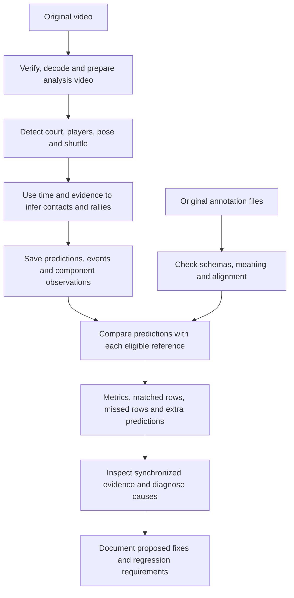
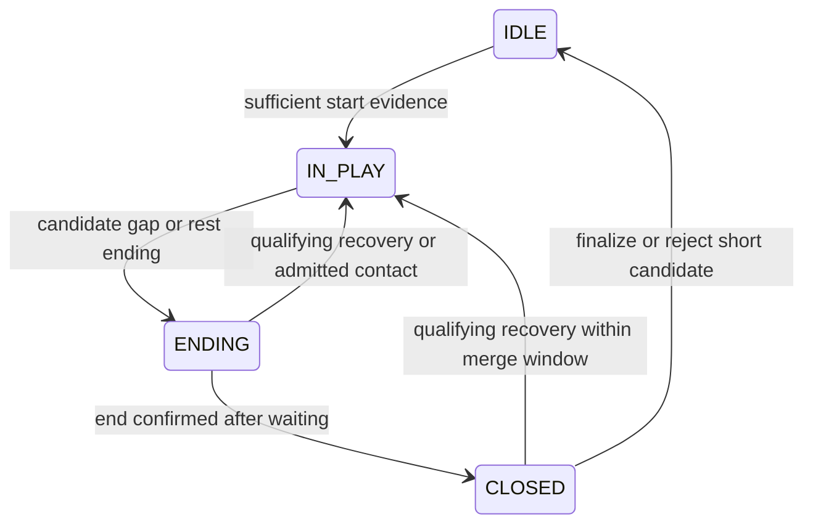

# How our badminton video evaluation works: a guide from the first frame to diagnosis

**Audience:** someone starting without knowledge of video processing, machine learning, or evaluation mathematics.  
**Implementation described:** the actual `Sports_Analytics` pipeline at commit `88aa0ad`, with the preserved Test 10 completed retry as the main worked example.  
**Purpose:** explain what we did, how the code calculates the results, what the results establish, and how evidence should guide future improvements. This document does not implement new pipeline fixes.

The numerical evidence comes from our saved outputs and the actual source code. Examples marked **teaching example** are invented to explain an idea. Examples marked **actual Test 10** come from the saved annotations and predictions.

## Reading order

Read sections 1–5 first for the overall picture. Sections 6–10 explain the data and inference. Sections 11–18 explain the calculations. Sections 19–24 explain diagnosis, fixes, and reproducibility. Section 25 contains runnable learning exercises; section 26 is a glossary.

The companion [consolidated results report](CONSOLIDATED_EVALUATION_ALL_RESULTS_20261113_v2.md) contains the large numerical inventory. This guide explains how to understand that inventory.

## 1. Start with the whole experiment

We have two different kinds of input:

1. **A video:** the pictures and timing information the pipeline analyzes.
2. **Reference files:** descriptions of times, positions, outcomes, or geometry supplied with the dataset.

The pipeline processes the video and produces its own observations and predictions. Only afterward does the evaluator compare those predictions with the reference files.



Notice that there is no arrow from annotation answers into inference. The model must not be told where the correct rallies are before it predicts them. That would be **answer leakage**: using the answers to create the predictions being scored.

A useful way to describe the experiment is:

> “Given this video, what does the pipeline produce by itself, and how does that output compare with each supplied reference?”

This is not the same question as “Does the code run without crashing?” A program can execute successfully and predict the wrong things.

### 1.1 What “evaluation matrix” means

A **metric** is one measurement: recall, mean timing error, or processing time, for example.

An **evaluation matrix** is our organized table of those measurements across components, reference files, videos, and versions. It is not one universal accuracy number.

A **confusion matrix** is a more specific table: true classes against predicted classes, such as `smash` predicted as `clear`. We can only construct a meaningful one when suitable true class labels and an agreed mapping exist.

## 2. What a video frame is

A **frame** is one picture in a video’s displayed sequence. A video creates the impression of motion by displaying successive pictures quickly.

For a decoded color frame, think of a rectangular grid:

```text
row 0       pixel pixel pixel ...
row 1       pixel pixel pixel ...
...
row 719     pixel pixel pixel ...
```

A **pixel** is one small picture element. In an ordinary decoded RGB image, its three channels represent red, green, and blue intensity. The machine sees arrays of numbers, not a built-in concept called “a badminton rally.” Models and algorithms must infer the sporting meaning from those numbers and their changes over time.

### 2.1 Resolution: width and height

`1920 × 1080` means 1,920 pixels across and 1,080 pixels down. Our Test 10 source has that resolution. Its analysis copy is `1280 × 720`.

That resizing changes image coordinates. A location measured in the original image cannot be compared directly with a location measured in the smaller image without the correct coordinate mapping.

For this proportional resize:

```text
analysis_x = source_x × 1280 / 1920 = source_x × 2/3
analysis_y = source_y × 720 / 1080  = source_y × 2/3
```

This particular arithmetic is valid because the inspected source-to-analysis transformation preserves the same aspect ratio. Cropping, rotation, letterboxing, or another camera view would require the corresponding actual transformation.

### 2.2 Where coordinates start

For our reviewed analysis images:

```text
(0,0) --------------------> x increases to the right
  |
  |
  v
y increases downward
```

An image coordinate `(600, 400)` is a position in pixels. It is not automatically a position in meters on the court.

### 2.3 A compressed video is not a folder of independent photographs

An MP4 file is a container holding compressed media and timing information. A codec is the method used to encode/decode the video. Some compressed frames depend on other frames, so jumping to a requested frame can require decoding nearby supporting frames first.

**Decoding** reconstructs pictures from the compressed representation. **Encoding** compresses pictures into a video representation. **Transcoding** decodes and encodes again, potentially changing resolution, frame rate, or format.

We do not extract and keep all 37,133 Test 10 pictures as individual image files before inference. We decode manageable chunks. We keep selected images for diagnostic evidence.

At 1280×720, one uncompressed 8-bit RGB picture requires roughly:

```text
1280 × 720 × 3 bytes = 2,764,800 bytes
```

All 37,133 pictures would require about **95.6 GiB** just for those RGB arrays, before model memory or other overhead. The compressed file is much smaller. This is one reason for chunked processing and careful disk management.

## 3. FPS, frame numbers, timestamps, and duration

**FPS** means **frames per second**: how many pictures belong to one second of the video timeline.

At 30 FPS:

- One second contains 30 frames.
- One frame interval is `1/30` second, about `0.033333` seconds.
- Ten seconds contain 300 frames.

For a constant-rate video whose first frame is numbered zero:

```text
time_in_seconds = frame_number / FPS
```

We divide frames by frames-per-second; the frame units cancel, leaving seconds.

### 3.1 Zero-based numbering

Our canonical timeline numbers the first image **0**, not 1.

| Frame number | Time at 30 FPS | Meaning |
|---:|---:|---|
| 0 | 0 s | First displayed image |
| 1 | 0.033333 s | Second image |
| 29 | 0.966667 s | Last frame starting within the first second |
| 30 | 1 s | First frame starting at one second |
| 300 | 10 s | Frame at ten seconds |
| 30,000 | 1,000 s | Frame at 16 min 40 s |

An annotation can use a different convention. We must verify its convention, not guess or search for whichever offset improves the score.

The metadata can store the frame rate as a fraction: `fps_num / fps_den`. Test 10 uses numerator 30 and denominator 1, so its rate is `30/1 = 30 FPS`. Other video rates can be fractional; code should use the recorded rate rather than assume every future video is exactly 30 FPS.

### 3.2 Why 20,000 or 30,000 frames is ordinary

At 30 FPS:

```text
20,000 / 30 = 666.666667 seconds ≈ 11 min 6.667 s
30,000 / 30 = 1,000 seconds      = 16 min 40 s
37,133 / 30 = 1,237.766667 s    ≈ 20 min 37.767 s
```

Thus tens of thousands of frames do not imply tens of thousands of rallies. They are pictures; one rally can span hundreds of those pictures.

**Actual Test 10:** there are 37,133 canonical frames, with image indices **0 through 37,132**. The final image starts at `37132/30 = 1237.733333` seconds. The full extent of all N frame intervals is `37133/30 = 1237.766667` seconds. Those are different quantities by one frame interval.

### 3.3 Precise timestamps versus displayed clocks

`4.366666666666666` seconds preserves much more precision than the display string `00:04`.

Our seven-column rally CSV uses both. Its `MM:SS` strings **truncate** to whole seconds. We must not reconstruct precise boundaries from the truncated display when precise frame/second columns already exist.

See [the CSV validation and display-time code](/home/administrator/Desktop/sport-analytics/Sports_Analytics/scripts/benchmarking/evaluate_rallies.py:66).

### 3.4 Constant versus variable frame rate

**CFR**, constant frame rate, means the timeline uses a fixed interval between displayed frames. **VFR**, variable frame rate, means those intervals can vary.

For VFR, blindly using `frame / 30` can be wrong. The displayed frame timestamps must be used or an explicit mapping must be built.

**PTS**, presentation timestamp, tells us when a decoded picture belongs on the displayed timeline. Compression can also have a decoding order; that order is not what our annotation time means.

Our fresh benchmark preparation verifies CFR at an unchanged analysis rate. The post-run timestamp audit checks the supplied source and analysis proxy, including the image/timestamp bindings used by scene decisions. It does not silently fit an annotation offset.

Sources: [preparation](/home/administrator/Desktop/sport-analytics/Sports_Analytics/research/production_external_stress.py:283), [timestamp audit](/home/administrator/Desktop/sport-analytics/Sports_Analytics/research/normal_timestamp_audit.py:15).

### 3.5 Three different rates that people often confuse

| Term | What it measures | Actual example |
|---|---|---|
| Video FPS | Pictures per second of recorded action | Test 10: 30 FPS |
| Model sampling cadence | How often a particular model is asked to make a fresh measurement | A stride of 6 at 30 FPS is approximately five scheduled measurements per video second |
| Processing throughput | How many source frames the computer processes per wall-clock second | Test 10’s integrated worker: about 7.7867 source frames/s |

The video remains 30 FPS even when the computer processes it at 7.8 frames per wall-clock second. A lower detector sampling rate also does not change the canonical frame numbering.

**FP** means false positive. **FPS** means frames per second. They are unrelated abbreviations.

## 4. What a rally is in this system

In badminton, a rally is an exchange of play. In our saved prediction/evaluation files, a rally is represented by a **time interval**, not by a separate video file:

```text
start frame, end frame, start time, end time, duration
```

The original video can contain rallies, pauses, walks, serves, camera changes, close-ups, score graphics, and replay-like content. The pipeline decides which time spans are candidate exchanges.

```text
One original video:
| pause |----- rally 1 -----| pause |-- rally 2 --| cut | pause |--- rally 3 ---|

Saved rally intervals:
             [start1,end1)              [start2,end2)              [start3,end3)
```

We do not first cut the video using the reference rally boundaries and then pretend to discover those same boundaries. The complete input is processed; the predicted intervals are inferred from the observations.

An interval can later be used to select a highlight clip. Saving highlight timestamps or evidence references is not the same as rendering a new MP4 highlight file.

### 4.1 The endpoint convention matters

For evaluation, our established interval contract is **half-open**:

```text
[start, end)
```

The opening bracket includes the start. The closing parenthesis excludes the end boundary. Therefore:

```text
duration_seconds = (end_frame - start_frame) / FPS
```

Example `[120,540)` at 30 FPS:

```text
start = 120/30 = 4 seconds
end = 540/30 = 18 seconds
duration = (540-120)/30 = 14 seconds
```

Do not add one frame to this evaluator’s duration. That would change the established comparison.

There is a related internal convention: the FSM’s `RallySegment.length` counts the inclusive canonical frame span, `end-start+1`, for minimum-length decisions. That span can include missing-observation time; it does not mean the detector observed the shuttle on every frame. The exported/evaluated timestamps still follow their preserved boundary contract. Internal inclusive span and evaluation boundary span are not interchangeable. This explains why a minimum-span threshold and a CSV duration can differ by one frame interval.

Sources: [internal segment length](/home/administrator/Desktop/sport-analytics/Sports_Analytics/sports/badminton/src/bai_badminton/events/rally_fsm.py:66), [prediction CSV writer](/home/administrator/Desktop/sport-analytics/Sports_Analytics/scripts/benchmarking/evaluate_rallies.py:107).

## 5. What kinds of dataset files we actually have

The available local `Part2/dataset` folders are Test 1, 2, 3, 4, 6, 7, 9, and 10. Tests 5 and 8 remained excluded under the chosen benchmark scope. Different folders have different supporting files; some contain extra interval variants such as `Full2` or `T4`.

A **CSV** is a text table: the first line names columns, and each subsequent data record supplies values. A **JSON** file stores structured named values, including nested lists and dictionaries.

An **annotation** is a supplied description associated with data. However, not every supplied CSV was created by a human carefully labelling physical reality.

Our files include:

- Coarse supplied reference tables with time ranges and semantic labels.
- Previously generated rally interval outputs.
- Previously generated player/shuttle coordinates.
- Previously generated winner/classification/score outputs.
- A manual-origin assertion for court points at one frame.

**Ground truth** ideally means independently reviewed correct labels for a defined task. We use the term carefully: generated reference agreement is not independent physical ground-truth accuracy.

A **baseline** is a preserved previous program version or run. Its predictions can also be wrong. Comparing a new run with the baseline checks behavioral change/regression. Comparing either run with a reference measures agreement with that reference. Independently reviewing physical events is a further question. A baseline prediction is not automatically ground truth.

### 5.1 The six actual Test 10 files

| File | Original records | What one row/item represents | Main evaluation use |
|---|---:|---|---|
| `Test10_Full.csv` | 101 records; 96 usable timed intervals and five blank trailing records | One coarse interval with outcome/shot/score fields | Separate coarse interval comparison; semantic fields retained and assessed |
| `Test10_Full_rally.csv` | 93 | One generated rally interval | Separate generated interval comparison |
| `win_predictions.csv` | 93 | One historical generated rally outcome record | Interval comparison plus semantic-field inventory; not automatically winner ground truth |
| `player_detections.csv` | 37,133 | Two generated anonymous player points for a frame | Source-bound point disagreement and coverage |
| `Test10_Full_ball_filled.csv` | 37,133 | Generated shuttle position/visibility/support for a frame | Raw shuttle point disagreement and presence coverage |
| `Test10_Full_court.json` | One frame-specific object | Court/net image points at frame 300 | Source-bound single-frame corner disagreement |

“All six files evaluated” means each file has a declared interpretation, its eligible comparisons were performed, and unsupported claims are explicitly identified. It does not mean every imaginable metric became computable.

## 6. Read the actual annotation schemas, column by column

### 6.1 `Test10_Full.csv`: the coarse reference

Actual header:

```csv
start_time,end_time,win_point_player,win_reason,ball_types,lose_reason,roundscore_A,roundscore_B
```

Actual first row:

```csv
0:04,0:18,Player A,Winner Shot,Smash,Opponent Failed to Return,1,0
```

| Column | Plain meaning | What it does not establish by itself |
|---|---|---|
| `start_time` | Reference start clock for this interval | Subsecond physical contact time if the author only supplied whole seconds |
| `end_time` | Reference end clock | Exact terminal contact/landing time without that annotation convention |
| `win_point_player` | Symbolic winner label, such as Player A | A verified connection to a physical athlete, current near/far side, or pipeline track |
| `win_reason` | Reference description of why the point was won | A complete independently adjudicated fault taxonomy |
| `ball_types` | A rally-level shot-type label | A label for every individual stroke inside that rally |
| `lose_reason` | Reference description of the losing event | Direct per-frame physical contact evidence |
| `roundscore_A`, `roundscore_B` | Reference score values using A/B conventions | A guaranteed match to current scoreboard rows, official game-reset rules, or inferred track identities |

For the first interval, `0:04`–`0:18` becomes frame boundaries `[120,540)` at 30 FPS.

Blank rows remain documented. They are not counted as real reference rallies. That is why Test 10 has 96 valid coarse references, not 101.

### 6.2 `Test10_Full_rally.csv`: precise generated intervals

Actual header:

```csv
Start_Frame,End_Frame,Start_Time_sec,End_Time_sec,Duration_sec,Start_Time,End_Time
```

Actual first row:

```csv
131,594,4.366666666666666,19.8,15.433333333333334,00:04,00:19
```

| Column | Meaning | Check performed |
|---|---|---|
| `Start_Frame` | Start boundary on the declared frame timeline | Integer, nonnegative, consistent with start seconds |
| `End_Frame` | End boundary under the evaluator’s convention | Integer, greater than start, consistent with end seconds |
| `Start_Time_sec` | Precise start seconds | Approximately `Start_Frame/FPS` within the explicit numerical tolerance |
| `End_Time_sec` | Precise end seconds | Approximately `End_Frame/FPS` |
| `Duration_sec` | Boundary-span duration | Approximately end seconds minus start seconds |
| `Start_Time` | Human-readable truncated clock | Must match the display convention |
| `End_Time` | Human-readable truncated clock | Must match the display convention |

The first row’s duration is:

```text
(594-131)/30 = 463/30 = 15.4333333333 seconds
```

These fields describe one interval in several redundant ways. They are not seven independent labels. Redundancy helps us detect inconsistent timestamps.

The strict seven-column parser rejects missing/extra fields, nonfinite values, invalid intervals, and inconsistent frame/second/duration values. It uses a `1e-6` second consistency tolerance; that tolerance is numerical validation, not permission to shift a rally to make it match.

See [the actual reader](/home/administrator/Desktop/sport-analytics/Sports_Analytics/scripts/benchmarking/evaluate_rallies.py:76).

### 6.3 `win_predictions.csv`: historical inferred outcomes

Actual header:

```csv
rally_idx,start_frame,end_frame,start_time,end_time,winner,loser,win_reason,reason_src,fault_side,fault_src,cnn_class,cnn_conf,cnn_oob,cnn_hn,cnn_wbl,score_Player A,score_Player B
```

| Field/group | Meaning in the inspected legacy producer |
|---|---|
| `rally_idx` | Zero-based index of the legacy input rally; it is not automatically the evaluator’s one-based prediction ID |
| `start_frame`, `end_frame` | Inherited rally boundaries |
| `start_time`, `end_time` | Human-readable time strings; frame columns carry the precise boundaries |
| `winner`, `loser` | Inferred symbolic names |
| `win_reason` | Final inferred reason after legacy fusion/rules |
| `reason_src` | Which branch supplied the reason, such as `ML_RF` |
| `fault_side`, `fault_src` | Inferred near/far fault side and its rule/source tag |
| `cnn_class` | Class selected by the legacy neural classifier |
| `cnn_conf` | Its maximum output support |
| `cnn_oob`, `cnn_hn`, `cnn_wbl` | Legacy supports for out-of-bounds, hit-net, and wrong-side/landing-related classes |
| `score_Player A`, `score_Player B` | Counters built by incrementing inferred winners; not automatically the official scoreboard |

An output support of `0.9953` is not a measured accuracy of 99.53%. A model can be very confident and wrong.

The actual first legacy row uses the same `[131,594)` interval as the generated rally table, but says **Player B**, `out_of_bounds`, and score **0:1**. The coarse table’s first row says **Player A**, `Smash`, and **1:0**.

This is a concrete conflict between supplied records. We must investigate whether it reflects timing, symbolic identity mapping, automatic prediction error, or another convention. It is not legitimate to declare both descriptions unquestionably correct.

The legacy predictor defaults A/B to far/near roles. Players can change ends, and the camera can change views. A role label is not a permanent physical identity. The legacy score counters start from zero and accumulate inferred winners; they do not by themselves implement independently verified official game scores.

Source: [the legacy outcome producer](/home/administrator/Desktop/sport-analytics/Sports_Analytics/legacy/pipeline/win_predictor/predict.py:371).

**What our current evaluation does:** it evaluates the frame intervals in this file and preserves all semantic fields and their limitations. Timing F1 from this file is not winner-prediction accuracy.

### 6.4 `player_detections.csv`: two points per frame, not full identity labels

Actual header:

```csv
frame_no,player_1_x,player_1_y,player_1_conf,player_2_x,player_2_y,player_2_conf
```

Actual first row, rounded here for readability:

```csv
0,707.2464,554.0444,0.8862,626.5123,332.6570,0.8707
```

The coordinate convention is consistent with the bottom center of a detected person box, near the feet. The source-bound review established the image coordinate basis for diagnostic comparisons.

These columns do **not** contain bounding-box corners, human-labelled physical person IDs, or every visible person’s full history.

An actual slot-order example:

```text
frame 37131:
  slot 1 ≈ (619.51,381.77)
  slot 2 ≈ (574.61,435.06)

frame 37132:
  slot 1 ≈ (573.60,434.53)
  slot 2 ≈ (619.61,385.19)
```

The spatial positions exchange slot numbers. If we assumed slot 1 was one permanent athlete, we would create an apparent identity switch from the annotation convention itself.

Therefore we compare anonymous point sets geometrically. We do not manufacture tracking identity ground truth from the slot names.

Source: [legacy player point exporter](/home/administrator/Desktop/sport-analytics/Sports_Analytics/legacy/pipeline/analysis/player_detection.py:312).

### 6.5 `Test10_Full_ball_filled.csv`: generated shuttle points

Actual header:

```csv
Frame,X,Y,Visibility,Confidence
```

Actual examples:

```csv
0,0,0,0,0.1655
27,366,108,1,0.5635
```

| Field | Meaning |
|---|---|
| `Frame` | Frame index |
| `X`, `Y` | Generated analysis-image coordinates |
| `Visibility` | Legacy output visibility marker |
| `Confidence` | Legacy model support, not a physical-accuracy certificate |

For frame 0, visibility is zero. We do not treat `(0,0)` as a valid shuttle location just because coordinate columns exist.

The `filled` history includes gap filling in the legacy processing. The supplied table does not give a per-row flag that reliably separates original observations from filled estimates. That matters: an interpolated point is not a direct observation of a physical shuttle.

Source review found that the frame-27 point lies at a broadcast graphic edge. This illustrates why a generated visibility flag is not exhaustive independently labelled physical visibility.

Sources: [legacy gap filler](/home/administrator/Desktop/sport-analytics/Sports_Analytics/legacy/pipeline/TrackNetV3/fill_gaps.py:4), [Test 10 source-review evidence](../test_10/diagnostics/evaluation_only_retry1/REPORT.md).

### 6.6 `Test10_Full_court.json`: geometry at one frame

Actual simplified structure, preserving its values:

```json
{
  "frame_no": 300,
  "frame_size": {"width": 1280, "height": 720},
  "corners": {
    "TL": [474, 264], "TR": [803, 263],
    "BR": [936, 657], "BL": [344, 659]
  },
  "net": {
    "net_Y": 402.0, "net_top_Y": 285.0,
    "left_bottom": [392, 403], "right_bottom": [889, 401],
    "cable_left": [388, 285], "cable_right": [894, 285]
  },
  "source": "manual"
}
```

`TL`, `TR`, `BR`, `BL` mean top-left, top-right, bottom-right, and bottom-left in the reviewed image arrangement. The net fields describe the marked lower positions and upper cable positions. The legacy tool computes `net_Y` and `net_top_Y` from their marked pairs.

`source: manual` asserts a manual origin. It does not by itself tell us which physical sidelines the annotator selected, the line-width convention, or the quality of the review.

Our source review checked frame 300, which is ten seconds into the video, and established that the marked rectangle corresponds to the outer **singles** floor rectangle. Comparing these marks with doubles sidelines would introduce an artificial error.

One labelled frame cannot establish court accuracy throughout a camera-changing video.

### 6.7 Why `Full2` is a special case in Test 1

Test 1’s `Full2` file contains 20 usable intervals and a literal `...` record. It does not establish that all unlisted time spans are negatives.

If an incomplete list mentions 20 rallies, a prediction outside those 20 is not automatically false. It could be a real rally that the list omitted.

We therefore retain recall on the listed positives, but make **FP, precision, and F1 unavailable** for that partial-reference comparison. Unmatched predictions remain explicitly **unscored**.

See [partial-reference handling](/home/administrator/Desktop/sport-analytics/Sports_Analytics/evaluation/ground_truth_validation/orchestration/evaluate_test01_components.py:52).

## 7. How we pair a video with the correct annotations

Matching filenames is a starting clue, not sufficient evidence.

We verify:

1. Which original media file was supplied.
2. Its exact byte identity, using SHA256.
3. Its dimensions, frame rate, and decoded frame count.
4. The analysis video’s dimensions and time mapping.
5. Each annotation’s original columns and exact file hash.
6. The annotation frame/time ranges and coordinate conventions.
7. Whether semantic names and scores can be mapped to physical people and official scoring.

**SHA256** is a content fingerprint: changing a file’s bytes changes the fingerprint with overwhelmingly high probability. It tells us whether we are discussing the same exact file. It does not tell us whether an annotation is physically correct.

An **evaluation manifest** is our explicit machine-readable declaration of those facts and decisions. It lists every immediate supporting file, exact schemas, roles, hashes, field eligibility, time basis, and limitations.

For Test 10, the reviewed manifest binds:

```text
source SHA256:
cf71d8e02086df5e192e3cf834804407ca5d9e0f2f6bdf26512b39b6b264214f

canonical video: 1280×720, 30/1 FPS, 37133 frames
frame origin: 0
offset: 0
evaluation interval end: exclusive
```

Dense tables must contain every canonical frame exactly once and in order. We do not fill missing annotation rows, clip out-of-image coordinates to hide errors, or search offsets that maximize agreement.

A **coordinate certificate** records a source-bound diagnostic review: which video, which coordinate basis, which original files, which frames were inspected, and which evidence images were used. It enables the declared comparisons. An agent-reviewed certificate is not a new exhaustive human-adjudicated physical ground-truth dataset.

Sources: [manifest validation](/home/administrator/Desktop/sport-analytics/Sports_Analytics/evaluation/ground_truth_validation/orchestration/evaluate_manifest_components.py:58), [annotation loading](/home/administrator/Desktop/sport-analytics/Sports_Analytics/evaluation/ground_truth_validation/orchestration/evaluate_manifest_components.py:195), [coordinate binding](/home/administrator/Desktop/sport-analytics/Sports_Analytics/evaluation/ground_truth_validation/orchestration/evaluate_manifest_components.py:239).

## 8. What inference means, and what the pipeline actually does

**Training** changes a model’s learned parameters using training examples. **Inference** applies already loaded parameters to new input and produces outputs. Our evaluation-only runs perform inference; they do not retrain the networks using these CSVs.

A **model checkpoint** is a saved set of learned parameters. A **backend** is the software path executing the model, such as PyTorch CUDA or ONNX Runtime CUDA. **CUDA** is the GPU computation platform used here. The **CPU** also performs substantial work.

The pipeline is a combination of learned models, geometric algorithms, temporal association, and rules. It is not one network reading a whole match and immediately returning verified sporting facts.

### 8.1 Preparation and the analysis proxy

The source is probed and checked. An **analysis proxy** is a standardized video copy used by the application and analysis.

For this run, the source was resized to 1280×720 at the verified unchanged 30 FPS. The proxy and playback segments share a canonical timeline. This gives the overlays, model outputs, and annotations a consistent frame coordinate system.

The executor creates a clean session with no annotation answers or previously accepted player identities. It records the code, profiles, model identities and source hashes before running.

See [native preparation](/home/administrator/Desktop/sport-analytics/Sports_Analytics/research/production_external_stress.py:283), [proxy planning](/home/administrator/Desktop/sport-analytics/Sports_Analytics/engine/src/bai_engine/media/proxy.py:105).

#### 8.1.1 Warm start: an important offline-video detail

Before the main chunk loop, the actual runner samples up to 24 pictures spread across the supplied source video. For sample index `i`, its target time is approximately `duration × (i+0.5)/24`. These are not necessarily the first 24 pictures or only early-video pictures.

The plugin uses those samples to initialize court/color/camera context and the initial shuttle background. Automatic court fitting can inspect the sampled pictures using up to four CPU threads.

This uses pixels from the current input, not annotation answers. It is valid under this recorded offline/video-on-demand experiment, but it means the experiment is **not a strictly causal live-stream benchmark**. A picture late in the clip can help initialize processing of its beginning. The temporal model and semantic lookahead also use bounded context.

When we say a particular association decision or next-chunk sampling request is causal, we mean its own state/evidence contract. We are not claiming that every preprocessing and inference stage has seen only pixels earlier than the current frame. A future live-stream requirement would need a separately specified warm-up policy and benchmark.

Sources: [actual keyframe sampler](/home/administrator/Desktop/sport-analytics/Sports_Analytics/engine/src/bai_engine/runtime/runner.py:310), [plugin initialization](/home/administrator/Desktop/sport-analytics/Sports_Analytics/sports/badminton/src/bai_badminton/plugin.py:393), [background initialization](/home/administrator/Desktop/sport-analytics/Sports_Analytics/sports/badminton/src/bai_badminton/perception/pipeline.py:562).

### 8.2 Scene, camera, court, and calibration

A **camera cut** is a change of shot or view. A **camera shot** here means a broadcast view segment; it is different from a badminton stroke.

The pipeline determines whether the current image is a usable main-court view, tracks camera context, and estimates court geometry.

**Calibration** is the mapping between a court model and its appearance in the image. **Camera registration** aligns a changing camera view to a reference view. An **ROI**, region of interest, identifies an area relevant to a component.

Calibration can be valid, held/stale, or invalid. Seeing an old court polygon is not proof it remains valid after a cut. A close-up or another camera can be ineligible for the current main-court measurements. Some code uses a replay/suppression flag for non-main views; that flag alone is not proof of a learned broadcast-replay classification.

An **epoch** in this context is a logical camera/content-history segment. It is not a training epoch. Context changes can invalidate temporal history and prevent association across unrelated views.

### 8.3 Player detection

The current declared player detector is RF-DETR, executed through ONNX CUDA FP32 with a 512×512 model input and score threshold 0.35 in the frozen profile.

A **bounding box** is a rectangle around a candidate person, usually described by left/top/right/bottom image coordinates. Detection asks where people are in a particular image.

The pipeline also uses court context to distinguish target-court participants from spectators or nearby courts. A spectator remaining visible should not automatically become a player.

### 8.4 Tracking and identity

**Tracking** associates detections across time: “this current box is a continuation of that previous box.” It can carry a hypothesis when no fresh detector measurement was scheduled.

A **tracklet** is a short linked sequence. A **track ID** names an internal track episode. An **identity** names a physical person. These are different levels of certainty.

An athlete disappearing behind another person and returning may produce a new tracklet. Joining the correct tracklets is a separate problem from detecting a box.

**Re-identification**, often called ReID, uses appearance to help connect observations of the same person. The actual Test 10 receipt reports that the configured OSNet checkpoint was not downloaded and the baseline ReID provider was unavailable. It would be wrong to say appearance-based identity accuracy was validated just because a ReID entry exists in the profile.

### 8.5 Pose estimation

**Pose estimation** predicts body keypoints such as shoulders, elbows, wrists, hips, knees and ankles. The current declared pose model is RTMPose through ONNX CUDA FP32, with a batch of two crops and input size192×256.

These keypoints help estimate body motion and racket/contact-related cues. A pose must be current and geometrically usable before it can support a strong decision. Carrying an old pose does not turn it into a fresh observation.

### 8.6 Shuttle detection using TrackNet

The current primary shuttle model is TrackNetV3, Torch CUDA FP16, with eight-frame temporal windows, a model batch of four windows, and model threshold 0.5.

A **heatmap** is an image-like array whose values indicate the model’s support for an object at each location. A bright peak is a candidate location, not automatically a physical shuttle.

The model uses motion information from a short sequence. Its input is resized to 512×288. In this configuration, eight RGB pictures plus an RGB median-background image produce27 channels. It returns temporal heatmaps that can be mapped back into analysis-image coordinates.

For a plain512×288→1280×720 mapping, the scale factor is 2.5 in both directions. The code uses its actual coordinate mapping; not every model’s preprocessing is necessarily this simple.

The background image is built from bounded samples, rather than storing every original frame. It helps separate changing foreground from persistent image structure.

Model windows may contain future context relative to an individual frame. This is an offline/video-on-demand pipeline with explicitly bounded temporal context; it is not correct to call every output strictly live and zero-lookahead.

See [TrackNet implementation](/home/administrator/Desktop/sport-analytics/Sports_Analytics/sports/badminton/src/bai_badminton/perception/tracknet.py:518).

#### 8.6.1 What the inference code does to the picture numbers

A **tensor** is a multidimensional array of numbers. You can think of it as nested rows, columns, channels and groups. TrackNet’s input layout is:

```text
(batch, channels, height, width)
up to (4, 27, 288, 512) in this setup

27 channels = 3 color channels × (8 video pictures + 1 background picture)
```

The code resizes each picture, changes OpenCV’s BGR channel order to RGB, forms the temporal/background stack, and normalizes unsigned 8-bit pixel values:

```python
# Simplified description of the actual preprocessing operation:
x = np.stack(windows).astype(np.float32) / 255.0
```

`uint8` represents integer pixel values from 0 to 255. Dividing by 255 maps them to approximately 0–1. `float32` is a floating-point number format. The Torch path transfers the array to the loaded model’s device and dtype; in this profile the shuttle model uses CUDA FP16. Sixteen-bit versus thirty-two-bit describes numeric representation, not a percentage accuracy.

The inspected network contains learned convolution filters, repeated downsampling and upsampling blocks, and a final sigmoid output. A **convolution** applies learned local filters to image features. Downsampling gives a smaller spatial representation; upsampling returns information toward the output resolution. The learned filters come from the checkpoint, not from fitting the current annotation CSV.

The model produces heatmaps with layout `(batch, 8, 288, 512)`. These are converted to ordinary numeric arrays for aggregation, thresholding and coordinate extraction. Overlapping window contributions are combined as described in section 9. The final support values are not automatically calibrated probabilities of physical correctness.

The Torch implementation uses `inference_mode()`: it executes forward computation without training-gradient tracking. There is no backpropagation or weight update in this evaluation.

Sources: [network definition](/home/administrator/Desktop/sport-analytics/Sports_Analytics/sports/badminton/src/bai_badminton/perception/tracknet.py:92), [preprocessing/forward execution](/home/administrator/Desktop/sport-analytics/Sports_Analytics/sports/badminton/src/bai_badminton/perception/tracknet.py:464).

### 8.7 Raw shuttle output versus accepted shuttle observation

The raw brightest location can be a floor logo, court mark, racket, or graphic. The association component preserves raw output and considers the current candidate locations with temporal evidence.

It may select a different currently observed candidate if the existing evidence supports that unique alternative. It does not manufacture a predicted coordinate and call it a new detector observation.

Important observation states include:

| State | Plain meaning |
|---|---|
| Observed | A usable current observation under the component contract |
| Missing | No usable current observation |
| Ambiguous | Competing evidence prevents a unique choice |
| Invalid/rejected | Context or evidence failed a required condition |
| Reconstructed | An explicitly estimated point, such as bounded interpolation |

**Interpolation** estimates an intermediate value between observations. It can provide supporting context in eligible gaps. It does not prove the shuttle physically occupied every estimated point. Ambiguous/invalid context creates barriers; estimates cannot bridge every cut or disagreement.

An alternative selected candidate carries its **own** support. It cannot inherit the stronger score of the wrong bright peak.

The temporal engine can use accepted selected observations. The current generic shuttle-reference distance metric compares the saved **raw** shuttle channel. Those are different output channels, so improving association need not improve a raw-channel distance score.

Sources: [association](/home/administrator/Desktop/sport-analytics/Sports_Analytics/sports/badminton/src/bai_badminton/perception/association.py:475), [engine observation use](/home/administrator/Desktop/sport-analytics/Sports_Analytics/sports/badminton/src/bai_badminton/engine.py:960).

### 8.8 Racket and contact evidence

The active racket provider is an OpenCV geometric method, not a newly trained independent racket network. Some ellipse-like shapes near a player’s face can resemble its racket geometry. Raw observations and semantic admission are therefore recorded separately.

A **contact candidate** is a proposed event around which the shuttle may have been struck. Trajectory direction changes, launch motion, body/pose evidence, and racket cues can contribute.

Three different questions must remain separate:

1. Does the trajectory show a plausible turn or launch?
2. Is there sufficient evidence of physical impact?
3. Can that impact be attributed to a particular player or team?

A sharp direction change after a tracking gap could be reacquisition rather than a real hit. A high heuristic score does not independently establish physical contact or identify the hitter.

**NMS**, non-maximum suppression, keeps a preferred candidate among nearby competing proposals. The contact code uses a score threshold 0.35 and a local0.2 second suppression radius, with separate handling of evidence types. This is not the same threshold as the rally matcher’s IoU0.5.

Sources: [contact candidates](/home/administrator/Desktop/sport-analytics/Sports_Analytics/sports/badminton/src/bai_badminton/events/contact.py:436), [typed contact evidence](/home/administrator/Desktop/sport-analytics/Sports_Analytics/sports/badminton/src/bai_badminton/events/contact_evidence.py:262).

### 8.9 Stroke classification

The active classifier is `stroke-rules-v0`, a heuristic rule component. It is not the legacy CNN columns in `win_predictions.csv`, and it is not a claim that a new trained stroke model was validated.

It considers eligible flight time, observed outgoing motion, court/serve context and other evidence. Missing prerequisites can produce **unknown**.

Unknown means “the system does not have enough evidence for an accepted class.” It is different from a verified negative or an invented label chosen to make coverage look complete.

Source: [stroke classifier](/home/administrator/Desktop/sport-analytics/Sports_Analytics/sports/badminton/src/bai_badminton/events/stroke.py:133).

### 8.10 Rally segmentation, outcomes, scoring and analytics

**Segmentation** means finding interval boundaries in time. The rally component combines observed motion, eligible contact proposals, context boundaries and temporal policy.

After a rally is formed, the system separately considers end reasons, participant attribution, scoreboard observations, scoring rules and evidence sufficiency. A cut can end the visible interval without establishing who won the sporting point.

**OCR**, optical character recognition, reads text from image regions. Scoreboard text is an observation, not automatically an accepted point. The system must consider source, stability, identity, game phase, uniqueness and legal score transitions.

The resulting event history supports analytics and highlight recommendations. A heatmap grid summarizes estimated occupancy/movement; without suitable reference trajectories, it is not measured analytics accuracy.

The generic export retained canonical analytics and evidence-backed highlight metadata. The standalone grid-export helper used for Test 2 is specifically Test 2-bound; it was not silently relabelled as a general Test 10 heatmap evaluation.

## 9. Chunks, model windows and batches are different things

### 9.1 Actual media chunks are 60 frames, not rallies

Our HLS proxy uses two-second segments. **HLS** is a segmented media format also used for progressive playback.

At 30 FPS:

```text
frames per segment = round(30 × 2 seconds) = 60

chunk0: frames0–59
chunk1: frames60–119
chunk2: frames120–179
...
```

The experiment YAML contains `chunk_frames:64`, but this actual `SessionRunner` path uses the proxy segment plan. It therefore processed 60-frame chunks. Reading one config field without tracing the execution path would give the wrong explanation.

Test 10 has:

```text
37133 = 618×60 + 53
```

Therefore there are 619 chunks:618 complete 60-frame chunks and a final 53-frame chunk.

Sources: [segment planning](/home/administrator/Desktop/sport-analytics/Sports_Analytics/engine/src/bai_engine/media/proxy.py:35), [actual runner loop](/home/administrator/Desktop/sport-analytics/Sports_Analytics/engine/src/bai_engine/runtime/runner.py:461).

A rally can begin in the middle of one chunk and end many chunks later. A chunk can contain the end of one rally, a pause, and the start of another. Chunk boundaries are a computation/storage choice, not a sporting definition.

### 9.2 TrackNet’s eight-frame windows

Within an uninterrupted60-frame chunk, the configured eight-frame windows start at:

```text
0,8,16,24,32,40,48,52
```

The last window covers52–59, overlapping the preceding48–55 window. Overlapping heatmap contributions are averaged. Scene/content boundaries split contexts, and short sequences can be padded within their own context.

Therefore “one output record per frame” does not mean each frame participated in exactly one neural forward operation.

### 9.3 A GPU batch of four windows

A **forward pass** is one application of the network to an input batch. A batch groups compatible inputs for efficient computation.

Here, a model batch of four means up to four eight-frame inputs in one forward call. It does not mean four videos or four independent rally engines. Pose batch two similarly means grouping pose inputs, not two benchmark videos.

### 9.4 Stride: fresh measurements versus carried state

A **stride** of 6 means scheduled measurements are spaced six frames apart. A stride of 1 means every eligible frame;0 disables that schedule. Probes and acquisition requests can affect actual execution.

Frozen profile defaults:

| Component schedule | In-play setting | Idle setting | Suppressed/replay setting |
|---|---:|---:|---:|
| Player detector | 2 | 6 | 0 |
| Pose | 1 | 6 | 0 |
| Shuttle | 1 | 1 | 0 |

The scheduler’s `in_play` property means FSM state other than `IDLE`; it includes `ENDING` and `CLOSED`, not just the literal state named `IN_PLAY`.

The system can carry tracked boxes between detector executions. Carried geometry is useful, but is not a fresh detection. Freshness flags such as `detector_matched` and pose source frame matter when diagnosing contact evidence.

**Processing all 37,133 frames means preserving the full timeline. It does not mean running every model freshly on all 37,133 frames.** Some views are ineligible, and some components are deliberately sampled.

### 9.5 Why sampling feedback needed its own fix

Perception receives the rally-state snapshot available before the chunk. The semantic engine has a deliberate lookahead delay, so it can temporarily still report idle even though the previous completed perception chunk already contains coherent motion.

The added motion-acquisition helper can request the existing faster detector/pose schedules for the next chunk using qualified prior completed observations. It cannot use future chunks, renew old evidence simply by applying a request, or directly declare a rally. Context changes revoke the request.

This is an example of fixing an integration/scheduling weakness rather than changing a benchmark score threshold.

Source: [acquisition lifecycle](/home/administrator/Desktop/sport-analytics/Sports_Analytics/sports/badminton/src/bai_badminton/perception/acquisition.py:155).

## 10. What actually runs in parallel

Several different activities can overlap, but we do not run all badminton stages as independent unordered jobs.

### 10.1 The actual temporal order

The main runner advances through chunks sequentially:

```text
decode chunk0 → perceive chunk0 → save cache0 → ingest chunk0
decode chunk1 → perceive chunk1 → save cache1 → ingest chunk1
decode chunk2 → perceive chunk2 → save cache2 → ingest chunk2
...
```

Within perception, the inspected path orders scene/court/camera checks and player continuity before batched shuttle processing, then association and OCR, then temporal ingestion.

Why preserve order? Tracking, background memory, camera context, content epochs, contact history and rally state depend on preceding observations. Processing frame 1000 before frame 999 could corrupt that state.

The badminton plugin declares sequential perception. The ordinary runner therefore disables seek-ahead perception and ordinary perception-cache reads for this path. It still writes caches for diagnosis and explicitly separate controlled replay.

### 10.2 Real concurrency in this run

| Work | How it can overlap |
|---|---|
| Transcoding | A media thread can prepare later segments while analysis consumes earlier completed segments |
| Initial automatic court fitting | Up to four CPU threads can inspect sampled source pictures; this is bootstrap work, not unordered temporal rally processing |
| Codec decoding | The segment decoder is configured with codec threads |
| GPU neural math | Kernels and batched tensor operations provide parallel computation inside a model execution |
| CPU work | Geometry, OCR, decoding, rules, IO and runtime libraries can use CPU resources |
| Resource monitoring | The parent samples the owned worker and its descendants while it runs |
| Annotation/source review | Independent read-only analysis can proceed while inference runs, without modifying shared production code or consuming unfinalized predictions as final results |

We processed one large benchmark video at a time, using physical GPU1 for the allocated neural run. We did not split six videos across six parallel GPU jobs.

Sources: [media thread](/home/administrator/Desktop/sport-analytics/Sports_Analytics/engine/src/bai_engine/runtime/runner.py:264), [codec decoding](/home/administrator/Desktop/sport-analytics/Sports_Analytics/engine/src/bai_engine/decode.py:44), [worker/resource orchestration](/home/administrator/Desktop/sport-analytics/Sports_Analytics/research/production_external_stress.py:654).

### 10.3 Why GPU usage can fluctuate

A pipeline can alternate between GPU kernels, CPU decoding, CPU rules, disk work, and waiting for dependencies. A momentary low GPU utilization reading does not establish that all inference was on the CPU. Conversely, a loaded GPU model does not prove every stage used the GPU.

Our execution receipts identify the actual backends and sampled GPU process memory. The frozen setup uses explicit CPU OCR, CUDA model paths for the declared primary networks, and CPU geometric/rule work. Throughput must be measured for the integrated workload, not guessed from GPU availability alone.

## 11. How frames become a predicted rally

### 11.1 The state machine

A **finite-state machine**, FSM, is a small controller that remembers a named state and changes it when specified evidence arrives.



The actual component is an evidence-aware wrapper around this base FSM. It preserves numerical defaults while controlling what kinds of evidence may start or continue an exchange.

### 11.2 The base defaults, with units

| Rule | Default | At 30 FPS / explanation |
|---|---|---|
| Motion start support | Three consecutive observed moving frames | Requires speed strictly greater than 3 pixels/frame |
| Gap end candidate | Ten missing observations | About 0.333 s of source time |
| Stationary end candidate | Seven slow observations in a ten-frame window | Slow means below 3 pixels/frame; missing samples are not invented stationary points |
| End confirmation lookahead | Fifteen frames | 0.5 s of source time from the tentative end anchor |
| Fast resume threshold | Above6 pixels/frame | Context-dependent recovery rule |
| Nominal minimum duration | 2 s | Sixty inclusive canonical frame indices at 30 FPS; not sixty observed shuttle samples |
| Nominal merge window | 0.75 s | Implemented as `round(0.75×FPS)` frames; Python rounds22.5 to 22 at 30 FPS |

Speed here is image motion in pixels per frame in the usable temporal coordinate basis. It is not measured airborne shuttle speed in meters per second.

Sources: [parameters](/home/administrator/Desktop/sport-analytics/Sports_Analytics/sports/badminton/src/bai_badminton/events/rally_fsm.py:35), [transitions](/home/administrator/Desktop/sport-analytics/Sports_Analytics/sports/badminton/src/bai_badminton/events/rally_fsm.py:128).

### 11.3 A start example

**Teaching example:** suppose frames 101,102,103 carry eligible observed speeds of 4 pixels/frame, with the necessary adjacent observations available. After the third qualifying frame, the base motion rule can open an exchange whose provisional start anchor is 101.

An admitted contact candidate can also propose a start. A start proposal is not automatically a confirmed physical serve. It remains subject to the current evidence policy and eventual maturity/finalization rules.

### 11.4 An end example: boundary time is not confirmation time

**Teaching example, base FSM:** the last observed frame is 500. Frames501–510 have no usable observation.

At 510, ten missing observations create a tentative end anchored at 500. The system waits for possible recovery. If no qualifying recovery appears, the fifteen-frame end-confirmation condition can close that tentative exchange at frame 515. The merge policy can delay final publication further.

The important distinction:

```text
predicted sporting boundary: frame500
frame when enough evidence exists to confirm it: later than500
```

Those are different times. A delayed decision can still assign an earlier boundary. Confirmation windows share anchors and are not all simply added as independent delays.

### 11.5 Context cuts and eligible short exchanges

A cut/context discontinuity finishes the old visible exchange before the new context, clears incompatible history, and prevents cross-cut merges. It does not identify the winner or automatically start another rally.

The selected evidence wrapper enables exit recovery and supported short-exchange evidence. A short exchange can be retained when its independent supporting conditions are met. This is not a blanket removal of the minimum-duration rule.

Current profile switches include:

```text
use_reconstruction = false
motion_guard = false
use_exit_recovery = true
use_short_exchange_evidence = true
use_terminal_contact_evidence = false
```

The reconstruction switch applies to that rally-continuation authority. It does not imply that no interpolation can exist anywhere in classification context.

Source: [evidence-aware rally logic](/home/administrator/Desktop/sport-analytics/Sports_Analytics/sports/badminton/src/bai_badminton/events/rally_evidence.py:87).

### 11.6 Lookahead and buffers

The temporal engine’s defaults include 40 frames of lookahead, 45 frames of backward context, and a nominal 1,800-frame history target. At 30 FPS these correspond to about 1.333 s, 1.5 s, and 60 s respectively. The history target is not a strict maximum: pending rallies, contacts and newer unfinalized context can require retaining more observations. These are context/storage/decision policies, not promises of wall-clock processing speed.

It also has an OCR wait default of 4 s and bounded late score reconciliation. Those mechanisms help distinguish candidate boundaries and preliminary text from sufficiently supported downstream decisions.

At chunk ingestion, final semantic processing advances only to an eligible frontier behind the newest received observations. An **analysis frontier** describes how far computation has progressed; a finalized semantic frontier can lag it.

Sources: [engine configuration](/home/administrator/Desktop/sport-analytics/Sports_Analytics/sports/badminton/src/bai_badminton/engine.py:140), [chunk ingestion](/home/administrator/Desktop/sport-analytics/Sports_Analytics/sports/badminton/src/bai_badminton/engine.py:878).

### 11.7 Prediction output and event history

The engine emits event records such as rally starts, contacts, strokes, ambiguity, and rally ends. An **event ledger** is the saved history of those records. Corrections/retractions can make the active or **live** interpretation differ from the raw append-only count.

Our evaluator verifies that the predicted rally CSV agrees with the final live production rally-end ledger. It does not replace those predictions with annotation boundaries.

Prediction IDs in comparisons are one-based rows of the evaluated prediction list. Reference IDs are one-based parsed intervals, with original data-row references retained separately. Do not confuse either ID with `win_predictions.csv`’s zero-based legacy `rally_idx`.

Source: [native manifest evaluation](/home/administrator/Desktop/sport-analytics/Sports_Analytics/evaluation/ground_truth_validation/orchestration/evaluate_manifest_components.py:692).

## 12. How the evaluator decides which rally matches which

Suppose referenceG describes one rally and predictionP describes one rally. We first ask how much their time intervals overlap.

### 12.1 Temporal Intersection over Union

**Intersection** is the shared span. **Union** is the span covered by either interval, counting overlap only once.

```text
intersection = max(0, min(G_end,P_end) - max(G_start,P_start))
union = G_duration + P_duration - intersection
temporal_IoU = intersection / union
```

IoU means **Intersection over Union**. Its value is between 0 and 1 for valid intervals:

- **1** means identical intervals.
- **0** means no positive shared duration.
- Intermediate values measure overlap quality.

This is **temporal** IoU. Bounding-box IoU uses image areas instead of time lengths; those are different metrics even though the mathematical idea is related.

Frames or seconds give the same temporal ratio if both intervals use the same FPS and time origin, because the common scale factor cancels.

### 12.2 Eligibility threshold

Our preserved matcher requires:

```text
temporal IoU >= 0.5
```

“Eligibility” means a pair is allowed to count as a match. The threshold is not changed to rescue difficult videos.

An IoU of 0.49 is below the declared rule even if it looks close to 0.5. The right response is to document the near miss and investigate its cause, not secretly lower the threshold.

### 12.3 One-to-one global assignment

Each reference can match at most one prediction, and each prediction at most one reference.

The actual algorithm maximizes the number of qualified matches first, then total overlap, with a tiny preference for closer boundaries when needed. It uses a Hungarian assignment routine with dummy unmatched choices.

It does not simply pair the first reference with the first prediction. It is not greedy nearest-start matching.

The actual eligible weight has the form:

```python
cardinality_bonus = 2 * (min(number_of_references, number_of_predictions) + 1)
weight = cardinality_bonus + iou + 1e-9 / (1 + boundary_distance_seconds)
```

The large bonus protects the match-count objective. The tiny term breaks near ties; it is not a fitted boundary offset.

### 12.4 Why global matching can matter

**Teaching example, not an actual ambiguous Test 10 case:**

```text
reference A: [0,20)
reference B: [10,30)
prediction X: [0,25)
prediction Y: [0,12)
```

Eligible IoUs are A–X=.8, A–Y=.6, B–X=.5. A greedy rule could take A–X first and leave B unmatched. The global rule selects A–Y and B–X, producing two qualified matches.

The inspected Test 10 eligible graph did not contain such competing eligible edges; this example explains the general algorithm rather than inventing ambiguity in that specific run.

Source for this entire matching policy: [actual IoU and assignment implementation](/home/administrator/Desktop/sport-analytics/Sports_Analytics/scripts/benchmarking/evaluate_rallies.py:120).

## 13. TP, FP, FN, precision, recall, and F1

These counts are **rally counts**, not frame counts.

A missed shuttle measurement on one frame is not automatically one rally FN. Many frames belong to the same rally, and temporal logic can tolerate some missing observations. Conversely, an observation gap can fragment one exchange and create several event-level errors. There is no direct rule that sums missing-frame counts into missed-rally counts.

| Term | Meaning for our rally evaluation |
|---|---|
| TP: true positive | One eligible one-to-one matched reference/predicted rally pair |
| FP: false positive | A predicted rally not used in any eligible match under this reference |
| FN: false negative | A valid reference rally with no eligible matched prediction |

LetM be the number of matches, P the number of predictions, and G the number of references:

```text
TP = M
FP = P-M
FN = G-M
```

### 13.1 Precision

```text
precision = TP / (TP+FP)
```

Question: **Of the predicted rallies, how many matched this reference?**

More unmatched predictions lower precision.

### 13.2 Recall

```text
recall = TP / (TP+FN)
```

Question: **Of the reference rallies, how many did the system match?**

More missed reference rallies lower recall.

### 13.3 F1

```text
F1 = 2 × precision × recall / (precision+recall)
   = 2TP / (2TP+FP+FN)
```

F1 combines precision and recall using their harmonic mean. It does not measure boundary accuracy, winner accuracy, or every component’s quality.

In reports, a score of 0.90 corresponds to 90% on that dimension. Pixel errors and timing errors are different kinds of numbers: lower error is generally better, whereas higher precision/recall/F1 is generally better.

### 13.4 Actual Test 10 coarse calculation

```text
valid coarse references = 96
predictions = 98
matches = 88

TP = 88
FP = 98-88 = 10
FN = 96-88 = 8

precision = 88/98 = 0.897959184
recall = 88/96 = 0.916666667
F1 = 176/(176+10+8) = 176/194 = 0.907216495
```

### 13.5 Actual Test 10 generated-rally calculation

Same 98 predictions, but a different reference table with 93 intervals:

```text
TP = 85
FP = 98-85 = 13
FN = 93-85 = 8

precision = 85/98 = 0.867346939
recall = 85/93 = 0.913978495
F1 = 170/191 = 0.890052356
```

Different scores do not mean we ran a different model for each CSV. We compared the same predictions with different supplied reference populations.

### 13.6 Why there is no rally true-negative count here

A **true negative**, TN, usually means a labelled negative example correctly rejected. For arbitrary event intervals, there are infinitely many possible non-rally spans unless we define a separate finite negative population.

We therefore do not fabricate a rally TN count or a universal `(TP+TN)/all` accuracy. Framewise rally/non-rally classification could define another task, but that is not this event-matching evaluator.

### 13.7 Empty and unsupported values are different

The evaluator has explicit zero-denominator conventions for defined interval tasks. For example, no predictions gives recorded precision 0 under its policy. If there are no matched pairs, conditional boundary metrics are unavailable.

Separately, physical pose or winner accuracy without suitable labels is **unsupported**, not a measured zero. These cases are recorded as null/unavailable with prerequisites.

Source: [saved metric construction](/home/administrator/Desktop/sport-analytics/Sports_Analytics/scripts/benchmarking/evaluate_rallies.py:244).

## 14. Actual Test 10 examples: how a false positive or false negative is located

### 14.1 A matched rally can have timing error

**Actual coarse reference row 1:** `[120,540)`  
**Actual prediction 1:** `[140,579)`

```text
reference:   120 |---------------------| 540
prediction:      140 |-----------------------| 579
shared span:     140 |-----------------| 540
```

Calculate in frames:

```text
intersection = 540-140 = 400
reference span = 540-120 = 420
prediction span = 579-140 = 439
union = 420+439-400 = 459
IoU = 400/459 = 0.871459695
```

It qualifies as a TP. But its start is 20 frames late and its end39 frames late. A TP is not a claim of perfect timing.

### 14.2 One nearby prediction can produce both an FN and an FP

**Actual coarse row 4:** `[1080,1140)`  
**Actual prediction 4:** `[1091,1199)`

```text
intersection = 1140-1091 = 49
union = (1140-1080)+(1199-1091)-49 = 119
IoU = 49/119 = 0.411764706
```

This is below 0.5. The reference row is therefore an FN, and prediction 4 is an FP under the coarse reference, because it is not otherwise matched there.

**There was a prediction near this rally.** The label “missed” means no eligible match, not necessarily no detection or no temporal overlap.

The first diagnostic question should be “Are the boundaries incompatible?” rather than immediately “Did the shuttle model detect nothing?”

You can inspect preserved actual source overlays at [frame 1080](/home/administrator/Desktop/sport-analytics/ground-truth-validation-artifacts-20261112/evaluation_only_v1/test10_retry1/visual_evidence/frame_0001080/current_source_overlay.png), [frame 1091](/home/administrator/Desktop/sport-analytics/ground-truth-validation-artifacts-20261112/evaluation_only_v1/test10_retry1/visual_evidence/frame_0001091/current_source_overlay.png), [frame 1140](/home/administrator/Desktop/sport-analytics/ground-truth-validation-artifacts-20261112/evaluation_only_v1/test10_retry1/visual_evidence/frame_0001140/current_source_overlay.png), and [frame 1199](/home/administrator/Desktop/sport-analytics/ground-truth-validation-artifacts-20261112/evaluation_only_v1/test10_retry1/visual_evidence/frame_0001199/current_source_overlay.png).

### 14.3 The same prediction can be a TP under another reference

Generated reference row 4 is `[1012,1199)`. Against the same prediction 4:

```text
intersection = 1199-1091 = 108
union = 1199-1012 = 187
IoU = 108/187 = 0.577540107
```

That is a TP under the generated reference.

Both evaluations are arithmetically correct for their declared reference. Deciding which boundaries best describe the physical rally requires source review and annotation-policy understanding.

### 14.4 A near-threshold miss

Coarse row 29 is `[11040,11160)`; prediction 28 is `[11073,11131)`.

```text
IoU = 58/120 = 0.483333333
```

It remains FN+FP under the fixed0.5 rule. We retain this case for diagnosis rather than fitting a new threshold to make it disappear.

### 14.5 A long boundary error can still pass matching

Coarse row 45 is `[17160,17640)`; prediction 45 is `[17376,17655)`. It qualifies at IoU0.533333333 even though the predicted start is 216 frames, or7.2 seconds, late.

This is why F1 alone cannot tell you how accurately the rally was localized.

### 14.6 A reference can overlap two fragments and match neither

Coarse row 88 is `[34110,34320)`.

```text
prediction89: [34122,34223), IoU≈0.480952381
prediction90: [34246,34335), IoU≈0.328888889
```

The local result is oneFN and twoFPs. The evaluator does not stitch them together using the reference answer.

This geometry suggests a possible fragmentation question. It does not yet prove that a specific shuttle gap, camera reset, or contact gate caused it. Those hypotheses need observation and event-state evidence.

### 14.7 An overlapping prediction may belong to another matched reference

Generated row 9 is `[2533,2690)`. Prediction9 is `[2538,3194)`, with too little IoU for row 9. It instead matches generated row 10 `[2726,3170)` at IoU≈0.676829268.

Row9 is an FN, but prediction 9 is not an FP because it is used by row 10. Counting every overlap as a separate correct detection would be wrong.

### 14.8 A miss with no overlapping prediction

Generated row 15 `[4580,4640)` has no positive prediction overlap. That is a different diagnosis category from the overlapping-but-ineligible row 4 example.

The saved comparison table lets us distinguish these cases before looking at model internals.

Exact case sources: [metrics JSON](/home/administrator/Desktop/sport-analytics/ground-truth-validation-artifacts-20261112/evaluation_only_v1/test10_retry1/components/component_reference_metrics.json), [all reference rows and comparisons](/home/administrator/Desktop/sport-analytics/ground-truth-validation-artifacts-20261112/evaluation_only_v1/test10_retry1/components/reference_raw_details.json), [actual predicted rally CSV](/home/administrator/Desktop/sport-analytics/ground-truth-validation-artifacts-20261112/evaluation_only_v1/test10_retry1/run/predicted_rallies.csv).

## 15. Boundary errors, duration errors, IoU statistics and tolerances

### 15.1 Signed errors

For a matched pair:

```text
start error = predicted start - reference start
end error = predicted end - reference end
duration error = predicted duration - reference duration
```

| Sign | Start error means | End error means |
|---|---|---|
| Positive | Prediction starts late | Prediction ends late |
| Negative | Prediction starts early | Prediction ends early |
| Zero | Boundaries agree | Boundaries agree |

Actual coarse row 1:

```text
start error = 140-120 = +20frames = +0.666667s
end error = 579-540 = +39frames = +1.3s
duration error = 439-420 = +19frames = +0.633333s
```

Notice that duration error equals end error minus start error when the conventions are consistent.

### 15.2 Absolute error and MAE

Absolute value removes the sign: `|-4|=4`, `|+4|=4`.

**MAE**, mean absolute error, is the average absolute mistake:

```text
MAE = sum(abs(error_i)) / number_of_matched_pairs
```

**Teaching example:** errors `[+3,-6,+9]` frames:

```text
MAE = (3+6+9)/3 = 6frames = 0.2seconds at30FPS
```

### 15.3 Signed bias

The mean signed error measures systematic early/late tendency:

```text
bias = (3-6+9)/3 = +2frames
```

A signed mean near zero can hide large errors that cancel. Errors `[-30,+30]` have zero bias but MAE 30 frames. Always read magnitude and bias together.

### 15.4 RMSE

**RMSE**, root mean square error:

```text
RMSE = sqrt(mean(error_i²))
```

For `[+3,-6,+9]`, RMSE=`sqrt((9+36+81)/3)=sqrt(42)≈6.480741`frames.

Squaring gives large mistakes more influence. A few severe boundary errors can raise RMSE substantially.

### 15.5 Median, maximum, p90 and p95

The **median** is the middle value in a sorted list. It is less influenced by extreme outliers than the mean.

The **maximum** is the worst observed magnitude in that population.

A **percentile** describes a position in the sorted distribution. A p90 absolute error says that about 90% of those errors are at or below that level under the implementation’s percentile convention. NumPy can interpolate between neighboring observations; a percentile need not equal one observed value.

The core boundary report saves MAE, median absolute error, RMSE, maximum absolute error, p90 absolute error, mean signed error and median signed error. Other supplemental/disagreement reports can also save p95. We do not invent a p95 field where that source report did not calculate one.

### 15.6 Matched-only statistics have a limited denominator

Boundary, duration and overlap summaries condition on qualified matched pairs. They do not assign imaginary timing errors to a missing rally.

FN and FP remain in their detection metrics. Otherwise, rejecting difficult matches could make a boundary average look better while recall gets worse.

This is why “lower MAE” and “better overall system” are not automatically the same statement.

### 15.7 Boundary tolerances

After matching, the evaluator also counts start/end errors within 1,3,5,10,15,30 frames.

| Frames | Seconds at 30 FPS |
|---:|---:|
| 1 | 0.033333 |
| 3 | 0.1 |
| 5 | 0.166667 |
| 10 | 0.333333 |
| 15 | 0.5 |
| 30 | 1 |

It reports two denominators:

```text
matched accuracy = within_count / matched_pairs
all-reference accuracy = within_count / all_reference_rallies
```

Actual Test 10 coarse starts within 30 frames:79.

```text
79/88 = 0.897727273 among matched pairs
79/96 = 0.822916667 among all valid coarse references
```

These answer different questions. Tolerance tables do not change the original IoU matching eligibility.

### 15.8 A small threshold detail

Matching uses IoU **greater than or equal to**0.5. The overlap summary’s “percent strictly exceeding0.5” uses **greater than**0.5.

An exact0.5match is therefore a TP, but not part of the strictly-above 0.5percentage. That is the specified calculation, not an inconsistency.

Source for error statistics and tolerance arithmetic: [actual evaluator](/home/administrator/Desktop/sport-analytics/Sports_Analytics/scripts/benchmarking/evaluate_rallies.py:145).

## 16. How the player, shuttle and court comparisons are calculated

### 16.1 Euclidean point distance

For two image points:

```text
reference = (x_r,y_r)
prediction = (x_p,y_p)

distance_px = sqrt((x_p-x_r)² + (y_p-y_r)²)
```

**Teaching example:** reference `(100,200)`, prediction `(104,203)`:

```text
sqrt(4²+3²) = sqrt(25) = 5pixels
```

This is straight-line image distance, not meters or physical airborne speed.

### 16.2 Player point extraction and matching

For a current person box `(x1,y1,x2,y2)`, the evaluation point is:

```text
bottom_center = ((x1+x2)/2, y2)
```

For each frame, the evaluator builds all valid reference slot points and current box-bottom points. It uses Hungarian assignment to minimize total Euclidean distance between those two sets.

Unlike the rally matcher, this point assignment has no tuned distance rejection threshold. It can pair the minimum available number of points even if a person is wrong or far away. Therefore we also retain unmatched counts and outliers. This point metric does not produce physical detector precision/recall.

It reports both all-current and fresh-detector populations. **Fresh detector** means the current matched-detection flag is true, not merely that a tracker box exists.

Actual Test 10 all-current diagnostic result:

```text
matched point pairs = 71,946
mean disagreement = 2.78960526955pixels
```

There can be more point pairs than video frames because a frame can contain two player points. It is not “71,946 frames.”

A low mean does not establish that every physical player was detected, that the same athlete kept the same ID, or that difficult unmatched examples were correct.

Sources: [point assignment](/home/administrator/Desktop/sport-analytics/Sports_Analytics/evaluation/ground_truth_validation/orchestration/evaluate_test01_components.py:66), [current point extraction and fresh subset](/home/administrator/Desktop/sport-analytics/Sports_Analytics/evaluation/ground_truth_validation/orchestration/evaluate_manifest_components.py:290).

### 16.3 Shuttle disagreement and missingness

For a declared visible reference with finite coordinates, and a current raw shuttle point, the evaluator calculates Euclidean distance.

It also records combinations such as:

```text
reference says visible + current point present
reference says visible + current point absent
reference says invisible + current point present
reference says invisible + current point absent
unknown visibility
invalid numeric coordinates
out-of-image reference coordinates
```

These are agreements/disagreements with the supplied generated table. They are not automatically physical shuttle TP/FP/FN.

Actual Test 10:

```text
both-present distance population = 24,406 frames
mean raw shuttle disagreement = 4.28613256127pixels
```

That distance is conditional on both usable positions existing. It is not the average over all 37,133 frames, and `24406/37133` is not physical recall.

If the generated reference and current model both select a wrong graphic, they could agree closely and still be physically wrong. Conversely, a correct current observation can disagree with a bad filled reference.

Source: [raw shuttle comparison](/home/administrator/Desktop/sport-analytics/Sports_Analytics/evaluation/ground_truth_validation/orchestration/evaluate_manifest_components.py:345).

### 16.4 Court corner projection

A **homography** is a 3×3 projective mapping used for a plane. The evaluator uses the current compatible court/camera mapping to project model floor corners into image space.

Conceptually:

```text
[u,v,w] = H × [court_X,court_Y,1]
image point = (u/w,v/w)
```

The actual current mapping combines the camera registration and reference calibration, `H_current = G @ H_reference`.

The model’s outer singles floor corners use lateral coordinates ±2.59 m and longitudinal coordinates ±6.7 m; doubles sidelines use ±3.05 m. The declared correspondence must match the reviewed reference.

For each corner, compute Euclidean image error, then mean and maximum over the four corners.

Actual Test 10 at frame 300:

| Corner | Disagreement px |
|---|---:|
| TL | 0.3169336984 |
| TR | 0.7421925844 |
| BR | 1.4280364034 |
| BL | 1.5752455339 |
| Mean | **1.0156020550** |

This is a source-bound, single-frame diagnostic comparison. It is not proof of valid calibration at every later camera view.

A floor homography cannot turn an airborne shuttle image point into a verified3D location or physical speed. The shuttle is not constrained to the floor plane.

Source: [court evaluator](/home/administrator/Desktop/sport-analytics/Sports_Analytics/evaluation/ground_truth_validation/orchestration/evaluate_manifest_components.py:399).

## 17. Why many requested component metrics remain unavailable

The absence of a metric is itself useful information about the dataset and the experiment. It must not be replaced with a made-up zero or a score computed from predictions treated as truth.

| Metric/task | Meaning in simple terms | What is missing from these supplied files |
|---|---|---|
| Player box IoU | Overlap of predicted and true person rectangles | Independently reviewed true boxes |
| Precision/recall for player detections | Correct detections versus false boxes and missed people | Exhaustive independent object labels and matching policy |
| AP/mAP | Precision/recall summarized over confidence ranking; mean AP over declared classes and/or IoU thresholds according to the benchmark protocol | Suitable independent boxes/classes and exhaustive coverage |
| IDF1 | Correct identity assignment across time | Persistent physical ground-truth identities |
| HOTA | Combined detection/association tracking quality | Complete identities, visibility and spatial labels |
| ID switches/fragmentation against truth | Changes/losses relative to the same real athlete | Stable physical identity labels; anonymous CSV slot changes are insufficient |
| PCK/OKS for pose | Quality of predicted body-joint positions under a defined normalization/tolerance | Independent joint labels and normalization/visibility conventions |
| Physical shuttle localization/PR | True observed shuttle positions and visibility | Independent physical labels, not merely a filled model trajectory |
| Racket/contact F1 and timing | True rackets and actual strike events | Racket geometry/contact timestamps and exhaustive event coverage |
| Stroke class precision/recall/confusion | Whether each actual stroke got the right class | Per-event classes, times, taxonomy and alignment, not one label per rally |
| Winner/outcome accuracy | Whether the correctly identified athlete/team won | Resolved names/teams/sides and adjudicated outcomes |
| Score sequence accuracy | Whether accepted official scores follow the true sequence | Valid identity/row mapping, game boundaries and reviewed official scores |
| Player analytics / highlight quality | Whether trajectories/statistics/highlights are correct/useful | Reference trajectories and independent relevance/quality judgments |

Some requested names are grouped into ten unsupported metric families in the JSON report. A single family can cover several related metrics.

For example, physical winner accuracy would require correct/incorrect outcomes. In our Test 10 output there are 98 rallies and **zero known named winner outputs**. That is known-output coverage0/98, not a measured winner accuracy0%: the reference identity mapping and independent labels are not established.

There are 1117live broadcast-score observations and zero canonical accepted point events. That is not1117verified points and not a verified0:0match score.

Actual live stroke labels total 1096:

```text
unknown794, lift58, push141, net_shot45,
drop39, drive8, clear10, rush1
```

The **unknown rate** is `794/1096 = 72.4453%`. This is measured output coverage/abstention. It is not a stroke classification accuracy or a confusion matrix. Among named outputs, correctness still requires valid labels.

Actual ReID availability is also limited by the missing checkpoint. Enabling a checkpoint later would be an implementation/runtime improvement to test, not proof that physical identities are now correct.

Source: [unsupported-metric prerequisites](/home/administrator/Desktop/sport-analytics/Sports_Analytics/evaluation/ground_truth_validation/orchestration/evaluate_test02_components.py:51).

### 17.1 How class metrics would work if suitable labels existed

**Teaching example only; this is not a measured stroke result.** Suppose five independently labelled strokes produce this table:

| True class | Predicted smash | Predicted clear | Unknown/abstained |
|---|---:|---:|---:|
| Smash | 2 | 0 | 1 |
| Clear | 1 | 1 | 0 |

For the class `smash`, true positives are 2. The clear wrongly called smash is one false positive. The smash left unknown is one missed true smash under an end-to-end policy that counts abstentions as misses.

```text
smash precision = 2/(2+1) = 2/3
smash recall = 2/(2+1) = 2/3
smash F1 = 2×2/(2×2+1+1) = 2/3
```

There are three correct named classifications among all five examples: end-to-end correct fraction `3/5 = 60%`. If someone reports accuracy only among the four non-unknown outputs, it becomes `3/4 = 75%`, but coverage is only `4/5 = 80%`. Those are different measurements and must be labelled. Omitting unknown examples without reporting coverage can make performance appear better.

For real data we would first need independently reviewed stroke times/classes, a mapping of label names, a temporal event-matching policy, and an explicit abstention policy. One `Smash` entry for a whole rally cannot label every contact inside it. The same principle applies to winner confusion matrices: physical identity and reference validity must be established first.

## 18. Aggregating results without misleading ourselves

### 18.1 One CSV comparison is not the whole benchmark

One video can have several reference families. The same prediction can pass one reference and fail another. A winner table can repeat the generated rally table’s exact boundaries.

Adding all those reference counts together would count the same video evidence multiple times. We therefore keep separate reference-family results and avoid adding duplicate aliases into aggregate populations.

### 18.2 Micro averages

For an eligible set of videos using the same reference family and compatible implementation/methodology:

```text
micro precision = sum(TP) / (sum(TP)+sum(FP))
micro recall = sum(TP) / (sum(TP)+sum(FN))
micro F1 = 2sum(TP) / (2sum(TP)+sum(FP)+sum(FN))
```

This pools event counts. Longer/more event-rich videos contribute more events.

### 18.3 Macro averages

A macro average takes the ordinary average of per-video scores. Each video has equal weight regardless of rally count.

Macro F1 is not generally equal to micro F1. The report labels both rather than calling either one the only correct aggregate.

For overlap, a mean weighted by matched counts answers a different question from an unweighted mean of per-video IoUs. Do not average per-video medians and call that the pooled median; pooled distributions require the actual underlying observations.

For example, the pooled matched IoU mean is:

```text
(matches_in_video1 × mean_IoU_video1
 + matches_in_video2 × mean_IoU_video2 + ...)
/ total_number_of_matches
```

That differs from simply adding per-video mean IoUs and dividing by the number of videos.

### 18.4 Version and exposure restrictions

The completed frozen-main evaluation-only cohort comprises Tests 3,4,6,7,9,10 on 88aa0ad. Their passive diagnostic sample ranges differ to cover each video, while the relevant production implementation and numeric settings are held fixed.

Latest Test 1 also has a completed88aa0ad run, but it was development-exposed. Latest Test 2’s completed arm is 5ae6148, not88aa0ad. There is therefore no homogeneous eight-video current-code result simply because eight videos appear in the consolidated file.

Some earlier baseline/post-fix arms even share the same recorded Git commit while executed dirty/source bytes differ. A **Git commit** identifies committed source; exact executed source hashes and change receipts are needed as well.

Repeated evaluation and fixes on the same videos can overfit them. **Generalisation** means working well on other appropriate videos, ideally different matches not used for tuning. The current dataset’s match identities/exposure do not establish a blind, match-disjoint test set.

## 19. Runtime and resources: how long the work actually took

### 19.1 Actual completed Test 10 worker

```text
canonical frames: 37133
worker elapsed: 4768.768428 seconds = 79min28.768s
parent elapsed: 4780.385202 seconds
worker source throughput: 37133/4768.768428 ≈ 7.7867frames/s
```

The video duration is about 1237.766667 seconds. The worker therefore took about 3.8527 times the video duration. Having a GPU does not guarantee processing faster than real time.

**Worker elapsed** includes the worker’s integrated work and initialization. **Parent elapsed** includes additional orchestration around it. These are not isolated neural-forward timing measurements.

Preparation, timestamp verification, annotation comparison, visual rendering, report generation, and final retention checks add time outside that worker interval.

### 19.2 CPU time versus wall-clock time

The actual worker CPU time is about 46,608.57 seconds. This is accumulated CPU work, potentially across many cores, not46,608 seconds of elapsed waiting.

For example, ten cores busy for one second can accumulate roughly ten CPU seconds. This explains why CPU time can greatly exceed wall time. It is not evidence of a timing contradiction.

**RSS**, resident set size, estimates process memory resident in RAM. **VRAM** is GPU memory. A sampled peak can miss short spikes. A worker’s maximum RSS and sampled worker-tree peak are different scopes.

The parent samples the owned worker and descendants, not unrelated jobs, approximately every two seconds. Backend declarations, actual model identities, frame count and stage-latency samples are retained.

### 19.3 Stage timings overlap

Some stages run inside larger timed stages, and transcoding can overlap analysis. Adding every time value together would double-count work.

Stage p50/p95 values in our analysis are milliseconds per stage invocation, often one chunk. They are not automatically per-frame latencies. We retain units and populations.

When isolated model-loading time or pure-NN throughput is not measured separately, the correct report is unavailable rather than an invented decomposition.

### 19.4 What the Test 10 timeout was

The initial preparation tried to count all decoded source frames with a300 second FFprobe deadline. The command exceeded that limit; no inference matrix existed for that initial attempt.

The completed retry preserved that failure and ran the same count command with a preparation-only 1800 second deadline. It finished in329.420777 seconds. The original function was restored in that separate preparation process; production inference ran unchanged in its own process.

Extending an execution deadline is not changing detector confidence, rally parameters, matching IoU or the original annotations. The retry’s source/model/configuration provenance is recorded separately.

The later archive check caught only the orchestrator stdout log changing after its hash was captured. Native inference and metric artifacts had completed. A separate quiescent retention verification passed the genuine native guard and verified7594retained artifacts; the original log-close discrepancy remains recorded, not erased.

See [the exact final retention record](../regression_tests/test10_completed_retry_retention_v1/README.md).

## 20. Diagnosis: moving from a bad number to a justified explanation

A metric tells us **what disagreed**. It usually does not by itself tell us **why**.

For an FN, possible explanations include:

- No usable object observations.
- A candidate interval existed but had insufficient IoU.
- One interval was fragmented into pieces.
- A prediction was too long and matched a neighboring reference.
- A minimum-duration or evidence-admission gate rejected the candidate.
- A camera/context change invalidated state.
- The annotation boundary/completeness policy differs.
- The supplied reference itself is wrong or generated from another imperfect model.

Calling all of those “the detector missed the rally” would lose the causal information we need.

### 20.1 The actual investigation sequence

1. Select one saved comparison row or unmatched prediction.
2. Record video identity, reference file, original data row, prediction ID, frames, seconds, and error type.
3. Recalculate its simple overlap/error arithmetic to understand the classification.
4. Inspect other reference families for the same time range.
5. Open synchronized source pictures, current overlays and cached observations around the event.
6. Check scene/camera/geometry state and cut boundaries.
7. Check fresh versus carried detections/poses and raw versus selected shuttle evidence.
8. Check contact candidates, acceptance reasons, FSM transitions, cancelled starts, end reasons and event corrections.
9. Separate what the evidence proves from what remains a hypothesis.
10. Propose the smallest justified reusable change, with tests and a cross-video validation plan.

A **root cause** is an underlying mechanism sufficient to explain the observed failure, not merely a correlated bad score.

### 20.2 How we get from time to the relevant cache

For60-frame chunks:

```python
chunk_number = frame_number // 60
offset_in_chunk = frame_number % 60
```

Actual frame 1091 is in chunk 18, offset11. The cache file is `seg_00018.msgpack` for that chunk’s perception. A later rally can span many cache files.

**Msgpack** is a compact binary serialization format. Our perception cache stores typed observations and metadata, not a new ground-truth label. We decode it using the native versioned interface; arbitrarily changing headers to make an old cache look compatible would invalidate the evidence.

The completed Test 10 `analysis/frame_component_coverage.csv` provides a convenient per-frame summary of view, calibration state, player count, detector execution, current pose/racket counts, scene hypotheses, actual barriers and content epoch.

### 20.3 Trace an actual temporal miss before guessing at a model fix

For coarse row 4, we already know prediction 4 exists and overlaps. Its saved IoU explains the FN+FP classification. Generated row 4 even accepts the same prediction as a TP.

That is confirmed evidence of **reference-dependent temporal disagreement**. It is not yet proof of a failed detector, a wrong human annotation, or a faulty minimum-duration rule.

The next review asks which physical event each author intended as the start/end. Then it checks whether the predicted tail reflects continued play, pickup motion, a shuttle tracking error, delayed ending, or another cause.

At inspected frame 1075, the retained coverage summary records a main view, VALID calibration, two current players, current pose evidence, no newly executed detector on that frame, and no actual content barrier. Even that useful context is not sufficient by itself to establish the physical rally end.

### 20.4 Split and merge diagnostics

A **split-like** pattern is one reference overlapping multiple predicted intervals. A **merge-like** pattern is one prediction overlapping several references.

The supplemental diagnostic code builds positive-overlap relationships and identifies significant cases. Significance can include unmatched events, boundary error above 30 frames, or matched IoU below 0.75. These are review selectors, not changes to the matching result.

An overlap graph is interval geometry, not a physical verdict. It can be caused by a tracking gap, an actual edited replay, or a conflicting annotation convention. Visual/temporal evidence must decide.

Source: [supplemental diagnostics](/home/administrator/Desktop/sport-analytics/Sports_Analytics/research/test2_evaluation.py:81).

### 20.5 A useful failure-case record

```text
component / video / source SHA
reference file + original row
canonical frames + source timestamps
reference expectation + current prediction
matching/error category and numbers
raw observations + selected observations
camera/calibration/content context
freshness and evidence-admission reason
confirmed mechanism or unresolved hypothesis
proposed fix + regression controls
before/after result + remaining limitations
```

This is more useful than a note saying only “bad detection.”

## 21. What we have already diagnosed and changed

The following summarizes earlier engineering work now present in main. It does not claim that every physical accuracy problem was solved.

### 21.1 Player observation birth and continuity

A person could be freshly detected but not yet emitted as a usable track. That distinguishes a tracker admission problem from a detector that found no box.

The implemented work honors the existing observed birth contract and separates target-court origin from continuing fresh image observations. A first attempted strict court-expiry policy was rejected after it withheld182visible athlete rows; subsequent work restored those rows under the reviewed continuity policy.

Lesson: lowering the detector confidence would not necessarily fix a track that the detector already found but downstream logic withheld.

Sources: [tracker birth](/home/administrator/Desktop/sport-analytics/Sports_Analytics/sports/badminton/src/bai_badminton/perception/_bytetrack.py), [player continuity](/home/administrator/Desktop/sport-analytics/Sports_Analytics/sports/badminton/src/bai_badminton/perception/players.py:635).

### 21.2 Camera/content continuity and missed edits

Test 2 source review identified real edits around frames 2928,11082,22416,23279. Failing to reset incompatible state could carry old observations into a different visible context.

The work separates scene-only image memory from participant authority and verifies independent scene witnesses. Overlapping previous image regions must not count the same features twice as independent proof.

Lesson: finding two “votes” is not sufficient if both came from the same overlapping evidence. The relevant temporal/tracking reset must be applied before consuming the new context. A same-camera content edit can retain its valid camera/court reference; a content barrier is not automatically a full camera/calibration reset.

Sources: [scene evidence](/home/administrator/Desktop/sport-analytics/Sports_Analytics/sports/badminton/src/bai_badminton/perception/scene_change.py:81), [content decisions](/home/administrator/Desktop/sport-analytics/Sports_Analytics/sports/badminton/src/bai_badminton/perception/content.py).

### 21.3 Static floor-logo shuttle alias

Around Test 2 frames 23534–23543, source review showed a raw bright floor-logo hypothesis. A plausible moving upper candidate already existed in the same current model outputs.

The association repair uses recent compactness/co-observation evidence and a unique eligible current alternative. It retains the raw candidate/support and the selected candidate’s separate support. It does not invent a forecast position or borrow the wrong peak’s confidence.

Lesson: this confirmed failure involved association of available observations, not necessarily absence of all useful detector candidates. Retraining is not the only possible response.

The raw-shuttle reference metric still measures the raw channel; improvements in selected semantic use must be assessed on the corresponding channel and downstream behavior.

### 21.4 Sampling feedback lag

The delayed FSM could still indicate idle at the next perception chunk even though previous completed observations showed coherent motion. Some active frames therefore received idle detector/pose cadence.

The acquisition helper can request existing faster schedules from qualified previous observations. It does not weaken contact admission or label a rally directly.

Lesson: a weak downstream contact/classification result can originate in scheduling or data freshness rather than in the neural architecture alone.

### 21.5 Racket anatomy aliases

Face/head-like shapes could resemble a geometric racket cue. The implemented rule preserves raw geometry but withholds geometrically selected candidates carrying positive anatomical ambiguity from semantic racket evidence. This is a conservative ambiguity policy, not a confirmed head-versus-racket pixel classifier.

Lesson: a raw detection-like shape, an accepted racket cue, and verified physical racket contact are distinct objects. Abstention can prevent unsupported downstream conclusions.

Source: [racket admission](/home/administrator/Desktop/sport-analytics/Sports_Analytics/sports/badminton/src/bai_badminton/racket_admission.py:1).

### 21.6 Provider-to-serialization numeric type mismatch

A fresh attempt failed before its first cache packet because real heatmap coordinates contained NumPy scalar types that the new strict wire contract rejected.

The implemented boundary fix converts valid supplied numeric coordinates into canonical Python floats while retaining strict rejection of booleans, strings and nonfinite values. The actual heatmap summarizer and serialization round trip were tested.

Lesson: an integration/type failure is not evidence of zero shuttle accuracy. A focused test must exercise the real producer’s value types, not only convenient synthetic Python-float fixtures.

### 21.7 What the measured regressions did and did not show

Latest Test 1 has the same detection counts across its six interval references, but some mean IoUs move in opposite directions. F1=1 for a reference does not mean every boundary or physical contact is correct.

Latest completed Test 2 shows mixed results:

| Reference | Earlier fresh post-fix | Latest completedV5 | Interpretation |
|---|---|---|---|
| Coarse | 69TP/6FP/6FN, F1.9200 | 68TP/5FP/7FN, F1.9189189 | One additional missed coarse event; no all-reference nonregression claim |
| Generated rally | 68TP/7FP/5FN, F1.9189189 | 69TP/4FP/4FN, F1.9452055 | Better detection agreement with this reference |
| Generated mean IoU | .849310815 | .833925082 | Matched temporal overlap became worse despite higher F1 |

Different matched populations can also change a mean. No change in these interval metrics independently establishes more accurate physical contact.

The short Test 2 coarse event around11700–11760 remains a limitation. A short candidate around11716–11751 does not automatically satisfy the exchange evidence/maturity policy. Reinstating a weak old contact or reducing duration thresholds merely to recover that row would not constitute a justified root-cause fix.

Detailed preserved findings: [Test 1–2 root-cause specification](test_01_02_root_cause_and_improvement_spec.md), [evaluation-only diagnosis specification](evaluation_only_diagnosis_spec.md).

## 22. What should be improved next, and what proof a fix needs

These are proposed engineering/data workstreams, not claims that new fixes have been implemented by this guide.

### 22.1 Separate four kinds of problem first

| Problem type | Example | Appropriate response |
|---|---|---|
| Execution/integration defect | Frame-count deadline; numeric serialization mismatch | Reproduce the operational failure; change the responsible contract/deadline handling with explicit provenance |
| Confirmed production behavior defect | A valid observation withheld by wrong admission logic | Fix the reusable module and dependencies, then regression-test |
| Model/algorithm limitation requiring investigation | Ambiguous tiny shuttle, missing physical impact evidence | Obtain suitable labels, inspect observations, compare approaches on comparable evidence |
| Annotation/measurement limitation | Conflicting winner names; missing boxes/joints | Preserve originals; adjudicate a separate reviewed reference or report the metric unavailable |

An annotation problem does not authorize rewriting original labels until the pipeline looks good. A code problem is not fixed by changing the evaluator to accept its output.

### 22.2 Prioritized improvement specification

| Priority/workstream | Concrete evidence or limitation | Proposed work | Evidence required before claiming success |
|---|---|---|---|
| P0: robust ingestion | Default full frame count exceeded300 s on Test 10;329.42 s preparation-only retry succeeded | Design bounded/recoverable metadata/decode handling in the generic media layer; expose exact failure/timebase state | Same media identity, correct frame count/PTS, cancellation and malformed/VFR controls, unchanged inference semantics |
| P1: reliable rally boundaries and short exchanges | Actual temporal FN+FP, split-like intervals, unresolved Test 2 short event | Trace observed-motion/contact/context admission; repair a verified mechanism, or specify a new evidence capability with explicit uncertainty | Same comparator, multiple references, real boundary review, source-backed positive and negative cases, Test 1/2 and cross-video regressions |
| P1: player identity capability | ReID checkpoint unavailable; anonymous slots and side/name ambiguity | Verify model license/pins, enable a suitable provider in a separate experiment, resolve roster and team/side transitions | Independent persistent IDs, occlusion/return/end-change tests, singles/doubles/unknown-format controls; not merely successful checkpoint loading |
| P1: shuttle quality and association | Floor-logo aliases, missing observations, filled reference errors | Evaluate current raw candidates versus selected observations; improve verified association weaknesses; investigate detector alternatives only with comparable labels | Independent visibility/location annotations, raw/selected coverage, continuity, cut/reacquisition controls and downstream effects |
| P1: contact and stroke evidence | Large unknown-class population; absent exhaustive per-contact truth | Collect contact-time/hitter/stroke labels; inspect fresh pose/racket/trajectory prerequisites; improve the appropriate component | Event-level timing, class-wise precision/recall/confusion, coverage including unknowns, and end-to-end scores |
| P1: outcomes and scoring | Zero named winners/accepted points despite many OCR observations | Resolve physical identities, scoreboard row/name bindings, legal game transitions and evidence reconciliation | Source-adjudicated winners and official score sequence, game resets/end changes, delayed/repeated graphic controls |
| P2: calibration/coordinate coverage | One-frame court references; unbound metrics in some other tests | Obtain verified frame/line semantics and source-bound geometry across camera contexts | Per-context valid calibration, correct floor-corner correspondence, separate airborne constraints |
| P2: broader benchmark data | Generated references, exposed development recordings, no full independent physical labels | Build an adjudicated dataset and separate development/validation/test matches | Frozen annotation policy, reviewer/adjudicator provenance, match-disjoint evaluation and coverage of difficult cases |
| P2: controlled performance study | Integrated throughput below playback FPS | Use stage invocation timings and CPU/GPU samples to identify a measured bottleneck | Same quality/reference metrics and hardware/workload controls; no silent reduction of difficult frames or model cadence |

Existing models are replaceable components, but a new model name or published score is not enough. Any adopted code, weights and dataset need appropriate provenance/license review and comparable local evidence. A valid architecture change should preserve explicit interfaces, source timing, failures/unknowns and singles/doubles support.

### 22.3 A safe before/after engineering loop

1. Preserve the current run, code, configuration, model hashes, prediction outputs and evaluator.
2. Describe one failure with its exact source-bound example and responsible module.
3. State a testable hypothesis: what mechanism caused the error, and what should change?
4. Add focused regression coverage that reproduces the original failure and includes meaningful negative controls.
5. Implement one reusable change. Do not hardcode video IDs, annotation times or benchmark answers into production.
6. Run relevant unit/integration checks and the integrated affected pipeline.
7. Re-evaluate the same inputs with the same annotation/matching policy.
8. Compare precision, recall, boundaries, coverage, unknowns and runtime; inspect individual gains and regressions.
9. Validate on other appropriate videos, including difficult and different-format cases.
10. Declare separately: implemented, tested, benchmarked, independently validated, or still unresolved.

**Regression** means something previously working became worse. A **regression test** checks that a specific unwanted behavior does not return. Passing tests demonstrates those checks passed; it does not by itself certify physical accuracy on unseen footage.

When annotations genuinely need correction, create a new reviewed annotation version and a separately versioned experiment. Keep the original benchmark and before/after comparability intact.

## 23. What we preserve, and how to read the files

For the completed Test 10 retry, the permanent artifact root is:

```text
/home/administrator/Desktop/sport-analytics/
  ground-truth-validation-artifacts-20261112/
    evaluation_only_v1/test10_retry1/
```

| Path relative to that root | What it answers |
|---|---|
| `retry_configuration.json` | Which failed attempt was preserved, which source file, and what retry scope was allowed? |
| `frame_count_retry_receipt.json` | Which count command ran, with what deadline and elapsed time? |
| `protocol/plan.json` | Which actual source/profile/model bindings and code commit were used? |
| `protocol/profiles/experiment.yaml` | What was the actual prepared profile, including passive diagnostic ranges? |
| `protocol/executed_source/` | Which executed source bytes were archived? |
| `run/inference.json` | Did the native full worker finish, how many frames, what timing/models/backends/degradation? |
| `run.executor.json` | Did the parent verify the worker, GPU allocation and complete cache population? |
| `run/perception_completion_catalog.json` | Which cache files, byte hashes and frame population belong to completion? |
| `run/predicted_rallies.csv` | What rally boundaries did production actually export? |
| `run/events.jsonl` | What event history was produced? |
| `run/data/sessions/UPLOADTEST10/perception/` | What component observations were stored per chunk? |
| `timestamps/` | Are source/proxy timing and pixel bindings aligned? |
| `analysis/technical_analysis.json` | What component coverage, events, resources and execution limitations were observed? |
| `analysis/frame_component_coverage.csv` | What was the per-frame scene/calibration/detector/pose context? |
| `components/component_reference_metrics.json` | What are all per-reference metrics and unsupported prerequisites? |
| `components/reference_raw_details.json` | What original annotation rows, semantic fields and individual comparisons were consumed? |
| `components/point_reference_*.jsonl` | What original/predicted point rows and assignments support aggregate distances? |
| `components/component_raw_details.json` | What event, track, coverage and resource observations support summaries? |
| `visual_evidence/` | Which synchronized source/proxy overlays and evidence hashes were rendered? |
| `downstream_exports/` | What canonical outcomes, individual analytics and highlight metadata were exported? |
| `completion.json` | What evaluation artifacts were initially inventoried? |
| `media_cleanup.json` | Which owned media files were removed after final verification? |

**JSONL** means one JSON record per line. **SQLite** is the local database format used for event/storage work. A **cache** stores computed observations for inspection or permitted reuse. A **log** records execution messages; a warning such as empty OCR text does not automatically mean a failed worker.

The initial wrapper’s final log-close hash discrepancy and the separate successful quiescent retention verification remain linked in [the final retention README](../regression_tests/test10_completed_retry_retention_v1/README.md). We did not rewrite predictions or weaken native completion checks to resolve a logging-finalization issue.

Original annotations, predictions, logs, configurations, model identities, source snapshots and visual evidence are retained. The owned raw Test 10 download and temporary analysis proxy were removed after verification to conserve space. Original annotation CSVs were not deleted.

Strict native reevaluation guards expect exact media at the recorded paths. After intentional media cleanup, later replay/reevaluation requiring those inputs needs the exact media restored and rehashed. An old receipt is not permission to silently bypass those guards.

## 24. Reproduce the evaluation workflow conceptually

The workflow is:

```text
inventory → schema/meaning review → exact source pairing
→ fresh full inference → native completion verification
→ source/proxy timing audit → component/reference comparison
→ downstream exports → synchronized visual evidence
→ diagnosis/specification → retention verification → owned-media cleanup
```

The actual generic commands use the repository’s existing native tools. The source video must exist again before rerunning native guards. Use a NEW output directory; do not overwrite the preserved run.

```bash
# Run from Sports_Analytics, in the existing server environment.
source ../gpu-env.sh
export PYTHONPATH="$PWD/sports/badminton/src:$PWD/engine/src:$PWD/agents/src:$PWD/apps/api/src:$PWD"

# Illustration only: replace these placeholders with restored exact inputs and NEW paths.
.venv/bin/python research/production_external_stress.py prepare-upload \
  --case test10 --video /exact/restored/Test_10.mp4 \
  --profile-source config/profiles/experimental-pipeline-repair-v1.yaml \
  --output /new/external/output/protocol

.venv/bin/python research/production_external_stress.py run \
  --case test10 --plan /new/external/output/protocol/plan.json \
  --output /new/external/output/run --gpu-index 1

.venv/bin/python research/normal_timestamp_audit.py \
  --run /new/external/output/run --output /new/external/output/timestamps

.venv/bin/python evaluation/ground_truth_validation/orchestration/analyse_native_completed_run.py \
  --run /new/external/output/run --output /new/external/output/analysis \
  --producer-root "$PWD" --tool-root "$PWD"

.venv/bin/python evaluation/ground_truth_validation/orchestration/evaluate_manifest_components.py \
  --run /new/external/output/run \
  --manifest /reviewed/source-bound/evaluation_manifest.json \
  --output /new/external/output/components
```

The plain preparation CLI still has its default deadline; the successful Test 10 retry used the separately recorded preparation-only wrapper. These commands explain the sequence, not a claim that the unmodified300 second preparation will now finish on that machine.

Evaluation code does not import annotation answers into the native worker. A field such as `new_inference_performed:false` in a component-evaluation result means that the evaluator itself performed no new inference. It does not contradict the original worker’s verified fresh run with `cached_perception_used:false`.

## 25. Learn by running small pieces of code

These exercises need the existing Python environment but do not run the video models. They read retained data or use clearly synthetic intervals. They do not modify the original files.

### Exercise A: frame and time arithmetic

```python
from fractions import Fraction

fps = Fraction(30, 1)
frame = 131
exact_time = Fraction(frame, 1) / fps
print(exact_time)          # 131/30
print(float(exact_time))  # 4.366666666666666

start, end = 131, 594
duration = Fraction(end - start, 1) / fps
print(float(duration))    # 15.433333333333334

print(frame // 60)        # chunk 2
print(frame % 60)         # offset 11 within the chunk
```

`Fraction` preserves a rational number exactly. Decimal display can still be rounded; the exact frame arithmetic need not be.

### Exercise B: see a real CSV schema

```python
import csv
from pathlib import Path

path = Path("Part2/dataset/Test10_Full/Test10_Full.csv")
with path.open(newline="") as stream:
    reader = csv.DictReader(stream)
    print(reader.fieldnames)
    records = list(reader)

print(len(records))  # 101 original records
print(records[0])   # actual first supplied row

# This demonstrates blank-record inspection only.
# The production evaluator performs the full parsing/validation policy.
timed = [r for r in records if r["start_time"].strip() and r["end_time"].strip()]
print(len(timed))    # 96
```

### Exercise C: run the actual rally evaluator on a teaching example

Run from the repository root using `.venv/bin/python`:

```python
from scripts.benchmarking.evaluate_rallies import Rally, evaluate

fps = 30
def interval(start, end):
    return Rally(start, end, start / fps, end / fps)

reference = [interval(300, 600), interval(900, 1200), interval(1500, 1800)]
prediction = [interval(315, 600), interval(910, 1190), interval(2100, 2250)]

metrics, comparisons = evaluate(reference, prediction, fps)
print(metrics["detection"])
print(metrics["overlap"]["mean_iou"])

assert metrics["detection"]["true_positives"] == 2
assert metrics["detection"]["false_positives"] == 1
assert metrics["detection"]["false_negatives"] == 1

for row in comparisons:
    print(row["gt_rally"], row["pred_rally"], row["matching_status"])
```

Expected results:

```text
precision = recall = F1 = 2/3
matched IoUs = .95 and .9333333333
mean matched IoU = .9416666667
third reference = missed
third prediction = unmatched extra
```

This uses the actual matching code, but the intervals are synthetic. It does not measure video-model accuracy.

### Exercise D: calculate one real Test 10 IoU yourself

```python
g_start, g_end = 1080, 1140
p_start, p_end = 1091, 1199

intersection = max(0, min(g_end, p_end) - max(g_start, p_start))
union = (g_end - g_start) + (p_end - p_start) - intersection
iou = intersection / union

print(intersection, union, iou)  # 49, 119, 0.41176470588...
print(iou >= 0.5)               # False
```

The saved evaluation’s FN+FP classification follows from this calculation. The physical cause still requires diagnosis.

### Exercise E: read the real saved metrics without inference

```python
import json
from pathlib import Path

root = Path("/home/administrator/Desktop/sport-analytics/")
run = root / "ground-truth-validation-artifacts-20261112/evaluation_only_v1/test10_retry1"
metrics = json.loads((run / "components/component_reference_metrics.json").read_text())

for name, result in metrics["interval_reference_comparisons"].items():
    print(name, result["metrics"]["detection"])

raw = json.loads((run / "components/reference_raw_details.json").read_text())
row4 = next(r for r in raw["Test10_Full.csv"]["comparison"]
            if r["reference_data_row"] == 4)
print(row4)
```

These are already preserved outputs. Reading them does not require restoring the deleted source video, whereas rerunning strict native evaluation would.

### Exercise F: a five-pixel point disagreement

```python
from math import hypot
reference = (100, 200)
prediction = (104, 203)
print(hypot(prediction[0] - reference[0], prediction[1] - reference[1]))  # 5.0
```

Do not call this bounding-box IoU, physical shuttle speed, or identity accuracy. The units and reference meaning determine what the number measures.

## 26. Plain-language glossary

| Term | Meaning in this work |
|---|---|
| Annotation | A supplied description linked to data; its origin and correctness still need assessment |
| Ground truth | Independently established correct labels for a clearly defined task |
| Reference | The specific supplied comparison target; may be generated and imperfect |
| Prediction | Output produced by the current pipeline without annotation answers |
| Inference | Applying fixed models/algorithms to input |
| Training | Changing learned model parameters using examples |
| Checkpoint | Saved learned model parameters |
| Model support/confidence | A model’s output strength; not automatically calibrated correctness probability |
| Frame | One decoded picture on the video timeline |
| FPS | Frames per second of recorded/displayed video |
| Throughput | Source frames processed per wall-clock second |
| Pixel | One image element |
| Resolution | Image width and height in pixels |
| Coordinate | A position expressed in a declared system |
| RGB | Red, green, blue image channels |
| Tensor | A multidimensional numeric array, such as batch × channels × height × width |
| Channel | One plane of values, such as red intensity; temporal model inputs can stack channels from multiple pictures |
| Normalization | Converting values to the numeric scale expected by a component, such as dividing pixels by 255 |
| Convolution | Applying learned local filters to spatial features |
| Gradient/backpropagation | Training calculations used to determine parameter changes; not performed in this evaluation |
| NaN/nonfinite | A numeric value that cannot be treated as an ordinary finite measurement |
| Codec | Video encoding/decoding method |
| Decode | Reconstruct pictures from compressed video |
| Transcode | Decode and encode another media representation |
| PTS | Presentation timestamp placing a picture on the displayed timeline |
| CFR/VFR | Constant/variable frame-rate timing |
| Proxy | Standardized media copy used for analysis/playback |
| HLS | Segmented media representation supporting progressive playback/analysis |
| Chunk | A manageable consecutive block of frames; not automatically a rally |
| Temporal window | Neighboring frames considered together |
| Batch | A group of compatible model inputs processed in a forward call |
| Forward pass | One application of a network to its input batch |
| Stride | Scheduled spacing between fresh measurements |
| Fresh observation | Measurement genuinely obtained for the current relevant frame |
| Carried observation | A tracked/retained estimate, not a new detector execution |
| Bounding box | Rectangle around an image object |
| Detection | Finding an object in an image |
| Tracking | Connecting object observations across time |
| Tracklet/episode | A bounded internal sequence of associated observations |
| ReID | Appearance-based help associating the same person across observations |
| Pose/keypoint | Estimated body-joint configuration/location |
| Heatmap | Spatial model-support array |
| Peak/argmax | Location with maximum support in an array |
| Association | Choosing which observation belongs to an evolving object hypothesis |
| Hypothesis | A candidate explanation, not established physical truth |
| Interpolation | Estimating values between observations |
| Ambiguous | Evidence does not justify one unique accepted interpretation |
| Abstention/unknown | An explicit decision not to supply an unsupported accepted label |
| ROI | Region of interest used by a component |
| Calibration | Mapping a geometric model to the observed image |
| Registration | Aligning a changing view to a reference view |
| Homography | Projective mapping appropriate to a plane |
| Epoch | Here, a segment of compatible context/history; not necessarily a training iteration |
| Shot | Depending on context, a broadcast camera shot or a badminton stroke; these differ |
| Contact candidate | A proposed strike event requiring evidence review/admission |
| NMS | Suppression of nearby competing proposals |
| OCR | Reading text from pixels |
| FSM | Controller whose state changes under explicit evidence rules |
| Provisional | Proposed but not yet finalized |
| Lookahead | Future source context used before finalizing an earlier event |
| Frontier | Latest frame observed, processed, or finalized under the stated scope |
| Segmentation | Finding event/region boundaries in a timeline |
| Half-open interval | Includes start boundary, excludes end boundary |
| Temporal IoU | Shared interval duration divided by union duration |
| Hungarian assignment | Global one-to-one assignment routine under a chosen objective |
| TP/FP/FN | Matched prediction / unmatched prediction / unmatched reference for the declared task |
| Precision | Fraction of predictions that match references |
| Recall | Fraction of references matched by predictions |
| F1 | Harmonic mean of precision and recall |
| MAE | Average magnitude of error |
| RMSE | Square-root average squared error, emphasizing large errors |
| Bias | Mean signed error; direction of systematic early/late tendency |
| Median | Middle of a sorted population |
| Percentile | Position within a distribution under the declared calculation |
| Conditional metric | Measurement calculated only over an explicitly eligible subset |
| Coverage | How often an observation or accepted output is available |
| Micro average | Metric calculated from pooled eligible counts |
| Macro average | Average of per-video/per-class metric values |
| Root cause | Evidence-supported underlying failure mechanism |
| Regression | A deterioration of previously working behavior |
| Baseline | Preserved comparison version/run |
| Generalisation | Performance on other appropriate examples beyond development/tuning data |
| Leakage | Answer information influencing predictions or decisions being evaluated |
| Provenance | Record of where an output/data item came from and how it was produced |
| Manifest | Explicit structured declaration of inputs, roles, schemas and bindings |
| SHA256/hash | Content fingerprint used to detect byte changes |
| Cache | Stored computed observations for diagnosis or permitted reuse |
| Serialization | Converting structured data into a stored/transmitted representation |
| Msgpack | Compact binary serialization used for perception observations |
| Ledger/live fold | Recorded event history / current accepted interpretation after corrections |
| RSS/VRAM | Resident CPU memory / GPU memory |
| MiB/GiB | Binary memory units: 1 MiB = 1024² bytes; 1 GiB = 1024³ bytes |
| Backend | Runtime executing a component, such as Torch CUDA or ONNX CPU |
| FP16/FP32 | Floating-point precision formats; not accuracy percentages |
| Unavailable/null | No supported measurement under the declared prerequisites |

## 27. A checklist for reading any one result correctly

For each number, ask:

1. Which video and exact source identity?
2. Which pipeline/source/model/configuration version?
3. Which annotation file and what origin/completeness?
4. Which component output: raw, selected, carried, reconstructed, or accepted?
5. Which units: frames, seconds, pixels, counts, fractions, percentages, milliseconds, bytes?
6. Which matching/eligibility policy?
7. Which denominator and eligible population?
8. Are misses, extras, unknowns and unscored cases retained?
9. Is this agreement, execution coverage, or independently validated physical accuracy?
10. Does the source-bound case evidence support a causal explanation or only a hypothesis?

If we cannot answer those questions, a precise-looking decimal is not enough to justify a claim about the pipeline.

## 28. Where to continue from this guide

- [Complete Test 10 evaluation matrix](test_10_evaluation_only_v1.md).
- [Consolidated numerical report with all selected video results](CONSOLIDATED_EVALUATION_ALL_RESULTS_20261113_v2.md).
- [Current validation index](CURRENT_VALIDATION_INDEX.md).
- [Annotation assessment across the sequential cohort](../dataset_inventory/sequential_evaluation_only_annotation_assessment_v1.md).
- [Evaluation-only diagnosis and deferred improvement specification](evaluation_only_diagnosis_spec.md).
- [Test 1–2 root-cause/improvement specification](test_01_02_root_cause_and_improvement_spec.md).
- [Manifest evaluator contract](../orchestration/evaluate_manifest_components.md).

This guide was produced by reading the actual implementation, original dataset contents and preserved output evidence. The learning examples use the same mathematical policies where stated. No new inference, model training, annotation edits or production-code fixes were performed to write it.
