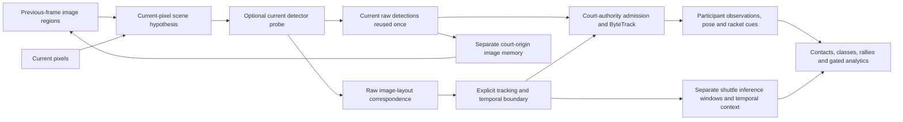

# Test 1–2 root-cause and improvement specification before Test 3

Status as of 2026-11-12 09:04 UTC: Test 1 is accepted for sequential cross-test validation with disclosed limitations under frozen candidate `2418ab8cbe4cca74dd16b722b9727ffdc950294a` in `test03-scene-evidence-contract-20261112`. Main remains `dacc05e`; no new production changes have been promoted or pushed. Full suites pass 2,773 main plus 705 research tests. Test 2 fresh inference completed all 29,296 frames with successful original worker and parent. Its outer workflow failed only in a legacy structural report guard; explicit native postprocessing compatibility is being validated without changing predictions, numeric evaluation, annotations, producer ROOT or original receipts. Test 2 metric/source acceptance remains pending. Test 3 has not been downloaded or processed.

The root Test 1 acceptance receipt is [test01_acceptance_v4.json](../regression_tests/pre_test03_contract_v1/test01_acceptance_v4.json). Current production behavior, modules and commits are summarized in [the production change register](pre_test03_production_change_register.md). Chronological execution sections below preserve rejected candidates, earlier suite counts and failed attempts as history; they must not be read as the current acceptance state. The c585 candidate's 182 withheld visible-athlete rows were rejected, and all 182 are restored exactly in the accepted Test 1 candidate. Original annotations, matrices, predictions, models, source and prior failures remain preserved.

## Scope and evidence standard

The evidence includes all six Test 1 interval-reference families, all seven Test 2 annotation/supporting files, both fresh Test 2 arms, the complete Test 1 fixed-perception regression, 14 significant Test 1 cases and 39 significant Test 2 cases per arm. Generated point/trajectory/winner tables are agreement references, not independently reviewed physical labels. Agent visual checks are diagnostic evidence. Missing boxes, identities, joints, contacts and exhaustive stroke/outcome labels stay unavailable. A missing observation is not a negative, and an unresolved name is not an unknown visual track.

The preserved [Test 1 matrix](test_01_evaluation_matrix.md), [Test 1 repairs](test_01_code_fix_status.md), [Test 2 consolidation](test_02_consolidated_v1.md) and [Test 2 final validation](../test_02/fixes/final_validation.md) remain the baseline. They are not overwritten or pooled into a ten-video generalisation score.

## Previously implemented but insufficient fixes

| Repair | Proven scope | Remaining limitation |
|---|---|---|
| Recovery/resume frontier retained before a cut | Mathematical state-machine regression; fresh Test 1 metrics preserved | Did not trigger on Test 1's measured cases; cannot recover unseen shuttle evidence. |
| One mapping vote per independent source score transition | Repeated-query identity overcount fixed | Names, physical people, score rows and edited-video point sequence remain distinct. |
| Detector foot transformed independently of reboxed envelope | Rotation/projective projection invariant restored | Identity camera matrices in measured Test 1 mean no demonstrated position gain there. |
| Anatomical racket admission | Raw ellipses preserved; face-overlapping semantic cues explicitly withheld | Head/body/banner raw detector aliases remain; no physical contact/classification accuracy gain established. |
| Current content-continuity/OCR/short-exchange implementations | Several false reset and logo-score counterexamples already resolved | Missing prior people can prevent edit acquisition; numeric OCR and short physical exchanges still need independent evidence. |

## Mixed Test 2 timing results

All three one-to-one assignments retain their original TP/FP/FN and F1 at IoU eligibility ≥0.5. Detection F1 measures matched interval counts, not exact temporal overlap. Six changed matched prediction boundaries affect the separate reference spans differently. Coarse mean IoU falls 0.8332145284202773→0.8306646001567289; generated rally mean IoU rises 0.848134653705245→0.8493108146026268. Coarse start/end/duration MAEs worsen. Generated start MAE worsens while end/duration MAEs improve.

For example prediction 25 changes [8627,8734)→[8626,8751). Generated reference row 24 is [8593,8748), giving IoU 0.690323→0.772152; coarse row 25 is [8610,8730), giving 0.830645→0.737589. Extending the same prediction fits one supplied span and overshoots the other. Neither reference change certifies a physical impact, and no endpoint is adjusted to fit either annotation. Exact row calculations and all arm-specific cases are being retained in the new failure database.

## Confirmed defects and investigation priorities

| ID | Component / module | Evidence | Engineering disposition |
|---|---|---|---|
| D01 | Temporal observation composition: `BadmintonMatchEngine._window` | An ordinary modern raw-missing association unconditionally erases postprocessor `vis` and `interp`; the equivalent legacy observation retains explicitly reconstructed geometry. Reproduced for singles and doubles. | Repair composition, preserve interpolation provenance, and create hard reconstruction barriers around ambiguous/invalid/rejected observations. Keep observed-only contacts and default reconstruction policy unchanged. |
| D02 | Appearance capability: `BadmintonSession.capabilities` | Current singles/unknown format overwrites actual checkpoint/CUDA failure with an inaccurate doubles-only disabled explanation. Explicit component selection can support singles. | Preserve actual loader/provider failure and effective component request; distinguish omitted default singles stage from failed construction. Reporting correction alone is not an accuracy gain. |
| D03 | Track births: `PlayerTracker` / installed ByteTrack adapter | The backend counts the initial detection as one update but emits an unassigned ID until a later match. The existing configured minimum is one; our wrapper drops the first eligible current observation. | Narrow adapter preserves the upstream association/timing/allocator and honors the existing observation-count policy on birth. Exact chronological probes restore both athletes at 11346 and the missing near athlete at 6492. No detector confidence threshold changes. |
| D04 | Rejected strict court-anchor expiry: `PlayerPerception._court_tracks` | The initial court-only timeout withholds182 visible-athlete rows in full Test1. Adjacent Test2 frames5957/5958 reveal a missed actual edit behind the official alias; the previous continuous-handover explanation was incomplete. | Restore uniquely fresh court-origin image continuity, preserve actual court-anchor time separately, expire only missing observations/carries, and clear histories at corroborated edits before consuming current proposals. Fifteen-window controls restore all182; full-video acceptance remains pending. |
| D05 | Scene acquisition depends on admitted participants | The fresh c7 full run loses the real7857/8106 edits after a genuine off-court athlete loses court authority. | Separate bounded court-origin image context from participant admission; preserve at least two independent image witnesses and current raw-layout evidence. Fresh c585 restores exactly the original13 scene boundaries. |
| D06 | Irreversible image-context deletion on ambiguous overlap | At7806 an athlete and official both overlap the previous far-region box; the first scene candidate deletes the episode and cannot recover at7812 outside court. | Preserve an unmatched old box/time within the existing observation allowance; a later unique image match may recover it. Ambiguity never refreshes time or participant authority, and cannot seed duplicate context. |
| D07 | Scene acquisition gating: `content`, `scene_change`, `pipeline` | Strong image-floor gating prevents an independent current-layout probe at Test2 edits355/5958/25521. Both actors change, but the existing absolute image floor alone is not met. | Separate relative acquisition from reset. Weak resets require confirmed pre-chunk format, complete strict-court current proposals, all-prior raw and camera-aligned displacement, and independently qualified same-channel witnesses. All three recover in actual chronological controls without lowering the strong image floor. |
| I01 | Detection / tracking / court continuity | Fresh exact-pixel RF-DETR proposes both athletes at Test 2 frame 6492, but final pipeline returns a background official outside strict/padded court and omits the near athlete. | Trace raw proposal→court admission→tracker lifecycle→person match. Restore correct integration rather than lower detector threshold or simply suppress outputs. |
| I02 | Edit acquisition and track births | At Test 2 frame 11346 raw detector sees both athletes, but final tracked output is empty and prior one-person region context misses the cut. | Test track confirmation, current-proposal scene acquisition and content-reset dependencies. Do not assume every tracker-ID change proves an edit. |
| I03 | Shuttle gap and rally split | Test 2 raw gap 27326–27347, tentative close, then reacquisition outside existing merge window; weak raw heatmap candidates, not an association veto. | Separate decoder misses from reconstructed continuity and raw reappearance distractors. Do not globally increase gap/merge thresholds. D01 is not automatically the G69 cause because the benchmark disables reconstruction. |
| I04 | Classification and contact attribution | Many contacts lack current complete body geometry, reliable outgoing motion or a trusted next contact; rule classifier unknown coverage remains high. | Audit provenance/context integration and independently labelled class/timing alternatives. Do not equate known-output coverage with accuracy. |

## Unresolved limitations and annotation problems

- The optional pinned OSNet checkpoint was absent in both Test 2 arms. A later isolated checkpoint probe fails to support the182 Test1 crop recoveries at unchanged production gates, so it is not installed into the shared cache. Installing an appearance model is a new perception experiment; it does not supply roster names, A/B meaning, team membership, point order or winner truth.
- Anonymous legacy detection slots can swap. Forced point assignment and filled shuttle disagreements cannot measure AP, IDF1/HOTA, pose quality or physical localization accuracy.
- Broadcast edits skip source points, historical scoreboard columns differ from current-game values, and some coarse spans include preparation or cross content changes. Duplicate shuttle files must not double the sample population.
- The geometric racket detector still accepts body/background contours; its support is not a calibrated probability. A true racket overlapping a face remains ambiguous under the current safeguard.
- No reviewed contact negatives, dense stroke taxonomy, joint/box labels, stable athlete identities or highlight relevance labels are available in these Part2 tables. Physical component accuracy is explicitly unavailable where those prerequisites are missing.

## Architecture and implementation constraints

The production path remains the configured sport plugin and its perception/identity/contact/stroke/rally/outcome/scoring/analytics components. The generic engine owns media, scheduling, storage, model runtime and transport. Do not create a per-test engine. Changes must support singles, four-player doubles and unknown format; preserve raw observations, source frames, confidence, rejected alternatives and unknowns. Model/provider/pipeline identities must invalidate dependent caches when behavior changes. Diagnostic replay is not fresh inference or a continuation checkpoint for private tracker state.

Existing specs were reviewed alongside current code, including the full-pipeline contracts, pluggable quality study and roadmap. Historical TODOs are hypotheses, not proof that current implementations are absent. The source-score ledger, participant episodes, reviewed identities and named analytics have separate authority and must not be collapsed to fill empty outputs.

## Component-to-implementation review

| Component | Actual reusable implementation / dependency | Finding and improvement boundary |
|---|---|---|
| Ingestion / timeline / resources | `bai_engine.media`, `runtime.runner`, exact CFR proxy; existing fresh-upload executor | Preserve original bytes, rational PTS, source/proxy binding, complete worker/parent/cache receipts, runtime and GPU samples. A new source-root plan is required for the isolated candidate. |
| Court calibration / view | `perception.court_lines`, `camera`, `calibration_state`, `pipeline` | Single-frame Test 2 singles-corner disagreement is mean1.55px; not evidence to replace the court model globally. Invalid/alternate views must remain barriers for physical geometry. |
| Person detection | `perception.players.PlayerDetector`, RF-DETR ONNX / explicit YOLOX alternative | Exact-image proposals already contain athletes at the key misses. Prioritize downstream integration rather than retraining/replacing a functioning detector or lowering its score threshold. |
| Tracking / admission | `PlayerTracker`, `PlayerPerception`, replaceable tracking factory | D03 restores eligible first observations; revised D04 preserves fresh image-continuity hypotheses separately from actual court support. Preserve raw/anonymous IDs and detector-match provenance. |
| Appearance / roster identity | `offline_reid`, `player_association`, `participation`, `identity`, review ledger | Missing pinned OSNet is an operational limitation; D02 fixes its misleading public explanation. Appearance, episode IDs, roster names, teams and scoring slots remain separate. |
| Pose / anatomy | `PoseEstimator`, COCO17 `keypoints`, current inference stamps | RGB conversion and per-frame source stamps are implemented. Pose on a propagated box remains current inference on uncertain geometry; no independent joints support PCK/OKS claims. Restored athlete boxes improve available inputs without proving pose accuracy. |
| Scene/content continuity | `content`, `scene_change`, current-detector layout corroboration | Correcting actor admission exposes a real source-supported edit6307 under the unchanged scene policy. New chronological acquisition controls recover355/5958/25521;11346 remains a cold-prefix limitation. An ID change alone does not establish a cut. |
| Shuttle observations / association | `tracknet`, `association`, flight masks, bounded diagnostics | G69's missing raw peaks are not an association rejection. Do not label estimates as recovered image detections or adopt an unlicensed/unverified replacement checkpoint. |
| Temporal reconstruction | `shuttle_post`, engine `_window`, `rally_motion` | D01 restores explicitly marked context, with no observed-mask changes in full retained-array diagnostics. Contradictory evidence is a barrier, not an interpolatable gap. |
| Racket / contacts | `racket`, `racket_admission`, `contact`, `contact_evidence`, participant hypotheses | Anatomical safeguard is already integrated but incomplete. Preserve raw contours and uncertainty; current per-impact positive/negative truth is absent. Birth repair supplies previously discarded real person observations. |
| Stroke classification | `events.stroke`, `participant_geometry`, delayed engine context | Rule estimates require actual outgoing motion, valid body/court context, flight time and serve context. Existing learned BST is explicit singles-only shadow research, not an executed default or doubles solution. |
| Rally segmentation | `rally_fsm`, `rally_evidence`, `exchange_evidence` | Existing duration/observed-motion/short-exchange gates are retained. Distinguish reference preparation spans, short retained predictions, cancelled candidates and no exported interval. No timeout extension to fit generated boundaries. |
| Outcomes / scores | `rally_outcome`, `score_ocr`, rules, transactional event ledger | Terminal physical evidence and named/row/point binding remain prerequisites. Source edits may skip points. Do not convert legacy reported accuracy or current OCR execution into verified winner accuracy. |
| Movement / heatmaps | `analytics.spatial`, `reviewed_motion`, `individual`, `automatic_individual`, `heatmaps` | Calibration quality, continuous observations and identity/review authority are explicit. Empty named-player products are a coverage limitation, not permission to assign tracks to names. |
| Highlights / insights | `analytics.match`, rebuild/export and existing component contract | Rankings use estimated events with lineage. New perception can change contacts/rally boundaries and ranking; preserve those differences and do not claim relevance accuracy without labels. |

The architecture weakness exposed by D01 is disagreement between independently
valid producer and consumer contracts. D03 exposes an untested dependency birth
boundary; D04 conflates supporting spatial evidence with authority renewal.
Focused integration tests and versioned dependency/cache identities address
these weaknesses directly. More model capacity is not a substitute for those
corrections.

Official upstream [ByteTrack documentation](https://github.com/roboflow/trackers/blob/develop/docs/trackers/bytetrack.md)
describes one-observation activation. Installed `trackers2.6.1` source and the
source-bound diagnostic receipt establish the actual behavior used here; the
upstream development branch is mutable, not the executed dependency pin. The
[upstream project](https://github.com/roboflow/trackers) declares Apache2.0 for
its code. No external library or neural checkpoint is replaced in this phase.

## Validation and release gates

1. Reproduce each accepted defect against `dacc05e` before applying its isolated production fix; retain failed and passed logs.
2. Run focused component/integration controls, including ordinary missing evidence versus ambiguity, cuts, invalid geometry, uncertain identity and all four doubles participants.
3. Run the full relevant main and research regression suites with the configured GPU environment. Passing tests alone establishes no real-video accuracy.
4. Compare complete Test 1 and Test 2 reference families using unchanged original evaluators/matching/annotations. Reuse immutable perception only for explicitly isolated semantic changes; changed perception or feedback requires fresh chronological inference.
5. Disclose all metric regressions, contact/class/identity/highlight changes and resource effects. Never change evaluation tolerances or silently exclude hard cases.
6. Integrate reviewed production code only after the above evidence is complete. Preserve baseline commits, patches, exact executed source/model/profile hashes and artifacts.
7. Only then inventory Test 3 independently, establish exact video pairing, and download its video for full inference/evaluation/diagnosis. Any Test 3 fix requires another bounded feedback and Test 1–2 regression check.

## Execution record

The isolated implementation is committed as `0c3c2b6` (production fixes and
focused controls), with `c7cf871` adding the independent court-anchor expiry
regression file. Main remains at `dacc05e` pending complete real-video acceptance.
These commits change the existing engine window composition, the tracking
adapter/factory and court-membership lifecycle, and the existing plugin's
availability explanation/cache declaration. They do not introduce a parallel
per-video pipeline.

The final frozen candidate passes **2,570 application/engine/sport/agent/API/
benchmark tests plus689 research tests**, with19 existing Starlette warnings.
Ruff passes. Source/test hashes are identical before and after the authoritative
full main suite. Three earlier failed unit assertions encoded the old delayed
birth behavior; their revised cases require immediate eligible birth and still
prove expiry and stable replacement IDs at25/30/60fps. Original failure logs
remain preserved. Initial isolated-worktree fixture/build-path failures were
resolved by linking existing read-only fixtures, without changing expectations;
only runs with explicit candidate package import paths count as candidate proof.

See [tracking investigation](../component_evaluations/pre_test03_perception_v1/REPORT.md),
[temporal investigation](../component_evaluations/pre_test03_temporal_v1/REPORT.md),
[identity capability correction](../component_evaluations/pre_test03_identity_v1/REVIEW.md),
[annotation/failure database review](test_01_02_annotation_and_failure_review.md),
[alternative investigation](../component_evaluations/pre_test03_alternatives_v1/REPORT.md)
and [regression execution ledger](../regression_tests/pre_test03_v1/README.md).

Fresh Test1 inference completed all17,268 canonical frames from clean `c7cf871`,
with fresh perception, unchanged profile/model pins and all retained references.
Worker runtime was1,769.01seconds. Its330 source/helper files and94 protected
inputs remained unchanged. All six interval detection counts and F1 values are
unchanged; coarse mean IoU is0.8421299051→0.8422842260 and primary generated
rally mean IoU is0.8710256650→0.8711853074. These tiny changes do not establish
improved physical contact accuracy.

**The fresh integrated candidate failed acceptance.** Independently reviewed
source frames confirm real same-camera edits at7857 and8106, both present as
barriers in the earlier arm and absent in the candidate (13→11 barriers). At
7857–7859, an old near-player box covers empty court after the edit. The new
court lease removed a genuine off-court far-player region beforehand, leaving
one prior region; the scene observer requires two and therefore cannot acquire
the edit. D04's successful Test2 official-removal prefixes were insufficient
cross-video validation. The fresh run and all failures remain immutable controls.

The player generated-reference maximum rises70.44→170.10pixels on newly
returned assignments at those three frames. Common fresh-detector assignment
errors are numerically identical; changed sample populations must be reported
separately from localization changes. A real integration defect is established
by synchronized source evidence, not by treating generated references as truth.
A reusable correction must preserve first-observation births and prevent the
Test2 official handover while restoring valid scene evidence. It must not lower
metric thresholds, force participant names or equate an ID change with an edit.

Test2's new full regression and Test3 remain gated on diagnosing and validating
this regression. No Test3 download, independent annotation inventory or inference
has started. The optional identity architecture audit separately confirms that
anonymous participant episodes and authoritative named attribution are distinct;
forcing the ambiguity latch off would invent identity authority. See
[architecture audit](../component_evaluations/pre_test03_identity_v1/architecture_audit.md).

## Scene-context integration follow-up (not yet accepted)

The source-confirmed regression prompted a separate candidate checkout,
`test03-scene-continuity-20261112`, preserving the executed `c7cf871` checkout
at its original plan path. Candidate `7ed2f73` separates court-origin image
regions from participant admission and adds explicit independent image-witness
cohorts. All original numerical profile values, checkpoints and evaluation
rules remain unchanged. New codec22 preserves scene-only regions, current-frame
freshness, raw measurements, supporting keys and current raw detector layout;
historical diagnostic codecs remain readable. Missing features remain unknown,
and image regions never authorize player names, poses or court membership.

The first bounded source experiment used ten chronological windows across both
videos. It recovered the real Test1 edit8106, retained the real Test2 edit6307
and detected another real edited jump6151 (score10:13→10:14). Source-bound
review confirms6151; this is diagnostic evidence, not newly supplied scoring
truth. Both prior false-reset controls7703 and23639 remained without barriers.
No foreground capacity overflow occurred (maximum four retained regions).
This experiment used282 new shared detector calls and retained earlier exact
proposals; it did not run the full pose/shuttle/semantic pipeline or measure
physical component accuracy.

**That first candidate still fails acceptance:** it misses7857. At7806 an
athlete and an official both overlap the last far-athlete image box. Deleting
that ambiguous image episode prevents unique outside-court reacquisition at
7812, even though the unchanged one-second observation allowance has not
expired. Source evidence, the failed run and exact executed sources are kept
in `component_evaluations/pre_test03_scene_foreground_v1/prefix_v1/`.

Follow-up commit `5b6d429` preserves that ambiguous region as an explicitly
unmatched, bounded image estimate. It does not move its box or refresh its
observation time; it can recover only with a later unique current raw match
before expiry. Ambiguous proposals cannot seed duplicate image episodes from
those same regions. Participant authority remains independently leased.
Tracking/cache policy versions change, with unchanged numeric gates. The
expanded combined focused suite passes177 tests and lint. The second NEW bounded source experiment completed all ten windows with
zero new neural calls, using911 exact retained detector observations. It
restores7857/8106, retains6151/6307, shows no reset at the two bounded negative
controls, and has no capacity overflow. Original/c7 control rows are identical
between attempts. The source, prior failures and both outputs are retained.
See [bounded validation](../component_evaluations/pre_test03_scene_foreground_v1/REPORT.md).
Full fresh Test1 and Test2 regression and final release acceptance are still
required. Successful component tests alone are
not a measured whole-pipeline improvement.

The execution/audit tools now explicitly accept the new codec22 artifact
format. This schema-only compatibility change preserves historical20/21
catalogue policies when their actual populations fit, keeps recovery strictly
codec21, and retains all previous source/PTS/geometry/threshold rules. Its111
focused compatibility and historical checks pass. Scoring/matching functions
are unchanged. Candidate `0af9f40` records that tool migration separately from
the production scene/tracking fixes. The complete source-frozen main suite is
running before a complete research suite and new full video inference.

Final source-frozen candidate `c585e35` passes2,656 main tests (including the77
benchmark tests once) plus704 research tests:3,360 total. Both runs retain
unchanged hashes for all697 tracked implementation/configuration/test files;
Ruff passes all26 changed Python files. The earlier broad run's single failure
was a stale tracking-contract version assertion, preserved with its log; the
revised test separately verifies birth, court-membership and scene-context
cache policies. The complete rerun passes with19 existing Starlette warnings.
A new fresh full Test1 run has started at
`../ground-truth-validation-artifacts-20261112/pre_test03_v2/test01_candidate_v2/`.
This is a new evaluation arm; the failed c7 full run and both prefix attempts
remain unchanged. Full metric/visual acceptance, Test2 regression and Test3
admission remain pending.

## Revised causal data flow

Only positively in-court fresh detections seed the image memory. Outside image
correspondence never renews participant authority. A missing or ambiguous image
match retains a bounded, explicitly unmatched estimate with its original fresh
observation time. Two independent regional innovations must qualify within the
same measurement channel before any scene hypothesis can act; all measured
regions remain available. The current layout check uses raw image proposals,
including those excluded from participant admission, so court authority cannot
cause a false scene displacement. Complete positive correspondence can veto a
raw hypothesis; unresolved evidence retains an explicitly uncertain experimental
tracking action. No image region is promoted to a named player, point or winner.

[Runtime model audit](../regression_tests/pre_test03_scene_v1/runtime_assets_v1/REPORT.md)
additionally binds the actual extracted RTMPose graph and all three RapidOCR
models to stored hashes across five historical evaluation arms. Current graph
hashes also agree with package RECORD and bundled release checksums. Model/container
paths, sizes, hashes and installed package versions are retained; historical
whole-package byte identity is unavailable and is not asserted. This closes a
reproducibility detail without changing any model, environment or prediction.

## Full Test1 regression observations awaiting final acceptance review

The fresh c585 worker completed17,268 frames in1,748.48seconds. All six supplied
reference detection matrices/F1 values remain unchanged. Coarse mean IoU is
0.8422842260 and primary generated-reference mean IoU is0.8711853074. All13
content boundaries match the original full-neural arm; the two c7-lost edits
are restored, and the stale7857–7859 box is removed. Strict full own-run semantic
parity passes. These do not establish physical contact/classification accuracy.

The all-current legacy player-point mean changes3.069777→3.082777pixels because
its population changes: all33,409 common frame/slot errors are exactly equal,
with240 new and57 old-only matched point pairs. All13,955 common fresh-detector
errors are also exactly equal; the former170pixel c7 maximum returns to the
original70.435594pixel maximum. This is not a claim that every population or
physical-recall measure improved.

The57 old-only pairs include6375–6381,7801–7805 and7812–7856 (legacy slot2).
There is an additional participant-coverage loss8087–8105 that does not appear
as old-only legacy point pairs. Physically visible off-court people can lose
participant authority while their current image regions remain explicitly
scene-only. This conservative admission tradeoff remains a limitation; a blue
context box is not a physical false detection or an authoritative named player.
Current dense foreground observations do not carry detector confidence, so
confidence unavailable outside retained detailed diagnostics is not fabricated.
A future appearance/participant-evidence improvement needs independent identity
and coverage validation. No hard case or original reference row is excluded.

The raw shuttle/reference common11853-point statistics equal the original arm.
The inherited shoe-area shuttle alias at13153 and the old large reference
mismatches remain limitations. Contact/stroke estimates increase445→452 and
unknown outputs301→306; the seven added anchors are unverified contact
hypotheses. Two same-anchor class changes are under evidence-lineage review,
without independent class truth. The rejected c7 timing/actor-region changes
are absent. Full Test1 independent/visual review is being completed before
proceeding to the separate Test2 regression.

The `use_reconstruction=False` value belongs to the rally-evidence provider;
it disables reconstruction as supporting rally-admission evidence. It is not a
global prohibition on bounded, provenance-marked shuttle postprocessing in
`_window`. Contact/classification context and their observed-only anchor masks
must be reviewed under their own contracts. The two changed same-anchor stroke
labels follow different next-contact links (3540:1.7333→0.6seconds;
6456:2.0→0.5seconds), while serialized post-contact speed and hitter court
positions remain unchanged. Without independent impact/class truth, these are
explainable estimated-output changes, not verified classification gains.

## Acceptance rejected: participant-coverage regression

The full c585 experiment is complete, but it is **not accepted** for advancing
to Test2/Test3. Source review establishes182 gross withheld participant rows
across753–800,3413–3449,6365–6381,7801–7805,7812–7856,8087–8105 and14103–14113.
The people are visibly athletes; their blue image-context regions are not a
substitute for participant or pose coverage. Preserved rally F1 and improved
net legacy point coverage cannot hide this regression. D04's strict court-only
timeout is therefore an implemented but insufficient repair, even after D05/D06
restore scene acquisition. The complete failed arm remains immutable.

[Continuity model investigation](../component_evaluations/pre_test03_participant_continuity_v1/REPORT.md)
rejects several motion-only replacements using unchanged library noise models
and fixed diagnostic gates. A post-observation width ablation still loses17
white-athlete rows under real center acceleration, so it is not adopted or
made to pass by loosening thresholds. Anchored HSV and the already-pinned
neural appearance component are being investigated independently. The existing
pipeline applies ROI admission before appearance, so merely installing ReID
weights cannot repair the integration. Any replacement must restore genuine
outside continuity, prevent the official handover, preserve unknowns and pass
new cross-source controls before fresh full regression. No Test2 or Test3 video
has been downloaded in this phase.

## Diagnosis correction and replacement design — 2026-11-12

The earlier D04 explanation treated the Test2 athlete-to-official alias as
continuous offcourt tracking. Exact adjacent proxy frames5957/5958 instead show
a real same-camera edit: both athletes jump to different locations in one
canonical frame while the background remains fixed. The previous athlete box
then overlaps a static official. A geometric court-anchor timeout treated this
symptom but withheld182 visibly real athlete rows in the full Test1 candidate.
That strict timeout is rejected. Earlier descriptions in this working document
that call its coverage loss correct authority expiry are superseded here.
The frozen c585 experiment and all its metrics/evidence remain unchanged.

The independent motion, HSV and optional pinned OSNet investigations do not
justify replacing the current tracker or tuning appearance/motion thresholds.
The OSNet research checkpoint remains isolated; shared checkpoints and model
configuration are unchanged. These controlled negative results are preserved
under component_evaluations/pre_test03_participant_continuity_v1/.

The new isolated candidate restores fresh unique court-origin image continuity
while retaining the last actual geometric anchor separately. Missing or carried
observations cannot renew freshness; an outside person without a court origin
cannot bootstrap it, and a source edit clears both histories before the current
probe is consumed. A continuity hypothesis still does not establish a named
person, physical identity, contact, point or winner.

The scene fix separates acquisition from reset. Existing strong image ratio3
and aggregate intensity15 gates remain unchanged. A relative-only innovation
can request a source-bound fresh detector probe, consumed exactly once through
the normal tracking step. It cannot by itself reset tracking. A weaker reset
requires at least two independent same-channel relative witnesses, a confirmed
format known before the chunk, exactly2/4 distinct strictly current-court raw
proposals, and every current proposal unmatched at the existing0.3IoU continuity
gate to every prior image region. The same absence must hold after transforming
prior boxes using adjacent verified camera poses; pan/zoom explanations abstain.
Unknown format, incomplete doubles visibility, missing geometry/probe/camera
context and ambiguous evidence remain unknown and do not gain a weak fallback.

The V4 raw evidence, V3 decision and codec23 retain source frames, full detector
proposals/confidence, cohort arithmetic, strict court polygon/indices, prior
camera, relative camera transform, format and actual decision. Cache validation
recomputes geometric/camera proofs and binds the polygon to the calibrated
reference plane. The pre-acquisition format context is preserved separately
from a format inferred later during chunk ingestion. Legacy diagnostic schema
reads remain supported, but legacy headers cannot carry new reset authority.

Initial read-only shadow controls cover2399 exact source frames and911 retained
detector crop bindings. They identify5958 plus separately retained detector
probes at355/25521 as candidate missed edits; source review sees genuine edited
body jumps in all three. These are diagnostic examples, not new ground-truth
annotations or a scene-detection recall estimate. Fresh chronological replay
and full Test1/Test2 regression are still required. No Test3 annotation access,
video download or inference is authorized by passing these component controls
alone; the user-required engineering/regression gates remain in force.

## Resumed integration failure: low-feature evidence contract

The a146953 fresh Test1 arm stopped while processing source chunk1500–1559,
with1,500cachedframes retained. Its exception, source snapshot, logs, proxy and
partial caches are immutable at pre_test03_v3/test01_candidate_v3. It is a
failed integration run, not a completed benchmark or accepted improvement.

The V4 observer preserves raw LK patch error even when fewer than six features
can support adaptive appearance evidence. In that case the ratio is unknown;
the prior history can still be recorded. The new arithmetic validator wrongly
required a numeric ratio from that unsupported residual, and could conversely
accept a fabricated finite appearance ratio. A source-native observer control
reproduces the defect. The isolated2418ab8 patch preserves the raw residual,
keeps unsupported ratios unknown and rejects claimed supported ratios with
insufficient current features. The existing feature minimum, image thresholds,
model weights, inference cadence and numerical evaluation are unchanged.

Seven focused regressions cover0/1/5features, history clearing/rebuilding,
forged supported values, and the existing six-feature boundary. They pass with
81existing acquisition/codec cases (88overlapping focused tests total). Full
suites and a new fresh Test1 arm are required before acceptance. A separate
read-only OCR contract review rejects the unproven crop-widening alternative;
its15pure checks are research controls, not additional pipeline accuracy scores.

## Refined G69 diagnosis and rejected duplicate repair

[Exact source/candidate/FSM review](../component_evaluations/pre_test03_shuttle_gap_v1/REPORT.md)
shows partially visible upper-edge evidence27326–27328, then outside-image
uncertainty, with clear upper re-entry27354. The lower27348–27353 branch
follows the visible racket. Twenty-two missing accepted coordinates therefore
are not twenty-two independently labelled visible-shuttle false negatives.
The source still has two people, main view and uninterrupted calibration.

The [complete configured-provider audit](../component_evaluations/pre_test03_shuttle_gap_v1/exit_contract_audit_v1/REPORT.md)
supersedes an explanation based only on the primitive upper-return check.
The actual tracklet provider already supports one qualified isolated alternative
without changing the raw observation, and recomputes when future evidence
arrives. G69 has six contiguous lower observations and deliberately exceeds
that conservative contract. Thirty-five focused controls pass; no permanent
negative latch or missing singleton algorithm is reproduced. No recovery-count,
gap, matching or confidence threshold is changed to fit this example. Moving
distractor association and censored observability remain research limitations
requiring independent labels and cross-test/post-point/doubles controls.

## Current full Test 2 regression investigation

The 2418 full Test 2 run and separate postprocessing completed all29,296 frames; original successful NN receipts and failed legacy outer audit remain immutable. Coarse F1 regresses0.9200→0.9127516779, with an additional missed coarse row33; generated F1 improves0.9189189189→0.9251700680 but mean IoU regresses0.8493108146→0.8307896604. Test 2 has not been accepted and Test 3 remains gated. See the [current regression matrix and diagnosis](test_02_pre_test03_regression_v1.md).

**Confirmed lifecycle difference, proposed defect still under investigation:** TrackNet receives combined camera-shot/content-epoch IDs. Its single key controls both temporal-window isolation and median-background history. New real same-camera content edits therefore reset both dynamic trajectory input boundaries and the static image background reservoir. At809 the same candidate peak's support changes0.51318→0.13770 under the unchanged0.5 cutoff; actual window/background diagnostic hashes support different model inputs. The engineering question is whether background memory can be separated under independently valid camera/scene evidence while preserving strict temporal isolation. It is unsafe to assume that carrying all backgrounds across edits is valid.

**Observed short-exchange rejection:** after the real edit11691, activity starts11716 but cancels11774 for missing qualified short-exchange evidence, yielding no exported [11715,11751) interval. Baseline short witnesses11715 and11740 use motion/context frames11711–11718 after the real edit, so the original rescue cannot simply be dismissed as pre-cut contamination. The absent current11715 contact and upstream input differences require a bounded component replay, not a duration or confidence threshold adjustment. All86 source frames11690–11775 and full current semantic trace are retained.
