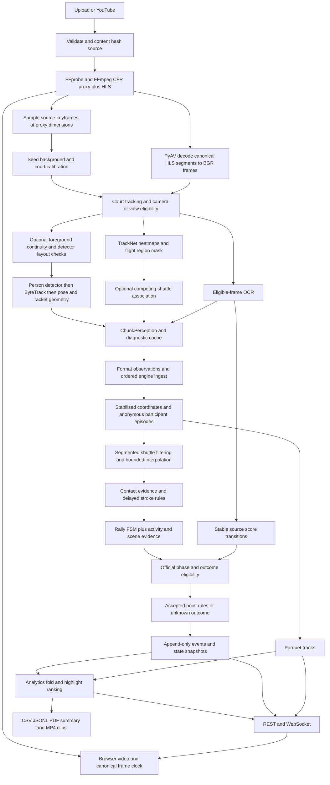
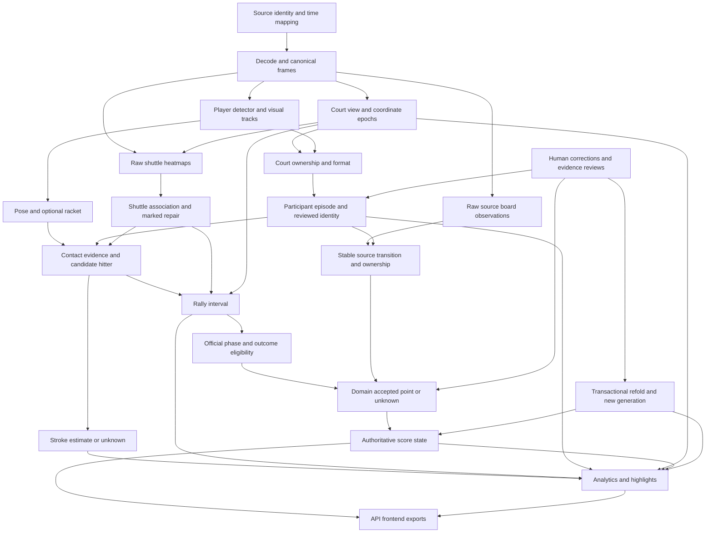

# Badminton Analytics Comprehensive Technical Audit and Model Evaluation

**Research access and runtime inspection:** 10 November 2026, Asia/Kolkata. **Repository:** `/home/administrator/Desktop/sport-analytics/Sports_Analytics`. **Branch:** `repair/pipeline-generalization-20261105`. **HEAD:** `caa91761948d09f2cfe4937b0db743fff8643a12`, plus inherited modified/untracked implementation. **Deliverable:** this single consolidated Markdown document.


## 1. Executive Summary

The platform has a functioning, evidence-preserving video-to-analytics implementation, but it is not yet a validated automatic badminton umpire, persistent four-athlete identity system, or biomechanics platform. It executes learned player detection, pose and shuttle localization alongside classical court/racket perception and deterministic temporal/event/scoring algorithms. The same raw video can produce many anonymous observations and rally candidates while named statistics and accepted points remain unavailable.

The current normal `.env` profile is `gpu-rtx4000`; the actual host has **two GTX 1080 Ti 11 GiB GPUs**, not an RTX 4000 Ada. The running Uvicorn process explicitly disables its embedded engine. Historical and the newly completed 10 November full Test1 experiments instead use an **explicit experimental repair profile**. Default, experimental, loaded, unavailable and actually executed stages must be reported separately.

The newly available full Test1 run processed **17,268 frames in 1,727.340 seconds**, about **9.9969 FPS / 180.056 seconds per source minute**. It detected 36 intervals against 36 generated Part2 interval references, mean temporal IoU **0.871026**. Against the separately supplied coarse human-origin reference table it also matched 36/36, but mean IoU was **0.842130**. These different references must not be silently exchanged. Its 446 contacts/strokes, 20 system-marked official rallies and three highlights coexist with **zero accepted named contact actors and zero known rally winners**. Detection agreement is not equivalent to correct contact, stroke, outcome or score understanding.

Fresh bounded experiments for this audit executed the existing RF-DETR Small, RTMPose M and TrackNet checkpoints in three separate GPU probe processes; additionally they exercised cached RF-DETR Nano/Small/Medium, YOLOX HumanArt and RTMPose M/X through the current adapters, with five warm-ups and three repeats of 100 calls per variant. CPU decode and a CPU-versus-NVDEC CLI experiment were also run. These are performance/contract probes on fixed source inputs, not new accuracy evaluation. New model/variant accuracy, four-player identity accuracy, segmentation benefit, validated movement/biomechanics and most component P/R remain unmeasured.

Highest priorities are: establish independently reviewed source-bound labels; quantify current shuttle/detection/identity failure before replacing models; separate physical contact confirmation from finality and shot estimates; resolve score/roster ownership; wire useful software telemetry; then benchmark replacements with frozen protocols. Keep current baselines while testing targeted alternatives. Cached model variants already provide a low-integration-cost first comparison. RacketVision's complete racket detector-plus-pose pipeline, OC-SORT/BoT-SORT association, a higher-resolution compatible pose model and a badminton-specific stroke shadow are worthwhile experiments, not validated upgrades.

Important research corrections: RacketVision BallTrack is described upstream as TrackNetV3 with temporal frames and a median background, not independently established as a causal live model. Its racket stack needs **RTMDet-M plus RTMPose-M**, while the local manifest contains only a pose candidate. SAM3/SAM3.1 exist but use gated checkpoints/custom licensing; TrackNetV5 SDK is proprietary and does not supply open weights. The current `rapidocr_v4` alias actually loads PP-OCRv6 detector/recognizer graphs. The `rtmpose_x_halpe26` alias is actually a 17-joint body7 export. None of these names proves a capability.

## 2. Scope, Methodology and Evidence Standards

### Evidence classes

Every numerical statement is scoped as one of: **SC** current source-code finding; **RT** current direct runtime/metadata finding; **HIST** previously measured local benchmark; **UP** upstream-reported result; **EST** explicitly calculated scenario/estimate; **PROP** proposed experiment or implementation. **NR** means not reported or not measured for the stated scope; **N/A** means the measure does not apply. Missing labels never become zero error or a perfect score.

Source inspection covered entry points, registries/factories, adapters and installed dependency implementations, preprocessing/postprocessing, thresholds, typed observations, event consumers, rules, corrections, cache identity, stores, API/client wiring and telemetry call sites. The 19 source/config/model-lock fingerprints in the previous report still match current bytes; this was verified again, not assumed. Research agents independently checked separate domains and primary external sources; the central review reconciled their contracts, metrics and licensing. No production code, configuration, model bytes or original sessions were modified.

The prior report is a useful detailed inventory, but its 6 November snapshot cannot certify 10 November runtime state. New `evaluation/ground_truth_validation` evidence changes annotation interpretation and adds a successful full Test1 run. Existing source and runtime evidence take precedence over architecture aspirations or frontend appearance. Code defaults are not proven loaded process state; registered ORT providers do not prove node execution; an event ledger's `confirmed` does not certify physical impact.

External research prioritizes official repositories, documentation, original papers and model cards. Access date is 2026-11-10. Where available, a repository revision/activity snapshot is included in Section 22. Exact current checkpoint bytes remain separate from a newer upstream architecture row. Code, weight and dataset/video rights are separate. Unverified grants remain unresolved even when a model can technically be downloaded.

### Actual work and nonclaims

**Executed in this audit:** checkpoint hashing; package/device/process/health/metrics inspection; direct ONNX metadata inspection; three existing-model GPU probe invocations; six cached detector/pose adapter benchmarks; current CPU SegmentDecoder repeats; FFmpeg CPU/CUDA hardware-decode CLI probes; read-only recalculation/verification of saved metrics and source fingerprints. Supporting raw outputs and exact executed probe script are retained under `../../comprehensive-audit-runs-20261110/` relative to this document.

**Reused as HIST, not rerun here:** completed full Test1/Test2 and eight-video runs; old OCR backend/thread experiments; product browser checks; software suite results; analytics checkpoint scaling experiment. **Not executed:** new external checkpoint downloads, training/fine-tuning, SAM segmentation, new trackers/ReID, RacketVision/WASB/BST replacements, broad prospective amateur accuracy evaluation, RTX4000Ada tests, wall-power monitoring or LLM generation. Their remaining experiments are explicit.

A measured component benchmark does not imply matched accuracy; a generated reference CSV does not become ground truth. All comparisons retain source identity, frame/time conventions, dataset/ref family, checkpoint hash, threshold, precision, backend, device and denominator. End-to-end accuracy must include missing and unknown outcomes rather than only conditioned successes.

## 3. Actual Repository and Runtime Baseline

There are three distinct operational contexts:

| Context | Actual selection or observation | Consequence |
| --- | --- | --- |
| Normal launcher configuration | `../start-server.sh` delegates to `start-app.sh`; `.env` selects `BAI_PROFILE=gpu-rtx4000`; settings otherwise default to an embedded engine | New normal sessions use the selected profile, unless a session supplies its own profile. Existing sessions retain their own profile and saved outputs. |
| Running service at inspection | PID `1231770` runs Uvicorn on `127.0.0.1:8010` with `create_app(settings, start_engine=False)` and a copied settings object containing `engine_mode="external", redis_url=None` | This particular web process does **not** start the analysis engine. It can expose saved results; its existence is not proof of active inference or a connected external worker. No worker connectivity claim is made from the command line. |
| Latest saved repair and sequential benchmarks | Explicit experimental profiles select extra shuttle association, foreground continuity, contact evidence, and tracklet rally logic, with CPU OCR | These are exercised experimental implementations, not a demonstrated promotion of the normal launcher default. Results belong to their frozen profiles and source snapshots. |

Actual hardware is two **NVIDIA GeForce GTX 1080 Ti**, each 11,264 MiB. `gpu-rtx4000` is a target/profile name, not this machine's GPU. At inspection GPU0/GPU1 used 74/7 MiB; those idle device readings are not inference memory requirements.

The normal launcher sources `../gpu-env.sh`, activates the existing virtual environment through its executables, prepares NVIDIA library search paths, loads `.env`, and invokes `bai serve`. `.env` points FFmpeg/FFprobe at `/home/administrator/.local/opt/ffmpeg-static/bin/` and enables YouTube ingestion. Secret settings are intentionally excluded here.

Implementation references: [launcher](../start-app.sh), [settings and profile schema](../engine/src/bai_engine/config.py), [application lifecycle](../apps/api/src/bai_api/app.py), [normal profile](../config/profiles/gpu-rtx4000.yaml), [experimental profile](../config/profiles/experimental-pipeline-repair-v1.yaml).

### Selected component implementations

| Stage | Normal configured pipeline | Latest repaired benchmark pipeline |
| --- | --- | --- |
| Shuttle detector | `tracknet-v3`, TrackNetV3 CUDA FP16 | Same checkpoint and backend |
| Player detector | `person-onnx-v1`, RF-DETR Small, CUDA ORT, requested FP16 | Same graph, explicitly configured FP32 |
| Pose | `rtmpose-v1`, RTMPose M body7, CUDA ORT, requested FP16 | Same graph, explicitly configured FP32 |
| Player tracking | `court-player-episodes-v1`, ByteTrack | Same base tracker with repaired observation/scene handling |
| Optional neural appearance | `osnet-appearance-v1` when eligible and weights exist | Unavailable in saved relevant runs; no executed OSNet model recorded |
| Racket | `racket-geometry-v1`, OpenCV ellipse and shaft | Same |
| OCR | `rapidocr-v1`, requested CUDA | Same package graphs, explicit CPU |
| Shuttle association | Disabled unless explicitly selected | `coobserved-static-hypotheses-v1` |
| Additional scene continuity | Disabled unless explicitly selected | `foreground-content-continuity-v2`, `barrier_detector_layout_v2` |
| Format understanding | `sustained-court-v1` | Same |
| Identity / participation | `participant-identity-v1` | Same evidence separation |
| Contact | Component ID `contact-fusion-v1`, internal method `contact_fusion_v2` | `contact-evidence-v1`, explicit spatial sensitivity |
| Stroke classification | `stroke-rules-v0` | Same; no trained stroke model promoted |
| Activity | `temporal-activity-v3` | Same |
| Rally | `rally-fsm-v1` | `rally-evidence-tracklets-v1` with short-exchange evidence enabled |
| Outcome | `observed-terminal-v1` | Same guarded outcome path |
| Scoring | `bwf-rally-point-v1` | Same |
| Analytics | `match-analytics-v1` | Same event fold |

`Profile.components` overrides the legacy stage fields. A weightless component may deliberately use `model: none, backend: none` while still executing its explicit implementation. Thus `contact.backend=none` does not disable the domain contact rules. Conversely, declaring a model in YAML does not create an adapter or cause a forward pass.

References: [perception composition](../sports/badminton/src/bai_badminton/perception/pipeline.py), [perception ports and factories](../sports/badminton/src/bai_badminton/perception/components.py), [semantic ports and defaults](../sports/badminton/src/bai_badminton/components.py), [session construction](../sports/badminton/src/bai_badminton/plugin.py).

### Reconciliation with the new 10 November evidence

The current branch is `repair/pipeline-generalization-20261105`, not a clean `main` snapshot. Current working source must be captured with dirty diffs/untracked paths to reproduce it. The latest data-readiness mapping found 289 frozen source/helper/profile/manifest paths equal to the earlier improved snapshot. This preserves source continuity for those paths, not proof every process imported current disk bytes.

The previously failed repaired historical Test1/Test2 final-reporting receipts remain failures with independent completion proofs. A **separate new Test1 baseline** now completed successfully: `evaluation/ground_truth_validation/test_01/baseline_v1/run/inference.json`. This is the strongest available current full-run timing evidence for Test1, not a retroactive repair of old receipts. No new Test2 was started in this audit; the separate evaluation workflow explicitly requires Test1 diagnosis before advancing.

`/api/health` currently returns `{"status":"ok"}` and `/metrics` responds. The current scrape largely has metric family declarations without active per-session samples, while `bai_ws_clients=0`. The health route checks serving only; it does not prove worker availability, model readiness or reliable analysis. Process arguments still show `start_engine=False` with an external-mode copied configuration and no Redis. Default configuration validation would require Redis for a real external engine; do not assume this inspection service can accept useful analysis work merely because HTTP is healthy.

The venv is intentionally Pascal-compatible. `../gpu-env.sh` sets the existing libraries and `UV_NO_SYNC=1`; its warning explains that blindly restoring the lock's newer CUDA build can lose Pascal support. Do not resynchronize dependencies during a routine benchmark. Installed `torchcodec` is unused by the selected decoder. TensorRT is advertised by ORT, but no TensorRT Python package or successful current TensorRT engine execution was established.

Blueprint reconciliation: `Design/Badminton_Analytics_Amateur_Product_Blueprint_v2.md` is a product specification, not executed capabilities. Its progress comparisons, split-step/readiness, lunge/balance, purposeful insights, evidence verification and personalized reflection requirements exceed the current implementation. Existing frontend routes/example stories do not establish those measurements. Architecture ownership documents describe intended generic boundaries; court/camera objects still have direct construction in badminton perception, and declarations alone do not demonstrate complete pluggability.

## 4. Complete Pipeline Architecture and Execution Flow



This diagram describes dependencies; several stages operate over a chunk rather than one frame at a time. The actual call order inside `BadmintonPerception.process` is:

1. Compute simple histogram cuts and camera-shot IDs for the decoded chunk.
2. Track court/camera geometry, classify views, update calibration lifecycle, and mark non-main views as analysis-excluded.
3. Choose detector and pose cadence using the **preceding engine state** supplied as `in_play`. The chosen cadence applies to that perception call; it is not recomputed after every semantic transition within the chunk.
4. If foreground continuity is selected, process it sequentially with previous-frame player regions. Where required, acquire current detector outputs for a layout decision, reset tracking at accepted barriers, and compute player/pose/racket observations. Reuse the exact detector probe once rather than executing a second inconsistent observation.
5. Run TrackNet over eligible windows, using court flight masks and shot/content epochs. Optional association consumes its candidate summaries.
6. Assemble `FramePerception`, processing players here if step 4 did not already do so.
7. Acquire eligible scoreboard readings on the configured cadence. This code runs independently of rally state; the older “between rallies only” docstring is not an enforced condition.
8. Return `ChunkPerception`. The host atomically writes its diagnostic MessagePack cache, then `BadmintonSession.ingest` applies format decisions and the semantic engine consumes observations in canonical order.
9. The engine stabilizes geometry, records tracks and participation/activity evidence, filters shuttle windows, admits contacts, advances rally states, classifies delayed contacts, reconciles outcomes/scores, and emits events. Finalization is delayed for future evidence.
10. The host writes/publishes tracks, progress, state, and analytics. At EOF it flushes pending observations and semantic decisions; an EOF boundary alone cannot prove a winner.

The public plugin boundary is `SportPlugin` / `SportSession`; badminton is registered through the `bai.sports` entry point. `ComponentRegistry` resolves typed ports with versioned contracts, supported formats, dependency/configuration identities, lifecycle methods, and failures. Semantic stateful components provide checkpoint/restore for transactions. The actual orchestration remains in `BadmintonSession`, `BadmintonPerception`, and `BadmintonMatchEngine`; the declaration of a stage graph should not be mistaken for a separate generic DAG scheduler. Court/camera implementations are still directly constructed in perception and called by the plugin.

References: [generic sport interface](../engine/src/bai_engine/sport.py), [component contracts](../engine/src/bai_engine/components.py), [host analysis loop](../engine/src/bai_engine/runtime/runner.py), [badminton plugin](../sports/badminton/src/bai_badminton/plugin.py), [perception execution](../sports/badminton/src/bai_badminton/perception/pipeline.py), [semantic execution](../sports/badminton/src/bai_badminton/engine.py).

### Acquisition and media execution

### Acquisition and media preparation

`POST /api/sessions` accepts streamed uploads; `/api/sessions/youtube` handles enabled YouTube ingestion through `yt-dlp`. Source storage is content-addressed with SHA256. The session catalogue stores source kind, URI, digest, title, profile, sport, roster, and preparation/analysis state. Reuse searches use durable source identity, profile and sport, with compatibility checks; matching a filename is not sufficient.

Default limits are 4 GiB upload and three hours. FFprobe checks media metadata, duration, selected video stream, dimensions, orientation, frame rate, and variable-frame-rate status. The runner uses the validated stream and rotation when sampling keyframes.

`plan_proxy` preserves supported standard rates, caps source rates above 60 FPS at 60, and otherwise selects 30 FPS. Height is at most 720 by default without upscaling a smaller source; width preserves aspect ratio and is even. FFmpeg uses `scale=-2:height`, `fps=...`, CFR output, and YUV420p. An NVENC capability probe selects H.264 NVENC if it works; otherwise libx264. Playback audio is retained when present; audio is not a contact/event inference input.

One encode tees to `proxy.mp4` and fMP4 HLS with `init.mp4`, `seg_*.m4s`, and `index.m3u8`. Keyframes are forced at segment boundaries and scene-dependent encoder keyframes disabled. Segments are approximately two seconds: `F=round(fps*2)`, hence **60 frames at 30 FPS**, even though profiles contain `chunk_frames: 64`. The normal SessionRunner advances by media segment size, not the nominal profile chunk size. Playback can start after the first segment while transcoding continues. A per-media writer lock prevents competing sessions overwriting the same prepared media.

### Decode and timeline

`SegmentDecoder` concatenates initialization bytes and one media segment and decodes through **CPU PyAV**, normally with two decode threads, into host `uint8` BGR arrays `(H,W,3)`. Segment `k` starts at canonical frame `k*F`. The final segment may be shorter. `make_decoder(..., device=...)` currently always returns this CPU decoder; installed `torchcodec` does not establish CUDA decoding.

Video presentation, events, tracks, seeks, clips, and overlays use the canonical CFR timeline. Rational FPS supports exact frame-to-time arithmetic. Source PTS and proxy frame number are distinct for VFR, resampling, duplication, rotation or source excerpts. Tests 1 and 2 verified their own 30 FPS source/proxy PTS correspondence; that does not prove generic VFR identity. Benchmark helpers additionally preserve source/proxy hashes and transforms.

The runner samples up to 24 distributed source keyframes, resized to proxy dimensions. They seed the TrackNet background and automatic court/camera selection. Full sequential inference decodes every canonical frame; model cadence selectively reduces detector/pose calls rather than dropping those frames from the timeline.

References: [ingest routes](../apps/api/src/bai_api/routes/sessions.py), [source adapters](../engine/src/bai_engine/sources.py), [probe](../engine/src/bai_engine/media/probe.py), [proxy generation](../engine/src/bai_engine/media/proxy.py), [decode](../engine/src/bai_engine/decode.py), [runner](../engine/src/bai_engine/runtime/runner.py).

## 5. Master Component Inventory

Status vocabulary follows the requested taxonomy. An “active production/default” status denotes the normal application **code path**, not that the currently inspection-only web process is doing inference. Model availability/runtime accuracy remain separate. Each capability below maps to a detailed specification and failure/metric requirements.

| ID | Capability | Status | Owner (relative to module root) | Responsibility and boundary |
| --- | --- | --- | --- | --- |
| C01 | Acquisition and content identity | Active production/default | engine/sources.py; API sessions | Upload/YouTube bytes→hashed source; source access and limits |
| C02 | Probe and canonical media | Active production/default | engine/media/probe.py,proxy.py | Validated stream→CFR proxy/HLS,rotation/timebase; audio playback only |
| C03 | Decode and frame clock | Active production/default | engine/decode.py; web frameClock | HLS segment→ordered BGR frames; CPU PyAV; GPU decode experimental probe only |
| C04 | Scheduling and lifecycle | Active production/default | runtime/runner.py; bus.py | Per-session sequential execution,commands,cancellation,progress |
| C05 | Model/component registry | Active production/default | runtime/registry.py; components.py | Verified model artifact and explicit provider construction |
| C06 | Cut and view eligibility | Active production/default | perception/scene.py; events/scene.py | Histogram cuts,mat presence,view segments; not verified replay recognizer |
| C07 | Foreground content continuity | Experimental | perception/content.py,scene_change.py | Optional same-camera change hypotheses/current-detector layout barriers |
| C08 | Court calibration and camera | Active production/default | court.py; court_lines.py,camera.py | Classical lines/manual H,floor verification,camera head and lifecycle |
| C09 | Format understanding | Implemented but conditionally executed | format_understanding.py | Configured or sustained target-court singles/doubles/unknown |
| C10 | Person detection | Active production/default | perception/players.py | RF-DETR default; YOLOX/cached variants conditional |
| C11 | Multi-object visual tracking | Active production/default | players.py; trackers ByteTrack | Detections+timestamps→temporary visual IDs and qualified carries |
| C12 | Neural appearance ReID | Implemented but conditionally executed | offline_reid.py; player_association.py | OSNet optional; unavailable in relevant saved runs |
| C13 | Participant/name/team binding | Partially implemented | participation.py,identity_review.py,teams.py | Anonymous episodes/reviewed identities/team hypotheses; four-person consistency unvalidated |
| C14 | Human pose | Active production/default | players.py PoseEstimator | COCO17 per-box RTMPose inference and source freshness |
| C15 | Player segmentation | Unsupported in current pipeline | No current player-mask port/model | No operational learned person masks; geometric court flight masks are different |
| C16 | Movement and jump cues | Implemented but conditionally executed | analytics/spatial.py; events/stroke.py | Floor path/travel estimates and jump/smash heuristics; no validated biomechanics |
| C17 | Shuttle heatmaps/localization | Active production/default | perception/tracknet.py,diagnostics.py | TrackNet temporal heatmaps→masked selected pixel observation |
| C18 | Shuttle association | Experimental | perception/association.py | Competing static hypotheses,abstention/reacquisition; no invented coordinate |
| C19 | Shuttle trajectory repair/features | Active production/default | shuttle_post.py; engine._window | Segmented spike removal,bounded spline/linear filling,image velocity |
| C20 | Racket perception | Active production/default | perception/racket.py | Classical ellipse/shaft proposals near fresh posed wrist; no learned track model |
| C21 | Contact and hitter evidence | Active production/default; experimental evidence provider optional | events/contact.py,contact_evidence.py; participant_contact.py | Candidate timing,independent impact/trajectory/attribution reliability |
| C22 | Shot/stroke classification | Active production/default | events/stroke.py; engine._classify | 12-class rule estimates+unknown; BST is separate shadow only |
| C23 | Temporal activity | Active production/default | events/activity.py | Observed activity hypotheses,not intent or official match proof |
| C24 | Rally segmentation | Active production/default; experimental variants | rally_fsm.py,rally_evidence.py,rally_motion.py | Candidate starts/ends,delayed confirmation,exit/short witnesses |
| C25 | Scoreboard OCR/reconciliation | Implemented but conditionally executed | perception/scoreboard.py; score_ocr.py | Source text/rows→stable source increments; independent of accepted points |
| C26 | Official phase/outcome/score | Implemented but conditionally executed | match_phase.py,rally_outcome.py; rules/bwf.py | Eligibility+known owner→accepted point or unknown; correction/refold |
| C27 | Analytics and heatmaps | Implemented but conditionally executed | analytics/match.py,rebuild.py,individual.py | Official/review-qualified event and track projections |
| C28 | Highlights and exports | Implemented but conditionally executed | analytics/match.py; API exports.py | Rule ranking,evidence intervals,CSV/JSONL/PDF/MP4 |
| C29 | Persistence/cache/transport | Active production/default | engine/store; wire.py,bus.py; API ws.py | Append-only events,state,Parquet,MessagePack,generations/revisions |
| C30 | API and frontend | Active production/default | apps/api; apps/web | HTTP/WS data→synchronized overlays,review,analytics and errors |
| C31 | Grounded text insights | Implemented but conditionally executed | agents/*; API routes/agents.py | Read-only event tools/provider generation or deterministic fallback |
| C32 | Software observability | Partially implemented | engine/obs.py; system.py | Structured logging/metrics/diagnostics; missing readiness,spans and useful wired counters |
| C33 | Research/dataset/evaluation management | Experimental | research/*; evaluation/ground_truth_validation | Source-bound harnesses,reference families,coverage and explicit quality gates |
| C34 | Learned/live/second-opinion refiners | Configured but not operational | profile shuttle_live/second_opinion/inpaint | RacketVision/WASB/Inpaint names do not execute; true-live acquisition unsupported |

## 6. Detailed Component Specifications

### Shared specification conventions

The component cards below use the same ten fields: identity/status/owner; purpose; implementation/configuration; input; output; capabilities/failures; metrics; hardware; observability; improvement. **Owner paths in cards are relative to** `engine/src/bai_engine/`, `sports/badminton/src/bai_badminton/` or `apps/`, as stated. All source records remain source-bound; low-rate event outputs are not raw neural tensors. New local measurements are in Section 13; missing physical accuracy is NR, with required labels in Sections 9 and 12.

The following detailed implementation account is based on current byte-identical source with renewed call-site/installed-library checks. It explains threshold and coordinate details for C06–C26; the uniform cards that follow cover the remaining platform layers and make status/failure/measurement ownership explicit.
### Court and geometry implementation

**No pretrained court model runs.** `court_lines_v1` is a CPU OpenCV/Numpy algorithm: white-line enhancement and low-saturation masking, ridge extraction, Hough lines, robust line fitting, two vanishing-point families, candidate model correspondences, physical camera plausibility checks, painted-line support scoring, and iterative refinement. Its court template includes singles/doubles sidelines, short/long service lines, baselines, and centre service segments.

Automatic startup fits sampled frames in a four-thread pool, groups camera poses, and chooses the main camera/reference. A usable fit needs support in both line directions. `AUTO_CALIBRATION_MIN_SCORE=0.6` is a local quality threshold, not labelled geometric accuracy. Manual landmarks and calibration review are supported. A mat contour is only a proposal; if painted geometry cannot be verified, the plugin records court degradation and requires calibration instead of treating an entire shared mat as one court.

`CourtTracker` uses previous fits, flow prediction/refinement and fresh reacquisition. `CameraRig` separates main and alternative camera heads using decomposed camera geometry. Legacy/manual paths can use `CameraTracker`: SIFT matching plus RANSAC, Lucas–Kanade alignment, reference/keyframes, and floor-edge verification. Its default work width is 640, anchor interval 30 frames, maximum unanchored interval 45, held pose limit 6, and maximum keyframes 16. Floor visibility and edge correlation guard against aligning only advertising/crowd structure. A static presence path also exists.

`CalibrationLifecycle` distinguishes `LOST`, `REACQUIRING`, `VALID`, and `DEGRADED`; three consecutive verified frames recover validity. A held pose is degraded evidence. `view` distinguishes main, alternative, and absent views. The perception boolean named `replay` frequently means **analysis-excluded non-main view**, not a verified broadcast replay. Replay status in OCR context is separate and can remain unknown.

Geometry conventions:

- Court origin is centre/net floor line, x across court, positive y toward the far end; near-side y is negative. Length is 13.40 m; doubles/singles width is 6.10/5.18 m.
- `H` maps court metres to calibration-reference pixels. `G_t` maps reference pixels to current-frame pixels. Current court mapping is `G_t H`; temporal image observations are stabilized by `G_t^-1` when usable.
- Player feet use bbox bottom centre before ground projection. This is an estimate: jumping, occlusion and box error can violate the ground assumption.
- Lost/non-main/invalid calibration withholds authoritative floor positions. Every consumer must respect coordinate epochs rather than differencing positions across cuts or recalibration.
- A floor homography does **not** recover airborne shuttle 3D position, physical speed, contact height, or an accurate line call.

Player gating uses the selected court with 0.35 m side and 0.75 m end runoff allowances for continuing observations. Detector crop padding is normally 60 px, extended upward by 25% of court height. A uniquely overlapping previous observed court track can retain a jumping/runoff athlete without globally expanding the court mask. Shuttle gating instead uses an upward swept image region: default sweep 0.35 image heights; experimental `vertical_columns_to_image_top_v1` extends selected court columns to the image top. Neither geometrically proves which court owns an overlapping airborne shuttle.

References: [court model and homography](../sports/badminton/src/bai_badminton/court.py), [court fitting](../sports/badminton/src/bai_badminton/perception/court_lines.py), [camera tracking](../sports/badminton/src/bai_badminton/perception/camera.py), [scene/presence](../sports/badminton/src/bai_badminton/perception/scene.py), [lifecycle](../sports/badminton/src/bai_badminton/perception/calibration_state.py), [flight mask](../sports/badminton/src/bai_badminton/perception/isolation.py).

### Tracking identity and four-player behavior

#### Detection association across frames

`PlayerTracker` wraps Roboflow `trackers.ByteTrackTracker` with activation threshold **0.4**, high-confidence detection threshold **0.5**, minimum consecutive frames **1**, and lost buffer **30 at the library's 30-FPS convention**, approximately one second. Updates pass `timestamp=frame_idx/fps`, so cadence changes use elapsed video time. Inspection of installed `trackers/core/bytetrack/tracker.py` confirms a Kalman `XYXYStateEstimator`, standard bbox IoU and SciPy Hungarian assignment, first matching confidence≥0.5 detections to all live tracks and then lower-confidence detections to remaining tracks. Its inherited minimum matching IoU is 0.1. RF-DETR already filters below 0.35, so the low-confidence recovery pool is only 0.35–0.5; this is not recovery from arbitrarily weak detections. New births come from unmatched high-confidence detections, making the high-stage threshold relevant in addition to configured activation 0.4. ByteTrack does not use frame pixels or camera-motion compensation here; camera correction is handled elsewhere in the pipeline. The project supplies detector scores, court gating, timestamps, and observation provenance.

Between detector ticks the project copies previous boxes with confidence multiplied by 0.98. It does **not** run a new image-based box detector or optical-flow person tracker on those carry frames. Carries expire when the last detector frame is older than the expected stride. `detector_matched=False` marks a carried or unmatched result. On a detector-run frame, a returned track counts as freshly observed only when one current detection uniquely matches it at IoU≥0.5, in both directions. A tracker output alone is not a fresh detection.

Current source pose can be attached to such carried boxes. Racket geometry requires a fresh matched person and therefore does not promote a carried box to equipment evidence. Cuts and accepted content barriers reset tracker/carry/association state and force detection on reentry.

#### Optional neural identity association

If OSNet loads, `PersistentPlayerAssociator` maps raw ByteTrack IDs to short-lived canonical visual IDs. It uses a maximum four-descriptor gallery per identity, up to 16 identities, L2-normalized descriptors, motion/height gates, Hungarian one-to-one assignment with dummy abstention choices, and row/column ambiguity margins. Important thresholds are minimum observation confidence 0.5, cosine similarity 0.8, score margin 0.05, and overlap IoU 0.3. Matching support is `0.65*appearance + 0.35*motion + 0.02*same_raw` after gating.

Default retention is one second; profile retention is eight seconds. A dormant identity older than one second needs stronger neural evidence, similarity≥0.9 and distinctive competitors. Overlap marks identity ambiguous; after separation, raw ID continuity alone cannot resolve it. Unobserved carries never train appearance or extend identity lifetime. Ambiguous output is `-1`; resets clear galleries. Birth IDs use absolute frame indices to avoid collisions across resets. If embedding fails, the matcher keeps its canonical namespace and explicit degraded state rather than silently reverting to possibly recycled raw IDs.

#### Anonymous participants and named athletes

The semantic engine creates deterministic, namespaced **participant episodes** from visual track observations. It records first appearances, entries/exits, uncertainty and possible substitutions. Misses and unavailable detector coverage are distinguished. Calibration changes, shot/content resets or prolonged coverage loss start a new epoch. Participant defaults are three entry observations, 30 exit observations and a 300-frame substitution window, with coverage guards. The participant layer's HSV-based reappearance suggestions remain uncertain; they do not merge people into accepted named identities.

The legacy `IdentityResolver` can form provisional singles side/track bindings, with optional unique short spatial rebind. The actual engine initializes `_multi_person_identity_ambiguous=True`: configured scoring names and format do not identify physical people. Interval-scoped identity reviews and per-stroke hitter reviews are separate accepted evidence. Consequently, anonymous observation geometry can support contacts without producing a `player_id` actor.

For unknown/doubles, perception reserves four-player capacity and retains up to six candidate tracks to expose distractors. More than six returns withhold the frame rather than silently selecting four as certain athletes. Singles likewise retains extra candidates; its contact participant window requires exactly two compatible episodes and no extra/unresolved person evidence.

`DoublesTeamTracker` can hypothesize two pairs from four distinct participants, valid court sides, confidence≥0.5 and sustained active-play support (normally two seconds). Pair IDs remain hypotheses and are not P1/P2 scoring identities. Team scoring still has two competitor slots. Reviewed roster/team membership and a separate doubles-service-order fold handle named team/partner reporting when sufficient evidence/configuration exists.

**Does identity consistency work for all four doubles players?** Four-person observation and association interfaces exist, and some full doubles clips execute. Continuous correct physical or named identity across crossings, occlusion, cuts, end changes and all four athletes has **not** been established. Optional OSNet was unavailable in these saved runs; the explicit identity experiment is marked opt-in after sampled AI-draft agreement regressed. No reviewed IDF1/HOTA or four-player identity-switch benchmark supports a stronger claim. One source diagnostic found four post-ROI detections but only three returned tracks. Same-side position and shirt colour are insufficient to certify an athlete identity.

References: [player implementation](../sports/badminton/src/bai_badminton/perception/players.py), [neural associator](../sports/badminton/src/bai_badminton/perception/player_association.py), [participation](../sports/badminton/src/bai_badminton/participation.py), [legacy identity resolver](../sports/badminton/src/bai_badminton/identity.py), [review handling](../sports/badminton/src/bai_badminton/identity_review.py), [team hypotheses](../sports/badminton/src/bai_badminton/teams.py), [experimental doubles profile](../config/profiles/gpu-doubles-identity.yaml).

### Shuttle association and repair

Normal TrackNet output is a framewise selected heatmap component; the CNN has temporal image input, but it is not a persistent multi-hypothesis physical object tracker by itself.

Experimental `coobserved-static-hypotheses-v1` acquires bounded alternative heatmap components from the **same forwards**, with candidate floor 0.1 and internal top-k up to 8. A compact static component repeatedly co-observed beside a different moving selection cannot later silently become that airborne shuttle's landing merely because it becomes the largest peak. Statuses are `observed`, `ambiguous`, `missing`, and `invalid`; association labels include tracked, static candidate, reacquisition, unknown and rejected. Camera registration can compare hypotheses in reference pixels. The association stage emits only an actual fresh input coordinate or none; it does not forecast a replacement coordinate.

Engine postprocessing operates inside temporal scene/coordinate segments:

- Reject impossible adjacent jumps using 300 px/frame backwards-step and 130 px/frame both-neighbour spike rules.
- Fill only interior gaps up to 25 frames with at least two anchor observations on each side within five-frame neighborhoods, implied speed≤120 px/frame, and moving anchor context.
- Use a natural cubic spline with enough anchors, otherwise linear interpolation; mark `interp=True` and confidence 0.35.
- Keep reconstructed samples distinct. Core contact and rally observed-motion inputs exclude interpolation; experimental rally reconstruction is explicitly disabled in the selected repair profile.
- Break filtering/velocity/contact context across cuts, replay/view changes and incompatible coordinate epochs. Missing coordinates remain NaN rather than fabricated stationary measurements.

Engine defaults retain 1,800 frames of history, 45 frames of backward context, and **40 frames lookahead** before temporal finality. At 30 FPS lookahead alone is about 1.33 seconds; chunk arrival, model work, rally confirmation and score waiting add delay. Image speeds are pixels/frame or pixels/second as indicated, not measured shuttle km/h.

References: [candidate association](../sports/badminton/src/bai_badminton/perception/association.py), [trajectory filtering](../sports/badminton/src/bai_badminton/perception/shuttle_post.py), [temporal buffers/windowing](../sports/badminton/src/bai_badminton/engine.py), [observations contract](../sports/badminton/src/bai_badminton/observations.py).

### Racket contact stroke and movement

#### Racket observations

`racket_geometry_v1` / `opencv_ellipse_shaft_v1` has **no learned checkpoint**. For fresh detector-matched people with confidence≥0.5 and COCO-17 pose, it searches around wrists with score≥0.5 using grayscale Canny edges (45/130), contour ellipse fitting, shape/coverage checks and visible shaft-edge support. Search radius is 0.75 body heights; acceptable axes are 0.07–0.5 body heights, aspect ratio≥0.35, median ellipse fit error≤0.16, angular coverage≥0.75 and shaft support≥0.65. Competing ownership is withheld.

It returns centre, axes, angle, wrist index, heuristic support, track owner and source-frame stamp. Blur, edge-on rackets, occlusion, distant players and background ellipses are known weaknesses. It is not equivalent to the unintegrated RacketVision racket-pose network.

#### Player and shuttle contact

`contact_fusion_v2` is deterministic hand-weighted logistic fusion: bias −4.2, redirect weight 3.2, impulse 1.4, proximity 3.4, wrist swing 1.1 and observed-racket overlap 1.4. Candidate cutoff is 0.35, temporal local-max suppression normally 0.2 seconds. Shuttle direction/speed estimates use local observed positions; wrists use score≥0.3, falling back to an upper-box cue when needed. Proximity scales distance by player body height. Attribution requires minimum proximity support 0.05 and a relative proximity separation of 0.05; otherwise actor/ownership stays uncertain. These values are heuristic supports, not calibrated physical-contact probabilities.

The repaired `contact-evidence-v1` explicitly records trajectory, impact, and attribution reliability separately. Its configured `spatial_sigma_px=0.7216878364870323` is the declared sensitivity `2.5/sqrt(12)` for a 512→1280 pixel grid cell, not measured shuttle-error covariance. Evidence distinguishes fresh, reconstructed, stale, carried, ambiguous, missing and rejected observations. Physical statuses include insufficient, ambiguous, probable, rejected and externally confirmed. Only explicit source-bound review can confirm a physical impact.

The engine considers anonymous participant bodies in contact windows, including all four in doubles, without requiring names first. It does not enforce singles alternation across unnamed episodes. A low-proximity trajectory turn can be preserved as `shuttle_turn` instead of a stroke-producing hit. Candidate timing, episode attribution, named hitter, and physical impact are separate claims.

#### Stroke rules and jump estimates

The active classifier is `RuleStrokeClassifier` / `stroke_rules_v0`, **not BST**. Inputs are contact context, optional hitter court feet, service context, post-contact image velocity, time to next contact and above-head evidence. It produces short/long serve, net shot, cross net, block, push, rush, lift, clear, drive, drop or smash estimates, or unknown.

It requires valid flight time and speed and, for non-serve strokes, court position. Unresolved initial-service context abstains. Front/rear zones and normalized image speed determine hand-set scores: fast>1.6 frame heights/s, very fast>2.6, long flight>1.0 s, short flight<0.6 s. A softmax uses temperature 0.8; maximum class confidence is capped at 0.7. These are not fitted class probabilities.

Post-contact kinematics require at least three real samples, excluding interpolation and next-contact/scene boundaries, and use robust median pairwise slope plus residual checks. Jump cues compare ankle/hip elevation against a pre-contact baseline; smash and jump-smash assessments are weighted rules. No depth, 3D skeleton, racket angular velocity, injury model or calibrated biomechanical measure is integrated.

Movement is `court_path_v2`: valid floor feet, stable track and consecutive source frames, maximum speed 12 m/s, local three-sample median, approximately 5 Hz sampling and 0.05 m jitter suppression. Missing frames, track switches or invalid calibration split the path; travel direction is court-plane motion, not body facing. Coverage accompanies distance/speed estimates.

References: [racket geometry](../sports/badminton/src/bai_badminton/perception/racket.py), [contact fusion](../sports/badminton/src/bai_badminton/events/contact.py), [physical evidence](../sports/badminton/src/bai_badminton/events/contact_evidence.py), [participant contact windows](../sports/badminton/src/bai_badminton/participant_contact.py), [stroke rules](../sports/badminton/src/bai_badminton/events/stroke.py), [movement](../sports/badminton/src/bai_badminton/analytics/spatial.py).

### Rally outcome and domain rules

#### Rally candidates

The normal deterministic FSM is `IDLE → IN_PLAY → ENDING → CLOSED`, with provisional starts and mergeable closures. Defaults: three consecutive moving observed frames above 3 px/frame to start; ten missing frames or seven of the last ten stationary observations below 3 px/frame to end; 15-frame lookahead; minimum two seconds; merge gap 0.75 seconds; resume threshold 6 px/frame. A contact can also start/resume an exchange. A cut closes an observation interval and resets motion context.

The repaired evidence FSM consumes typed `RallyObservation` rather than treating all coordinates as observed. Selected `rally-evidence-tracklets-v1` enables image-exit recovery with association-qualified tracklets and stronger short-exchange evidence. Its flags are `use_reconstruction=false`, `motion_guard=false`, `use_exit_recovery=true`, `use_curve_exit=false`, `use_short_exchange_evidence=true`, and `use_terminal_contact_evidence=false`.

Short-exchange admission requires compatible shot/content/coordinate epochs, separate observed shuttle motion and a consistent freshly observed opposite-court participant pair in both contact contexts. This supports anonymous exchange continuity without naming athletes or proving impacts. The terminal contact veto experiment was not adopted. No unconditional gap extension or missing-shuttle fabrication is used to force reference matches.

Internal endpoint sample counting is inclusive in relevant FSM structures; the external benchmark export/matcher uses half-open time intervals. Comparisons must preserve that distinction.

#### Activity and official phase

`temporal_activity_v3` combines bounded person coverage, movement, observed shuttle trajectory and existing rally evidence, normally with a two-second window and one-second transition hold. It reports unknown, reacquiring, rally, active play or inactive; motion does not establish match intent.

`MatchPhaseTracker` separately decides whether a candidate is official play. Human match-start/per-rally decisions and corroborated scoreboard changes can support it. Legacy service-formation/tempo heuristics exist, but `allow_heuristic_official=false` by default. Unknown phase remains unknown. An official-phase flag does not establish a winner.

#### Outcome and scoring

`observed-terminal-v1` wraps a legacy geometric outcome cascade for out, net, winner or unknown. It is rule-based CPU logic, not a learned point detector. The current caller adds material gates: known format throughout the rally, valid compatible court geometry, no cut/EOF-only outcome, and at least four consecutive real terminal observations with confidence≥0.5 and near-rest displacement below `15/fps` px/frame. An absent shuttle or extrapolated floor crossing alone cannot score a point. Even this gated geometry is not validated automatic line judging.

`ScoreReconciler` and source evidence can propose a unique scoreboard increment. A point additionally needs accepted ownership/mapping and official/format eligibility. Default engine OCR wait is four seconds, with bounded late reconciliation over 30 seconds. Unique transition ownership prevents one observed increment from being applied to multiple rally fragments.

The BWF rule fold applies accepted winners: two scoring competitors, rally points, 21 with two-point margin and cap 30, games/match state, service and end state. Unknown scores must remain unavailable rather than be displayed as verified 0–0. Doubles teams use two scoring slots; four athletes are separate roster members. `DoublesServiceOrder` supports reviewed opening server/receiver and partner rotation, but it requires explicit configuration and compatible accepted point history. It is not automatic visual recognition of all service roles.

References: [baseline FSM](../sports/badminton/src/bai_badminton/events/rally_fsm.py), [evidence FSM](../sports/badminton/src/bai_badminton/events/rally_evidence.py), [exchange proof](../sports/badminton/src/bai_badminton/events/exchange_evidence.py), [motion/exit evidence](../sports/badminton/src/bai_badminton/events/rally_motion.py), [activity](../sports/badminton/src/bai_badminton/events/activity.py), [phase](../sports/badminton/src/bai_badminton/events/match_phase.py), [outcome cascade](../sports/badminton/src/bai_badminton/events/rally_outcome.py), [score rules](../sports/badminton/src/bai_badminton/rules/bwf.py), [doubles service order](../sports/badminton/src/bai_badminton/rules/doubles.py), [engine gates](../sports/badminton/src/bai_badminton/engine.py).

### OCR and reconciliation

At most one corner crop is searched per scheduled OCR call: four corners, each 45% of width and 25% of height. After parsing a coherent board, the reader locks a crop around it with margin; four failed reads release the lock. GPU profiles normally read once per second; CPU development once per two seconds. Default scene policy permits only main-view images; optional `all_image_broadcast_overlay` exists. The view exclusion flag and independently known replay status remain distinct.

Current parser `nearest-name-current-column-v2` groups adjacent name tokens, associates the closest eligible name to score fields on the right, verifies two-row alignment and a unique plausible board, and selects the rightmost current-game number up to 30. It avoids borrowing a broadcaster logo across an intervening athlete name and abstains on conflicting/extra rows or missing current digits. It does not infer an obscured digit from an old game score.

`ScoreReading` is a frame-stamped model observation of two `(label, points)` rows and support. Reconciliation requires repeated stable observations (same board twice), compares before/after source boards independently of the engine score, and accepts only one row +1 with the other unchanged as a potential increment. Game resets, jumps across edits, unobserved final points, label changes and ambiguous transitions are not silently filled. Source transitions have content-derived IDs and supporting frame references.

OCR row text, normalized competitor labels, P1/P2 ownership hypotheses, observed source increments and accepted points are different layers. Typed names/review or supported evidence are needed for binding; paired labels require both partners. A readable score bug does not automatically supply roster identity or a verified full score sequence.

The old Test2 parser stabilized `SXFI 21 / LIVE 12` branding instead of the athlete board. The repaired parser abstains on the documented missing digit example and produces many athlete-labelled readouts, but the repaired run still emits no accepted points. Thus OCR execution and improved reading coverage have not solved score ownership or end-to-end scoring.

References: [OCR search and parser](../sports/badminton/src/bai_badminton/perception/scoreboard.py), [source transition reconciliation](../sports/badminton/src/bai_badminton/score_ocr.py), [repair evidence](../../pipeline-repair-runs-20261105/OCR_REPAIR_REPORT_v2.md), [original component validation](TEST2_COMPONENT_VALIDATION.md).


The cards below describe the inspected code paths, not a claim that the inspection-only API process is actively analysing video. **NR** means no verified result exists for the stated metric and scope; proposed metrics are not measured results. Source links are relative to this report in `research/`. Upstream/downstream relationships are summarized in Section 17, with concrete exchanges stated in each card.

### C01 Acquisition and content identity

| Specification field | Current finding |
| --- | --- |
| 1. Identity and ownership | **Active production/default**, with YouTube acquisition conditional. Owners: `store_upload`, `parse_youtube_url` and `YouTubeSource` in [sources.py](../engine/src/bai_engine/sources.py), invoked by [session routes](../apps/api/src/bai_api/routes/sessions.py). |
| 2. Purpose and responsibilities | Store immutable source media and establish the content identity used by probing, proxy generation and session reuse. |
| 3. Current implementation | `store_upload` streams to a temporary file while hashing and enforcing limits, then publishes content-addressed media. YouTube URLs pass host and public-address validation before yt-dlp acquisition. Live camera ingestion is outside this path. |
| 4. Exact input contract | The API accepts uploaded byte chunks or an enabled, validated YouTube URL. Configured limits include 4 GiB and three hours; source metadata retains the original name. |
| 5. Exact output contract | A stored source contains its kind, URI, SHA256, size and original name. The session catalogue records acquisition status and points downstream preparation to the immutable bytes. |
| 6. Capabilities and limitations | Corrupt, oversized or inaccessible input prevents preparation. A supported URL does not establish permission to reuse its content. |
| 7. Evaluation and available metrics | Measure ingestion success, bytes per second, duplicate reuse and rejection rates against exact-byte and valid-media fixtures. A complete current acquisition performance benchmark is **NR**. |
| 8. Runtime and hardware | Execution uses CPU, network and disk. There is no neural checkpoint or inference VRAM requirement; per-source resource measurements are **NR**. |
| 9. Observability requirements | Record accepted bytes, source digest, acquisition stage, timeout, reuse decision and fixed failure reason. Preserve the source reference in subsequent run metadata. |
| 10. Improvement opportunities | Keep immutable originals and explicit origin metadata. A future live source needs its own timestamp, buffering and backpressure contract. |

### C02 Probe and canonical media

| Specification field | Current finding |
| --- | --- |
| 1. Identity and ownership | **Active production/default**. Owners: [media/probe.py](../engine/src/bai_engine/media/probe.py) and `plan_proxy`, `build_command` and `transcode` in [media/proxy.py](../engine/src/bai_engine/media/proxy.py); `SessionRunner._ensure_media` invokes preparation. |
| 2. Purpose and responsibilities | Convert supported source media into the canonical playback and analysis timeline consumed by decoding, exports and the frontend. |
| 3. Current implementation | FFprobe establishes stream metadata. FFmpeg applies rotation, CPU scaling, CFR conversion and pixel formatting, then tees H.264 output to MP4 and fMP4 HLS. Encoding selects working NVENC or x264; segments use `F=round(fps*2)`. |
| 4. Exact input contract | Inputs are source bytes, validated stream metadata, rational FPS and rotation, with the normal maximum proxy height of 720 pixels. |
| 5. Exact output contract | Outputs include `proxy.mp4`, HLS initialization and media segments, a playlist, rational FPS and a two-second segment plan. Audio is optional AAC playback, not an analytical input. |
| 6. Capabilities and limitations | CFR resampling may duplicate or drop source frames. Negative media origins, rotation and unsupported codecs require explicit handling; generic source-frame identity is not guaranteed. |
| 7. Evaluation and available metrics | Evaluate source/proxy PTS integrity, first and tail frames, seeks, preparation latency and throughput. Test-specific timeline checks exist; complete current transcoding resource measurements are **NR**. |
| 8. Runtime and hardware | Scaling and frame-rate conversion are CPU operations. Video encoding may use NVENC; audio uses AAC when present. The new decode probes do not measure full transcoding cost. |
| 9. Observability requirements | Record source/proxy hashes, stream index, codec, rotation, rational FPS, frame counts, encoder build and preparation failures. |
| 10. Improvement opportunities | Persist a source-to-proxy correspondence for VFR and excerpts. Preserve current negative-DTS handling and require timeline parity before changing codecs or hardware paths. |

### C03 Decode and frame clock

| Specification field | Current finding |
| --- | --- |
| 1. Identity and ownership | **Active production/default**. Owners: `DecodedChunk`, `SegmentDecoder.decode_segment` and `make_decoder` in [decode.py](../engine/src/bai_engine/decode.py), plus [frameClock.ts](../apps/web/src/lib/frameClock.ts) for browser presentation. |
| 2. Purpose and responsibilities | Produce ordered canonical BGR frames for perception and align browser overlays with the presented video frame. |
| 3. Current implementation | `SegmentDecoder` concatenates initialization bytes with one HLS segment and uses CPU PyAV with two threads. `make_decoder` always selects this path. The browser clock derives the canonical index from presented media time. |
| 4. Exact input contract | The decoder receives media paths, segment index and segment size `F`, normally 60 frames at 30 FPS. It reads encoded initialization and segment bytes. |
| 5. Exact output contract | `DecodedChunk` contains `start=k*F` and host `uint8` arrays shaped `(H,W,3)` in BGR order. A final short segment is valid. |
| 6. Capabilities and limitations | Empty or oversized decoded segments are rejected. A CUDA-capable system or installed TorchCodec does not change the selected decoder; a GPU replacement must preserve color and timeline contracts. |
| 7. Evaluation and available metrics | Compare decoded frames per second, frame counts, PTS, seeks and BGR conversion. Fresh CPU repeats and a bounded CPU/NVDEC CLI comparison appear in Section 13; integrated GPU decoder performance is **NR**. |
| 8. Runtime and hardware | Normal execution is CPU-based and allocates host image arrays. The NVDEC CLI probe is an experiment, not a production decoder integration. |
| 9. Observability requirements | Separate segment wait from decode service time. Record decoded count, dimensions, empty segments, tail length and timestamp anomalies; the declared decode-FPS gauge is not currently wired. |
| 10. Improvement opportunities | Benchmark hardware decode with transfer and color conversion included. Adopt it only after exact canonical frame-count and timestamp equivalence is demonstrated. |

### C04 Scheduling and lifecycle

| Specification field | Current finding |
| --- | --- |
| 1. Identity and ownership | **Active production/default code path**. Owner: `SessionRunner` in [runtime/runner.py](../engine/src/bai_engine/runtime/runner.py), with commands and publications through [bus.py](../engine/src/bai_engine/bus.py). |
| 2. Purpose and responsibilities | Coordinate media readiness, chronological perception, semantic ingestion, persistence, progress, cancellation and finalization for each session. |
| 3. Current implementation | `_analyse` constructs the sport and decoder, iterates available segments, calls perception and ingestion, persists tracks, then advances the frontier. Badminton requires sequential perception; its diagnostic cache does not restore tracker state. |
| 4. Exact input contract | Inputs are source/session/profile metadata, ordered prepared segments, commands and playhead information. Actual segment size comes from the media plan. |
| 5. Exact output contract | Outputs are session status, progress, track and event publications, durable artifacts and finalized analytics. End-of-file handling flushes delayed semantic evidence. |
| 6. Capabilities and limitations | Stop, restart and reanalysis can race with preparation or stale generations. Stateful perception must remain chronological, and a failed segment must not advance a successful frontier. |
| 7. Evaluation and available metrics | Evaluate completion, cancellation latency, frontier monotonicity, command delay and session latency. Existing lifecycle tests and saved full runs provide evidence; multi-session scaling metrics are **NR**. |
| 8. Runtime and hardware | A `SessionRunner` uses a thread per session and shared CPU/GPU resources. Model initialization can recur per session; safe deployment concurrency has not been measured. |
| 9. Observability requirements | Record worker heartbeat, queue delay, lifecycle phase, source/profile identity, generation, frontier and exception stage. |
| 10. Improvement opportunities | Introduce measured admission and concurrency limits before increasing parallel sessions. Preserve explicit reset and generation semantics rather than reusing partial state across incompatible runs. |

### C05 Model and component registries

| Specification field | Current finding |
| --- | --- |
| 1. Identity and ownership | **Active production/default**. Owners: `ModelRegistry` in [runtime/registry.py](../engine/src/bai_engine/runtime/registry.py) and `ComponentRegistry` in [components.py](../engine/src/bai_engine/components.py); badminton providers register in their component modules. |
| 2. Purpose and responsibilities | Resolve declared artifacts and construct explicitly selected providers while exposing availability, fingerprints and contract failures. |
| 3. Current implementation | The model registry validates artifact identity and resolves retained bytes. Component contracts describe selected provider interfaces and construction; failures produce explicit unavailable or degraded states rather than an unrelated replacement algorithm. |
| 4. Exact input contract | Inputs include a manifest model key, expected hash, artifact location, profile component ID, provider context and contract version. |
| 5. Exact output contract | Outputs are a verified artifact path or stream and a typed component handle with identity and availability metadata. These feed perception and domain constructors. |
| 6. Capabilities and limitations | Missing or mismatched weights prevent the selected provider from operating. Registry presence alone proves neither successful inference nor task accuracy. |
| 7. Evaluation and available metrics | Evaluate hash integrity, construction failures, cache staleness and reset/serialization parity with source-bound fixtures. Registry-specific throughput and initialization distributions are **NR**. |
| 8. Runtime and hardware | Hashing and extraction use CPU and disk; provider construction subsequently incurs each model's own loading and device costs. |
| 9. Observability requirements | Record requested versus resolved model, hash, provider, backend, precision, load duration and unavailable reason. Distinguish declared capabilities from observed execution. |
| 10. Improvement opportunities | Pin OCR subgraphs and native engine build identities as explicitly as other artifacts. Test lock and extraction behavior before concurrent deployment. |

### C06 Camera cuts and view eligibility

| Specification field | Current finding |
| --- | --- |
| 1. Identity and ownership | **Active production/default**. Owners: `CutDetector` and `CourtPresence` in [perception/scene.py](../sports/badminton/src/bai_badminton/perception/scene.py), and `SceneSegmenter` in [events/scene.py](../sports/badminton/src/bai_badminton/events/scene.py). |
| 2. Purpose and responsibilities | Identify image discontinuities and eligible court views before downstream tracking, geometry and temporal event processing. |
| 3. Current implementation | Resized image histograms and classical mat-presence checks contribute cut and view decisions. Scene segmentation records intervals; geometry and selected camera heads determine main, alternative or absent views. |
| 4. Exact input contract | Inputs are current and previous BGR images, histogram state and available court/camera evidence. Missing geometry is distinct from an observed eligible view. |
| 5. Exact output contract | Outputs include `shot_id`, cut flags, view labels and scene intervals. A perception field named `replay` often means analysis-excluded non-main view, not a verified replay classification. |
| 6. Capabilities and limitations | Same-camera edits can evade histogram changes. Alternative views may be live rather than replays; incorrect exclusion removes valid observations and affects every temporal consumer. |
| 7. Evaluation and available metrics | Measure cut precision/recall within a declared frame tolerance, wrong-view exclusions, replay confusion and geometry coverage. Independently adjudicated current scene accuracy is **NR**. |
| 8. Runtime and hardware | Execution uses CPU histogram and image operations without learned weights. Isolated resource measurements are **NR**. |
| 9. Observability requirements | Record histogram correlation, cut spacing, view and exclusion reasons, geometry age and reset propagation. |
| 10. Improvement opportunities | Use independently reviewed cut/view/replay labels. Evaluate content continuity separately instead of treating every pixel change or alternative view as an authoritative replay. |

### C07 Foreground content continuity

| Specification field | Current finding |
| --- | --- |
| 1. Identity and ownership | **Experimental** and selected by repaired profiles. Owners: `ContentContinuityProviderV2` in [perception/content.py](../sports/badminton/src/bai_badminton/perception/content.py) and `SceneContinuityDetectorV2` in [perception/scene_change.py](../sports/badminton/src/bai_badminton/perception/scene_change.py). |
| 2. Purpose and responsibilities | Propose same-camera content discontinuities and validate detector-layout barriers before resetting tracking and temporal context. |
| 3. Current implementation | Sequential flow and patch evidence use prior player regions. A triggered hypothesis may request a detached current detector probe; layout evidence validates, rejects or leaves the hypothesis unknown before any accepted epoch change. |
| 4. Exact input contract | Inputs are adjacent BGR frames, prior fresh regions and, when requested, the current detector probe bound to that source frame. |
| 5. Exact output contract | Outputs retain raw hypotheses, detector-layout decisions, rejection or veto reasons and accepted content-epoch increments. They feed explicit reset and exclusion logic. |
| 6. Capabilities and limitations | Without a raw hypothesis there is no layout decision. The documented edit at frame 11346 was missed; occlusions can also resemble edits, so proposals are not authoritative scene facts. |
| 7. Evaluation and available metrics | Evaluate trigger precision/recall, false resets and downstream track/contact/rally effects using independent edits and negative controls. A complete reviewed current benchmark is **NR**. |
| 8. Runtime and hardware | CPU flow and patch processing may trigger detector work. Saved timers group some work with players, so they are not isolated model-forward latency. |
| 9. Observability requirements | Record hypothesis/decision counts, probe frame and hash, correspondence quality, veto, unknown reason and resulting epoch. |
| 10. Improvement opportunities | Improve trigger recall only against held-out cases and negative controls. Preserve uncertain evidence and shared detector observations rather than adding video-specific boundary exceptions. |

### C08 Court calibration and camera geometry

| Specification field | Current finding |
| --- | --- |
| 1. Identity and ownership | **Active production/default**. Owners: [court.py](../sports/badminton/src/bai_badminton/court.py), `CourtTracker`, `CameraRig` and `detect_court` in [court_lines.py](../sports/badminton/src/bai_badminton/perception/court_lines.py), plus `CameraTracker` in [camera.py](../sports/badminton/src/bai_badminton/perception/camera.py). |
| 2. Purpose and responsibilities | Estimate and maintain selected-court geometry for court admission, stable coordinates, grounded player mapping and downstream validity checks. |
| 3. Current implementation | Classical line hypotheses and refinement estimate a court homography and camera pose. Manual calibration and SIFT/RANSAC/LK camera tracking are supported; lifecycle checks distinguish valid, held, reacquiring and lost geometry. |
| 4. Exact input contract | Inputs are current frames, distributed keyframes or reviewed named court landmarks with source dimensions. Tracking also uses prior fits and reference images. |
| 5. Exact output contract | Outputs include a 3×3 homography, `CameraPose` terms `K/R/t`, fit support, camera-head identity and lifecycle/reference epochs. Current projection combines reference geometry with frame registration. |
| 6. Capabilities and limitations | Wrong-court selection, held fits and airborne bbox feet invalidate physical mapping. A floor homography cannot recover airborne shuttle 3D position, contact height or reliable line calls. |
| 7. Evaluation and available metrics | Measure landmark/reprojection error, court error in metres, calibration success, wrong-court rate, drift and recovery time. Current source-bound physical calibration accuracy is **NR**; ambiguous reference semantics prevent a valid numeric error. |
| 8. Runtime and hardware | Classical CPU line, SIFT and LK operations require no learned checkpoint. Keyframe calibration uses four threads; available stage timings are scoped in Section 13. |
| 9. Observability requirements | Record fit support, floor correlation, held age, validity changes, camera head and coordinate epoch. Withhold physical analytics when required geometry is invalid. |
| 10. Improvement opportunities | Use manual calibration as a control. Evaluate bounded learned-line or feature-matching proposals only with source-bound landmark and grounded-position labels. |

### C09 Singles and doubles format understanding

| Specification field | Current finding |
| --- | --- |
| 1. Identity and ownership | **Implemented but conditionally executed**. Owner: `SustainedCourtFormat`, `FormatPolicy` and `FormatDecision` in [format_understanding.py](../sports/badminton/src/bai_badminton/format_understanding.py). |
| 2. Purpose and responsibilities | Provide configured or evidence-supported singles/doubles format without treating a temporary visible-person count as match format. |
| 3. Current implementation | Configured format is explicit evidence. Inferred format accumulates fresh target-court observations with valid floor geometry and sufficient visibility; the policy requires at least eight observations over three seconds with a maximum 0.75-second gap. |
| 4. Exact input contract | Inputs are configured format or repeated participant observations, court sides, geometry validity and visibility evidence. |
| 5. Exact output contract | `FormatDecision` records singles, doubles or unknown, with revision, reason, supporting frames and source. Changes invalidate incompatible downstream context. |
| 6. Capabilities and limitations | Occlusion and extra people can corrupt person counts. Missing observations must not silently downgrade confirmed doubles, and configured format does not identify athletes. |
| 7. Evaluation and available metrics | Evaluate format confusion, coverage, confirmation delay and false changes on independently labelled singles/doubles clips. Current task-level accuracy is **NR**. |
| 8. Runtime and hardware | Execution is bounded CPU state without a neural checkpoint. Isolated runtime measurements are **NR**. |
| 9. Observability requirements | Record configured/inferred state, candidate duration, side counts, visibility, confirmation and reset cause. |
| 10. Improvement opportunities | Validate full-court visibility assumptions and preserve roster/configuration overrides. Test player entry, spectators and partial doubles visibility explicitly. |

### C10 Person detection

| Specification field | Current finding |
| --- | --- |
| 1. Identity and ownership | **Active production/default**. Owners: `PlayerDetector`, `CourtROI` and `_nms` in [perception/players.py](../sports/badminton/src/bai_badminton/perception/players.py), invoked by `PlayerPerception` and the perception pipeline. |
| 2. Purpose and responsibilities | Detect person boxes admitted to the selected court and provide the observed evidence used by tracking, pose, participation and contact attribution. |
| 3. Current implementation | The default RF-DETR Small ONNX adapter converts BGR to RGB, applies model preprocessing, decodes query boxes/logits, filters person support at 0.35 and applies NMS at IoU 0.6. Alternative cached model providers are conditional. |
| 4. Exact input contract | Inputs are the current court ROI and its offset in the canonical image. RF-DETR Small uses a 512×512 FP32 NCHW graph input after resize/normalization. |
| 5. Exact output contract | Raw normalized query boxes and class logits become image-space `float64` arrays shaped `(N,4)` in xyxy order, with scores and ROI/source provenance. |
| 6. Capabilities and limitations | Small, distant or occluded people may be missed; spectators can survive imperfect court admission. Detector failures propagate to tracking, pose, racket ownership and contacts. |
| 7. Evaluation and available metrics | Use AP50, AP50–95, small-person AP, target-player recall and false positives per frame. Independent project box accuracy is **NR**; the legacy point CSV cannot supply bounding-box AP. |
| 8. Runtime and hardware | The current ONNX graph is FP32 with CUDA execution and possible CPU provider fallback. Fresh cached-variant latency and resource probes are reported in Section 13, separately from accuracy. |
| 9. Observability requirements | Record calls and their cadence reason, raw queries, person filtering, NMS/ROI rejections, scale and confidence distributions. |
| 10. Improvement opportunities | Compare Nano/Small/Medium under identical ROI, cadence and labels before broader RT-DETR or YOLO experiments. Keep detector quality separate from tracker recovery. |

### C11 Multi-object visual tracking

| Specification field | Current finding |
| --- | --- |
| 1. Identity and ownership | **Active production/default**. Owners: `PlayerTracker`, `PlayerPerception` and `_unique_detection_matches` in [perception/players.py](../sports/badminton/src/bai_badminton/perception/players.py), wrapping installed `trackers.ByteTrackTracker`. |
| 2. Purpose and responsibilities | Associate person detections over time and distinguish newly observed boxes from temporary carried or unmatched visual tracks. |
| 3. Current implementation | ByteTrack uses Kalman prediction, bbox IoU and Hungarian assignment. Activation is 0.4, the high-confidence threshold is 0.5, and the lost buffer is 30 at the library's 30-FPS convention; canonical timestamps control elapsed time. |
| 4. Exact input contract | Inputs are xyxy boxes, scores and `frame_idx/fps`. The detector already truncates the recovery pool below 0.35; library matching permits IoU 0.1. |
| 5. Exact output contract | Outputs contain temporary track IDs, boxes and scores. Freshness additionally requires unique current detection matches at IoU≥0.5; between detector ticks, qualified boxes are copied with confidence decay of 0.98. |
| 6. Capabilities and limitations | Crossings and occlusions can switch IDs. Carried boxes are not new observations, and tracker IDs alone cannot establish four persistent named athletes. |
| 7. Evaluation and available metrics | Measure HOTA, IDF1, MOTA, switches, fragmentation and completeness using four-person identity labels. These current accuracy metrics are **NR**. |
| 8. Runtime and hardware | Association runs on CPU without learned weights. Library matching IoU 0.1 and the project's fresh-observation IoU 0.5 solve different checks and must not be conflated. |
| 9. Observability requirements | Record fresh/carry ratios, assignment IoU, lost age, return, reset, detector cadence and ambiguous matches. |
| 10. Improvement opportunities | Replay identical cached detections through ByteTrack, OC-SORT and BoT-SORT. Score online identity separately from interpolation and appearance-based participant binding. |

### C12 Neural appearance re-identification

| Specification field | Current finding |
| --- | --- |
| 1. Identity and ownership | **Implemented but conditionally executed**; unavailable in the relevant saved runs. Owners: `OSNetAppearanceEmbedder` in [offline_reid.py](../sports/badminton/src/bai_badminton/perception/offline_reid.py) and `PersistentPlayerAssociator` in [player_association.py](../sports/badminton/src/bai_badminton/perception/player_association.py). |
| 2. Purpose and responsibilities | Provide optional appearance evidence for short-lived canonical visual identities after tracking fragmentation, while permitting ambiguous assignment. |
| 3. Current implementation | A hash-pinned OSNet-AIN x0.25 produces normalized descriptors. Separate motion/height gates and one-to-one association use cosine threshold 0.8, margin 0.05 and overlap gating; dormant identities require stronger support. |
| 4. Exact input contract | Inputs are current bounded person crops, converted to RGB and resized to 128×256 with FP32 processing. Carried observations do not train or extend the gallery. |
| 5. Exact output contract | Outputs are private L2-normalized `(N,512)` embeddings and separate canonical-ID assignments. Ambiguous identity is `-1`; descriptors are not persisted as normal event/perception outputs. |
| 6. Capabilities and limitations | The expected checkpoint is absent from the primary cache. Similar uniforms and low-resolution crops confound appearance, and descriptors cannot identify names without binding evidence. |
| 7. Evaluation and available metrics | Evaluate retrieval rank-1/mAP and downstream identity benefit, switches, ambiguity and accepted coverage. Own retrieval and association accuracy are **NR**. |
| 8. Runtime and hardware | The adapter supports explicit PyTorch CPU or CUDA FP32 execution. Current footprint and latency are **NR** because the selected checkpoint did not execute in those runs. |
| 9. Observability requirements | Record checkpoint identity, gallery age, similarity/margin distributions, rejection, ambiguous overlaps and unavailable state. |
| 10. Improvement opportunities | Verify checkpoint and usage rights before a controlled execution. Benchmark four-player crossings and gallery rejection rather than forcing every track to a known identity. |

### C13 Participant, name and team binding

| Specification field | Current finding |
| --- | --- |
| 1. Identity and ownership | **Partially implemented**. Owners: `ParticipantTracker` in [participation.py](../sports/badminton/src/bai_badminton/participation.py), `IdentityReviewLedger` in [identity_review.py](../sports/badminton/src/bai_badminton/identity_review.py), and `DoublesTeamTracker` in [teams.py](../sports/badminton/src/bai_badminton/teams.py). |
| 2. Purpose and responsibilities | Separate anonymous visual participant episodes from reviewed athlete names, team hypotheses and scoring competitor slots. |
| 3. Current implementation | The engine creates deterministic participant episodes with entry/exit and coverage guards. HSV reappearance suggestions remain uncertain; interval identity and hitter reviews provide accepted named links. Doubles pairs require sustained side-compatible evidence. |
| 4. Exact input contract | Inputs are fresh or qualified carried tracks, geometry and format, configured roster, participant intervals and explicit identity/hitter reviews. |
| 5. Exact output contract | Outputs are anonymous participation events, uncertain reappearance/team hypotheses and accepted named links where review supports them. These qualify contact attribution and individual analytics. |
| 6. Capabilities and limitations | Track IDs, physical people, teams and scoreboard rows are different identities. Four-player consistency across crossings, cuts and end changes has not been validated. |
| 7. Evaluation and available metrics | Evaluate episode precision, review coverage, four-person identity consistency and end-change accuracy. Current HOTA/IDF1 and named-player binding accuracy are **NR**. |
| 8. Runtime and hardware | The layer uses CPU state and bounded identity memory without a name-classification network. Participant defaults include three entry observations, 30 exit observations and a 300-frame substitution window. |
| 9. Observability requirements | Record episode birth/exit, coverage loss, epoch changes, uncertain reappearance, review provenance and unknown actors. |
| 10. Improvement opportunities | Establish durable, reviewed identity memory and corrections. Do not assign athlete names from fixed screen slots, side or shirt color alone. |

### C14 Human pose estimation

| Specification field | Current finding |
| --- | --- |
| 1. Identity and ownership | **Active production/default**. Owner: `PoseEstimator` and `PlayerPerception` in [perception/players.py](../sports/badminton/src/bai_badminton/perception/players.py), using rtmlib's RTMPose adapter. |
| 2. Purpose and responsibilities | Estimate image-space COCO-17 keypoints for each eligible person box and preserve source freshness for movement and contact consumers. |
| 3. Current implementation | BGR is explicitly converted to RGB before affine crop/normalization. The default RTMPose M SimCC graph runs per box; decoded x/y distributions map back to image coordinates. Profile `batch:2` does not establish actual batched execution. |
| 4. Exact input contract | Inputs are current images and person boxes. The default crop is 192×256 pixels; the FP32 graph receives NCHW tensors. |
| 5. Exact output contract | Decoded output is one `(17,3)` array per box containing image x, y and joint score, with `pose_frame_idx`. Raw graph outputs are SimCC distributions, not direct 3D coordinates. |
| 6. Capabilities and limitations | A fresh pose can be computed on a carried box without proving a freshly observed person. Wrist blur, joint swaps and occlusion can corrupt contact cues; no 3D accuracy is established. |
| 7. Evaluation and available metrics | Measure compatible COCO-17 OKS AP/PCK, per-joint/wrist error, visibility, jitter and pose-to-player association. Project pose accuracy is **NR**. |
| 8. Runtime and hardware | The selected ONNX graph is FP32 and uses CUDA with possible CPU fallback. Current adapter probes appear in Section 13; crop-loop cost must be included when comparing models. |
| 9. Observability requirements | Record per-person calls, source age, missing joints, low-confidence wrists and poses computed on carried boxes. |
| 10. Improvement opportunities | Use identical person boxes and common 17-joint metrics to compare M, higher-resolution M, X and ViTPose. Evaluate true batching as a separate implementation change. |

### C15 Player segmentation

| Specification field | Current finding |
| --- | --- |
| 1. Identity and ownership | **Unsupported in the current execution path**; proposed as a conditional research capability. No current player-mask model, provider port or persisted mask contract was found. Geometric court/flight masks in [isolation.py](../sports/badminton/src/bai_badminton/perception/isolation.py) are a different capability. |
| 2. Purpose and responsibilities | A future segmenter could isolate person pixels for annotation, appearance crops or grounded foot-point studies when boxes and pose demonstrably fail. |
| 3. Current implementation | No SAM or YOLO person segmentation model executes in the normal pipeline. Candidate integration would require explicit prompting, ownership, temporal association and mask-quality contracts. |
| 4. Exact input contract | There is no current component input. Proposed inputs are images/video and person box, point or text prompts, subject to each candidate's actual supported interface. |
| 5. Exact output contract | There are no current person-mask outputs. Proposed outputs would include masks, owner association, source frame and quality/provenance metadata. |
| 6. Capabilities and limitations | Masks can merge people, rackets and background, and do not automatically solve physical identity, racket detection or contact confirmation. |
| 7. Evaluation and available metrics | Evaluate mask mIoU, Dice, boundary F and video J&F, then measure improvement in the specific downstream task. All local segmentation accuracy and benefit measurements are **NR**. |
| 8. Runtime and hardware | No segmentation model was executed. Candidate latency, RAM, VRAM and power are **NR**, and cannot be inferred from model size alone. |
| 9. Observability requirements | A pilot should record prompt source, mask size/score, ownership overlaps, lost masks, temporal consistency and resource cost. |
| 10. Improvement opportunities | Begin with on-demand annotation or a tightly scoped failure study. Adopt an online segmenter only when its measured downstream benefit justifies extra cost and licensing requirements. |

### C16 Movement and jump cues

| Specification field | Current finding |
| --- | --- |
| 1. Identity and ownership | **Implemented but conditionally executed**. Owners: `movement` and `TravelSample` in [analytics/spatial.py](../sports/badminton/src/bai_badminton/analytics/spatial.py), and `jump_features`/`assess_smash` in [events/stroke.py](../sports/badminton/src/bai_badminton/events/stroke.py). |
| 2. Purpose and responsibilities | Estimate qualified court-plane movement and limited rule-based jump/smash cues; the layer does not provide validated biomechanics. |
| 3. Current implementation | `court_path_v2` splits paths at gaps, identity changes or invalid geometry. It uses a local three-sample median, approximately 5-Hz sampling, 0.05-m jitter suppression and a 12-m/s speed limit; jump cues use pre-contact pose baselines. |
| 4. Exact input contract | Inputs are grounded court feet, canonical frame times, stable track identity and valid calibration. Jump cues additionally need sufficiently fresh ankle/hip pose and contact context. |
| 5. Exact output contract | Outputs include sampled path, estimated travel distance, speed, heading, coverage and quality, plus heuristic jump support. Court heading represents travel direction rather than body facing. |
| 6. Capabilities and limitations | Jumping or incorrect bbox feet violate floor assumptions. Missing identities or calibration bias distances; balance, injury, split-step and reliable 3D biomechanics are absent. |
| 7. Evaluation and available metrics | Measure path error in metres, speed error and eligible coverage against independent references. Jump/lunge event precision and recall need separate labels; current physical accuracy is **NR**. |
| 8. Runtime and hardware | Execution uses CPU numeric rules without a movement network. Per-component latency and memory measurements are **NR**. |
| 9. Observability requirements | Record eligible path duration, discontinuity reasons, rejected speeds, calibration validity and pose freshness for jump evidence. |
| 10. Improvement opportunities | Validate existing estimates before adding acceleration, body orientation or coaching claims. Preserve measured geometry, estimates and heuristic cues as distinct outputs. |

### C17 Shuttle heatmaps and localization

| Specification field | Current finding |
| --- | --- |
| 1. Identity and ownership | **Active production/default**. Owners: `BackgroundModel`, `TrackNetV3` and `heatmap_to_point` in [perception/tracknet.py](../sports/badminton/src/bai_badminton/perception/tracknet.py), with candidate diagnostics in [diagnostics.py](../sports/badminton/src/bai_badminton/perception/diagnostics.py). |
| 2. Purpose and responsibilities | Convert temporal images into framewise shuttle heatmaps and selected image observations for association and downstream trajectory processing. |
| 3. Current implementation | The loaded checkpoint constructs the temporal CNN. Eight RGB frames plus one median RGB background form 27 channels; inference produces eight heatmaps. Court flight masks and connected-component decoding select observations separately from the network. |
| 4. Exact input contract | Inputs are resized RGB images at 512×288 and a median background, normalized into `(B,27,288,512)`. The normal temporal step is eight and configured batch size is four. |
| 5. Exact output contract | Raw output is `(B,8,288,512)` heatmaps. Decoding adds a selected peak/component centroid, raw support and, when requested, multiple candidate summaries mapped to image coordinates. |
| 6. Capabilities and limitations | Bright backgrounds, blur and static competitors cause misses or wrong peaks. Background and temporal windows can span content changes unless reset; a heatmap selection is not persistent physical tracking. |
| 7. Evaluation and available metrics | Use independently labelled visibility precision/recall, pixel error, PCK, missing rate and false localization by blur/scale. Current physical accuracy is **NR**; filled legacy trajectories are not independent truth. |
| 8. Runtime and hardware | Relevant CUDA runs use PyTorch FP16; CPU uses FP32. Fresh model-only probes and saved full-component timings are scoped separately in Section 13. |
| 9. Observability requirements | Record window/batch/step, background identity, heatmap peak, mask rejection, raw candidates and source/coordinate epoch. |
| 10. Improvement opportunities | Check upstream aggregation parity and tune thresholds only on labelled validation data. Compare alternatives on the same independent locations and visibility policy. |

### C18 Shuttle observation association

| Specification field | Current finding |
| --- | --- |
| 1. Identity and ownership | **Experimental**, selected by repaired profiles. Owner: `CausalShuttleAssociation` and `ShuttleObservationEvidence` in [perception/association.py](../sports/badminton/src/bai_badminton/perception/association.py). |
| 2. Purpose and responsibilities | Distinguish competing observed components, static distractors and reacquisition while abstaining when shuttle ownership is ambiguous. |
| 3. Current implementation | `coobserved-static-hypotheses-v1` retains bounded hypotheses from the same TrackNet forwards. Repeated static co-observations constrain later selection; camera registration allows reference-coordinate comparisons. Candidate floor 0.1 is not the 0.5 acceptance threshold. |
| 4. Exact input contract | Inputs are the raw selected observation, candidate heatmap components, source/content epochs and compatible camera mapping. Candidate extraction retains up to eight components internally. |
| 5. Exact output contract | Outputs are observed, ambiguous, missing or invalid status, `selected_xy == raw_xy` exactly for observed status, otherwise `None`, and association/rejection reasons. No forecast coordinate is fabricated. |
| 6. Capabilities and limitations | Static and moving components may remain ambiguous. Association cannot recover a shuttle the underlying observations never supplied, and confidence is not a calibrated probability. |
| 7. Evaluation and available metrics | Measure wrong association, continuity, abstention coverage and reacquisition latency against independent component/location labels. Current physical association accuracy is **NR**. |
| 8. Runtime and hardware | Execution maintains bounded CPU hypotheses without an additional checkpoint. Its isolated runtime is **NR**; candidate heatmaps reuse existing neural forwards. |
| 9. Observability requirements | Record raw versus retained selections, static witnesses, hypothesis age/expiry, reacquisition, unknowns and coordinate compatibility. |
| 10. Improvement opportunities | Compare alternative association policies under frozen identical neural heatmaps, including static hard negatives. Report accuracy and coverage jointly. |

### C19 Shuttle trajectory repair and image features

| Specification field | Current finding |
| --- | --- |
| 1. Identity and ownership | **Active production/default**. Owners: `remove_spikes`, `fill_gaps`, `velocity` and `process` in [perception/shuttle_post.py](../sports/badminton/src/bai_badminton/perception/shuttle_post.py), consumed by `BadmintonMatchEngine._window` in [engine.py](../sports/badminton/src/bai_badminton/engine.py). |
| 2. Purpose and responsibilities | Reject implausible jumps, repair eligible interior gaps and supply segmented image-motion features without merging reconstructed data with observations. |
| 3. Current implementation | Spike rules use 300-pixel/frame backward and 130-pixel/frame both-neighbor checks. Gaps up to 25 frames require anchors within five-frame neighborhoods, implied speed≤120 pixels/frame and moving context; fitting uses natural cubic splines or linear interpolation. |
| 4. Exact input contract | Inputs are dense source-stamped shuttle arrays, confidence, missing NaNs and temporal/coordinate segment boundaries. Required anchors must be genuine compatible observations. |
| 5. Exact output contract | Outputs retain filtered positions and filled samples marked `interp=True` with confidence 0.35, plus image velocity. Unsupported gaps remain missing. |
| 6. Capabilities and limitations | Spline overshoot and smoothing across impacts can fabricate motion. Scene barriers and coordinate epochs split processing; physical shuttle speed cannot be inferred from these image derivatives. |
| 7. Evaluation and available metrics | Evaluate observed and filled localization separately, false bridges, continuity and gap-length effects. Physical velocity error requires independent valid 3D/time ground truth and is currently **NR**. |
| 8. Runtime and hardware | The implementation uses CPU NumPy/SciPy rather than learned InpaintNet. Isolated resource measurements are **NR**. |
| 9. Observability requirements | Record spike removal, anchor provenance, gap length, fill method, boundary checks and downstream use of interpolation. |
| 10. Improvement opportunities | Test impact-preserving smoothers or InpaintNet only in shadow with identical masked-gap protocols. Include a leave-gap baseline and prevent reconstructed points from silently becoming contact evidence. |

### C20 Racket perception

| Specification field | Current finding |
| --- | --- |
| 1. Identity and ownership | **Active production/default**. Owner: `RacketDetector` in [perception/racket.py](../sports/badminton/src/bai_badminton/perception/racket.py), invoked from player perception. |
| 2. Purpose and responsibilities | Generate observed racket-head and shaft-support proposals near eligible player wrists for optional contact evidence. |
| 3. Current implementation | `racket_geometry_v1` uses grayscale Canny edges at 45/130, contour ellipse fitting and shaft/coverage checks. The search radius is 0.75 body heights; competing ownership is withheld. There is no learned racket checkpoint. |
| 4. Exact input contract | Inputs are current BGR images, fresh detector-matched people with confidence≥0.5 and COCO-17 wrists with score≥0.5. Carried people do not qualify. |
| 5. Exact output contract | Outputs include ellipse center, axes, angle, wrist index, heuristic support, track owner and current source-frame stamp. These are observed geometric proposals, not independent temporal racket tracks. |
| 6. Capabilities and limitations | Background ellipses, edge-on views, motion blur, occlusion and small players cause failures. A pose-only candidate checkpoint cannot replace a detector-plus-pose racket pipeline. |
| 7. Evaluation and available metrics | Measure racket AP or head/keypoint error, player-racket ownership, visibility and contact-window recall. Current independent racket accuracy is **NR**. |
| 8. Runtime and hardware | Execution is CPU Canny/contour geometry. Cost is not isolated from player processing; no neural VRAM is attributable to this detector. |
| 9. Observability requirements | Record proposals, geometry/shaft rejections, ownership ambiguity, wrist eligibility, source stamp and visibility gaps. |
| 10. Improvement opportunities | Compare the complete RacketVision RTMDet-plus-RTMPose stack against this baseline on independently labelled windows, including distant and occluded rackets. |

### C21 Contact candidates and hitter evidence

| Specification field | Current finding |
| --- | --- |
| 1. Identity and ownership | **Active production/default**, with an optional experimental evidence provider. Owners: `detect_contacts`/`build_contact_evidence` in [events/contact.py](../sports/badminton/src/bai_badminton/events/contact.py), `assess_contact_evidence` in [contact_evidence.py](../sports/badminton/src/bai_badminton/events/contact_evidence.py), and [participant_contact.py](../sports/badminton/src/bai_badminton/participant_contact.py). |
| 2. Purpose and responsibilities | Propose contact timing and separately assess trajectory support, physical impact evidence, anonymous participant ownership and named hitter attribution. |
| 3. Current implementation | Default deterministic fusion combines redirect, impulse, body-scaled proximity and wrist swing, with optional observed racket cues. Candidate threshold is 0.35 and temporal NMS is normally 0.2 seconds; repaired evidence explicitly separates reliability dimensions. |
| 4. Exact input contract | Inputs are observed shuttle neighborhoods, fresh participant/pose/racket evidence, canonical timing and compatible source/content/coordinate epochs. Reconstruction and carried observations retain separate provenance. |
| 5. Exact output contract | Outputs are contact candidates, heuristic support, trajectory/impact/attribution reliability and possibly unknown actors. Physical states include insufficient, ambiguous, probable, rejected and externally confirmed. |
| 6. Capabilities and limitations | Spatial proximity or a trajectory turn is not physical impact. Ledger finality does not establish human confirmation, and timing accuracy does not establish hitter or shot correctness. |
| 7. Evaluation and available metrics | Measure event precision/recall/F1 within declared timing tolerances, temporal error, hitter accuracy and accepted coverage. Use oracle and detected inputs separately; current independent physical-contact accuracy is **NR**. |
| 8. Runtime and hardware | Execution is CPU local fusion and NMS without a learned contact checkpoint. Engine lookahead is 40 frames before temporal finality, adding delay beyond inference. |
| 9. Observability requirements | Count candidates, probable/rejected/reviewed impacts and resulting shot events separately. Preserve source windows, rejection causes, actor uncertainty and each downstream consumer. |
| 10. Improvement opportunities | Create exhaustive independent impact labels first. Evaluate targeted fresh detections around contact windows and multimodal temporal models in shadow without equating proximity with confirmation. |

### C22 Shot and stroke classification

| Specification field | Current finding |
| --- | --- |
| 1. Identity and ownership | **Active production/default**. Owners: `RuleStrokeClassifier`, `post_contact_motion`, `jump_features` and `assess_smash` in [events/stroke.py](../sports/badminton/src/bai_badminton/events/stroke.py), called by `BadmintonMatchEngine._classify` in [engine.py](../sports/badminton/src/bai_badminton/engine.py). |
| 2. Purpose and responsibilities | Estimate a shot class after a contact candidate while preserving separate contact, hitter and service uncertainty. |
| 3. Current implementation | `stroke_rules_v0` applies hand-set context/velocity scores. Softmax temperature is 0.8 and maximum class support is capped at 0.7; unresolved required context yields unknown. BST runs only in a separate shadow workflow. |
| 4. Exact input contract | Inputs include contact context, real post-contact positions, flight time, optional grounded hitter feet, service context and above-head evidence. Motion uses at least three real samples within compatible boundaries. |
| 5. Exact output contract | The taxonomy is short serve, long serve, net shot, cross net, block, push, rush, lift, clear, drive, drop and smash, plus unknown. Derived jump-smash support is a separate rule output. |
| 6. Capabilities and limitations | Rules are not trained probabilities. An initial contact is not automatically a serve, and missing context or wrong upstream attribution can corrupt an otherwise plausible class. |
| 7. Evaluation and available metrics | Evaluate event-level macro F1, per-class precision/recall/confusion, balanced accuracy and unknown risk/coverage. Separate oracle-contact and end-to-end results; current independent stroke accuracy is **NR**. |
| 8. Runtime and hardware | The active classifier uses CPU rules without a learned checkpoint. Model-only BST performance cannot be assigned to this default component. |
| 9. Observability requirements | Record missing required evidence, abstentions, class supports/margins and contact/hitter provenance. Keep score-like supports distinct from calibrated probabilities. |
| 10. Improvement opportunities | Compare rules with a badminton-specific temporal shadow under compatible taxonomy and singles/doubles scope. Generic video pretraining does not establish badminton stroke accuracy. |

### C23 Temporal activity understanding

| Specification field | Current finding |
| --- | --- |
| 1. Identity and ownership | **Active production/default**. Owner: `ActivityTracker`, `ActivityObservation` and `ActivityEstimate` in [events/activity.py](../sports/badminton/src/bai_badminton/events/activity.py), registered through the domain component factory. |
| 2. Purpose and responsibilities | Summarize observed activity while keeping inactive, unavailable and unknown evidence distinct from official match intent. |
| 3. Current implementation | `temporal_activity_v3` combines bounded person coverage, movement, observed shuttle trajectory and rally evidence. Its normal window is two seconds with a one-second transition hold. |
| 4. Exact input contract | Inputs are tri-state view/person/motion/shuttle observations and existing temporal context. Missing or unavailable perception is not an observed negative. |
| 5. Exact output contract | Outputs include `ActivityEstimate` and non-overlapping activity intervals such as unknown, reacquiring, rally, active play or inactive. They support but do not own official-phase decisions. |
| 6. Capabilities and limitations | Walking or a stationary shuttle can resemble or obscure play. Activity alone cannot establish an official rally, participant intent or a point. |
| 7. Evaluation and available metrics | Evaluate activity-boundary F1, temporal IoU, coverage and state confusion against independent labels. Current task-level activity accuracy is **NR**. |
| 8. Runtime and hardware | Execution is bounded CPU state without learned weights. Isolated latency and memory are **NR**. |
| 9. Observability requirements | Record state transitions, window support, eligible coverage and unavailable versus observed-absence reasons. |
| 10. Improvement opportunities | Keep conservative unknown states and validate activity before using it to support official-match interpretation. |

### C24 Rally segmentation

| Specification field | Current finding |
| --- | --- |
| 1. Identity and ownership | **Active production/default**, with experimental selected variants. Owners: `RallyFSM` in [rally_fsm.py](../sports/badminton/src/bai_badminton/events/rally_fsm.py), `EvidenceRallyFSM` in [rally_evidence.py](../sports/badminton/src/bai_badminton/events/rally_evidence.py), and exit/continuation helpers in [rally_motion.py](../sports/badminton/src/bai_badminton/events/rally_motion.py). |
| 2. Purpose and responsibilities | Convert ordered motion/contact evidence into provisional, delayed and finalized exchange intervals without asserting a winner. |
| 3. Current implementation | The baseline transitions IDLE→IN_PLAY→ENDING→CLOSED, with a two-second minimum, ten missing frames, 15-frame lookahead and 0.75-second merging. The selected experimental provider adds association-qualified exit tracklets and short-exchange witnesses, with reconstruction disabled. |
| 4. Exact input contract | Inputs are ordered observed/reconstructed/invalid shuttle states and contacts, with view and coordinate barriers. Evidence variants preserve observation provenance. |
| 5. Exact output contract | Outputs are provisional/final/cancelled `RallyUpdate` records and `RallySegment` boundaries with reasons. Internal inclusive sample bounds are distinct from half-open benchmark exports. |
| 6. Capabilities and limitations | Long gaps can fragment play; minimum duration can reject short points. Cuts end observation continuity without proving the physical rally ended, and an interval match does not establish outcome correctness. |
| 7. Evaluation and available metrics | Use one-to-one temporal IoU≥0.5 precision/recall/F1, boundary errors and completeness. Current reference-family agreement is reported separately; independent physical rally accuracy remains **NR**. |
| 8. Runtime and hardware | Execution is CPU state-machine logic without learned weights. Saved full-run performance includes it, but isolated latency distributions are **NR**. |
| 9. Observability requirements | Record every start, resume, close, merge, cancellation, admission witness and frontier. Retain evidence needed to explain differences from each reference family. |
| 10. Improvement opportunities | Resolve labelled false merges, short exchanges and gaps before changing timeouts. Use match-disjoint negative clips and preserve the fixed evaluation protocol. |

### C25 Scoreboard OCR and reconciliation

| Specification field | Current finding |
| --- | --- |
| 1. Identity and ownership | **Implemented but conditionally executed**. Owners: `ScoreboardReader`/`parse_scoreboard` in [perception/scoreboard.py](../sports/badminton/src/bai_badminton/perception/scoreboard.py), and `ScoreReconciler` in [score_ocr.py](../sports/badminton/src/bai_badminton/score_ocr.py). |
| 2. Purpose and responsibilities | Read source scoreboard evidence and identify stable observed increments independently from authoritative application score ownership. |
| 3. Current implementation | RapidOCR runs detector, orientation and recognizer ONNX graphs. The reader searches one corner per scheduled call, locks a coherent crop, releases it after four misses, and parses nearest-name/current-column rows. Reconciliation requires repeated stable boards and a unique one-row increment. |
| 4. Exact input contract | Inputs are eligible BGR corner crops, normally once per second in GPU profiles or two seconds in CPU development. Dynamic OCR preprocessing determines actual tensor sizes. |
| 5. Exact output contract | Raw text boxes, strings and support become frame-stamped two-row `ScoreReading` observations and content-derived stable source-transition IDs with supporting frames. |
| 6. Capabilities and limitations | Branding, hidden digits, extra rows, label changes and edits can produce false boards. Source rows do not automatically identify scoring competitors, and OCR cannot directly award a point. |
| 7. Evaluation and available metrics | Measure character/word error, digit and row exact match, transition precision/recall and latency using scoreboard-labelled crops and sequences. Current physical score-sequence accuracy is **NR**. |
| 8. Runtime and hardware | The normal profile requests CUDA; repaired benchmarks use CPU. Three actual package-selected ONNX graphs execute; historical backend/thread probes are scoped in Section 13. |
| 9. Observability requirements | Record crop search/lock/misses, raw and parsed rejects, actual graph hashes/providers, stable transitions and ownership ambiguity. |
| 10. Improvement opportunities | Build an exact crop and transition benchmark. Preserve abstention when a current digit is unobserved and validate ownership separately from text recognition. |

### C26 Official phase, rally outcome and score

| Specification field | Current finding |
| --- | --- |
| 1. Identity and ownership | **Implemented but conditionally executed**. Owners: `MatchPhaseTracker` in [match_phase.py](../sports/badminton/src/bai_badminton/events/match_phase.py), `analyze_rally_end` in [rally_outcome.py](../sports/badminton/src/bai_badminton/events/rally_outcome.py), engine admission gates, and `apply_rally`/`fold` in [rules/bwf.py](../sports/badminton/src/bai_badminton/rules/bwf.py). |
| 2. Purpose and responsibilities | Separate official-play eligibility, proposed terminal outcomes and accepted point decisions before applying authoritative score-state changes. |
| 3. Current implementation | Official-phase heuristics are disabled by default unless allowed. The rule-based terminal cascade is gated by known format and valid compatible observed terminal evidence; OCR increments require unique ownership. Only accepted winners enter the deterministic BWF fold and correction/refold path. |
| 4. Exact input contract | Inputs are phase and format evidence, observed terminal trajectories or stable score transitions, accepted competitor ownership and effective review history. |
| 5. Exact output contract | Outputs are accepted point events and before/after match state, or explicit unknown/rejection. The fold manages two scoring competitors, games, intervals, service and end changes; doubles athlete service order is separately configured/reviewed. |
| 6. Capabilities and limitations | Missing shuttle, floor extrapolation or an official-phase flag cannot establish a winner. Unknown score must remain unavailable rather than a verified 0–0; automatic line judging is not validated. |
| 7. Evaluation and available metrics | Measure outcome/hitter accuracy, accepted coverage, exact score sequence and correction/duplicate-point behavior. Saved runs with unknown winners do not establish accuracy; independent current outcome/score accuracy is **NR**. |
| 8. Runtime and hardware | Execution uses CPU rules and stored evidence without a point network. Default OCR wait is four seconds, with late reconciliation bounded at 30 seconds. |
| 9. Observability requirements | Record eligibility, rejection, transition ownership, accepted-point authority, state before/after and parent/source event IDs. Track unknowns as a denominator. |
| 10. Improvement opportunities | Adjudicate point labels and competitor mapping first. Validate scoreboard increments, correction propagation and all four doubles service roles before enabling stronger automated score claims. |

### C27 Analytics and heatmaps

| Specification field | Current finding |
| --- | --- |
| 1. Identity and ownership | **Implemented but conditionally executed**. Owners: `MatchAnalytics` in [analytics/match.py](../sports/badminton/src/bai_badminton/analytics/match.py), `build` in [rebuild.py](../sports/badminton/src/bai_badminton/analytics/rebuild.py), and `build_individual_analytics` in [individual.py](../sports/badminton/src/bai_badminton/analytics/individual.py). |
| 2. Purpose and responsibilities | Project effective events and qualified tracks into match, athlete and pair summaries while retaining eligibility and coverage limitations. |
| 3. Current implementation | Rebuild folds the current effective event history. Named court presence requires accepted identity, official intervals, sufficient confidence and valid camera geometry; API caching keys include event/track and media state rather than only session ID. |
| 4. Exact input contract | Inputs are effective rally/stroke/point events, reviewed names, official intervals, valid tracks and rational FPS. Estimated individual analytics remain distinguished from accepted named outputs. |
| 5. Exact output contract | Outputs include statistics, score timeline, momentum, heatmaps and individual/pair estimates with coverage. Heatmap bins use 0.25-m resolution with a one-metre margin. |
| 6. Capabilities and limitations | Raw positions can coexist with empty named grids. Unknown strokes, identity gaps and eligibility filtering bias accepted summaries; display completeness does not establish physical accuracy. |
| 7. Evaluation and available metrics | Test fold conservation, revision/correction parity and eligible coverage; validate physical measurements against independent labels. Current named-athlete analytical accuracy is **NR**. |
| 8. Runtime and hardware | Execution uses CPU folds and Parquet reads, with no analytics network. Available scaling experiments have their own historical scope; complete current latency distributions are **NR**. |
| 9. Observability requirements | Record numerator/denominator, excluded and unattributed counts, eligible seconds, cache revision and supporting event IDs. |
| 10. Improvement opportunities | Verify positive review-to-analytics propagation and explain withheld output. Improve upstream identity and evidence before presenting denser but unsupported athlete statistics. |

### C28 Highlights and exports

| Specification field | Current finding |
| --- | --- |
| 1. Identity and ownership | **Implemented but conditionally executed**. Owners: highlight ranking in `MatchAnalytics` in [analytics/match.py](../sports/badminton/src/bai_badminton/analytics/match.py), and export/clip routes in [exports.py](../apps/api/src/bai_api/routes/exports.py). |
| 2. Purpose and responsibilities | Rank evidence-backed intervals and provide bounded downloadable representations synchronized to canonical video. |
| 3. Current implementation | Rule weights score rally features and MMR diversifies candidates, normally capped at ten. Export routes generate CSV, JSONL, PDF, summaries or FFmpeg clips with source/proxy identity and frame bounds in cache keys. |
| 4. Exact input contract | Inputs are eligible rally/shot evidence, ranking policy, canonical media and requested frame bounds. Clip requests have explicit duration and padding limits. |
| 5. Exact output contract | Outputs are ranked highlights, evidence-linked summaries and export files. MP4 clips use canonical boundaries and cached, atomically published output. |
| 6. Capabilities and limitations | No eligible rallies can legitimately produce an empty list. The example highlights page is not inferred output; ranking relevance is separate from event accuracy. |
| 7. Evaluation and available metrics | Measure evidence grounding, clip-bound correctness, export success/latency and annotated viewer preference. Current highlight relevance accuracy is **NR**. |
| 8. Runtime and hardware | Ranking/MMR runs on CPU; clip encoding uses FFmpeg x264/AAC. No generative video model executes, and full per-export resource distributions are **NR**. |
| 9. Observability requirements | Record eligible/ranked counts, empty reasons, frame bounds, cache identity, encode failures, output bytes and source revision changes. |
| 10. Improvement opportunities | Test positive real-evidence exports and user-valued clip controls. Consider exploratory clips separately from official-point highlights, preserving explicit provenance. |

### C29 Persistence, caching and transport

| Specification field | Current finding |
| --- | --- |
| 1. Identity and ownership | **Active production/default**. Owners: `EventStore` in [store/events.py](../engine/src/bai_engine/store/events.py), `TrackStore` in [store/tracks.py](../engine/src/bai_engine/store/tracks.py), [bus.py](../engine/src/bai_engine/bus.py), [wire.py](../engine/src/bai_engine/wire.py) and [ws.py](../apps/api/src/bai_api/ws.py). |
| 2. Purpose and responsibilities | Persist durable event and track evidence and deliver generation/revision-aware snapshots and updates to application consumers. |
| 3. Current implementation | SQLite stores the catalogue and append-only event history; PyArrow writes atomically replaced Zstd Parquet track revisions. MessagePack stores diagnostic perception chunks. LocalBus or Redis signals updates after commits; WS replays durable event sequences. DuckDB is dependency-only, not an integrated store. |
| 4. Exact input contract | Inputs are typed events/tracks, session/source identity, revision/generation, bounded frame ranges and commands. Event IDs and payload identity control idempotency. |
| 5. Exact output contract | Outputs are durable ledger/fold state, Parquet tracks, diagnostic caches and HTTP/WS snapshots or updates. Cache bytes do not constitute restored sequential tracker state. |
| 6. Capabilities and limitations | LocalBus subscribers can silently drop oldest messages when their 2048-item queue fills; Redis pub/sub is non-durable. Replay restores durable events, while stale or mixed-generation tracks require explicit range recovery. |
| 7. Evaluation and available metrics | Evaluate durability, idempotency, fold/replay parity, revision consistency, drop recovery and commit/delivery latency. Complete current throughput and p95 distributions are **NR**. |
| 8. Runtime and hardware | Execution uses CPU and disk with optional Redis. Storage and replay scale with retained history; no inference checkpoint is involved. |
| 9. Observability requirements | Record commits, failures, bus drops, backlog, last delivered/replayed sequence, revisions/generations and artifact hashes. Current drop and publish-to-send metrics need wiring. |
| 10. Improvement opportunities | Fault-test post-commit notification failures, slow consumers and reconnect/reset paths. Preserve deterministic folds and explicit invalidation rather than treating bus delivery as durable history. |

### C30 Backend APIs and frontend synchronization

| Specification field | Current finding |
| --- | --- |
| 1. Identity and ownership | **Active production/default code path**. Owners: [API app.py](../apps/api/src/bai_api/app.py), [ws.py](../apps/api/src/bai_api/ws.py), [session.ts](../apps/web/src/stores/session.ts) and [frameClock.ts](../apps/web/src/lib/frameClock.ts). |
| 2. Purpose and responsibilities | Expose persisted analysis and synchronize video, overlays, review actions, scores, analytics, progress and errors in the browser. |
| 3. Current implementation | FastAPI serves snapshots, ranged tracks, events and exports; WS uses sequence replay and generation/revision resets. The frontend rejects stale revisions, reconnects from its last sequence and drives Canvas overlays from presented video time. |
| 4. Exact input contract | Inputs are REST snapshots, binary/typed WS messages, canonical media timing and user requests. Backend availability and worker readiness remain separate prerequisites. |
| 5. Exact output contract | Outputs are visible overlays, review and score state, dashboards, progress, exports and errors. Rendering performs no frontend neural inference. |
| 6. Capabilities and limitations | Stale generations, lag, missing worker activity or clock mismatch can show incorrect overlays. A healthy HTTP server or attractive visualization does not validate perception or gameplay facts. |
| 7. Evaluation and available metrics | Evaluate API contracts, delivered/rendered frame alignment, score authority, reconnect behavior and export correctness. Existing product checks are historical; complete current delivery-staleness metrics are **NR**. |
| 8. Runtime and hardware | The backend uses CPU FastAPI/Uvicorn and optional embedded workers; the browser uses HLS/video and Canvas. Actual inspection-service configuration does not establish an active inference worker. |
| 9. Observability requirements | Record HTTP failures, job/worker state, WS sequence and generation, frontier versus playhead, presented frame and user-visible stale/error states. |
| 10. Improvement opportunities | Separate liveness from readiness and run positive source-bound browser checks. Preserve explicit unavailable analytics instead of filling missing model facts in the interface. |

### C31 Grounded text insights

| Specification field | Current finding |
| --- | --- |
| 1. Identity and ownership | **Implemented but conditionally executed**. Owners: `ask`, `validate`, `repair_citations` and `deterministic_answer` in [agent.py](../agents/src/bai_agents/agent.py), with `TokenBudgetLedger`/`BudgetedProvider` in [budget.py](../agents/src/bai_agents/budget.py) and [agent routes](../apps/api/src/bai_api/routes/agents.py). |
| 2. Purpose and responsibilities | Answer questions from allowed read-only analytical tools, with citations and a deterministic fallback when generation is unavailable or invalid. |
| 3. Current implementation | The agent calls constrained tools, records traces, validates citations/numeric claims and may repair or fall back. Provider accounting persists usage; strict bounds and reported-usage modes have different enforcement semantics. Current vendor adapters supply no verified full-request upper-bound contract, so strict mode withholds their calls. Reported mode charges complete reported totals and blocks future calls after unknown usage; it is not a total billing hard cap. |
| 4. Exact input contract | Inputs are a question, allowed read-only tools, event snapshot context, provider/model configuration and token budget. No new video perception is performed by the text layer. |
| 5. Exact output contract | Outputs are cited answers or deterministic responses, tool/evidence traces, provider metadata and token accounting. The layer cannot award points or mutate authoritative match state. |
| 6. Capabilities and limitations | Hallucination, incomplete source evidence, stale reads or budget failures can affect answers. Grounded wording cannot create a fact the pipeline did not establish. |
| 7. Evaluation and available metrics | Measure claim/evidence precision, unsupported numeric claims, staleness, abstention, cost and grounded usefulness. Exact executed model and current answer-quality metrics are **NR** in saved product tests. |
| 8. Runtime and hardware | Optional remote APIs or compatible local serving provide generation; deterministic fallback is CPU logic. No paid generation or new LLM benchmark was executed in this audit. |
| 9. Observability requirements | Record provider/model, tokens, tool cycles, latency, event-sequence fence, validation failures and fallback reason. Keep billing estimates separate from physical model resource measurements. |
| 10. Improvement opportunities | Keep score calculations deterministic and generation optional. Evaluate grounded answers against held-out questions and evidence without confusing prose quality with computer-vision capability. |

### C32 Software observability

| Specification field | Current finding |
| --- | --- |
| 1. Identity and ownership | **Partially implemented**. Owners: metrics and `configure_logging` in [obs.py](../engine/src/bai_engine/obs.py), [system routes](../apps/api/src/bai_api/routes/system.py), and `gpu_snapshot` in [runtime/device.py](../engine/src/bai_engine/runtime/device.py). |
| 2. Purpose and responsibilities | Expose execution status, timing, progress and diagnostic evidence, with important gaps in readiness, delivery, data quality and causal tracing. |
| 3. Current implementation | A custom Prometheus registry serves current counters/gauges/histograms. Stage timers measure chunk-scoped wall work; inference-rate labels are stage throughput rather than pure model-forward FPS. Default logging is console-rendered structlog; JSON rendering is optional, not selected by normal app startup. |
| 4. Exact input contract | Inputs are stage timers, runner updates, event publications, WS client changes, provider usage and system queries. GPU samples are currently request-triggered by `/api/system`. |
| 5. Exact output contract | Outputs include `/metrics`, logs and stored diagnostics. There are no integrated distributed trace spans; custom registry output excludes automatic default process collectors. |
| 6. Capabilities and limitations | Decode-FPS, escalation and WS send-lag families are declared without updates. GPU gauges can be absent/stale, and static `/api/health` liveness does not establish engine readiness or accuracy. |
| 7. Evaluation and available metrics | Evaluate instrumentation coverage, freshness, drop detection, causal trace completeness and time to detect/recover injected failures. Current observability effectiveness and overhead measurements are **NR**. |
| 8. Runtime and hardware | Current metrics/logging use CPU; device telemetry reports device-wide state, not per-model attribution. No new monitoring stack was deployed or benchmarked. |
| 9. Observability requirements | Use bounded stage/status/reason labels; place run/session/frame/event IDs in logs or traces. Correlate invalid input, downstream consumption, withholding and published outputs. |
| 10. Improvement opportunities | Wire existing counters and structured JSON logging before adding services. Start with one Prometheus server; add Grafana and narrow OpenTelemetry spans only when they solve demonstrated diagnostic gaps. |

### C33 Dataset, research and evaluation management

| Specification field | Current finding |
| --- | --- |
| 1. Identity and ownership | **Experimental**, with current saved evidence. Owners include [ground_truth_validation](../evaluation/ground_truth_validation/), its [component evaluator](../evaluation/ground_truth_validation/orchestration/evaluate_test01_components.py), and frozen helpers/reports under [research](../research/). |
| 2. Purpose and responsibilities | Keep source-bound run receipts, annotation provenance, reference-family comparisons and explicit gates separate from claims of physical accuracy. |
| 3. Current implementation | The sequential workflow inventories source/reference schemas and provenance, runs a completed baseline, exports diagnostics, and gates further work on diagnosis and regression. Interval matching is one-to-one at temporal IoU≥0.5, preserving half-open exports and reference-specific scope. |
| 4. Exact input contract | Inputs are immutable video/reference identities, hashes, completed run receipts, frozen model/config/runtime metadata and the prespecified evaluation protocol. |
| 5. Exact output contract | Outputs are comparison metrics, coverage diagnostics, failure packages, explicit null metrics and review queues. Generated proposals, coarse human-origin labels and partial annotations remain distinct reference families. |
| 6. Capabilities and limitations | Generated predictions, match leakage, malformed rows or coordinate/timebase misbinding can create false accuracy. Partial reference scope cannot justify false-positive penalties outside annotated regions. |
| 7. Evaluation and available metrics | Evaluate schema/source binding, annotation disagreement, adjudication coverage, match-disjoint splits and baseline parity. Current independent physical metrics remain **NR** where annotations are insufficient; null is not zero error. |
| 8. Runtime and hardware | Read-only evaluation is CPU work; fresh inference separately uses its declared hardware. The audit created no new adjudicated accuracy labels and did not rerun every historical benchmark. |
| 9. Observability requirements | Record every input/output hash, revision, reference origin, protocol, exclusion and denominator. Preserve prediction artifacts and observed/interpolated/reconstructed provenance. |
| 10. Improvement opportunities | Version reviewed labels independently from generated proposals and retain an untouched match-level test gate. Require identical before/after protocols and prevent tuning on held-out legacy boundaries. |

### C34 Declared live, second-opinion and learned inpainting refiners

| Specification field | Current finding |
| --- | --- |
| 1. Identity and ownership | **Configured but not operational** for the declared refiners; true-live acquisition is **Unsupported** in the implemented VOD source path. Owners are declarations in [profiles](../config/profiles/), the [model manifest](../models/manifest.yaml), and availability construction in [perception components](../sports/badminton/src/bai_badminton/perception/components.py). |
| 2. Purpose and responsibilities | Document the gap between named future providers and actual outputs so declared models are not counted as executing capabilities. |
| 3. Current implementation | BallTrack/live, WASB second-opinion and inpainting names/flags do not produce integrated authoritative outputs in the inspected path. The cached InpaintNet artifact is unused; default trajectory filling is classical interpolation. |
| 4. Exact input contract | Profiles declare intended model keys and enable flags, but complete causal input contracts and working selected adapters are not established for these capabilities. |
| 5. Exact output contract | There are no active learned live/second-opinion/inpainting outputs to inventory. Availability metadata reports the unavailable stage rather than certifying successful inference. |
| 6. Capabilities and limitations | Missing adapters, checkpoints and causal evidence prevent execution. A BallTrack name does not establish strict live operation, and a file on disk does not establish integration. |
| 7. Evaluation and available metrics | First test loading, exact contracts and causality, then benchmark independent accuracy and cost. Current integrated metrics for these declared capabilities are **NR**. |
| 8. Runtime and hardware | Candidate hardware cost is **NR**. Cached InpaintNet is 6,264,451 bytes, but its disk size provides no measured inference speed, VRAM or accuracy. |
| 9. Observability requirements | Record requested versus active provider, artifact identity, unavailable reason and any shadow outputs. Never relabel a fallback algorithm as the selected neural provider. |
| 10. Improvement opportunities | Build a complete shadow adapter only after checkpoint, code and data rights are verified. Preserve source-compatible labels and compare against the active baseline before promotion. |

## 7. Current Pretrained Model and Algorithm Inventory

External pretraining is established for the integrated neural artifacts; no current source path proves project-specific fine-tuning of these selected weights. Rule/geometry names identify custom algorithms, not custom-trained models. A registry candidate is not a run record. Exact checkpoint hashes and source strings below are local artifact evidence; upstream replacement grants are examined separately in Sections 10–11 and 20.


SHA256 values below were recomputed from local bytes during this inspection. Duplicate Hugging Face snapshot copies and duplicate old/new ZIP extraction trees are omitted; the primary usable artifact is listed once. Absence from this primary cache is separate from a manifest declaration.

| Artifact | Bytes | SHA256 |
| --- | ---: | --- |
| `models/cache/inpaintnet/InpaintNet_best.pt` | 6,264,451 | `5749b66b8002f3ad9e0af841604004706fc796df30599e6bf01952696009688c` |
| `models/cache/rfdetr_medium/rfdetr_m_v142_576x576.onnx` | 126,347,989 | `7fc5834e2fc7205e399a77d29dd0e89b694b075eeb496d5c8464d25137cad788` |
| `models/cache/rfdetr_nano/rfdetr_n_v142_384x384.onnx` | 112,616,995 | `aceebff282d046fae831217136c4c0ce91fb28a6b834dfd48f3a3f46fddc1d9e` |
| `models/cache/rfdetr_small/rfdetr_s_v142_512x512.onnx` | 119,619,156 | `fcd3c3c4e0d3d5533ee9c3a174deb7f02dfe4b042b6fdd3d29040f3c6da7845e` |
| `models/cache/rtmpose_m_body7/extracted/20230831/rtmpose_onnx/rtmpose-m_simcc-body7_pt-body7_420e-256x192-e48f03d0_20230504/end2end.onnx` | 54,330,655 | `5c0a4bf67953e6d2ac43ce15e77dc9d5d354ae18430a47d2c5963a7bc5683e3c` |
| `models/cache/rtmpose_m_body7/rtmpose-m_simcc-body7_pt-body7_420e-256x192-e48f03d0_20230504.zip` | 50,799,818 | `f7fbb6c5c11a1bb70f3d445e4ddec5d144ea89ad5649c081ef976f9b24a0b741` |
| `models/cache/rtmpose_x_halpe26/extracted/20230831/rtmpose_onnx/rtmpose-x_simcc-body7_pt-body7_700e-384x288-71d7b7e9_20230629/end2end.onnx` | 197,660,326 | `df0c0fa91e9870b1515dcaff741fd76cc753dcfb12786862f61b243bae81cd52` |
| `models/cache/rtmpose_x_halpe26/rtmpose-x_simcc-body7_pt-body7_700e-384x288-71d7b7e9_20230629.zip` | 184,294,200 | `1174dd5ccf780501835017eb7376a93fc202238457549a8af8f6aa6d44ae548a` |
| `models/cache/tracknetv3/TrackNet_best.pt` | 136,190,877 | `df867641a02712b021f04548ff4b1208ddfdb47f629ab2094ceb978667e83b1a` |
| `models/cache/yolox_m_humanart/yolox_m_8xb8-300e_humanart-c2c7a14a.onnx` | 101,400,344 | `3dea6513388889f0fff4b77bf7a26013600321b9eb9ceb0e9a400a82572f5f23` |
| `rapidocr/models/PP-OCRv6_det_small.onnx` in installed package | 9,929,594 | `090f04abcd9d9a7498bc4ebf677e4cb9bdce1fe4197ddb7e529f1ef44e1ff94f` |
| `rapidocr/models/PP-OCRv6_rec_small.onnx` in installed package | 21,234,383 | `6f327246b50388f3c176ae304bd95767ea6dc0c9ae92153ef8cbe210b3c14884` |
| `rapidocr/models/ch_ppocr_mobile_v2.0_cls_mobile.onnx` in installed package | 585,532 | `e47acedf663230f8863ff1ab0e64dd2d82b838fceb5957146dab185a89d6215c` |

**RT parameter inspection:** constructing the current `_build_torch_model(27,8)` and summing `numel()` over parameters gives **11,341,000 parameters**. This identifies the current network architecture, not optimizer/checkpoint payload size. The RF-DETR/pose ONNX initializer element totals are not treated as trainable parameter counts. Upstream variant counts below are separately scoped.

### Declared source and format of every model registry entry

The following is the complete current manifest model list, including unused/candidate/builtin entries. Source strings reproduce local registry provenance; they are not a new external model-card or license audit.

| Registry key | Task | Format | Declared source | Declared license |
| --- | --- | --- | --- | --- |
| `osnet_ain_x0_25` | person_reidentification | torch | hf=LibreYOLO/LibreReID-osnet; file=osnet_ain_x0_25.pt | MIT (Torchreid/LibreYOLO weights and code); research-data provenance documented in model card |
| `tracknetv3` | shuttle | torch | hf=TanmaySarda/tracknetv3-weights; file=TrackNet_best.pt | MIT (qaz812345/TrackNetV3 code + checkpoints); HF mirror of the official Google Drive release |
| `inpaintnet` | shuttle_refine | torch | hf=TanmaySarda/tracknetv3-weights; file=InpaintNet_best.pt | MIT (qaz812345/TrackNetV3) |
| `racketvision_balltrack` | shuttle_live | torch | hf=linfeng302/RacketVision-Models; file=checkpoints/balltrack_best.pth | MIT (RacketVision, AAAI 2026); YouTube-sourced training data — check content rights |
| `rfdetr_nano` | person_detection | onnx | hf=saifkhichi96/opendetect; file=rfdetr/rfdetr_n_v142_384x384.onnx | Apache-2.0 (RF-DETR N/S/M/L); ONNX export mirror |
| `rfdetr_small` | person_detection | onnx | hf=saifkhichi96/opendetect; file=rfdetr/rfdetr_s_v142_512x512.onnx | Apache-2.0 (RF-DETR); ONNX export mirror |
| `rfdetr_medium` | person_detection | onnx | hf=saifkhichi96/opendetect; file=rfdetr/rfdetr_m_v142_576x576.onnx | Apache-2.0 (RF-DETR); ONNX export mirror |
| `yolox_m_humanart` | person_detection | onnx | hf=saifkhichi96/opendetect; file=yolox/yolox_m_8xb8-300e_humanart-c2c7a14a.onnx | Apache-2.0 (MMPose / YOLOX) |
| `rtmpose_m_body7` | pose | onnx-zip | url=https://download.openmmlab.com/mmpose/v1/projects/rtmposev1/onnx_sdk/rtmpose-m_simcc-body7_pt-body7_420e-256x192-e48f03d0_20230504.zip | Apache-2.0 (MMPose RTMPose) |
| `rtmpose_x_halpe26` | pose | onnx-zip | url=https://download.openmmlab.com/mmpose/v1/projects/rtmposev1/onnx_sdk/rtmpose-x_simcc-body7_pt-body7_700e-384x288-71d7b7e9_20230629.zip | Apache-2.0 (MMPose RTMPose) |
| `racket_geometry_v1` | racket_pose | builtin | Project builtin; no checkpoint | project (OpenCV runtime) |
| `racketvision_racketpose` | racket_pose | torch | hf=linfeng302/RacketVision-Models; file=checkpoints/best_PCK_epoch_90.pth | MIT (RacketVision); mmpose checkpoint — exported to ONNX in the research container |
| `bst_cg_ap_shuttleset` | stroke | torch | url=https://drive.usercontent.google.com/download?id=1snqpEEww-GG6xFUBzkuctYAPHcBP360B&export=download&confirm=t; file=bst_CG_AP_JnB_bone_between_2_hits_with_max_limits_seq_100_merged_2.pt | MIT source; separate checkpoint grant not independently verified (Va6lue/BST-Badminton-Stroke-type-Transformer) |
| `rapidocr_v4` | ocr | package | package=rapidocr | Apache-2.0 (RapidOCR / PP-OCR models) |
| `contact_fusion_v2` | contact | builtin | Project builtin; no checkpoint | project |
| `contact_fusion_v0` | contact | builtin | Project builtin; no checkpoint | project |

### Current dependency inventory

The Python workspace requires Python >=3.12,<3.13. Current interpreter is 3.12.12. Versions below come from installed distribution metadata, not minimum-version declarations. Presence does not imply runtime use.

| Distribution | Installed version |
| --- | --- |
| `anthropic` | `1.12.1` |
| `av` | `19.0.1` |
| `bai-agents` | `0.1.0` |
| `bai-api` | `0.1.0` |
| `bai-badminton` | `0.1.0` |
| `bai-engine` | `0.1.0` |
| `duckdb` | `1.5.6` |
| `fastapi` | `0.143.0` |
| `httpx` | `0.28.1` |
| `huggingface-hub` | `1.33.0` |
| `itsdangerous` | `2.2.0` |
| `msgpack` | `1.2.3` |
| `numpy` | `2.5.3` |
| `nvidia-ml-py` | `13.615.71` |
| `onnxruntime` | `Not installed as this distribution` |
| `onnxruntime-gpu` | `1.29.0` |
| `openai` | `3.26.1` |
| `opencv-python-headless` | `5.0.0.93` |
| `prometheus-client` | `0.26.0` |
| `psutil` | `Not installed as this distribution` |
| `pyarrow` | `25.0.1` |
| `pydantic` | `2.14.0` |
| `pydantic-settings` | `2.15.0` |
| `python-multipart` | `0.0.32` |
| `python-ulid` | `4.0.1` |
| `pyyaml` | `6.0.3` |
| `rapidocr` | `3.10.0` |
| `redis` | `8.1.0` |
| `reportlab` | `5.0.1` |
| `rtmlib` | `0.0.16` |
| `scenedetect` | `Not installed as this distribution` |
| `scipy` | `1.18.1` |
| `shapely` | `2.2.0` |
| `structlog` | `26.1.0` |
| `supervision` | `0.30.9` |
| `tensorrt` | `Not installed as this distribution` |
| `torch` | `2.14.1+cu126` |
| `torchcodec` | `0.17.0` |
| `trackers` | `2.6.1` |
| `uvicorn` | `0.54.0` |
| `yt-dlp` | `2026.8.19` |

Responsibility mapping: PyAV/OpenCV/FFmpeg handle media and geometry; Torch and ONNX Runtime execute learned models; rtmlib wraps detection/pose; trackers plus supervision supply ByteTrack detection containers and matching; RapidOCR supplies three OCR models; Numpy/SciPy/Shapely supply numeric, spline, assignment and geometry operations; Pydantic/PyYAML handle contracts/profiles; PyArrow/Parquet handle tracks and SQLite handles catalogues/events; DuckDB is declared/installed but no runtime use was found; MessagePack and Redis/in-process bus carry updates; FastAPI/Uvicorn serve APIs; yt-dlp acquires enabled YouTube sources; ReportLab exports PDF; OpenAI/Anthropic/httpx support optional grounded text providers. SQLite and FFmpeg are not Python-only model dependencies.

### Frontend declared dependencies

These are exact manifest version ranges, rather than an assertion about the already-built `dist` bundle.

| Package | Declared range |
| --- | --- |
| `@fontsource-variable/archivo` | `^5.2.5` |
| `@msgpack/msgpack` | `^3.1.2` |
| `@radix-ui/react-dialog` | `^1.1.15` |
| `@radix-ui/react-popover` | `^1.2.0` |
| `@radix-ui/react-tabs` | `^1.1.13` |
| `@radix-ui/react-tooltip` | `^1.2.8` |
| `@tanstack/react-query` | `^5.90.2` |
| `@tanstack/react-router` | `^1.132.0` |
| `clsx` | `^2.1.1` |
| `hls.js` | `^1.6.13` |
| `lucide-react` | `^0.544.0` |
| `react` | `^19.1.1` |
| `react-dom` | `^19.1.1` |
| `zustand` | `^5.0.8` |

Build/test tooling includes TypeScript ~5.9.2, Vite ^7.1.7, Vitest ^3.2.4, Playwright ^1.55.1, Biome ^2.2.4, Tailwind ^4.1.13 and Testing Library. These are development dependencies, not perception models.

## 8. Exact Input and Output Contracts

All integrated learned models are externally pretrained artifacts. No evidence in the active inference path establishes project-specific fine-tuning or a custom-trained production checkpoint. The rules/geometry below are custom **algorithms**, not custom-trained networks. External training labels and architecture internals beyond the retained artifacts/configurations are not invented here.

### RF-DETR Small player detector

| Field | Actual implementation |
| --- | --- |
| Model and architecture | RF-DETR Small 1.4.2, transformer object detector; COCO person class retained |
| Source | RF-DETR, ONNX mirror `saifkhichi96/opendetect`, file `rfdetr/rfdetr_s_v142_512x512.onnx` |
| Local checkpoint | `models/cache/rfdetr_small/rfdetr_s_v142_512x512.onnx`, 119,619,156 bytes |
| Framework | ONNX Runtime via `rtmlib.RFDETR`, session replaced with platform providers |
| Input | Court ROI BGR is explicitly converted to RGB, resized/normalized by rtmlib; NCHW FP32 graph input, 512×512 |
| Output | Two raw tensors: normalized `(1,Q,4)` cxcywh boxes and `(1,Q,C)` class logits; sigmoid person scores, mapped to original ROI then frame xyxy boxes and scores |
| Thresholds | Person score ≥0.35; best non-background class must be person; NMS IoU 0.6; finite positive boxes and court admission required |
| Device and precision | CUDA ORT then CPU provider; graph inputs/weights are FP32 despite normal YAML `precision: fp16`. Profile text alone does not convert the graph |
| Cadence | In-play stride 2; idle stride 6; excluded view suppressed; optional scene probes can force a current observation |
| Training status | External pretrained, no local fine-tuning established |

### RTMPose M player pose

| Field | Actual implementation |
| --- | --- |
| Model and architecture | RTMPose M, SimCC top-down pose, body7 training/export variant, **17 output joints** |
| Source | OpenMMLab MMPose ONNX SDK archive `rtmpose-m_simcc-body7_pt-body7_420e-256x192-e48f03d0_20230504.zip` |
| Local checkpoint | `models/cache/rtmpose_m_body7/.../end2end.onnx`, 54,330,655 bytes; source ZIP 50,799,818 bytes |
| Framework | `rtmlib.RTMPose` and ONNX Runtime |
| Input | Full-resolution frame and tracked xyxy boxes; explicit BGR→RGB, affine crop/normalization; model crop width×height **192×256** |
| Output | SimCC coordinate distributions decoded into one `(17,3)` array per box: image x, image y, keypoint score |
| Thresholds | No universal pose acceptance threshold; source stamp requires finite joint evidence with score >0; contact wrists use ≥0.3, racket wrists ≥0.5; downstream gates differ |
| Device and precision | CUDA ORT with CPU fallback partition; actual graph is FP32. `batch: 2` is profile intent; the adapter passes eligible boxes to rtmlib, with no custom profile-batch scheduler |
| Cadence | In-play every frame; idle stride 6; suppressed in excluded views |
| Training status | External pretrained, no local fine-tuning established |

Pose is inferred on the current image even when the box was carried from an earlier detector call. `pose_frame_idx` distinguishes current inferred pose from display reuse. Current pose does not imply a fresh box or correct person identity. Pose supports wrists, contact-above-head estimates and jump cues; no separate learned movement or biomechanics model runs.

### TrackNetV3 shuttle detector

| Field | Actual implementation |
| --- | --- |
| Model and architecture | TrackNetV3 3.0; convolutional encoder/decoder with U-Net-style skip connections and sigmoid heatmaps; local builder reproduces the vendored network |
| Source | `qaz812345/TrackNetV3`, MIT source in `third_party/TrackNetV3`; checkpoint mirror `TanmaySarda/tracknetv3-weights` |
| Local checkpoint | `models/cache/tracknetv3/TrackNet_best.pt`, 136,190,877 bytes |
| Framework | Primary PyTorch; CPU/CUDA plus optional ONNX export/ORT/TensorRT adapter paths exist |
| Input | Eight resized RGB frames plus one median RGB background, concatenated as `(B,27,288,512)`, normalized image tensor |
| Output | `(B,8,288,512)` heatmaps; point is heatmap-weighted centroid of the thresholded connected component containing the masked peak; confidence is raw peak |
| Resolution and thresholds | 512×288; raw heatmap threshold 0.5; output rescaled to proxy pixels. The association candidate floor 0.1 retains diagnostic alternatives; it does not lower the accepted detector threshold |
| Cadence and batching | Non-overlapping step 8, up to four windows per forward in normal/repair GPU profiles; cut/content epochs split context; final windows may overlap to cover the segment tail, and shorter shot spans use padding |
| Device and precision | Saved relevant runs actually use CUDA FP16; export to host Numpy is FP32. CPU profile uses Torch CPU FP32 |
| Training status | External badminton pretrained, no local fine-tuning established |

Checkpoint `param_dict` supplies sequence/background settings; profile comments alone do not define the loaded network. Only `bg_mode=concat` is accepted. The bounded background reservoir samples every 15 frames, retains 120 resized samples per active shot, and refreshes median after 20 new samples, with distributed-keyframe startup seeding. Old shot reservoirs are pruned. Eight-frame inference and later temporal reasoning make this a delayed VOD workflow, not a verified strictly causal live detector.

References: [detector/pose/tracking implementation](../sports/badminton/src/bai_badminton/perception/players.py), [TrackNet network and inference](../sports/badminton/src/bai_badminton/perception/tracknet.py), [vendored source](../third_party/TrackNetV3/model.py), [artifact registry](../models/manifest.yaml).

### Optional OSNet appearance model

`osnet_ain_x0_25` is an omni-scale person ReID model with instance-normalization variants, external Torchreid/LibreYOLO weights from `LibreYOLO/LibreReID-osnet/osnet_ain_x0_25.pt`. The adapter requires exact SHA256 `ce171fe160b3608f5e4c19489774991419be965b1d6f4bdccc4b4cfd2ef95347`. It uses RGB 128×256 person crops, FP32 PyTorch on an explicit device, and returns L2-normalized `(N,512)` descriptors. There is no classifier confidence cutoff in the embedder; association thresholds apply separately.

No matching checkpoint is present in the primary `models` cache inspected, and the relevant run records explicitly degrade this stage. A model declaration is not evidence of OSNet execution. It is normally considered for doubles/unknown format, bypassed for explicitly configured singles unless a component override requests it. Features are private bounded state and are not persisted in event/perception caches; HSV appearance signatures are a different, saved cue.

References: [verified embedder](../sports/badminton/src/bai_badminton/perception/offline_reid.py), [vendored architecture](../sports/badminton/src/bai_badminton/perception/_vendor/osnet_ain.py), [association](../sports/badminton/src/bai_badminton/perception/player_association.py).

### RapidOCR actual models

The alias `rapidocr_v4@4` does **not** pin PP-OCRv4. Installed RapidOCR **3.10.0** selects these actual ONNX graphs, also recorded in repaired-run caches:

| OCR substage | Exact graph | Function and tensor contract |
| --- | --- | --- |
| Text detector | `PP-OCRv6_det_small.onnx` | PP-OCRv6 small text-region detection; float image input, probability map decoded into quadrilateral text boxes |
| Orientation classifier | `ch_ppocr_mobile_v2.0_cls_mobile.onnx` | Mobile 0/180-degree crop classifier; package configuration calls its version PP-OCRv4; nominal `(N,3,48,192)` |
| Text recognizer | `PP-OCRv6_rec_small.onnx` | PP-OCRv6 small sequence recognizer; nominal `(N,3,48,320)` with aspect/width handling, decoded text and confidence |

These are externally pretrained package-selected models, not a badminton score-recognition network. Exact deeper backbone names are not independently pinned by the application manifest; retained graph filenames, hashes, installed package, and tensor contracts are the verifiable model identities.

Actual package configuration: global text score 0.5; detector pixel threshold 0.3, box score 0.5, unclip ratio 1.6, maximum candidates 1,000; detector shorter-side target 736 with `limit_type=min`; orientation threshold 0.9 and batch 6; recognition batch 6. Input/crop preprocessing is dynamic, not a fixed whole-frame OCR resolution. A 576×180 corner crop was expanded to 2368×736 in the saved placement investigation.

Normal profile requests CUDA; repaired benchmarks explicitly request CPU and leave thread count unset. Runtime metadata records actual provider sequences, package version and graph hashes per substage. A standalone original-Test2 node profile showed real CUDA execution despite plugin warnings; that is separate from the repaired CPU configuration.

References: [OCR adapter/parser](../sports/badminton/src/bai_badminton/perception/scoreboard.py), installed `.venv/lib/python3.12/site-packages/rapidocr/config.yaml`, [performance report](PIPELINE_PERFORMANCE_REPORT.md), [original OCR placement diagnostic](TEST2_COMPONENT_VALIDATION.md).

### Model outputs versus derived application records

| Boundary | Actual output | Does not establish |
| --- | --- | --- |
| RF-DETR raw graph | `input float[1,3,512,512]` → `dets float[1,300,4]`, `labels float[1,300,91]` logits | Persistent player IDs, target court, named person, pose or physical identity |
| RTMPose raw graph | `float[batch,3,256,192]` → SimCC x `[batch,joints,384]`, y `[batch,joints,512]`; decoded joints17 | Four-person batch execution, grounded feet, true3D or calibrated body orientation |
| TrackNet raw graph/network | `[B,27,288,512]` → `[B,8,288,512]` heatmaps | Persistent shuttle identity, physical visibility, trajectories, velocity, contact, landing or points |
| Heatmap decode | Masked thresholded peak component centroid/support; bounded alternatives optionally retained | Calibrated error probability or physical airborne court ownership |
| Association | Fresh observed selected coordinate or explicit missing/ambiguous/invalid; hypothesis witnesses | A reconstructed/predicted replacement observation |
| Trajectory repair | Observed arrays plus marked filled coordinates and image kinematics | Real-world speed/acceleration or impact; interpolation must not create contact truth |
| Racket geometry | Current ellipse/shaft cue with wrist ownership/support | Independent neural racket detection, complete shaft keypoints or temporal swing path |
| Contact rule | Candidate support with independent trajectory/impact/attribution evidence | Confirmed physical hit or named hitter merely because ledger finality says confirmed |
| Stroke rule | Class estimate/unknown plus context/evidence | Independently validated shot class or correct hitter |
| OCR neural output | Text quadrilaterals/strings/support and substage output arrays | Legal point or athlete-track identity |
| Source transition | Stable before/after source boards with unique transition ID | Accepted point until ownership/official/rule gates pass |
| Authoritative point | Legal accepted event and state before/after in effective history | Direct perception model mutation of scoreboard |

Pose normalization is actual RGB pixel mean `[123.675,116.28,103.53]` and std `[58.395,57.12,57.375]`; RF-DETR is `(RGB/255 - [.485,.456,.406])/[.229,.224,.225]`. Installed rtmlib loops over each pose box and forwards each crop, so `pose.batch=2` is currently an unused intention, not implemented batching. NCHW/width-height conventions must remain explicit: pose input is width192,height256, tensor spatial256×192.

### Movement and biomechanics feasibility

| Requested capability | Current state | Required evidence before reliable measurement |
| --- | --- | --- |
| Path, sampled distance, mean travel speed/heading | Implemented conditional `court_path_v2`, conservative estimates | Verified floor H, grounded foot point, stable identity, real timestamps, continuity, coordinate error calibration |
| Maximum speed, acceleration/deceleration/direction-change rate | Travel samples exist; robust validated complete metrics not established | Higher-quality grounded foot tracks, noise-aware derivative model, threshold/time normalization and independently measured speed/acceleration |
| Lateral/forward/backward travel, court zones/coverage | Can derive in known court axes; named/official ownership gates apply | End-switch normalization, direction conventions, denominator and identity coverage; measured future extension if not exposed |
| Recovery position/efficiency | Product/research capability, not validated current inference | Defined recovery reference, event timing and counterfactual/path policy; avoid calling shortest path tactical efficiency |
| Jumps/overhead reach | Current ankle/hip and above-head heuristics | Per-event reviewed labels, visibility/frame-rate controls; jump height requires calibrated3D/multi-view or accepted model validation |
| Split-step, lunge, readiness, balance/posture | No authoritative trained component or validated outputs | Definition, temporal joint labels, coach adjudication, ground-contact and perspective assumptions |
| Body facing/joint angles | 2D skeleton available; travel heading is not facing | Camera projection model/occlusion handling; 2D angles explicitly image-plane,3D angles require separate model and validation |
| Fatigue, injury or medical conclusions | Unsupported | Outside current analytics evidence; do not infer from sparse image motion |

For every derived metric, preserve unit, source time, supporting duration, calibration/identity coverage, excluded intervals and version. Raw skeleton rendering is not an evaluation of any derived biomechanical claim.

## 9. Component-Specific Repository Benchmark Results

### Reference eligibility before measuring quality

The fresh dataset inventory materially qualifies the earlier baseline discussion. According to legacy documentation, `Part2/dataset/TestN_Full/TestN_Full.csv` is a **coarse reference candidate with human-origin labels**, including outcomes, reasons, one shot-type value per rally, and scores. Its per-row source and identity alignment, completeness, and conflicting values still require adjudication. The `*_rally.csv`, T, and T4 variants are **generated interval references**. The `*_ball_filled.csv` files contain model-filtered and interpolated trajectories. `player_detections.csv` provides two point slots in detector order, rather than exhaustive bounding boxes or stable identities. `win_predictions.csv` contains generated outcomes and scores. Filenames alone do not establish independent ground truth.

Six court JSON files explicitly declare manual origin: Tests 1/2/3/4/9/10. Tests 6/7 do not specify their origin. Each binds one frame at 1280×720, rather than every camera pose. The reviewed Test1 overlay suggests that its corners lie on the singles lines; coordinate order and physical line correspondence need a certificate before comparison with a homography fitted to doubles width. `Test1_Full2.csv` contains 20 complete rows followed by a literal ellipsis placeholder, and disagrees with coarse rows 19/20. At source frame 8634, the visible scoreboard reads 20:20, while nearby reference sequences show 10:9 or 9:10. Scores accumulated across selected, edited points are not automatically the absolute score shown in the source. Test3 has a malformed semantic row. Test7 has an opening winner/score disagreement when interpreted from an assumed 0:0. Test2/Test4 contain many score jumps greater than one point. Preserve all originals and establish eligibility separately for each field.

References: [schema and provenance audit](../evaluation/ground_truth_validation/dataset_inventory/component_schema_analysis.md), [outcome conflicts](../evaluation/ground_truth_validation/dataset_inventory/outcome_provenance_analysis.md), and [source visual evidence and readiness](../evaluation/ground_truth_validation/reports/phase1_dataset_readiness.md). The legacy outcome evaluator uses **greedy matching at IoU≥0.3** (`legacy/pipeline/win_predictor/evaluate_predictions.py:35`). Current benchmarking uses maximum-cardinality, one-to-one temporal matching at IoU≥0.5. Historical outcome percentages cannot be imported into the current protocol.

### Latest Test1 results against each reference family

All rows below use the same newly completed November 10 predictions; only the reference family changes. These are agreement statistics, rather than independently certified accuracy across all components.

| Reference | Role | References / matched | TP / FP / FN | F1 | Mean matched IoU | Start / end MAE seconds |
| --- | --- | --- | --- | ---: | ---: | --- |
| `Test1_Full.csv` coarse | Documented reference candidate with human-origin labels | 36 / 36 | 36 / 0 / 0 | 1.000000 | 0.842130 | 1.029630 / 0.466667 |
| `Test1_Full_rally.csv` | Generated precise legacy reference | 36 / 36 | 36 / 0 / 0 | 1.000000 | 0.871026 | 0.941667 / 0.349074 |
| `Test1_Full_rev_T.csv` | Alternative generated interval family | 35 / 34 | 34 / 2 / 1 | 0.957746 | See saved JSON; no substitution from another family | See saved per-family metrics |
| `Test1_Full_rev_T4.csv` | Alternative generated interval family | 38 / 36 | 36 / 0 / 2 | 0.972973 | See saved JSON | See saved per-family metrics |
| `Test1_Full2.csv` complete subset | Partial, mixed semantic candidate with 20 complete rows | 20 / 19 | 19 matches / FP N/A / 1 miss | N/A | Conditional on the labelled subset | Unlabelled remainder cannot be counted as FP |

Source: [actual metrics for all reference families](../evaluation/ground_truth_validation/test_01/baseline_v1/all_reference_components/component_reference_metrics.json). Precision and F1 for the partial table are deliberately null. Counting all 36 predictions against only 20 labelled intervals would invent false positives in unlabelled video.

The same record provides a **diagnostic shuttle-presence cross-tab**: 11,853 frames with both present; 2,161 with legacy filled visibility but no current detection; 183 with legacy invisibility but a current detection; and 3,071 with both absent. These sum to 17,268 frames. Because legacy visibility includes interpolation, these counts describe disagreement rather than physical precision or recall. Pixel-error and court-coordinate comparisons remain null until source-coordinate certificates are established. Two player-point slots cannot supply box mAP, HOTA, or pose AP. One `ball_types` value per rally cannot provide exhaustive stroke labels for every contact.

### Preserved eight-video interval agreement

The previously requested subset remains Tests 1/2/3/4/6/7/9/10. Tests 5/8 are excluded from these denominators. The rows retain the frozen repaired predictions and reference matcher; they do not represent fresh inference performed by this audit.

| Test | Generated references | Predictions | TP / FP / FN | Precision | Recall | F1 | Matched mean IoU |
| --- | ---: | ---: | --- | ---: | ---: | ---: | ---: |
| 1 | 36 | 36 | 36 / 0 / 0 | 1.000000 | 1.000000 | 1.000000 | 0.871026 |
| 2 | 73 | 75 | 68 / 7 / 5 | 0.906667 | 0.931507 | 0.918919 | 0.848135 |
| 3 | 19 | 24 | 18 / 6 / 1 | 0.750000 | 0.947368 | 0.837209 | 0.895795 |
| 4 | 41 | 46 | 38 / 8 / 3 | 0.826087 | 0.926829 | 0.873563 | 0.821815 |
| 6 | 42 | 47 | 35 / 12 / 7 | 0.744681 | 0.833333 | 0.786517 | 0.884584 |
| 7 | 30 | 32 | 28 / 4 / 2 | 0.875000 | 0.933333 | 0.903226 | 0.833985 |
| 9 | 82 | 84 | 69 / 15 / 13 | 0.821429 | 0.841463 | 0.831325 | 0.862791 |
| 10 | 93 | 98 | 85 / 13 / 8 | 0.867347 | 0.913978 | 0.890052 | 0.844965 |
| Pooled | 416 | 442 | 377 / 65 / 39 | 0.852941 | 0.906250 | 0.878788 | 0.854244 |

Pooled matched start/end MAE is 25.042440/18.477454 frames at 30 FPS, or 0.834748/0.615915 seconds. Macro F1 is 0.880101, distinct from pooled F1 of 0.878788. Boundary error is conditional on qualified matches; missed rallies receive no invented endpoint errors.

The original fixed Test2 result had 73 predictions, 67 TP / 6 FP / 6 FN, F1 0.917808, and mean IoU 0.849962. The repaired result with 75 predictions has slightly higher F1 but lower precision and mean IoU. Historical selected Test1 mean IoU of 0.867622 differs from the latest 0.871026. Keep results from each revision and configuration separate. References: [original comparison](TEST1_TEST2_COMPARISON.md), [sequential report](CONSOLIDATED_SEQUENTIAL_BENCHMARK_REPORT.md), and [preserved metrics](../../sequential-benchmark-20261106/consolidated_v1/consolidated_metrics.json).

### Current semantic and product coverage

The fresh November 10 Test1 result reproduces 446 contacts/strokes, 36 rallies, 20 system-marked official intervals, 473 live broadcast-score events, and 3 highlight events. Saved OCR readings and official status do not establish accepted named identity or a winner. All 446 contact actors and 36 rally winners remain unknown.

The repaired historical Test2 result has 819 contacts/strokes, 75 rallies, 47 system-marked official intervals, 765 parsed readings, and 6 highlight events, but no accepted points or known winners. Across the historical eight-video subset, all 4,874 stroke actors and all 442 winners remain unknown; 3,539 stroke labels are unknown and 1,335 are estimated. These counts describe coverage and abstention, rather than false-positive labels.

The earlier original Test2 product fixture passed 11 GET reads, 7 browser panels, and 4 exports without making any `/ask` calls. Its official rows and highlights were empty. Transport success on empty data cannot validate positive highlight relevance or named heatmaps. The newer Test1 downstream export JSONs are available and must be checked for evidence ownership. No new full browser validation was performed for this audit.

### Metric definitions and annotation requirements

The table below defines the component-specific evaluation contract. Upstream (**UP**) results appear only with their exact task and protocol in Section 11. Local sporting values absent from the records above are **NR**, not zero. Local runtime observations belong to Section 13.

| Component / metric | Definition | Unit and required ground truth | Current project eligibility |
| --- | --- | --- | --- |
| Detection P/R/F1 | TP/(TP+FP), TP/(TP+FN), and 2PR/(P+R), with a prespecified confidence operating point | Exhaustive person boxes, target-court membership, and ignored-region rules per labelled image | NR; two legacy points do not qualify |
| AP50 / AP50–95 | Area under the precision–recall curve; COCO AP averages IoU thresholds 0.50:0.05:0.95 and uses COCO interpolation/maxDet rules | Exhaustive boxes/classes on a common detector input set; APsmall uses the defined COCO area bin | NR on independent amateur boxes; compare the same protocol only |
| Person recall / FP per frame | Matched target athletes divided by all visible target athletes; false detections divided by labelled frames | Per-person visibility, scale, occlusion, and target-versus-spectator labels | NR; report strata and confidence sweeps |
| Tracking MOTA | 1−(FN+FP+ID switches)/GT detections | Complete trajectories, global physical IDs, and ignore masks | NR; anonymous outputs do not supply ground-truth identities |
| IDF1 / IDP / IDR | IDF1=2IDTP/(2IDTP+IDFP+IDFN), with global trajectory identity assignment | Physical IDs maintained through crossings and end changes, with an explicit camera policy | NR; include all four doubles IDs |
| HOTA / AssA / DetA | HOTA averages sqrt(DetA×AssA) over matching thresholds | Official TrackEval matching and ground-truth identity tracks | NR; not interchangeable with sampled point agreement |
| Track completeness / fragmentation / IDS | Valid observed trajectory coverage, interrupted episodes, and identity transitions | Exhaustive per-frame identities and visible/occluded states | NR; distinguish planned skips from real misses |
| ReID rank-1 / retrieval mAP | Correct-identity first-match rate and ranked retrieval AP | Match/person-disjoint query and gallery sets, including similar-uniform negatives | Exact current-checkpoint retrieval result NR; retrieval does not establish named identity authority |
| Pose OKS/AP | OKS=mean_visible exp(−d_i²/(2s²k_i²)); AP is computed over OKS thresholds | The same 17 joints, visibility, person scale, and sigma convention; detector or oracle boxes declared explicitly | Own result NR; the upstream result for the same checkpoint appears in Section 11 |
| PCK / wrist localization | Fraction of joint distances within a declared normalized or pixel threshold; median/mean error | Joint definitions, scale normalization, source resolution, and visible/occluded ground truth | NR; Body8 PCK, COCO PCK, and Halpe26 are different protocols |
| Pose association / completeness / jitter | Correct person-to-pose assignment, visible-joint recall, and temporal residual after genuine motion | Ground-truth person identity and joints with visibility across time | NR; a source-frame stamp verifies execution only |
| Person segmentation IoU/Dice/J&F | Mask intersection/union; Dice=2×intersection/(sum of mask areas); video J&F averages region and boundary quality | Independent masks with object identities and an explicit prompt policy | NR; no current player segmentation |
| Court landmark/reprojection/metre error | Held-out landmark L2 distance, RMSE=sqrt(mean squared residual), and physical floor-coordinate error | Named grounded landmarks, source pixels, and known metric correspondences | NR; fit precision and the all-frame VALID rate are different quantities |
| Calibration recovery / drift / wrong court | Time to usable re-estimation, change in held-out residuals, and wrong-court assignments | Grounded labels for each camera/cut, with court IDs | NR; track state coverage separately |
| Shuttle visibility P/R / localization / PCK | Physical visibility confusion, observed-coordinate distance, and fraction within a declared pixel threshold | Independent physical visibility/location labels, including visible and absent cases | NR; the filled CSV is a diagnostic reference only |
| Shuttle continuity / false trajectory / gaps | Observed-flight coverage, fragmentation, and false bridges per flight or minute | Flight IDs, occluded/out-of-frame states, and true contacts | NR; evaluate interpolation error separately |
| Shuttle velocity / acceleration error | Difference between estimated and reference physical or image derivatives | High-rate source/multi-view data, or validated image-kinematic ground truth; units and smoothing specified | Physical 3D result NR; image slopes do not establish km/h |
| Racket AP / head/shaft PCK | Bounding-box AP or fraction of racket joints within a declared distance threshold; ownership accuracy | Racket boxes/five keypoints, visibility, and player IDs in contact windows | NR; the count of visible ellipses is not detector recall |
| Contact-event P/R/F1 | One-to-one event matching within prespecified ±frames/ms; unmatched events become FP/FN | Exhaustive independently reviewed physical impacts, unknowns, and hitter IDs | NR; probable/insufficient status counts are not correctness labels |
| Contact timing / hitter / conversion | Absolute predicted−true time; correct hitter among matched events and all true events; confirmed/candidate ratio | The same event set, with end-to-end and oracle-hitter denominators distinguished | NR; unknown actors remain in the coverage denominator |
| Stroke macro F1 / balanced accuracy | Mean per-class F1, mean class recall, and event-level top-1/top-k accuracy | Each physical stroke's taxonomy, hitter, and contact timestamp, including unknown and rare classes | Local result NR; one rally-level label is insufficient |
| Confidence ECE / Brier / risk–coverage | Weighted absolute accuracy−confidence difference across bins; mean squared class error; error versus accepted coverage | Independent correctness labels and an untouched calibration split | NR; neither heuristic rules nor model peaks have established calibration |
| Rally P/R/F1 / temporal IoU | One-to-one assignment using intersection duration/union duration; default eligibility IoU≥0.5 | An exhaustive interval family, clock, half-open convention, and matching algorithm | Generated-reference agreement measured above; independent physical truth pending |
| Boundary F1 / MAE / completeness | One-to-one starts/ends within ±k frames; mean absolute endpoint error; whole-rally coverage | Agreed sporting service/contact/terminal definitions | Matched and all-reference denominators remain separate; legacy timings are not final reviewed truth |
| Outcome / winner accuracy | Correct outcome/hitter/team per matched true point, with end-to-end accepted coverage | Adjudicated winner/reason, point correspondence, and source-bound A/B mapping | Some coarse labels exist, but eligibility is unresolved; current winners remain unknown |
| OCR CER / WER / exact rows | Edit distance divided by true characters/words; exactness of both rows and current digits | Text boxes, raw text, current-game column, and owner labels for each source frame | Physical accuracy NR; old coverage and backend parity are not OCR accuracy |
| Score transition / sequence | Precision/recall of true legal increments, exact ordered states, duplicate points, and handling of edits/resets | Reviewed point time, team, game, and absolute sequence with gaps | NR; omitted points cannot be inferred from a scoreboard reset |
| Heatmap / movement / statistic correctness | Aggregate parity, physical-metric error, and coverage | Accepted event IDs, identity intervals, calibrated tracks, and movement ground truth | Fold/software checks exist; physical distance accuracy NR |
| Highlight relevance / grounding | Human-accepted/retrieved ratio, event support, and boundary validity | Independent relevance/preference labels plus source/rally truth | Grounding can be checked; relevance NR; empty output is not positive validation |
| Runtime / energy | Latency percentiles, frames/elapsed time, elapsed/video duration, and integral(Pdt)/source minutes | Exact input/device/precision/cadence, warm-up, repeated timing, and telemetry scope | Bounded new costs plus historical full-pipeline results; wall energy NR |

Formula references: [COCO evaluation](https://cocodataset.org/#detection-eval), [TrackEval](https://github.com/JonathonLuiten/TrackEval), and [HOTA paper](https://arxiv.org/abs/2009.07736). Evaluators must implement the stated conventions before using these names. A metric named in an evaluation plan does not establish that its evaluator is implemented.

### Fresh Nov10 Test1 component coverage

These are execution/availability counts, not independent physical accuracy. They are taken from the new saved run rather than copied from the earlier Test1 run.

| Observation | Count |
| --- | ---: |
|Raw shuttle coordinate frames|12,036|
|Detector-executed frames|7,091|
|Person rows|33,716|
|Unique current detector matches|14,091|
|Carried or unmatched person rows|19,625|
|Current-source pose rows|26,752|
|Current poses on propagated boxes|12,661|
|Current-source racket rows|11,385|
|Rackets on carried boxes|0|
|Foreground hypotheses / accepted barriers|13|

Calibration states: REACQUIRING=42, VALID=16,941, LOST=285. Shuttle association: missing=4,947, observed=11,947, invalid=285, ambiguous=89. Detailed raw diagnostic selection covers3,600frames; full per-frame summary/observations remain cached, not every raw heatmap tensor. More current poses than fresh boxes reflects pose execution on carried boxes, not extra physical detection certainty. [Saved raw count provenance](../evaluation/ground_truth_validation/test_01/baseline_v1/all_reference_components/component_reference_metrics.json).


## 10. Open-Source Candidate Research

Candidate research prioritizes task compatibility and verifiable checkpoints over headline scores. The order is badminton-specific supervision where obtainable, same-task alternatives with compatible input/output contracts, lightweight deployment alternatives, and foundation models for annotation or research. Higher COCO, MOT, SA-V, or Kinetics scores do not establish better amateur badminton contact or score understanding.

Screening distinguishes a **candidate with a reproducible checkpoint**, **public code with incomplete, gated, or custom-term artifacts**, **a research architecture requiring task training**, and **an approach unsuitable for this open-source comparison**. The proprietary TrackNetV5 SDK is screened out. Missing TrackNetV4 links are not replaced with guessed mirrors. Gated SAM3 remains a publicly released research candidate under custom terms. General video-action models provide pretrained features or general classification, rather than badminton shot labels by default. Segmentation is justified only if controlled tests demonstrate better ownership, ReID crops, footpoint quality, or annotation throughput.

The matrices in Section 11 provide each candidate's input/output, checkpoint/version, training data and protocol, available metrics, local evidence, and resource/licensing gaps. Repository revisions in Section 22 support later retrieval without treating a moving main branch as a pinned artifact. Inaccessible or separately licensed weights remain an acquisition requirement rather than an assumed integrated model.

### Candidate operational screening

| Candidate family | Framework/input requirement | Integration and hardware implication |
| --- | --- | --- |
| Cached detector/pose alternatives | Existing rtmlib and ORT adapters, with verified local hashes | Low adapter risk; same-input costs measured here; no quality-based replacement approved |
| New RF-DETR / RT-DETR / YOLO releases | Exact new checkpoint/export, normalization, and postprocessing mapping | Verify graph types, provider support, and rights; do not reuse the old decoder blindly |
| Appearance trackers | Detector outputs, trusted person crops/embeddings, and a consistent timebase | Additional GPU crop inference and private gallery; test camera-motion compensation against our stabilization |
| Learned court lines/features | Frames or feature pairs → line proposals/matches → domain homography fit | Retain physical floor validation and court identity; learned matches alone cannot identify the metric plane |
| SAM2 / SAM3 / other masks | Prompts, boxes, or text plus video memory; model-specific packages/GPU support | Four-object scaling, temporal memory, small racket size, and custom licensing matter; overhead NR until tested |
| RacketVision | Complete RTMDet detector plus RTMPose racket pose and their licenses | Add the missing detector, configuration, and crop contract; observed keypoints still require temporal ownership and contact validation |
| WASB / TrackNet alternatives | Exact temporal sequence, background, and pixel conventions | Preserve raw heatmaps for comparisons using the same postprocessing; do not credit inpainting to the detector |
| BST | Source-compatible chronological two-player pose/bone/shuttle windows | Start with singles shadow evaluation; four-player use requires architecture changes and labelled retraining |
| MMAction2 / VideoMAE / Swin / SlowFast / X3D / ActionFormer | RGB clips or extracted features and task-labelled temporal events | A general pretrained backbone is not a badminton classifier; include decoding, memory, context, and taxonomy mapping costs |
| GPU decode / DeepStream | Compatible codecs, drivers, APIs, device surfaces, and timebases | Measure transfer, colour, resolution, and proxy-frame parity; current host-BGR consumers may negate the benefit |
| OpenTelemetry / Prometheus / Grafana | Instrumented execution paths and bounded correlation context | Begin with existing metrics and logs; a larger monitoring stack cannot replace missing instrumentation |

## 11. Comparative Model Evaluation Matrices

These are separate task matrices, not a cross-task leaderboard. UP denotes upstream results; local new costs are in Section 13; independent amateur quality is NR unless explicitly stated. Candidate memory, power, energy, initialization and latency are NR on our hardware unless the local cached-variant or selected-model probe actually executed that artifact. Every recommendation remains conditional on rights, contract, labels and before/after evidence.

### Perception candidate comparison matrices

Evidence accessed 10 November 2026. “NR” means not reported or not independently established for the stated implementation/protocol; it is not a zero. All published accuracy and speed below are **upstream results**, not measurements on our amateur badminton videos. Candidate VRAM, RAM, power, energy, p99, and four-person overhead are NR on our GTX 1080 Ti and RTX 4000 Ada target unless a separately identified local experiment supplies them. The central audit executed these probes; exact local costs are reported in Section 13, with fixed inputs and no accuracy labels.

#### Player detection

RF-DETR upstream table conditions: COCO val2017, 5,000 images, pycocotools/SAB; NVIDIA T4 TensorRT FP16 batch 1 for latency. Current upstream models are not proven byte-identical to the cached 1.4.2 ONNX mirrors. Current RF-DETR uses DINOv2 except the newly introduced Atto/Femto/Pico family. [Official benchmark and license table](https://github.com/roboflow/rf-detr/blob/develop/README.md).

| Model/Approach | Role | Current/Candidate | Input | Output | Upstream metrics | Own evidence | Compute | Limitations | Code/weights/data rights | Recommendation |
| --- | --- | --- | --- | --- | --- | --- | --- | --- | --- | --- |
| RF-DETR Small 1.4.2 cached ONNX | Player boxes | Current default | RGB FP32 `[1, 3,512,512]`; ImageNet normalization | `dets [1,300, 4]`, `labels [1,300, 91]` logits; decoded person xyxy/scores | Latest official Small: AP50 72.1, AP50:95 53.0; not independently tied to this export | Graph metadata and hash inspected; person score ≥0.35, NMS 0.6; local accuracy NR | 119,619,156-byte graph; current CUDA ORT FP32 graph; current latest upstream fused count 32.1 M is not this graph's parameter count | Low-resolution distant athletes; player versus spectator ownership is downstream | [RF-DETR](https://github.com/roboflow/rf-detr): code and N/S/M/L weights Apache-2.0; COCO and mirror provenance separate | **Keep current baseline**; label small-player recall and false target-court admissions first |
| RF-DETR Nano 1.4.2 cached ONNX | Lightweight player boxes | Integrated CPU-profile alternative | RGB 384×384 | Same box/logit semantics through adapter | Latest official Nano AP48.4, AP50 67.6 | Cached graph; no independent amateur AP | 112,616,995 bytes locally; latest upstream T4 2.3 ms, 30.5 M fused parameters | Published latency is neither CPU fallback nor Pascal performance | Same [Apache model family](https://github.com/roboflow/rf-detr/blob/develop/README.md); data rights separate | **Benchmark as priority** using fixed crops, score tuning on validation only |
| RF-DETR Medium 1.4.2 cached ONNX | Higher-resolution detection | Integrated high-profile alternative | RGB 576×576 | Boxes, class logits | Latest official Medium AP54.7, AP50 73.6 | Cached graph; own labelled quality NR | 126,347,989-byte graph; latest upstream T4 4.4 ms, 33.7 M | Higher resolution alone may not resolve overlap or court ownership | Same [Apache family](https://github.com/roboflow/rf-detr/blob/develop/README.md); verify exact mirror | **Benchmark as priority**, paired against Small on distant and occluded people |
| YOLO26n / YOLO26s, `yolo26n.pt` / `yolo26s.pt` | Lightweight independent detector | Candidate | RGB 640×640 | Boxes/classes/confidence; optional NMS-free output branch | Official COCO AP40.9/48.6; end-to-end-head AP40.1/47.8 | No local accuracy or runtime result from this review | Vendor T4 TensorRT10 1.7/2.5 ms; CPU ONNX38.9/87.2 ms; fused2.4/9.5 M | Vendor protocol differs from RF-DETR SAB; P2/P6 architectures have no released task weights | [Official YOLO26](https://docs.ultralytics.com/models/yolo26/): AGPL-3.0 or commercial terms; COCO training data separate | **Benchmark as priority** if licensing fits; do not assume better badminton recall |
| YOLO11n / YOLO11s | Mature deployment comparator | Candidate | RGB image; standard task size640 | Boxes/classes/confidence | Exact selected-checkpoint metric NR in this review | Not integrated in current detector adapter | PyTorch/export backends; current-device cost NR | Adds another detector family; avoid redundant broad sweeps before labelled failures exist | [Official YOLO11](https://docs.ultralytics.com/models/yolo11/): AGPL/commercial; weights/model rights and COCO data separately record | **Secondary candidate** for stable export and deployment comparison |
| RT-DETRv2-S COCO checkpoint | Independent real-time transformer detector | Candidate | RGB640×640 | Query boxes and class scores | COCO AP48.1, AP50 65.1 | Not integrated; own quality NR | Official20 M parameters, 60 GFLOPs, T4 TRT FP16 217 FPS | Objects365-pretrained variants are different checkpoints; export contract must be verified | [Official RT-DETR/v2](https://github.com/lyuwenyu/RT-DETR): Apache-2.0 code; archive selected weight terms and COCO/Objects365 rights | **Benchmark as priority** after cached RF variants |
| RT-DETRv4 | Foundation-model-assisted detector training | Candidate, released successor | Config-specific RGB input | Boxes and scores | NR for a selected variant here | Official repository availability verified; no integration | Exact variant hardware/weight size NR | The older repository links it; “newer” does not prove better small-person performance | [Official RT-DETRv4](https://github.com/AIMIA-PKU/RT-DETRv4): Apache-2.0 code; individual checkpoint and training sources need review | **Secondary candidate**; pin one exact model before comparisons |
| GroundingDINO Swin-T OGC, `groundingdino_swint_ogc.pth` | Text-assisted proposal/annotation | Candidate | Image plus prompt such as `person .` | 900 default boxes with token similarity; filtered boxes and phrases | No badminton person AP established here | No current adapter | PyTorch, optional CUDA extension; own latency/VRAM NR | Language similarity is not player identity; open-vocabulary flexibility may add unnecessary cost | [Official GroundingDINO](https://github.com/IDEA-Research/GroundingDINO), release v0.1.0-alpha weights; Apache code; separate weight/data grant not independently cleared | **Strong research candidate** for annotation assistance, not first default replacement |

YOLO27 is labelled unreleased by the current official documentation and is not treated as an available checkpoint candidate.

#### Multi-object tracking and person re-identification

Original tracker results use different detectors, training data, postprocessing and sometimes different evaluation modes. Their numbers cannot rank algorithms under our conditions. A proper local comparison must freeze the exact detector outputs, source timestamps, ROI, score floor, frame cadence, online/offline policy and physical four-person labels. Tracker IDs remain distinct from accepted named-athlete identities.

| Model/Approach | Role | Current/Candidate | Input | Output | Upstream metrics | Own evidence | Compute | Limitations | Code/weights/data rights | Recommendation |
| --- | --- | --- | --- | --- | --- | --- | --- | --- | --- | --- |
| `trackers==2.6.1` ByteTrack wrapper | Online detection association | Current default | Person xyxy, scores, timestamp `frame/fps` | Temporary track IDs and boxes | Original ByteTrack scores below do not evaluate this implementation | Source inspected: activation.4, high-confidence.5, buffer1s, minimum consecutive1, inherited matching IoU.1 | CPU Kalman/assignment plus detector cost; no ReID forward | Detector floor.35 removes weaker recovery detections; carried boxes are not observations | Installed Roboflow trackers Apache-2.0; [original algorithm reference](https://github.com/ifzhang/ByteTrack) MIT differs from wrapper | **Keep current baseline**; first measure IDF1/HOTA and freshness |
| Original ByteTrack | Two-stage high/low score association | Candidate implementation control | Detections and scores | Temporary IDs | MOT17test80.3 MOTA, 77.3 IDF1, 63.1 HOTA, 29.6 FPS; singleV100 context | Not a controlled local replacement result | Motion association CPU; detector dominates full pipeline | Different detector/training; no durable identity by itself | [Official ByteTrack](https://github.com/ifzhang/ByteTrack): MIT code; detector weights and MOT datasets separate | **Secondary candidate** for implementation parity checks |
| BoT-SORT / BoT-SORT-ReID | Motion, appearance and camera compensation | Candidate | Boxes, image, optional ReID features | IDs and boxes | MOT17test base64.6 HOTA/79.5 IDF1; ReID65.0/80.2 | No local comparable result | Adds ReID crops and CMC; original tested Torch1.11/CUDA11.3; current cost NR | Similar uniforms and crossings remain ambiguous; avoid redundant camera correction | [Official BoT-SORT](https://github.com/NirAharon/BoT-SORT): MIT code; FastReID weights and data separately verify | **Benchmark as priority** for doubles crossing/reentry |
| OC-SORT | Observation-centric motion association | Candidate | Boxes, confidence, chronology | Track IDs | MOT17private63.2 HOTA, 77.5 IDF1, 78.0 MOTA; DanceTracktest55.1 HOTA | No local identity scores | Upstream association700 FPS i9-3GHz; complete~28 FPS2080Ti; separate scopes | No appearance identity; motion near crossings can remain ambiguous | [Official OC-SORT](https://github.com/noahcao/OC_SORT): MIT; detector weights separate;2026 refactor reported | **Benchmark as priority**, keeping detector fixed |
| Deep OC-SORT | Adaptive appearance plus observation-centric association | Candidate | Boxes, pixels and appearance features | IDs; optional postprocessed tracks | MOT17 HOTA64.9, IDF180.6, MOTA79.4; DanceTrackHOTA61.3 | No current integration | Adds embedding/CMC; exact own VRAM and latency NR | Official examples include `_post` interpolation; compare online separately | [Official Deep OC-SORT](https://github.com/GerardMaggiolino/Deep-OC-SORT): MIT code; YOLOX/FastReID/Torchreid assets have separate terms | **Strong research candidate** after detector baseline is frozen |
| DeepSORT, `mars-small128.pb` | Appearance association baseline | Candidate | Detections plus128 D descriptors | Track IDs | Exact reproduced benchmark NR here | No current integration | Original graph TensorFlow1.5; modern-port cost NR | Legacy framework overhead; MARS pedestrian appearance does not establish badminton identity | [Official DeepSORT](https://github.com/nwojke/deep_sort): GPL-3.0 code; checkpoint and MARS/MOT rights separate | **Secondary candidate**; prefer modern adapter over adding TF1.x |
| StrongSORT / StrongSORT++ | Enhanced association plus optional AFLink/GSI | Candidate | Detections, embeddings; tracklets for offline modules | IDs; linked/interpolated tracks in++ | Exact numerical tracker table not extracted from official graphic; NR | Not integrated | Separate AFLink/GSI cost and future context; hardware-matched latency NR | Offline linking and Gaussian interpolation must not become observed evidence | [Official StrongSORT](https://github.com/dyhBUPT/StrongSORT): GPL-3.0; detector/ReID/link weights separate | **Secondary candidate**; evaluate only if specific fragmentation remains |
| OSNet-AIN x0.25, pinned local registry checkpoint | Appearance descriptor | Implemented conditionally; absent in relevant runs | RGB128×256 person crop | L2-normalized512 D descriptor | Exact mirror checkpoint retrieval result NR | Strict checksum/FP32 adapter; missing checkpoint degrades explicitly; no local IDF1 | PyTorch CPU/CUDA, at most8 crops by loader | Retrieval similarity is not accepted identity; gallery contamination under overlap | [Torchreid source](https://github.com/KaiyangZhou/deep-person-reid): MIT; current mirror hash fixed; pedestrian training-data rights separate | **Benchmark as priority** once legitimate weights and four-ID labels exist |
| Masked appearance with fixed OSNet | Background suppression for ReID | Proposed hybrid | Same person crop plus verified instance mask | Descriptor and matching hypothesis | NR | Not implemented | Adds segmentation and mask preprocessing; full four-person overhead NR | Wrong mask can amplify identity errors; masks do not name people | [SAM2](https://github.com/facebookresearch/sam2) plus OSNet; each model and data license independently applies | **Strong research candidate** only after proving background contamination |

#### Pose and skeletal features

The exact current RTMPose-M `e48f03d0` body7 model differs from the generic AIC+COCO `63eb25f7` model. Upstream Model Zoo uses flip-test and says its multi-domain results are unsuitable for academic comparison. The current rtmlib adapter does not perform flip-test. Body8 PCK@0.1 and Body8 AUC are **not MPII PCKh or AIC scores**. Input sizes below use height×width when reproducing upstream pose notation; tensor channel order remains NCHW.

| Model/Approach | Role | Current/Candidate | Input | Output | Upstream metrics | Own evidence | Compute | Limitations | Code/weights/data rights | Recommendation |
| --- | --- | --- | --- | --- | --- | --- | --- | --- | --- | --- |
| RTMPose-M body7 `e48f03d0_20230504` | Player skeleton | Current default | RGB crop256×192, FP32; affine normalization | SimCC x/y then17 joint x/y/support | COCOAP74.9; Body8PCK@.1=94.25, AUC68.59 | Graph metadata verified; current-source stamp differs from fresh-box match |13.59 M, 1.93 GFLOPs upstream; local graph54.33 MB; actual rtmlib forward per person | Pose on a carried bbox is not a fresh athlete detection; score uncalibrated | [Exact official Model Zoo row](https://github.com/open-mmlab/mmpose/blob/main/projects/rtmpose/README.md): MMPose Apache-2.0; seven training datasets have separate rights | **Keep current baseline**; measure wrists and visibility on real footage |
| RTMPose-M body7 high-res `65e718c4_20230504` | Higher spatial pose resolution | Candidate | RGB384×288 |17 joint SimCC | COCOAP76.6; Body8PCK94.64, AUC70.38 | No current matched-box labelled comparison |13.72 M, 4.33 GFLOPs upstream; own VRAM NR | More pixels do not fix blurred/occluded wrists or person assignment | [Official export/weights](https://github.com/open-mmlab/mmpose/blob/main/projects/rtmpose/README.md); same code terms; dataset-specific rights | **Benchmark as priority**, same gold and predicted boxes |
| RTMPose-X body7 `71d7b7e9_20230629` | Larger pose network | Integrated high-profile alternative | RGB384×288 |17 joints in this actual export | Exact checkpoint headline not reproduced here; NR | Cached under misleading `rtmpose_x_halpe26` alias |197,660,326-byte graph; current-device compute measured separately if run | Does not supply26 heel/toe joints despite alias | [Official MMPose](https://github.com/open-mmlab/mmpose/tree/main/projects/rtmpose), Apache code; exact archive pinned locally | **Benchmark as priority** because checkpoint already cached, without asserting biomechanical gains |
| True RTMPose-M Halpe26 `4d3e73dd_20230605` | Feet/heel/toe detail | Candidate | RGB256×192 |26 joint SimCC | Body8PCK94.75, AUC71.91; no directly comparable17 joint COCO result adopted | Not integrated |13.93 M, 1.95 GFLOPs upstream; new export required | Joint mapping, consumer validation and occlusion labels must change | [Official Halpe26 checkpoint](https://github.com/open-mmlab/mmpose/blob/main/projects/rtmpose/README.md); Apache code; Halpe/training rights separate | **Strong research candidate** only if grounded-foot analysis needs it |
| ViTPose-S / ViTPose-B classic decoder, MAE pretrain | Transformer pose baseline | Candidate | RGB256×192 crop | Joint heatmaps decoded to17 positions | COCOval AP73.8/75.8, AR79.2/81.1 with detector56mAP | No local comparison | PyTorch/MMPose; exact local latency/VRAM NR | Decoder, detector and MAE pretrain affect comparability | [Official ViTPose](https://github.com/ViTAE-Transformer/ViTPose): Apache code; weights linked; image/training rights separate | **Secondary candidate** for wrist/occlusion quality |
| ViTPose++ | Shared transformer, dataset-specific pose adaptation | Candidate | RGB crop, model-specific resolution | Dataset-specific keypoint heads | Headline81.1 AP COCOtest-dev requires exact variant; not compared to val rows | Not integrated | Larger model cost must be measured; NR | Multi-task dataset overlap warning in repo; taxonomy depends on head | [Official ViTPose++](https://github.com/ViTAE-Transformer/ViTPose); Apache code; checkpoint/data grants separately archive | **Strong research candidate** if RTMPose recall ceiling is measured |
| MediaPipe Pose Landmarker Lite/Full/Heavy `.task` | CPU/mobile fallback | Candidate | Image/video and monotonic timestamp |33 image/world landmarks, optional body mask | Comparable COCO17 AP NR in this audit | Not integrated | CPU/GPU platform delegates; own four-person overhead NR | World landmarks are model estimates, not calibrated badminton3 D; convert taxonomy | [Official Pose Landmarker](https://ai.google.dev/edge/mediapipe/solutions/vision/pose_landmarker); SDK/model-card terms and training rights separately archive | **Secondary candidate**, focused CPU fallback |
| YOLO26-pose / YOLO11-pose checkpoints | Shared detection and pose | Candidate | RGB whole image | Person bbox, joint coordinates/confidences | Exact selected pose metric NR here | Not integrated | May share detector features; actual own memory/latency NR | New pose-to-track contract; compare common17 joints and same visibility policy | [YOLO26](https://docs.ultralytics.com/models/yolo26/), [YOLO11](https://docs.ultralytics.com/models/yolo11/): AGPL/commercial; task-specific weights and COCO rights | **Secondary candidate** to test actual shared-compute benefit |

Whole-body models such as RTMW are worth screening only when hands/feet provide measurable downstream value. COCO-WholeBody133-joint AP cannot be ranked against COCO17-joint AP; unsupported joint definitions must be explicitly adapted and tested.

#### Player segmentation

No learned player segmentation adapter, checkpoint or persisted person mask exists in the current production path. Court/flight masks are geometric gates. Segmentation should be added only if it improves a measured failure such as background-contaminated ReID, visible foot localization or annotation effort. It does not by itself identify a racket, confirm contact or assign athlete names.

| Model/Approach | Role | Current/Candidate | Input | Output | Upstream metrics | Own evidence | Compute | Limitations | Code/weights/data rights | Recommendation |
| --- | --- | --- | --- | --- | --- | --- | --- | --- | --- | --- |
| Existing bbox/pose path without masks | Reference control | Current default | BGR images and detections | Boxes, skeletons, no person masks | Person-mask metrics not applicable | No SAM/segmentation factory in current ports or manifest | Zero additional mask-model compute | Cannot isolate foreground appearance pixels precisely | Project algorithms and existing model licenses | **Keep current baseline** until mask benefit is demonstrated |
| SAM2.1 Hiera Tiny, `sam2.1_hiera_tiny.pt` | Prompted video masks | Candidate | RGB video plus points/boxes/masks | Object IDs and masklets | SA-VtestJ&F76.5, MOSEval71.8, LVOSv277.3 | No current mask or downstream identity accuracy |38.9 M, 91.2 FPS on A100, Torch2.5.1, CUDA12.4 compiled; own overhead NR | Memory and object count matter; example BF16 does not establish Pascal support | [Official SAM2](https://github.com/facebookresearch/sam2): code and checkpoints Apache-2.0; SA-V and source-video rights separate | **Strong research candidate**, bounded annotation/ReID-mask pilot |
| SAM2.1 Hiera Large, `sam2.1_hiera_large.pt` | Mask quality ceiling | Candidate | Same prompt/video contract | Masklets | SA-VtestJ&F79.5 | Not locally executed |224.4 M, 39.5 FPS same A100 conditions; own VRAM NR | Higher mask quality does not prove improved identity or feet measurements | [Official SAM2 checkpoint table](https://github.com/facebookresearch/sam2#model-description); Apache code/weights; data separate | **Secondary candidate**, quality/cost control only |
| SAM3 / SAM3.1 official gated checkpoints | Text/visual concept segmentation and tracking | Available candidate; not integrated | Image/video plus text or visual prompts | Concept instances, masks and tracked objects | SAM3.1~7× at128 objects onH100 vs November2025SAM3; not a four-player benchmark | Availability verified; no local execution |Python≥3.12, Torch≥2.7, CUDA≥12.6; current-device memory/latency NR | Gated access; mixed upstream benchmark changes; cannot assume tiny racket recognition | [Official SAM3](https://github.com/facebookresearch/sam3), [3.1 release](https://github.com/facebookresearch/sam3/blob/main/RELEASE_SAM3p1.md), [custom SAM License](https://github.com/facebookresearch/sam3/blob/main/LICENSE) covers code/weights; datasets separate | **Strong research candidate** for annotation; not automatically permissive open source or default replacement |
| EfficientSAM ViT-Ti / ViT-S | Lower-cost prompted image masks | Candidate | RGB plus point/box prompts | Masks and predicted mask-quality values | Exact target-video accuracy/latency NR | Not integrated | `efficient_sam_vitt.pt` / `efficient_sam_vits.pt.zip`; PyTorch; own VRAM NR | Not native persistent player identity; per-frame prompt cost remains | [Official EfficientSAM](https://github.com/yformer/EfficientSAM): Apache-2.0 code; published checkpoint and SAM/SA-1B training provenance separately retain | **Secondary candidate**, mask-cost comparator |
| MobileSAM, `mobile_sam.pt` | Lightweight SAM-compatible masks | Candidate | RGB plus prompts | Masks and quality estimates | Upstream9.66 M and~12 ms “singleGPU”; exact GPU unspecified, so not a transferable latency | Not integrated | TinyViT encoder; CPU/CUDA path; own latency/VRAM NR | No native durable video identity; quality claims largely SAM agreement | [Official MobileSAM](https://github.com/ChaoningZhang/MobileSAM): Apache-2.0 code; weights/teacher/data provenance separately retain | **Secondary candidate** for annotation assistance |
| YOLO26-seg or RF-DETR-Seg | Class-conditioned instance masks | Candidate | RGB image | Person boxes/classes/masks | Exact checkpoint-specific segmentation metric NR here | Not integrated | Could reuse detection role; own four-player latency and memory NR | Masks may merge or swap under overlap; task-specific weights necessary | [YOLO26 task models](https://docs.ultralytics.com/models/yolo26/): AGPL/commercial; [RF-DETR-Seg](https://github.com/roboflow/rf-detr): all published segmentation sizes Apache-2.0; datasets separate | **Benchmark as priority** only if one combined model can replace rather than duplicate detection |

#### Court and camera geometry

| Model/Approach | Role | Current/Candidate | Input | Output | Upstream metrics | Own evidence | Compute | Limitations | Code/weights/data rights | Recommendation |
| --- | --- | --- | --- | --- | --- | --- | --- | --- | --- | --- |
| `court_lines_v1` plus manual landmarks | Known-court calibration | Current default/conditional fallback | BGR image, known court template or reviewed landmarks |3×3H, camera pose, support, residuals and lifecycle state | External model metric not applicable | Code verified; validity requires painted precision≥.6, support≥.9widths, 2 lines/family, area≥.04; labelled metre error NR | CPU OpenCV/Numpy search/refinement; no weights | Repeated courts and occluded lines; support is not labelled geometric precision | Project code; OpenCV and dependencies have their own notices | **Keep current baseline**, add independent court labels before model changes |
| SIFT/LK/RANSAC `CameraTracker` | Legacy reference alignment | Implemented conditionally | Current/reference frames, floor mask, prior pose | G mapping reference pixels to current pixels, held/lost flags | External model metric not applicable | FloorNCC≥.2, visiblefloor≥.04, hold≤6 frames; primary current mode may use court lines | CPU; workwidth640; SIFT1500 features | Crowd-plane registration can be wrong; held pose must not become valid floor evidence | Project algorithm and OpenCV | **Keep current baseline** as a reproducible camera control |
| DeepLSD `deeplsd_md.tar` / `deeplsd_wireframe.tar` plus known-court fitting | Learned generic line proposals/refinement | Candidate hybrid | Image→line distance/angle fields | Generic segments; separate domain assignment and homography required | Badminton calibration/recovery accuracy NR | Not integrated | PyTorch; optional Ceres/GFlags/GLog refinement; own latency/VRAM NR | Generic lines do not identify target court or establish landmark correspondence | [Official DeepLSD](https://github.com/cvg/DeepLSD): code and both pretrained models explicitly MIT; Wireframe/MegaDepth rights separate | **Strong research candidate** for low-contrast lines after a labelled failure baseline |
| LightGlue with DISK/ALIKED plus RANSAC | Learned feature matching for reacquisition | Candidate hybrid | Two images, keypoints/descriptors | Matched indices/scores; separate RANSAC G | RTX3080 compiled/adaptive150 FPS at1024 keypoints; CPUi7-10700K20 FPS at512; matcher scope only | No local court comparison | Extractor cost additional; own Pascal/Ada memory and full latency NR | Repetitive courts/crowds still require floor verification; not a court detector | [Official LightGlue](https://github.com/cvg/LightGlue): code and weights Apache-2.0; DISK Apache, ALIKED BSD3; SuperPoint has separate restrictive terms | **Benchmark as priority** for bounded reacquisition, retaining floor and epoch gates |
| Learned badminton landmarks/line segmentation with geometry | Domain landmark estimation | Proposed training approach | RGB image and owned court labels | Semantic landmarks/line probabilities then H and uncertainty | No verified ready checkpoint in this review | Not implemented | Training and runtime cost depend on selected backbone; NR | A tennis court checkpoint has incompatible geometry; labels and disjoint matches required | Chosen framework/model plus owned dataset rights must be recorded | **Strong research candidate** only after calibration-error labels show a need |

#### Revision and activity evidence

Official GitHub default-branch heads were read through the GitHub API on 10 November 2026. These identify reviewed code snapshots, not pretrained checkpoint digests. None was reported archived by the API. Last default-branch commit dates range from older research snapshots to current active development; absence of recent commits alone does not invalidate a mature algorithm. Keep code, weight and data identities separate.

| Repository | Reviewed branch | Commit SHA | Default-branch commit UTC | Repository SPDX metadata |
| --- | --- | --- | --- | --- |
| [roboflow/rf-detr](https://github.com/roboflow/rf-detr/tree/a459eeade6387927c599a50f287a319a19d7ae82) | develop | `a459eeade6387927c599a50f287a319a19d7ae82` | 2026-11-10T14:52:24Z | Apache-2.0 |
| [ultralytics/ultralytics](https://github.com/ultralytics/ultralytics/tree/0d1b03a920127c8016e135f8c4f6ab45b82da0ac) | main | `0d1b03a920127c8016e135f8c4f6ab45b82da0ac` | 2026-11-10T15:51:45Z | AGPL-3.0 |
| [lyuwenyu/RT-DETR](https://github.com/lyuwenyu/RT-DETR/tree/df2a96c8c3a098567a1149bf0248da6efe6d495d) | main | `df2a96c8c3a098567a1149bf0248da6efe6d495d` | 2026-10-09T07:38:10Z | Apache-2.0 |
| [IDEA-Research/GroundingDINO](https://github.com/IDEA-Research/GroundingDINO/tree/856dde20aee659246248e20734ef9ba5214f5e44) | main | `856dde20aee659246248e20734ef9ba5214f5e44` | 2024-08-12T08:52:02Z | Apache-2.0 |
| [ifzhang/ByteTrack](https://github.com/ifzhang/ByteTrack/tree/d1bf0191adff59bc8fcfeaa0b33d3d1642552a99) | main | `d1bf0191adff59bc8fcfeaa0b33d3d1642552a99` | 2022-12-11T07:05:00Z | MIT |
| [NirAharon/BoT-SORT](https://github.com/NirAharon/BoT-SORT/tree/251985436d6712aaf682aaaf5f71edb4987224bd) | main | `251985436d6712aaf682aaaf5f71edb4987224bd` | 2022-10-30T15:12:42Z | MIT |
| [nwojke/deep_sort](https://github.com/nwojke/deep_sort/tree/f08cf1dc470eeb1cd2add1cbf077d95ac6c48aab) | master | `f08cf1dc470eeb1cd2add1cbf077d95ac6c48aab` | 2025-03-02T09:54:41Z | GPL-3.0 |
| [dyhBUPT/StrongSORT](https://github.com/dyhBUPT/StrongSORT/tree/ee995076da5083e28d0da1f885297df62705ebd7) | master | `ee995076da5083e28d0da1f885297df62705ebd7` | 2024-05-28T09:44:10Z | GPL-3.0 |
| [noahcao/OC_SORT](https://github.com/noahcao/OC_SORT/tree/8462e7e729a93ccd3bd995c0a79a890336cb3a0b) | master | `8462e7e729a93ccd3bd995c0a79a890336cb3a0b` | 2026-04-21T23:31:31Z | MIT |
| [GerardMaggiolino/Deep-OC-SORT](https://github.com/GerardMaggiolino/Deep-OC-SORT/tree/6bb51d027b137233f5c520b6fcc4f2ae387a6ba9) | main | `6bb51d027b137233f5c520b6fcc4f2ae387a6ba9` | 2023-05-06T23:08:54Z | MIT |
| [KaiyangZhou/deep-person-reid](https://github.com/KaiyangZhou/deep-person-reid/tree/f8cd150fdf77e8d9e1ed143b7f308c2c609ded50) | master | `f8cd150fdf77e8d9e1ed143b7f308c2c609ded50` | 2026-01-09T05:23:24Z | MIT |
| [open-mmlab/mmpose](https://github.com/open-mmlab/mmpose/tree/759b39c13fea6ba094afc1fa932f51dc1b11cbf9) | main | `759b39c13fea6ba094afc1fa932f51dc1b11cbf9` | 2025-08-04T07:30:49Z | Apache-2.0 |
| [ViTAE-Transformer/ViTPose](https://github.com/ViTAE-Transformer/ViTPose/tree/c050ed29112da7704797cc1a65af0234b525010d) | main | `c050ed29112da7704797cc1a65af0234b525010d` | 2025-12-25T16:25:15Z | Apache-2.0 |
| [facebookresearch/sam2](https://github.com/facebookresearch/sam2/tree/2b90b9f5ceec907a1c18123530e92e794ad901a4) | main | `2b90b9f5ceec907a1c18123530e92e794ad901a4` | 2024-12-16T00:47:17Z | Apache-2.0 |
| [facebookresearch/sam3](https://github.com/facebookresearch/sam3/tree/f1647e8d0c1d280991f4d1b7d974c2704537fe66) | main | `f1647e8d0c1d280991f4d1b7d974c2704537fe66` | 2026-10-23T19:49:10Z | NOASSERTION |
| [yformer/EfficientSAM](https://github.com/yformer/EfficientSAM/tree/d525f622e6f640acf5a0fc37c7ca1f243da5bde0) | main | `d525f622e6f640acf5a0fc37c7ca1f243da5bde0` | 2024-12-24T08:36:34Z | Apache-2.0 |
| [ChaoningZhang/MobileSAM](https://github.com/ChaoningZhang/MobileSAM/tree/f706ad9c4eb7f219c00d9050e46328518ffb65d2) | master | `f706ad9c4eb7f219c00d9050e46328518ffb65d2` | 2026-05-05T11:00:12Z | Apache-2.0 |
| [cvg/LightGlue](https://github.com/cvg/LightGlue/tree/5a650c444718caffc2669dc0094cde908f42dd73) | main | `5a650c444718caffc2669dc0094cde908f42dd73` | 2026-10-25T23:32:33Z | Apache-2.0 |
| [cvg/DeepLSD](https://github.com/cvg/DeepLSD/tree/f7d9d6258c0cd25d4f6eea882853565403d289be) | main | `f7d9d6258c0cd25d4f6eea882853565403d289be` | 2026-09-06T14:24:18Z | MIT |

RT-DETRv4 revision lookup failed; access date and official repository URL retain availability evidence.


### Shuttle, racket, contact and temporal-event candidate matrices

Research access date: **10 November 2026**. Every numeric result below is **upstream reported**, not reproduced on this project. “NR” means not reported or not independently established in the inspected primary material. Input resolution, evaluation tolerance, temporal context, dataset split and timing scope are part of each result. Different rows are not a common leaderboard. Model parameter count does not establish VRAM, latency, energy or deployment power.

### Shuttle localization and temporal tracking

| Model / approach | Role; current or candidate | Input → output contract | Repository metrics and exact protocol | Real-world evidence | Compute requirements | Limitations | Code / weights / data rights | Recommendation |
|---|---|---|---|---|---|---|---|---|
| **Current local TrackNetV3 adapter** | Current selected shuttle baseline; postprocessing remains separate | Eight RGB frames plus median RGB background, `B×27×288×512`, normalized `/255` → `B×8×288×512` sigmoid heatmaps. Peak-component weighted centroid → proxy-pixel `(x,y,confidence)`; filtering and spline reconstruction are separate components. `TrackNet_best.pt`, SHA-256 `df867641a02712b021f04548ff4b1208ddfdb47f629ab2094ceb978667e83b1a` | Use project-reported measurements with their profile, source revision and evaluator; no new accuracy measurement supplied by this research subtask | Current application integration verified in source; amateur-domain accuracy needs independent labels | 136,190,877-byte local checkpoint; Torch CUDA FP16 or explicit alternative backend. Component VRAM, latency and power must come from actual runtime probes | Heatmap confidence is not a calibrated probability. Temporal windows and background construction affect causality. The model itself produces neither confirmed contacts nor physical velocity | Project manifest identifies upstream/mirror provenance and a MIT assertion; original code is MIT. Artifact-specific checkpoint grant and original video rights require separate confirmation | **Keep current baseline.** Compare raw observed localization separately from interpolated trajectory quality |
| **Original TrackNet, badminton-trained three-frame model** | Historical baseline; architecture provenance reference | Three RGB frames resized `640×360` → last-frame detection heatmap; coordinate decoding is subsequent processing | Original paper, **Table VI**: badminton precision **85.0%**, recall **57.7%**, F1 **68.7%**; 18,242 badminton frames, random **70/30 frame split**, correctness threshold **7.5 pixels**. Its well-known **98.5% F1 is tennis**, not badminton. [Original paper](https://arxiv.org/html/1907.03698v1) | Broadcast data with frame-level split; not match-disjoint amateur validation | Current-device runtime, VRAM and power NR; compatible deployable checkpoint not verified here | Older architecture; frame-level splitting can share match characteristics across train and test. Tennis-weight transfer on badminton gives F1 **35.2%**, showing domain mismatch | Paper availability does not establish code, checkpoint or dataset reuse grants; those artifacts were not separately verified | **Secondary historical reference.** No evidence supporting replacement of the current baseline |
| **Official TrackNetV3 plus InpaintNet** | Candidate reproduction of the complete upstream two-module workflow | Predictor: eight RGB frames plus median background → eight heatmaps; **separate** sequence-16 InpaintNet consumes trajectory/missingness features → repaired coordinates. Official Drive checkpoints linked by the repository | Repository's ShuttlecockTrajectoryDataset table: V3 accuracy **97.51%**, precision **97.79%**, recall **99.33%**, F1 **98.56%**, **25.11 FPS**; its V2 reference F1 **97.03%**, **27.70 FPS**. These belong to that upstream tracking/rectification evaluator, not this project's raw-heatmap-only baseline. [Official implementation and table](https://github.com/qaz812345/TrackNetV3) | Broadcast shuttle dataset; domain transfer and rectification behavior on amateur footage unverified | Upstream FPS device/precision not established by the inspected README. Project-specific memory, latency, load time and power NR | Do not attribute InpaintNet behavior to TrackNet itself. Reconstructed coordinates must remain distinguishable from observations | Code MIT; checkpoint URLs available, but separate artifact-specific grant not established here; original video/data rights separate | **Benchmark as priority** only when reproducing upstream preprocessing, evaluator and checkpoint provenance explicitly |
| **WASB** | Compact temporal localization candidate | High-resolution HRNet-style feature extractor; three RGB frames, nine channels at `512×288` → three heatmaps. Official badminton checkpoint linked in model zoo | Same-paper badminton comparison: WASB **1.5M parameters**, step 3 **F1 91.6%, accuracy 87.0%, AP 88.5%, 70.4 FPS**; step 1 **F1 93.1%, accuracy 89.0%, AP 91.6%, 34.3 FPS**. Position tolerance **4 pixels**. Same-table TrackNetV2 F1 **90.5%**. These results are not directly comparable with TrackNetV3's separate README table. [Paper](https://arxiv.org/html/2311.05237v1), [official model zoo](https://github.com/nttcom/WASB-SBDT/blob/main/MODEL_ZOO.md) | Multi-sport evaluation includes badminton; no independent amateur-footage evaluation found | Training described with four V100 GPUs, batch 8, 30 epochs; this is not inference deployment hardware. Local inference VRAM/latency/power NR | Window stride changes both accuracy and throughput. Paper's badminton ablation does not establish a benefit from adding online tracking | Code MIT; badminton weights downloadable, separate weight grant NR; datasets retain their individual terms | **Benchmark as priority**, using identical decoded frames, missingness policy and localization tolerance |
| **RacketVision BallTrack** | Badminton/multisport fine-tuned TrackNetV3 derivative | Checked config uses **four RGB frames plus median background**, `15×288×512` → four heatmaps; `last_only=True`, step 1; decoded CSV includes frame, x, y, visibility and confidence; example threshold **0.5** | RacketVision **Table 3**, badminton: single-sport TrackNetV3 precision **0.922**, recall **0.865**, mean distance error **2.07 px**, AP50 **72.5**; multisport counterpart precision **0.915**, recall **0.865**, mean distance error **1.54 px**, AP50 **83.1**. Errors rescaled to `1920×1080`. Paper text and config/table differ on temporal length; pin executable config. [Paper](https://arxiv.org/html/2511.17045v1), [config](https://github.com/OrcustD/RacketVision/blob/main/source/BallTrack/configs/tracknetv3_base.py) | Dataset covers three racket sports; amateur-domain accuracy and median-background behavior remain unverified | Example inference batch **20** is a configuration, not a measured requirement. Local VRAM, latency, power and energy NR | Last-frame output alone does not establish strict causality when median background uses future frames. It is a TrackNetV3 derivative, not an unrelated ball detector | Code MIT; [HF weights](https://huggingface.co/linfeng302/RacketVision-Models) had no model card establishing a separate grant; [dataset](https://huggingface.co/datasets/linfeng302/RacketVision) MIT tag does not settle underlying video rights | **Benchmark as priority**, after checkpoint rights and preprocessing compatibility are established |
| **TrackNetV4** | Motion-prompt / motion-attention research candidate | Official TensorFlow/Keras implementation; three-frame `512×288` input and heatmap outputs, with V2/V3-based variants | Official results: V2 badminton **37,794 frames**, F1 **87.7% → 87.8%**, FPS **162.1 → 161.1** with motion variant; V3 tracking-only **10,836 frames**, F1 **96.8% → 97.1%**, FPS **15 → 15***. Frame populations and timing scopes differ. [Official result table](https://github.com/TrackNetV4/TrackNetV4/blob/main/docs/RESULT.md) | No project-specific reproduction | Table hardware, precision, VRAM and power NR; starred full-script FPS must not be treated as model-only timing | Inspected download links were `#` placeholders; exact obtainable pretrained artifact not verified | Code MIT; weights availability/grant unresolved; [project dataset terms](https://tracknetv4.github.io/) restrict research use and commercial redistribution | **Insufficient evidence for adoption.** Verify weights, terms and exact protocol before a secondary experiment |
| **TrackNetV5 SDK, original author release** | Recent architectural research, not an available open-source pretrained replacement | SDK describes three-frame heatmap prediction and Gaussian coordinate decoding; full training and checkpoint artifacts withheld | No independently reproducible checkpoint evaluation established by inspected SDK. [Official SDK](https://github.com/thaonan/TrackNetV5-SDK), [paper](https://arxiv.org/abs/2512.02789) | No current-project evidence | SDK example environment Python 3.10 / Torch 2.9 / CUDA 12.6; actual memory, latency and power NR | Weights and training data described as confidential/unreleased | **Proprietary SDK, all rights reserved**; no verified downloadable checkpoint grant; dataset unavailable | **Not suitable as a readily deployable open-source candidate** under current evidence |
| **TOTNet** | Occlusion-oriented temporal research candidate | Temporal video context → ball localization, with online and offline variants. Repository example uses five frames at `512×288`; verify exact model/config before execution | Paper Table 3: **8.65M**, **28.50 FPS**; badminton visible RMSE **23.43**, PCK **0.89**; nonvisible RMSE **44.55**, PCK **0.84**. Crucially, badminton nonvisible targets are canonical `(0,0)`, not hidden-object ground-truth locations. In the same table V4 visible PCK is **0.92**: newer TOTNet does not dominate badminton localization. [Paper](https://rbouadjenek.github.io/assets/pdf/YCVIU_104657.pdf) | Occlusion-rich TTA table-tennis data motivated the work; badminton transfer needs matched evaluation | [Repository](https://github.com/AugustRushG/TOTNet) documents A100 training; FPS hardware and local VRAM/power not established here. Downloadable pretrained checkpoint not verified | Occlusion interpolation targets carry annotation uncertainty; online/offline timing differs. Baseline reproduction descriptions differ between paper and README | Code MIT; checkpoint grant NR; TTA access requires research agreement and prohibits commercial use/redistribution; badminton data has separate terms | **Secondary research candidate**, conditional on artifact availability and clear visibility semantics |

### Racket perception and player–racket association

| Model / approach | Role; current or candidate | Input → output contract | Repository metrics | Real-world evidence | Compute requirements | Limitations | Code / weights / data rights | Recommendation |
|---|---|---|---|---|---|---|---|---|
| **Current `racket_geometry_v1`** | Active/conditional classical auxiliary | BGR frame + fresh person detections + COCO-17 pose → fitted ellipse, shaft support, wrist and owner association | Independent racket AP, keypoint error and owner accuracy **NR** | Execution path verified; annotation-based accuracy not established | OpenCV CPU; no learned checkpoint; measured latency/RAM/power must come from component profiling | Wrist visibility and fresh person/pose are prerequisites. Blur, occlusion, racket/net confusion and competing owners cause failure. No independent temporal racket track | Project code applies; no separate model weights; evaluation video rights remain separate | **Keep as explicit heuristic baseline**, not confirmed contact evidence |
| **RacketVision RacketPose, full two-stage stack** | Dedicated learned candidate | **RTMDet-M** detector `epoch_300.pth`, 640-square preprocessing → racket boxes/scores; crop → **RTMPose-M** `best_PCK_epoch_90.pth`, `256×256` SimCC → five racket keypoints `(top,bottom,handle,left,right)` + confidence. Coordinate inversion and player assignment are separate | Paper Table 4: single-sport PCK@0.2 box **82.1**, MPJPE **5.45 px**, mOKS **0.601**, NME **0.259**, detection mAP **69.8**; multisport **88.5**, **5.00 px**, **0.668**, **0.235**, **75.5**, respectively. [Original paper](https://arxiv.org/html/2511.17045v1) | Multi-racket-sport dataset, not a four-player amateur contact benchmark | Detector **and** pose crop cost must be measured together; GPU latency, batch behavior, VRAM, host RAM and power NR locally | Five racket points do not prove shuttle contact. Model does not solve persistent racket-to-player identity. Current local manifest's pose declaration lacks the required detector integration | Code MIT; weight-specific license not established in HF model card; dataset MIT metadata and raw-video rights separate | **Priority research benchmark** after rights/artifact checks, against independent racket/owner labels; no current integration claim |

Exact configs: [RTMDet-M detector](https://github.com/OrcustD/RacketVision/blob/main/source/RacketPose/configs/detection/rtmdet_m_racket.py), [RTMPose-M racket pose](https://github.com/OrcustD/RacketVision/blob/main/source/RacketPose/configs/pose/rtmpose_m_racket.py). The paper's full dataset contains 1,672 clips and 435,179 frames across three sports; annotation density and task-specific subsets must be checked before interpreting totals as dense racket/contact labels.

### Contact and interaction events

| Model / approach | Role; current or candidate | Input → output contract | Repository metrics | Real-world evidence | Compute requirements | Limitations | Code / weights / data rights | Recommendation |
|---|---|---|---|---|---|---|---|---|
| **Current contact fusion + reliability assessment** | Current deterministic candidate generation and evidence assessment | Observed shuttle before/after motion, player/wrist/racket geometry, freshness and context → scored candidates; separate trajectory, impact and hitter assessments; explicit review may confirm physical impact | No independently reproduced contact F1 established here. Required metric: one-to-one contact events at fixed ±frame/ms tolerances, plus joint correct-event-and-hitter F1 | Source integration verified; geometric evidence does not establish accurate physical-hit recognition | CPU event processing; actual latency and memory NR. Event lookahead creates latency beyond compute time | Logistic support is not a calibrated probability. Temporal ledger `CONFIRMED` does not mean physically confirmed impact. Doubles may preserve anonymous evidence while withholding a named hitter | Project algorithm; no pretrained contact checkpoint | **Keep conservative baseline**, build independent contact annotations before replacement |
| **Temporal fusion TCN / Transformer** | Proposed custom research, not existing pretrained capability | Raw shuttle dynamics + wrist/racket motion + missingness/freshness flags + participant context → event-time distribution, impact support, hitter distribution and abstention | **NR**: no verified ready-to-use badminton physical-contact checkpoint and comparable event benchmark identified | Must train/validate with reviewed amateur singles and doubles contacts, match-disjoint splits | All runtime and power **NR** until an explicit architecture is implemented and measured | Learns upstream errors; requires hard negatives, occlusion labels and calibration. Must keep `candidate_contact → confirmed_contact → shot_event` distinct | Chosen implementation license, trained-weight license and training-video rights must be established independently | **Strong research direction after ground truth**, not an immediate model substitution |
| **BadmintonTrackNet event rules / BounceNet** | External implementation reference | TrackNetV3/InpaintNet trajectories → kinematic landing/hit/out-of-frame candidates; optional trajectory/visual-patch second-stage classifier; annotation tools | README's TrackNetV3 localization figures are inherited upstream figures, **not** demonstrated hit/landing F1. Independently validated event metrics and pretrained BounceNet artifact **NR**. [Owner repository](https://github.com/ZSHYC/BadmintonTrackNet) | Useful inspectable workflow; own amateur accuracy unestablished | Runtime, VRAM and power NR | Candidate filtering does not establish physical confirmation or validated landing inference | Code MIT; available trained BounceNet weights and their grant not verified; underlying videos have separate rights | **Secondary reference** for annotation and event filtering; no unsupported adoption claim |
| **RacketVision TrajPred** | Forecasting research, adjacent to contact detection | Historical shuttle/racket context, e.g. 20→5 or 80→20 frames, → future coordinates using LSTM/Transformer variants | Forecast metrics belong to forecasting, not contact precision or hitter accuracy; no contact metric established. [Paper](https://arxiv.org/html/2511.17045v1) | No current-project validation | Local inference latency, VRAM and energy NR | Predicted coordinates must never be promoted silently to observations or point evidence | Code MIT; weights/data grants must be verified separately | **Secondary forecasting candidate**, not a substitute for contact confirmation |

### Stroke classification and temporal localization

| Model / approach | Role; current or candidate | Input → output contract | Repository metrics and protocol | Real-world evidence | Compute requirements | Limitations | Code / weights / data rights | Recommendation |
|---|---|---|---|---|---|---|---|---|
| **Current `stroke-rules-v0`** | Current rule classifier | Contact-delimited geometry, serve context, observed post-contact motion and optional pose features → 12 class supports + unknown; confidence capped at 0.7 | Project event-level metrics required; no pretrained classification benchmark applies | Integration verified; correctness depends on contact, calibration, geometry and context | CPU; runtime/memory/power NR independently | Unknown when prerequisites absent; airborne image speed is not physical shuttle speed. Supports 12 ontology classes, not arbitrary labels | Project rules; no learned stroke checkpoint | **Keep baseline**, measure event classification separately from contact and hitter quality |
| **BST, final arXiv v3, merged 25-class setting** | Conditional singles shadow; not authoritative doubles classifier | Two-player joints/bones, shuttle and positions resampled to sequence 100 → unknown + 12 top-player + 12 bottom-player classes. Local named checkpoint: `bst_CG_AP_JnB_bone_between_2_hits_with_max_limits_seq_100_merged_2.pt` | Final v3 Tables 1–2: fixed-width CG+AP top-1 **0.8254**, macro F1 **0.7983**, top-2 **0.9503**; between-hit **0.8322**, **0.8097**, **0.9594**. Cleaned 40 matches / 33,481 strokes, match split **30/5/5**. Earlier versions differ. [Final paper](https://arxiv.org/html/2502.21085v3) | Singles broadcast benchmark, not amateur doubles | **1.85M** parameters; upstream **9.7 s/epoch on RTX4090 is training**, not inference latency. Local adapter defaults to CPU FP32 and accepts explicit CUDA; it was not executed here and actual latency/VRAM is NR | Requires correct contact windows and feature parity. Exactly two players; current adapter rejects doubles. Local checkpoint naming does not establish equivalence to every final-paper row | Code MIT; downloadable upstream weights, separate artifact-specific grant NR; source video/data rights separate | **Priority singles shadow benchmark**, with GT-contact and predicted-contact conditions reported separately |
| **VideoMAE ViT-S** | General clip encoder requiring badminton adaptation | RGB 16-frame 224-resolution clips → encoder features / fine-tuned action logits | Official Kinetics-400 model-zoo row: top-1 **79.0**, top-5 **93.8**, 1,600-epoch pretraining, five temporal clips × three crops, no additional data. [Model zoo](https://github.com/MCG-NJU/VideoMAE/blob/main/MODEL_ZOO.md) | No badminton contact/hitter/event accuracy established | Local memory, latency and power NR; multiview reporting cost differs from single-pass operation | Generic clip classification does not provide hitter identity or millisecond contact localization | Official [MCG-NJU repository](https://github.com/MCG-NJU/VideoMAE) license **CC-BY-NC-4.0**; checkpoint and source-video rights separate | **Secondary research**, subject to noncommercial license constraints and domain labels |
| **Video Swin-T** | General temporal action encoder | Windowed spatiotemporal RGB features → action logits | Official K400/ImageNet-1K-pretrained, crop 224: top-1 **78.8**, top-5 **93.6**, **28M** parameters, **87.9 GFLOPs**; retain model-zoo view protocol. [Official repository](https://github.com/SwinTransformer/Video-Swin-Transformer) | No badminton-specific validated checkpoint found | Local latency/VRAM/power NR; FLOPs do not determine actual cost | Requires domain adaptation; no direct contact, persistent identity or score semantics | Code Apache-2.0; artifact-specific weights and data grants separate | **Secondary encoder candidate**, no evidence-backed replacement claim |
| **SlowFast R50, 8×8** | General dual-rate video encoder | Slow/fast RGB pathways → action logits | Official K400 top-1 **77.0**, top-5 **92.6**, three spatial crops × ten temporal clips. [Official model zoo](https://github.com/facebookresearch/SlowFast/blob/main/MODEL_ZOO.md) | No amateur badminton event evaluation | Local latency/VRAM/power NR; include both pathways and view count | Generic action labels; clip accuracy does not measure event/hitter correctness | Code Apache-2.0; checkpoint and training-video grants separate | **Secondary candidate** if a labeled temporal-recognition experiment justifies it |
| **X3D-S** | Lightweight general video encoder | Compact 3D CNN, 13×6 temporal sampling → action logits | Official K400: **3.8M**, **1.96 GFLOPs**, top-1 **73.1** with ten views / **73.5** with thirty views. [Official model zoo](https://github.com/facebookresearch/SlowFast/blob/main/MODEL_ZOO.md) | No badminton-specific accuracy established | Local latency/VRAM/power NR; candidate for measured lower-cost adaptation | Short visual actions and contacts still need labeled timing/hitter context | Code Apache-2.0 via SlowFast; weights/data grants separate | **Lightweight research candidate**, benchmark after contact-ground-truth establishment |
| **MMAction2** | Evaluation/training toolbox, not one model | Configuration-specific recognition/localization/pose inputs → corresponding outputs | No single meaningful “MMAction2 accuracy”; pin individual config/checkpoint/evaluator. [Official repository](https://github.com/open-mmlab/mmaction2) | No platform badminton integration established | Framework/MMCV compatibility and each model's compute must be measured separately | A supported model's availability does not establish badminton task suitability | Toolbox Apache-2.0; individual weights and datasets have separate terms | **Useful common experimental harness**, not a model replacement |
| **ActionFormer** | General temporal interval localization | Precomputed video feature sequence → class, interval start/end and confidence | Official README: THUMOS14 **mAP@tIoU 0.5 = 71.0%**; ActivityNet1.3 average mAP **36.56%**. [Official repository](https://github.com/happyharrycn/actionformer_release) | No badminton checkpoint or contact-time result established | Include feature extractor, storage and latency; head-only timing is insufficient. Local VRAM/power NR | Interval localization metric differs from contact F1; coarse feature sampling may miss brief impacts | Code MIT; feature-extractor weights, localization weights and source data require independent checks | **Strong research candidate for rally/action intervals after labels**, not physical-contact proof |

**Dataset/reference distinction.** [ShuttleSet's official README](https://github.com/wywyWang/CoachAI-Projects/tree/main/ShuttleSet) describes 44 singles matches, 104 sets, 3,685 rallies and 36,492 strokes across 18 labels. Its annotations and CoachAI forecasting projects are not pretrained visual shot detectors. Repository code is MIT; original video rights remain separate. [FineBadminton](https://github.com/iLearn-Lab/MM25-FineBadminton) / [paper](https://arxiv.org/abs/2508.07554) provide multilevel video understanding/QA data and evaluation. They do not automatically provide independently gold dense contact, identity and score-transition labels. Code Apache-2.0 does not settle dataset rights. Both are **secondary annotation/taxonomy references** requiring explicit mappings to the platform's 12-class ontology and independent amateur tests.

### Rally boundaries, outcome decisions and scoring

| Model / approach | Role; current or candidate | Input → output contract | Repository metrics | Real-world evidence | Compute requirements | Limitations | License / rights | Recommendation |
|---|---|---|---|---|---|---|---|---|
| **Current evidence-backed rally FSM** | Normal `rally-fsm-v1`; selected experimental `rally-evidence-tracklets-v1` | Per-frame observed shuttle visibility/motion, contact witnesses and context boundaries → inclusive rally intervals, acceptance/rejection reasons | Use project boundary evaluation with exact tolerance, tIoU and short-rally policy; no upstream learned-model accuracy applies | Source integration and short-exchange recovery verified; independent boundary accuracy remains dataset-specific | CPU; actual duration and memory NR here | Visibility gap is not itself a point. Short-exchange witnesses can be probable/anonymous; not all hits are reviewed physical confirmations | Project code; source video/annotation terms separate | **Keep baseline**, ablate recovery policies on independent short-rally and negative-view cases |
| **Temporal boundary TCN / ActionFormer + FSM** | Proposed hybrid | Time-aligned activity, shuttle, contact and participant features plus missingness → boundary support; deterministic FSM validates transitions | Badminton boundary F1 and tIoU **NR**. ActionFormer's generic benchmarks above are not badminton rally results | Requires independent start/end and cut/replay annotations | Model and feature cost NR until implementation/profiling | Learned boundaries cannot resolve authoritative outcomes or scoring without domain evidence | Chosen model code/checkpoint/data grants independently required | **Research candidate only if observed FSM errors justify temporal learning** |
| **Current guarded terminal-outcome rules** | Current conservative outcome mechanism | Known format + valid calibration/context + observed terminal evidence → reason, winner or unknown | Legacy **85.7% reason / 68.9% winner on 399 rallies** must not be represented as current guarded-wrapper accuracy; independently re-evaluate exact source/profile | Source guards verified; monocular line/landing accuracy not established | CPU; profiling NR | Camera cuts, uncertain identity, unobserved landing and missing shuttle should cause abstention. Court-floor homography is invalid for the airborne shuttle's true 3D position | Project rules; no pretrained checkpoint | **Keep strict abstention**, report accuracy jointly with coverage and independent winner attribution |
| **Physics/learned 3D landing reconstruction** | Proposed research layer | Properly calibrated geometry, observations and uncertainty, ideally multiple views → flight/landing estimate | No verified ready-to-deploy pretrained artifact and comparable amateur landing metric established here | Needs metric-space ground truth; image-coordinate fit alone insufficient | Calibration, annotation and inference cost NR | Monocular ambiguity; reconstruction must retain predicted provenance and uncertainty | Specific method, weights and training-data terms unresolved | **Insufficient evidence for current adoption**; define physical-ground-truth experiment first |
| **Current BWF domain fold + validated point decisions** | Current authoritative rules layer | Accepted winner slot, roster and service state → deterministic score, game/match state and service rotation | Evaluate exact transition correctness, idempotency, duplicate prevention and correction replay; model AP/F1 is inappropriate | Rules implementation inspected; perception reliability must be evaluated upstream | Lightweight CPU state transitions; operational latency includes reconciliation and persistence | Four boxes do not establish a doubles roster, opening server/receiver or participant identity. Perception must not directly mutate authoritative score | Project domain code; no learned weights | **Keep domain ownership**, verify point-to-score propagation and evidence provenance |

OCR candidates are compared separately below. The current OCR-to-score workflow must distinguish frame-stamped text observations, stable-board candidates, actor mapping, validated transitions and accepted authoritative points. Report character/string accuracy separately from false accepted score transitions.

### Observed upstream revision pins

These are repository metadata pins observed on 10 November 2026, not proof that the project's deployed weights were trained from those revisions. Link numeric results to their paper version or model-zoo row above; pin executable configs when reproducing an experiment.

| Repository | Observed commit |
|---|---|
| `qaz812345/TrackNetV3` | `6eda442ada1740573f200f836d93edc9a541ee86` |
| `nttcom/WASB-SBDT` | `923462cacdeb3353b84ddebdedb3f4b7a8553b0f` |
| `OrcustD/RacketVision` | `c44af2a08524d3cb54d818f19686f4cdea4d2793` |
| `Va6lue/BST-Badminton-Stroke-type-Transformer` | `c93acfa736ed784ba7bea4ec9d360001dea9b728` |
| `TrackNetV4/TrackNetV4` | `cb7eea7988474771ceac7e880bbffc35bfa87bca` |
| `thaonan/TrackNetV5-SDK` | `779d78f487b63cd76076f8deab27f42dcd4d8930` |
| `AugustRushG/TOTNet` | `8a757f63391b262c14d18b4095486336852dbeef` |
| `ZSHYC/BadmintonTrackNet` | `a1889b10fdbd4d0b8085888c3b93725283bc1a34` |
| `iLearn-Lab/MM25-FineBadminton` | `d3fd88b61ebadd8773774b4fa95ab27da4811cc1` |
| `MCG-NJU/VideoMAE` | `14ef8d856287c94ef1f985fe30f958eb4ec2c55d` |
| `SwinTransformer/Video-Swin-Transformer` | `db018fb8896251711791386bbd2127562fd8d6a6` |
| `facebookresearch/SlowFast` | `287ec0076846560f44a9327e931a5a2360240533` |
| `open-mmlab/mmaction2` | `a5a167dff2399e2d182a60332325f9c0d4663517` |
| `happyharrycn/actionformer_release` | `61ea7eb9308a568b0cf45e3804830836e30061de` |

### Interpretation and integration caveats

1. Preserve **raw heatmap → decoded observed point → association decision → interpolation/reconstruction → event feature → candidate contact → estimated contact → classified shot** as separate contracts and provenance categories. Explicit source-bound physical review is an independent optional evidence branch; current classification also consumes estimated contacts and does not require reviewed confirmation.
2. Do not compare thresholded localization AP, per-frame PCK, event F1, stroke accuracy, interval mAP or score-transition accuracy as a generic leaderboard.
3. RacketVision requires both the detector and the pose model; its reported racket mAP/PCK do not imply contact accuracy.
4. Do not label original TrackNet's tennis F1 as a badminton result or TOTNet's canonical nonvisible `(0,0)` accuracy as hidden-shuttle reconstruction quality.
5. No candidate has measured local memory, power or latency solely because it has a checkpoint, parameter count or upstream FPS.
6. Actual bounded local probes are reported in Section 13 with exact checkpoint, precision, physical GPU, cold/warm timing and omissions. No new external candidate weights were downloaded; only already cached selected variants were executed.


### Media, platform and observability comparison matrices
Accessed 2026-11-10. Source status: repository HEAD caa91761948d09f2cfe4937b0db743fff8643a12 plus inspected inherited working-tree changes. External default branches are not pinned releases unless identified below; pin an exact commit/build before an adoption experiment. No model or dataset rights attach automatically to any framework license. NR means not reported under a comparable badminton/video/device protocol. Direct new probes are reported in Section 13; they establish only the cost of their exact inputs and execution scope.

### Video preparation and decode candidates

| Approach / role / status | Exact integration contract | Project and upstream evidence | Compute and operational requirements | Rights and evidence | Recommendation and acceptance experiment |
|---|---|---|---|---|---|
| Existing FFmpeg preparation + CPU PyAV SegmentDecoder; current | Upload/YouTube stored bytes → probe/rotation + rational FPS → H.264 CFR proxy and fMP4 HLS. Decoder consumes init plus one segment, returns ordered HWC BGR uint8 host arrays; start=kF, F≈2×FPS, shortened tail allowed. At30FPS normally1280×720 andF60. Existing CPU filter scale/fps/format; encoder may be NVENC after capability probe. | Verified source media/proxy.py:105, decode.py:43/55/114. Saved full Test1 pipeline elapsed1727.3397s/17268frames (~9.997FPS) is **whole pipeline**, not decoder performance. Fresh bounded CPU decode probes are in Section 13. Upstream PyAV does not publish a comparable badminton accuracy/FPS result: NR. | Decode CPU2threads; BGR arrays in host RAM; CUDA provider elsewhere does not move this decoder to GPU. Encode selection independent from decode. Startup/transcode/full pipeline costs need separate timing scopes. | [PyAV project](https://github.com/PyAV-Org/PyAV) BSD-3-Clause. [FFmpeg command documentation](https://www.ffmpeg.org/ffmpeg-all.html), [filter documentation](https://www.ffmpeg.org/ffmpeg-filters.html). FFmpeg effective LGPL/GPL obligations depend on compiled components; x264-enabled binary needs explicit build/license review. No learned checkpoint or dataset. | **Keep current baseline.** Frozen source/proxy paired tests for rotation, rationalFPS, negativeDTS, first frame, middle seek and tail. Require zero frame-count/clock regressions before replacing. |
| FFmpeg NVDEC + CUDA resize; candidate, CLI probe only | Compressed packets → CUDA hardware frames (`-hwaccel cuda -hwaccel_output_format cuda`); GPU scale/color path; final host BGR conversion/download needed by current Python contracts unless downstream is redesigned. | The audit verified a bounded NVDEC CLI execution; that is not an integrated SegmentDecoder or inference speed gain. No project end-to-end parity/FPS/VRAM/energy measurement for this replacement. NVIDIA official instructions establish the API path, not badminton runtime. | NVIDIA driver/codec support and matching FFmpeg build required; surface pools occupy VRAM. Download/re-upload and BGR conversion may remove savings. Current Pascal hardware compatibility must be established per actual codec/SDK rather than assuming latest SDK supports it. | [NVIDIA Video Codec SDK13.1 FFmpeg guide](https://docs.nvidia.com/video-technologies/video-codec-sdk/13.1/ffmpeg-with-nvidia-gpu/index.html); FFmpeg and NVIDIA redistribution/driver terms separately. No weights/data. | **Benchmark as priority only if decode contributes material wall time.** Same segments/order/color/rationalFPS, warm-up plus repeated paired runs; report decode-only and full component timing including transfer, peak VRAM, CPU and frame equality/PTS. Retain CPU fallback. |
| GStreamer bounded queue/pipeline; candidate | Source/decoder/convert/appsink graph → timestamped raw frames; explicit queue capacity, blocking/leak/drop policy. Need adapter to DecodedChunk and generation/coordinate epoch. | No integrated current execution; own performance NR. Official queue docs establish separate streaming thread and bounded queue semantics, not speed on this task. | CPU decode or selected hardware plugins; configurable threading and backpressure. Deployment adds plugin/version/caps negotiation and timestamp tests. No latency/VRAM/watts estimate from framework name. | [Queue semantics](https://gstreamer.freedesktop.org/documentation/coreelements/queue.html), [licensing](https://gstreamer.freedesktop.org/documentation/frequently-asked-questions/licensing.html): core LGPL; plugin and external codec licenses separately. | **Secondary candidate** for true-live ingestion or multi-stream buffering; existing VOD path does not justify rewrite. Test discontinuities, dropped frames and explicitly defined sourcePTS→canonical mapping. |
| NVIDIA DeepStream9.2; future GPU graph candidate | GStreamer/NVDEC + stream mux + inference/tracking metadata → application event/track adapter. TrackNet temporal windows, court lifecycle and authoritative domain events still require explicit custom integration. | No local pipeline integration or comparable own result. Official9.2 release/installation documents specify supported platforms; present Pascal development GPU is not established as supported by9.2. Vendor multi-stream figures cannot become our throughput. | Future Ada deployment is relevant. TensorRT/plugins/CUDA/driver compatibility, batching, GPU frame surfaces and asynchronous state ordering must be qualified. Existing ONNX/PyTorch models are not drop-in contract equivalence. Full stack VRAM/RAM/watts NR. | [9.2 release notes](https://docs.nvidia.com/deepstream/9.2/text/DS_Release_notes), [installation](https://docs.nvidia.com/deepstream/text/DS_Installation), [current source](https://github.com/NVIDIA/DeepStream).9.2 exposes more elements/libraries as source; inspect per-component [LICENSE](https://github.com/NVIDIA/DeepStream/blob/main/LICENSE), bundled third-party and SDK binary terms. Do not label entire SDK uniformly open source or proprietary. Model/dataset rights separate. | **Strong research candidate for future multi-stream Ada, secondary for present single-video workload.** Establish current backend baseline first; port isolated detector/pose branch and retain canonical frame/provenance/domain boundaries. |

### Event persistence, application output and observability candidates

| Approach / role / status | Input → output contract | Project metrics / upstream evidence | Compute / limitations | Rights / official reference | Recommendation |
|---|---|---|---|---|---|
| Current SQLite EventStore + PyArrow Parquet TrackStore + LocalBus/Redis; current | Typed session events + revision/generation → durable append-only event ledger and fold; bounded frame/object tracks → atomically replaced Zstd Parquet. After-commit bus signals plus WS durable-sequence replay; bus alone is not event durability. | Existing correctness tests and source contracts; direct writes/replay throughput, p95 commit, bus-drop rates and correction-latency NR. LocalBus max2048 silently drops oldest subscriber item; durable replay recovers events. DuckDB is **dependency-only**, not verified runtime store. | CPU/disk; SQLite lock/WAL and shared-directory assumptions. Redis optional pub/sub is non-durable; command queue/list must be monitored separately. Model memory is unrelated. | Existing repository license; [SQLite public domain](https://www.sqlite.org/copyright.html), [Apache Arrow](https://arrow.apache.org/overview/) Apache2. Redis installed version/license must be checked independently; no blanket BSD claim. | **Keep baseline; benchmark reliability first.** Fault-inject post-commit notification failure, slow WS subscriber, reconnect and revision reset; require event fold parity, no duplicate score mutation and explicit dropped-track recovery. |
| Current structlog + prometheus-client custom registry; current partial | Timer/log/decision/runtime observations → current custom /metrics plus console structured logs by default; JSON renderer is available but app does not select it. | Wired: per-chunk stage histogram, chunk-level throughput, frontier/progress, event counts,WSclients,tokens. Declared but unupdated: decodeFPS, escalation count,WSsendlag. GPU gauges sampled only during /api/system call. No spans. Observability coverage/effective scrape/staleness metrics NR. | Small existing instrumentation path; no measured overhead. Session labels can grow; custom registry excludes standard process metrics. Devicewide GPU samples are not perPID model cost. | Existing repo plus library licensing. [Prometheus instrumentation practices](https://prometheus.io/docs/practices/instrumentation/) supports measuring events/latency; semantics must be defined in application. | **Keep and fix first.** Wire frame/call/skip/drop/error counters, separate scopes, JSON log option, periodic hardware freshness, process metrics, independent readiness/worker heartbeat. |
| Single Prometheus server; candidate operational addition | Bounded-label /metrics scrapes → time series, rates, histogram quantiles and alerts. Logs/traces remain distinct evidence. | No project deployment/load/retention measurement. Upstream does not supply badminton pipeline accuracy or automatic correctness. | CPU/RAM/disk depend on seriescount,scrapeinterval,retention; measure overhead and set retention/cardinality limits. Session/run/frame/event IDs belong in logs/traces, not unlimited metric labels. | [Instrumentation](https://prometheus.io/docs/practices/instrumentation/), [names/units](https://prometheus.io/docs/practices/naming/), [Apache2 license](https://github.com/prometheus/prometheus/blob/main/LICENSE). | **Benchmark as priority**, smallest metrics backend. Alerts for stalled frontier, unavailable required component, staleGPU telemetry, failedexports, backlog/drop and invalid event transitions. A dashboard is not readiness evidence. |
| Grafana OSS; optional visualization | Prometheus/time-series queries → interactive panels and alerts; does not create missing model metrics or fix semantics. | No installed project evidence or own overhead benchmark; dashboards/alert detection should be tested against injected failure. | Separate service/DB/config overhead; expensive queries/cardinality need limits. No need to add Loki/Tempo/Mimir immediately. | [Official fundamentals](https://grafana.com/docs/grafana/latest/fundamentals/), [AGPLv3 license](https://github.com/grafana/grafana/blob/main/LICENSE). Commercialplugins/enterprise features separate. | **Secondary candidate**, add when retained time-series require routine operator inspection. Start with processing/stage/domain/API panels and explicit measured/unknown distinctions. |
| OpenTelemetry Python; optional application instrumentation | HTTP/job/thread/bus context → trace spans, correlated structured logs and instrumented metrics; exporter/collector/storage chosen separately. | No current production spans. No comparable own overhead or trace-completeness measurement; framework instrumentation cannot infer contact/score validity. | Sample trace volume and export queues; propagate context explicitly over session threads and Redis; ensure exceptions and queue waits included. Collector/backend optional until needed. | [Concepts](https://opentelemetry.io/docs/what-is-opentelemetry/), [Python instrumentation](https://opentelemetry.io/docs/languages/python/instrumentation/), [Apache2](https://github.com/open-telemetry/opentelemetry-python/blob/main/LICENSE). | **Secondary candidate** after missing counters wired. Add narrow session/chunk→stage→persist→publish→UI/export spans where latency/failure propagation cannot be diagnosed from logs. Test causal completeness and overhead rather than deploy broad stack. |
| Existing frozen CV evaluation helpers + pytest/receipts; current experimental | Source-bound clips/references,finished run metadata,explicit matcher → separate component diagnostics, interval agreement and abstentions; provenance preserved. | Nov10 Test1 coarse36/36 intervals agree atIoU≥.5; generated references and partial labels have separate denominators. These do not establish shuttle/contact/identity/shot/outcome accuracy. | CPU evaluation; GPU only for separately authorized fresh inference. Existing scripts and receipts simplify reproducibility; annotations remain limiting. | Existing repo and independently licensed reference datasets; source/checkpoint/data licenses separate. | **Keep baseline.** Schema/timebase/coordinate binding plus adjudicated match-disjoint labels before promoting accuracy. Require before/after same-data/model/config matcher parity and frozen failure clips. |
| Harness²; external agent research, not CV benchmark runtime | Task plus base agent harness → recursive harness refinement with model weights fixed; not a badminton annotator, tracking scorer or metric protocol. | Verified official repository/paper exists. Published professional agent benchmark gains are incompatible with our CV metrics and are deliberately not transplanted. No project execution,labels,accuracy/runtime evidence. | Model-backed research can incur external token/runtime costs; current badminton audit did not run it. Adaptivity can contaminate held-out CV tests if used to tune against them. | [Google Research repository](https://github.com/google-research/harness2), [paper](https://arxiv.org/abs/2610.14224), [Apache2 code license](https://github.com/google-research/harness2/blob/main/LICENSE); external benchmark/tool/model rights separate. Defaultbranch unpinned. Do not attribute organization to GoogleDeepMind without a supporting source. | **Not suitable as immediate CV harness replacement.** Possible methodological inspiration for separate grounded analytics-agent experiments with cost/grounding/heldout-task metrics. Existing deterministic CV protocol better resolves current uncertainties. |

### Priority measurement and acceptance details

1. Timebase: fixedsource hash,streamindex,rotation,PTS/timebase,proxyhash,FPS,F,framestart/end,first/mid/tail paired output. Acceptance zero canonical index/count/coordinate regression; VFR source mapping explicitly stored. BGR correctness tolerance must be declared before comparing hardware conversion.
2. Media compute: same warm fixed segments; report model-free decode vs preprocessing+transfer vs full pipeline separately, repeated timings and p50/p95/p99 only with enough samples; exact resolution,threads,precision,batch and CPU/GPU load. Do not reuse whole Test1~9.997FPS as model/decoderFPS.
3. Observability: inject one error/drop/stall per boundary; require corresponding bounded counter/log and linked run/chunk/frame/generation. Measure missingmetric wiring coverage, scrape freshness, instrumentation overhead and MTTD. Keep sessionIDs and hashes in logs/traces.
4. Data delivery: transaction committed then kill publisher; slow subscriber to overflow2048; WS reconnect fromlastseq; revision/generationreset. Acceptance deterministic ledger/fold parity, no double point, bounded memory, explicit track/window recovery and visible stale UI state.
5. Health: distinguish /api/health liveness from authenticated model readiness,worker heartbeat,source/proxy availability,store health,bus roundtrip,frontier advance and frontend sequence. A200response must not certify analytical accuracy.
6. Power: sample actualGPU UUID/time/power/util/memory with clear cadence and concurrency; integrate joules over attributable scope. No inference from parameter count. Board power≠wall power; current request-triggered gauges cannot establish energy per minute.

### OCR and scoreboard candidates

| Model / approach | Role / status | Input contract | Output contract | Repository metrics | Own evidence | Compute | Limitations | Code / weights / data rights | Recommendation |
| --- | --- | --- | --- | --- | --- | --- | --- | --- | --- |
| RapidOCR 3.10.0, actual PP-OCRv6 small detector/recognizer and mobile angle classifier | Current | Eligible corner/locked BGR crop; dynamic shorter-side scaling; package-normalized tensors | Text quadrilaterals,strings,support; domain parser then stable source board transitions | No badminton scoreboard CER/transition accuracy from upstream | Three graph hashes and source adapter verified; historical CPU/CUDA costs in Section13, no new OCR accuracy | Explicit CPU experimental profile; CUDA default requested; dynamic crop resize can be expensive | Package alias `rapidocr_v4` is not model version; raw text does not own score | [Official model routes](https://rapidai.github.io/RapidOCRDocs/main/en/model_list/) and [license/attribution](https://rapidai.github.io/RapidOCRDocs/main/en/model_licenses/) distinguish converted Paddle weights and code; Apache2 model evidence, data/video rights separate | **Keep baseline**, independently label current digits,rows and ownership |
| PP-OCRv6 tiny / medium via RapidOCR, exact selected checkpoint to be pinned | Same-task size comparator; candidate | Same image/crop and declared model preprocessing; verify actual route/config | Detection/recognition outputs through compatible adapter | In-house OCR results are not badminton metrics; no selected checkpoint CER/cost result reproduced | No new weight or accuracy run | Framework supports multiple model sizes/backends; current Pascal/Ada VRAM,p95,power NR | Larger/tinier model may alter text omissions and crop lock; compare raw text and final board separately | [Official configurable routes](https://rapidai.github.io/RapidOCRDocs/main/en/model_list/); archive exact graph/hash and applicable model grants | **Benchmark as priority after labelled crop set**, with identical parser and acquisition policy |
| PP-OCRv5 English/mobile recognition through PaddleOCR/RapidOCR | Language-specific alternative; candidate | Independently segmented text crops,version-specific normalization | Text plus support; existing ownership/score validation retained | No task-matched scoreboard metric verified here; NR | Not integrated as a selected new graph | Paddle/ONNX exports possible; current model-specific memory/latency NR | Lower general OCR score can still suit finite score digits; language model does not validate points | [PaddleOCR official project](https://github.com/PaddlePaddle/PaddleOCR); Apache2 code,selected weights and data grants separately archive | **Secondary candidate**, isolate recognizer from text detection/parser |
| TrOCR base printed, `microsoft/trocr-base-printed` | General printed-line recognizer; screened candidate | Printed text-line image to version-specific processor/encoder-decoder tensors | Autoregressive text sequence; no text localization/score semantics | No badminton scoreboard metrics; NR | No project adapter or local checkpoint | Transformer autoregressive inference; actual input size,VRAM/latency and exact tokenizer/checkpoint config must be pinned | Fine-tuned on SROIE receipt text; current card was written by HF,not original release team; not a drop-in score detector | [Microsoft-hosted model card](https://huggingface.co/microsoft/trocr-base-printed); separate checkpoint license/data grant not cleared in this audit | **Insufficient evidence / secondary research**, not first replacement for finite tiny digits |
| Locked ROI + finite digit recognizer/template plus explicit row layout | Proposed hybrid after scene/layout diagnosis | Reviewed current-game digit/name boxes and source pixels | Observed digits/rows/unknown; same source increment/point gates | No published or own validated task score; NR | Current ROI/parser supplies partial infrastructure; no new trained digit model | Small crop CPU/GPU cost to measure; avoid unnecessary full OCR detection | Broadcast font/layout changes,missing digit and amateur absent scoreboard; never fill missing point | Project algorithm; any new templates/training images/weights need permission and versioned sources | **Strong research candidate only for observed repeated layout failure**, with out-of-layout negatives and generic fallback |


## 12. Real-World Badminton Evaluation Framework

### Corpus and split policy

Create a consented, prospective amateur corpus independent of exposed development recordings. A practical **pilot proposal** is 12 new complete matches: 6 singles and 6 doubles. Revisit the sample size using measured error confidence intervals. Split by physical match/session and venue/day, rather than frames: 6 development, 3 validation, and 3 sealed test matches, with singles/doubles represented. Keep whole-camera copies, excerpts, proxies, and re-encodes in the same group. These small counts define a feasibility stage, rather than a generalization guarantee.

If task fine-tuning requires more data, expand training without opening sealed matches. Person-disjoint ReID testing requires another split dimension. Register every previously exposed source so it cannot enter the blind set.

Stratify capture across fixed/moving cameras; low/high positions; baseline, side, and oblique views; 720p/1080p/4K; 15/25/30/50/60 FPS and VFR; different mat colours and lighting; blur/backlight; net, player, and shuttle occlusion; multiple courts; similar uniforms; entries/exits; crossings; end changes; cuts/replays; short serves and long clears; fast/slow exchanges; and dead-time/pickup hard negatives. Not every combination needs to occur in one recording. Count relevant events within each stratum and report confidence intervals where rare cases have few examples.

### Annotation schema and adjudication

| Label object | Required fields and policy | Quality control |
| --- | --- | --- |
| Source/frame | Original SHA256, stream, PTS, timebase, proxy-frame→source mapping, rotation, and size | Exact rational audit, complete tail, and identified duplicates |
| Court/camera | Court ID, named physical landmarks, line definitions, reference frame, homography applicability, and camera head/cut | Grounded anchors; manual origin with reviewer receipts; error on held-out landmarks |
| Players | Exhaustive boxes/visibility, physical participant ID, team, target court, occlusion, and truncation | All four doubles IDs maintained across end changes; retain unknowns where identity is unknowable |
| Pose | Common 17-joint image positions, visibility/uncertainty, and person ID; optional additional-joint schema | Double-label wrists/ankles/contact windows; version the taxonomy and record disagreement |
| Shuttle | Visible/occluded/out-of-frame/indeterminate state, observed xy with uncertainty, and flight ID | Never mark interpolation as observation; include exhaustive negatives and coordinate clipping rules |
| Racket | Box, head/shaft/five keypoints, visibility, owner, and unknown ownership | Dense contact windows plus non-contact negatives; retain blur uncertainty |
| Impact | Physical-impact time/frame interval, hitter ID/team, and source-frame evidence | Two annotators for ambiguous high-impact events; adjudicator records disagreement and uncertain intervals |
| Stroke | Exact 12-class mapping, subtype/taxonomy version, contact ID, hitter, and unknown | Label each stroke rather than one label per rally; distinguish rush/net kill from generic smash aliases |
| Rally | Sporting start/terminal definitions, contact sequence, visible observation bounds, and let/edit/replay flags | Keep physical exchanges separate from observation episodes; retain uncertain boundaries as intervals |
| Outcome/score | Point ID, winner team/reason, current game before/after, absolute versus selected sequence, and raw scoreboard rows | Review A/B mapping, missing points, and resets; do not force 0:0, a missing digit, or a padded score |
| Review | Annotator ID, version, source/time, original and adjudicated values, reason, and confidence | Immutable originals, non-overwriting adjudication, and inter-annotator disagreement report |

Two annotators independently label all point/hitter/shot ambiguities and a prespecified overlapping sample of each visual task. A third resolves disagreements. Primary annotators should not see the evaluated model's answer. Assisted masks or boxes may accelerate a separate correction workflow, but provenance must record the assistance and independent review. Report Cohen's kappa where appropriate for categorical labels, timing-agreement/tolerance distributions, and inter-annotator pixel distances. These measure reference quality, rather than model accuracy.

### Evaluation passes

1. **Contract/reference pass:** Verify source maps, schemas, physical coordinate/joint conventions, exhaustiveness, and malformed rows before calculating metrics. Retain generated references as a separate diagnostic family.
2. **Perception pass:** Evaluate court, detector, pose, shuttle, and racket components independently with oracle inputs where useful, followed by predicted inputs. Freeze thresholds on validation and publish precision–recall/coverage curves and per-stratum errors.
3. **Association pass:** Feed identical detections/heatmaps to tracker and association candidates. Evaluate online identities, occlusion, and named-review coverage. Label offline interpolation/postprocessing separately.
4. **Interaction pass:** Use exhaustive impacts and hitter IDs with one-to-one ±1/±3/±5-frame matching and millisecond reports. Models may use only legally available temporal context; report lookahead and latency alongside accuracy.
5. **Classification pass:** Run oracle-contact and detected-contact protocols using a common taxonomy, event-level macro F1/confusion, and unknown rejection. Two-player models do not establish four-player capability without adaptation.
6. **Domain pass:** Evaluate physical rally boundaries and accepted point/score truth. Count missed, extra, unknown, and unscored cases. Compare complete states and point ownership rather than only conditional accuracy among known winners.
7. **Product pass:** Use reviewed real-recording evidence to verify source frames, accepted identity, folded statistics, highlight relevance, boundaries, correction propagation, and frontend scoreboard authority. Include positive outputs and empty/abstention cases.
8. **Uncertainty/statistics:** Use paired match bootstrap 95% confidence intervals for quality/cost differences. Cluster evaluation by match rather than treating frames as independent samples. Retain every failure and adverse control; preregister acceptance and non-inferiority margins before sealed evaluation.

The minimum annotation budget depends on event/stratum coverage and uncertainty. Twelve matches are not promised to be sufficient. Audit-produced visual reviews do not become independent ground truth.

## 13. Hardware, Compute, Memory, Latency and Power Analysis

### Physical environment and compatibility

**RT, November 10:** The machine has two GTX 1080 Ti GPUs, each with 11,264 MiB and compute capability 6.1; NVIDIA driver 580.178.04; two Xeon E5-2699 v3 sockets with 18 cores/socket and 36 logical CPUs; and 135,078,547,456 usable RAM bytes (~125.8 GiB). The root filesystem has 345,472,983,040 bytes, with ~68.96 GB available at inspection. Working storage is therefore a bounded resource. No foreign GPU compute PID was present at probe allocation; unrelated CPU/user processes remained untouched. Idle GPU0/1 memory readings of 74/7 MiB are not model memory requirements.

The installed runtime is Python 3.12.12, Torch 2.14.1+cu126, CUDA build 12.6, cuDNN 91002, ORT GPU 1.29.0, rtmlib 0.0.16, trackers 2.6.1, supervision 0.30.9, RapidOCR 3.10.0, PyAV 19.0.1, Numpy 2.5.3, and OpenCV 5.0.0.93. ORT lists TensorRT, CUDA, and CPU providers. The TensorRT Python package is absent, and TensorRT execution is unverified. Torch's compiled architecture list includes `sm60` but no explicit `sm61` entry; successful forwards establish actual compatibility for the tested paths. `CUDA_VISIBLE_DEVICES` maps process-local `cuda:0` to physical GPU1. The venv's CUDA build and the driver's supported CUDA version reported by `nvidia-smi` are different facts.

The selected external FFmpeg CLI is `n8.1.3-18-g46d899d7a0-20261016`, a GPL/version-3-enabled build. `-hwaccels` lists CUDA, VAAPI, QSV, DRM, OpenCL, Vulkan, and AMF, but listing a backend does not prove successful hardware execution. PyAV embeds a different FFmpeg library build: libavcodec 63.1.102 versus CLI 62.28.103. CLI behaviour cannot automatically be attributed to PyAV. The CUDA decode CLI succeeded in the probes below; NVENC selection remains a separate encode capability check.

NVIDIA specifies 20 GB GDDR6, a 130 W board rating, and Ada Tensor Cores for the intended RTX 4000 Ada target. These are vendor specifications, **not measured pipeline power or latency**. No Ada execution or speedup factor was measured. Check the current TensorRT support matrix before upgrading: a modern TensorRT binary must not be assumed compatible with Pascal. References: [NVIDIA datasheet](https://www.nvidia.com/content/dam/en-zz/Solutions/products/workstations/nvidia-rtx-4000-datasheet.pdf), [video support matrix](https://developer.nvidia.com/video-encode-decode-support-matrix), [TensorRT support](https://docs.nvidia.com/deeplearning/tensorrt/latest/getting-started/support-matrix.html), and [ORT CUDA/cuDNN compatibility](https://onnxruntime.ai/docs/execution-providers/CUDA-ExecutionProvider.html).

### Fresh bounded model-only probes

Three independent processes each loaded the existing, hash-verified models and ran one initial forward followed by 10 warm forwards. Each ORT session used two intra-op threads, one inter-op thread, and profiling. TrackNet used batch 1, the eight-frame Test1 source window 12760–12767, a background initialized from those eight frames, and CUDA synchronization around `_forward`.

RF-DETR and pose graph-forward timings exclude preprocessing and postprocessing. TrackNet `_forward` includes host-to-device input transfer and transfer of FP32 output back to host memory. Inputs were the whole original image for detection and one fixed original-image crop for pose, rather than the production court ROI or labelled accuracy inputs. Setup and first-forward values are cold for those model instances, rather than a cold machine. Thirty warm observations support descriptive quantiles; a stable p99 is NR for this small probe.

| Model | Pooled 30-warm-call p50 ms | p95 ms | Setup range ms | First-forward range ms | Sampled PID GPU peak MiB | Executed tensors/placement |
| --- | ---: | ---: | --- | --- | ---: | --- |
| `rfdetr_small` | 17.982 | 18.677 | 386.753–396.625 | 249.461–275.394 | 418 | FP32; 758 CUDA nodes / 0 CPU nodes in the optimized graph |
| `rtmpose_m` | 4.692 | 5.129 | 87.590–92.484 | 87.909–92.440 | 290 | FP32; 185 CUDA nodes plus 2 CPU shape operations |
| `tracknet_fp16` | 24.844 | 26.162 | 863.276–887.946 | 46.832–48.832 | 578 | Actual Torch CUDA FP16; exported Numpy FP32 |
| `tracknet_fp32` | 21.143 | 21.310 | 835.554–877.862 | 22.826–23.726 | 630 | Actual Torch CUDA FP32; exported Numpy FP32 |

All three probe source guards passed; selected model and input hashes match. Fixed-input output repeatability is recorded, rather than general determinism. Faster FP32 TrackNet results in this microprobe do not approve a precision change: its fixed order, batch 1, and local background differ from the full pipeline's batch-4 context. References: [raw trial 1](../../comprehensive-audit-runs-20261110/model_probe_trial1/runtime_probe.json), [trial 2](../../comprehensive-audit-runs-20261110/model_probe_trial2/runtime_probe.json), and [trial 3](../../comprehensive-audit-runs-20261110/model_probe_trial3/runtime_probe.json).

### Actual cached alternative adapters

**New RT measurements:** Each adapter received the same 1280×720 BGR image at proxy dimensions from Test1 frame 12760. Current `PlayerDetector` and `PoseEstimator` calls include BGR→RGB conversion, resize/affine preprocessing, normalization, forward inference, decoding/filtering, and NMS where applicable. Detectors used the full frame rather than the target-court ROI, with score threshold 0.35 for every size. Pose models used the same fixed crop; no oracle accuracy was measured.

After the first call, each model ran five warm-ups followed by 3×100 calls on physical GPU1. Sessions used CUDA plus CPU fallback and FP32 graphs, with one OpenCV thread and default ORT session threading. No external weights or new environment were introduced. Fixed model order, shared CPU scheduling, and thermal state were not counterbalanced. Model bytes were already stored and checksummed locally, and the script accepts no annotations.

| Adapter | p50 / p95 / p99 ms (300 calls) | Mean call FPS | Setup s | Sampled PID GPU peak MiB | Sampled RSS peak MiB | Mean/peak board W during whole phase | Whole-phase board J |
| --- | --- | ---: | ---: | ---: | ---: | --- | ---: |
| `rfdetr_nano` | 13.605 / 14.262 / 14.972 | 73.09 | 1.038 | 416 | 1216.2 | 144.5 / 201.5 | 838.1 |
| `rfdetr_small` | 22.800 / 23.072 / 23.335 | 43.80 | 0.695 | 416 | 1435.9 | 181.0 / 228.1 | 1456.7 |
| `rfdetr_medium` | 29.976 / 30.194 / 30.741 | 33.33 | 0.604 | 674 | 1446.8 | 188.6 / 237.8 | 1915.9 |
| `yolox_m_humanart` | 29.181 / 29.744 / 30.766 | 34.19 | 0.342 | 418 | 1457.3 | 164.0 / 227.9 | 1617.7 |
| `rtmpose_m_body7` | 5.583 / 5.660 / 6.227 | 178.29 | 0.257 | 294 | 1462.8 | 113.4 / 129.8 | 271.7 |
| `rtmpose_x_body7` | 15.668 / 15.903 / 16.860 | 63.66 | 0.849 | 678 | 1847.0 | 170.2 / 212.5 | 1046.6 |

These compare **cost**, rather than quality improvements. P99 from 300 repeated calls on a fixed input is descriptive, rather than a latency SLO under load. Sampled PID memory includes initialization and library state retained from earlier models; it does not isolate model weights or continuous peaks.

Board energy integrates NVML samples at 50 ms intervals across loading, the first call, warm-up, 300 calls, and cleanup. It includes idle board/driver costs and telemetry lag; it is neither per-call kernel energy nor system wall energy. Do not divide it by a hypothetical video minute: component cadence, court ROI, person count, and other CPU/stage work differ. Whole-pipeline joules/Wh per source-video minute remain **NR** until power and timing are aligned for one complete workload. Per-stage average VRAM allocation and ORT allocator peaks are also unavailable; these observations establish sampled maxima only.

References: [exact script](../../comprehensive-audit-runs-20261110/cached_variant_probe/executed_script.py) and [raw timings, output contracts, hashes, and power samples](../../comprehensive-audit-runs-20261110/cached_variant_probe/results.json). Retained phase CPU seconds divided by wall seconds give mean logical cores used. Converting that to a host percentage requires division by 36 and does not recover historical CPU use by exited child processes. Accelerator utilization percentages are not converted into CUDA-core or Tensor-Core occupancy. GPU0/1 temperatures were 41/43°C before the audit and 45/51°C after adapter probes; two readings do not measure throttling or steady thermal behaviour.

### Media and hardware-decode probes

The current CPU `SegmentDecoder` decoded HLS segment 212 (60 frames) and final segment 287 (48 frames), with one initial call and 10 repeats, two decode threads, and host-BGR conversion included. Warm median/p95 latency was 165.709/183.158 ms for 60 frames and 141.861/143.022 ms for 48 frames. First-frame hashes repeated identically. This measures cached short-segment service cost, rather than full-source decode throughput.

The FFmpeg CLI decoded 120 original 1080p frames after a seek to 425.333333 seconds, producing raw host BGR that was then discarded. CPU and CUDA/NVDEC each ran three repeats. The probe used two decode CPU threads and included process startup, seeking, frame download, and colour conversion where applicable. Exact commands and raw errors are retained. Successful NVDEC execution does not establish PyAV GPU integration or scaling across bitrates.

- **CPU:** Three successful repeats, elapsed range 1.081–1.143 seconds and median 1.131 seconds. The 120/median rate is 106.15 frames/second, including startup and seek.
- **CUDA:** Three successful repeats, elapsed range 0.928–1.181 seconds and median 0.957 seconds. The 120/median rate is 125.37 frames/second, including startup and seek.

CPU/NVDEC output pixel equivalence and a complete source-to-proxy PTS certificate were not established; the BGR bytes were discarded. These results establish execution and cost only and do not approve a decoder replacement. [Media probe](../../comprehensive-audit-runs-20261110/media_probe.json).

### Current and historical whole-pipeline scopes

**HIST, newly available November 10 Test1:** The completed worker processed 17,268 frames to frontier 17267 without cached perception. Worker elapsed time was 1727.339742 seconds at 9.996875 FPS, for 575.600 seconds of source video. This is 180.056 processing seconds per source minute; real-time factor (elapsed/source duration) 3.000938; and throughput multiple (source duration/elapsed) 0.333229×. Worker CPU time was 21011.967 seconds and maximum RSS 2,809,272 KiB. Initialization including models took 9.1903 seconds, media preparation 2.0923 seconds, and model staging 1.7615 seconds. Staging precedes the worker timing scope. The run used physical GPU1 and explicit CPU OCR; optional OSNet was unavailable. These are original completed receipts, rather than a new full run performed by this audit.

Stage sums were court 96.364 seconds, content continuity plus players 767.070 seconds, shuttle 247.451 seconds, player assembly 62.297 seconds, and OCR 244.639 seconds. The 1525.011-second decode/perception/cache parent scope overlaps those stages. Do not sum them to infer model-kernel costs or establish a CPU bottleneck. [Actual worker](../evaluation/ground_truth_validation/test_01/baseline_v1/run/inference.json).

The original historical Test2 run took 6544.650 seconds at 4.4763 FPS, with sampled worker GPU memory of 3400 MiB. Later repaired Test1/Test2 runs had failure-inclusive parent times of 2037.224/3643.507 seconds and sampled memory of 2126/2122 MiB, but **no final worker timing** because catalogue publication failed. A newly completed Test1 run does not rewrite those failures.

Successful sequential Tests 3/4/6/7/9/10 recorded worker rates of 9.8014/9.9930/9.0297/10.3713/8.9173/8.3976 FPS and roughly 2122–2130 MiB of sampled GPU memory. Content, host concurrency, timing scope, and profiling differ between runs; these results are not controlled speedup comparisons. References: [historical performance](PIPELINE_PERFORMANCE_REPORT.md), [GPU placement](GPU_PERFORMANCE_REPORT.md), and [sequential metrics](CONSOLIDATED_SEQUENTIAL_BENCHMARK_REPORT.md).

The historical fixed-25-crop OCR backend probe measured p50/p95 of 8431.106/10289.992 ms with CUDA/default threads, 1388.176/1500.070 ms with CPU/four threads, and 658.362/1041.115 ms with CPU/default threads. Text and boxes matched on 25/25 inputs, but raw numerical tolerance passed on 11/25 and one parsed confidence changed. No model or threshold was retuned. Neither identical CPU/CUDA outputs nor a nearly 10× whole-pipeline improvement follows from this probe. This audit did not repeat the OCR experiment. [Exact scope and graphs](PIPELINE_PERFORMANCE_REPORT.md).

### Per-component resource completeness and scheduling

| Layer | Current measured evidence | Still NR / required run | Scheduling recommendation |
| --- | --- | --- | --- |
| Upload/proxy/encode | Full-run media-preparation scope; CPU/NVDEC CLI decode probe | Cold network/encode profile, I/O energy, and complete VFR stress | CPU/network job; use NVENC only if verified; serialize writers for each media asset |
| Decode | New CPU short-segment and CLI comparisons | Complete online queue wait, live jitter, BGR pixel parity, and PTS equivalence | Prefetch bounded CPU chunks while preserving canonical order |
| Court/view/content | Full-run stage-invocation times and failure traces | Isolated p50/p95/p99, CPU, and RAM per algorithm | CPU classical processing with cadence/reacquisition; avoid unbounded competing thread pools |
| Detector/pose alternatives | New FP32 adapter timings, RSS, PID VRAM, and whole-phase board power | Real-ROI/doubles-batch/occlusion accuracy and steady-workload energy | Share GPU sessions, use court ROIs and explicit cadence; evaluate true pose batching separately |
| ByteTrack/ReID/participation | ByteTrack execution; OSNet unavailable; historical tracker controls | Pure tracker latency on common inputs; OSNet VRAM and identity quality with approved weights | CPU assignment; GPU appearance on fresh eligible crops only; prevent gallery contamination |
| Shuttle | New FP16/FP32 forward costs and historical complete-stage timing | Counterbalanced production batch-4 numerical, accuracy, and energy comparison | GPU eight-frame windows with bounded backgrounds; preserve cuts and lookahead |
| Racket/contact/stroke/activity/FSM/outcome | Full-run timelines, events, and software tests | Isolated CPU event-service percentiles and independent physical labels | Bounded CPU windows; do not block independent GPU work behind unbounded OCR |
| OCR | Historical fixed-crop backend study and full-run CPU stage | Representative-ROI/full-board-corpus CER and steady-workload energy | Reduced cadence; CPU as an explicit profile experiment; separate queue only if late reconciliation remains safe |
| Analytics/stores/API/WS/export | Historical fold, checkpoint, and product checks | Loaded concurrency, SQL latency, WS staleness, clip peak RSS, and system power | CPU event folds and bounded asynchronous exports; do not duplicate neural inference for reads |
| Segmentation/new models | Upstream numbers and framework requirements in Section 11 | All actual Pascal/Ada VRAM, power, latency, and accuracy | Begin on demand or in shadow mode; require measured benefit before a foundation-model default |

CPU fallback exists for Torch/ORT, but complete-pipeline CPU capacity was not measured here. Pose CPU shape operations are legitimate graph partitions rather than wholesale GPU fallback. Current multi-GPU operation uses independent workers; it does not establish model parallelism. Lease physical GPU UUIDs, bound CPU/I/O contention, and apply memory admission. A single CUDA inference owner batching compatible crops is a possible experiment after process and latency testing. On Ada, benchmark all graphs/precisions and check driver compatibility afresh; the 130 W board rating is not measured consumption.

For a valid energy experiment, align GPU board-power samples with wall AC power when a meter is available. Integrate using the trapezoidal rule, `E_J = Σ_i ((P_i + P_{i+1}) / 2) × (t_{i+1} − t_i)`; divide by 3600 for Wh, then divide by processed source-video minutes for joules/Wh per source minute. Report idle-included and, when measured, idle-subtracted scopes separately. GPU board power or utilization cannot establish CPU/system power. A wall-power meter, complete-pipeline power integration, long thermal/throttling tests, and candidate energy measurements remain NR.

### Fresh saved Test1 stage invocation distribution

The completed Nov10 run sampled worker GPU peak **2122 MiB** and current process-tree RSS peak **2,877,272,064 bytes**, selected by its physical GPU1 UUID and PID3663485 over838 samples. These are sampled maxima,not continuous peaks or stage allocation. No final full-workload power integral exists.

| Scope | Calls / summed frames | p50 ms | p95 ms | Total seconds |
| --- | --- | ---: | ---: | ---: |
|court|288 /17,268|304.207|584.808|96.364|
|content_continuity_and_players|288 /17,268|3044.697|3271.622|767.070|
|shuttle|288 /17,268|841.104|1019.464|247.451|
|players|288 /17,268|197.635|453.018|62.297|
|ocr|288 /17,268|814.006|1238.150|244.639|

Each call normally covers a60framechunk (short tail48); p95 is per invocation,not per individual model/image. `content_continuity_and_players` owns detector/tracker/pose/racket work under this provider; `players` is not a second isolated person detector benchmark. These scopes overlap their parent. [Original resource analysis](../evaluation/ground_truth_validation/test_01/baseline_v1/analysis/technical_analysis.json).


## 14. Component Failure Conditions and Root-Cause Matrices

The causes below are engineering failure mechanisms or hypotheses until source-bound review establishes a particular event. A component can reject evidence correctly and still reduce useful product coverage. Record the first invalid dependency and every consumer that used or withheld it; a final empty chart is a symptom, not a sufficient cause analysis.

| Component | Failure condition / possible cause | Observable symptom and detection | Output impact | Downstream consequence | Required recovery policy |
| --- | --- | --- | --- | --- | --- |
| C01 acquisition | Oversize, inaccessible URL, interrupted download or wrong source | Byte/duration validation, source digest, download exception | Missing or invalid source | All analysis unavailable | Fail clearly; bounded retry for transient network only; no mismatched reuse |
| C02 preparation | Wrong stream/rotation, VFR resample, encoder failure, count timeout | Probe/PTSaudit, stderr, incomplete playlist/tail | Proxy missing or wrong time/coordinates | Overlay, labels, contacts and export misalign | Reject incomplete media; record operational deadline change separately; preserve source |
| C03 decode/clock | Missing segment, corrupt fMP4, timestamp gap or media-origin mismatch | Count/range/hash checks, displayed PTS probe | Empty/shifted/repeated frames | False speed, scene changes and incorrect event display | Stop or reset epoch; never bridge unknown discontinuity |
| C04 scheduling | Out-of-order preview mutates state, overloaded queue, orphan worker | Frontier/order/generation/heartbeat and queue-delay traces | History/carry inconsistent or processing stalls | Nonreproducible observations and stale UI | Preserve chronological state; cancel/drain safely; bounded admission |
| C05 registry | Wrong artifact, unavailable backend, stale export cache | Hash/type/provider verification and construction failure | Model unavailable or explicit fallback | Missing modality or wrong outputs | Fail closed for mismatch; degrade optional stage; report actual backend |
| C06 scene/view | Similar histogram edit; true live main view marked excluded | Gold cut/view comparison, hypothesis/epoch traces | Missing reset or excessive suppression | Wrong cross-context trajectory/contact/rally | Reacquire; retain unknown replay status; source review |
| C07 foreground | Occlusion imitates cut; raw trigger misses edit; stale region | Raw hypothesis vs current detector layout and exact frame hashes | False barrier or no barrier | Track births, lost contact context, rally fragmentation | Veto only with positive correspondence; explicit unknown; improve trigger on independent labels |
| C08 court/camera | Wrong court template, crowd alignment, drift, held stale pose | Held-out landmark residual, floor verification, camera head/state | Invalid or wrong H/metres | ROI, movement, targeting and outcome corrupted | Withhold metric geometry; new reference epoch; reacquire/manual calibration |
| C09 format | Extra spectators or occlusion mistaken for player count | Sustained fresh side counts, full-court visibility, configured roster | Wrong or unknown singles/doubles | Wrong court/rule/contact assumptions | Preserve configured/confirmed doubles through occlusion; no backdated format authority |
| C10 detector | Small/distant/blurred athlete missed; spectator admitted | Per-scale gold recall, ROI/NMS/query rejects and count overflow | Missing/extra boxes | Tracks, pose, team and hitter evidence change | Preserve candidates/unknown ownership; targeted resolution/cadence experiment |
| C11 tracker | Crossing, variable cadence, weak pool or recycled raw IDs | IoU/age/timestamp, gold IDS/fragmentation, fresh-match flag | Wrong/missing temporary identity | Pose/racket ownership and per-person aggregation wrong | Reset on valid boundary; withhold ambiguous identity; evaluate same detections |
| C12 ReID | Missing weight, similar uniform, tiny crop, poisoned gallery | Load status, cosine/margin, overlap and gallery-age checks | Appearance unavailable or ambiguous | No durable association; potential false relink | Keep anonymous namespace; no carry learning; require distinctive evidence/review |
| C13 identity/team | Track episode promoted to roster name or court side to team | Accepted-review lineage, duplicate physical IDs, episode epochs | False named actor/team | Corrupted four-person stats, hitter and service state | Require explicit interval/hitter evidence; retract/refold affected results |
| C14 pose | Joint swap, wrist occlusion, pose on old box | Source stamps, per-joint visibility/error, carried-box count | Missing or wrong joint/swing cue | False contact/above-head/jump/shot estimate | Mark cue unknown; fresh detector on qualified trigger; don't reuse display pose as observed |
| C15 segmentation | Mask merges athletes or drifts to net/background | Mask/ID gold, object overlap, prompt and memory age | Wrong ownership mask | ReID contamination or false footpoint precision | Do not activate by default; reset/review; require task gain beyond good-looking masks |
| C16 movement | Foot not grounded, unstable H, ID switch, noisy derivative | Calibration/identity continuity and speed/jitter rejection | Biased distance/speed/heading | Unsupported workload/efficiency story | Split path; report observed coverage; no invented missing travel/biomechanics |
| C17 shuttle | Bright background/blur/net occlusion or dominant static peak | Visibility gold, raw peak alternatives, mask and threshold rejects | Wrong/missing coordinate | Flight, contact, shot/rally and outcome fail | Preserve raw evidence; unknown visibility; evaluate localization before raising confidence |
| C18 association | Real shuttle confused with static object; weak reentry | Co-observation witnesses, candidate IDs/expiry and reasons | Ambiguous selection withheld or wrong observed branch | False floor rest or fragmented exchange | Do not replace with predicted point; reviewed alternate-hypothesis experiment |
| C19 trajectory | Spline overshoot, bridge through cut/contact, filled point counted real | interp flags, segment IDs, gap/anchor checks and endpoint residual | Synthetic turn/rest/speed | False contacts, wrong terminal and rally merge | Never infer impact from interpolation; break at epochs; preserve missing baseline |
| C20 racket | Blur/edge-on/occluded racket; background ellipse/shaft | Proposal geometry/ownership and annotated contact-window recall | Missing or false ellipse cue | Incorrect contact reinforcement | Optional support only; abstain; complete learned detector+pose pilot |
| C21 contact | Trajectory apex/proximity/pickup mistaken for impact; wrong hitter | Independent impact/attribution labels, fresh cue gates, local window trace | Extra/missed/anonymous candidate | Wrong shot sequence, rally boundary and player stats | Keep candidate/probable/review-confirmed separate; preserve rejections/unknowns |
| C22 shot | Wrong contact window/actor, insufficient motion or rule confusion | Per-class confusion, unknown reasons, oracle vs detected-contact tests | Wrong/unknown class | Misleading shot distributions/highlights | Abstain; delayed evidence; shadow model taxonomy map; no forced label |
| C23 activity | Walking with shuttle or warm-up mistaken for official match | Activity labels, coverage/intent state | Activity hypothesis only | Premature official scoring if conflated | Keep match intent separate; require official evidence |
| C24 rally | Short point filtered; long clear lost; pickup resumes interval | FSM trace, source-bound FP/FN/boundary package | Miss/extra/fragment/late start/early end | Rally stats and highlights misleading | Evidence-qualified short/exit logic; no unconditional timeouts/padding |
| C25 OCR | Branding, missing current digit, old game column, unmapped row | Raw/parsed crop, layout reject, stable board and source transitions | Wrong/missing score observation | False official phase or unowned point candidate | Abstain on missing/conflicting fields; bounded reacquisition; never fill digit/point from plausibility |
| C26 scoring | Disappearance/cut treated terminal, wrong row ownership, duplicate transition | Accepted point parent/state lineage, unknown/rejection reason, legal rule checks | Unknown or erroneous winner/score | Every score-based stat/service/UI may corrupt | Only domain rules mutate authority; unique transition owner; review then atomic refold |
| C27 analytics | Unofficial/anonymous/invalid spatial records counted as accepted | Conservation/coverage invariants and effective event IDs | Empty or biased grids/stats | False player insight | Preserve eligibility denominator; rebuild after correction; expose unavailable reason |
| C28 highlights/export | Empty official pool; stale clip cache; wrong source revision | Evidence IDs, bounds, hash/generation, encode status | Empty/incorrect clip or summary | User trusts unsupported moment | Explain empty result; positive evidence checks; atomic cache publication/retry |
| C29 persistence/bus | Queue drops oldest, stale generation, partial write, loss of log fold | Drop/backlog counters, SQL/Parquet atomicity, seq and replay parity | Missing/reordered UI updates or stale output | Export/stat/score divergence | Durable log catch-up; snapshot+generation fence; transactional corrections |
| C30 API/frontend | HTTP healthy but engine absent; stale frame clock/state | Readiness/heartbeat, presented mediaTime, generation and last_seq | Stalled analysis or misaligned overlay | Apparent model failure or misleading displayed score | Separate liveness/readiness; recover subscriptions; show genuine worker/error state |
| C31 text insights | Uncited claim, stale query, provider/token-budget error | Tool result/evidence IDs, sequence fence, claim audit | Unreliable prose | User misinterprets unknowns as coaching certainty | Deterministic fallback; no point mutation; disclose coverage and evidence |
| C32 observability | Unwired/stale metrics, label explosion, absent consumer lineage | Instrumentation tests, scrape freshness, correlation coverage | Silent failures or deceptive dashboards | Root cause and service reliability unknown | Wire existing instruments, bounded labels, explicit readiness, optional spans |
| C33 evaluation | Leakage, generated truth, partial/malformed labels, mismatched clocks | Immutable manifests, source/map/schema gates, reference-family IDs | Inflated or invalid metrics | Wrong model adoption and roadmap | Exclude unsupported metric with reason; preserve raw labels; adjudicate independently |
| C34 missing refiners/live | YAML alias assumed executable/causal | Requested vs loaded capability, artifact/adapter checks | No actual new model output | Fake capability/performance expectation | Unsupported status; complete shadow adapter/rights/protocol before promotion |

A failure recovery must distinguish retryable transport/IO from nonretryable invalid evidence. Repeating a wrong confident observation does not cure it. Unknown identity, geometry, visibility, contact, class, outcome and score must propagate independently; one high confidence score cannot substitute for all missing modalities.

## 15. Software and Pipeline Observability Architecture

### What exists and what is actually wired

`engine/src/bai_engine/obs.py` defines structured logging and a custom Prometheus registry. Default `configure_logging()` uses console rendering; JSON rendering is available but not the default application invocation. `timed(stage)` records wall latency in `finally`. Perception `_rate(stage,n,t0)` updates `bai_inference_fps`, but it represents frames divided by **stage/chunk wall time**, not isolated neural forward FPS. Full experimental helpers add raw stage latency samples, hashes, per-frame component counts, original-frame visual packages and GPU/PID sampling.

Wired operational pieces include event append counters, worker queue/frontier/analysis-rate metrics, WebSocket client count, revision/generation fencing and source-bound degradation. Important gaps verified by call-site search:

- `bai_decode_fps`, `bai_escalations_total` and `bai_ws_send_lag_seconds` have declarations but no effective update sites in the inspected code. A dashboard showing the family name does not show measurements.
- GPU util/memory/power gauges update through `gpu_snapshot()` when system information is queried; there is no continuous application sampler. A Prometheus scrape can see absent or stale GPU data.
- `/api/health` returns a constant serving response; it does not check engine, model/store readiness or worker progress.
- LocalBus removes an oldest item when a subscription queue is full without a dedicated drop counter. Durable event replay helps catch up, but high-rate observation loss requires explicit monitoring.
- The custom registry does not automatically include default process collectors. No OpenTelemetry tracing/spans were found. There are no general input/output-quality, confidence-distribution, reference-epoch, missing-observation or downstream-withholding dashboards.

Exact source: [observability declarations](../engine/src/bai_engine/obs.py), [GPU snapshots](../engine/src/bai_engine/runtime/device.py), [health/metrics](../apps/api/src/bai_api/routes/system.py), [bus](../engine/src/bai_engine/bus.py), [WS](../apps/api/src/bai_api/ws.py), [perception timers](../sports/badminton/src/bai_badminton/perception/pipeline.py).

### Smallest useful monitoring architecture

Keep the current event/track stores as evidence truth. First wire existing Prometheus instruments, a periodic bounded hardware/process sampler, console-or-JSON structured logs with consistent context, and explicit liveness/readiness/worker heartbeat. Add a single Prometheus scraper plus a small dashboard or Grafana only if the team needs shared historical inspection. Prometheus/JSON logs do not require adding Kafka, a workflow orchestrator or a second event database.

Add OpenTelemetry SDK spans **after** stage ownership and IDs are stable: API request→prepare→queue→decode→component preprocess/forward/postprocess→persist→publish, and point admission/correction/refold→analytics/export. Start with local OTLP export or console traces; choose one collector/backend only if cross-process analysis justifies it. Exporting traces without semantic evidence would not explain a missing contact. See [OpenTelemetry Python](https://opentelemetry.io/docs/languages/python/), [Prometheus instrumentation](https://prometheus.io/docs/practices/instrumentation/), [Grafana](https://grafana.com/docs/grafana/latest/).

### Correlation and provenance contract

Proposed structured record:

```json
{
  "run_id": "immutable-run",
  "session_id": "session",
  "generation": "analysis-generation",
  "analysis_revision": 1,
  "source_sha256": "source-digest",
  "proxy_sha256": "proxy-digest",
  "canonical_frame_start": 120,
  "canonical_frame_end": 179,
  "source_pts_mapping_version": "mapping-v1",
  "component": "contact",
  "implementation": "contact-evidence-v1",
  "model_sha256": null,
  "coordinate_epoch": "epoch",
  "available_through_frame": 219,
  "input_observation_ids": ["shuttle-window", "participant-episode"],
  "output_event_ids": ["candidate-event"],
  "output_status": "insufficient",
  "reason": "fresh_player_observation_unavailable",
  "confidence_semantics": "uncalibrated_support",
  "consumer_action": "withheld_named_stroke"
}
```

This is **PROP**, not a claim those fields already exist in every log. Reuse existing source/epoch/event/review identifiers; add only missing joins. Each decision should expose what it knew **when available**, separately from source event time, to measure lookahead/latency and avoid retrospective leakage.

### Four levels of observation

| Level | Required signals | Healthy / failure interpretation |
| --- | --- | --- |
| Component | Active/disabled/unavailable; input shape/dtype/frame count; actual model/hash/backend; preprocess/forward/post durations; output count; finite/range checks; confidence histogram; rejection/retry/exception counts; RAM/VRAM | No scheduled call is a legitimate cadence state; zero outputs must distinguish missing evidence from failed execution |
| Temporal/event | Source/proxy PTS continuity, duplicate source observations, court/coordinate epochs, fresh/carry flags, track breaks/IDs, shuttle gaps/fills, contact admission, stroke abstention, FSM transitions, point/state lineage | Changes must have typed reasons; missing or interpolated evidence must not appear as fresh observation |
| Downstream impact | Input observation IDs→consumer decision→published/withheld event→stat/highlight/score IDs; correction/refold history | An upstream failure is contained if consumers abstain; track both quality and lost coverage, not only exceptions |
| Application | Request success/latency, worker heartbeat/frontier, queue/service time, database commit/query, bus drop/reconnect lag, generation alignment, clip generation, last presented frame and user-visible error | HTTP liveness differs from analysis readiness; stale saved views must be distinguishable from running work |

### Proposed metrics and dashboards

Use low-cardinality labels: component, implementation version, task/state, rejection code, backend and coarse source stratum. Put run/session/source digest/track/person/event IDs in logs/traces or exemplars, not unbounded Prometheus labels. Do not expose raw athlete names or source URIs in labels.

- Repair existing counters/gauges; add `component_calls_total{outcome}`, `component_observations_total{freshness}`, `component_rejections_total{reason}`, `component_duration_seconds{phase}`, `queue_wait_seconds`, `bus_dropped_total`, `worker_heartbeat_age_seconds` and `artifact_stale_total`.
- Add separate input/output validation, calibration valid/held/lost duration, player fresh vs carry ratio, unresolved identity fraction, shuttle missing/ambiguous/interpolated ratio, contact candidate/probable/review-confirmed counts, stroke unknown reasons, official eligibility and accepted-point coverage.
- Add score-authority invariants: one effective point owner per source increment/rally, legal state transition, no unknown/provisional/retracted point counted; event/analytics/UI generations agree. These are correctness alarms, not merely hardware health.
- Histograms need buckets matching actual component/chunk scopes. Existing latency buckets ending10s are poor for long OCR/chunk outliers; record model-forward, component, chunk and total scopes separately. Never sum overlapping stage durations into total runtime.
- Visual diagnostics: source-synchronized overlays of raw/accepted/filled shuttle, competing peaks, fresh/carried boxes, current/display-held pose, court/reference and contact windows; candidate→impact→shot→rally→point timeline; reference/prediction intervals and cause path; confidence-versus-correctness on independently reviewed labels.

Operational SLO proposals must be calibrated to baseline: zero schema/illegal-score/identity-forcing violations; worker heartbeat/frontier freshness within a workload-specific deadline; explicit output availability percentages; p95/p99 service and queue budgets from repeated representative video, not the fixed-input probes. Alert on sustained semantic coverage deterioration per source stratum, not every detector miss. A stalled engine plus healthy HTTP should alarm immediately as readiness failure.

Telemetry validation must test that a real code path increments each metric, missing backends create explicit reasons, queue drops are counted, ID fields are present across producer/consumer, and recorder failure cannot alter sporting decisions. Apply bounded retention and sampling for raw images/heatmaps; always retain rare rejection/score-correction evidence with source binding when policy permits. Instrumentation overhead is itself an experiment, measuring the same outputs and wall time with recording on/off.

## 16. Missing Components and Recommended Additional Layers

Most needs are extensions of existing evidence and review seams, not reasons to build a parallel engine. Each proposed layer must resolve a measured ambiguity and have a bounded cost and failure policy.

| Layer | Current state and need | Input→output / dependencies | Evaluation | Cost and failure / integration requirement |
| --- | --- | --- | --- | --- |
| Source/proxy correspondence certificate | CFR clock exists; generic VFR original-frame mapping incomplete | Original stream PTS/rotation/resampling→proxy-frame source references/duplicates; media preparation | Timestamp/coordinate equivalence,tail/drop/duplicate accounting | CPU decode/index+storage; wrong stream/map invalidates all labels; add versioned media contract |
| Target court/participant ownership | Court ROI/continuity exist; spectators/multi-court still ambiguous | Court IDs,grounded boxes,temporal context→membership hypothesis/unknown | Target recall,wrong-court/spectator FP,format/hitter impact | CPU baseline; optional masks/appearance costNR; integrate before named identity/admission |
| Durable four-person identity memory | Visual episodes and interval/hitter review exist; automatic cross-cut IDs unvalidated | Trusted crops/episodes,roster/end changes/reviews→durable hypothesis with abstention | IDF1/HOTA,allfour consistency,review acceptance,wrong relink | Private bounded gallery,extra embedding; prevent drift and ambiguous gallery learning; separate score slots |
| Independent racket detector and temporal ownership | Current wrist ellipse cue only | Complete detector+five-keypoint pose,person association→visible racket observations/track and uncertainty | Racket AP/PCK,owner accuracy,contact-window recall | Two NNs plus tracking; blur/occlusion; extend typed racket port/records without claiming impact |
| Physical contact confirmation | Candidates/reliability and review exist; no validated temporal impact model | Real shuttle+racket+pose+video context→candidate/probable/reviewed physical impact | EventF1/timing/hitter and risk-coverage on gold | Temporal model/data costNR; prediction can remain probable,not authoritatively confirmed by score alone |
| Flight/net-crossing/landing evidence | Pixel trajectories/guarded terminal rules exist; independent3D/net/landing not complete | Observed flight segments,validated camera/net,impact windows→flight/crossing/landing candidates with provenance | Flight association,crossingP/R,landingpixel/metre error only groundedtruth | CPUgeometry then learned/multiview if needed; floorH cannot map airbornepoint; new typed output needed |
| Temporal stroke model with doubles support | Rules plus singles BST shadow; no validated four-player classifier | Allfour pose/identity/racket/shuttle/video+detected impacts→class/unknown and actor separately | Event macroF1,unknown calibration,hitter and joint endtoend recall | Training data/GPUcost; taxonomymapping and causalwindow gate; shadow before authoritative output |
| Point ownership and score-sequence evidence | Legal BWF fold,OCR candidate transitions,review/refold exist; ownership unresolved | Adjudicated point/row/team/official evidence→accepted source increment owner→point | Endtoend pointprecision,knowncoverage,exactscore/duplicate/correction tests | CPUreconciliation; missingframes/editedpoints remainunknown; preserve one authority |
| Annotation/version/split management | Manifests,readiness and evaluator scripts exist; independent dense gold missing | Consented sources+raw labels+adjudication→versioned gold and sealed evaluation | Interannotator agreement,source binding,split leakage checks | Humanreview dominates; assistedlabels disclosed; no overwrite of Part2 originals |
| Calibration and uncertainty layer | Raw supports/reasons exist; statistical calibration missing | Heldout correctness+scores→versioned reliability/risk thresholds | ECE/Brier/selective-risk curves bystratum | CPUfit/reviewdataset; miscalibration under drift; never turn rulesupport into probability without evidence |
| Software trace/readiness layer | Existing partial metrics/logs; missing producer-consumer joins | Instrumented run/frame/epoch/event provenance→trace/metrics/readiness | Instrumentcoverage,failurecontainment,overhead and recovery | Low-overhead logs/metrics first; excessivelabels/IO can harmruntime; no new authority |
| Drift/regression and adoption registry | Model/weight verification exists; evaluation lineage incomplete | Dataset/model/config/runtime/protocol→before/after acceptance receipt | PairedmatchCI,accuracycost/coverage regression; no leaked tuning | Retainedimmutableartifacts; candidatepromotionrequires review; preserve oldprofile/weightsrollback |
| Grounded product value/history | Analytics/progress/examples exist; longitudinal meaning insufficiently validated | Accepted comparable sessions,user chosen purpose→descriptive evidence-linked story/history | Usercomprehension,highlight preference,coverage/correction truth | CPUfold/optionalLLM; no fabricated improvement/causal coaching; align with blueprint's consent/self-reference |

No default SAM layer, new “agentic CV orchestrator,” distributed message platform or3D biomechanics model is justified solely by architectural fashion. A missing dedicated module is not a reason to duplicate logic already owned by the event engine, rules, registry or review workflow.

## 17. Downstream Dependency and Failure Propagation Analysis



The critical path is not simply a neural-model chain. Court/time/identity validity and provenance are dependencies. Wrong source timestamps can contaminate every apparent motion derivative; a detector mistake can propagate through tracker→pose/racket ownership→hitter→stroke→named analytics; false shuttle rest can terminate a rally and suggest a landing; wrong OCR row ownership can corrupt official eligibility and source-point attribution. None should directly mutate score.

| First invalid dependency | Consumers at risk | Required containment and observable consequence |
| --- | --- | --- |
| Time/coordinate epoch | Kalman,velocity,contact,FSM,source references,overlays | Reset incompatible temporal state; no interpolation/differencing across boundary; report excluded intervals |
| Court geometry/ownership | Format,ROI,metres,teams,outcome,heatmaps | Raw image evidence may remain; authoritative court projection/outcome withheld with reason |
| Fresh person association | Pose/racket/hitter confidence | Distinguish current pose from carried box; no fake fresh impact; anonymous evidence may still support exchange |
| Identity link | Named shots,individual/pair/service stats | Preserve unnamed observations; unknown actors do not become near/far permanent names |
| Shuttle association | Velocity,contact,shot/rally/terminal | Retain raw competitor evidence; selected absent/ambiguous; no synthesized “observed” hit |
| Physical contact or class | Shot ordering,shotmix,highlight categories | Candidate event and reliability remain separate; abstain/retract class; don't infer score from shottype |
| Source score transition owner | Accepted point and every score-dependent metric | Unique source ID ownership; unknown point until domain eligibility; legal rules plus review |
| Persistence/transport revision | API/UI/export consistency | Atomic publication,durable event catch-up,sequence/revision fences,refold current effective history |

Proposed trace links should record producer output ID, consuming component/version, available-through frame, accept/reject/withhold reason, emitted event IDs and every affected analytical projection. Error impact is then measurable: fraction of suspect observations contained; number of published decisions later retracted; correction latency; and false certainty avoided versus useful coverage lost. Physical correctness still needs gold labels; a trace merely establishes what the system did.

Current correction infrastructure appends superseding/retracted/human-reviewed events and transactionally rebuilds domain state/analytics. Preserve the current journal's O(1) in-process checkpoint head and O(history) restore distinction; persisted event logs/caches do not constitute arbitrary neural tracker snapshots. A reprocessing request with changed model/calibration/format must create compatible observation generations and invalidate dependent results without deleting reviewed evidence silently.

## 18. Component-Level Improvement Recommendations

| Component group | Recommendation | Reason and required proof |
| --- | --- | --- |
| Acquisition/media | Keep content-addressed CFR/HLS baseline; validate source map and hardware-decode parity | Timeline correctness dominates all downstream tests; short NVDEC execution did not prove end-to-end gain |
| Court/view | Keep geometric baseline/manual review; priority source-bound ownership/cut/reacquisition tests | More learned features do not resolve wrong physical plane/court identity without constraints |
| Detection | Keep Small; priority cached Nano/Medium comparison plus one independent lightweight candidate | Actual cost difference measured; no target recall/AP benefit yet established |
| Tracking/identity | Keep ByteTrack baseline; priority OC-SORT and BoT-SORT on identical detections | Distinguish missed boxes from association and physical identity; do not add legacy frameworks unnecessarily |
| ReID | Priority only after pinned checkpoint and gallery/rights review | Missing model means no current neural benefit; same-uniform ambiguity requires calibrated rejection |
| Segmentation | Research/on-demand annotation first | No current integration; justify masks by measurable ownership/ReID/footpoint benefit |
| Pose/movement | Keep exact M body7; paired high-resolution/common17 test; real batching separately | Upstream AP may use flip-test/oracle boxes; current sequential crop costs scale with people |
| Shuttle | Keep hash-pinned TrackNet baseline; priority physical localization and raw-output/postprocess parity | Legacy filled trajectories cannot validate detector; newer family names do not guarantee usable checkpoints |
| Association/repair | Priority same-heatmap ablation and false bridge controls | Avoid improving rally IoU by synthetic continuity that invents impact/landing evidence |
| Racket/contact | Strong research candidate complete RacketVision stack; contact benchmark is prerequisite | The missing detector and physical impact labels matter more than installing a pose file |
| Stroke/temporal | Keep explicit unknown rules preview; BST singles shadow and task-trained temporal alternatives | End-to-end event/hitter/class accuracy separate; no generic action backbone is a drop-in badminton classifier |
| Rally | Keep frozen baseline; evaluate first missed/extra/boundary causes | Do not global-timeout tune against known references or treat barrier as point |
| OCR/score | Keep explicit CPU experiment pending task labels; improve ownership/review integration | Lower OCR latency and more parsed rows do not yield accepted points automatically |
| Analytics/highlights | Priority positive review→accepted event→stat/clip propagation tests | Empty-path transport tests are insufficient; valuable clip selection needn't fabricate official points |
| API/frontend/LLM | Separate analysis readiness and grounded evidence from examples/narrative | Healthy HTTP and polished UI do not show live engine or correct physical analytics |
| Observability | Wire current metrics/log context first, then targeted OTel | Existing unused telemetry should be fixed before another monitoring stack is introduced |
| Evaluation/adoption | Version labels/protocol/source and require before/after controlled receipts | All model selection depends on valid comparable denominators and untouched evaluation |

Candidate classifications in Section11 are conservative: “Keep current baseline” is an evidence-control decision, not a claim it is best; “Benchmark as priority” means a test resolves a known uncertainty; “Strong research candidate” needs architecture/data work; “Secondary candidate” is useful only if the first controlled test leaves a gap; “Not suitable” includes incompatible licensing/closed weights; “Insufficient evidence” blocks an accuracy or deployment claim.

## 19. Prioritized Benchmark and Experiment Roadmap

All acceptance values below are **proposed gates**, to be preregistered with the team before looking at sealed results. An experiment needing a new adapter or labels is not executable merely because a model name is listed. Existing commands below can run now; candidate commands must be implemented/versioned in isolated research adapters before use. No proposed replacement is promoted in this task.

| Priority / experiment | Uncertainty and baseline→candidate | Dataset / fixed inputs | Metrics and hardware/configuration | Expected output / acceptance gate | Failure controls / rollback |
| --- | --- | --- | --- | --- | --- |
| P0 provenance/labels | Are supplied coordinates/outcomes physically eligible? RawPart2→source-bound reviewed schema | Allreferencefamilies plus independent prospective matches | PTS/schema/exhaustiveness,disagreement and split leakage; CPUread-only | Immutableeligiblelabelmanifest; zero silent fixes/mixedfamilies; partiallabels retainN/Adenominators | Full2ellipsis,scoreconflicts,VFRduplicate,courtlineconvention; retainoriginalrawlabels |
| P0 frozen current baseline | What exactly executes now? Currentworkingtree/profile→unchanged fullrun | Newsealedinputs after labels secured; first use completedNov10Test1 as exposedcontrol | Fullcomponentcoverage,rally/contact/class/score quality,walltime/RAM/VRAM/energy; GPUUUID/config hashes | Completeworker+parentreceipt,tail/PTSequivalence,source/artifactguards,raw+analyticalexports | Reproduce old reportingfailures separately; no cachedperception masquerading as fresh; rollbacknochange |
| P0 observation/provenance telemetry | Can first failing dependency be located? Existinglogs→wiredmetrics/correlation | Existingfixtures +shortrealwindows | Metricupdatecoverage,input/outputcounts,reasons,tracejoins; overheadwith/onoff | Allnamedinstrumentpaths tested; identicalsportoutputs; proposedoverheadp95≤5% underrepresentative workload | Recorderfailure,labelcardinality,queuesaturated; disabletelemetrywithoutchangingdecisionlogic |
| P1 shuttle localization | Which raw observations fail? CurrentTrackNet→exactupstreaminference parity/WASB adapter | Same independently annotated visible/occluded/absent frames,heldoutmatches | PxPCKatprespecifiedthresholds,visibilityP/R,continuity,latency,VRAM; existingPascalFP16/FP32separate | PairedmatchCI improves primaryquality with no material FP/abstention regression; agreedcostbudget | Brightstaticlines,upperexit,netocclusion,pickup; oldcheckpoint/profile retained |
| P1 association/repair | Is failure neural selection or temporal policy? Current→alternativeassociation/InpaintNetshadow | Identicalsavedheatmaps/candidates and goldflight/impactlabels | Wrongassociation,falsebridge,filledvsobservederror,contact/rallyP/R; CPU+existingGPU | Improveassociatedphysicalquality notjustlegacyIoU; neverpromotefilledtoreal; nofalsebridgeincrease | Truefloorobject,turn/impact/cut/longclear; revertproviderID/config |
| P1 person detector | Is missing player the bottleneck? Small→cachedNano/Medium +oneRTDETR/YOLO | Samegoldboxes/courtownership,commonROI/cadence,scale/occlusionstrata | AP50:95/recall/FPspectator,contactcoverage,latency/VRAM/power; FP32samehost | Candidate meets preregistered recallnoninferiority (e.g.−1percentagepoint) andcostbenefit OR qualityimprovementCI>0 | Similaruniforms,offcourtjump/spectator,adjacentcourt; olddetectorrecord+hash |
| P1 doubles association | Are IDs lost despite valid boxes? CurrentByteTrack→OCSORT/BoTSORT | Identicaldetections,timestamps,4physicalIDs,ends/crossings | HOTA/IDF1/IDS/fragment/abstention,associationcost,ReIDcost separate | BetterIDF1/AssA with no hiddeninterpolation and lowerwrongpersonpublication | Occlusion/reentry/uniforms/cuts/CMCdoublecorrection; keepanonymousbaseline |
| P1 contact gold/confirmation | Are turns/proximity mistaken for impact? Currentfusion→freshcueablation/temporalshadow | Exhaustiveactualimpacts,hitterIDs,noncontacthandling/flightapexnegatives | EventP/R/F1±1/3/5frames,ms,hitter/coverage,risk; samelegalcontextlookahead | Primaryprecision/noninferiorityandrecallCI; no fabricatedactor/confirmedimpact; costwithinbudget | Missingracket/wrist/carriedbox/framegap; rollbackrules/evidenceprovider |
| P2 pose/common joints | Does higher spatial precision help impact? M→Mhighres/X/ViTPosecommon17 | Samegoldandpredicteddetectorboxes,wrists/anklesvisible/occluded | OKSAP/PCK,wristpxerror,poseassociation,jitter,contactimpactprecision; perperson+4personcost | Improvement survivespredictedboxes/endtoendimpact; fixedtaxonomy; latencybudget | Extra26/133joints notdirectAPcomparison; nofliptesthidden; oldadapter |
| P2 actual batching | Is per-person overhead avoidable? Existingloops→explicitbatchadapter | Samecroparrays,2/4/6people,source/timehashes | Tensorparity,percrop/wholebatchp50/95,memory/cost,downstreamlabelparity | Pairedoutputswithinprespecifiedtolerance; costgainunderrepresentativebatchoccupancy | Sparsebatches,tail/invalidcrops/dynamicshape; revertadapter |
| P2 court/camera | Is geometry ownership wrong? Lines/manual→DeepLSD/LightGlueproposals | Groundedheldoutlandmarks acrosscamera/court/lighting | Reprojection/metreerror,wrongcourt,recovery/drift,CPU/GPUcost | Wrongcourtneverincreases; recovery/geometryqualityCI improves at samevalidcoverage | Crowdmatch,similarcourt,heldfloor/pan; immutablecalibrationepochs |
| P2 racket | Can visible equipment improve contact? Geometry→completeRacketVisiondetector+pose | Goldhead/shaft/owner/contactwindows and negatives | AP/PCK,owneraccuracy,contactwindowrecall,impactP/R,latency/VRAM | Benefit on independentcontacttask,notjustkeypointPCK; explicitvisibilityabstention | Blurred/edge-on/backgroundellipse/multiplayers; oldgeometryoptionalport |
| P2 stroke | Does learned model beat rules when contact/hitter valid? Rules→BSTsinglesshadow/tasktemporalmodel | Oracle+detectedcontacts,common12taxonomy,matchdisjoints | EventmacroF1/perclass/unknown,hitteraccuracy separately,calibration/latency | BettermacroF1CI withoutrareclass/unknowncollapse; nooraclecontactsusedforendtoendclaim | Shortserve/netkill/dropclearconfusion,doublesunsupported; shadowoutputsnoauthority |
| P2 rally/outcome/score | Are intervals and points physically correct? Current→evidence-policy change | Adjudicatedboundaries/lets/cuts/realpoints andsourceboardownership | PhysicalboundaryF1/MAE,unknowncoverage,acceptedpointprecision,exactscoresequence | Legal/uniqueowner invariantszero violations; qualitygainpreserveshardnegatives | CutEOF/editedscorejumps/pickup/samepointfragments; review+transactionalrollback |
| P3 optional masks | Do masks solve measured ReID/footpoint problem? Bbox→SAM2tiny/YOLOsegmask | Sameboxes,crossings/similaruniforms,goldmask+IDs | J&F/IDF1orfooterror,4objectlatency/VRAM,memorygrowth | Downstreamgain justifies overhead; segmentationqualityalone insufficient | Maskleaktootherplayer/net; disablemaskprovider |
| P3 media/runtime/concurrency | Can throughput improve without changing evidence? CPUdecoder→NVDECadapter,sharedsessions | Samefullsource/PTS/ROI/cadence,1/2workers,PascalandactualAda whenavailable | Pixel/PTSequivalence,component+totalFPS,p95queue/RSS/VRAM/energy/thermal | Identicalsportresultswithinprespecifiednumericpolicy andmeasuredendtoendgain; nofailoverhidden | Codec/VFR/rotation/tail/cancel/foreignGPUjob; currentCPUdecoderrollback |
| P3 product positive paths | Does accepted evidence reach all4users? Existing→review/analytics/clipflow | Source-boundverifiedpoint/identity cases,corrections,positivehighlights | Evidencegrounding,scoreauthority,statsconservation,frameexactrender/export,userrelevance | Everypublishedmetric/cliptraceable; correctionupdatesallviews; noexampledataasrecording | Empty/unofficial/unknown/providerfailure/stalegeneration; deterministicfallback |

### Reproducible existing commands

The following invoke existing source. New output directories must not exist. They do not imply a new candidate adapter or guarantee required labels are present.

```bash
cd /home/administrator/Desktop/sport-analytics/Sports_Analytics
source ../gpu-env.sh
# Exact limited GPU probe used here; chooses only physical GPU1 and rejects foreign compute.
.venv/bin/python research/production_runtime_probe.py \
  --output ../comprehensive-audit-runs-20261110/NEW_model_probe \
  --gpu-index 1 --warm-count 10 --source-frame 12760

# Prepare a fresh isolated full-upload plan from current working source, not historical cached observations.
.venv/bin/python research/production_external_stress.py prepare-upload \
  --case test1 --video data/benchmarking/test1/Test1_Full_rev.mp4 \
  --profile-source config/profiles/experimental-pipeline-repair-v1.yaml \
  --output ../comprehensive-audit-runs-20261110/NEW_test1_protocol
.venv/bin/python research/production_external_stress.py run \
  --case test1 --plan ../comprehensive-audit-runs-20261110/NEW_test1_protocol/plan.json \
  --output ../comprehensive-audit-runs-20261110/NEW_test1_run --gpu-index 1

# Strict completed-run analysis and generated-reference agreement, after source/PTSaudits.
.venv/bin/python research/pipeline_repair_run_analysis.py \
  --run ../comprehensive-audit-runs-20261110/NEW_test1_run \
  --output ../comprehensive-audit-runs-20261110/NEW_test1_component_analysis
.venv/bin/python research/pipeline_repair_evaluation.py \
  --run ../comprehensive-audit-runs-20261110/NEW_test1_run --session UPLOADTEST1 \
  --reference Part2/dataset/Test1_Full/Test1_Full_rally.csv \
  --output ../comprehensive-audit-runs-20261110/NEW_test1_reference_evaluation
```

The exact cached-variant benchmark executed for this audit is retained as `../comprehensive-audit-runs-20261110/cached_variant_probe/executed_script.py`; it requires current local artifact paths, runs fixed order and records all costs/limits. Existing `research/tracking_benchmark.py`, `shot_benchmark.py`, `participant_benchmark.py`, `production_external_semantic_replay.py` and source-bound failure-package tools are reusable only with their validated input schemas. A semantic own-cache replay is not fresh neural inference. Never run an evaluator on model-generated “gold” without declaring diagnostic agreement.

**Harness²:** Official [Google Research repository](https://github.com/google-research/harness2) and [paper](https://arxiv.org/abs/2610.14224) describe recursive agent harnessing for professional tasks. This is not a badminton metric library or ready CV test harness, and Google DeepMind ownership was not established. It could help automate research-script construction with review, but introduces agent nondeterminism and is not needed for current reproducibility. Use the existing immutable manifests, strict completion guards, pytest/metamorphic tests and explicit metric adapters first. [TrackEval](https://github.com/JonathonLuiten/TrackEval), COCO/MMPose task evaluators and the current temporal matcher are directly relevant metric implementations.

## 20. Risks, Unknowns, Licensing and Research Gaps

### Evidence and deployment risks

- Current dirty source and externally stored/symlinked artifacts must remain available; commit hash alone is insufficient. Changes during a guarded run invalidate comparison. Current-source fingerprints and artifact manifests belong with every result.
- Independent physical labels remain the main blocker. Some human-origin coarse semantics exist, but conflicts, symbolic identities and edited scores prevent treating them as a complete point/contact/shot corpus. Generated intervals, filled visibility and detector-order point slots cannot certify their producer's accuracy.
- No candidate quality was measured on prospective amateur data in this task. Cached alternative runtime, upstream AP/PCK and old rally agreement do not rank downstream reliability. No four-player identity, validated biomechanics or reliable full score sequence was demonstrated.
- New bounded tests include fixed inputs, small/correlated samples, warm caches, fixed order and shared CPU/thermal state. Percentiles and power are descriptive. GPU telemetry excludes wall-system energy; per-stage average/peak allocation and long thermal throttling remain NR where not explicitly sampled.
- Runtime device/provider fallbacks, version drift, TensorRT support, gated/custom checkpoints and inference-export compatibility can prevent a candidate from executing on Pascal. Official CUDA-version requirements alone do not guarantee supported compute architecture or kernels.
- Existing reports include earlier snapshots with now-superseded capability or budget statements. Recheck source call sites and actual provider responses; static frontend examples, product blueprint and a registry entry are not execution evidence.

### Licensing ledger and acquisition gate

Local manifest licenses are recorded provenance, not new legal clearance. For every adoption archive: official code license at pinned revision; exact weight filename/hash and weight grant/model card; training dataset license and access constraints; source-video/publicity/privacy rights; dependency/export/runtime obligations. Mirrors can reproduce bytes without proving authority to relicense them. Human permission to analyze a recording does not imply permission to publish it or train on it.

| Family | Verified code/weight distinction | Unresolved or material condition |
| --- | --- | --- |
| Current TrackNetV3/InpaintNet | Local registry records MIT source/checkpoints; official/released mirrors identified | Video/training data rights and mirror provenance remain separate; current cache pins are integrity,not authentication |
| Current RF-DETR N/S/M | Local manifest Apache2; current upstream expressly covers N/S/M/L under Apache2 | New Atto/Femto/Pico/XL/2XL terms differ; do not apply blanket license to whole family; COCO/RF100 rights separate |
| MMPose/RTMPose/MMAction2 | Framework Apache2 | Each pretrained dataset/weight may impose conditions; architecture license does not clear source broadcast footage |
| OSNet/Torchreid | MIT code/local model record | Current mirror checksum known; trained person datasets and checkpoint grant need artifact archive; missing local weight |
| YOLO/Ultralytics | AGPL3 or commercial path | Inference deployment/source distribution obligations need project-specific review; no automatic permissive replacement |
| ByteTrack/BoT-SORT/OC-SORT/DeepOCSORT | Official code generally MIT as listed per candidate | Detector/ReID weights and MOT/person datasets separate; offline postprocessing licenses/semantics retained |
| DeepSORT/StrongSORT | GPL3 code | Not a frictionless proprietary deployment add-on; legacy dependency environments need isolation |
| SAM2.1 | Official code/checkpoints Apache2 | SA-V/SA-1B/video rights separate; prompts/identity still need validation |
| SAM3/SAM3.1 | Public code/open weights under custom SAM terms; gated HF checkpoint access | Do not call OSI-permissive or automatically Apache; access approval and restrictions must be reviewed |
| EfficientSAM/MobileSAM | Public Apache2 code and linked artifacts | Teacher/training data and explicit weight grant documented separately before production |
| RacketVision | Official MIT source; complete configurations/checkpoints hosted | Exact detector+pose checkpoint grants/data/video provenance must be archived; a pose mirror alone is incomplete |
| BST | MIT source; exact official checkpoint pin locally declared | Separate checkpoint grant not independently cleared by local manifest; ShuttleSet/video rights distinct |
| TrackNetV4/V5 | V4 visible code/research but actual download availability incomplete; V5 SDK proprietary | Missing/restricted weights make a reproducible open-model comparison unavailable; no guessed license |
| VideoMAE | Official source CC-BY-NC4.0 | Noncommercial restriction material; generic pretraining is not badminton adaptation |
| DeepLSD/LightGlue | Official code/checkpoints MIT /Apache2 as scoped | Feature extractor such as SuperPoint may have separate restrictive terms; floor geometry still domain-owned |
| FFmpeg/PyAV/GStreamer | FFmpeg build GPL/version3-enabled; PyAV BSD; GStreamer core LGPL | Linked codecs/plugins/binaries have separate terms; current static CLI is not the same library as PyAV |
| DeepStream9.2 | Official source now exposes multiple elements/libraries | Review each source LICENSE plus binary/SDK/third-party terms; no blanket wholly-open/wholly-closed claim; Pascal not established supported |
| Monitoring | Prometheus Apache2,OTel Python Apache2,Grafana AGPL3 | Optional backend/distribution and data-retention obligations separate; no monitoring services deployed here |

When a per-weight license is not explicit, classify **insufficient rights evidence** and keep shadow/research pending review rather than claim commercial safety. This audit documents technical provenance and acquisition gates; it does not grant use rights. Sources are in the per-candidate rows and Section22.

### Remaining required measurements

A definitive model recommendation still needs: independently reviewed task labels; same-input/metric candidate accuracy; actual source-compatible inference contract and checkpoint availability; representative singles/doubles concurrency; per-stage isolated memory/latency; full-workload GPU/system energy; target Ada measurement; cut/replay/ownership quality; confidence calibration; positive review-to-score-to-frontend checks; and match-disjoint before/after evidence. Unsupported values are NR throughout; they are not filled from parameter count, marketing FPS or published unrelated datasets.

## 21. Final Technical Recommendations

1. **Preserve and measure the current evidence core.** Keep immutable raw video, source/proxy mapping, calibration/identity epochs, raw and accepted observations, interpolation flags, event ancestry and explicit unknowns. The existing registry, plugin, stores, review and transactional score fold are the right extension seams.
2. **Establish trustworthy labels before model shopping.** Adjudicate Part2 origins/coordinate conventions separately from new prospective amateur gold. Evaluate shuttle, people/identity, pose/racket, impact/hitter, event class, rally and accepted score independently; report conditioned and end-to-end coverage.
3. **Resolve the earliest downstream bottleneck.** Current named actors and accepted winners remain unknown even when interval F1 is high. Prioritize fresh person ownership, physical contact/hitter evidence and source-point ownership; do not present a better detector benchmark as a solved match analytics system.
4. **Use measured low-risk experiments first.** Cached detector/pose variants, fixed-detection tracking alternatives, raw-heatmap association and explicit CPU OCR are concrete candidates with manageable integration. Add a complete racket stack or temporal classifier only with valid labels, compatible contracts and rights.
5. **Treat four-person doubles as a separate hard requirement.** Track episodes, durable people, pairs and scoring slots remain distinct. Crossing/end-change correctness, hitter attribution and partner service state require explicit evaluation and review; do not force names from near/far positions.
6. **Instrument software decisions, not only hardware.** Wire current metrics and readiness, record provenance joins and reasons for every withheld/published consequential event, and measure correction propagation. Add targeted tracing and dashboards after this foundation works.
7. **Promote only on comparable quality, coverage and cost.** Before/after experiments must preserve inputs, references, metric conventions, devices and versions. New Pascal probes establish bounded execution/cost; upstream tables identify candidates; neither substitutes for independently reviewed target-domain accuracy or Ada deployment tests.

The final artifact consolidates the technical findings and evidence, with fresh bounded runtime probes clearly separated from historical full-video results and unexecuted candidate experiments. No production source, configuration, selected checkpoint or original application session was changed. The largest open work is empirical validation and evidence ownership, not an unqualified replacement list.


## 22. Official References and Source Links

All external source access in this audit is dated **10 November 2026**. Per-result primary links in Section11 support exact benchmark conditions; current source links throughout describe our implementation. Main/develop links are mutable; the revision table below provides available retrieval pins. Unpinned sources are explicitly live-document snapshots,not immutable checkpoint provenance. No tool-internal citation identifiers are used.

### Local implementation and evidence map

| Evidence | Current location |
| --- | --- |
|Entry/lifecycle|[Entry/lifecycle](../start-app.sh)|
|Settings/profiles|[Settings/profiles](../engine/src/bai_engine/config.py)|
|Host scheduling|[Host scheduling](../engine/src/bai_engine/runtime/runner.py)|
|Component contracts|[Component contracts](../engine/src/bai_engine/components.py)|
|Badminton composition/cache|[Badminton composition/cache](../sports/badminton/src/bai_badminton/plugin.py)|
|Perception execution|[Perception execution](../sports/badminton/src/bai_badminton/perception/pipeline.py)|
|Semantic engine|[Semantic engine](../sports/badminton/src/bai_badminton/engine.py)|
|Registry manifest|[Registry manifest](../models/manifest.yaml)|
|Current annotation provenance|[Current annotation provenance](../evaluation/ground_truth_validation/dataset_inventory/component_schema_analysis.md)|
|Outcome/reference conflicts|[Outcome/reference conflicts](../evaluation/ground_truth_validation/dataset_inventory/outcome_provenance_analysis.md)|
|Current all-reference Test1 metrics|[Current all-reference Test1 metrics](../evaluation/ground_truth_validation/test_01/baseline_v1/all_reference_components/component_reference_metrics.json)|
|Current full Test1 receipt|[Current full Test1 receipt](../evaluation/ground_truth_validation/test_01/baseline_v1/run/inference.json)|
|New bounded raw benchmark results|[New bounded raw benchmark results](../../comprehensive-audit-runs-20261110/cached_variant_probe/results.json)|
|New model-only trial1|[New model-only trial1](../../comprehensive-audit-runs-20261110/model_probe_trial1/runtime_probe.json)|
|New media probes|[New media probes](../../comprehensive-audit-runs-20261110/media_probe.json)|
|Hardware package inventory|[Hardware package inventory](../../comprehensive-audit-runs-20261110/runtime_inventory.json)|
|Prior source-hash verification|[Prior source-hash verification](../../comprehensive-audit-runs-20261110/previous_report_source_verification.json)|
|Product blueprint|[Product blueprint](../Design/Badminton_Analytics_Amateur_Product_Blueprint_v2.md)|
|Original report|[Original report](CURRENT_BADMINTON_PIPELINE_TECHNICAL_REPORT.md)|

### Inspected working-source fingerprint ledger

These hashes were rechecked during this audit. Their equality to the previous report is evidence for these files only; the full dirty tree remains required for reproduction.

| Source/configuration | SHA256 |
| --- | --- |
|`start-app.sh`|`ad723206885629629a5654858b1f6c89561960ce15402a3b31bc3cf9091e71de`|
|`models/manifest.yaml`|`b5590b8ff1437945da036b42b01729f521728259a0dfc4c3299a926216ba8df3`|
|`models/cache/lock.json`|`fb3b69b8ff3224d6f7b647c68acb08ec4ed4ffec6c67e3acf6f08da485ff9966`|
|`config/profiles/gpu-rtx4000.yaml`|`ae83f0a05dc9c86543c95ec50c9475b65dc677a91e18b69065092c8df2cc6395`|
|`config/profiles/experimental-pipeline-repair-v1.yaml`|`280cbf717568fa2a7a1c3b476921bac1b48e9958bf65be0469fae7b5b2dae756`|
|`engine/src/bai_engine/runtime/runner.py`|`b922a15dd80c352b366a72ebb2d87cfef49657814c747220d1be963d77ef1763`|
|`engine/src/bai_engine/decode.py`|`0589b3d08b08420dc56b7081c958503403e39397f4ff38c64960299c65651cfc`|
|`sports/badminton/src/bai_badminton/plugin.py`|`1f17e9048b722432a5d028eff1a670d2172c64325ed96cc603a30c9a5eb91285`|
|`sports/badminton/src/bai_badminton/engine.py`|`37defaabca8a8029831a956a644edf7f24fb8d68ece847a07a924721883f8ed7`|
|`sports/badminton/src/bai_badminton/components.py`|`04b4ead97b1eb9bba327b11765ea8fcd7f1822369da78cadb338d12f17d6933c`|
|`sports/badminton/src/bai_badminton/perception/components.py`|`b1cb883554db13116e99fe4e3f94a5a180a6376a5e0a8985905fb277f67b3a1d`|
|`sports/badminton/src/bai_badminton/perception/pipeline.py`|`179615e684eeea9ace13810788f7c5a75968b89f5cf0622aa552a35885364616`|
|`sports/badminton/src/bai_badminton/perception/players.py`|`a114df8d80c921e864ff7051be01250b1ad79368ee2382155ed241fbc7e1caf2`|
|`sports/badminton/src/bai_badminton/perception/scoreboard.py`|`08e6d1b2f7294ae2ce8c306567a0455643d064783a83240f83b1980833c4778c`|
|`sports/badminton/src/bai_badminton/perception/tracknet.py`|`06d1016b93249eb68a935568373eb3fa96db7b68654d4d058d4b15a12b59ef97`|
|`sports/badminton/src/bai_badminton/events/contact_evidence.py`|`391cb0713c6a7003462a7086b17e4efb1e5b5ce65b862f70c3f4edffe24f2688`|
|`sports/badminton/src/bai_badminton/events/rally_evidence.py`|`e07a46cf3baa9ce9f18bb960c850ab82f6db573a27aedb33db01587f9fb1c99f`|
|`sports/badminton/src/bai_badminton/events/rally_fsm.py`|`76d13dbab15a7c393da7c862a8019606e43e937036ab62cbac97640a40466ba5`|
|`sports/badminton/src/bai_badminton/events/exchange_evidence.py`|`4b41f4189285eac09a3cf08acb35d7fea5bf6d9808b0780aaf2a819f010e6139`|

### Official repository revision and maintenance snapshots

Commit date and last push are activity observations,not a judgment of scientific validity or future support. An API license field may omit per-model custom terms; the candidate license rows take precedence.

| Official repository | Inspected commit | Commit date / latest push where captured | Archived |
| --- | --- | --- | --- |
|[roboflow/rf-detr](https://github.com/roboflow/rf-detr/tree/a459eeade6387927c599a50f287a319a19d7ae82)|`a459eeade6387927c599a50f287a319a19d7ae82`|2026-11-10T14:52:24Z /2026-11-10T15:35:35Z|False|
|[ultralytics/ultralytics](https://github.com/ultralytics/ultralytics/tree/0d1b03a920127c8016e135f8c4f6ab45b82da0ac)|`0d1b03a920127c8016e135f8c4f6ab45b82da0ac`|2026-11-10T15:51:45Z /2026-11-10T15:51:50Z|False|
|[lyuwenyu/RT-DETR](https://github.com/lyuwenyu/RT-DETR/tree/df2a96c8c3a098567a1149bf0248da6efe6d495d)|`df2a96c8c3a098567a1149bf0248da6efe6d495d`|2026-10-09T07:38:10Z /2026-10-09T07:38:10Z|False|
|[IDEA-Research/GroundingDINO](https://github.com/IDEA-Research/GroundingDINO/tree/856dde20aee659246248e20734ef9ba5214f5e44)|`856dde20aee659246248e20734ef9ba5214f5e44`|2024-08-12T08:52:02Z /2024-08-12T08:52:02Z|False|
|[ifzhang/ByteTrack](https://github.com/ifzhang/ByteTrack/tree/d1bf0191adff59bc8fcfeaa0b33d3d1642552a99)|`d1bf0191adff59bc8fcfeaa0b33d3d1642552a99`|2022-12-11T07:05:00Z /2024-06-19T11:45:05Z|False|
|[NirAharon/BoT-SORT](https://github.com/NirAharon/BoT-SORT/tree/251985436d6712aaf682aaaf5f71edb4987224bd)|`251985436d6712aaf682aaaf5f71edb4987224bd`|2022-10-30T15:12:42Z /2024-08-08T18:45:51Z|False|
|[nwojke/deep_sort](https://github.com/nwojke/deep_sort/tree/f08cf1dc470eeb1cd2add1cbf077d95ac6c48aab)|`f08cf1dc470eeb1cd2add1cbf077d95ac6c48aab`|2025-03-02T09:54:41Z /2025-03-02T09:55:38Z|False|
|[dyhBUPT/StrongSORT](https://github.com/dyhBUPT/StrongSORT/tree/ee995076da5083e28d0da1f885297df62705ebd7)|`ee995076da5083e28d0da1f885297df62705ebd7`|2024-05-28T09:44:10Z /2024-05-28T09:44:10Z|False|
|[noahcao/OC_SORT](https://github.com/noahcao/OC_SORT/tree/8462e7e729a93ccd3bd995c0a79a890336cb3a0b)|`8462e7e729a93ccd3bd995c0a79a890336cb3a0b`|2026-04-21T23:31:31Z /2026-04-21T23:31:34Z|False|
|[GerardMaggiolino/Deep-OC-SORT](https://github.com/GerardMaggiolino/Deep-OC-SORT/tree/6bb51d027b137233f5c520b6fcc4f2ae387a6ba9)|`6bb51d027b137233f5c520b6fcc4f2ae387a6ba9`|2023-05-06T23:08:54Z /2023-05-06T23:08:54Z|False|
|[KaiyangZhou/deep-person-reid](https://github.com/KaiyangZhou/deep-person-reid/tree/f8cd150fdf77e8d9e1ed143b7f308c2c609ded50)|`f8cd150fdf77e8d9e1ed143b7f308c2c609ded50`|2026-01-09T05:23:24Z /2026-01-09T05:23:24Z|False|
|[open-mmlab/mmpose](https://github.com/open-mmlab/mmpose/tree/759b39c13fea6ba094afc1fa932f51dc1b11cbf9)|`759b39c13fea6ba094afc1fa932f51dc1b11cbf9`|2025-08-04T07:30:49Z /2025-08-04T07:30:50Z|False|
|[ViTAE-Transformer/ViTPose](https://github.com/ViTAE-Transformer/ViTPose/tree/c050ed29112da7704797cc1a65af0234b525010d)|`c050ed29112da7704797cc1a65af0234b525010d`|2025-12-25T16:25:15Z /2025-12-25T16:25:15Z|False|
|[facebookresearch/sam2](https://github.com/facebookresearch/sam2/tree/2b90b9f5ceec907a1c18123530e92e794ad901a4)|`2b90b9f5ceec907a1c18123530e92e794ad901a4`|2024-12-16T00:47:17Z /2026-05-30T02:29:40Z|False|
|[facebookresearch/sam3](https://github.com/facebookresearch/sam3/tree/f1647e8d0c1d280991f4d1b7d974c2704537fe66)|`f1647e8d0c1d280991f4d1b7d974c2704537fe66`|2026-10-23T19:49:10Z /2026-10-23T19:51:06Z|False|
|[yformer/EfficientSAM](https://github.com/yformer/EfficientSAM/tree/d525f622e6f640acf5a0fc37c7ca1f243da5bde0)|`d525f622e6f640acf5a0fc37c7ca1f243da5bde0`|2024-12-24T08:36:34Z /2024-12-24T08:36:39Z|False|
|[ChaoningZhang/MobileSAM](https://github.com/ChaoningZhang/MobileSAM/tree/f706ad9c4eb7f219c00d9050e46328518ffb65d2)|`f706ad9c4eb7f219c00d9050e46328518ffb65d2`|2026-05-05T11:00:12Z /2026-05-05T11:00:13Z|False|
|[cvg/LightGlue](https://github.com/cvg/LightGlue/tree/5a650c444718caffc2669dc0094cde908f42dd73)|`5a650c444718caffc2669dc0094cde908f42dd73`|2026-10-25T23:32:33Z /2026-10-25T23:32:36Z|False|
|[cvg/DeepLSD](https://github.com/cvg/DeepLSD/tree/f7d9d6258c0cd25d4f6eea882853565403d289be)|`f7d9d6258c0cd25d4f6eea882853565403d289be`|2026-09-06T14:24:18Z /2026-09-06T14:24:19Z|False|
|[qaz812345/TrackNetV3](https://github.com/qaz812345/TrackNetV3/tree/6eda442ada1740573f200f836d93edc9a541ee86)|`6eda442ada1740573f200f836d93edc9a541ee86`|2026-09-03 /NR|NR|
|[nttcom/WASB-SBDT](https://github.com/nttcom/WASB-SBDT/tree/923462cacdeb3353b84ddebdedb3f4b7a8553b0f)|`923462cacdeb3353b84ddebdedb3f4b7a8553b0f`|2023-11-23 /NR|NR|
|[OrcustD/RacketVision](https://github.com/OrcustD/RacketVision/tree/c44af2a08524d3cb54d818f19686f4cdea4d2793)|`c44af2a08524d3cb54d818f19686f4cdea4d2793`|2026-04-11 /NR|NR|
|[Va6lue/BST-Badminton-Stroke-type-Transformer](https://github.com/Va6lue/BST-Badminton-Stroke-type-Transformer/tree/c93acfa736ed784ba7bea4ec9d360001dea9b728)|`c93acfa736ed784ba7bea4ec9d360001dea9b728`|2026-10-15 /NR|NR|
|[TrackNetV4/TrackNetV4](https://github.com/TrackNetV4/TrackNetV4/tree/cb7eea7988474771ceac7e880bbffc35bfa87bca)|`cb7eea7988474771ceac7e880bbffc35bfa87bca`|2025-05-28 /NR|NR|
|[thaonan/TrackNetV5-SDK](https://github.com/thaonan/TrackNetV5-SDK/tree/779d78f487b63cd76076f8deab27f42dcd4d8930)|`779d78f487b63cd76076f8deab27f42dcd4d8930`|2026-03-19 /NR|NR|
|[iLearn-Lab/MM25-FineBadminton](https://github.com/iLearn-Lab/MM25-FineBadminton/tree/d3fd88b61ebadd8773774b4fa95ab27da4811cc1)|`d3fd88b61ebadd8773774b4fa95ab27da4811cc1`|2026-03-31 /NR|NR|
|[MCG-NJU/VideoMAE](https://github.com/MCG-NJU/VideoMAE/tree/14ef8d856287c94ef1f985fe30f958eb4ec2c55d)|`14ef8d856287c94ef1f985fe30f958eb4ec2c55d`|2023-04-24 /NR|NR|
|[SwinTransformer/Video-Swin-Transformer](https://github.com/SwinTransformer/Video-Swin-Transformer/tree/db018fb8896251711791386bbd2127562fd8d6a6)|`db018fb8896251711791386bbd2127562fd8d6a6`|2021-07-28 /NR|NR|
|[facebookresearch/SlowFast](https://github.com/facebookresearch/SlowFast/tree/287ec0076846560f44a9327e931a5a2360240533)|`287ec0076846560f44a9327e931a5a2360240533`|2026-03-16 /NR|NR|
|[open-mmlab/mmaction2](https://github.com/open-mmlab/mmaction2/tree/a5a167dff2399e2d182a60332325f9c0d4663517)|`a5a167dff2399e2d182a60332325f9c0d4663517`|2026-03-18 /NR|NR|
|[happyharrycn/actionformer_release](https://github.com/happyharrycn/actionformer_release/tree/61ea7eb9308a568b0cf45e3804830836e30061de)|`61ea7eb9308a568b0cf45e3804830836e30061de`|2024-04-11 /NR|NR|
|[AugustRushG/TOTNet](https://github.com/AugustRushG/TOTNet/tree/8a757f63391b262c14d18b4095486336852dbeef)|`8a757f63391b262c14d18b4095486336852dbeef`|NR /NR|NR|
|[ZSHYC/BadmintonTrackNet](https://github.com/ZSHYC/BadmintonTrackNet/tree/a1889b10fdbd4d0b8085888c3b93725283bc1a34)|`a1889b10fdbd4d0b8085888c3b93725283bc1a34`|NR /NR|NR|

CoachAI retrieval was inspected on its live branch,with no independently verified immutable commit pin. Harness²/monitoring/media documentation are live source/document versions unless a linked release/version is given. The RacketVision/TrackNet/BST weight hashes in our manifest are separate from code commit pins.

### Primary source index

The following consolidates external links used in the body; it does not imply every architecture,weight or dataset is integrated. Source title and the nearby claim identify what a link supports.

- [COCO evaluation](https://cocodataset.org/#detection-eval)
- [TrackEval](https://github.com/JonathonLuiten/TrackEval)
- [HOTA paper](https://arxiv.org/abs/2009.07736)
- [Official benchmark and license table](https://github.com/roboflow/rf-detr/blob/develop/README.md)
- [RF-DETR](https://github.com/roboflow/rf-detr)
- [Official YOLO26](https://docs.ultralytics.com/models/yolo26/)
- [Official YOLO11](https://docs.ultralytics.com/models/yolo11/)
- [Official RT-DETR/v2](https://github.com/lyuwenyu/RT-DETR)
- [Official RT-DETRv4](https://github.com/AIMIA-PKU/RT-DETRv4)
- [Official GroundingDINO](https://github.com/IDEA-Research/GroundingDINO)
- [original algorithm reference](https://github.com/ifzhang/ByteTrack)
- [Official BoT-SORT](https://github.com/NirAharon/BoT-SORT)
- [Official OC-SORT](https://github.com/noahcao/OC_SORT)
- [Official Deep OC-SORT](https://github.com/GerardMaggiolino/Deep-OC-SORT)
- [Official DeepSORT](https://github.com/nwojke/deep_sort)
- [Official StrongSORT](https://github.com/dyhBUPT/StrongSORT)
- [Torchreid source](https://github.com/KaiyangZhou/deep-person-reid)
- [SAM2](https://github.com/facebookresearch/sam2)
- [Exact official Model Zoo row](https://github.com/open-mmlab/mmpose/blob/main/projects/rtmpose/README.md)
- [Official MMPose](https://github.com/open-mmlab/mmpose/tree/main/projects/rtmpose)
- [Official ViTPose](https://github.com/ViTAE-Transformer/ViTPose)
- [Official Pose Landmarker](https://ai.google.dev/edge/mediapipe/solutions/vision/pose_landmarker)
- [Official SAM2 checkpoint table](https://github.com/facebookresearch/sam2#model-description)
- [Official SAM3](https://github.com/facebookresearch/sam3)
- [3.1 release](https://github.com/facebookresearch/sam3/blob/main/RELEASE_SAM3p1.md)
- [custom SAM License](https://github.com/facebookresearch/sam3/blob/main/LICENSE)
- [Official EfficientSAM](https://github.com/yformer/EfficientSAM)
- [Official MobileSAM](https://github.com/ChaoningZhang/MobileSAM)
- [Official DeepLSD](https://github.com/cvg/DeepLSD)
- [Official LightGlue](https://github.com/cvg/LightGlue)
- [roboflow/rf-detr](https://github.com/roboflow/rf-detr/tree/a459eeade6387927c599a50f287a319a19d7ae82)
- [ultralytics/ultralytics](https://github.com/ultralytics/ultralytics/tree/0d1b03a920127c8016e135f8c4f6ab45b82da0ac)
- [lyuwenyu/RT-DETR](https://github.com/lyuwenyu/RT-DETR/tree/df2a96c8c3a098567a1149bf0248da6efe6d495d)
- [IDEA-Research/GroundingDINO](https://github.com/IDEA-Research/GroundingDINO/tree/856dde20aee659246248e20734ef9ba5214f5e44)
- [ifzhang/ByteTrack](https://github.com/ifzhang/ByteTrack/tree/d1bf0191adff59bc8fcfeaa0b33d3d1642552a99)
- [NirAharon/BoT-SORT](https://github.com/NirAharon/BoT-SORT/tree/251985436d6712aaf682aaaf5f71edb4987224bd)
- [nwojke/deep_sort](https://github.com/nwojke/deep_sort/tree/f08cf1dc470eeb1cd2add1cbf077d95ac6c48aab)
- [dyhBUPT/StrongSORT](https://github.com/dyhBUPT/StrongSORT/tree/ee995076da5083e28d0da1f885297df62705ebd7)
- [noahcao/OC_SORT](https://github.com/noahcao/OC_SORT/tree/8462e7e729a93ccd3bd995c0a79a890336cb3a0b)
- [GerardMaggiolino/Deep-OC-SORT](https://github.com/GerardMaggiolino/Deep-OC-SORT/tree/6bb51d027b137233f5c520b6fcc4f2ae387a6ba9)
- [KaiyangZhou/deep-person-reid](https://github.com/KaiyangZhou/deep-person-reid/tree/f8cd150fdf77e8d9e1ed143b7f308c2c609ded50)
- [open-mmlab/mmpose](https://github.com/open-mmlab/mmpose/tree/759b39c13fea6ba094afc1fa932f51dc1b11cbf9)
- [ViTAE-Transformer/ViTPose](https://github.com/ViTAE-Transformer/ViTPose/tree/c050ed29112da7704797cc1a65af0234b525010d)
- [facebookresearch/sam2](https://github.com/facebookresearch/sam2/tree/2b90b9f5ceec907a1c18123530e92e794ad901a4)
- [facebookresearch/sam3](https://github.com/facebookresearch/sam3/tree/f1647e8d0c1d280991f4d1b7d974c2704537fe66)
- [yformer/EfficientSAM](https://github.com/yformer/EfficientSAM/tree/d525f622e6f640acf5a0fc37c7ca1f243da5bde0)
- [ChaoningZhang/MobileSAM](https://github.com/ChaoningZhang/MobileSAM/tree/f706ad9c4eb7f219c00d9050e46328518ffb65d2)
- [cvg/LightGlue](https://github.com/cvg/LightGlue/tree/5a650c444718caffc2669dc0094cde908f42dd73)
- [cvg/DeepLSD](https://github.com/cvg/DeepLSD/tree/f7d9d6258c0cd25d4f6eea882853565403d289be)
- [Original paper](https://arxiv.org/html/1907.03698v1)
- [Official implementation and table](https://github.com/qaz812345/TrackNetV3)
- [Paper](https://arxiv.org/html/2311.05237v1)
- [official model zoo](https://github.com/nttcom/WASB-SBDT/blob/main/MODEL_ZOO.md)
- [Paper](https://arxiv.org/html/2511.17045v1)
- [config](https://github.com/OrcustD/RacketVision/blob/main/source/BallTrack/configs/tracknetv3_base.py)
- [HF weights](https://huggingface.co/linfeng302/RacketVision-Models)
- [dataset](https://huggingface.co/datasets/linfeng302/RacketVision)
- [Official result table](https://github.com/TrackNetV4/TrackNetV4/blob/main/docs/RESULT.md)
- [project dataset terms](https://tracknetv4.github.io/)
- [Official SDK](https://github.com/thaonan/TrackNetV5-SDK)
- [paper](https://arxiv.org/abs/2512.02789)
- [Paper](https://rbouadjenek.github.io/assets/pdf/YCVIU_104657.pdf)
- [Repository](https://github.com/AugustRushG/TOTNet)
- [RTMDet-M detector](https://github.com/OrcustD/RacketVision/blob/main/source/RacketPose/configs/detection/rtmdet_m_racket.py)
- [RTMPose-M racket pose](https://github.com/OrcustD/RacketVision/blob/main/source/RacketPose/configs/pose/rtmpose_m_racket.py)
- [Owner repository](https://github.com/ZSHYC/BadmintonTrackNet)
- [Final paper](https://arxiv.org/html/2502.21085v3)
- [Model zoo](https://github.com/MCG-NJU/VideoMAE/blob/main/MODEL_ZOO.md)
- [MCG-NJU repository](https://github.com/MCG-NJU/VideoMAE)
- [Official repository](https://github.com/SwinTransformer/Video-Swin-Transformer)
- [Official model zoo](https://github.com/facebookresearch/SlowFast/blob/main/MODEL_ZOO.md)
- [Official repository](https://github.com/open-mmlab/mmaction2)
- [Official repository](https://github.com/happyharrycn/actionformer_release)
- [ShuttleSet's official README](https://github.com/wywyWang/CoachAI-Projects/tree/main/ShuttleSet)
- [FineBadminton](https://github.com/iLearn-Lab/MM25-FineBadminton)
- [paper](https://arxiv.org/abs/2508.07554)
- [PyAV project](https://github.com/PyAV-Org/PyAV)
- [FFmpeg command documentation](https://www.ffmpeg.org/ffmpeg-all.html)
- [filter documentation](https://www.ffmpeg.org/ffmpeg-filters.html)
- [NVIDIA Video Codec SDK13.1 FFmpeg guide](https://docs.nvidia.com/video-technologies/video-codec-sdk/13.1/ffmpeg-with-nvidia-gpu/index.html)
- [Queue semantics](https://gstreamer.freedesktop.org/documentation/coreelements/queue.html)
- [licensing](https://gstreamer.freedesktop.org/documentation/frequently-asked-questions/licensing.html)
- [9.2 release notes](https://docs.nvidia.com/deepstream/9.2/text/DS_Release_notes)
- [installation](https://docs.nvidia.com/deepstream/text/DS_Installation)
- [current source](https://github.com/NVIDIA/DeepStream)
- [LICENSE](https://github.com/NVIDIA/DeepStream/blob/main/LICENSE)
- [SQLite public domain](https://www.sqlite.org/copyright.html)
- [Apache Arrow](https://arrow.apache.org/overview/)
- [Prometheus instrumentation practices](https://prometheus.io/docs/practices/instrumentation/)
- [names/units](https://prometheus.io/docs/practices/naming/)
- [Apache2 license](https://github.com/prometheus/prometheus/blob/main/LICENSE)
- [Official fundamentals](https://grafana.com/docs/grafana/latest/fundamentals/)
- [AGPLv3 license](https://github.com/grafana/grafana/blob/main/LICENSE)
- [Concepts](https://opentelemetry.io/docs/what-is-opentelemetry/)
- [Python instrumentation](https://opentelemetry.io/docs/languages/python/instrumentation/)
- [Apache2](https://github.com/open-telemetry/opentelemetry-python/blob/main/LICENSE)
- [Google Research repository](https://github.com/google-research/harness2)
- [paper](https://arxiv.org/abs/2610.14224)
- [Apache2 code license](https://github.com/google-research/harness2/blob/main/LICENSE)
- [Official model routes](https://rapidai.github.io/RapidOCRDocs/main/en/model_list/)
- [license/attribution](https://rapidai.github.io/RapidOCRDocs/main/en/model_licenses/)
- [PaddleOCR official project](https://github.com/PaddlePaddle/PaddleOCR)
- [Microsoft-hosted model card](https://huggingface.co/microsoft/trocr-base-printed)
- [NVIDIA datasheet](https://www.nvidia.com/content/dam/en-zz/Solutions/products/workstations/nvidia-rtx-4000-datasheet.pdf)
- [video support matrix](https://developer.nvidia.com/video-encode-decode-support-matrix)
- [TensorRT support](https://docs.nvidia.com/deeplearning/tensorrt/latest/getting-started/support-matrix.html)
- [ORT CUDA/cuDNN compatibility](https://onnxruntime.ai/docs/execution-providers/CUDA-ExecutionProvider.html)
- [OpenTelemetry Python](https://opentelemetry.io/docs/languages/python/)
- [Grafana](https://grafana.com/docs/grafana/latest/)
