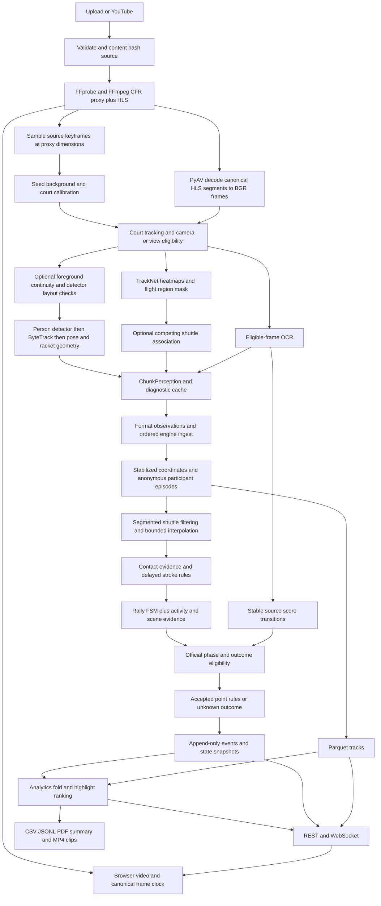

# Current badminton analytics pipeline technical report

Inspection date: 6 November 2026, Asia/Kolkata. Repository: `/home/administrator/Desktop/sport-analytics/Sports_Analytics`. HEAD: `caa91761948d09f2cfe4937b0db743fff8643a12`, with existing tracked modifications and untracked repair code. This report describes those actual working files as well as the separately frozen benchmark implementations. HEAD alone does not reproduce the working tree or historical runs.

The system implements video preparation, court calibration, learned player detection and pose, learned shuttle heatmaps, anonymous tracking, classical racket observations, rule-based contact and stroke estimates, rally segmentation, scoreboard OCR, guarded scoring, event-derived analytics, exports, and a React frontend. Its strongest measured sporting result is agreement with legacy rally interval tables. Reliable automatic named-player attribution, shot recognition, accepted winners, and complete match scoring are not established. They must not be inferred from successful model execution or a populated frontend.

## 1 What is currently selected and what actually runs

There are three distinct operational contexts:

| Context | Actual selection or observation | Consequence |
| --- | --- | --- |
| Normal launcher configuration | `../start-server.sh` delegates to `start-app.sh`; `.env` selects `BAI_PROFILE=gpu-rtx4000`; settings otherwise default to an embedded engine | New normal sessions use the selected profile, unless a session supplies its own profile. Existing sessions retain their own profile and saved outputs. |
| Running service at inspection | PID `1231770` runs Uvicorn on `127.0.0.1:8010` with `create_app(settings, start_engine=False)` and a copied settings object containing `engine_mode="external", redis_url=None` | This particular web process does **not** start the analysis engine. It can expose saved results; its existence is not proof of active inference or a connected external worker. No worker connectivity claim is made from the command line. |
| Latest saved repair and sequential benchmarks | Explicit experimental profiles select extra shuttle association, foreground continuity, contact evidence, and tracklet rally logic, with CPU OCR | These are exercised experimental implementations, not a demonstrated promotion of the normal launcher default. Results belong to their frozen profiles and source snapshots. |

Actual hardware is two **NVIDIA GeForce GTX 1080 Ti**, each 11,264 MiB. `gpu-rtx4000` is a target/profile name, not this machine's GPU. At inspection GPU0/GPU1 used 74/7 MiB; those idle device readings are not inference memory requirements.

The normal launcher sources `../gpu-env.sh`, activates the existing virtual environment through its executables, prepares NVIDIA library search paths, loads `.env`, and invokes `bai serve`. `.env` points FFmpeg/FFprobe at `/home/administrator/.local/opt/ffmpeg-static/bin/` and enables YouTube ingestion. Secret settings are intentionally excluded here.

Implementation references: [launcher](../start-app.sh), [settings and profile schema](../engine/src/bai_engine/config.py), [application lifecycle](../apps/api/src/bai_api/app.py), [normal profile](../config/profiles/gpu-rtx4000.yaml), [experimental profile](../config/profiles/experimental-pipeline-repair-v1.yaml).

### Selected component implementations

| Stage | Normal configured pipeline | Latest repaired benchmark pipeline |
| --- | --- | --- |
| Shuttle detector | `tracknet-v3`, TrackNetV3 CUDA FP16 | Same checkpoint and backend |
| Player detector | `person-onnx-v1`, RF-DETR Small, CUDA ORT, requested FP16 | Same graph, explicitly configured FP32 |
| Pose | `rtmpose-v1`, RTMPose M body7, CUDA ORT, requested FP16 | Same graph, explicitly configured FP32 |
| Player tracking | `court-player-episodes-v1`, ByteTrack | Same base tracker with repaired observation/scene handling |
| Optional neural appearance | `osnet-appearance-v1` when eligible and weights exist | Unavailable in saved relevant runs; no executed OSNet model recorded |
| Racket | `racket-geometry-v1`, OpenCV ellipse and shaft | Same |
| OCR | `rapidocr-v1`, requested CUDA | Same package graphs, explicit CPU |
| Shuttle association | Disabled unless explicitly selected | `coobserved-static-hypotheses-v1` |
| Additional scene continuity | Disabled unless explicitly selected | `foreground-content-continuity-v2`, `barrier_detector_layout_v2` |
| Format understanding | `sustained-court-v1` | Same |
| Identity / participation | `participant-identity-v1` | Same evidence separation |
| Contact | Component ID `contact-fusion-v1`, internal method `contact_fusion_v2` | `contact-evidence-v1`, explicit spatial sensitivity |
| Stroke classification | `stroke-rules-v0` | Same; no trained stroke model promoted |
| Activity | `temporal-activity-v3` | Same |
| Rally | `rally-fsm-v1` | `rally-evidence-tracklets-v1` with short-exchange evidence enabled |
| Outcome | `observed-terminal-v1` | Same guarded outcome path |
| Scoring | `bwf-rally-point-v1` | Same |
| Analytics | `match-analytics-v1` | Same event fold |

`Profile.components` overrides the legacy stage fields. A weightless component may deliberately use `model: none, backend: none` while still executing its explicit implementation. Thus `contact.backend=none` does not disable the domain contact rules. Conversely, declaring a model in YAML does not create an adapter or cause a forward pass.

References: [perception composition](../sports/badminton/src/bai_badminton/perception/pipeline.py), [perception ports and factories](../sports/badminton/src/bai_badminton/perception/components.py), [semantic ports and defaults](../sports/badminton/src/bai_badminton/components.py), [session construction](../sports/badminton/src/bai_badminton/plugin.py).

## 2 Architecture and execution order



This diagram describes dependencies; several stages operate over a chunk rather than one frame at a time. The actual call order inside `BadmintonPerception.process` is:

1. Compute simple histogram cuts and camera-shot IDs for the decoded chunk.
2. Track court/camera geometry, classify views, update calibration lifecycle, and mark non-main views as analysis-excluded.
3. Choose detector and pose cadence using the **preceding engine state** supplied as `in_play`. The chosen cadence applies to that perception call; it is not recomputed after every semantic transition within the chunk.
4. If foreground continuity is selected, process it sequentially with previous-frame player regions. Where required, acquire current detector outputs for a layout decision, reset tracking at accepted barriers, and compute player/pose/racket observations. Reuse the exact detector probe once rather than executing a second inconsistent observation.
5. Run TrackNet over eligible windows, using court flight masks and shot/content epochs. Optional association consumes its candidate summaries.
6. Assemble `FramePerception`, processing players here if step 4 did not already do so.
7. Acquire eligible scoreboard readings on the configured cadence. This code runs independently of rally state; the older “between rallies only” docstring is not an enforced condition.
8. Return `ChunkPerception`. The host atomically writes its diagnostic MessagePack cache, then `BadmintonSession.ingest` applies format decisions and the semantic engine consumes observations in canonical order.
9. The engine stabilizes geometry, records tracks and participation/activity evidence, filters shuttle windows, admits contacts, advances rally states, classifies delayed contacts, reconciles outcomes/scores, and emits events. Finalization is delayed for future evidence.
10. The host writes/publishes tracks, progress, state, and analytics. At EOF it flushes pending observations and semantic decisions; an EOF boundary alone cannot prove a winner.

The public plugin boundary is `SportPlugin` / `SportSession`; badminton is registered through the `bai.sports` entry point. `ComponentRegistry` resolves typed ports with versioned contracts, supported formats, dependency/configuration identities, lifecycle methods, and failures. Semantic stateful components provide checkpoint/restore for transactions. The actual orchestration remains in `BadmintonSession`, `BadmintonPerception`, and `BadmintonMatchEngine`; the declaration of a stage graph should not be mistaken for a separate generic DAG scheduler. Court/camera implementations are still directly constructed in perception and called by the plugin.

References: [generic sport interface](../engine/src/bai_engine/sport.py), [component contracts](../engine/src/bai_engine/components.py), [host analysis loop](../engine/src/bai_engine/runtime/runner.py), [badminton plugin](../sports/badminton/src/bai_badminton/plugin.py), [perception execution](../sports/badminton/src/bai_badminton/perception/pipeline.py), [semantic execution](../sports/badminton/src/bai_badminton/engine.py).

## 3 Video ingestion decoding and preprocessing

### Acquisition and media preparation

`POST /api/sessions` accepts streamed uploads; `/api/sessions/youtube` handles enabled YouTube ingestion through `yt-dlp`. Source storage is content-addressed with SHA256. The session catalogue stores source kind, URI, digest, title, profile, sport, roster, and preparation/analysis state. Reuse searches use durable source identity, profile and sport, with compatibility checks; matching a filename is not sufficient.

Default limits are 4 GiB upload and three hours. FFprobe checks media metadata, duration, selected video stream, dimensions, orientation, frame rate, and variable-frame-rate status. The runner uses the validated stream and rotation when sampling keyframes.

`plan_proxy` preserves supported standard rates, caps source rates above 60 FPS at 60, and otherwise selects 30 FPS. Height is at most 720 by default without upscaling a smaller source; width preserves aspect ratio and is even. FFmpeg uses `scale=-2:height`, `fps=...`, CFR output, and YUV420p. An NVENC capability probe selects H.264 NVENC if it works; otherwise libx264. Playback audio is retained when present; audio is not a contact/event inference input.

One encode tees to `proxy.mp4` and fMP4 HLS with `init.mp4`, `seg_*.m4s`, and `index.m3u8`. Keyframes are forced at segment boundaries and scene-dependent encoder keyframes disabled. Segments are approximately two seconds: `F=round(fps*2)`, hence **60 frames at 30 FPS**, even though profiles contain `chunk_frames: 64`. The normal SessionRunner advances by media segment size, not the nominal profile chunk size. Playback can start after the first segment while transcoding continues. A per-media writer lock prevents competing sessions overwriting the same prepared media.

### Decode and timeline

`SegmentDecoder` concatenates initialization bytes and one media segment and decodes through **CPU PyAV**, normally with two decode threads, into host `uint8` BGR arrays `(H,W,3)`. Segment `k` starts at canonical frame `k*F`. The final segment may be shorter. `make_decoder(..., device=...)` currently always returns this CPU decoder; installed `torchcodec` does not establish CUDA decoding.

Video presentation, events, tracks, seeks, clips, and overlays use the canonical CFR timeline. Rational FPS supports exact frame-to-time arithmetic. Source PTS and proxy frame number are distinct for VFR, resampling, duplication, rotation or source excerpts. Tests 1 and 2 verified their own 30 FPS source/proxy PTS correspondence; that does not prove generic VFR identity. Benchmark helpers additionally preserve source/proxy hashes and transforms.

The runner samples up to 24 distributed source keyframes, resized to proxy dimensions. They seed the TrackNet background and automatic court/camera selection. Full sequential inference decodes every canonical frame; model cadence selectively reduces detector/pose calls rather than dropping those frames from the timeline.

References: [ingest routes](../apps/api/src/bai_api/routes/sessions.py), [source adapters](../engine/src/bai_engine/sources.py), [probe](../engine/src/bai_engine/media/probe.py), [proxy generation](../engine/src/bai_engine/media/proxy.py), [decode](../engine/src/bai_engine/decode.py), [runner](../engine/src/bai_engine/runtime/runner.py).

## 4 Court calibration camera tracking and geometry

**No pretrained court model runs.** `court_lines_v1` is a CPU OpenCV/Numpy algorithm: white-line enhancement and low-saturation masking, ridge extraction, Hough lines, robust line fitting, two vanishing-point families, candidate model correspondences, physical camera plausibility checks, painted-line support scoring, and iterative refinement. Its court template includes singles/doubles sidelines, short/long service lines, baselines, and centre service segments.

Automatic startup fits sampled frames in a four-thread pool, groups camera poses, and chooses the main camera/reference. A usable fit needs support in both line directions. `AUTO_CALIBRATION_MIN_SCORE=0.6` is a local quality threshold, not labelled geometric accuracy. Manual landmarks and calibration review are supported. A mat contour is only a proposal; if painted geometry cannot be verified, the plugin records court degradation and requires calibration instead of treating an entire shared mat as one court.

`CourtTracker` uses previous fits, flow prediction/refinement and fresh reacquisition. `CameraRig` separates main and alternative camera heads using decomposed camera geometry. Legacy/manual paths can use `CameraTracker`: SIFT matching plus RANSAC, Lucas–Kanade alignment, reference/keyframes, and floor-edge verification. Its default work width is 640, anchor interval 30 frames, maximum unanchored interval 45, held pose limit 6, and maximum keyframes 16. Floor visibility and edge correlation guard against aligning only advertising/crowd structure. A static presence path also exists.

`CalibrationLifecycle` distinguishes `LOST`, `REACQUIRING`, `VALID`, and `DEGRADED`; three consecutive verified frames recover validity. A held pose is degraded evidence. `view` distinguishes main, alternative, and absent views. The perception boolean named `replay` frequently means **analysis-excluded non-main view**, not a verified broadcast replay. Replay status in OCR context is separate and can remain unknown.

Geometry conventions:

- Court origin is centre/net floor line, x across court, positive y toward the far end; near-side y is negative. Length is 13.40 m; doubles/singles width is 6.10/5.18 m.
- `H` maps court metres to calibration-reference pixels. `G_t` maps reference pixels to current-frame pixels. Current court mapping is `G_t H`; temporal image observations are stabilized by `G_t^-1` when usable.
- Player feet use bbox bottom centre before ground projection. This is an estimate: jumping, occlusion and box error can violate the ground assumption.
- Lost/non-main/invalid calibration withholds authoritative floor positions. Every consumer must respect coordinate epochs rather than differencing positions across cuts or recalibration.
- A floor homography does **not** recover airborne shuttle 3D position, physical speed, contact height, or an accurate line call.

Player gating uses the selected court with 0.35 m side and 0.75 m end runoff allowances for continuing observations. Detector crop padding is normally 60 px, extended upward by 25% of court height. A uniquely overlapping previous observed court track can retain a jumping/runoff athlete without globally expanding the court mask. Shuttle gating instead uses an upward swept image region: default sweep 0.35 image heights; experimental `vertical_columns_to_image_top_v1` extends selected court columns to the image top. Neither geometrically proves which court owns an overlapping airborne shuttle.

References: [court model and homography](../sports/badminton/src/bai_badminton/court.py), [court fitting](../sports/badminton/src/bai_badminton/perception/court_lines.py), [camera tracking](../sports/badminton/src/bai_badminton/perception/camera.py), [scene/presence](../sports/badminton/src/bai_badminton/perception/scene.py), [lifecycle](../sports/badminton/src/bai_badminton/perception/calibration_state.py), [flight mask](../sports/badminton/src/bai_badminton/perception/isolation.py).

## 5 Learned model inventory and inference contracts

All integrated learned models are externally pretrained artifacts. No evidence in the active inference path establishes project-specific fine-tuning or a custom-trained production checkpoint. The rules/geometry below are custom **algorithms**, not custom-trained networks. External training labels and architecture internals beyond the retained artifacts/configurations are not invented here.

### RF-DETR Small player detector

| Field | Actual implementation |
| --- | --- |
| Model and architecture | RF-DETR Small 1.4.2, transformer object detector; COCO person class retained |
| Source | RF-DETR, ONNX mirror `saifkhichi96/opendetect`, file `rfdetr/rfdetr_s_v142_512x512.onnx` |
| Local checkpoint | `models/cache/rfdetr_small/rfdetr_s_v142_512x512.onnx`, 119,619,156 bytes |
| Framework | ONNX Runtime via `rtmlib.RFDETR`, session replaced with platform providers |
| Input | Court ROI BGR is explicitly converted to RGB, resized/normalized by rtmlib; NCHW FP32 graph input, 512×512 |
| Output | Two raw tensors: normalized `(1,Q,4)` cxcywh boxes and `(1,Q,C)` class logits; sigmoid person scores, mapped to original ROI then frame xyxy boxes and scores |
| Thresholds | Person score ≥0.35; best non-background class must be person; NMS IoU 0.6; finite positive boxes and court admission required |
| Device and precision | CUDA ORT then CPU provider; graph inputs/weights are FP32 despite normal YAML `precision: fp16`. Profile text alone does not convert the graph |
| Cadence | In-play stride 2; idle stride 6; excluded view suppressed; optional scene probes can force a current observation |
| Training status | External pretrained, no local fine-tuning established |

### RTMPose M player pose

| Field | Actual implementation |
| --- | --- |
| Model and architecture | RTMPose M, SimCC top-down pose, body7 training/export variant, **17 output joints** |
| Source | OpenMMLab MMPose ONNX SDK archive `rtmpose-m_simcc-body7_pt-body7_420e-256x192-e48f03d0_20230504.zip` |
| Local checkpoint | `models/cache/rtmpose_m_body7/.../end2end.onnx`, 54,330,655 bytes; source ZIP 50,799,818 bytes |
| Framework | `rtmlib.RTMPose` and ONNX Runtime |
| Input | Full-resolution frame and tracked xyxy boxes; explicit BGR→RGB, affine crop/normalization; model crop width×height **192×256** |
| Output | SimCC coordinate distributions decoded into one `(17,3)` array per box: image x, image y, keypoint score |
| Thresholds | No universal pose acceptance threshold; source stamp requires finite joint evidence with score >0; contact wrists use ≥0.3, racket wrists ≥0.5; downstream gates differ |
| Device and precision | CUDA ORT with CPU fallback partition; actual graph is FP32. `batch: 2` is profile intent; the adapter passes eligible boxes to rtmlib, with no custom profile-batch scheduler |
| Cadence | In-play every frame; idle stride 6; suppressed in excluded views |
| Training status | External pretrained, no local fine-tuning established |

Pose is inferred on the current image even when the box was carried from an earlier detector call. `pose_frame_idx` distinguishes current inferred pose from display reuse. Current pose does not imply a fresh box or correct person identity. Pose supports wrists, contact-above-head estimates and jump cues; no separate learned movement or biomechanics model runs.

### TrackNetV3 shuttle detector

| Field | Actual implementation |
| --- | --- |
| Model and architecture | TrackNetV3 3.0; convolutional encoder/decoder with U-Net-style skip connections and sigmoid heatmaps; local builder reproduces the vendored network |
| Source | `qaz812345/TrackNetV3`, MIT source in `third_party/TrackNetV3`; checkpoint mirror `TanmaySarda/tracknetv3-weights` |
| Local checkpoint | `models/cache/tracknetv3/TrackNet_best.pt`, 136,190,877 bytes |
| Framework | Primary PyTorch; CPU/CUDA plus optional ONNX export/ORT/TensorRT adapter paths exist |
| Input | Eight resized RGB frames plus one median RGB background, concatenated as `(B,27,288,512)`, normalized image tensor |
| Output | `(B,8,288,512)` heatmaps; point is heatmap-weighted centroid of the thresholded connected component containing the masked peak; confidence is raw peak |
| Resolution and thresholds | 512×288; raw heatmap threshold 0.5; output rescaled to proxy pixels. The association candidate floor 0.1 retains diagnostic alternatives; it does not lower the accepted detector threshold |
| Cadence and batching | Non-overlapping step 8, up to four windows per forward in normal/repair GPU profiles; cut/content epochs split context; final windows may overlap to cover the segment tail, and shorter shot spans use padding |
| Device and precision | Saved relevant runs actually use CUDA FP16; export to host Numpy is FP32. CPU profile uses Torch CPU FP32 |
| Training status | External badminton pretrained, no local fine-tuning established |

Checkpoint `param_dict` supplies sequence/background settings; profile comments alone do not define the loaded network. Only `bg_mode=concat` is accepted. The bounded background reservoir samples every 15 frames, retains 120 resized samples per active shot, and refreshes median after 20 new samples, with distributed-keyframe startup seeding. Old shot reservoirs are pruned. Eight-frame inference and later temporal reasoning make this a delayed VOD workflow, not a verified strictly causal live detector.

References: [detector/pose/tracking implementation](../sports/badminton/src/bai_badminton/perception/players.py), [TrackNet network and inference](../sports/badminton/src/bai_badminton/perception/tracknet.py), [vendored source](../third_party/TrackNetV3/model.py), [artifact registry](../models/manifest.yaml).

### Optional OSNet appearance model

`osnet_ain_x0_25` is an omni-scale person ReID model with instance-normalization variants, external Torchreid/LibreYOLO weights from `LibreYOLO/LibreReID-osnet/osnet_ain_x0_25.pt`. The adapter requires exact SHA256 `ce171fe160b3608f5e4c19489774991419be965b1d6f4bdccc4b4cfd2ef95347`. It uses RGB 128×256 person crops, FP32 PyTorch on an explicit device, and returns L2-normalized `(N,512)` descriptors. There is no classifier confidence cutoff in the embedder; association thresholds apply separately.

No matching checkpoint is present in the primary `models` cache inspected, and the relevant run records explicitly degrade this stage. A model declaration is not evidence of OSNet execution. It is normally considered for doubles/unknown format, bypassed for explicitly configured singles unless a component override requests it. Features are private bounded state and are not persisted in event/perception caches; HSV appearance signatures are a different, saved cue.

References: [verified embedder](../sports/badminton/src/bai_badminton/perception/offline_reid.py), [vendored architecture](../sports/badminton/src/bai_badminton/perception/_vendor/osnet_ain.py), [association](../sports/badminton/src/bai_badminton/perception/player_association.py).

### RapidOCR actual models

The alias `rapidocr_v4@4` does **not** pin PP-OCRv4. Installed RapidOCR **3.10.0** selects these actual ONNX graphs, also recorded in repaired-run caches:

| OCR substage | Exact graph | Function and tensor contract |
| --- | --- | --- |
| Text detector | `PP-OCRv6_det_small.onnx` | PP-OCRv6 small text-region detection; float image input, probability map decoded into quadrilateral text boxes |
| Orientation classifier | `ch_ppocr_mobile_v2.0_cls_mobile.onnx` | Mobile 0/180-degree crop classifier; package configuration calls its version PP-OCRv4; nominal `(N,3,48,192)` |
| Text recognizer | `PP-OCRv6_rec_small.onnx` | PP-OCRv6 small sequence recognizer; nominal `(N,3,48,320)` with aspect/width handling, decoded text and confidence |

These are externally pretrained package-selected models, not a badminton score-recognition network. Exact deeper backbone names are not independently pinned by the application manifest; retained graph filenames, hashes, installed package, and tensor contracts are the verifiable model identities.

Actual package configuration: global text score 0.5; detector pixel threshold 0.3, box score 0.5, unclip ratio 1.6, maximum candidates 1,000; detector shorter-side target 736 with `limit_type=min`; orientation threshold 0.9 and batch 6; recognition batch 6. Input/crop preprocessing is dynamic, not a fixed whole-frame OCR resolution. A 576×180 corner crop was expanded to 2368×736 in the saved placement investigation.

Normal profile requests CUDA; repaired benchmarks explicitly request CPU and leave thread count unset. Runtime metadata records actual provider sequences, package version and graph hashes per substage. A standalone original-Test2 node profile showed real CUDA execution despite plugin warnings; that is separate from the repaired CPU configuration.

References: [OCR adapter/parser](../sports/badminton/src/bai_badminton/perception/scoreboard.py), installed `.venv/lib/python3.12/site-packages/rapidocr/config.yaml`, [performance report](PIPELINE_PERFORMANCE_REPORT.md), [original OCR placement diagnostic](TEST2_COMPONENT_VALIDATION.md).

## 6 Tracking association and four player identity

### Detection association across frames

`PlayerTracker` wraps Roboflow `trackers.ByteTrackTracker` with activation threshold **0.4**, high-confidence detection threshold **0.5**, minimum consecutive frames **1**, and lost buffer **30 at the library's 30-FPS convention**, approximately one second. Updates pass `timestamp=frame_idx/fps`, so cadence changes use elapsed video time. Inspection of installed `trackers/core/bytetrack/tracker.py` confirms a Kalman `XYXYStateEstimator`, standard bbox IoU and SciPy Hungarian assignment, first matching confidence≥0.5 detections to all live tracks and then lower-confidence detections to remaining tracks. Its inherited minimum matching IoU is 0.1. RF-DETR already filters below 0.35, so the low-confidence recovery pool is only 0.35–0.5; this is not recovery from arbitrarily weak detections. New births come from unmatched high-confidence detections, making the high-stage threshold relevant in addition to configured activation 0.4. ByteTrack does not use frame pixels or camera-motion compensation here; camera correction is handled elsewhere in the pipeline. The project supplies detector scores, court gating, timestamps, and observation provenance.

Between detector ticks the project copies previous boxes with confidence multiplied by 0.98. It does **not** run a new image-based box detector or optical-flow person tracker on those carry frames. Carries expire when the last detector frame is older than the expected stride. `detector_matched=False` marks a carried or unmatched result. On a detector-run frame, a returned track counts as freshly observed only when one current detection uniquely matches it at IoU≥0.5, in both directions. A tracker output alone is not a fresh detection.

Current source pose can be attached to such carried boxes. Racket geometry requires a fresh matched person and therefore does not promote a carried box to equipment evidence. Cuts and accepted content barriers reset tracker/carry/association state and force detection on reentry.

### Optional neural identity association

If OSNet loads, `PersistentPlayerAssociator` maps raw ByteTrack IDs to short-lived canonical visual IDs. It uses a maximum four-descriptor gallery per identity, up to 16 identities, L2-normalized descriptors, motion/height gates, Hungarian one-to-one assignment with dummy abstention choices, and row/column ambiguity margins. Important thresholds are minimum observation confidence 0.5, cosine similarity 0.8, score margin 0.05, and overlap IoU 0.3. Matching support is `0.65*appearance + 0.35*motion + 0.02*same_raw` after gating.

Default retention is one second; profile retention is eight seconds. A dormant identity older than one second needs stronger neural evidence, similarity≥0.9 and distinctive competitors. Overlap marks identity ambiguous; after separation, raw ID continuity alone cannot resolve it. Unobserved carries never train appearance or extend identity lifetime. Ambiguous output is `-1`; resets clear galleries. Birth IDs use absolute frame indices to avoid collisions across resets. If embedding fails, the matcher keeps its canonical namespace and explicit degraded state rather than silently reverting to possibly recycled raw IDs.

### Anonymous participants and named athletes

The semantic engine creates deterministic, namespaced **participant episodes** from visual track observations. It records first appearances, entries/exits, uncertainty and possible substitutions. Misses and unavailable detector coverage are distinguished. Calibration changes, shot/content resets or prolonged coverage loss start a new epoch. Participant defaults are three entry observations, 30 exit observations and a 300-frame substitution window, with coverage guards. The participant layer's HSV-based reappearance suggestions remain uncertain; they do not merge people into accepted named identities.

The legacy `IdentityResolver` can form provisional singles side/track bindings, with optional unique short spatial rebind. The actual engine initializes `_multi_person_identity_ambiguous=True`: configured scoring names and format do not identify physical people. Interval-scoped identity reviews and per-stroke hitter reviews are separate accepted evidence. Consequently, anonymous observation geometry can support contacts without producing a `player_id` actor.

For unknown/doubles, perception reserves four-player capacity and retains up to six candidate tracks to expose distractors. More than six returns withhold the frame rather than silently selecting four as certain athletes. Singles likewise retains extra candidates; its contact participant window requires exactly two compatible episodes and no extra/unresolved person evidence.

`DoublesTeamTracker` can hypothesize two pairs from four distinct participants, valid court sides, confidence≥0.5 and sustained active-play support (normally two seconds). Pair IDs remain hypotheses and are not P1/P2 scoring identities. Team scoring still has two competitor slots. Reviewed roster/team membership and a separate doubles-service-order fold handle named team/partner reporting when sufficient evidence/configuration exists.

**Does identity consistency work for all four doubles players?** Four-person observation and association interfaces exist, and some full doubles clips execute. Continuous correct physical or named identity across crossings, occlusion, cuts, end changes and all four athletes has **not** been established. Optional OSNet was unavailable in these saved runs; the explicit identity experiment is marked opt-in after sampled AI-draft agreement regressed. No reviewed IDF1/HOTA or four-player identity-switch benchmark supports a stronger claim. One source diagnostic found four post-ROI detections but only three returned tracks. Same-side position and shirt colour are insufficient to certify an athlete identity.

References: [player implementation](../sports/badminton/src/bai_badminton/perception/players.py), [neural associator](../sports/badminton/src/bai_badminton/perception/player_association.py), [participation](../sports/badminton/src/bai_badminton/participation.py), [legacy identity resolver](../sports/badminton/src/bai_badminton/identity.py), [review handling](../sports/badminton/src/bai_badminton/identity_review.py), [team hypotheses](../sports/badminton/src/bai_badminton/teams.py), [experimental doubles profile](../config/profiles/gpu-doubles-identity.yaml).

## 7 Shuttle association and trajectory processing

Normal TrackNet output is a framewise selected heatmap component; the CNN has temporal image input, but it is not a persistent multi-hypothesis physical object tracker by itself.

Experimental `coobserved-static-hypotheses-v1` acquires bounded alternative heatmap components from the **same forwards**, with candidate floor 0.1 and internal top-k up to 8. A compact static component repeatedly co-observed beside a different moving selection cannot later silently become that airborne shuttle's landing merely because it becomes the largest peak. Statuses are `observed`, `ambiguous`, `missing`, and `invalid`; association labels include tracked, static candidate, reacquisition, unknown and rejected. Camera registration can compare hypotheses in reference pixels. The association stage emits only an actual fresh input coordinate or none; it does not forecast a replacement coordinate.

Engine postprocessing operates inside temporal scene/coordinate segments:

- Reject impossible adjacent jumps using 300 px/frame backwards-step and 130 px/frame both-neighbour spike rules.
- Fill only interior gaps up to 25 frames with at least two anchor observations on each side within five-frame neighborhoods, implied speed≤120 px/frame, and moving anchor context.
- Use a natural cubic spline with enough anchors, otherwise linear interpolation; mark `interp=True` and confidence 0.35.
- Keep reconstructed samples distinct. Core contact and rally observed-motion inputs exclude interpolation; experimental rally reconstruction is explicitly disabled in the selected repair profile.
- Break filtering/velocity/contact context across cuts, replay/view changes and incompatible coordinate epochs. Missing coordinates remain NaN rather than fabricated stationary measurements.

Engine defaults retain 1,800 frames of history, 45 frames of backward context, and **40 frames lookahead** before temporal finality. At 30 FPS lookahead alone is about 1.33 seconds; chunk arrival, model work, rally confirmation and score waiting add delay. Image speeds are pixels/frame or pixels/second as indicated, not measured shuttle km/h.

References: [candidate association](../sports/badminton/src/bai_badminton/perception/association.py), [trajectory filtering](../sports/badminton/src/bai_badminton/perception/shuttle_post.py), [temporal buffers/windowing](../sports/badminton/src/bai_badminton/engine.py), [observations contract](../sports/badminton/src/bai_badminton/observations.py).

## 8 Racket contact stroke and movement analysis

### Racket observations

`racket_geometry_v1` / `opencv_ellipse_shaft_v1` has **no learned checkpoint**. For fresh detector-matched people with confidence≥0.5 and COCO-17 pose, it searches around wrists with score≥0.5 using grayscale Canny edges (45/130), contour ellipse fitting, shape/coverage checks and visible shaft-edge support. Search radius is 0.75 body heights; acceptable axes are 0.07–0.5 body heights, aspect ratio≥0.35, median ellipse fit error≤0.16, angular coverage≥0.75 and shaft support≥0.65. Competing ownership is withheld.

It returns centre, axes, angle, wrist index, heuristic support, track owner and source-frame stamp. Blur, edge-on rackets, occlusion, distant players and background ellipses are known weaknesses. It is not equivalent to the unintegrated RacketVision racket-pose network.

### Player and shuttle contact

`contact_fusion_v2` is deterministic hand-weighted logistic fusion: bias −4.2, redirect weight 3.2, impulse 1.4, proximity 3.4 and wrist swing 1.1, with optional observed-racket overlap cues. Candidate cutoff is 0.35, temporal local-max suppression normally 0.2 seconds. Shuttle direction/speed estimates use local observed positions; wrists use score≥0.3, falling back to an upper-box cue when needed. Proximity scales distance by player body height. Attribution requires minimum proximity support 0.05 and a relative proximity separation of 0.05; otherwise actor/ownership stays uncertain. These values are heuristic supports, not calibrated physical-contact probabilities.

The repaired `contact-evidence-v1` explicitly records trajectory, impact, and attribution reliability separately. Its configured `spatial_sigma_px=0.7216878364870323` is the declared sensitivity `2.5/sqrt(12)` for a 512→1280 pixel grid cell, not measured shuttle-error covariance. Evidence distinguishes fresh, reconstructed, stale, carried, ambiguous, missing and rejected observations. Physical statuses include insufficient, ambiguous, probable, rejected and externally confirmed. Only explicit source-bound review can confirm a physical impact.

The engine considers anonymous participant bodies in contact windows, including all four in doubles, without requiring names first. It does not enforce singles alternation across unnamed episodes. A low-proximity trajectory turn can be preserved as `shuttle_turn` instead of a stroke-producing hit. Candidate timing, episode attribution, named hitter, and physical impact are separate claims.

### Stroke rules and jump estimates

The active classifier is `RuleStrokeClassifier` / `stroke_rules_v0`, **not BST**. Inputs are contact context, optional hitter court feet, service context, post-contact image velocity, time to next contact and above-head evidence. It produces short/long serve, net shot, cross net, block, push, rush, lift, clear, drive, drop or smash estimates, or unknown.

It requires valid flight time and speed and, for non-serve strokes, court position. Unresolved initial-service context abstains. Front/rear zones and normalized image speed determine hand-set scores: fast>1.6 frame heights/s, very fast>2.6, long flight>1.0 s, short flight<0.6 s. A softmax uses temperature 0.8; maximum class confidence is capped at 0.7. These are not fitted class probabilities.

Post-contact kinematics require at least three real samples, excluding interpolation and next-contact/scene boundaries, and use robust median pairwise slope plus residual checks. Jump cues compare ankle/hip elevation against a pre-contact baseline; smash and jump-smash assessments are weighted rules. No depth, 3D skeleton, racket angular velocity, injury model or calibrated biomechanical measure is integrated.

Movement is `court_path_v2`: valid floor feet, stable track and consecutive source frames, maximum speed 12 m/s, local three-sample median, approximately 5 Hz sampling and 0.05 m jitter suppression. Missing frames, track switches or invalid calibration split the path; travel direction is court-plane motion, not body facing. Coverage accompanies distance/speed estimates.

References: [racket geometry](../sports/badminton/src/bai_badminton/perception/racket.py), [contact fusion](../sports/badminton/src/bai_badminton/events/contact.py), [physical evidence](../sports/badminton/src/bai_badminton/events/contact_evidence.py), [participant contact windows](../sports/badminton/src/bai_badminton/participant_contact.py), [stroke rules](../sports/badminton/src/bai_badminton/events/stroke.py), [movement](../sports/badminton/src/bai_badminton/analytics/spatial.py).

## 9 Rally segmentation point decisions and match state

### Rally candidates

The normal deterministic FSM is `IDLE → IN_PLAY → ENDING → CLOSED`, with provisional starts and mergeable closures. Defaults: three consecutive moving observed frames above 3 px/frame to start; ten missing frames or seven of the last ten stationary observations below 3 px/frame to end; 15-frame lookahead; minimum two seconds; merge gap 0.75 seconds; resume threshold 6 px/frame. A contact can also start/resume an exchange. A cut closes an observation interval and resets motion context.

The repaired evidence FSM consumes typed `RallyObservation` rather than treating all coordinates as observed. Selected `rally-evidence-tracklets-v1` enables image-exit recovery with association-qualified tracklets and stronger short-exchange evidence. Its flags are `use_reconstruction=false`, `motion_guard=false`, `use_exit_recovery=true`, `use_curve_exit=false`, `use_short_exchange_evidence=true`, and `use_terminal_contact_evidence=false`.

Short-exchange admission requires compatible shot/content/coordinate epochs, separate observed shuttle motion and a consistent freshly observed opposite-court participant pair in both contact contexts. This supports anonymous exchange continuity without naming athletes or proving impacts. The terminal contact veto experiment was not adopted. No unconditional gap extension or missing-shuttle fabrication is used to force reference matches.

Internal endpoint sample counting is inclusive in relevant FSM structures; the external benchmark export/matcher uses half-open time intervals. Comparisons must preserve that distinction.

### Activity and official phase

`temporal_activity_v3` combines bounded person coverage, movement, observed shuttle trajectory and existing rally evidence, normally with a two-second window and one-second transition hold. It reports unknown, reacquiring, rally, active play or inactive; motion does not establish match intent.

`MatchPhaseTracker` separately decides whether a candidate is official play. Human match-start/per-rally decisions and corroborated scoreboard changes can support it. Legacy service-formation/tempo heuristics exist, but `allow_heuristic_official=false` by default. Unknown phase remains unknown. An official-phase flag does not establish a winner.

### Outcome and scoring

`observed-terminal-v1` wraps a legacy geometric outcome cascade for out, net, winner or unknown. It is rule-based CPU logic, not a learned point detector. The current caller adds material gates: known format throughout the rally, valid compatible court geometry, no cut/EOF-only outcome, and at least four consecutive real terminal observations with confidence≥0.5 and near-rest displacement below `15/fps` px/frame. An absent shuttle or extrapolated floor crossing alone cannot score a point. Even this gated geometry is not validated automatic line judging.

`ScoreReconciler` and source evidence can propose a unique scoreboard increment. A point additionally needs accepted ownership/mapping and official/format eligibility. Default engine OCR wait is four seconds, with bounded late reconciliation over 30 seconds. Unique transition ownership prevents one observed increment from being applied to multiple rally fragments.

The BWF rule fold applies accepted winners: two scoring competitors, rally points, 21 with two-point margin and cap 30, games/match state, service and end state. Unknown scores must remain unavailable rather than be displayed as verified 0–0. Doubles teams use two scoring slots; four athletes are separate roster members. `DoublesServiceOrder` supports reviewed opening server/receiver and partner rotation, but it requires explicit configuration and compatible accepted point history. It is not automatic visual recognition of all service roles.

References: [baseline FSM](../sports/badminton/src/bai_badminton/events/rally_fsm.py), [evidence FSM](../sports/badminton/src/bai_badminton/events/rally_evidence.py), [exchange proof](../sports/badminton/src/bai_badminton/events/exchange_evidence.py), [motion/exit evidence](../sports/badminton/src/bai_badminton/events/rally_motion.py), [activity](../sports/badminton/src/bai_badminton/events/activity.py), [phase](../sports/badminton/src/bai_badminton/events/match_phase.py), [outcome cascade](../sports/badminton/src/bai_badminton/events/rally_outcome.py), [score rules](../sports/badminton/src/bai_badminton/rules/bwf.py), [doubles service order](../sports/badminton/src/bai_badminton/rules/doubles.py), [engine gates](../sports/badminton/src/bai_badminton/engine.py).

## 10 Scoreboard recognition and score validation

At most one corner crop is searched per scheduled OCR call: four corners, each 45% of width and 25% of height. After parsing a coherent board, the reader locks a crop around it with margin; four failed reads release the lock. GPU profiles normally read once per second; CPU development once per two seconds. Default scene policy permits only main-view images; optional `all_image_broadcast_overlay` exists. The view exclusion flag and independently known replay status remain distinct.

Current parser `nearest-name-current-column-v2` groups adjacent name tokens, associates the closest eligible name to score fields on the right, verifies two-row alignment and a unique plausible board, and selects the rightmost current-game number up to 30. It avoids borrowing a broadcaster logo across an intervening athlete name and abstains on conflicting/extra rows or missing current digits. It does not infer an obscured digit from an old game score.

`ScoreReading` is a frame-stamped model observation of two `(label, points)` rows and support. Reconciliation requires repeated stable observations (same board twice), compares before/after source boards independently of the engine score, and accepts only one row +1 with the other unchanged as a potential increment. Game resets, jumps across edits, unobserved final points, label changes and ambiguous transitions are not silently filled. Source transitions have content-derived IDs and supporting frame references.

OCR row text, normalized competitor labels, P1/P2 ownership hypotheses, observed source increments and accepted points are different layers. Typed names/review or supported evidence are needed for binding; paired labels require both partners. A readable score bug does not automatically supply roster identity or a verified full score sequence.

The old Test2 parser stabilized `SXFI 21 / LIVE 12` branding instead of the athlete board. The repaired parser abstains on the documented missing digit example and produces many athlete-labelled readouts, but the repaired run still emits no accepted points. Thus OCR execution and improved reading coverage have not solved score ownership or end-to-end scoring.

References: [OCR search and parser](../sports/badminton/src/bai_badminton/perception/scoreboard.py), [source transition reconciliation](../sports/badminton/src/bai_badminton/score_ocr.py), [repair evidence](../../pipeline-repair-runs-20261105/OCR_REPAIR_REPORT_v2.md), [original component validation](TEST2_COMPONENT_VALIDATION.md).

## 11 Data contracts persistence dependencies and cache behavior

| Boundary | Information exchanged | Storage or owner |
| --- | --- | --- |
| Ingest→media | Source digest, URI, probe metadata, rotation/stream, normalized FPS and dimensions | Session JSON in catalogue; content-addressed media |
| Decode→perception | `DecodedChunk(start, frames)` with absolute canonical indices and BGR arrays | Host memory, one HLS segment at a time |
| Perception→engine | `ChunkPerception(start,end,frames,models,ocr,cam_ref)` | Diagnostic MessagePack per segment |
| Frame observation | Shuttle pixels/support/association, persons, pose/racket source stamps, detector flags, camera matrix, view/shot/content epoch, calibration state | `FramePerception`; serialized in cache |
| Person observation | Visual/raw track IDs, xyxy bbox, confidence, 17-joint pose, HSV appearance, match provenance and racket observation | `PersonObs`; private OSNet features excluded |
| Engine→track store | Frame/time, object and track IDs, pixels, optional court coordinates, bbox/pose, visibility/interpolation and observation provenance | Arrow/Parquet chunks by object |
| Engine→event store | Contacts, strokes, rallies, source boards, points, activity/phase, identity ambiguity/reviews, highlights, provenance and evidence references | Append-only SQLite event log and state snapshots |
| Analytics→API | Folded stats, score availability, heatmap grids, movement quality, highlight ranking and supporting event IDs | In-memory/rebuilt analytics caches |
| API→frontend | REST snapshots/ranges plus WebSocket status/events/state/tracks with revision and generation | React Query, Zustand, event/track buffers and frame clock |

Default on-disk layout:

```text
data/
  sessions.sqlite
  media/<source_sha256>/
    source.<ext>
    proxy.mp4
    hls/index.m3u8, init.mp4, seg_00000.m4s ...
    sprite.jpg, sprite.json
  sessions/<session_id>/
    events.sqlite
    perception/seg_00000.msgpack ...
    camera_ref.png
    tracks/<object>/...parquet
    exports/...csv, jsonl, pdf, mp4
models/
  manifest.yaml
  cache/lock.json
  cache/<model>/<checkpoint>
  cache/<zip-model>/extracted-v1/<identity>/.../end2end.onnx
```

Benchmark data roots are isolated under the sibling run directories and `artifacts/benchmarking/experiments`; do not assume a benchmark's `UPLOADTEST1` ID identifies the application catalogue's session.

The event model distinguishes provisional, confirmed, corrected, retracted and human-verified ledger entries. Corrections append superseding events. **Ledger `confirmed` means finalized by the temporal/log workflow, not independently confirmed physical impact or correct classification.** Physical reliability fields carry separate semantics. Analytics queries fold live, unsuperseded events, and transactions/checkpoints support consistent corrections and late score reconciliation.

`ModelRegistry` resolves only declared models, verifies manifest or first-fetch lock digests, and validates extracted ZIP artifacts. TrackNet uses a verified private checkpoint stream. Optional ONNX export caches bind checkpoint, implementation/export contract, toolchain information and graph hash, then publish atomically. First-fetch pinning protects later integrity, not publisher authenticity. OCR package graphs have separately recorded runtime hashes rather than a meaningful `v4` alias pin.

Perception codec version is currently **21**. Its `ci` identity records profile, component configuration/fingerprints, loaded model/runtime identities, court calibration, camera mode/reference, frame size/FPS, format policy and decision provenance. Stale/mismatched cache decoding fails closed. Source/pipeline identities are also exported by `describe_pipeline`.

Crucially, `BadmintonSession.requires_sequential_perception` currently always returns **True**. The host therefore recomputes perception in chronological order instead of mixing old cached chunks and fresh tracker/background state; it also disables out-of-order seek previews through that instance. Caches are durable diagnostics and useful for controlled replay, **not full snapshots of tracker, camera, background and identity state**. Semantic restart restore/carry-over and checkpointed event folds are separate mechanisms. Reanalysis uses revisions/generations and dependent invalidation; retained observations and reviewed evidence must not be overwritten casually.

Transport defaults to an in-process bus; Redis is supported for shared command transport. Validated external-engine settings require Redis. The observed running service bypasses ordinary validation with a copied settings object and disables its own engine, so its command line cannot demonstrate an operational external analysis pipeline.

References: [schema](../engine/src/bai_engine/schema/events.py), [tracks](../engine/src/bai_engine/schema/tracks.py), [session/media layout](../engine/src/bai_engine/store/sessions.py), [event store](../engine/src/bai_engine/store/events.py), [track store](../engine/src/bai_engine/store/tracks.py), [wire encoding](../engine/src/bai_engine/wire.py), [bus](../engine/src/bai_engine/bus.py), [cache codec and identity](../sports/badminton/src/bai_badminton/plugin.py), [model registry](../engine/src/bai_engine/runtime/registry.py).

## 12 Analytics heatmaps highlights insights and frontend

`MatchAnalytics` folds accepted current events. It separates official and unofficial rallies, attributed and unattributed strokes, and available versus unknown score. Implemented fields include active play duration, rally lengths, stroke mix, serves, smashes/jump smashes, points, winners/errors, serve conversion, pressure points, accepted movement, score timeline and momentum. Momentum is a hand-set EWMA with alpha 0.3 over accepted point winners, not a trained win-probability model.

Heatmaps are float grids at 0.25 m resolution over the doubles court plus a 1 m margin. Kinds are `presence` (accepted sampled feet counts), `origin` (hitter feet at contact), `landing` (explicit trajectory/human landing evidence), `movement` (distance weighted), and `targeting` (receiver position). Presence is not automatically dwell time. Receiver feet must not be presented as shuttle landing. Valid geometry, continuity, official ownership and identity gates can leave public P1/P2 grids empty despite many anonymous projected positions.

Reviewed individual, estimated individual, pair and doubles-service analytics are separate folds. Named review propagation has bounded track/observation continuity and ambiguity guards. A four-person roster is not itself an accepted track-to-person mapping. Pair statistics require compatible reviewed people/team evidence.

Highlight ranking is rule-based, scoring rally length, stroke variety, smash winners, jump smashes, defence, net battles, pressure, deuce, comebacks and momentum shifts, capped at 10. Top-k selection applies category diversity with MMR, default diversity 0.35. Engine highlight event threshold defaults to 4.0. Scores are ranking values, not probabilities. Official-play admission and event evidence determine the candidate pool; if those gates fail, highlights can be empty. Selected clips are cut from the proxy with frame-derived times and optional padding, reencoded H.264/libx264 CRF20 plus AAC, atomically cached by source/proxy revision/FPS/frame range. No generative video highlight model runs.

The API offers session/event/state/track reads, analytics, heatmaps, highlights, calibration proposals/review, identity/hitter review, source media, and exports. Downloads include event JSONL, rally/legacy CSV, deterministic summary JSON, ReportLab PDF and MP4 clips. Benchmark unfiltered rally-candidate CSVs are different from public official-only exports.

Frontend stack is React 19 + TypeScript + Vite, TanStack Router/Query, Zustand, hls.js, MessagePack and Canvas/SVG rendering. HLS/MP4 playback uses `requestVideoFrameCallback` and a shared frame clock; overlays map intrinsic video coordinates into the contained canvas viewport and draw players, dashed carried boxes, pose estimates, shuttle trails/contact rings, racket geometry and current camera-adjusted court. REST initializes ranges/state; WebSocket updates events, tracks and status. Generation/revision handling prevents stale reanalysis output from mixing with the current session.

The active router exposes library/matches/session, calibration, analytics/statistics, movement, court/heatmaps, rallies, highlights/moments, people/progress, settings/system and Q&A. `src/prototype` and example highlight data are available; the `/highlights` route defaults to `source=example`, so a polished example view is not evidence that a recording produced those highlights. Recording-backed output has a separate provider.

Optional Q&A/insights use `bai_agents`, grounded event-query tools, a small text knowledge base, provider adapters and token accounting. Supported adapters are Azure/OpenAI-compatible, OpenAI, Anthropic and local OpenAI-compatible endpoints. Source defaults include Azure deployment `gpt-4.1-mini`, OpenAI `gpt-4o-mini`, Anthropic `claude-opus-5-5`, or configurable local model; these are **code defaults**, not a verified currently executed model. Exact configured hosted deployment can be overridden externally. There is no required local LLM checkpoint in the perception chain. Test2 product validation made zero `/ask` calls, so it validates no LLM narrative quality.

References: [analytics fold and highlights](../sports/badminton/src/bai_badminton/analytics/match.py), [heatmaps](../sports/badminton/src/bai_badminton/analytics/heatmaps.py), [reviewed individual](../sports/badminton/src/bai_badminton/analytics/individual.py), [estimated individual](../sports/badminton/src/bai_badminton/analytics/automatic_individual.py), [doubles service analytics](../sports/badminton/src/bai_badminton/analytics/doubles_service.py), [API analytics](../apps/api/src/bai_api/analytics.py), [exports](../apps/api/src/bai_api/routes/exports.py), [router](../apps/web/src/router.tsx), [overlay](../apps/web/src/features/player/overlay.ts), [frame clock](../apps/web/src/lib/frameClock.ts), [agent tools](../agents/src/bai_agents/tools.py), [providers](../agents/src/bai_agents/providers.py).

## 13 Available alternatives unused settings and missing capabilities

| Artifact or feature | Exact available identity | Integration status |
| --- | --- | --- |
| RF-DETR Nano | `rfdetr_n_v142_384x384.onnx`, 384×384, pretrained ONNX, local | Integrated alternative selected by CPU development profile; person threshold 0.35 |
| RF-DETR Medium | `rfdetr_m_v142_576x576.onnx`, 576×576, pretrained ONNX, local | Integrated alternative in `gpu-high`; threshold 0.3; not normal selected detector |
| YOLOX M HumanArt | `yolox_m_8xb8-300e_humanart-c2c7a14a.onnx`, 640×640, local | Supported alternate person adapter, including confidence decoding; not selected by normal/repair profiles |
| RTMPose X alias | `rtmpose_x_halpe26` resolves `rtmpose-x_simcc-body7_pt-body7_700e-384x288-71d7b7e9_20230629/end2end.onnx`, width×height 288×384, local | Integrated alternate pose artifact in `gpu-high`; actually body7/17 joints, **not a Halpe26 heel/toe export** |
| InpaintNet | `InpaintNet_best.pt`, 6,264,451 bytes, TrackNetV3 mirror, sequence length 16 | Weights cached; no active refinement adapter. `gpu-high` declares `inpaint: true`, but capability reports unavailable; normal gap filling is spline/linear rules |
| RacketVision causal ball track | `linfeng302/RacketVision-Models/checkpoints/balltrack_best.pth`, manifest 46,585,585 bytes | Candidate; `shuttle_live` declared, no verified active adapter or local checkpoint in inspected model roots; no inference resolution/threshold asserted by active code |
| WASB second opinion | YAML model ID `wasb_badminton` | No corresponding model manifest entry or active adapter; a declaration only |
| RacketVision racket pose | `checkpoints/best_PCK_epoch_90.pth`, manifest 106,524,759 bytes, mmpose Torch candidate | No verified local active racket adapter/checkpoint. Actual racket path is OpenCV geometry; active model resolution/threshold not applicable |
| BST-CG-AP stroke Transformer | `bst_CG_AP_JnB_bone_between_2_hits_with_max_limits_seq_100_merged_2.pt`, manifest 7,514,133 bytes | Implemented verified optional singles shadow adapter; not active rules replacement; not found in primary model cache |
| OSNet | Pinned `osnet_ain_x0_25.pt` | Implemented optional adapter, unavailable in relevant saved runs and primary cache |
| CUDA video decode | Installed `torchcodec` | `make_decoder` still returns CPU PyAV; not integrated as selected decode path |
| TensorRT | ORT provider selection and engine cache machinery | Adapter/configuration capability, no proven current TensorRT pipeline execution; normal profile selects Torch CUDA and ONNX CUDA |
| PySceneDetect | External v0.7.2 source probe recorded | Candidate probe only; package absent from current venv, no production replacement selected |
| Audio contact/whistle detection | No selected model | Missing; audio preserved for playback/export only |
| 3D shuttle flight / calibrated speed | No selected reconstruction model | Missing; monocular floor and image motion are the implemented geometry |
| Trained contact/point/phase models | No selected checkpoint | Missing; current implementations are rules/evidence policies |
| Fully automatic durable four-athlete identity | Interfaces/reviews and optional matcher exist | Unvalidated/incomplete; cannot claim robust all-player continuity |

The cached InpaintNet network is a temporal 1D convolutional encoder/decoder with skip connections and LeakyReLU, defined in `third_party/TrackNetV3/model.py`. It concatenates `(N,L,2)` coordinates and `(N,L,1)` mask, and returns sigmoid `(N,L,2)` coordinates; the registry declares L=16. No running adapter defines a current device, acceptance threshold or actual inference latency for it. Candidate RacketVision/WASB architectures and tensor contracts are not established by the active adapter code; declaring exact resolutions or thresholds for these absent integrations would be speculation.

BST's shadow adapter expects chronological complete singles observations and source-compatible between-hit windows. It forms `(100,2,72)` pose/bone features, `(100,2)` shuttle pixels and `(100,2,2)` player positions and returns 25 classes: unknown plus 12 strokes for top/bottom players. Its verified hash is `997f43e52b20cb47517132c71d3e147d7d717a2d9651cfbe7651a5003bd66809`. It uses PyTorch FP32 on an explicit device (CPU default, CUDA selectable), with no active selected device in the current pipeline. It requires exactly two players and rejects doubles; missing pose is not replaced with invented skeletons. No active inference image resolution or live confidence threshold applies to this feature-based shadow path. Source and checkpoint rights are separately recorded; the manifest notes the checkpoint grant is not independently verified.

Other profile variants remain available: `cpu-dev` selects Nano/RTMPose-M/Torch CPU with detector and pose strides 3 in play and 15 idle, OCR every 2 seconds; `gpu-high` selects Medium/RTMPose-X with stride 1 in play and 3 idle, TrackNet batch 8/step 4 and a declared but unavailable inpaint request; `gpu-rtx4000-rally-evidence` selects `rally-evidence-v2`; `gpu-rtx4000-rally-tracklets` selects tracklet exit logic before the later short-exchange repair; `gpu-doubles-identity` is an explicit identity experiment, not the promoted default.

Other profile fields with no operational use in the inspected production flow include `shuttle_rates`, `court_verify_every_s`, `escalation_budget`, and `racket_window`: searches find schema declarations/capability reporting rather than corresponding scheduling/refinement consumers. Racket detection actually runs from `_people_at` on eligible fresh observations, not an implemented ±contact trigger scheduler. Court tracking has its own algorithmic verification cadence. Likewise profile `analysis_height`/`chunk_frames` should not be assumed to override settings-driven proxy planning and two-second HLS segment decoding.

References: [full manifest](../models/manifest.yaml), [profiles](../config/profiles), [capability reporting](../sports/badminton/src/bai_badminton/plugin.py), [BST adapter](../sports/badminton/src/bai_badminton/events/bst.py), [BST network](../sports/badminton/src/bai_badminton/events/_bst_network.py), [device providers](../engine/src/bai_engine/runtime/device.py), [performance experiments](PIPELINE_PERFORMANCE_REPORT.md).

## 14 Actual implementation status

| Status | Components and qualification |
| --- | --- |
| Implemented and exercised | Upload/YouTube preparation, CFR proxy/HLS, CPU decode, court-line calibration/tracking, RF-DETR, RTMPose, TrackNet, ByteTrack, source stamps, anonymous participation, OpenCV racket proposals, contact rules, stroke rules, rally FSM, OCR, guarded outcome/scoring, event/Parquet stores, analytics folds, API/browser transport and exports. “Exercised” does not mean independently accurate; the inspected web process itself has inference disabled. |
| Implemented experimental and exercised | Competing-static shuttle association, foreground/detector-layout continuity, contact reliability evidence, tracklet exit/short-exchange rally logic, explicit CPU OCR. Frozen full runs exist; normal default promotion is not established. |
| Implemented but unreliable or low coverage | Court ownership in challenging/multi-court scenes; spectator exclusion; continuity through cuts and long shuttle gaps; fresh player matching; exact impact/hitter attribution; rule stroke labels; robust OCR parsing/ownership; sporting outcome and scoring; named analytics/highlights when identity/official gates lack evidence. |
| Implemented optional but unavailable or gated | OSNet absent; BST shadow singles-only; configured doubles opening service review; GPU decoder candidate not selected; TensorRT machinery not established in this pipeline. |
| Available assets without active integration | InpaintNet weights; candidate RacketVision models declared; unused live/second-opinion settings; example/prototype frontend data. |
| Missing validated capability | Learned physical contact/point classifier, reliable end-to-end match score sequence, calibrated 3D shuttle/speed/line judging, independent component accuracy corpus and robust four-player identity validation. |

## 15 Test 1 and Test 2 evaluation

Different reports describe different frozen runs. The original comparison and the later repaired sequential evaluation must remain separate.

### Rally interval agreement

| Metric | Test1 historical selected | Test1 latest scene and repaired regression | Test2 original fixed primary | Test2 repaired and sequential |
| --- | ---: | ---: | ---: | ---: |
| Canonical frames | 17,268 | 17,268 | 29,296 | 29,296 |
| Reference rallies | 36 | 36 | 73 | 73 |
| Predicted rallies | 36 | 36 | 73 | 75 |
| TP / FP / FN | 36 / 0 / 0 | 36 / 0 / 0 | 67 / 6 / 6 | 68 / 7 / 5 |
| Precision | 1.000000 | 1.000000 | 0.917808 | 0.906667 |
| Recall | 1.000000 | 1.000000 | 0.917808 | 0.931507 |
| F1 | 1.000000 | 1.000000 | 0.917808 | 0.918919 |
| Mean matched IoU | 0.867622 | 0.871026 | 0.849962 | 0.848135 |
| Start MAE frames | 29.1389 | 28.2500 | 24.8657 | 23.8824 |
| End MAE frames | 10.3333 | 10.4722 | 21.6269 | 21.1618 |
| Duration MAE seconds | 1.1324 | 1.1111 | 1.3199 | 1.3025 |

Matcher: one-to-one maximum cardinality, then total IoU with a small boundary-distance tie-break, qualifying **IoU≥0.5**, half-open intervals `[start,end)`, duration `end-start`. Boundary metrics condition on matched pairs; missed references are still FN and receive no fabricated boundary error. A 36/36 count match is compatible with about one-second mean onset error.

Original all-reference boundary tolerances: Test1 latest scene starts within ±5 frames 12/36, ends 17/36; Test2 original starts 23/73, ends 24/73. Repaired Test2 starts within ±5 frames 24/73, ends 24/73; ±30 starts 52/73. Its maximum matched onset error is 167 frames and end error 343 frames. Slightly higher repaired F1 coexists with lower precision and lower mean IoU; it is not an across-the-board quality improvement.

Sources: [original comparison](TEST1_TEST2_COMPARISON.md), [original Test2 report](TEST2_EVALUATION_REPORT.md), [actual repaired Test1 metrics](../../sequential-benchmark-20261106/test1_historical/evaluation/evaluation_results.json), [actual repaired Test2 metrics](../../sequential-benchmark-20261106/test2_historical/evaluation/evaluation_results.json), [consolidated sequential report](CONSOLIDATED_SEQUENTIAL_BENCHMARK_REPORT.md).

### Component coverage and product behavior

| Recorded observation | Test2 original | Test2 repaired |
| --- | ---: | ---: |
| Raw shuttle coordinate frames | 20,211 | 20,256 |
| Association observed / ambiguous | 20,194 / 17 | 20,227 / 29 |
| Person rows | 58,338 | 58,452 |
| Detector-executed frames | 12,273 | 12,315 |
| Current pose rows | 46,629 | 46,816 |
| Current racket geometry rows | 20,498 | 20,568 |
| Contacts and stroke records | 812 each | 819 each |
| Named contact actors | 0 | 0 |
| Rally candidates | 73 | 75 |
| System-marked official rallies | 0 | 47 |
| Rally winners known | 0 | 0 |
| Accepted point events | 0 | 0 |
| Highlight output | Empty | 6 highlight events |

Original Test2 contact physical statuses were 429 insufficient, 278 ambiguous, 105 probable, zero independently confirmed impacts. Stroke classification was 581 unknown and 231 estimated; there is no labelled confusion matrix. Court states were VALID 29,205, REACQUIRING 22, LOST 69, a coverage count rather than calibration accuracy. Original named P1/P2 heatmaps had zero eligible samples despite 56,485 finite anonymous floor estimates.

Repaired Test2 has 765 parsed OCR readings, 38 raw foreground-change hypotheses, 36 accepted observation barriers and two current-layout vetoes. Its 819 contact impact assessments are 427 insufficient, 283 ambiguous and 109 probable; its stroke labels are 587 unknown and 232 estimated. Its 46,816 poses include **22,227 inferred on propagated boxes**; those current pose stamps cannot establish fresh person detections. All raw person rows remain anonymous. A parsed athlete name or official-phase estimate still does not provide an accepted winner. Positive repaired highlight usefulness, identity-bound analytics and official scoring require separate review.

Repaired Test1 retained 36 intervals, 446 current contacts/strokes, 20 system-marked official rallies and three highlight events; all 36 winners and all 446 contact actors remained unknown. Original append-only contact counts can be larger because they include superseded/retracted entries; use live counts when comparing outputs.

Original Test2 product checks exercised 11 GET endpoints, seven Firefox panels and four downloads. They established transport/source consistency, not positive sporting output quality: official rows and highlights were empty, and no `/ask` call ran. Exact model/source records and technical recovery prove observation completion without converting the original reporting failures into successful executions.

Sources: [original component validation](TEST2_COMPONENT_VALIDATION.md), [repaired Test1 saved technical analysis](../../pipeline-repair-runs-20261105/analysis_test1_v1/technical_analysis.json), [repaired Test2 saved technical analysis](../../pipeline-repair-runs-20261105/analysis_test2_v1/technical_analysis.json), [remaining issues](PIPELINE_REMAINING_ISSUES.md).

### Broader available evaluation

The completed sequential subset is Tests 1,2,3,4,6,7,9,10; Tests5/8 were skipped and excluded. It has **416 reference rallies, 442 predictions, 377 TP, 65 FP, 39 FN**, pooled precision **0.852941**, recall **0.906250**, F1 **0.878788**, and matched mean IoU **0.854244**. Pooled matched start/end MAE is 25.0424/18.4775 frames. All 442 winners remain unknown; all 4,874 stroke actors remain unknown; 3,539 labels are unknown and 1,335 estimated. This is descriptive rally-reference agreement across exposed/development recordings, not a prospective blind end-to-end match analytics accuracy result.

The retained final combined software suite log records **3,151 passed, 19 warnings, 438.46 seconds** (`../pipeline-repair-runs-20261105/full_suite_v5.log`). This is historical software-contract validation; no new tests or model runs were performed for this documentation task.

Missing evaluated denominators include independently reviewed shuttle localization/visibility, court reprojection error, player AP/IDF1/HOTA, pose PCK/OKS, racket detection P/R, physical contact timing P/R, hitter/team accuracy, stroke confusion, score-sequence accuracy and highlight relevance. Legacy outcome comments cite 85.7% reason and 68.9% winner accuracy on 399 legacy rallies; those historical figures do **not** evaluate the current guarded pipeline and are not reused as current metrics.

## 16 Performance GPU execution and memory

### Whole pipeline measurements

| Frozen run | Timing scope | Seconds / throughput | Sampled GPU memory | Other memory |
| --- | --- | --- | ---: | --- |
| Test1 historical selected | Successful historical worker | 11.38677 FPS | 2,880 MiB | Peak RSS 2,871,062,528 bytes |
| Test1 latest scene arm | Successful source-frozen worker | 1,794.365 s / 9.623459 FPS | 2,894 MiB | Sampled PID RSS 2,770.38 MiB |
| Test2 original | Successful full worker, actual `inference.json` | 6,544.650 s / 4.4763 FPS | 3,400 MiB | Peak RSS 3,105,214,464 bytes |
| Test1 repaired historical | Original worker reporting failed; parent failure-inclusive clock | 2,037.223530 s; final worker FPS unavailable | 2,126 MiB | Sampled tree RSS 3,068,030,976 bytes |
| Test2 repaired historical | Original worker reporting failed; parent failure-inclusive clock | 3,643.506591 s; final worker FPS unavailable | 2,122 MiB | Sampled tree RSS 3,052,724,224 bytes |
| Test3 / Test4 sequential | Successful workers | 9.801441 / 9.992971 FPS | 2,130 / 2,126 MiB | Sampled tree RSS 2,827,141,120 / 2,992,701,440 bytes |
| Test6 / Test7 sequential | Successful workers | 9.029730 / 10.371301 FPS | 2,128 / 2,122 MiB | Sampled tree RSS 2,848,849,920 / 2,906,685,440 bytes |
| Test9 / Test10 sequential | Successful workers | 8.917314 / 8.397586 FPS | 2,122 / 2,124 MiB | Sampled tree RSS 3,005,173,760 / 3,048,800,256 bytes |

The repaired Test1/Test2 workers processed all frames and wrote predictions, then failed during catalogue/final reporting. Independent recovery establishes coverage; it does not recreate unavailable final worker timing. Their parent times must not be substituted for successful worker latency. Test10's first preparation attempt timed out; a deadline-only FFprobe retry is separately recorded.

These runs share CPU/I/O and sometimes run concurrently on different GPUs. GPU memory is sampled by worker PID and allocated UUID, usually at two-second intervals; it can miss short peaks. Tree RSS can double-count shared pages. Neither whole-device usage nor Torch allocator memory equals all-framework per-process memory. No valid controlled RTX4000Ada throughput or real-time deployment result follows from these GTX1080Ti observations.

### Bounded model measurements

Existing-model fixed-input GPU probe, five warm forwards, profiling overhead included:

| Model | Setup ms | First forward ms | Warm median ms | Warm P95 ms | Sampled PID GPU MiB |
| --- | ---: | ---: | ---: | ---: | ---: |
| RF-DETR Small CUDA FP32 graph | 419.161 | 268.299 | 18.328 | 18.561 | 416 |
| RTMPose M CUDA with CPU shape nodes | 99.757 | 94.785 | 5.383 | 5.599 | 294 |
| TrackNet CUDA FP16 | 896.352 | 50.740 | 27.877 | 28.279 | 578 |
| TrackNet CUDA FP32 diagnostic | 852.366 | 23.398 | 21.564 | 21.710 | 630 |

RF-DETR had 758 unique CUDA-assigned optimized nodes, zero CPU; RTMPose 185 CUDA and two CPU shape operations. TrackNet hooks confirmed CUDA FP16 inputs/parameters/network output in the FP16 arm, despite FP32 Numpy export. This establishes those particular executions, not full-run per-node placement or accumulator precision. FP32 being faster in this small fixed-order TrackNet probe did not justify changing the selected precision.

Torch peaks in that probe were 302,653,952 allocated /438,304,768 reserved bytes for FP16 versus 375,054,336 /492,830,720 for FP32. They exclude ORT/driver allocations.

OCR probe on 25 fixed crops: CUDA/default-thread p50/p95 **8,431.106/10,289.992 ms**; CPU/four-thread **1,388.176/1,500.070 ms**; CPU/default-thread **658.362/1,041.115 ms**. Text and boxes matched on 25/25 crops, but raw numerical tolerance passed only 11/25; one parsed confidence differed. This supports a CPU experiment on Pascal, not universal output equivalence or a causal whole-pipeline speedup. Stock OCR preprocessing and model hashes were held constant.

Application stage timers include court, shuttle, players, OCR, and optional content-continuity-with-players scopes. They time **stage invocations**, potentially an entire chunk with multiple/no neural calls. With the foreground provider, much detector/tracker/pose/racket work is inside `content_continuity_and_players`; later `players` mainly assembles output. Parent decode/perception/cache timing overlaps substages. Summing scopes or interpreting them as isolated model latency is invalid. There are no complete per-component instantaneous VRAM measurements for the full pipeline.

References: [GPU execution report](GPU_PERFORMANCE_REPORT.md), [performance report](PIPELINE_PERFORMANCE_REPORT.md), [original Test2 actual worker output](../artifacts/benchmarking/experiments/next_test2_fresh_association_scene_v1/inference.json), [saved cross-run resources](../../pipeline-repair-runs-20261105/performance_cross_run_v3.json), [sequential report](CONSOLIDATED_SEQUENTIAL_BENCHMARK_REPORT.md).

## 17 Known failure mechanisms and interpretation limits

1. **Shuttle evidence:** high clears leave the image or gate; blur and static painted/scene peaks compete; sparse/rejected reacquisition fragments long flights. A new lower peak cannot simply be assumed to continue the prior shuttle.
2. **Scene continuity:** histogram cuts miss same-camera edits. Foreground continuity depends on adjacent valid regions and an initial hypothesis trigger. Test2 edit near frame11346 remains missed; current layout checks cannot rescue an event for which no hypothesis was acquired. A camera barrier separates observations but does not prove a sporting point.
3. **Short exchanges:** baseline maturity rejects genuine short points; the stronger experimental witness recovers some but requires stable participant observations. G56/G63 still lack sufficient evidence; G58 is retained as a walking/handling negative rather than forced into a rally.
4. **Players and court ownership:** spectators, adjacent courts, jumps, occlusion and overlapping boxes can pass or fail ROI heuristics incorrectly. Camera `VALID` and finite court coordinates are not labels proving correct calibration/participation.
5. **Identity:** raw IDs and participant episodes remain anonymous; neither roster names nor two-side geometry resolve physical ownership. Four-player continuity has no validated guarantee.
6. **Contact and strokes:** trajectory turns, wrist proximity and ellipse proposals often lack fresh impact evidence. Estimated stroke rules abstain frequently; no independent contact/stroke truth establishes physical accuracy.
7. **OCR and scoring:** branding/layout ambiguity, missing digits, sparse stable boards, edited score jumps and unmapped rows prevent point acceptance. More readable names do not solve accepted actor/winner ownership.
8. **Product coverage:** empty named heatmaps, points and official highlights may follow evidence gates even while observations are retained. This is a substantive usability/coverage gap, not just a transport defect.
9. **Evaluation:** legacy rally tables include disputed preparation, edited/mixed exchanges or omitted activity. Original rows and FP/FN remain preserved; diagnostic visual reviews are not independently adjudicated ground truth. Tests1/2 informed development, and the broader subset is not certified blind/match-disjoint.
10. **Operational completion:** frame completion and successful final catalogue publication differ. Historical failed receipts and independently verified recovery remain separate. The inspected web service has no embedded engine; a normal configured start and a running analysis worker must be verified separately.

Sources: [Test2 failure analysis](TEST2_FAILURE_ANALYSIS.md), [remaining issues](PIPELINE_REMAINING_ISSUES.md), [generalization report](PIPELINE_GENERALIZATION_REPORT.md), [sequential evaluation](CONSOLIDATED_SEQUENTIAL_BENCHMARK_REPORT.md).

## 18 Reproduction boundaries and evidence index

Normal application entry point is `../start-server.sh` or `start-app.sh`, which loads the selected `.env` profile. A benchmark reproduction must instead use its saved exact profile, model manifests/locks, source/proxy hash bindings, executed source copies and command receipt. Running the current HEAD with only the old profile name does not recreate its working-tree implementation.

This inspection read actual source, configuration, package metadata, runtime process arguments, local checkpoint bytes/hashes, saved evaluator JSON and saved technical cache-analysis records. It did not rerun inference, mutate original sessions, download weights, change configuration, or turn historical tests into new validation. Only this report is a task deliverable. Existing unrelated working-tree changes remain in place.

| Evidence | Location |
| --- | --- |
| Original Test1/Test2 comparison | `research/TEST1_TEST2_COMPARISON.md` |
| Original Test2 evaluation / reproduction / failures | `research/TEST2_EVALUATION_REPORT.md`, `TEST2_REPRODUCTION.md`, `TEST2_FAILURE_ANALYSIS.md` |
| Original Test2 model/output diagnostics | `artifacts/benchmarking/experiments/next_test2_fresh_association_scene_v1/` |
| Repair implementation/component/performance reports | `research/PIPELINE_REPAIR_IMPLEMENTATION_REPORT.md`, `PIPELINE_COMPONENT_VALIDATION.md`, `PIPELINE_PERFORMANCE_REPORT.md` |
| Actual repaired Test1/Test2 technical records | `../pipeline-repair-runs-20261105/analysis_test1_v1/technical_analysis.json`, `analysis_test2_v1/technical_analysis.json` |
| Original failure receipts and independent completion proofs | `../pipeline-repair-runs-20261105/fresh_test1_v1*`, `fresh_test2_v1*`, `completion_test1_v1/`, `completion_test2_v1/` |
| Final broader rally metrics | `../sequential-benchmark-20261106/consolidated_v1/consolidated_metrics.json` and `research/CONSOLIDATED_SEQUENTIAL_BENCHMARK_REPORT.md` |
| Model declarations and local integrity pins | `models/manifest.yaml`, `models/cache/lock.json`, verified extraction manifests |
| Installed dependencies | `.venv` package metadata; Python/workspace manifests and `apps/web/package.json` |

The following appendices record the inspected artifact and dependency inventory in this same file.


## Appendix A Verified local checkpoint inventory

SHA256 values below were recomputed from local bytes during this inspection. Duplicate Hugging Face snapshot copies and duplicate old/new ZIP extraction trees are omitted; the primary usable artifact is listed once. Absence from this primary cache is separate from a manifest declaration.

| Artifact | Bytes | SHA256 |
| --- | ---: | --- |
| `models/cache/inpaintnet/InpaintNet_best.pt` | 6,264,451 | `5749b66b8002f3ad9e0af841604004706fc796df30599e6bf01952696009688c` |
| `models/cache/rfdetr_medium/rfdetr_m_v142_576x576.onnx` | 126,347,989 | `7fc5834e2fc7205e399a77d29dd0e89b694b075eeb496d5c8464d25137cad788` |
| `models/cache/rfdetr_nano/rfdetr_n_v142_384x384.onnx` | 112,616,995 | `aceebff282d046fae831217136c4c0ce91fb28a6b834dfd48f3a3f46fddc1d9e` |
| `models/cache/rfdetr_small/rfdetr_s_v142_512x512.onnx` | 119,619,156 | `fcd3c3c4e0d3d5533ee9c3a174deb7f02dfe4b042b6fdd3d29040f3c6da7845e` |
| `models/cache/rtmpose_m_body7/extracted/20230831/rtmpose_onnx/rtmpose-m_simcc-body7_pt-body7_420e-256x192-e48f03d0_20230504/end2end.onnx` | 54,330,655 | `5c0a4bf67953e6d2ac43ce15e77dc9d5d354ae18430a47d2c5963a7bc5683e3c` |
| `models/cache/rtmpose_m_body7/rtmpose-m_simcc-body7_pt-body7_420e-256x192-e48f03d0_20230504.zip` | 50,799,818 | `f7fbb6c5c11a1bb70f3d445e4ddec5d144ea89ad5649c081ef976f9b24a0b741` |
| `models/cache/rtmpose_x_halpe26/extracted/20230831/rtmpose_onnx/rtmpose-x_simcc-body7_pt-body7_700e-384x288-71d7b7e9_20230629/end2end.onnx` | 197,660,326 | `df0c0fa91e9870b1515dcaff741fd76cc753dcfb12786862f61b243bae81cd52` |
| `models/cache/rtmpose_x_halpe26/rtmpose-x_simcc-body7_pt-body7_700e-384x288-71d7b7e9_20230629.zip` | 184,294,200 | `1174dd5ccf780501835017eb7376a93fc202238457549a8af8f6aa6d44ae548a` |
| `models/cache/tracknetv3/TrackNet_best.pt` | 136,190,877 | `df867641a02712b021f04548ff4b1208ddfdb47f629ab2094ceb978667e83b1a` |
| `models/cache/yolox_m_humanart/yolox_m_8xb8-300e_humanart-c2c7a14a.onnx` | 101,400,344 | `3dea6513388889f0fff4b77bf7a26013600321b9eb9ceb0e9a400a82572f5f23` |
| `rapidocr/models/PP-OCRv6_det_small.onnx` in installed package | 9,929,594 | `090f04abcd9d9a7498bc4ebf677e4cb9bdce1fe4197ddb7e529f1ef44e1ff94f` |
| `rapidocr/models/PP-OCRv6_rec_small.onnx` in installed package | 21,234,383 | `6f327246b50388f3c176ae304bd95767ea6dc0c9ae92153ef8cbe210b3c14884` |
| `rapidocr/models/ch_ppocr_mobile_v2.0_cls_mobile.onnx` in installed package | 585,532 | `e47acedf663230f8863ff1ab0e64dd2d82b838fceb5957146dab185a89d6215c` |

### Declared source and format of every model registry entry

The following is the complete current manifest model list, including unused/candidate/builtin entries. Source strings reproduce local registry provenance; they are not a new external model-card or license audit.

| Registry key | Task | Format | Declared source | Declared license |
| --- | --- | --- | --- | --- |
| `osnet_ain_x0_25` | person_reidentification | torch | hf=LibreYOLO/LibreReID-osnet; file=osnet_ain_x0_25.pt | MIT (Torchreid/LibreYOLO weights and code); research-data provenance documented in model card |
| `tracknetv3` | shuttle | torch | hf=TanmaySarda/tracknetv3-weights; file=TrackNet_best.pt | MIT (qaz812345/TrackNetV3 code + checkpoints); HF mirror of the official Google Drive release |
| `inpaintnet` | shuttle_refine | torch | hf=TanmaySarda/tracknetv3-weights; file=InpaintNet_best.pt | MIT (qaz812345/TrackNetV3) |
| `racketvision_balltrack` | shuttle_live | torch | hf=linfeng302/RacketVision-Models; file=checkpoints/balltrack_best.pth | MIT (RacketVision, AAAI 2026); YouTube-sourced training data — check content rights |
| `rfdetr_nano` | person_detection | onnx | hf=saifkhichi96/opendetect; file=rfdetr/rfdetr_n_v142_384x384.onnx | Apache-2.0 (RF-DETR N/S/M/L); ONNX export mirror |
| `rfdetr_small` | person_detection | onnx | hf=saifkhichi96/opendetect; file=rfdetr/rfdetr_s_v142_512x512.onnx | Apache-2.0 (RF-DETR); ONNX export mirror |
| `rfdetr_medium` | person_detection | onnx | hf=saifkhichi96/opendetect; file=rfdetr/rfdetr_m_v142_576x576.onnx | Apache-2.0 (RF-DETR); ONNX export mirror |
| `yolox_m_humanart` | person_detection | onnx | hf=saifkhichi96/opendetect; file=yolox/yolox_m_8xb8-300e_humanart-c2c7a14a.onnx | Apache-2.0 (MMPose / YOLOX) |
| `rtmpose_m_body7` | pose | onnx-zip | url=https://download.openmmlab.com/mmpose/v1/projects/rtmposev1/onnx_sdk/rtmpose-m_simcc-body7_pt-body7_420e-256x192-e48f03d0_20230504.zip | Apache-2.0 (MMPose RTMPose) |
| `rtmpose_x_halpe26` | pose | onnx-zip | url=https://download.openmmlab.com/mmpose/v1/projects/rtmposev1/onnx_sdk/rtmpose-x_simcc-body7_pt-body7_700e-384x288-71d7b7e9_20230629.zip | Apache-2.0 (MMPose RTMPose) |
| `racket_geometry_v1` | racket_pose | builtin | Project builtin; no checkpoint | project (OpenCV runtime) |
| `racketvision_racketpose` | racket_pose | torch | hf=linfeng302/RacketVision-Models; file=checkpoints/best_PCK_epoch_90.pth | MIT (RacketVision); mmpose checkpoint — exported to ONNX in the research container |
| `bst_cg_ap_shuttleset` | stroke | torch | url=https://drive.usercontent.google.com/download?id=1snqpEEww-GG6xFUBzkuctYAPHcBP360B&export=download&confirm=t; file=bst_CG_AP_JnB_bone_between_2_hits_with_max_limits_seq_100_merged_2.pt | MIT source; separate checkpoint grant not independently verified (Va6lue/BST-Badminton-Stroke-type-Transformer) |
| `rapidocr_v4` | ocr | package | package=rapidocr | Apache-2.0 (RapidOCR / PP-OCR models) |
| `contact_fusion_v2` | contact | builtin | Project builtin; no checkpoint | project |
| `contact_fusion_v0` | contact | builtin | Project builtin; no checkpoint | project |

## Appendix B Dependencies and installed versions

The Python workspace requires Python >=3.12,<3.13. Current interpreter is 3.12.12. Versions below come from installed distribution metadata, not minimum-version declarations. Presence does not imply runtime use.

| Distribution | Installed version |
| --- | --- |
| `anthropic` | `1.12.1` |
| `av` | `19.0.1` |
| `bai-agents` | `0.1.0` |
| `bai-api` | `0.1.0` |
| `bai-badminton` | `0.1.0` |
| `bai-engine` | `0.1.0` |
| `duckdb` | `1.5.6` |
| `fastapi` | `0.143.0` |
| `httpx` | `0.28.1` |
| `huggingface-hub` | `1.33.0` |
| `itsdangerous` | `2.2.0` |
| `msgpack` | `1.2.3` |
| `numpy` | `2.5.3` |
| `nvidia-ml-py` | `13.615.71` |
| `onnxruntime` | `Not installed as this distribution` |
| `onnxruntime-gpu` | `1.29.0` |
| `openai` | `3.26.1` |
| `opencv-python-headless` | `5.0.0.93` |
| `prometheus-client` | `0.26.0` |
| `psutil` | `Not installed as this distribution` |
| `pyarrow` | `25.0.1` |
| `pydantic` | `2.14.0` |
| `pydantic-settings` | `2.15.0` |
| `python-multipart` | `0.0.32` |
| `python-ulid` | `4.0.1` |
| `pyyaml` | `6.0.3` |
| `rapidocr` | `3.10.0` |
| `redis` | `8.1.0` |
| `reportlab` | `5.0.1` |
| `rtmlib` | `0.0.16` |
| `scenedetect` | `Not installed as this distribution` |
| `scipy` | `1.18.1` |
| `shapely` | `2.2.0` |
| `structlog` | `26.1.0` |
| `supervision` | `0.30.9` |
| `tensorrt` | `Not installed as this distribution` |
| `torch` | `2.14.1+cu126` |
| `torchcodec` | `0.17.0` |
| `trackers` | `2.6.1` |
| `uvicorn` | `0.54.0` |
| `yt-dlp` | `2026.8.19` |

Responsibility mapping: PyAV/OpenCV/FFmpeg handle media and geometry; Torch and ONNX Runtime execute learned models; rtmlib wraps detection/pose; trackers plus supervision supply ByteTrack detection containers and matching; RapidOCR supplies three OCR models; Numpy/SciPy/Shapely supply numeric, spline, assignment and geometry operations; Pydantic/PyYAML handle contracts/profiles; PyArrow/Parquet/DuckDB and SQLite handle tracks/catalogues/events; MessagePack and Redis/in-process bus carry updates; FastAPI/Uvicorn serve APIs; yt-dlp acquires enabled YouTube sources; ReportLab exports PDF; OpenAI/Anthropic/httpx support optional grounded text providers. SQLite and FFmpeg are not Python-only model dependencies.

### Frontend declared dependencies

These are exact manifest version ranges, rather than an assertion about the already-built `dist` bundle.

| Package | Declared range |
| --- | --- |
| `@fontsource-variable/archivo` | `^5.2.5` |
| `@msgpack/msgpack` | `^3.1.2` |
| `@radix-ui/react-dialog` | `^1.1.15` |
| `@radix-ui/react-popover` | `^1.2.0` |
| `@radix-ui/react-tabs` | `^1.1.13` |
| `@radix-ui/react-tooltip` | `^1.2.8` |
| `@tanstack/react-query` | `^5.90.2` |
| `@tanstack/react-router` | `^1.132.0` |
| `clsx` | `^2.1.1` |
| `hls.js` | `^1.6.13` |
| `lucide-react` | `^0.544.0` |
| `react` | `^19.1.1` |
| `react-dom` | `^19.1.1` |
| `zustand` | `^5.0.8` |

Build/test tooling includes TypeScript ~5.9.2, Vite ^7.1.7, Vitest ^3.2.4, Playwright ^1.55.1, Biome ^2.2.4, Tailwind ^4.1.13 and Testing Library. These are development dependencies, not perception models.

## Appendix C Source snapshot identifiers

These digests identify inspected working files, including existing uncommitted repairs. They do not assert that the already-running service imported these exact bytes or that an older benchmark executed them. Model source/weight rights and training-data rights are separate; the manifest records MIT/Apache declarations and explicit candidate caveats, not a blanket commercial clearance.

| Working file | SHA256 |
| --- | --- |
| `start-app.sh` | `ad723206885629629a5654858b1f6c89561960ce15402a3b31bc3cf9091e71de` |
| `models/manifest.yaml` | `b5590b8ff1437945da036b42b01729f521728259a0dfc4c3299a926216ba8df3` |
| `models/cache/lock.json` | `fb3b69b8ff3224d6f7b647c68acb08ec4ed4ffec6c67e3acf6f08da485ff9966` |
| `config/profiles/gpu-rtx4000.yaml` | `ae83f0a05dc9c86543c95ec50c9475b65dc677a91e18b69065092c8df2cc6395` |
| `config/profiles/experimental-pipeline-repair-v1.yaml` | `280cbf717568fa2a7a1c3b476921bac1b48e9958bf65be0469fae7b5b2dae756` |
| `engine/src/bai_engine/runtime/runner.py` | `b922a15dd80c352b366a72ebb2d87cfef49657814c747220d1be963d77ef1763` |
| `engine/src/bai_engine/decode.py` | `0589b3d08b08420dc56b7081c958503403e39397f4ff38c64960299c65651cfc` |
| `sports/badminton/src/bai_badminton/plugin.py` | `1f17e9048b722432a5d028eff1a670d2172c64325ed96cc603a30c9a5eb91285` |
| `sports/badminton/src/bai_badminton/engine.py` | `37defaabca8a8029831a956a644edf7f24fb8d68ece847a07a924721883f8ed7` |
| `sports/badminton/src/bai_badminton/components.py` | `04b4ead97b1eb9bba327b11765ea8fcd7f1822369da78cadb338d12f17d6933c` |
| `sports/badminton/src/bai_badminton/perception/components.py` | `b1cb883554db13116e99fe4e3f94a5a180a6376a5e0a8985905fb277f67b3a1d` |
| `sports/badminton/src/bai_badminton/perception/pipeline.py` | `179615e684eeea9ace13810788f7c5a75968b89f5cf0622aa552a35885364616` |
| `sports/badminton/src/bai_badminton/perception/players.py` | `a114df8d80c921e864ff7051be01250b1ad79368ee2382155ed241fbc7e1caf2` |
| `sports/badminton/src/bai_badminton/perception/scoreboard.py` | `08e6d1b2f7294ae2ce8c306567a0455643d064783a83240f83b1980833c4778c` |
| `sports/badminton/src/bai_badminton/perception/tracknet.py` | `06d1016b93249eb68a935568373eb3fa96db7b68654d4d058d4b15a12b59ef97` |
| `sports/badminton/src/bai_badminton/events/contact_evidence.py` | `391cb0713c6a7003462a7086b17e4efb1e5b5ce65b862f70c3f4edffe24f2688` |
| `sports/badminton/src/bai_badminton/events/rally_evidence.py` | `e07a46cf3baa9ce9f18bb960c850ab82f6db573a27aedb33db01587f9fb1c99f` |
| `sports/badminton/src/bai_badminton/events/rally_fsm.py` | `76d13dbab15a7c393da7c862a8019606e43e937036ab62cbac97640a40466ba5` |
| `sports/badminton/src/bai_badminton/events/exchange_evidence.py` | `4b41f4189285eac09a3cf08acb35d7fea5bf6d9808b0780aaf2a819f010e6139` |
