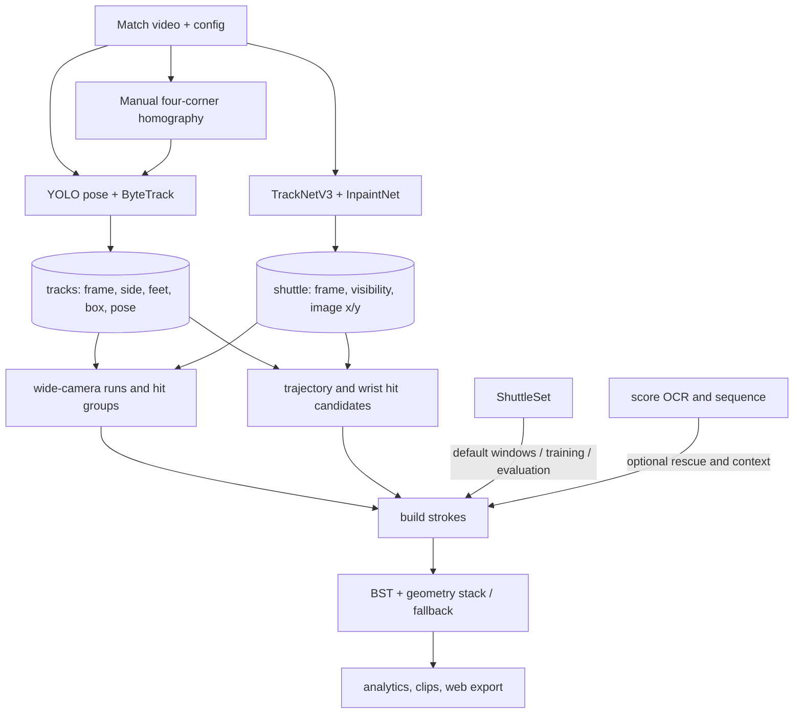
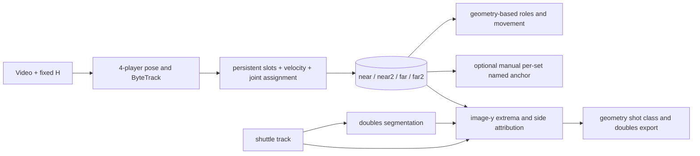
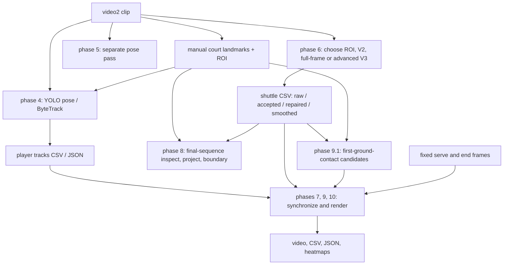
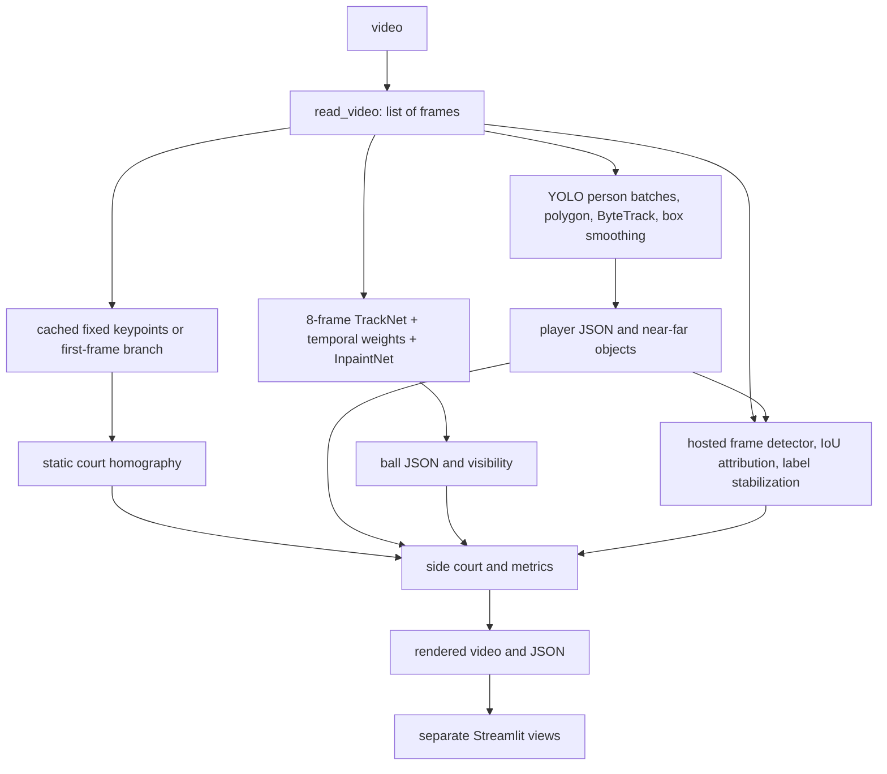

# External badminton repositories: pipeline architecture analysis

Research snapshot: 2 November 2026. Static inspection only: no model weights were downloaded, no dependencies installed, no application or inference tests run, and no application code changed. Source and metadata were retrieved locally into a temporary directory; generated data and media were inventoried rather than downloaded wholesale. The analysis refers to these revisions:

- **J — jayclim/BadmintonAI:** [`5c356f05cde0ed90c75316c133e0aba495e5232b`](https://github.com/jayclim/BadmintonAI/tree/5c356f05cde0ed90c75316c133e0aba495e5232b).
- **D — Dinil007/badminton:** [`1690934989ff3b64e61fcc497518bb652f8d0b5f`](https://github.com/Dinil007/badminton/tree/1690934989ff3b64e61fcc497518bb652f8d0b5f).
- **V — amramer/Badminton-VisionAI:** [`a17e47251b971aa7fda6d60d0424ffb3887030b6`](https://github.com/amramer/Badminton-VisionAI/tree/a17e47251b971aa7fda6d60d0424ffb3887030b6).

**Evidence standard.** “Implemented” means source contains a concrete path, not that accuracy, reproducibility or production readiness has been independently demonstrated. Upstream numerical claims are not independently reproduced. This investigation followed principal execution paths and examined representative implementations, configuration, tests, output schemas and alternative modules; it did **not** execute or exhaustively read every line of every UI, notebook, dataset, generated file or upstream dependency. Descriptions of external models follow the available wrappers and checked-in definitions.

## 1. Executive summary

J has the most developed match-analysis architecture: separate video observations, rally/stroke construction, score reconstruction, labelled-data comparisons, review/export, and a separate doubles branch. Useful ideas include explicit source provenance, held-out evaluation, frame alignment and joint four-slot association. Fixed-camera/broadcast assumptions and heuristic contacts remain; named doubles identity is manually seeded and doubles event accuracy is unlabelled. Labelled and video-derived branches must not be conflated.

D is a clip-specific research prototype with multiple shuttle experiments and inspection artifacts. Its explicit raw, accepted, reconstructed and smoothed trajectory fields and manual landmark calibration are useful ideas. Its default CLI is a specific visualization, not a universal pipeline; rally timing and many paths are fixed to one video, several modules are empty, and line-call outputs are not a validated general-purpose line judge.

V is an offline frame-in-memory demonstration combining fixed court points, YOLO/ByteTrack, TrackNet/InpaintNet, a hosted per-frame shot detector, overlays and a separate Streamlit application. Its public identity and metrics are two-player oriented; the shot detector does not use shuttle motion. Its license restricts redistribution and commercial use.

Evaluate ideas against our existing pipeline and labelled footage instead of importing implementations. This checkout already includes TrackNetV3, court/camera logic, player association and identity review, contact fusion and BST. The existing [multi-court isolation analysis](../docs/multi-court-isolation.md) documents why geometric exclusion is not shuttle or event accuracy.

## 2. Repository architecture overview

| | J | D | V |
|---|---|---|---|
| Organization | Python processing modules, DuckDB, static Next.js exports and Streamlit | Phase-oriented Python CLI and file-based experimental stages | `app.py` offline batch processing and separate `web.py` Streamlit UI |
| Input | Match video, config, manual calibration; optional ShuttleSet labels | One locally configured clip, calibration and precomputed intermediates | Configured video and cached JSON; frames collected in memory |
| Intermediate data | SQL `matches`, `tracks`, `shuttle`, `strokes`; frame indices and source | Phase-specific CSV/JSON keyed by frame | Frame-aligned player and ball objects, JSON caches and shot records |
| Main entry | [singles chain](https://github.com/jayclim/BadmintonAI/blob/5c356f05cde0ed90c75316c133e0aba495e5232b/scripts/run_match_chain.sh), [doubles tracker](https://github.com/jayclim/BadmintonAI/blob/5c356f05cde0ed90c75316c133e0aba495e5232b/scripts/run_doubles_track.sh) | [`main.py`](https://github.com/Dinil007/badminton/blob/1690934989ff3b64e61fcc497518bb652f8d0b5f/main.py) | [`app.py`](https://github.com/amramer/Badminton-VisionAI/blob/a17e47251b971aa7fda6d60d0424ffb3887030b6/app.py), [`web.py`](https://github.com/amramer/Badminton-VisionAI/blob/a17e47251b971aa7fda6d60d0424ffb3887030b6/web.py) |

These are not interchangeable one-command workflows. J's scripts include an author-specific absolute working directory; D uses many absolute Windows paths. V can load cached data rather than regenerate it.

## 3. Individual deep dives and execution paths

### 3.1 J: BadmintonAI

**Inputs and branches.** [Match configuration](https://github.com/jayclim/BadmintonAI/blob/5c356f05cde0ed90c75316c133e0aba495e5232b/config/matches.yaml) holds video paths, calibration, match metadata and offsets. [`shuttleset.py`](https://github.com/jayclim/BadmintonAI/blob/5c356f05cde0ed90c75316c133e0aba495e5232b/src/badminton/shuttleset.py) imports human-labelled ShuttleSet strokes into DuckDB: these are not predictions. The singles pipeline defaults to labelled stroke windows; `--label-free` switches to inferred segments, optionally rescued using a score snapshot. Training still requires other labelled matches. Per-set names and score need OCR or manual context. The web can display exported data without running inference.

**Video, court and players.** [`detect.process_video`](https://github.com/jayclim/BadmintonAI/blob/5c356f05cde0ed90c75316c133e0aba495e5232b/src/badminton/detect.py) uses OpenCV frame reading with start/stride and `YOLO.track(persist=True, tracker="bytetrack.yaml")`; defaults are YOLO11x pose, 1280-pixel inference, MPS and 0.7 m court margin. COCO ankles require confidence ≥0.3. `ground_point` takes ankle x and blends ankle y 0.65 toward bbox bottom, with bbox fallback. [`court.compute_homography`](https://github.com/jayclim/BadmintonAI/blob/5c356f05cde0ed90c75316c133e0aba495e5232b/src/badminton/court.py) maps four manually selected corners to court metres. Court filtering and near/far half assignment simplify singles. Fixed calibration and side assignment are vulnerable to camera changes, projection error and neighboring courts.

**Shuttle and hits.** [`shuttle.run_tracknet`](https://github.com/jayclim/BadmintonAI/blob/5c356f05cde0ed90c75316c133e0aba495e5232b/src/badminton/shuttle.py) invokes upstream `predict.py` with TrackNetV3 and InpaintNet checkpoints and weighted temporal evaluation. The wrapper globally patches `.cuda()`, `torch.load` and DataLoader for MPS/CPU; it should not be assumed to preserve a CUDA host's normal GPU selection. Its upstream path uses eight-frame windows, background, temporal heatmap ensemble and trajectory repair. `track_window` chunks video; `import_csv` applies offsets and writes image coordinates to DuckDB. The module docstring mentions an `interpolated` flag, but the inspected insert writes only match, frame, image coordinates and visibility; reconstruction provenance cannot be assumed from that insert.

[`hits.detect_hits`](https://github.com/jayclim/BadmintonAI/blob/5c356f05cde0ed90c75316c133e0aba495e5232b/src/badminton/hits.py) fills internal gaps up to six frames, compares velocities over ±4 frames, scores velocity change (30 px/frame threshold) or a turn (20 threshold, cosine <0.5), and suppresses nearby candidates within eight frames. Extra passes handle 2–14-frame raw gaps, serve motion onset and wrist-speed peaks ≥10 px/frame within 60 px of an observed shuttle. `attribute_hits` chooses a nearby wrist or bbox centre within ±1 frame; it does not detect a racket. Thresholds depend on camera and frame rate. `find_landing` takes the lowest image point on a plausible post-hit continuation; it is not a verified floor-contact classifier. Projection is meaningful only if the point is actually on the court. Match-specific offsets align ShuttleSet labels with video; the two prediction streams themselves use video frames.

**Rallies and shots.** [`segment.segments`](https://github.com/jayclim/BadmintonAI/blob/5c356f05cde0ed90c75316c133e0aba495e5232b/src/badminton/segment.py) treats both players tracked in-court as a main-camera proxy, merges gaps, filters box-height bands, groups hits and trims restarts or implausible wrist distances. Defaults such as 45-frame runs and a 90-frame hit gap encode its broadcast domain. [`pipeline.build_strokes`](https://github.com/jayclim/BadmintonAI/blob/5c356f05cde0ed90c75316c133e0aba495e5232b/src/badminton/pipeline.py) constructs contact rows and player positions. For a nonfinal stroke, its `landing` is the **next hitter's floor position at contact**, a proxy, not an observed shuttle landing. The last-stroke estimate comes from the heuristic above. `classify` combines a pretrained BST adapter and geometry in a stack trained on other labelled matches, with BST and geometry fallbacks. [`bst_eval._window_arrays`](https://github.com/jayclim/BadmintonAI/blob/5c356f05cde0ed90c75316c133e0aba495e5232b/src/badminton/bst_eval.py) assembles two players' bbox-normalized COCO joints and bones and shuttle coordinates normalized to 1280×720 into 30 time steps. Hard-coded dimensions and two-player ordering require adaptation. [`scoreboard.py`](https://github.com/jayclim/BadmintonAI/blob/5c356f05cde0ed90c75316c133e0aba495e5232b/src/badminton/scoreboard.py) reads broadcast digit templates; [`score_seq.py`](https://github.com/jayclim/BadmintonAI/blob/5c356f05cde0ed90c75316c133e0aba495e5232b/src/badminton/score_seq.py) repairs score progression. Export, review and optional LLM commentary consume derived records rather than create ground truth.

**Doubles branch.** [`doubles.track.SlotAssigner`](https://github.com/jayclim/BadmintonAI/blob/5c356f05cde0ed90c75316c133e0aba495e5232b/src/badminton/doubles/track.py) retains two detections per half. It persists ByteTrack IDs, predicts missing slots with velocity in metres and jointly assigns remaining detections. Radius starts at 1.5 m and expands to 4 m; predictions expire after 15 frames; area penalty and a five-frame sticky-half rule influence assignment. A finite cold-fill cost allows weakly supported assignment; slot persistence is not proof of identity. State is recreated for each processing chunk. [`doubles.identity`](https://github.com/jayclim/BadmintonAI/blob/5c356f05cde0ed90c75316c133e0aba495e5232b/src/badminton/doubles/identity.py) maps service quadrants to names using manually supplied per-set anchors. Automatic serve reanchoring is a hook. [`doubles.roles`](https://github.com/jayclim/BadmintonAI/blob/5c356f05cde0ed90c75316c133e0aba495e5232b/src/badminton/doubles/roles.py) derives formation geometrically without requiring names.

[`doubles.strokes.contacts`](https://github.com/jayclim/BadmintonAI/blob/5c356f05cde0ed90c75316c133e0aba495e5232b/src/badminton/doubles/strokes.py) treats smoothed image-y maxima/minima as near/far candidates, with prominence max(15 px, 12% of range) and ≥7-frame spacing. `enforce_alternation` collapses consecutive same-side candidates; `attribute` chooses the nearest same-side wrist/bbox or defaults to the first slot. Camera geometry, flight apexes and missing observations can invalidate this heuristic. Alternation **after enforcing alternation is not independent accuracy evidence**. The module explicitly says labelled doubles shot validation is unavailable and its geometry classifier is transferred from singles.

### 3.2 D: badminton

**Orchestration.** [`main.py`](https://github.com/Dinil007/badminton/blob/1690934989ff3b64e61fcc497518bb652f8d0b5f/main.py) dispatches phases, with 9.1 as default. Phase 4 runs players, 5 pose, 6 selects a shuttle experiment, 7 consumes existing files for rendering, 8 handles a final-sequence line call, 9/9.1 renders line-call analytics, and 10/10.1/10.2 render or audit movement. One phase does not automatically produce all prerequisites. The YAML describes one 1280×720, 50 fps, 1,004-frame clip; several modules instead use their own `D:\badminton` paths and constants.

**Court and players.** [`BadmintonCourtCalibrator`](https://github.com/Dinil007/badminton/blob/1690934989ff3b64e61fcc497518bb652f8d0b5f/src/court/calibration.py) associates operator clicks with named metric landmarks. `compute_homography` calls `cv2.findHomography` directly for four points or RANSAC for more, with a 0.5 reprojection threshold in destination coordinate units. `validate_homography` reports residuals; previews help review. This is manual calibration, not the empty `court/detector.py`, `keypoints.py` or `homography.py`. [`player.tracker.PlayerTracker`](https://github.com/Dinil007/badminton/blob/1690934989ff3b64e61fcc497518bb652f8d0b5f/src/player/tracker.py) uses Ultralytics pose/ByteTrack, ROI and metric court filtering. `_canonicalize_ids` majority-votes each raw track into far=1 or near=2, merging same-side tracks: this is not four-player identity. [`player.pose`](https://github.com/Dinil007/badminton/blob/1690934989ff3b64e61fcc497518bb652f8d0b5f/src/player/pose.py) is a separately invoked pass. Heatmaps and movement/speed audit consume projected player positions.

**Shuttle alternatives.** The basic config describes a 9-channel three-RGB-frame input at 512×288; the repository tree contains `models/shuttle/tracknet.pt`, which was not downloaded. `detector.py`, `tracker.py`, `trajectory.py`, `fullframe_detector.py`, `fullframe_tracker.py`, and `improved_detector.py` are alternatives rather than one automatic chain. [`AdvancedShuttleTracker.process_tracking`](https://github.com/Dinil007/badminton/blob/1690934989ff3b64e61fcc497518bb652f8d0b5f/src/shuttle/advanced_tracker.py) separately combines V3-window detections, confidence/position-weighted ensemble and kinematic rejection, bounded gap repair, then bidirectional Kalman/RTS smoothing. [`load_tracknet_v3_model`](https://github.com/Dinil007/badminton/blob/1690934989ff3b64e61fcc497518bb652f8d0b5f/src/shuttle/tracknet_v3.py) constructs 27 input channels and eight output heatmaps and strictly loads an external V3 checkpoint; V3 and InpaintNet checkpoints are absent from the inventoried tree. [`TrajectoryInpainter.find_bounded_gaps`](https://github.com/Dinil007/badminton/blob/1690934989ff3b64e61fcc497518bb652f8d0b5f/src/shuttle/inpaint.py) requires two observations at each end and repairs at most six frames. Model-based repair has spline/kinematic fallback branches, but loads InpaintNet before reaching them: a missing checkpoint is not automatically handled by that fallback. [`rts_smoother.py`](https://github.com/Dinil007/badminton/blob/1690934989ff3b64e61fcc497518bb652f8d0b5f/src/shuttle/rts_smoother.py) uses future observations, so is offline; smoothing across a racket impact may erase a directional change. CSV fields preserve raw, ensemble, rejection, inpaint and final stages.

**Events and outputs.** [`RallyDetector`](https://github.com/Dinil007/badminton/blob/1690934989ff3b64e61fcc497518bb652f8d0b5f/src/analytics/rally.py) generates exactly one rally from fixed serve frame 140 and contact frame 809 at default 50 fps. This is a clip-specific state display, not general rally discovery. [`run_line_call`](https://github.com/Dinil007/badminton/blob/1690934989ff3b64e61fcc497518bb652f8d0b5f/src/line_calling/line_call.py) inspects a specified final sequence, transforms a selected pixel and evaluates the boundary. The separate [`ContactDetector`](https://github.com/Dinil007/badminton/blob/1690934989ff3b64e61fcc497518bb652f8d0b5f/src/line_calling/contact_detector.py) proposes first-ground-contact candidates from approach, velocity change, rebound, court proximity and confidence, and emits debug crops. Ground contact is not racket-hit or shot classification. It is not demonstrated as a calibrated general line judge. `src/analytics/events.py` and several court/visualization modules are empty. No automated test suite was found in the repository tree.

### 3.3 V: Badminton-VisionAI

**Actual app flow.** [`app.main`](https://github.com/amramer/Badminton-VisionAI/blob/a17e47251b971aa7fda6d60d0424ffb3887030b6/app.py) loads YAML; [`read_video`](https://github.com/amramer/Badminton-VisionAI/blob/a17e47251b971aa7fda6d60d0424ffb3887030b6/utils/video.py) decodes all selected OpenCV frames into a list with nominal FPS/size. Frames remain as OpenCV returns them (BGR), despite its RGB docstring. Cached court, player and shuttle JSON can bypass inference. Cache validity is based on file existence, not a demonstrated video/model/config fingerprint. The app produces annotated frames, video and metrics; `web.py` and `webapp/` consume saved data separately.

**Court and player processing.** [`CourtDetection`](https://github.com/amramer/Badminton-VisionAI/blob/a17e47251b971aa7fda6d60d0424ffb3887030b6/tracking/court_detection/court_detection.py) defaults to fixed points and loads JSON or collects points on the first frame. A ResNet/YOLO first-frame branch exists but model/point-shape compatibility is unverified: ResNet creates 24 outputs for 12 points whereas [`SideCourt.homography_matrix`](https://github.com/amramer/Badminton-VisionAI/blob/a17e47251b971aa7fda6d60d0424ffb3887030b6/analysis/sidecourt.py) requires 32 correspondences. No dynamic calibration is established. [`PlayerTracker.run_tracker`](https://github.com/amramer/Badminton-VisionAI/blob/a17e47251b971aa7fda6d60d0424ffb3887030b6/tracking/players_tracking/player_tracking.py) batches YOLO person detections (`conf=0.5`, IoU 0.7, image size 640), filters by a court polygon, uses supervision ByteTrack and averages two recent boxes. `Player.assign_player` then sets configured ID/name according to which side of an image net line the bbox foot falls. ByteTrack is internal; the public ID is a two-side mapping, not persistent individual re-identification. Optional SAM masks are visualization, not tracking evidence. `players_poses/players_poses.py` is not called by the main pipeline.

**Shuttle and events.** [`BallTracker`](https://github.com/amramer/Badminton-VisionAI/blob/a17e47251b971aa7fda6d60d0424ffb3887030b6/tracking/shuttle_tracking/ball_tracking.py) loads TrackNet and optional InpaintNet checkpoints. Eight-frame sequences, 640×360 model dimensions, weighted overlapping-window aggregation and gap refinement create frame-indexed positions and visibility. Configured model checkpoints are absent from the inventoried tree. [`ShotDetector.run`](https://github.com/amramer/Badminton-VisionAI/blob/a17e47251b971aa7fda6d60d0424ffb3887030b6/shot_detection/detector.py) calls a hosted Roboflow model for each **already annotated** frame, keeps the highest-confidence box, and chooses the player box with greatest positive IoU. It neither consumes the shuttle track nor estimates racket contact. `LabelStabilizer` holds a short label history; this is not demonstrated event segmentation, and repeated frame records need not be distinct shots. The exception path can reference `result` before successful assignment or reuse a previous iteration's value; `app.py` initializes `shots_by_frame` only for nonempty shots before later use. These are static risks, not reproduced failures. Config contains a credential-shaped API value; do not copy it or assume validity. Hosted inference adds access, availability, privacy and model-version dependencies.

[`analysis.metrics.Metrics`](https://github.com/amramer/Badminton-VisionAI/blob/a17e47251b971aa7fda6d60d0424ffb3887030b6/analysis/metrics.py) stores one position for each of IDs 1 and 2, fills missing values and calculates finite-difference movement and ball-derived speed. A floor homography applied to an airborne shuttle produces a planar projection, not measured 3D shuttle position, speed or physical shot power. Metric labels and charts do not establish physical validity. `shot_detection/analysis.py` and `analysis/poseview.py` are empty; small notebooks do not establish a verified training pipeline.

## 4. Component-by-component capability matrix

| Component | J | D | V |
|---|---|---|---|
| Decoding / temporal buffering | OpenCV for players; chunked upstream TrackNet; frame offsets in DB | Phase-specific OpenCV processing, clip constants and CSVs | Entire decoded video in RAM, with multiple annotation lists |
| Calibration | Four manually selected corners, one H per match | Named manual landmarks, direct/RANSAC H and residual preview | Cached/manual 32 points; optional first-frame model branch; static H |
| Player detection | YOLO11 pose + ByteTrack; ankle/bbox blend | YOLO11 pose + ByteTrack; separate pose pass | YOLOv8 person + supervision ByteTrack; bbox feet; optional SAM rendering |
| Singles identity | Near/far slot | Majority court side per raw ID, canonical 1/2 | Side of image net line determines configured IDs 1/2 |
| Doubles | Separate four-slot tracking, formations and manual anchors; switches possible | Same-side IDs collapse; doubles court dimensions do not make four identities | Two-person mapping and metrics; no supported four-person flow established |
| Shuttle | External TrackNetV3/InpaintNet via patched wrapper | Three-frame V2 and alternatives; separate V3 ensemble/repair/RTS | Eight-frame TrackNet/InpaintNet and weighted windows |
| Racket/contact | Trajectory velocity, gap and wrist heuristics; no racket detector shown | Ground-contact heuristic for line calling; no general racket-hit path established | Hosted per-frame shot boxes; no shuttle-based racket-contact estimator |
| Shot classification | BST + trained geometry stack/fallback; doubles uses transferred geometry | No connected general shot classifier found | Hosted box class, player IoU, label stabilizer |
| Rally | Broadcast camera-run + hits; optional score rescue; separate doubles logic | Hard-coded one-clip state | No general rally segmenter established in main path |
| Outputs | DuckDB, clips, replay, static JSON/dashboard, optional commentary | CSV/JSON, annotated video, heatmaps, line-call and speed diagnostics | Video, JSON, side court and Streamlit reports |
| Evidence | Tests, label comparisons and review code, still domain-dependent | Example outputs and diagnostics; no test suite found | Example cached JSON/videos; no test suite found |
| Reuse | Own MIT code; model, weight and data terms separate | No license file found at snapshot; seek permission for code reuse | All-rights-reserved restrictions; permission needed for redistribution/commercial use |

The strongest **candidate** for four-player association is J's joint slot assignment; for labelled singles contact evaluation, J's matching harness; for trajectory audit, D's explicit stage fields; and for calibration review, D's named landmark residuals. These are engineering judgments, not comparative accuracy results. V demonstrates a compact visualization and separate viewer; presentation ideas need not copy restricted source.

## 5. Models, data, dependencies and reproducibility

- **J:** [requirements](https://github.com/jayclim/BadmintonAI/blob/5c356f05cde0ed90c75316c133e0aba495e5232b/requirements.txt) include OpenCV, NumPy, DuckDB, PyYAML, Ultralytics, pandas, scikit-learn and upstream model dependencies; the web has separate dependencies. YOLO weights and checkpoints are separate; wrappers reference TrackNetV3 and BST source/checkpoint paths. [License notes](https://github.com/jayclim/BadmintonAI/blob/5c356f05cde0ed90c75316c133e0aba495e5232b/LICENSES/README.md) record third-party licenses and ShuttleSet provenance. Verify exact artifact and weight terms independently: a repository license does not automatically license a dataset, video, model weights or all dependencies. Python tests cover doubles, scoring, review, accuracy, storage and export; web tests cover data and review. Their presence does not mean they were run here.
- **D:** [requirements](https://github.com/Dinil007/badminton/blob/1690934989ff3b64e61fcc497518bb652f8d0b5f/requirements.txt) are largely unpinned: Torch, Ultralytics, OpenCV, SciPy, pandas, filterpy and others. The tree includes a V2 checkpoint and metadata, but V3/InpaintNet loaders need external files. [Configuration](https://github.com/Dinil007/badminton/blob/1690934989ff3b64e61fcc497518bb652f8d0b5f/configs/badminton.yaml) describes the example; phase code also uses absolute paths and constants. No repository license file was found. Public access does not grant a general reuse license.
- **V:** [pipeline requirements](https://github.com/amramer/Badminton-VisionAI/blob/a17e47251b971aa7fda6d60d0424ffb3887030b6/requirements.pipeline.txt), web requirements and environment YAML include Torch, Ultralytics, supervision, Roboflow, SAM and visualization libraries, mostly unpinned. Configured YOLO, SAM, TrackNet and InpaintNet weights are not in the inventoried tree. Its [license](https://github.com/amramer/Badminton-VisionAI/blob/a17e47251b971aa7fda6d60d0424ffb3887030b6/LICENSE.txt) permits personal modification without redistribution while restricting redistribution and commercial use without permission. Hosted model terms are unknown.

All three use neural inference and benefit from acceleration; CPU paths are not a throughput guarantee. J's wrapper redirects CUDA calls to MPS or CPU; D's RTS stage is offline; V holds full-resolution frames and multiple annotation lists, so RAM grows approximately with frame count × width × height in addition to tensors. Overlapping windows add computation. No portable GPU memory, latency or FPS comparison can be made without a controlled benchmark.

## 6. Reusable ideas for our system

These are experiments or design ideas, not instructions to integrate external code. Existing local touchpoints include `sports/badminton/src/bai_badminton/perception/player_association.py`, `perception/tracknet.py`, `perception/shuttle_post.py`, `perception/court_lines.py`, `events/contact.py`, `events/bst.py`, `identity.py` and `identity_review.py`. Their existence does not imply these comparisons have been performed.

| Idea / action | Source and mechanism | Value, requirements and risk |
|---|---|---|
| **Benchmark joint doubles assignment** | J `doubles.track._SlotState`, `_best_matching`, `SlotAssigner.update`: predict in metres using actual frame gaps and compare assignments jointly with motion and size costs. | Compare to our association on labelled crossings/occlusion. Needs valid target-court H and tracks, no new model. Calibration errors, cold fills and chunk resets can cause identity swaps. Measure ID switches and abstention before replacing existing hypotheses. |
| **Adapt separate slot, role and named identity** | J `doubles.roles` and `doubles.identity`: geometric roles and manually anchored names are separate. | Our identity review can preserve unknowns and reanchoring evidence. Requires roster/service context and end-change tests. The upstream score-reanchor hook is not automatic identity proof. |
| **Benchmark complementary contact signals** | J `hits.detect_hits`, `_wrist_hits`, `attribute_hits`: turn/acceleration, raw-gap boundary, serve onset, wrist proximity. | Compare with our `events/contact.py` and racket/participant evidence on independently labelled contacts. Use timestamps and normalized geometry; porting pixel/frame constants risks false contacts and domain failure. Requires reliable shuttle and pose. |
| **Benchmark bounded offline repair and provenance** | D `temporal_ensemble`, `TrajectoryInpainter.find_bounded_gaps`, `BidirectionalKalmanRTS.run_bidirectional_tracking`, `AdvancedShuttleTracker.process_tracking`. | Compare raw/accepted/repaired/smoothed positions against labelled trajectories. Learned path needs V3/InpaintNet weights; RTS uses future data and may blur real contacts. Interpolation is not evidence of visibility. Our TrackNet is the baseline. |
| **Adapt calibration QA** | D `calibration.compute_homography`, `validate_homography` and previews use named correspondences and residuals. | Compare with our manual/line calibration and camera recovery. Evaluate held-out landmarks, visible lines and temporal stability, not just fitted-point residual. A planar H cannot correct lens distortion or recover airborne depth. |
| **Adapt review evaluation and fingerprints** | J `review_eval.py`, `pipeline._stack_cache_path`, `validate.py`: review records, held-out match declarations and feature invalidation. | Compare to our evaluation manifest/review ledger; include code, calibration, model, frame timeline and settings. Independently review false negatives, not only detected anchors; prevent leakage and stale caches. |
| **Benchmark score as corroboration** | J `scoreboard.timeline/events`, `score_seq.repair/complete`, `pipeline.rally_windows` score-hole rescue. | Our OCR/match-phase pipeline can test rescue on reviewed broadcast footage. Score changes do not localize hits or explain rallies; graphics and missed reads require uncertainty. |
| **Avoid a hosted box label as a contact event** | V `ShotDetector.run` and `_get_primary_shot`. | A class and player-box IoU may be weak evidence, but does not establish contact or its time. Hosted service and restricted source add barriers; avoid replacing fused contact events. |
| **Avoid equating projected flight with a line call** | V `SideCourt.update_ball_position`; D `run_line_call`; J `find_landing`. | Projection is justified only at verified floor contact. Keep airborne positions in image coordinates with uncertainty. Official line calls need independently validated landing/cork localization and calibration error. |

## 7. Limitations and unresolved questions

1. **No independent runtime validation.** No repository was executed, no environment installed, and no output compared to original footage. Code-path findings are static; published metrics are not directly comparable across data, labels, frame tolerances and splits.
2. **Training and split leakage.** Which J matches, score templates, thresholds and contacts were used for tuning or held out? `pipeline.stack_training_frame` describes a gap between features at labelled contacts and detected contacts. Report contact recall separately from shot accuracy conditional on a matched contact.
3. **Doubles ground truth.** Measure precision/recall, timing, side and partner attribution, and identity switches on labelled four-player rallies. J's enforced alternation can hide missing contacts. Its named identities depend on anchors; D and V use two-side mappings.
4. **Camera/domain change.** J's broadcast segmentation depends on cuts and tuned frame thresholds; D is configured around one 50-fps clip. Our fixed multi-court footage, small shuttle, partial baseline, variable frame rate and other players need separate labelled validation. A flight mask cannot resolve every overlapping airborne shuttle.
5. **Floor contact.** Finding the visually lowest sample is not proof of actual landing. Calibration, blur, shuttle size and line width call for uncertainty/no-call handling. None of these repositories establishes officiating-grade performance on our footage.
6. **Timing provenance.** V uses nominal frame/FPS, D hard-codes FPS in places, and J stores match-specific label offsets. Variable frame rate, resampling, duplicate frames, clips and numbering can misalign observations. Preserve source timestamps and distinguish normalized frames from independent evidence.
7. **Rights and artifacts.** Verify source, weights, datasets, video, hosted model and transitive package rights independently, and identify model versions and hashes. Do not place credentials in our repository. This inventory is not a legal opinion.
8. **Disconnected and fragile paths.** J documentation and insert code differ on some details; D has empty files and non-orchestrated alternatives; V's model/keypoint count mismatch, file-existence caches, exception and empty-shot paths need reproduction before asserting runtime failures.

## 8. Recommended next steps

1. **Establish labels and splits.** Freeze representative singles/doubles footage, especially the fixed multi-court scene, with match-level development and held-out splits. Label target shuttle/visibility, four-player identity, contacts and hitter, rally bounds and floor contact. Preserve timestamps and calibration. Report event precision, recall, timing and attribution, not just mask compliance or alternation.
2. **Inventory and baseline existing components.** Map our TrackNet, observation provenance, court admission, identity/review, racket and contact fusion to the candidates; run unchanged baselines against the same labels. Stratify by shuttle scale, neighboring court, occlusion, side, camera cut and partner crossing.
3. **Run isolated ablations.** Compare J-inspired joint assignment and complementary contact signals with existing outputs; evaluate bounded repair and RTS offline with and without event-aware segmentation. Preserve raw observations, inferred points and uncertainty.
4. **Evaluate calibration and timing separately.** Use held-out landmark residuals, camera motion/recovery and frame-alignment audits before estimating metric speed; test wide-angle distortion and partial courts. Keep airborne floor projections display-only.
5. **Evaluate rallies and shot models after contact quality.** Separate recall across all labelled contacts from conditional shot accuracy; compare score-assisted and unassisted segmentation, include unknown outcomes and quantify doubles transfer.
6. **Resolve rights and reproducibility before implementation.** Document code, weights and data permissions, pin versions/hashes, and establish device/memory budgets for our actual runtime. Do not integrate V or D source without appropriate authorization.

## 9. Additional exact source index

- J: [schema](https://github.com/jayclim/BadmintonAI/blob/5c356f05cde0ed90c75316c133e0aba495e5232b/schema/schema.sql), [doubles segmentation](https://github.com/jayclim/BadmintonAI/blob/5c356f05cde0ed90c75316c133e0aba495e5232b/src/badminton/doubles/segment.py), [movement](https://github.com/jayclim/BadmintonAI/blob/5c356f05cde0ed90c75316c133e0aba495e5232b/src/badminton/doubles/movement.py), [web export](https://github.com/jayclim/BadmintonAI/blob/5c356f05cde0ed90c75316c133e0aba495e5232b/src/badminton/export_web.py), [review evaluation](https://github.com/jayclim/BadmintonAI/blob/5c356f05cde0ed90c75316c133e0aba495e5232b/src/badminton/review_eval.py), [tests](https://github.com/jayclim/BadmintonAI/tree/5c356f05cde0ed90c75316c133e0aba495e5232b/tests).
- D: [temporal ensemble](https://github.com/Dinil007/badminton/blob/1690934989ff3b64e61fcc497518bb652f8d0b5f/src/shuttle/temporal_ensemble.py), [V3 detector](https://github.com/Dinil007/badminton/blob/1690934989ff3b64e61fcc497518bb652f8d0b5f/src/shuttle/tracknet_v3_detector.py), [speed audit](https://github.com/Dinil007/badminton/blob/1690934989ff3b64e61fcc497518bb652f8d0b5f/src/analytics/speed_audit.py), [frame synchronizer](https://github.com/Dinil007/badminton/blob/1690934989ff3b64e61fcc497518bb652f8d0b5f/src/integration/frame_synchronizer.py).
- V: [TrackNet and InpaintNet definitions](https://github.com/amramer/Badminton-VisionAI/blob/a17e47251b971aa7fda6d60d0424ffb3887030b6/tracking/shuttle_tracking/models.py), [sequence dataset](https://github.com/amramer/Badminton-VisionAI/blob/a17e47251b971aa7fda6d60d0424ffb3887030b6/tracking/shuttle_tracking/dataset.py), [shot stabilizer](https://github.com/amramer/Badminton-VisionAI/blob/a17e47251b971aa7fda6d60d0424ffb3887030b6/shot_detection/stabilizer.py), [dashboard](https://github.com/amramer/Badminton-VisionAI/blob/a17e47251b971aa7fda6d60d0424ffb3887030b6/analysis/dashboard.py), [web application](https://github.com/amramer/Badminton-VisionAI/blob/a17e47251b971aa7fda6d60d0424ffb3887030b6/web.py).
