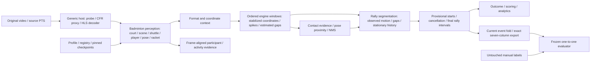

# Test 1 root-cause investigation

Investigation gate CLOSED: all seven specialist reports reviewed and accepted
for controlled experiments. No production code was changed before this gate.
Test 1 is development data.
Baseline production301baf08 and benchmark b773e20 remain frozen; exact hashes are
in `evidence_registry.json`. The original source, labels and all1766 baseline
files are immutable. Main remains unchanged.

## Reproduction and dependency map

Independent arithmetic and the production evaluator reproduce the complete
baseline metrics. Diagnostic replay uses the actual production structural
decoder, `BadmintonMatchEngine`, domain ports, recorded calibration and recorded
format decision. It reproduces all49 interval endpoints AND end reasons, all49
live start anchors and all432 live contact/stroke timestamps. This replay holds
perception fixed; it is not fresh video inference or an end-to-end improvement.

Source owners: generic media/timeline/scheduling/storage remain in `engine/`;
badminton geometry/perception/contact/segmentation remain in the sport plugin.
The existing plugin and independent-component contracts must be preserved.
`PIPELINE_TRACE.md` and seven specialist reports provide the detailed stage map.

Evidence packages: `artifacts/benchmarking/investigation/failure_cases/index.json`
indexes55 packages: all36 labels plus all19 policy-FPs, including every miss,
eleven multi-segment labels, large errors and four good-IoU controls. Each package
has source ranges/timestamps, labels for review, all nearby predicted segments,
raw shuttle/player/pose/confidence observations, inferred contacts with provenance,
exact FSM transitions and original-frame overlay. Session logs are copied whole
because the original log lacks per-frame entries; no fake log slice is invented.

## Ranked findings

### R1 — Fragmentation dominates the severe assigned-boundary outliers

- **Symptom:**49 predictions for36 labels,19 policy-FPs,6 FNs, late/early matched boundaries.
- **Evidence:**Audit A exact-rational assignment, independent event fold and all36 row diagnostics. All19 FPs overlap labels; zero predictions are wholly outside labeled spans. GT2/19 first fragments start+4frames but selected matches start+179/+202; GT20/27 later fragments reach−20/−12frames while selected ends are−442/−218.
- **Source:**`evaluate_rallies.match_rallies`, `RallyFSM.step/_finalize`, engine `_handle_fsm`.
- **Cause:**predictions split one annotated interval; unchanged one-to-one matching necessarily selects at most one fragment. This is a prediction failure, not a matcher defect.
- **Alternatives:**annotation grouping/tool ambiguity exists; GT23 includes spillover from the preceding interval, so a GT-dependent union is not a permissible prediction algorithm.
- **Confidence:**high for measured mechanism; no new shuttle/contact labels are asserted.
- **Causal experiment:**fixed-perception segmentation ablations, then full production inference with labels confined to evaluation.
- **Action/effect:**recover independently supported continuity, expecting fewer fragments/FP/FN and lower severe boundary errors; preserve raw component evidence and frozen matching.
- **Risk:**joining legitimately adjacent rallies. GT22/23 and source controls must remain visible in per-rally comparisons; no indiscriminate merge expansion.

### R2 — Temporary loss is treated as termination even when trajectory reconstruction supports continuity

- **Symptom:**GT20 splits at9525 during an overhead exchange; GT2/19 have41/39-frame internal losses.
- **Evidence:**exact trace9535 enters ENDING at10missing observations, although interpolation is valid;9540 becomes CLOSED; recovery at9543/9544 is intermittent and9548 finalizes. Source views show upper-image exit/re-entry. Audit C distinguishes raw and bounded-window processed evidence.
- **Source:**`engine._window/_advance`, `shuttle_post.fill_gaps/process`, `RallyFSM.step`.
- **Cause:**`observed=vis & ~interp` correctly protects contact truth, but the rally port has only an observed boolean/speed and cannot separately consume bounded reconstructed continuity. Missing data therefore increments negative evidence even with compatible anchors.
- **Alternatives:**model misses can extend physical nonvisibility; gap interpolation itself can be wrong and is not ground truth.
- **Confidence:**high for state transition; medium-high for physical top-exit explanation.
- **Experiment:**provide a typed, independently inspectable reconstructed-continuation flag while leaving observation/contact/start gates unchanged. Separate long-gap/motion experiments; do not call estimates observed.
- **Action/effect:**optional evidence-aware segmenter with bounded continuation, expecting reduced early ends/fragments. Keep baseline provider available.
- **Risk:**bridging actual breaks or stale coordinate contexts. Test cut/replay barriers, stationary floor points, unsupported/missing anchors and closely spaced rallies.

### R3 — Accepted contact is immediately contradicted by pre-contact stationary history

- **Symptom:**38 of489 accepted-contact calls re-enter ENDING on the same frame, including264 and12771.
- **Evidence:**Audit E actual-FSM counterexample: nine prior slow samples, accepted contact, current observed speed10; stationary history still triggers ENDING. Exact replay confirms38 occurrences. GT27 accepts12771 then immediately ends again from history; subsequent fast samples resume it.
- **Source:**`RallyFSM.on_contact`, `step`, `_stationary`; engine calls contact before step.
- **Cause:**contact resumes/opens play but does not rebase the history used to infer stationary termination. Independent post-contact terminal evidence is not required.
- **Alternatives:**some accepted contacts are false, and clearing history cannot correct their perception origin.
- **Confidence:**high, proven code defect with real occurrences.
- **Experiment:**clear/rebase only stationarity history at accepted contacts; all parameters and raw evidence fixed. Report duration/FP changes, not only one recovered start.
- **Action/effect:**small owner-local correctness fix, expected fewer instant endings/cancelled starts; no contact relabeling.
- **Risk:**a genuine final contact followed by a stationary shuttle may confirm later. Measure end bias and legitimate-break regression.

### R4 — Merge eligibility uses delayed motion confirmation rather than the observed run's onset

- **Symptom:**a motion run starts within the22-frame budget but confirms two frames later and fails to reopen.
- **Evidence:**Audit F production-FSM synthetic18vs19 missing-frame probes. Run onset120 minus previous end99=21, but confirmation122−99=23 rejects it. Real long41/39-frame losses exceed this small correction and must not be claimed resolved by it.
- **Source:**`RallyFSM.step`, CLOSED branch.
- **Cause:**inconsistent clock: normal start is backdated to `_run_start`, while recovery uses the confirmation frame.
- **Alternatives:**a recovery truly beginning outside the budget should still be separate.
- **Confidence:**high for defect; actual impact requires ablation.
- **Experiment/action:**use run onset for eligible recovery, preserving3-frame confirmation and cut barriers; compare unchanged baseline inputs.
- **Expected effect:**remove boundary-dependent two-frame rejection without simply increasing the merge threshold.
- **Risk:**one/two-frame changes near legitimate breaks; test budget edge−1/0/+1 and contact recovery separately.

### R5 — Configured stationary history length is not respected

- **Symptom:**`stationary_window=5` or15 silently fails after warmup.
- **Evidence:**Audit F synthetic probes; `_recent` is always maxlen10 while `_stationary` requires length equal to the configured window.
- **Source:**`RallyFSM` deque initialization/reset and `RallyParams`.
- **Cause:**configuration/state allocation mismatch, not the default Test1 cause (window10).
- **Alternatives:**reject unsupported windows explicitly; silently accepting them is not valid.
- **Confidence:**high, proven configuration defect.
- **Experiment/action:**parameter-shaped validated state, reset/checkpoint tests for5/10/15; default10 must retain behavior.
- **Expected effect:**reliable experiments/configuration, no claimed default accuracy gain.
- **Risk:**state lifecycle/checkpoint regressions; retain independent-provider tests.

### R6 — Static model peaks can falsely support stationary-end/contact reasoning

- **Symptom:**GT27 ends early despite93.6%raw coverage; observed coordinates stick near(645,393).
- **Evidence:**raw peaks≈0.51–0.58 at the painted service T during visible overhead action;23 of49 endings are stationary. Contact12748 can receive strong relative redirect/impulse support from tiny coordinate jitter (Audit E).
- **Source:**`heatmap_to_point`, `events.contact.score_frame`, `_advance`, `_stationary`.
- **Cause hypothesis:**single maximum-component selection follows a static white feature; any measured low image-plane speed becomes terminal support without independent contradiction handling.
- **Alternatives:**real low-motion shuttle, spare shuttle, labeling ambiguity. No independent pixel/contact GT is available.
- **Confidence:**high for gate chain, medium-high visual model-attractor diagnosis.
- **Experiment/action:**inspect alternative heatmap components; compare a frame-aligned independently observed pose/motion contradiction guard against stationarity. Movement may only qualify an existing interval's ambiguous end, never create a start or unbounded continuation.
- **Expected effect:**fewer premature stationary ends; no promised detector-accuracy improvement.
- **Risk:**players move during breaks; Audit D finds1625 active-play frames outside labels. Do not use current activity state40frames ahead of the FSM or treat movement as rally truth.

### R7 — TrackNet step8 is not frame skipping; chunk context remains an experiment

- **Symptom:**model context/averaging differs at60-frame HLS segment boundaries despite profile chunk64.
- **Evidence:**all17268 input indices exist; synthetic tensor contract emits all eight temporal positions.60-frame chunks use a tail window at52 and uneven overlap. No multi-second timestamp lag follows from window latency.
- **Source:**`TrackNetV3.detect/_prep`, `SessionRunner._perceive`, media segment plan.
- **Cause hypothesis:**uneven context/votes or short-window localization could affect continuity, not dropped frames.
- **Alternatives:**physical nonvisibility and stationary attractors survive stronger overlapping inference.
- **Confidence:**high frame-coverage fact, unproven quality effect.
- **Experiment/action:**paired step8/4 using same checkpoint/precision and unchanged segmentation; record full metrics and cost. No new model adoption without artifact/data licensing and comparable measurements.
- **Expected effect:**unknown; reject expensive changes if only conditional IoU improves.
- **Risk:**cost, GPU memory, averaging weakens peaks. The model comparison explicitly labels unmeasured alternatives.

### R8 — Missing appearance weights and player activity are not universal causes

- **Symptom:**OSNet unavailable; some camera-lost frames; no named contact actors.
- **Evidence:**16941 geometry-valid frames;16693 frames have two players;25594 pose rows are on schedule; all432livecontacts have two cached players. Unknown format becomes singles at120, before first label243. Baseline named identity remains review-gated by design.
- **Source:**perception player/reid loaders, format understanding, participant geometry, activity and contacts.
- **Cause:**explicit optional appearance fallback may affect association in some settings, but does not erase detection/pose or directly terminate rallies. Player stationarity never enters the original rally step.
- **Alternatives:**doubles/crossings may require stronger appearance; no real doubles label set is present here.
- **Confidence:**high for source/coverage; no identity accuracy claim.
- **Experiment/action:**preserve fallback visibility, test4-player/uncertain identity contracts; restore weights only as a separately measured hypothesis, not a presumed rally fix.
- **Expected effect:**observability/general reliability; no assumed Test1 gain.
- **Risk:**unjustified dependency/model download or fabricated named athletes.

### R9 — Timebase/evaluator defects do not explain these offline failures

- **Symptom:**large boundary errors could resemble offsets; HLS has a small mux origin.
- **Evidence:**source/proxy each17268 video PTS on30FPS grid;32 sampled HLS images equal corresponding proxy pixels. HLS323/15360-second origin is ignored by canonical index decoder; video content remains same-index. Audit A exact-rational matching reproduces all metrics. GT29 IoU157/315 is legitimately below0.5.
- **Source:**media proxy/decode/timeline; fixed benchmark evaluator/export.
- **Cause:**no persistent offline alignment or matching defect found. HLS/browser seek timing is a separate production hypothesis, not a reason to offset labels.
- **Alternatives:**unavailable human annotation-tool history leaves±1frame ambiguity, far smaller than these errors.
- **Confidence:**high for offline measurement; browser normalization untested.
- **Experiment/action:**keep matching/frame semantics unchanged; retain temporal contracts and report the browser follow-up. Empty-GT header defect is unrelated evaluator hardening, not a Test1 score correction.
- **Expected effect:**preserve objective measurement; no manufactured accuracy gain.
- **Risk:**silently changing inclusive endpoints would turn GT29 into a false policy improvement.

## Baseline regression control and remaining gate

The full existing engine/badminton/agents/API/benchmark suite passed1725tests in
280.32seconds before production changes (19 deprecation warnings). These include
controlled component tests; they do not establish model accuracy. Audit B also
ran36 temporal/media tests; C ran10 shuttle contract tests; D ran141 perception,
tracking, activity, format and doubles tests. Reports distinguish real decoded
media, recorded evidence replay, synthetic probes and mocked unit evidence.

Architecture audit G and final D/E reports confirm the typed-port extension,
explicit fallback limits and frame-aligned evidence requirements above. Experiments must keep start/end errors, outliers, fragmentation and
legitimate-break regressions visible. No accepted production change may depend on
GT row IDs, a target count, fitted offsets or test-video-specific interval edits.

### R10 — Runtime observability and injected model-root correctness

- **Symptom/evidence:**baseline persists whole-run time but no CPU/RSS/GPU peaks or per-stage totals. `perception.stats.seconds` and domain/perception boundaries can support new measurements. Audit G also proves `BadmintonSession` passes global `get_settings().models_dir` despite receiving an injected registry with its own model root.
- **Source:**`perception.pipeline._rate`, host runner, `plugin.BadmintonSession.__init__`, `ComponentRegistry`.
- **Cause:**experiment observer omitted available runtime aggregates; derived cache path has a real dependency-injection inconsistency. Neither establishes a Test1 boundary cause.
- **Alternatives/confidence:**source-backed high confidence; suspected growing analytics rollback cost remains unprofiled and is not a proven bottleneck.
- **Experiment/action:**external observer records stage wall aggregates, process CPU/RSS and separately scoped GPU samples/allocator peaks. Fix injected path in the owner with a controlled temporary-root contract test; never migrate weights or replace environment.
- **Expected effect:**reproducible isolated experiments, explicit availability and accurate runtime/cost reporting; no promised boundary gain.
- **Risk:**per-device GPU totals include unrelated jobs; Torch peaks exclude ORT. Record scope/cadence. Avoid unrelated analytics refactors that could corrupt accepted score evidence.
